<!-- PDF_PAGE: 1 -->

# Pose Measurement and Assembly of Spacecraft Components based on Assembly Features and a Consistent Coordinate System

Shuqing Chen Tsinghua University, Beijing

Tiemin Li Tsinghua University, Beijing

Yao Jiang (jiangyaonju@126.com)

Tsinghua University, Beijing

## Research Article

Keywords: Spacecraft Component, Precision Assembly, Pose Measurement, Assembly Features, Consistent Coordinate System

Posted Date: October 22nd, 2021

DOI: https://doi.org/10.21203/rs.3.rs-999234/v1

License: This work is licensed under a Creative Commons Attribution 4.0 International License. Read Full License

<!-- PDF_PAGE: 2 -->

# Pose Measurement and Assembly of Spacecraft Components based on Assembly Features and a Consistent Coordinate System

Shuqing Chen·Tiemin Li·and Yao Jiang $ ^{*1} $

Abstract To assemble spacecraft automatically and precisely, it is vital to measure the relative spatial pose (position and orientation) of the assembly features of the spacecraft components before assembly. For large-scale spacecraft components, the global measurement method is mainly utilized to guide assembly control, and its accuracy and efficiency have ultimately failed to meet requirements. To address this issue, a novel measurement method is proposed. Since the goal is to measure the relative spatial pose of the assembly features of the spacecraft components, the proposed method measures it directly to ensure the consistency of the measurement and assembly coordinate system. This method has the advantage of high precision because it can reduce the influence of structural parameter errors and is not limited by the scale of the spacecraft components. In addition, it requires only one offline calibration, which significantly improves the efficiency of online measurement and assembly. Taking the control moment gyroscope (CMG) assembly task as an example, a measurement system and its corresponding calibration device are designed and developed. After calibration by the calibration device, the measurement system is mounted on the assembly features of the CMG to measure the relative spatial pose between the assembly features of the CMG and the assembly features of the mounted base (MB). Finally, six assembly experiments are completed according to the measurement results. The experimental results show that this method has high accuracy and can guide the robot to achieve high assembly accuracy, satisfying the assembly requirements of typical spacecraft components.

Keywords Spacecraft Component · Precision Assembly · Pose Measurement Assembly Features · Consistent Coordinate System

<!-- PDF_PAGE: 3 -->

## 1 Introduction

Assembly is the final procedure of spacecraft production, and its accuracy and efficiency directly affect the service performance and lead time of the spacecraft. At present, manual assembly is still a primary way to assemble spacecraft, in which primitive measurement and handling tools are utilized by workers to complete the assembly task [1]. Assembly tasks that utilize this method suffer from low accuracy, low efficiency, and uncontrollable risk due to a lack of precise motion control and real-time data feedback [2]. With the expansion of space exploration missions, the accuracy and efficiency requirements of the assembly task are increasing to improve the functionality and performance of the spacecraft, so the current method is obviously unable to satisfy these requirements [3]. In recent years, it has become an inevitable trend to utilize robots instead of skilled workers to complete precise and complex operations in industrial automation [4, 5]. Robotic assembly systems are now widely used in 3C [7, 8], automotive [9, 10], and aircraft [11, 12] assembly lines due to their dexterity, stability, high efficiency and high accuracy [6]. In essence, assembly fits the specific parts (which can be called the assembly features) of two assemblies according to technical requirements. Therefore, obtaining the relative spatial pose of the assembly features is the key to guiding the robot to complete the assembly task, and this is usually performed by a measurement system [13, 14]. To precisely measure the pose, many measurement methods have been proposed. According to the location of the measurement system, the current methods can be roughly classified into two categories or their combination: 1) local measurement methods and 2) global measurement methods.

The local measurement method fixes the measurement system and the movable component on the robot's end-effector, and it utilizes the measurement system to measure the spatial pose of the fixed component to determine the relative spatial pose between the fixed component and the movable component. The most common application of this measurement method is to fix a monocular camera on the robot's end-effector to measure the pose of a fixed component with simple structures. Schmitt et al. utilized a monocular camera mounted on the robot's end-effector to estimate the pose of the assembly features of a cylinder block and then determined the relative spatial pose between the cylinder and the cylinder block to insert the cylinder into the cylinder block [15]. Due to a lack of depth information, monocular cameras cannot measure object sizes directly. A binocular camera can solve this problem easily. Chang mounted two

<!-- PDF_PAGE: 4 -->

charge-coupled device (CCD) cameras on an end-effector, measured the pose of a back shell and a smartphone, and then drove the robot to assemble the back shell and the smartphone [7]. Monocular cameras and binocular cameras have certain advantages in measuring objects with simple structures. It is common to obtain the poses of objects with complex structures by matching their computer aided design (CAD) models with the measured point cloud data. Ogun et al. mounted a grasper and a laser scanner on an end-effector, utilized the laser scanner to measure the point cloud data of the rings and the shaft to determine their spatial pose, and then fixed the rings on the shaft with the grasper [16]. The local measurement method is limited by the sensor's measurement range and is mainly used to measure small-scale objects. Therefore, this method is primarily utilized in the precision assembly of small-scale components. This method can also be extended to large-scale objects at the cost of measurement accuracy. Romano et al. built a laboratory test bed that enables the simulation of the autonomous approach and docking of a chaser spacecraft to a target spacecraft. A single camera mounted on the chaser spacecraft is utilized to determine the pose of the target spacecraft by measuring a pattern mounted on the target spacecraft. Then, the chaser spacecraft is driven by eight thrusters to complete the assembly task [17]. Wang et al. followed this method and mounted a camera on a rocket launcher to obtain the pose of a satellite by measuring four sign points mounted on the satellite [18].

The global measurement method establishes a measurement system outside the two assemblies and utilizes the measurement system to measure the spatial positions of the two assemblies simultaneously to determine their relative spatial pose. By establishing the camera outside the two assemblies, this method can also determine their relative spatial positions. Wan et al. utilized two cameras to obtain the relative spatial pose between a peg and a hole. Then, the peg was driven by a robot to complete an assembly task [19]. Wei et al. utilized this method for the automatic docking of cabins. Two cameras were used to measure markers pasted on each cabin's outer surface to obtain their spatial pose. One of the cabins was driven to complete the docking task [20]. In precision assembly tasks with large-scale components, sensors with an extensive measuring range and high measuring accuracy, such as laser trackers, theodolites, and iGPS, are used for pose measurement. Gai et al. proposed a method of bundle adjustment of multiple stations to measure the relative spatial pose between a panel and an understructure with several laser trackers. Then, the measurement result was utilized to

<!-- PDF_PAGE: 5 -->

complete an assembly task [21]. Mosqueira et al. utilized iGPS to measure the poses of complex aircraft structures and drive a robot to complete an assembly task [22]. Zulkifli et al. conducted pose measurements of satellites by using a laser tracker with seven target points. The relative spatial pose of each part of the satellite was calculated to complete an assembly task [23]. Li et al. proposed a novel measuring system to provide an alternative choice for metrology in precision assembly. This measurement system was utilized to measure the position of a target mounted on a spacecraft. Then, the measurement result was used to complete the assembly task [24].

The size of spacecraft components is generally large, while the sensors' field of view in the local measurement method is relatively small. Therefore, the global measurement method is now mainly utilized for measurement in spacecraft assembly tasks. By the global measurement method, several targets arranged on two spacecraft components are measured. With the help of the structural parameters of the spacecraft components, the relative spatial pose of their assembly features is then determined. This method performs well in a single assembly task, but when the structure of a spacecraft component changes, the corresponding measurement system has to change with it. Changes in the measurement system take considerable time to adjust and calibrate. Due to the multivariate characteristics of small batches, the global measurement method seriously reduces the efficiency of the spacecraft assembly task. In addition, this measurement method indirectly determines the relative spatial pose of the assembly features of the spacecraft components, so the measurement accuracy will be affected by their structural parameter errors. The costs of ensuring the accuracy of the structural parameters are very high, especially for large-scale spacecraft components. Therefore, the existing measurement methods utilized in spacecraft assembly tasks have certain limitations. Considering that the accuracy of the assembly features is high and its variety is limited, this paper proposes a novel measurement method. According to the proposed method, a measurement system based on typical assembly features is designed and mounted on the assembly features of a spacecraft component, which is utilized to measure the assembly features of another spacecraft component directly. Since the measurement coordinate system can be built directly on the assembly features by a simple calibration, the proposed method achieves consistency in the measurement and assembly coordinate system. This method has the advantage of high precision because it can reduce the influence of structural parameter errors, and it is not limited by the

<!-- PDF_PAGE: 6 -->

scale of the spacecraft components. In addition, it requires only one offline calibration, which significantly improves the efficiency of online measurement and assembly. Therefore, the proposed measurement method can be utilized in spacecraft assembly tasks with different structures, sizes, and machining accuracies, providing an alternative choice for the spacecraft assembly task. To verify this method, the assembly of a control moment gyroscope (CMG) is taken as an application example. According to the measurement requirements of the CMG assembly task, a measurement system and its corresponding calibration device are designed and developed. The installation errors of the measurement system are calibrated and compensated for by the calibration device. Then, the measurement system is mounted on the assembly features of the CMG and measures the relative spatial pose between the assembly features of the CMG and the assembly features of the MB. Finally, the robot is guided by the measurement result to complete the CMG assembly task. The rest of the paper is structured as follows: the measurement system based on the proposed method and its corresponding assembly prototype are developed in Section 2; the kinematic models of the measurement system and the assembly system are established in Section 3; the measurement system is calibrated in Section 4; in Section 5, experiments are carried out on the prototype to evaluate the feasibility of the solution; and Section 6 presents the conclusion.

## 2 Prototype design for the CMG assembly task

To evaluate the feasibility of the proposed method, this paper takes a CMG assembly task as an application example. A measurement system and an assembly system are developed to complete this assembly task.

## 2.1 Task description and measurement system design

As illustrated in Fig.1, the space station is equipped with 6 CMGs to control the attitude in orbit. Each CMG needs to be assembled with the mounted base (MB) on the space station to ensure that the mounting surfaces fit together and that the through holes of the CMG and the threaded holes of the MB are coaxial. There are four identical assembly features on the CMG, and each assembly feature contains a mounting surface and five through holes 11 mm in diameter. Correspondingly, there are four identical assembly features on the mounting base, and each assembly feature includes a mounting surface and five threaded M10 holes. After assembly, the angular error between the assembly features of the CMG and the assembly features of the MB is required to be

<!-- PDF_PAGE: 7 -->

less than $ 0. 5^{\circ} $ , the position error must be less than 0.5 mm, and the M10 bolts can be tightened with the threaded holes through the through holes.

According to the proposed method, a measurement system is designed for the CMG assembly task. As shown in Fig. 2, considering that both the CMG and the MB contain four identical assembly features, four identical measurement modules are designed and mounted on the assembly features of the CMG, which are utilized to measure the spatial pose of the assembly features of the MB. Since each assembly feature has a mounting surface and five threaded holes, the truncated circles intersected by the mounting surface and the threaded holes are utilized to determine the spatial pose of the assembly features of the MB. The monocular camera has certain advantages in measuring objects with simple structures. Thus, this paper utilizes it to measure the truncated circles of the MB. Combined with the depth information measured by the laser displacement sensor (LDS), the spatial pose of the assembly features of the MB can be obtained. Therefore, the measurement module can be built with the monocular camera and the laser displacement sensor. In addition, two quick-fit and quick-release connectors are designed to mount the measurement module on the CMG precisely and efficiently, and their principle is similar to that of the expansion bolts.

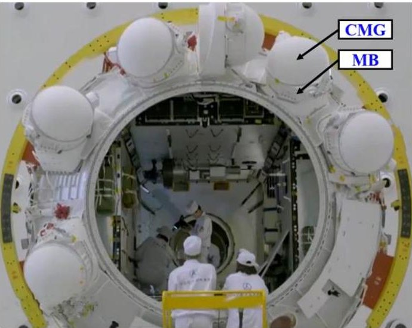

Fig.1. Physical picture of the assembly of the CMG and MB

<!-- PDF_PAGE: 8 -->

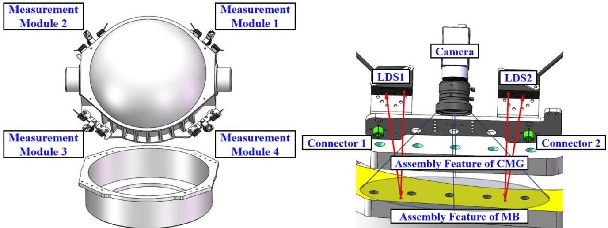

Fig. 2. Installation and measurement schematic of the measurement system

In the CMG assembly task, the measurement system consists of four identical measurement modules, and each measurement module is mounted on the assembly features of the CMG. Benefitting from the high machining accuracy of the assembly features and the measurement modules, the installation errors of the measurement modules can be ignored. By calibrating the installation errors of the monocular cameras and the LDSs, the measurement coordinate system can be built directly on the assembly features to ensure the consistency of the measurement and assembly coordinate system. Then, the pose of the assembly features of the MB in the measurement coordinate system can be regarded as the relative spatial pose between the assembly features of the CMG and the assembly features of the MB, which is measured by the measurement modules. The above measurement process reduces the dependence on the structural parameters of the CMG and the MB. On the one hand, the machining accuracy of noncritical parts can be reduced to improve efficiency and decrease costs. On the other hand, the measurement system can be quickly switched between different assembly tasks with the same assembly features after one calibration. As shown in Fig.1, six CMG assembly tasks can utilize the same measurement system without redesign or recalibration.

## 2.2 Prototype design

To simulate the CMG assembly task in a laboratory environment and verify the feasibility of the proposed method, a prototype is developed, shown in Fig. 3. This prototype mainly consists of a 6-degree-of-freedom (DOF) robot, a CMG, an MB, a measurement system and an accuracy verification device. The measurement system consists of four identical measurement modules, and each measurement module

<!-- PDF_PAGE: 9 -->

contains two LDSs (Panasonic HG-C1100) and one monocular camera (HIKROBOT MV-CA060-11GM).

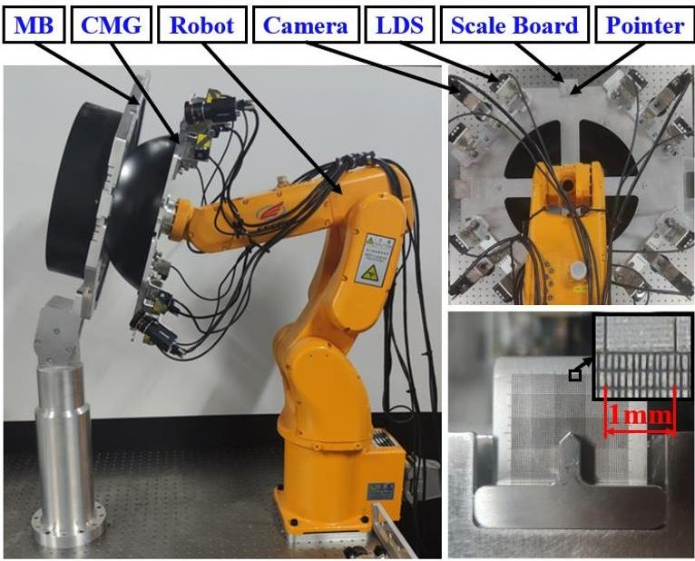

Fig. 3. Prototype of the task of assembling the CMG

After assembly, the bolts must be tightened with the threaded holes through the through holes. Therefore, it is necessary to test whether all bolts can be tightened with the threaded holes after assembly. If any bolt cannot be tightened with the threaded hole, then the task fails. Otherwise, the accuracy verification device is required to further quantitatively verify the assembly accuracy.

The verification device is developed to verify the assembly accuracy quantitatively, and it consists of three scale boards and three pointers. The scale boards are mounted on the MB, and the pointers are mounted correspondingly on the CMG. The center of the scale board contains scale lines with 0.1 mm spacing, and the distances between the scale boards and the pointers can be measured by a digital micrometer. By obtaining the readings of the accuracy verification device and the distances between the scale boards and the pointers, the spatial position of the pointers relative to the scale boards can be obtained. Because of the high accuracy of the pointers and the scale boards, their actual positions can be obtained. Then, the installation errors between the assembly features of the CMG and the assembly features of the MB can be derived.

## 3 Kinematic model of the measurement system and the assembly system

To measure the relative spatial pose between the assembly features of the CMG and the assembly features of the MB, a kinematic model of the measurement system is needed. To guide the robot to complete the assembly task, a kinematic model of the assembly system is also needed.

<!-- PDF_PAGE: 10 -->

## 3.1 Kinematic model of the measurement system

The information measured by the cameras and the LDSs is utilized to calculate the relative spatial pose between the assembly features of the CMG and the assembly features of the MB. According to the calculation results, the robot is guided to complete the assembly task.

Benefitting from the high machining accuracy of the assembly features, the CMG coordinate system $ \{N\} $ can be established at the center of the four assembly features of the CMG, and the MB coordinate system $ \{M\} $ can be established at the center of the four assembly features of the MB. Then, the relative spatial pose between the assembly features of the CMG and the assembly features of the MB can be represented by the homogeneous transformation matrix $ ^{N}T_{M} $ from $ \{M\} $ to $ \{N\} $ . After calibration of the cameras and the LDSs, their installation pose can be derived. To further determine $ ^{N}T_{M} $ kinematic models of the LDSs and cameras are needed.

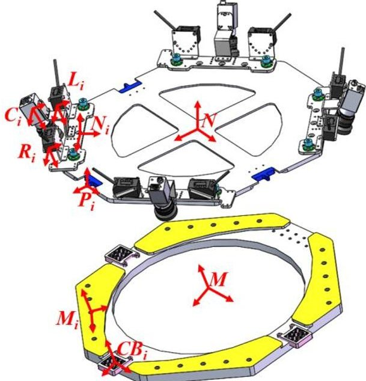

Fig. 4. Kinematic model of the verification system and the measurement system

Table 1. Notation adopted in the measurement system and assembly system

<table border="1"><tr><td>Symbol</td><td>Meaning</td><td>Symbol</td><td>Meaning</td></tr><tr><td>{N}</td><td>The CMG CS(coordinate system), located at the center of the four assembly features of the CMG.</td><td>{M}</td><td>The MB CS, located at the center of the four assembly features of the MB.</td></tr><tr><td>{Ni}</td><td>Theith assembly feature CS, attached to the center of the truncated circles intersected by</td><td>{Mi}</td><td>Theith assembly feature CS, attached to the center of the truncated circles intersected by</td></tr></table>

<!-- PDF_PAGE: 11 -->

<table border="1"><tr><td></td><td>the mounting surface and the third through hole.</td><td></td><td>the mounting surface and the third threaded hole.</td></tr><tr><td>{Li}</td><td>The measurement CS of the left LDS in the ith measurement module.</td><td>{Ci}</td><td>The measurement CS of the ith camera.</td></tr><tr><td>{Ri}</td><td>The measurement CS of the right LDS in the ith measurement module.</td><td>{Pi}</td><td>The pointer CS, located at the vertex of the ith pointer.</td></tr><tr><td>{E}</td><td>The robot end-effector CS.</td><td>{RB}</td><td>The robot base CS.</td></tr><tr><td>{CBi}</td><td>The scaled board CS, attached to the center of the ith scaled board.</td><td>NiTMi</td><td>The 4×4 homogeneous transformation matrix (HTM) from {Mi} to {Ni}.</td></tr><tr><td>NLi</td><td>The spatial position of the measurement points in the coordinate system {N}, measured by the left LDS in the ith measurement module.</td><td>NRi</td><td>The spatial position of the measurement points in the coordinate system {N}, measured by the right LDS in the ith measurement module.</td></tr><tr><td>NiTLi</td><td>The 4×4 HTM from {Li} to {Ni}.</td><td>NiTRi</td><td>The 4×4 HTM from {Ri} to {Ni}.</td></tr><tr><td>Li</td><td>The spatial position of the measurement points in the coordinate system {Li}, measured by the left LDS in the ith measurement module. Li=[0,0,l1,1]T, where li represents the measurement result of this LDS.</td><td>Ri</td><td>The spatial position of the measurement points in the coordinate system {Ri}, measured by the right LDS in the ith measurement module. Ri=[0,0,r1,1]T, where ri represents the measurement result of this LDS.</td></tr><tr><td>NTMi</td><td>The 4×4 HTM from {M} to {N}, which can be represented by a six-dimensional variable {x,y,z,α,β,γ}.</td><td>Bij</td><td>The center of the truncated circles, intersected by the mounting surface and the jth threaded hole in the ith assembly features.</td></tr><tr><td>MBij</td><td>The spatial position of Bij in {M}, MBij=[xbij,ybij,zbij,1]T.</td><td>CiBij</td><td>The spatial position of Bij in {Ci}, CiBij=[xBij,yBij,zBij,1]T.</td></tr></table>

<!-- PDF_PAGE: 12 -->

<table border="1"><tr><td>$^{RB}T_{E1}$</td><td>The 4×4 HTM from {E} to {RB} when the robot is in the assembly start pose.</td><td>$^{RB}T_{E2}$</td><td>The 4×4 HTM from {E} to {RB} when the robot is in the assembly end pose.</td></tr><tr><td>$^{Ni}T_{Ci}$</td><td>The 4×4 HTM from {Ci} to {Ni}.</td><td>$^{E}T_{N}$</td><td>The 4×4 HTM from {N} to {E}.</td></tr></table>

$ \alpha, \beta $ and z in $ ^{N}T_{M} $ can be obtained by the kinematic model of the LDSs. The LDS can measure the distance between its measurement origin and the mounting surface, and this distance can yield the spatial position of the measurement point. The spatial positions of the measurement points in the coordinate system $ \{N\} $ can be obtained as

$$
^ {N} \boldsymbol {L} _ {i} = ^ {N} \boldsymbol {T} _ {N i} ^ {N i} \boldsymbol {T} _ {L i} \boldsymbol {L} _ {i}
$$

$$
^ {N} \boldsymbol {R} _ {i} = ^ {N} \boldsymbol {T} _ {N i} ^ {N i} \boldsymbol {T} _ {R i} \boldsymbol {R} _ {i}
$$

Assuming that the plane equation of the mounting surface expressed in $ \{N\} $ is ax+by+cz=1, the least-squares method is utilized to obtain the parameters of the equation, a,b and c, by substituting into the spatial position of the measurement points. When the spatial angle between the mounting surface of the CMG and the MB is small, the distance d from point N to the mounting surface of the MB can be regarded as z; then, $ \alpha, \beta $ and z in $ ^{N}T_{M} $ can be computed as

$$
\alpha = \arcsin \frac {b}{\sqrt {a ^ {2} + b ^ {2} + c ^ {2}}}
$$

$$
\beta = \arcsin \frac {a}{\sqrt {a ^ {2} + b ^ {2} + c ^ {2}}}
$$

$$
z \approx d = \frac {1}{\sqrt {a ^ {2} + b ^ {2} + c ^ {2}}}
$$

where the number of measurement points is required to be more than two in the above solution process; as this number increases, the fitted result becomes closer to the actual value.

x,y and $ \gamma $ in $ ^{N}T_{M} $ can be obtained by the kinematic model of the cameras. The HTM from $ \{C_{i}\} $ to $ \{N\} $ can be expressed as

$$
^ {N} \boldsymbol {T} _ {C i} = ^ {N} \boldsymbol {T} _ {N i} ^ {N i} \boldsymbol {T} _ {C i}
$$

<!-- PDF_PAGE: 13 -->

Equation (6) can be utilized to obtain the measurement origin and the direction of the optical axis of the camera in $ \{N\} $ . Combined with the plane equation of the mounting surface, the distances between the points on the mounting surface and the pixel coordinate plane of the camera can be derived. The pixel coordinates of $ B_{ij} $ can be determined by image processing, which can further yield the spatial coordinates of $ B_{ij} $ in $ \{C_{i}\} $ . Benefitting from the high machining accuracy of the assembly features, the spatial coordinates of $ B_{ij} $ in $ \{M\} $ are obtained, and the following equation holds:

$$
^ {N} \boldsymbol {T} _ {C i} ^ {C i} \boldsymbol {B} _ {i j} = ^ {N} \boldsymbol {T} _ {M} ^ {M} \boldsymbol {B} _ {i j}
$$

Assuming that $ ^{M}B=\left[ ^{M}B_{11};\cdots; ^{M}B_{ij}\right] $ , since these points are coplanar and the z-coordinate values of $ ^{M}B_{ij} $ are the same, $ ^{M}B^{M}B^{\mathrm{T}} $ is not full rank. Therefore, $ ^{N}T_{M} $ cannot be derived directly by the least-squares method. By taking the first two lines of equation (7), the following equation holds:

$$
\left[ \begin{array}{l l l l} a _ {1 1} & a _ {1 2} & a _ {1 3} & a _ {1 4} \\ a _ {2 1} & a _ {2 2} & a _ {2 3} & a _ {2 4} \end{array} \right] ^ {C i} \boldsymbol {B} _ {i j} = \left[ \begin{array}{l l l l} b _ {1 1} & b _ {1 2} & b _ {1 3} & b _ {1 4} \\ b _ {2 1} & b _ {2 2} & b _ {2 3} & b _ {2 4} \end{array} \right] ^ {M} \boldsymbol {B} _ {i j}
$$

where $ a_{ij} $ is the $ i $ -th row and $ j $ -th column element of $ ^{N i} T_{C i} $ and $ b_{ij} $ is the $ i $ -th row and $ j $ -th column element of $ ^{N i} T_{M} $ . Then, x, y, and $ \gamma $ in $ ^{N} T_{M} $ can be obtained by the least-squares method. Combined with $ \alpha, \beta $ , and z in $ ^{N} T_{M} $ , which are measured in the kinematic model of the LDS, $ ^{N} T_{M} $ can be obtained.

## 3.2 Kinematic model of the assembly system

To control the robot motion, it is necessary to build a kinematic model of the assembly system.

The end-effector of the robot is controlled to reach different assembly positions by rotating its axes. In the assembly task, the end-effector is driven to the assembly start pose first, and the measurement system is then utilized to obtain $ ^{N}T_{M} $ . The assembly end pose is calculated and finally guides the robot to complete the task. When the end-effector is in the assembly start pose and the assembly end pose, the HTM from $ \{E\} $ to $ \{RB\} $ can be expressed as $ ^{RB}T_{E1} $ and $ ^{RB}T_{E2} $ , respectively. According to the relationship between $ \{R\} $ and $ \{M\} $ , the following equation holds:

$$
^ {R} \boldsymbol {T} _ {E 1} ^ {E} \boldsymbol {T} _ {N} ^ {N} \boldsymbol {T} _ {M} = ^ {R} \boldsymbol {T} _ {E 2} ^ {E} \boldsymbol {T} _ {N}
$$

The above equation can be rewritten as

<!-- PDF_PAGE: 14 -->

$$
^ {R} \boldsymbol {T} _ {E 2} = ^ {R} \boldsymbol {T} _ {E 1} ^ {E} \boldsymbol {T} _ {N} ^ {N} \boldsymbol {T} _ {M} ^ {E} \boldsymbol {T} _ {N} ^ {- 1}
$$

The assembly end pose can be derived by equation (10) and can guide the robot to complete the assembly task.

## 4 Kinematic calibration of the measurement system

Calibration of the LDSs and the cameras is a prerequisite for the measurement system to measure $ ^{N} T_{M} $ precisely. According to the proposed method, the measurement modules for the CMG assembly task are developed and mounted on the assembly features of the CMG. As mentioned previously, because of the high accuracy of the assembly features and the measurement modules, the installation errors between the measurement modules and the assembly features can be ignored. Therefore, the spatial pose relationship between the sensors and the assembly features of the CMG can be obtained by calibrating the installation errors of the LDSs and the cameras in the measurement modules.

## 4.1 Calibration mechanism and its kinematic model

In the process of calibrating the sensor, the sensor is usually utilized to measure a known object in different measurement poses, and then the installation errors are addressed with the help of precise geometric constraints [27, 28]. The internal and external parameter calibration of cameras has been developed over the years [29]. The internal parameters are usually calibrated by measuring and fitting the geometric information of the calibration plate in several different measurement poses. The external parameters are calibrated by measuring and fitting the spatial pose of the calibration plate in the measurement CS with the help of the internal parameters and the precise geometric constraints [30, 31]. According to the shape of the measurement object, the calibration methods of the LDS can be divided into planar methods [32] and spherical methods [33]. In these methods, the LDS is driven to several different measurement poses to measure the distances between its measurement origin and the measurement object, and these measurement results are utilized to fit the spatial equation of a planar or spherical shape. Then, the installation errors of the LDS can be derived.

Since the LDSs and the camera are mounted on the measurement module, it is efficient to change the measurement pose of these sensors with the same calibration device. Then, these sensors can measure the respective objects simultaneously.

<!-- PDF_PAGE: 15 -->

Compared to the combination of the calibration plate and the sphere, it is more convenient to ensure machining accuracy by combining the calibration plate with the plane. In this way, the camera and the LDSs can measure the calibration plate and the plane, respectively, in different measurement poses. In addition, a calibration device with a 2-DOF rotation capability is designed to drive these sensors to different measurement poses.

The calibration device is developed as shown in Fig. 5. The measurement pose is changed by the two rotation axes of the calibration device, while the rotation angles are recorded by two encoders. At the same time, the two LDSs measure the distances between their measurement origins and the plane, and the camera measures the pose of the calibration plate.

According to the kinematic model of the calibration device, the following two equations hold:

$$
^ {C i} \boldsymbol {T} _ {C B} = ^ {C i} \boldsymbol {T} _ {M S i} ^ {R o 1} \boldsymbol {T} _ {M S i} ^ {- 1} R o 2 \boldsymbol {T} _ {R o 1} ^ {- 1} R o 2 \boldsymbol {T} _ {P P} ^ {P P} \boldsymbol {T} _ {C B}
$$

$$
^ {M S i} \boldsymbol {T} _ {P P} = ^ {R o 1} \boldsymbol {T} _ {M S i} ^ {- 1} ^ {R o 2} \boldsymbol {T} _ {R o 1} ^ {- 1} ^ {R o 2} \boldsymbol {T} _ {P P}
$$

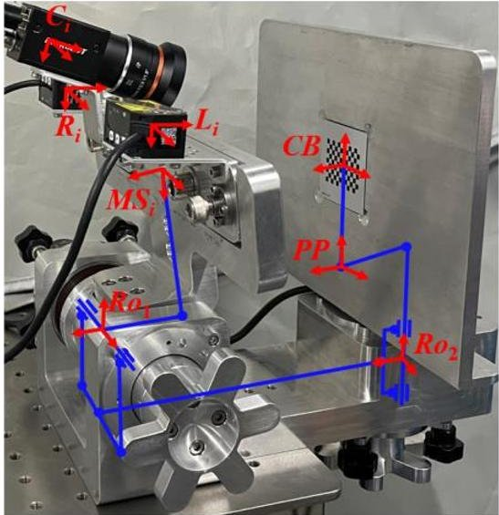

Fig. 5. Kinematic model of the calibration mechanism

Table 2. Notation adopted in the calibration system

<table border="1"><tr><td>Symbol</td><td>Meaning</td><td>Symbol</td><td>Meaning</td></tr><tr><td>{MSi}</td><td>Theith measurement module CS, which is attached to the mounting surface of the measurement module.</td><td>$^{Ci}T_{CB}$</td><td>The 4x4 HTM from {CB} to {Ci}.</td></tr><tr><td>{Ro1}</td><td>The first rotation axis CS, attached to the center of the axis.</td><td>$^{Ci}T_{MSi}$</td><td>The 4x4 HTM from {MSi} to {Ci}, which can be represented</td></tr></table>

<!-- PDF_PAGE: 16 -->

<table border="1"><tr><td></td><td>Its x-axis is along the direction of the rotation axis.</td><td></td><td>by a six-dimensional variable $\{x_{1},y_{1},z_{1},\alpha_{1},\beta_{1},\gamma_{1}\}$.</td></tr><tr><td>$\{Ro_{2}\}$</td><td>The second rotation axis CS, attached to the center of the axis. Its z-axis is along the direction of the rotation axis.</td><td>$^{Ro1}T_{MSi}$</td><td>The 4×4 HTM from $\{MSi\}$ to $\{Ro_{1}\}$.</td></tr><tr><td>$\{PP\}$</td><td>The plane CS, attached to the plane.</td><td>$^{Ro2}T_{Ro1}$</td><td>The 4×4 HTM from $\{Ro_{1}\}$ to $\{Ro_{2}\}$ , which can be represented by a six-dimensional variable $\{x_{2},y_{2},z_{2},\alpha_{2},\beta_{2},\gamma_{2}\}$.</td></tr><tr><td>$\{CB\}$</td><td>The calibration plate CS, attached to the center of the calibration plate.</td><td>$^{Ro2}T_{PP}$</td><td>The 4×4 HTM from $\{PP\}$ to $\{Ro_{2}\}$.</td></tr><tr><td>$^{MSi}T_{PP}$</td><td>The 4×4 HTM from $\{PP\}$ to $\{MSi\}$.</td><td>$^{MSi}T_{Li}$</td><td>The 4×4 HTM from $\{Li\}$ to $\{MSi\}$ , which can be represented by a six-dimensional variable $\{x_{Li},y_{Li},z_{Li},\alpha_{Li},\beta_{Li},\gamma_{Li}\}$.</td></tr><tr><td>$^{PP}T_{CB}$</td><td>The 4×4 HTM from $\{CB\}$ to $\{PP\}$, which can be represented by a six-dimensional variable $\{x_{3},y_{3},z_{3},\alpha_{3},\beta_{3},\gamma_{3}\}$.</td><td>$^{MSi}T_{Ri}$</td><td>The 4×4 HTM from $\{Ri\}$ to $\{MSi\}$, which can be represented by a six-dimensional variable $\{x_{Ri},y_{Ri},z_{Ri},\alpha_{Ri},\beta_{Ri},\gamma_{Ri}\}$.</td></tr></table>

## 4.2 Calibration of the monocular cameras

After mounting the measurement module on the calibration device, the axes of the device are rotated to drive the camera to different measurement poses. In each measurement pose, equation (11) holds. However, the $ ^{C i} T_{C B} $ derived by the ideal parameters deviates from the value measured by the camera because there are errors in this kinematic model:

1) The installation errors of the camera: the installation errors of the camera mounted on the measurement module, $ \Delta x_{1},\Delta y_{1},\Delta z_{1},\Delta \alpha_{1},\Delta \beta_{1} $ , and $ \Delta y_{1} $ ;

2) The installation errors of the calibration device: the rotation angle error of the first axis $ \Delta\alpha_{2} $ , the rotation angle error of the second axis $ \Delta\gamma_{2} $ , and the mounting errors of the calibration plate mounted on the plane, $ \Delta x_{3},\Delta y_{3},\Delta z_{3},\Delta\alpha_{3},\Delta\beta_{3} $ , and $ \Delta\gamma_{3}. $

Substituting the above errors into equation (11), this equation can be rewritten as

<!-- PDF_PAGE: 17 -->

$$
^ {C i} \boldsymbol {T} _ {C B} ^ {e} = ^ {C i} \boldsymbol {T} _ {M S i} ^ {e} ^ {R o 1} \boldsymbol {T} _ {M S i} ^ {- 1} ^ {R o 2} \boldsymbol {T} _ {R o 1} ^ {e} ^ {- 1} ^ {R o 2} \boldsymbol {T} _ {P P} ^ {P P} \boldsymbol {T} _ {C B} ^ {e}
$$

Assuming that $ c_{ij} $ is the i-th row and j-th column element of $ ^{C i} T_{C B} $ , by subtracting equation (11) from equation (13) and ignoring the higher-order error, the functional relationship between each element and the errors can be obtained as

$$
^ {C i} \boldsymbol {T} _ {C B} ^ {e} - ^ {C i} \boldsymbol {T} _ {C B} = \left[ \begin{array}{c c c c} \Delta c _ {1 1} & \Delta c _ {1 2} & \Delta c _ {1 3} & \Delta c _ {1 4} \\ \Delta c _ {2 1} & \Delta c _ {2 2} & \Delta c _ {2 3} & \Delta c _ {2 4} \\ \Delta c _ {3 1} & \Delta c _ {3 2} & \Delta c _ {3 3} & \Delta c _ {3 4} \\ 0 & 0 & 0 & 0 \end{array} \right]
$$

where $ \Delta c_{ij} $ can be expressed as a function of each error:

$$
\Delta c _ {i j} = F _ {i j} \left(\Delta x _ {1}, \Delta y _ {1}, \Delta z _ {1}, \Delta \alpha_ {1}, \Delta \beta_ {1}, \Delta \gamma_ {1}, \Delta \alpha_ {2}, \Delta \gamma_ {2}, \Delta x _ {3}, \Delta y _ {3}, \Delta z _ {3}, \Delta \alpha_ {3}, \Delta \beta_ {3}, \Delta \gamma_ {3}\right)
$$

Equation (15) is solved by the square method to obtain the errors mentioned above.

The camera is driven to thirty-four measurement poses to measure the spatial poses of the calibration plate. Twenty-six sets of measurement data are utilized to calibrate the fourteen errors mentioned above, and the rest of the measurement data are used to verify the calibration results. Each measurement module is installed on the calibration device in turn, and the calibration device is calibrated, compensated, and verified according to the above process. The verification results are shown in Fig. 6. The position accuracy of $ ^{C i} T_{C B} $ is better than 0.1 mm, and the posture accuracy is better than $ 0.1^{\circ}. $

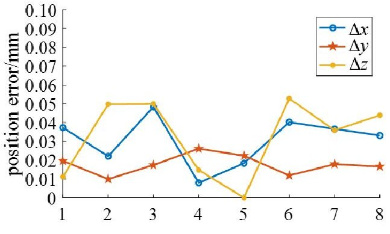

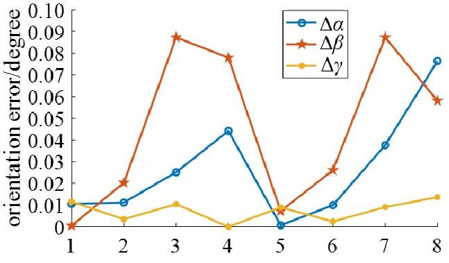

(a) Camera 1

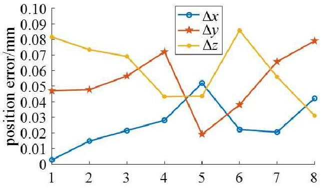

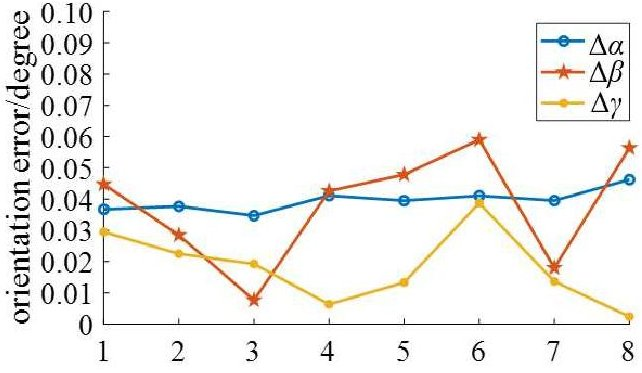

(b) Camera 2

<!-- PDF_PAGE: 18 -->

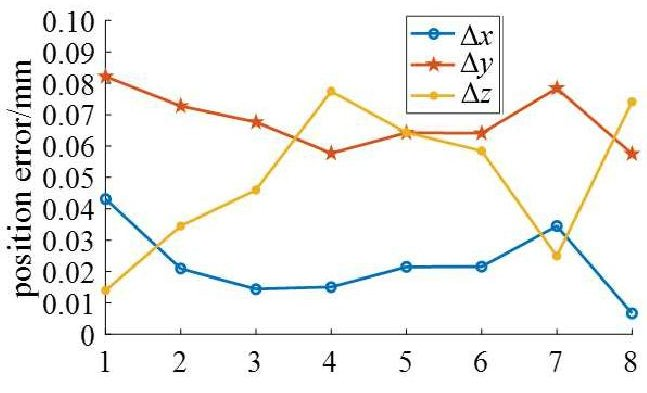

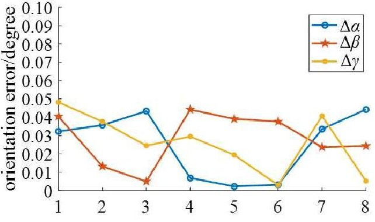

(c) Camera 3

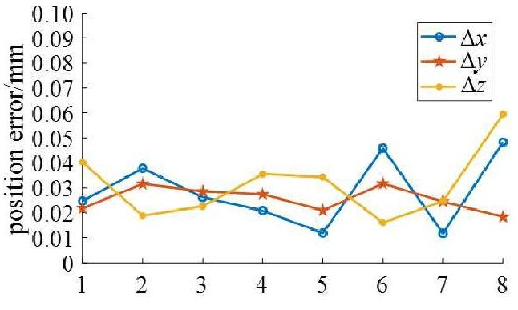

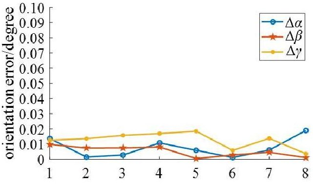

(d) Camera 4

Fig. 6. Errors between the predicted and measured values of $ ^{C i} T_{C B} $

## 4.3 Calibration of the LDSs

Since the calibration method and process for the LDSs on each measurement module are the same, this paper takes the left laser displacement sensor of the i-th measurement module as an example to introduce the specific calibration method.

After mounting the measurement module on the calibration device, the axes of the device are rotated to drive the LDS to different measurement poses. In each measurement pose, the LDS measures the distance between its measurement origin and the plane. However, this distance derived by the ideal parameters deviates from the measured value measured by the LDS because there are errors in this kinematic model: 1) The installation errors of the LDS: the installation errors of the LDS mounted on the measurement module, $ \Delta x_{Li},\Delta y_{Li},\Delta z_{Li},\Delta \alpha_{Li} $ , and $ \Delta \beta_{Li} $

2) The installation errors of the calibration device: the rotation angle error of the first axis $ \Delta\alpha_{2} $ and the rotation angle error of the second axis $ \Delta\gamma_{2}. $

Since $ \Delta\alpha_{2} $ and $ \Delta\gamma_{2} $ were calibrated in the camera calibration, these errors can be directly utilized in the LDS calibration. The installation errors of the LDS must be calibrated as in the remainder of this section.

<!-- PDF_PAGE: 19 -->

Assume that the reference point and the direction of the LDS can be denoted in $ \{MS_{i}\} $ as $ P_{Li}=[x_{Li},y_{Li},z_{Li},1]^{\mathrm{T}} $ and $ D_{Li}=[rx,ry,rz,0]^{\mathrm{T}} $ , respectively. Then, the spatial positions of the measurement points expressed in $ \{MS_{i}\} $ can be obtained as

$$
\boldsymbol {P} _ {M i} = \boldsymbol {P} _ {L i} + l _ {i} \boldsymbol {D} _ {L i}
$$

where $ D_{L i} $ is the direction vector of the z-axis in $ \{L_{i}\} $ . For the LDS, its rotation around the direction of the LDS does not affect the measurement results. Then, $ D_{L i} $ can be expressed by $ \alpha_{L i} $ and $ \beta_{L i} $ as $ [-\sin \beta_{L i}\cos \alpha_{L i},\sin \alpha_{L i},\cos \beta_{L i}\cos \alpha_{L i},0]^{\mathrm{T}}. $

Assuming that the equation of the plane expressed in $ \{MS_{i}\} $ is $ Ax+By+Cz=D $ , according to equation (12), the relationship between the parameters of the plane equation and $ ^{MSi}T_{PP} $ can be described as

$$
\left\{ \begin{array}{l} \left[ A, B, C, 0 \right] = e _ {3} ^ {\mathrm {T}} ^ {M S i} T _ {P P} ^ {\mathrm {T}} \\ D = e _ {3} ^ {\mathrm {T}} ^ {M S i} T _ {P P} ^ {\mathrm {T}} ^ {M S i} T _ {P P} e _ {4} \end{array} \right.
$$

where $ e_{3} $ is $ [0,0,1,0]^{\mathrm{T}} $ and $ e_{4} $ is $ [0,0,0,1]^{\mathrm{T}}. $

Substituting the above equation and the spatial position of the measurement points into the plane equation, the following equation holds:

$$
\left[ A, B, C, 0 \right] \boldsymbol {P} _ {M i} = D
$$

When the installation errors of the LDS exit, equation (18) can be rewritten as

$$
\left[ A, B, C, 0 \right] \boldsymbol {P} _ {M i} ^ {e} = D ^ {e}
$$

By subtracting equation (19) from equation (18) and ignoring the higher-order error, the following equation can be computed:

$$
\begin{array}{l} A \Delta x _ {L i} + B \Delta y _ {L i} + C \Delta z _ {L i} + \left(A l _ {L i} \sin \alpha_ {L i} \sin \beta_ {L i} + B l _ {L i} \cos \alpha_ {L i} - C l _ {L i} \sin \alpha_ {L i} \cos \beta_ {L i}\right) \Delta \alpha_ {L i} \\ + \left(- A l _ {L i} \cos \alpha_ {L i} \cos \beta_ {L i} - C l _ {L i} \cos \alpha_ {L i} \sin \beta_ {L i}\right) \Delta \beta_ {L i} = \Delta D \\ \end{array}
$$

The LDS is driven to fifty-four measurement poses to measure L (the distance between its measurement origin and the plane). Forty-two sets of measurement data are utilized to calibrate the installation errors of the LDSs, and the rest of the measurement data are used to verify the calibration results. Each measurement module is installed on the calibration device in turn, and the calibration device is calibrated, compensated, and verified according to the above process. The verification results are shown in Fig. 7. The

<!-- PDF_PAGE: 20 -->

accuracy of L, which is predicted by the kinematic model of the calibration device, is better than 0.1 mm.

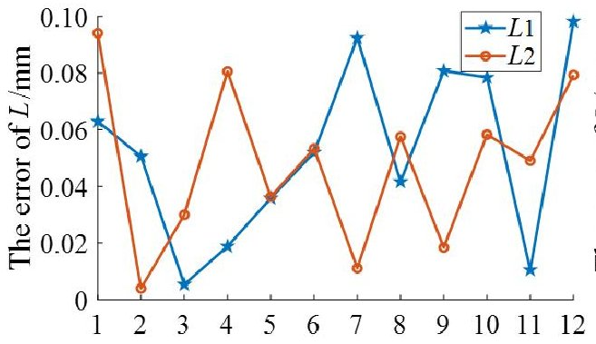

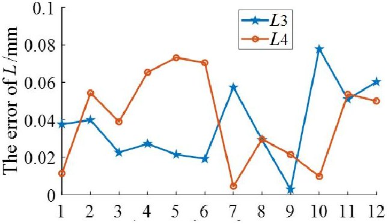

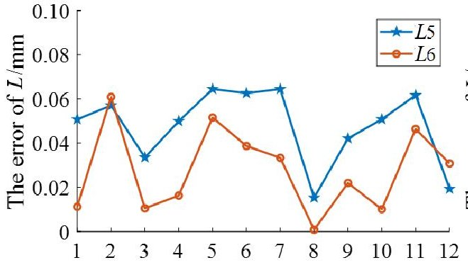

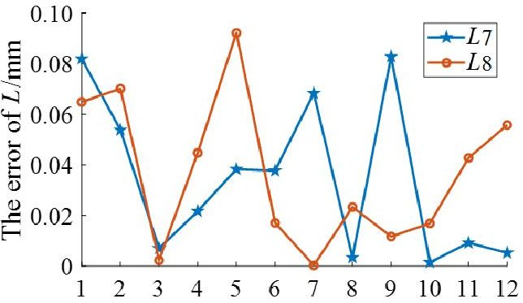

Fig. 7. Errors between the predicted and measured values of L

## 5 Experiments on the prototype system

After calibrating the installation errors of the cameras and the LDSs, the measurement modules are mounted on the assembly features of the CMG to measure the relative spatial pose of the assembly features of the MB. Then, the measurement results are utilized to guide the robot to complete the assembly task. The measurement and assembly experiments are conducted by utilizing the prototype. As illustrated in Fig. 8, the specific steps are as follows:

(1) The measurement system and robot system start, and according to the measurement information from the cameras and the LDSs, the robot is driven to the assembly start pose by manual control.

(2) Eight LDSs work simultaneously to measure the distances between each LDS and the mounting surface of the MB, and then these distances are utilized to obtain $ \alpha, \beta $ , and $ z $ in $ ^{N}T_{M}. $

(3) First, the images measured by the four cameras are regularized, median filtered, and binarized in turn. The pre-extracted threaded hole templates are then matched with these images to obtain the positions of the threaded holes in the pixel coordinate system. In these positions, ellipse positioning is performed to finally obtain the exact pixel

<!-- PDF_PAGE: 21 -->

coordinates of $ B_{ij} $ . Combined with the measurement information from the LDSs, x, y, and $ \gamma $ in $ ^{N}T_{M} $ can be obtained.

(4) According to the measurement results of the LDSs and the cameras, the kinematic model of the measurement system is utilized to obtain the relative spatial pose between the assembly features of the CMG and the assembly features of the MB.

(5) Based on the measurement results and the current pose of the end-effector, the assembly end pose is derived to guide the movement of the robot.

(6) After assembly, the M10 bolts are tightened with the threaded holes through the through holes. The assembly task fails if any of these bolts cannot be tightened with the threaded hole. Otherwise, the assembly task succeeds, and it is necessary to verify the assembly accuracy.

(7) The verification device consists of three pointers and three scale boards, and it is utilized to verify the assembly accuracy. By obtaining the readings of the accuracy verification device and the distances between the scale boards and the pointers, the spatial positions of the pointers relative to the scale boards can be obtained. Then, the installation errors of the CMG can be calculated.

According to the above process, the robot is driven to six different assembly start poses, the relative spatial pose between the assembly features of the CMG and the assembly features of the MB is measured, and the robot is moved to the corresponding assembly end poses. The status of the prototype before and after assembly is shown in Fig. 9. The assembly start poses, the relative spatial poses between the assembly features of the CMG and the assembly features of the MB, and the assembly end poses are all listed in Table 3.

<!-- PDF_PAGE: 22 -->

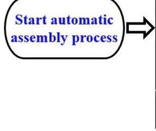

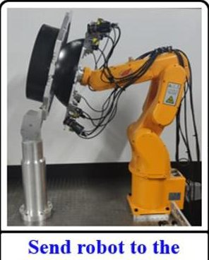

Send robot to the assembly start pose

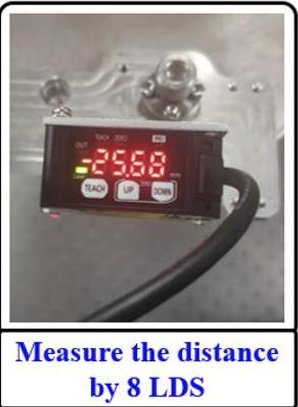

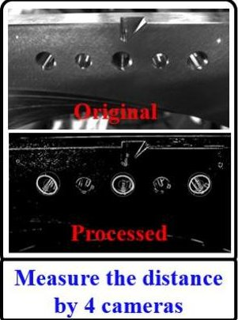

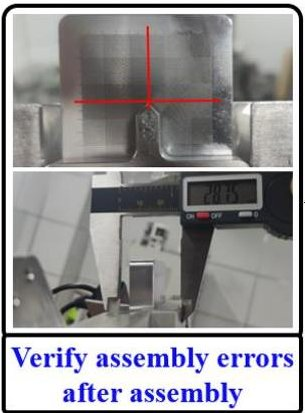

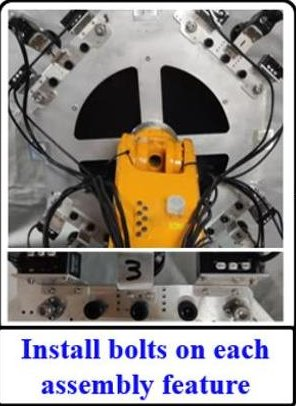

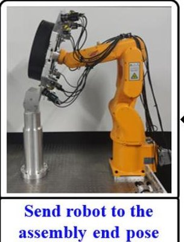

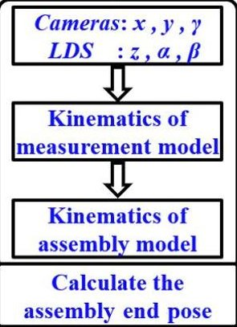

Fig. 8. Flowchart of robotic assembly

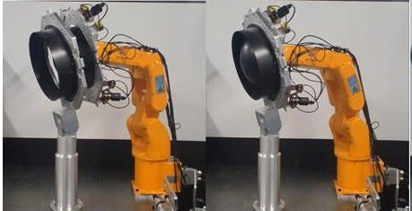

(a) Pose 1

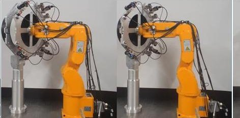

(b) Pose 2

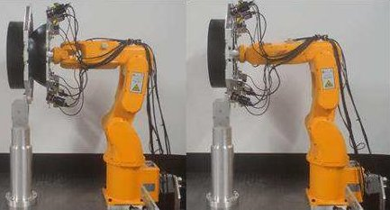

(c) Pose 3

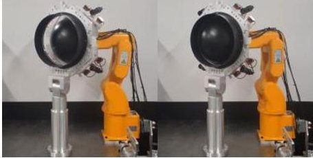

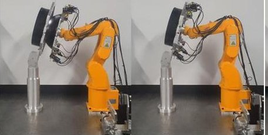

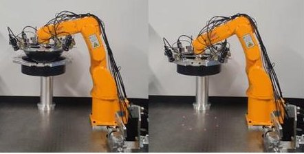

(d) Pose 4 (e) Pose 5 (f) Pose 6 Fig. 9. System status diagram before and after assembly

Table 3. The assembly start poses, the measured poses and the assembly end poses of each experiment

<table border="1"><tr><td>No.</td><td>Pose</td><td>x/mm</td><td>y/mm</td><td>z/mm</td><td>$\alpha/\circ$</td><td>$\beta/\circ$</td><td>$\gamma/\circ$</td></tr><tr><td rowspan="3">1</td><td>start</td><td>-167.800</td><td>339.000</td><td>596.000</td><td>72.600</td><td>-30.000</td><td>38.200</td></tr><tr><td>measured</td><td>2.556</td><td>1.464</td><td>-82.930</td><td>0.052</td><td>-0.054</td><td>-0.027</td></tr><tr><td>end</td><td>-206.143</td><td>410.033</td><td>576.807</td><td>72.686</td><td>-29.990</td><td>38.131</td></tr><tr><td rowspan="3">2</td><td>start</td><td>-23.300</td><td>310.000</td><td>545.800</td><td>90.457</td><td>-31.000</td><td>-31.200</td></tr><tr><td>measured</td><td>0.183</td><td>-2.369</td><td>-83.217</td><td>-0.238</td><td>-0.256</td><td>0.208</td></tr><tr><td>end</td><td>20.053</td><td>381.011</td><td>544.568</td><td>90.386</td><td>-31.205</td><td>-31.509</td></tr></table>

<!-- PDF_PAGE: 23 -->

<table border="1"><tr><td rowspan="3">3</td><td>start</td><td>4.000</td><td>300.000</td><td>543.000</td><td>90.555</td><td>-30.600</td><td>-0.785</td></tr><tr><td>measured</td><td>0.582</td><td>-0.766</td><td>-82.405</td><td>-0.082</td><td>-0.099</td><td>0.000</td></tr><tr><td>end</td><td>5.288</td><td>382.393</td><td>543.335</td><td>90.415</td><td>-30.602</td><td>-0.670</td></tr><tr><td rowspan="3">4</td><td>start</td><td>-5.000</td><td>300.000</td><td>543.700</td><td>90.012</td><td>-32.500</td><td>59.192</td></tr><tr><td>measured</td><td>0.495</td><td>-0.018</td><td>-82.283</td><td>-0.034</td><td>-0.053</td><td>0.008</td></tr><tr><td>end</td><td>-75.567</td><td>342.357</td><td>543.960</td><td>89.944</td><td>-32.493</td><td>59.255</td></tr><tr><td rowspan="3">5</td><td>start</td><td>3.300</td><td>275.500</td><td>463.000</td><td>108.700</td><td>-28.700</td><td>-9.800</td></tr><tr><td>measured</td><td>0.874</td><td>-0.601</td><td>-82.280</td><td>-0.058</td><td>0.064</td><td>-0.010</td></tr><tr><td>end</td><td>5.137</td><td>354.456</td><td>486.300</td><td>108.606</td><td>-28.713</td><td>-9.727</td></tr><tr><td rowspan="3">6</td><td>start</td><td>12.000</td><td>474.200</td><td>474.000</td><td>-1.000</td><td>0.300</td><td>121.500</td></tr><tr><td>measured</td><td>3.187</td><td>-0.138</td><td>-83.282</td><td>-0.210</td><td>-0.453</td><td>-0.144</td></tr><tr><td>end</td><td>12.100</td><td>476.292</td><td>390.659</td><td>-1.213</td><td>-0.153</td><td>121.361</td></tr></table>

After assembly, the bolts are tightened with the threaded holes through the through holes. Since each assembly feature of the CMG contains five through holes and two holes are utilized to mount the measurement module, the rest are used to verify the assembly accuracy. Thus, in each experiment, 12 bolts need to be tightened with the threaded holes through the through holes. Six different experiments show that the 12 bolts can all be tightened with the threaded holes through the through holes in each experiment.

To further verify the assembly accuracy, the verification device is utilized to calculate the installation errors of the CMG. The installation errors of each experiment are listed in Table 4.

Table 4. Installation errors of each experiment

<table border="1"><tr><td>No.</td><td>Δx/mm</td><td>Δy/mm</td><td>Δz/mm</td><td>Δα/°</td><td>Δβ/°</td><td>Δγ/°</td></tr><tr><td>1</td><td>0.050</td><td>0.100</td><td>0.140</td><td>0.141</td><td>-0.005</td><td>0.000</td></tr><tr><td>2</td><td>0.200</td><td>0.100</td><td>0.165</td><td>0.099</td><td>0.007</td><td>0.053</td></tr><tr><td>3</td><td>0.050</td><td>-0.450</td><td>0.160</td><td>0.097</td><td>0.000</td><td>-0.013</td></tr><tr><td>4</td><td>-0.200</td><td>0.050</td><td>0.225</td><td>0.063</td><td>0.012</td><td>0.040</td></tr><tr><td>5</td><td>0.100</td><td>0.050</td><td>0.195</td><td>0.132</td><td>0.009</td><td>0.013</td></tr><tr><td>6</td><td>0.150</td><td>-0.050</td><td>0.120</td><td>0.081</td><td>-0.008</td><td>0.040</td></tr></table>

It can be concluded that the angular error between the assembly features of the CMG and the assembly features of the MB is less than $ 0. 5^{\circ} $ , and the position error is

<!-- PDF_PAGE: 24 -->

less than 0.5 mm in each experiment. Therefore, the proposed method satisfies the accuracy requirement of the CMG assembly task and is proven to be feasible.

## 6 Conclusion

This paper proposes a novel measurement method based on assembly features and a consistent coordinate system. In this measurement method, the measurement system is directly mounted on the assembly features of a spacecraft component and measures the spatial pose of the assembly features of another spacecraft component. This measurement method can directly measure the relative spatial pose of the assembly features, reducing the dependence on the structural parameters of the spacecraft components. To evaluate the feasibility of the proposed method, this paper takes the CMG assembly task as an application example. According to the requirements of the CMG assembly task, the measurement system is developed and directly mounted on the assembly features of the CMG. Then, the measurement system is utilized to measure the relative spatial pose between the assembly feature of the CMG and the assembly features of the MB. To improve the measurement accuracy, a calibration device is developed and utilized to calibrate the installation errors of the measurement system precisely and efficiently. Finally, six sets of experiments are carried out on the prototype, and the assembly accuracy of each experiment is measured by the verification device. The experimental results show that the proposed method can accomplish the task of assembling typical spacecraft components with high precision.

According to the previous analysis, the proposed method has the following advantages:

1) The measurement system based on the proposed method can quickly switch between different spacecraft component assembly tasks with the same assembly features, and there is no need to redesign and recalibrate the measurement system.

2) This method can reduce the influence of the structural parameters of the spacecraft components on the measurement accuracy. Theoretically, the size of the spacecraft has no impact on the measurement process. For large-scale spacecraft components, this method enables accurate measurement of the assembly features at close range.

<!-- PDF_PAGE: 25 -->

3) Benefitting from the high accuracy of the assembly features of the spacecraft components, the measurement system can be mounted on the assembly features, which simplifies the process of calibrating the measurement system.

Author contribution All the related authors contribute to the conceptualization, data curation, investigation, methodology, writing—original draft, writing—review, and editing of the manuscript.

Funding Supported by Joint Fund of Advanced Aerospace Manufacturing Technology Research (Project No. U2037202), and the National Natural Science Foundation of China (Grant No. 52175017).

Availability of data and materials Data used in this work have been properly cited within the article.

## Declarations

Conflict of interest The authors declare no competing interests.

Ethical approval The article has been written by the stated authors who are all aware of its content and approve its submission.

Consent for publication All listed authors approve to publish.

<!-- PDF_PAGE: 26 -->

## Reference

1. Zhang LJ, Hu RQ, Yi WM, Fu H, Tang LY (2014) A study of flexible force control method on robotic assembly for spacecraft. Appl Mech Mater, 681:79-85. doi: 10.4028/www.scientific.net/AMM.681.79

2. Zhang B, Zhang CL, Xie FG, Yi, WM, Meng, SH, Wang W (2019) Design of an endeffector for spacecraft automatic assembly robot. In: 3rd International Conference on Advanced Technologies in Design, Mechanical and Aeronautical Engineering, Shanghai, China, pp 1-6. doi: 10.1088/1757-899X/616/1/012010

3. Realyvasquez-Vargas A, Arredondo-Soto KC, Garcia-Alcaraz JL, Marquez-Lobato BY, Cruz-Garcia J (2019) Introduction and configuration of a collaborative robot in an assembly task as a means to decrease occupational risks and increase efficiency in a manufacturing company. Robot Comp Integ Manuf, 57:315-328. doi: 10.1016/j.rcim.2018.12.015

4. Geihs K (2020) Engineering Challenges Ahead for Robot Teamwork in Dynamic Environments. Appl Sci-Basel, 10(4):1-18. doi: 10.3390/app10041368

5. Kang S, Yu JC, Zhang J, Jin QL (2020) Development of multibody marine robots: A review. IEEE Access, 8:21178-21195. doi: 10.1109/ACCESS.2020.2969517

6. Chutima P (2020) A comprehensive review of robotic assembly line balancing problem. J Intell Manuf. doi: 10.1007/s10845-020-01641-7

7. Chang WC (2018) Robotic assembly of smartphone back shells with eye-in-hand visual servoing. Robot Comp Integ Manuf, 50:102-113. doi: 10.1016/j.rcim.2017.09.010

8. Hu HP, Cao Z , Yang XS, Xiong H, Lou YJ (2021) Performance evaluation of optical motion capture sensors for assembly motion capturing. IEEE Access, 9:61444-61454. doi: 10.1109/ACCESS.2021.3074260

9. Su JH, Liu ZY, Qiao H, Liu, CK (2016) Pose-estimation and reorientation of pistons for robotic bin-picking. Int J Robot Res, 43(1):22-32. doi: 10.1108/IR-06-2015-0129

10. Pellegrinelli S, Pedrocchi N, Tosatti LM, Fischer A, Tolio T (2017) Multi-robot spotwelding cells for car-body assembly: Design and motion planning. Robot Comp Integ Manuf, 44:97-116. doi: 10.1016/j.rcim.2016.08.006

11. Mei B, Liang ZS, Zhu WD, Ke YL (2021) Positioning variation synthesis for an automated drilling system in wing assembly. Robot Comp Integ Manuf, 67. doi: 10.1016/j.rcim.2020.102044

<!-- PDF_PAGE: 27 -->

12. Mei B, Zhu WD (2021) Accurate positioning of a drilling and riveting cell for aircraft assembly. Robot Comp Integ Manuf, 69. doi: 10.1016/j.rcim.2020.102112

13. Bullock IM, Feix T, Dollar AM (2015) The Yale human grasping dataset: Grasp object, and task data in household and machine shop environments. Int J Robot Res, 15(3):425-432. doi: 10.1177/0278364914555720

14. Kim YL, Song HC, Song JS (2014) Hole detection algorithm for chamferless square pegin-hole based on shape recognition using f/t sensor. Int J Precis Eng Man, 15(3):425- 432. doi: 10.1007/s12541-014-0353-6

15. Schmitt R, Cai Y (2014) Recognition of dynamic environments for robotic assembly on moving workpieces. Int JAdv Manuf Technol, 71(5-8):1359-1369. doi: 10.1007/s00170-013-5455-2.

16. Ogun PS, Usman Z, Dharmaraj K, Jackson MR (2015) 3D Vision Assisted Flexible Robotic Assembly of Machine Components. In: Eighth International Conference on Machine Vision, Barcelona, Spain, pp 1-7. doi: 10.1117/12.2229053

17. Romano M, Friedman DA, Shay TJ (2007) Laboratory experimentation of autonomous spacecraft approach and docking to a collaborative target. J Spacecraft Rockets, 44(1):164-173. doi: 10.2514/1.22092

18. Wang J,Chen H, Zhang XH,Ding SW (2017) Relative pose measurement of satellite and rocket based on photogrammetry. In: 2017 2nd International Conference on Image, Vision and Computing, Chengdu, China, pp 1117-1122.

19. Wan A, Xu J ,Chen HP, Zhang S, Chen K (2017) Optimal path planning and control of assembly robots for hard-measuring easy-deformation assemblies. IEEE Trans Mechatron, 22(4):1600-1609. doi: 10.1109/TMECH.2017.2671342

20. WEI ZZ, MENG QH, ZENG M, Liu YB, Lian ZG, Kang ZQ (2018) Stereo vision based cabin's 6-dimensional pose measurement in docking process. In: 2018 13th World Congress on Intelligent Control and Automation, Changsha, China, pp 1279-1283.

21. Gai YH, Zhang JW, Guo JM, Shi XL, Wu D, Chen K (2020) Construction and uncertainty evaluation of large-scale measurement system of laser trackers in aircraft assembly. Measurement 165:1-16. doi: 10.1016/j.measurement.2020.108144

22. Mosqueira G, Apetz J, Santos KM, Villani E ,Suterio R, Trabasso LG (2012) Analysis of the indoor GPS system as feedback for the robotic alignment of fuselages using laser radar measurements as comparison. Robot Comp Integ Manuf, 28(6):700- 709. doi: 10.1016/j.rcim.2012.03.004

<!-- PDF_PAGE: 28 -->

23. Zulkifli A, Abdullah NH, Wai NS, MeeWS, Ismail M (2017) Alignment measurement technique for satellite assembly, integration, and test. Int J Adv Appl Sci, 4(9):119-124. doi: 10.21833/ijaas.2017.09.016

24. Li YH, Qiu YR, Chen YX, Guan KS (2014) A novel orientation and position measuring system for large & medium scale precision assembly. Opt Laser Eng, 62:31- 37. doi: 10.1016/j.optlaseng.2014.05.004

25. Kou M, Wang G, Jiang C, Li WL, Mao JC (2020) Calibration of the laser displacement sensor and integration of on-site scanned point. Meas Sci Technol, 31(12):1-14. doi: 10.1088/1361-6501/ab9840

26. Yu C, Ji F, Xue J (2020) Dynamic granularity matrix space model based high robust multi-ellipse center extraction method for camera calibration. IEEE Access, 8:128308- 128323. doi: 10.1109/ACCESS.2020.3008559

27. Herrera CD, Kannala J, Heikkila J (2012) Joint depth and color camera calibration with distortion correction. IEEE T Pattern Anal, 34(10):2058-2064. doi: 10.1109/TPAMI.2012.125

28. Tsai R Y (1987) A versatile camera calibration technique for high-accuracy 3d machine vision metrology using off-the-shelf tv cameras and lenses. IEEE Journal of Robotics and Automation, 3(4):323-344. doi: 10.1109/jra.1987.1087109

29. Zhang ZY (2000) A flexible new technique for camera calibration. IEEE T Pattern Anal, 22(11):1330-1334. doi: 10.1109/34.888718

30. Cao SQ, Yuan PJ, Chen DD, Shi ZY (2018) Calibration method for laser beam direction and zero point of laser displacement sensor. Journal of Beijing University of Aeronautics and Astronautics, 44(6):1321-1327. doi: 10.13700/j.bh.1001-5965.2017.0450

31. Zhu ZQ, Tang Q, Li JS, Gan ZX (2004) Calibration of laser displacement sensor used by industrial robots. Opt Eng, 43(1):12-13. doi: 10.1117/1.1631935