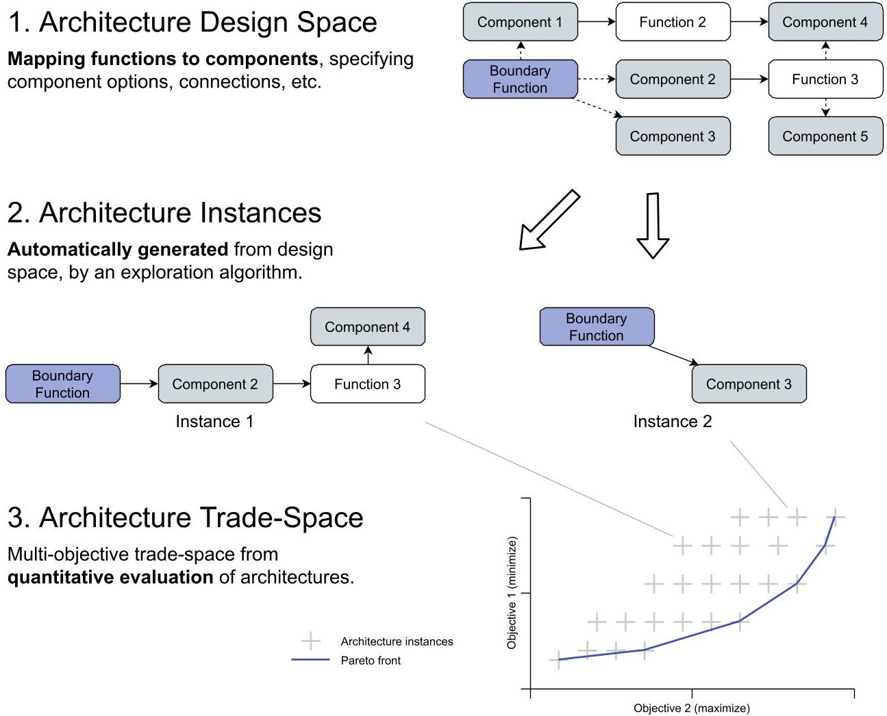
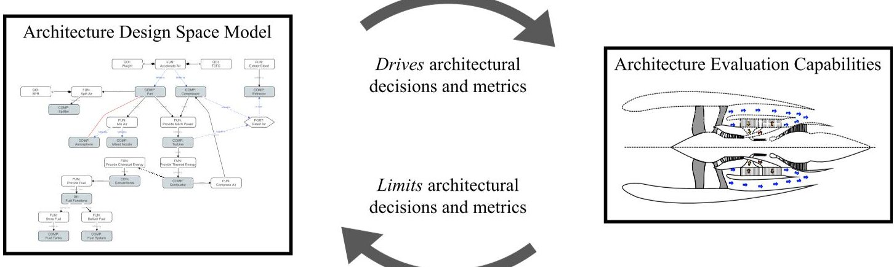
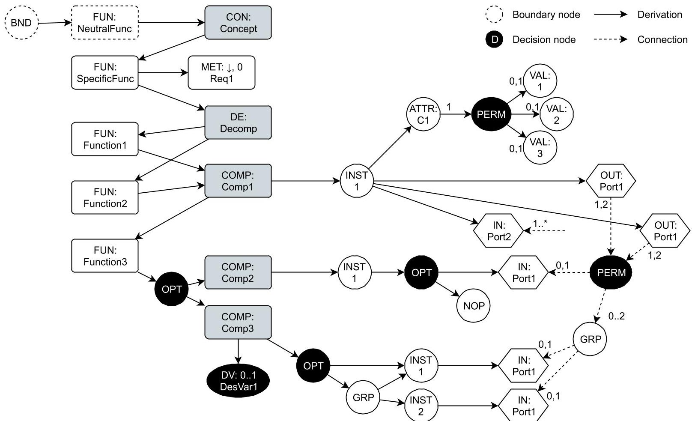
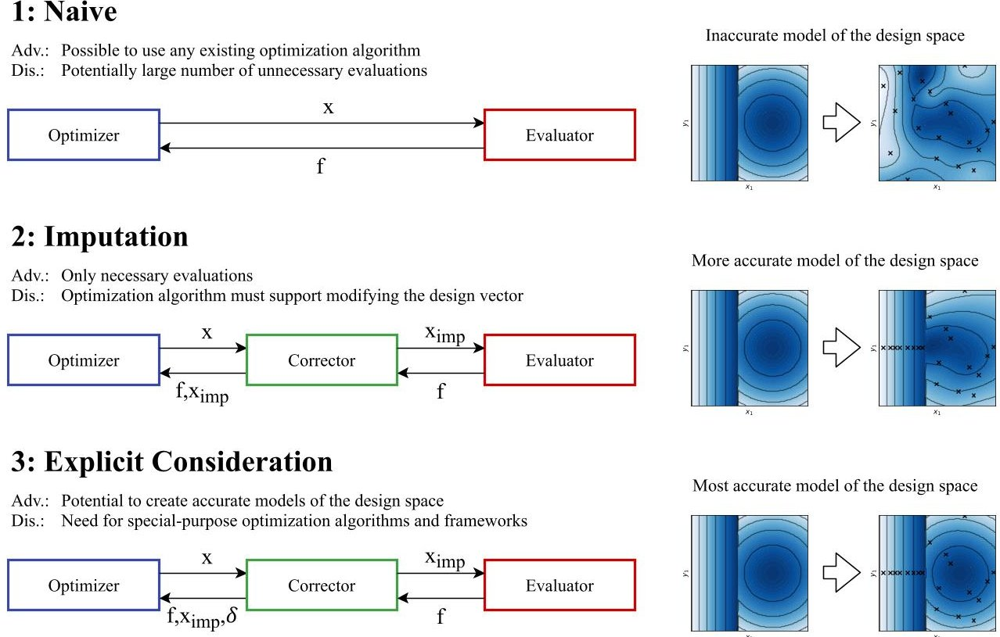
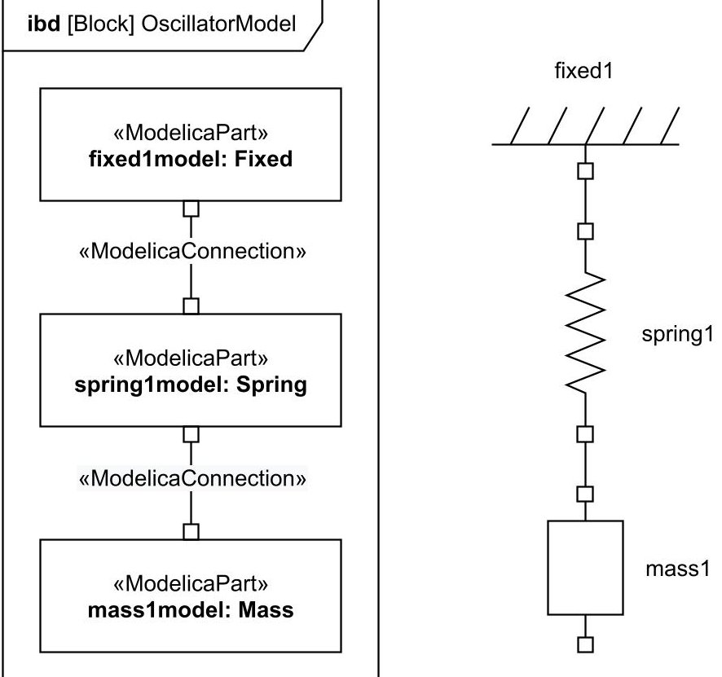
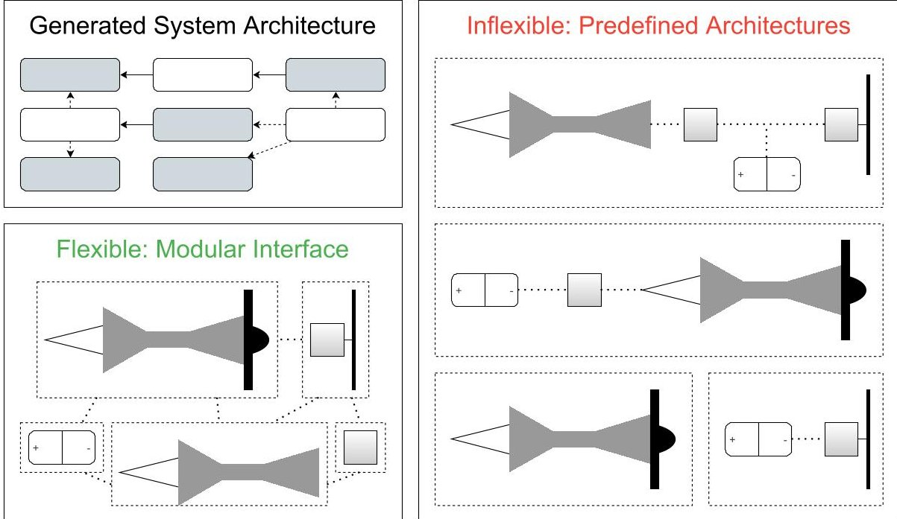

<!-- PDF_PAGE: 1 -->

# SYSTEM ARCHITECTURE DESIGN SPACE MODELING AND OPTIMIZATION ELEMENTS

J.H. Bussemaker $ ^{1} $ , P.D. Ciampa $ ^{1} $ & B. Nagel $ ^{1} $

$ ^{1} $DLR (German Aerospace Center), Institute of System Architectures in Aeronautics, Hamburg, Germany

## Abstract

Optimization of complex system architectures can help accelerate the non-biased search for novel architectures in the early design phase. Four aspects needed to enable architecture optimization are discussed formalization of the architecture design space, systematic exploration of the design space, conversion from architecture model to simulation model, and flexible simulation of architecture performance. Modeling the design space is driven by system requirements and simulation capabilities and should be based on functional decomposition. Systematic exploration can be done using enumeration, design of experiments, or optimization. Various approaches for converting architectures to simulation models are discussed. Finally, simulation environments should expose a flexible and modular interface to be used in architecture optimization.

Keywords: system architecture, architecture optimization, architectural design space, MBSE

## Nomenclature

DOE Design of Experiments MBSE Model-Based Systems Engineering SBO Surrogate-Based Optimization

## 1 Introduction

Model-Based Systems Engineering (MBSE) aims to improve the development process of complex systems by leveraging models and physics-based simulation [10]. Such approaches require the modeling of the complete product life-cycle across all design stages. On the one hand, upstream design stages deal with the identification and formalization of requirements and scenarios, taking all involved stakeholders into account. System architecture options are identified and trade-offs are performed. On the other hand, downstream phases deal with the detailed design and optimization of the system taking the complete life-cycle into account. The design process may benefit from delaying the selection of a design solution until later in the design process, in order to keep options open while knowledge of the system is continuously increased [35]. Such approaches, however, have been difficult to implement practically at the architecture selection level, because of the difficulty of exploring the design space subject to the combinatorial explosion of alternatives and expensive black-box simulation [20]. Time and knowledge constraints are normally solved by involving expert judgment to limit the size of the architectural design space [32]. This, however, can expose the system design to expert bias and conservatism [24].

Enabling the practical implementation of architecture optimization capabilities then requires the upstream and downstream product development phases to be bridged. This is done by extending the scope of product optimization capabilities to also include the exploration and optimization of the system architecture itself, and by formulating the system architecture in terms of abstract functions and

<!-- PDF_PAGE: 2 -->

components. Such a formulation supports the non-biased recombination of components into architectures [25], and the smooth integration with upstream MBSE processes. However, a function-based representation will also mean that such a generic architecture representation must be converted into some simulation model and/or environment before its performance can be evaluated. This paper argues that to successfully formulate and deploy an architecture optimization problem, four interacting aspects will have to be taken care of:

1. Formalization of the architecture design space in terms of functions and components;

2. Systematic exploration of the design space using optimization algorithms;

3. Generic and re-usable interpretation of an architecture model into a simulation model;

4. Flexible and modular quantitative evaluation of architecture performance.

The first two aspects enable the systematic generation of candidate architecture instances. These architecture instances fulfill functional requirements by assigning components to functions and further specifying component attributes; for example configuration options, connections, and sizing variables. Formalization of the architecture design space (aspect 1) and systematic exploration using optimization algorithm (aspect 2) fall in this category. To then select one or more system architectures to continue the detailed design process with, it is needed to evaluate the performances of the candidate architecture instances. Architecture model interpretation (aspect 3) and quantitative evaluation (aspect 4) fall in this category.

First, this introduction is extended by a discussion on design automation in general and its more specific application to the design of complex system architecture in Section 1.1. In Section 2 the aspects needed for systematically generating architecture instances is discussed. Aspects related to architecture performance evaluation are discussed in Section 3. The paper concludes with Section 4

## 1.1 Design Automation for Complex Mechanical Systems

Designing can be seen as the creation of a solution for a problem, defined in terms of functions to be achieved. In the context of complex mechanical systems, however, design problems are non-deterministic: a direct derivation of a solution from functions is not possible, and often many possible solutions can fulfill the functions [31]. In general then, designing involves suggesting solutions, predicting performance of these solutions, evaluating solutions based on the performance predictions, and the proposal of modifications to the design. It quickly becomes infeasible to follow, however, if the number of possible solutions is sufficiently large, as is often the case for complex system design spaces due to the combinatorial explosion of alternatives [20]. In this case, it is needed to take a more systematic approach to these design steps in order to ensure the sufficient exploration of the design space [34]. An additional issue mitigated by a systematic design approach is that usually subject matter experts are involved in the design steps, and whereas their knowledge can accelerate the design process, it can also suffer from expert bias, subjectivity, conservatism or overconfidence, and thereby hinder the discovery of novel solutions [24].

In the past, several (partly) automated design approaches have been developed: design by reasoning, design by learning, and design by analogy [8]. For the design of complex systems, design by analogy is most relevant [31]. One form of design by analogy is optimization: building blocks are systematically combined and recombined in search of an optimal design. Optimization requires the definition of a merit function that precisely quantifies how "good" a design is compared to other designs, which can be problematic because of the knowledge paradox [35]: the phenomena that early in the design process design freedom is higher, however system knowledge is less detailed and therefore the performance prediction step is much more difficult to reliably execute [5].

Further lifting of the knowledge paradox, by increasing both system knowledge and design freedom earlier in the design process, requires a careful definition of the design problem even at the very

<!-- PDF_PAGE: 3 -->

early design stages. One way of doing this is by using systems engineering methods, where the solution to be designed is treated as a set of interconnected components working together to fulfill well-defined requirements, taking all stakeholders and the complete lifecycle into account [11]. The materialization of the design is described by the system architecture: a mapping of functions to components, formalizing the way a system (solution) fulfills its requirements (problem). To explore larger design spaces and allow the designer to find innovative solutions, it is therefore needed to extend design automation techniques to the design of system architectures [21].

When generating possible design solutions, it is important to distinguish design goals, what is to be achieved, from design options, how are the goals achieved [24]. In systems engineering, this is done by separating between function and form: function represents what the system does and ultimately represents the reason for the existence of the system; form represents the thing that will be implemented in the end to perform the functions, and can also be referred to as the components of a system. Therefore when formulating the architecture design space in terms of options and decisions, the best way of decomposing the solution space is by functional decomposition [25]: the breakdown is generic to any architecture alternative, it is free of solution bias by not suggesting architecture concepts, fits well with upstream systems engineering steps by explicitly specifying how requirements are fulfilled, and functions suggest types of solutions rather than specific technologies.

At the Institute of System Architectures in Aeronautics of the German Aerospace Center (DLR), the development of a system architecture design and optimization methodology is addressed as part of a larger effort to improve the way complex aeronautical systems are designed. In the context of the AGILE 4.0 project [1], a model-based conceptual framework for streamlining the architecting, design and optimization of complex aeronautical systems is under development. The generation of design solutions and system architectures is supported by the acceleration of upstream MBSE phases. System functions specified from requirements form the basis for deriving the system architecture design space in combination with available system component and component characterization options [7]. This design space model provides a semantic view of the architecture design space and its architectural decisions. These decisions can be mapped to design variables to formulate an optimization problem or design of experiments for generating architectures. More details regarding the system architecting process and related efforts will be published in [6].

Architecture evaluation is enabled by the use of distributed collaborative MDO techniques [9]. Here, different engineering disciplines, as appropriate for the design problem at hand, are combined into one automated design process that takes all relevant cyber-physical effects into account and yields an accurate system performance estimation. Collaborative MDO is based on the use of a common data language for representing the product or system to be analyzed and/or optimized. Such a common language reduces the amount of data interfaces to be implemented, and enable the automatic linking of data connections between tools [27]. The distributed nature of collaborative MDO ensures that intellectual property constraints occurring when different organizations, teams, and/or departments collaborate on a design are not violated.

Combining these ideas, a systematic architecture design space exploration concept can be formulated. First, the architecture design space is modeled using a function-based decomposition (design space formalization, Section 2.1). Using this design space model, an architecture optimization problem can be formulated and architecture instances are automatically generated using an optimization algorithm (design space exploration, Section 2.2). Then, to compare architectures, performance of architectures instances are quantitatively evaluated using simulation techniques (quantitative evaluation, Section 3.2). An interpretation step is needed to convert the abstract architecture representation into a simulation model (architecture interpretation, Section 3.1). This systematic architecture design space exploration process is visualized in Fig. 1.

<!-- PDF_PAGE: 4 -->

Figure 1 - Systematic architecture design space exploration concept.

## 2 Generating System Architectures

One of the aspects to consider in architecture optimization is the mechanism by which candidate architecture instances are generated. An architecture instance represents one design solution in the architecture design space, the space spanning all possible architectures as made up by the combination of all architectural choices. Before evaluation, they are denoted as candidate architecture instances, because whereas they satisfy function fulfillment and structural constraints, it is not yet known whether or not these architecture are feasible from a performance point of view.

The first step to enable architecture generation is to model the architectural design space by identifying all the different solution options available using a function-based decomposition. This design space model is then used to identify architectural decisions to be taken in order to define an architecture instance. Not taking structural constraints and incompatibilities between components into account, this design space model can also be used to get a rough estimate on the number of possible architectures; it is not uncommon to see extremely large numbers of possible architectures (e.g. $ 1.1 6 \cdot1 0^{1 9} $ for an aircraft [22]). Modeling the design space and formalization of architectural choices is further discussed in Section 2.1.

The formalized architectural choices, together with the definition of evaluation metrics, can then be used to formulate an optimization problem. The types and number of design variables, objectives, and constraints, along with properties of the architecture evaluation determine which optimization algorithms are most appropriate for the design space exploration. Design space exploration using optimization is discussed in Section 2.2.

## 2.1 Formalization of Architectural Choices

The formalization of architectural choices is an important enabler for architecture optimization. Not only because design automation requires a formalized mathematical model to work with, but also because it helps map out and document the design space and thereby enables discussion and offloads

<!-- PDF_PAGE: 5 -->

Figure 2 - Interaction between the architecture design space model and evaluation capabilities. Engine architecture image reproduced from [30].

the mind to focus on one part of the design space at a time [24]. The architectural choice model should be built from upstream systems engineering results, such as requirements, scenarios, and use cases. This way, traceability of decisions is maintained, and it is made sure that all stakeholder needs are taken care of. The result of this exercise is to build a model of the architectural design space that specifies how candidate architecture instances can be generated, and explicitly identifies all architectural choices and performance evaluation metrics.

The architecture design space model drives the selection of the exploration algorithm, as needed for systematically exploring the design space, through the number and types of architectural decisions (mapped to design variables) and the allocation of performance metrics. During design space exploration, performance metrics are used to compare different architecture instances to each other. In the case of optimization, this is done by assigning the role of objective or constraint to these metrics. More details regarding the impact of these kind of assignments are discussed in Section 2.2.

The architecture design space thus describes the architectural choices and metrics by mapping functions to component options and modeling component characterization options. The actual variety in architecture components and their various forms and connections that can be modeled, however, is determined by the architecture evaluation capabilities, mainly the architecture simulation. Next to the components and arrangements that the simulation environment can represent, it also determines the metrics that can be calculated and the accuracy of the impact that different architectural decisions have on these performance metrics [35]. In the end, the architecture instances generated in an architecture optimization loop can only exist of the architectural elements that can actually be represented in the simulation environment. However, because system requirements and simulation capabilities might not completely match, the architecture design space model can be used to identify missing capabilities and/or explicitly remove or disable architectural decisions that are not possible to be simulated. Instead of being based on implicit assumptions or experience, at least the decision to not include some architectural decision in the optimization process is then explicitly defined. Practically, the process of matching the architectural design space model and the simulation environment will be iterative: the system requirements and architecture design space model drive the architectural decisions and metrics to be evaluated, whereas the existing architecture evaluation capabilities limit the decisions and metrics that can be evaluated. This concept is visualized in Fig. 2.

Several methods for modeling the architectural design space and identifying decisions and options have been developed, including morphological matrix methods [25], graph-based methods [16], and methods based on function mapping [21]. For a more detailed literature review, the reader is referred to [6].

The Architecture Design Space Graph (ADSG) [7] method has been developed as part of the modelbased conceptual framework of the DLR. The ADSG has been specifically developed to map functions to components and in addition take component characterization and connection (i.e. structure) architectural decisions, incompatibility constraints, and performance metrics into account, in order to

<!-- PDF_PAGE: 6 -->

Figure 3- An example Architecture Design Space Graph (ADSG). Figure from [7].

offer the most general applicability to and compatibility with MBSE methods. Fig. 3 shows an example of an ADSG, mapping functions to components and component characterization and connection options. Design space elements are defined and linked to each other: a repository of components that define which functions they fulfill and which functions they induce (i.e. need) is constructed. Then, boundary functions are defined from system requirements, and these are used to select components from the repository to build-up the ADSG and get an overview of which possibilities exist to fulfill all functions. Next to mapping functions to components, component characterization and connections are also modeled, and can therefore be used to represent complex system architecting design spaces, while at the same time offering a formalized model that can be used to define architecture optimization problems. Currently, a web-based graphical editing environment is in development that enables intuitive and flexible editing of the ADSG, and allows seamless connection to other MBSE phases and optimization frameworks.

## 2.2 Systematically Exploring the Design Space

The other aspect needed for generating architectures is a way to suggest new design points to evaluate. Architectural decisions are known from the design space model, and can readily be mapped to mixed-discrete design variables. To ensure the design space is explored sufficiently, the most obvious choice is to simply enumerate all possible combinations of design variable values. This approach is feasible if either the number of different architectures is low (e.g. in the hundreds), evaluating the performance of one architecture instance does not take much time (e.g. in the order of seconds), or both are true. For example, Shougarian et al. [34] take this approach: on an engine architecture problem, 127 different architectures were generated (low number of architecture); for a mobile phone architecture problem, 21168 architectures were generated, however evaluating one architecture takes less than a second as it is based on several relatively simple equations.

If, however, evaluating the performance of one architecture instance take more time, for example due to higher-fidelity simulations, and there are many architecture alternatives (e.g. thousands or millions), it is not feasible to enumerate all possible architectures. In that case, some algorithm must

<!-- PDF_PAGE: 7 -->

## SYSTEM ARCHITECTURE DESIGN SPACE MODELING AND OPTIMIZATION ELEMENTS

Figure 4- Three ways of dealing with hierarchical design variables.

be used to create architecture alternatives to sufficiently explore the design space without needing to generate all possible architectures. To generate an overview of the behavior of the design space a Design of Experiments (DOE) can be generated. To find optimal architectures, it is needed to apply an optimization algorithm: architectural decisions are mapped to design variables, and performance metrics are used as objectives or constraints. In the most general sense, architecture optimization problems have the following properties [7]:

- Design variables can be hierarchical, due to incompatibility constraints and decisions depending on options of other decisions;

- Design variables are mixed-discrete, as architectural decisions often are categorical or integer design variables, and (continuous) sizing parameters can also be taken into account in an architecture optimization;

- The optimization problem can be multi-objective, due to the presence of conflicting design goals coming from stakeholder needs.

All three of these properties can be dealt with in several ways, which drives the selection of the optimization algorithm that can solve these optimization problems. For example, Olvander et al. [26] apply a mixed-discrete Tabu search algorithm to optimize the architecture of a more-electric Unmanned Aerial Vehicle (UAV). One of their test cases was to both design for minimum weight and minimum costs, which are conflicting objectives. To solve this, they modified the multi-objective problem into a series of single-objective problems using normalization and the datum concept.

Another appropriate class of optimization algorithms are evolutionary algorithms. These optimization algorithms mimic the biological process of evolution to improve a population of individuals (i.e. design points) by creating offspring (i.e. new design points) by crossover and mutation based on parents (i.e. selected design points from the population) [13]. Evolutionary algorithms are well-suited for solving mixed-discrete problems and finding global optima, and multi-objective evolutionary algorithms have been developed as well. Judt et al. [21] used a combination of Ant Colony Optimization (ACO) and a Genetic Algorithm (GA) to solve a single-objective optimization problem created by weighing multiple objectives. Albarello et al. [2] and Frank et al. [12] applied the Non-Dominated Sorting Genetic Algorithm 2 (NSGA2) to solve multi-objective architecting problems.

<!-- PDF_PAGE: 8 -->

Another property of system architecture optimization is design variable hierarchy: design variables can be activated or deactivated based on values of other design variables. The three ways of dealing with this problem are: ignoring the effect (naive approach), imputation, and explicit consideration [36]. As also visualized in Fig. 4, ignoring the effect might confuse the optimization algorithm due to the possibility of different design vectors mapping to the same architecture, and therefore having the same performance metrics. Imputation solves this by replacing inactive design variables by some default value in the design vector. Explicitly considering the hierarchy effect by applying special-purpose optimization algorithms has the greatest potential for accurately and efficiently exploring the hierarchical design space, however this needs an optimization framework that supports this, and availability of the design variable activity function $ \delta $ [19]. The imputation approach works well for genetic algorithms, for example by correcting the design vectors of newly created offspring. The explicit consideration approach is more relevant in model-building algorithms, for example Surrogate Based Optimization (SBO): here, a surrogate model (e.g. Kriging) of the design space is created, and accuracy can be increased by using hierarchical kernels. Recent research into hierarchical SBO algorithms can be found in [18, 19, 29, 36].

## 3 Quantitative Evaluation of System Architectures

The degree to which architecture optimization can be implemented in practice greatly depends on the capability to quantitatively evaluate the performance of all candidate architecture instances. This is needed both for comparing different architecture instances for selection of the best architecture(s), and as feedback to the exploration (i.e. optimization) algorithm as needed for exploring new designs.

For complex mechanical systems, architecture evaluation often involves the simulation of the performance of the system in various operating scenarios and from the point-of-view of different engineering disciplines (e.g. structural design, aerodynamic/hydrodynamic design, electronics, thermodynamics). The architecture evaluation capabilities are then realized by focusing on two aspects: how to convert the abstract architecture instance model into a model of which the performance can be evaluated (Section 3.1), and how to prepare the simulation capabilities for use in architecture optimization (Section 3.2).

## 3.1 Interpreting the Architecture Model

Generated architecture instances, as coming from the design space exploration algorithm and design space model, are abstract descriptions of a system architecture: they describe the architecture in terms of architectural decisions, options, functions, etc. To evaluate the performance of an architecture, it is therefore needed to convert the model to an executable format first. This conversion should be an automated procedure, as it need to happen within the optimization loop. For example, as part of the architecture generator step as described in [7].

One of the most popular languages for describing system architectures is SysML $ ^{1} $ [17]. Whereas SysML does include parametric modeling capabilities, it does not contain any functionality for evaluating system behavior. One way that has attracted research effort is then to directly convert a SysML model into a simulation model. This 1-to-1 conversion approach requires the specification of all inputs needed for simulation into the SysML model. Such approaches work well if the system describes a mechanical or physical system, and if a single simulation model can indeed sufficiently capture all relevant physical phenomena to compare different architecture alternatives.

SysML4Modelica [28] can be used to convert SysML models to executable Modelica models. Modelica $ ^{2} $ is a general-purpose continuous- and discrete-time differential equation solver, and comes with a large library of elements that can be used to simulate among others mechanical, electrical, hydraulic, and control systems. To convert a SysML model to a Modelica model, a SysML profile is applied to the SysML model that can be used to represent flow types, Modelica library parts, and more. An example of a SysML model of a mass-damper system and its corresponding Modelica model is shown

<!-- PDF_PAGE: 9 -->

Figure 5 - Mass-damper system in SysML (left) and Modelica (right) formats. Figure reproduced from [28].

in Fig. 5. Guenov et al. [14] apply SysML4Modelica for designing aircraft on-board systems, for example the Environmental Control System (ECS). Balestrini-Robinson et al. [4] present a method for translating SysML to OpenMDAO $ ^{3} $ an open-source MDO framework. They do note, however, that it might require significant effort to model the detailed data connections in the SysML model, and it might be needed to perform manual steps before the OpenMDAO workflow is executable.

Bile et al. present a method for directly converting SysML model elements into a computational workflow. To enable this, each model element has defined source-sink behavior and connections to other elements. Similarly, Roelofs et al. [33] present a graph-based system model that can be directly converted into a computational model. Both these methods are possible when the system model itself is already fairly close to the computational model, and data flow and equations are already modeled in the system model.

This brief overview shows that converting a system model (e.g. SysML) into a simulation model (e.g. Modelica, OpenMDAO) is a non-trivial endeavor. This is even more so the case when dealing with complicated multidisciplinary simulation tools, which might require the architect to model the computation process in addition to the system architecture itself.

## 3.2 Towards Flexible Simulation

The simulation capabilities are the main enabler of the architectural options that can be explored in an architecture optimization problem, see also Fig. 2. The possibilities for the architecture optimization problem are mainly limited by the following simulation environment aspects:

1. The architecture components and architectures that can be modeled;

2. The availability and accuracy of performance metrics;

3. The execution time of one simulation.

The first relates to the design space model itself; the architectures that can be included in the design space. For example, from requirements analysis and architecture modeling, various components that

<!-- PDF_PAGE: 10 -->

Figure 6- Comparison between flexible and inflexible interfaces to the simulation environment.

can fulfill a given function can be identified. If, however, the simulation environment is not capable of representing some of these components, these cannot be taken into account in the architecture optimization problem. This does not necessarily have to be a problem, however it should be recognized and documented that components are left out of the evaluation if in principle they could be viable options. Another limitation can come from the architectures that can be represented in the simulation environment, for example in terms of number of components, connections, and other variations.

The second point relates to the performance metrics used to compare different architecture instances. If it is not possible to compute certain metrics currently, this can signal the need for selection or development of additional engineering tools. Additionally, architectural options need to have sufficient and accurate influence on the performance metrics, to give the optimization algorithm enough opportunity for improving the design. Finally, the third point drives the selection of the optimization algorithm: for longer execution times algorithms specifically designed to limit the number of function evaluations, such as Surrogate-Based Optimization (SBO) algorithms, might be needed.

System architecture instances are defined based on some kind of decomposition of the system, for example function-based decomposition. This is needed to automatically generate new architecture by (re)combining elements and connections. When it comes to evaluating architecture performance, it then makes sense that the evaluation environment supports a similar level of modularity and flexibility: if the simulation environment is less flexible than the architecture design space model, it reduces the types of architecture instances that can be explored (the first point in the list above). The simulation environment should expose a modular interface that enables an almost 1-to-1 translation from the architecture elements and connections to the evaluation model. The only extra information that then needs to be specified are boundary and operating conditions. The interface modularity concept is visualized in Fig. 6: an inflexible interface means that only predefined architectures can be simulated, whereas a flexible interface enables the evaluation of any generated architecture.

One example of an engineering tool exposing a flexible, modular interface is Modelica [28]. As also discussed in the previous section, Modelica is a general-purpose differential equation solver with a large library of model elements. All available elements are implemented such that their inputs and outputs are well-defined and each block defines the representation of its physics as differential equations. Another example of a tool with a flexible interface is pyCycle [15], a thermodynamic cycle solver used for the design of aircraft engines, with a library of engine components (e.g. compressor, combustor, turbine). At their basic level, each of these components define a transformation of airflow in terms of thermodynamic quantities such as pressure, entropy, and temperature. Knowledge Based Engineering (KBE) method rely on a library of primitives to build complex geometrical engi-

<!-- PDF_PAGE: 11 -->

neering models based on design rules [23]. Such models can then be queried and translated to other engineering disciplines (e.g. structural or aerodynamic models) for further simulation.

These kind of engineering tools rely on the Object-Oriented Programming (OOP) concepts of abstraction and inheritance to maintain a high level of flexibility and modularity. These concepts allow elements and processes to be represented as hierarchies: all objects share a common interfaces, and progressively refine their internal implementations. This allows both the development of specialized solvers (e.g. for differential equations), and the co-location of element and its behavior. Thereby the development of the core solver and implementation of new elements is decoupled, and the definition of new architecture by (re)combination of elements is supported.

The design of complex systems often involves multiple engineering disciplines coordinating their evaluations and design suggestions in an MDO process. An enabling element for dealing with the challenge of integrating heterogeneous engineering disciplines into MDO processes is the use of a common data language for exchanging data between disciplines [9]. Such a common data language reduces the number of data interfaces that need to be implemented [3] and allow automatic identification of data connections and formulation of the MDO workflow [27]. It should be ensured that such a central data format supports the flexible definition of architectures. Once all tools correctly implement their data interfaces, the flexibility of the central data format is precipitated into the whole MDO toolchain. To fully take advantage of the strengths of collaborative MDO, it should be possible to define how changes in system architectures are precipitated into changes of the common data language, and it should be possible to do this without needing to produce programming code. At the current stage, such a connection is not yet possible at this level, and would require a custom ad-hoc implementation. However, efforts are underway to develop a reusable and user-friendly way of doing this in the AGILE 4.0 project [1].

## 4 Conclusions and Outlook

Systematically exploring and optimization system architectures can help non-biased search for novel architectures in large design spaces subject to the combinatorial explosion of alternatives. System architectures should be defined based on function and form, and MBSE method should be applied to ensure all stakeholder needs and the product lifecycle are taken into account. Four aspects that enable the optimization of system architectures are discussed: formalization of the architecture design space, systematic exploration using optimization algorithms, interpretation of the architecture model into a simulation model, and quantitative evaluation of architecture performance.

The first step to generate system architectures is to formally model the architecture design space. All solutions for fulfilling system functions are identified and represented using a function-based decomposition. The extent of the architectural choices that can be modeled depends on the performance evaluation capabilities available. The formal architecture design space model maintains traceability from stakeholder needs all the way to system components. Morphological matrix methods, as well as various graph-based methods for modeling the design space are discussed.

Systematically generating new architectures can then be done in various ways: full enumeration of the design space, a Design of Experiments (DOE), or optimization. Enumeration of the design space is only possible if the number of possible architectures is low, or the time it takes to evaluate an architecture is low. If any of these two properties does not apply, only a subset of possible architectures can be evaluated. A DOE can give a good overview of the design space an opportunities, however finding the best architecture(s) in the design space requires the use of an optimization algorithm. Architecture optimization problems can have hierarchical and mixed-discrete design variables, and can feature multiple objectives due to conflicting stakeholder needs. These kind of problems can be solving using evolutionary algorithms (e.g. Genetic Algorithm, NSGA2). Surrogate-Based Optimization (SBO) algorithms can also be applied, and generally need less function evaluations that evolutionary algorithms. Dealing with design variable hierarchy is challenging, and can be done in multiple ways: naive, imputation, or explicit consideration.

Quantitative evaluation of architecture instances, as needed for optimization, is enabled by convert-

<!-- PDF_PAGE: 12 -->

ing architecture instances to simulation models, and by having sufficiently flexible simulation tools for representing the great variety of system architectures typically seen in architecture optimization problems. Various approaches for converting architectures from system models (e.g. SysML) to simulation models (e.g. Modelica) are discussed. Simulation environments need modular interfaces to be used for architecture optimization, and limit the exploration possibilities of the optimization problem in three ways: by the architectures that can be modeled, the availability and accuracy of performance metrics, and the execution time of one simulation. Abstraction and inheritance play an important role in the implementation of modular simulation tools suited for architecture optimization.

To increase the practical use of architecture optimization, it is needed to integrate the design steps in the MBSE approach. Efforts to do this are underway at the DLR Institute of System Architectures in Aeronautics. The implemented method should be made practical by the development of user-friendly and intuitive graphical modeling tools, and the development of generic and reusable architecture conversion frameworks. Especially the connection to collaborative MDO methods should be explored, to enable the detailed multidisciplinary analysis of system architectures. Connecting the practical architecture optimization method with both upstream MBSE and downstream collaborative MDO phases will be done in the AGILE 4.0 project [1]. There, the method will be applied to several industry-provided use cases related to cyber-physical complex systems design.

Architecture optimization should then be applied to various design problems in aeronautics and other engineering fields. Promising design problems include engine and (hybrid-electric) propulsion system design, on-board system design, and System of Systems (SoS) design. Application to these kind of realistic but expensive-to-evaluate problems will also drive the development of appropriate optimization algorithms. Surrogate-Based Optimization is promising when considering the reduction of function evaluations needed to solve an optimization problem. Currently, a realistic aircraft engine architecting problem is being developed, and will be made available open-source as a benchmark problem to showcase the properties of architecture optimization, and drive the development of new technologies in relation to it.

## 5 Contact and Acknowledgments

The authors can be contacted at jasper.bussemaker@dlr.de, pier.ciampa@dlr.de, and bjoern.nagel@dlr.de. The research presented in this paper has been performed in the framework of the AGILE 4.0 project (Towards Cyber-physical Collaborative Aircraft Development) and has received funding from the European Union Horizon 2020 Programme under grant agreement n o 815122.

## 6 Copyright Statement

The authors confirm that they, and/or their company or organization, hold copyright on all of the original material included in this paper. The authors also confirm that they have obtained permission, from the copyright holder of any third party material included in this paper, to publish it as part of their paper. The authors confirm that they give permission, or have obtained permission from the copyright holder of this paper, for the publication and distribution of this paper as part of the ICAS proceedings or as individual off-prints from the proceedings.

## References

[1] AGILE4.0. AGILE4.0 Portal. Available: www.agile4.eu, 2019. Accessed June 2021.

[2] N. Albarello, J.B. Welcomme, and C. Reyterou. A formal design synthesis and optimization method for systems architectures. In Proceedings of MOSIM, Bordeaux, France, June 2012.

[3] M. Alder, E. Moerland, J. Jepsen, and B. Nagel. Recent advances in establishing a common language for aircraft design with CPACS. In Aerospace Europe Conference, 2020.

[4] S. Balestrini-Robinson, D.F. Freeman, and D.C. Browne. An object-oriented and executable SysML framework for rapid model development. Procedia Computer Science, 44:423-432, 2015.

[5] B.S. Blanchard and W.J. Fabrycky. Systems Engineering and Analysis. Prentice-Hall, Upper Saddle River, NJ, 3rd edition, 1998.

[6] J.H. Bussemaker and P.D. Ciampa. Handbook of Model-Based Systems Engineering, chapter MBSE in Architecture Design Space Exploration (in review). Springer, 2021.

<!-- PDF_PAGE: 13 -->

[7] J.H. Bussemaker, P.D. Ciampa, and B. Nagel. System architecture design space exploration: An approach to modeling and optimization. In AIAA AVIATION 2020 FORUM. American Institute of Aeronautics and Astronautics, jun 2020.

[8] A. Chakrabarti, K. Shea, R. Stone, J. Cagan, M. Campbell, N.V. Hernandez, and K.L. Wood. ComputerBased Design Synthesis Research: An Overview. Journal of Computing and Information Science in Engineering, 11(2), jun 2011.

[9] P. D. Ciampa and B. Nagel. AGILE paradigm: The next generation of collaborative mdo for the development of aeronautical systems. Progress in Aerospace Sciences, 119, November 2020.

[10] P.D Ciampa, G. La Rocca, and B. Nagel. A MBSE approach to MDAO systems for the development of complex products. In AIAA Aviation Forum, Reno, Nevada, June 2020. American Institute of Aeronautics and Astronautics.

[11] E. Crawley, B. Cameron, and D. Selva. System architecture: strategy and product development for complex systems. Pearson Education, 2015.

[12] C.P. Frank. A Design Space Exploration Methodology to Support Decisions under Evolving Requirements Uncertainty and its Application to Suborbital Vehicles. PhD thesis, Georgia Institute of Technology, 2016.

[13] F. Glover and G. Kochenberger. Handbook of Metaheuristics, volume 57. 2003.

[14] M. Guenov, A. Molina-cristóbal, A. Riaz, S. Sharma, A. Murton, and J. Crockford. Aircraft Systems Architecting - Logical-Computational Domains Interface. 31st Congress of the International Council of the Aeronautical Sciences, pages 1-12, 2018.

[15] E.S. Hendricks and J.S. Gray. pyCycle: A tool for efficient optimization of gas turbine engine cycles. Aerospace, 6(8):87, aug 2019.

[16] D.R. Herber, J.T. Allison, R. Buettner, P. Abolmoali, and S.S. Patnaik. Architecture generation and performance evaluation of aircraft thermal management systems through graph-based techniques. In AIAA Scitech 2020 Forum. American Institute of Aeronautics and Astronautics, jan 2020.

[17] J. Holt and S. Perry. SysML for systems engineering: 2nd edition: A model-based approach. Institution of Engineering and Technology, nov 2013.

[18] D. Horn, J. Stork, N. Schüßler, and M. Zaefferer. Surrogates for hierarchical search spaces. In Proceedings of the Genetic and Evolutionary Computation Conference. ACM, jul 2019.

[19] F. Hutter and M.A. Osborne. A kernel for hierarchical parameter spaces.

[20] J.V. Iacobucci. Rapid Architecture Alternative Modeling (Raam): a Framework for Capability-Based Analysis of System of Systems Architectures. PhD thesis, Georgia Institute of Technology, 2012.

[21] D.M. Judt and C.P. Lawson. Development of an automated aircraft subsystem architecture generation and analysis tool. Engineering Computations, 33(5):1327-1352, jul 2016.

[22] K. Kernstine, B. Boling, L. Bortner, E. Hendricks, and D. Mavris. Designing for a green future: A unified aircraft design methodology. Journal of Aircraft, 47(5):1789-1797, sep 2010.

[23] G. La Rocca. Knowledge Based Engineering Techniques to Support Aircraft Design and Optimization. PhD thesis, Delft University of Technology, 2011.

[24] A.M. Madni. Novel options generation. In Transdisciplinary Systems Engineering, pages 89-102. Springer International Publishing, oct 2017.

[25] D. Mavris, C. de Tenorio, and M. Armstrong. Methodology for Aircraft System Architecture Definition. In 46th AIAA Aerospace Sciences Meeting and Exhibit, number January, pages 1-14, Reston, Virigina, jan 2008. American Institute of Aeronautics and Astronautics.

[26] J. Olvander, B. Lunden, and H. Gavel. A computerized optimization framework for the morphological matrix applied to aircraft conceptual design. Computer-Aided Design, 41(3):187-196, mar 2009.

[27] A. Page-Risueño, J.H. Bussemaker, P.D. Ciampa, and B. Nagel. MDAx: Agile generation of collaborative MDAO workflows for complex systems. In AIAA AVIATION 2020 FORUM. American Institute of Aeronautics and Astronautics, jun 2020.

[28] C.J.J. Paredis, Y. Bernard, R. Burkhart, H. de Koning, S. Friedenthal, P. Fritzson, N. Rouquette, and W. Schamai. An overview of the SysML-Modelica transformation specification. INCOSE International Symposium, 2:1-14, 2010.

[29] J. Pelamatti, L. Brevault, M. Balesdent, E. Talbi, and Y. Guerin. Bayesian optimization of variable-size design space problems. Optimization and Engineering, jul 2020.

[30] O. Petit, C. Xisto, X. Zhao, and T. Grönstedt. An outlook for radical aero engine intercooler concepts. In Volume 3: Coal, Biomass and Alternative Fuels; Cycle Innovations; Electric Power; Industrial and Cogeneration; Organic Rankine Cycle Power Systems. American Society of Mechanical Engineers, jun 2016.

[31] D. Rentema. AIDA : Artificial Intelligence supported conceptual Design of Aircraft. PhD thesis, Delft

<!-- PDF_PAGE: 14 -->

University of Technology, 2004.

[32] M.N. Roelofs and R. Vos. Correction: Uncertainty-Based Design Optimization and Technology Evaluation: A Review. In 2018 AIAA Aerospace Sciences Meeting, number January, pages 1-21, Reston, Virginia, jan 2018. American Institute of Aeronautics and Astronautics.

[33] M.N. Roelofs and R. Vos. Formalizing Technology Descriptions for Selection During Conceptual Design. In AIAA Scitech 2019 Forum, number January, pages 1-14, Reston, Virginia, jan 2019. American Institute of Aeronautics and Astronautics.

[34] N.R. Shougarian. Towards concept generation and performance-complexity tradespace exploration of engineering systems using convex hulls. PhD thesis, MIT, Department of Aeronautics and Astronautics, 2017.

[35] WL. Simmons and E.F. Crawley. A Framework for Decision Support in Systems Architecting. PhD thesis, Massachusetts Institute of Technology, 2008.

[36] M. Zaefferer and D. Horn. A First Analysis of Kernels for Kriging-Based Optimization in Hierarchical Search Spaces. In Robert Schaefer, Carlos Cotta, Joanna Kołodziej, and Günter Rudolph, editors, Parallel Problem Solving from Nature, PPSN XI, volume 1, pages 399-410. Springer Berlin Heidelberg, Berlin, Heidelberg, 2018.