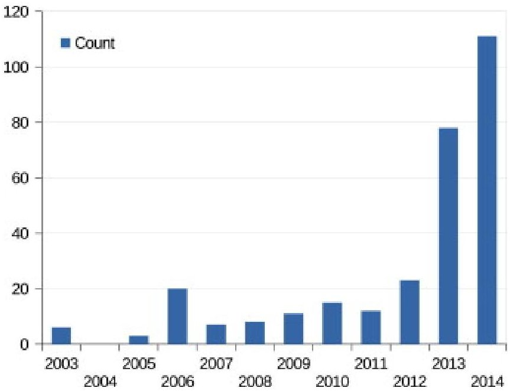
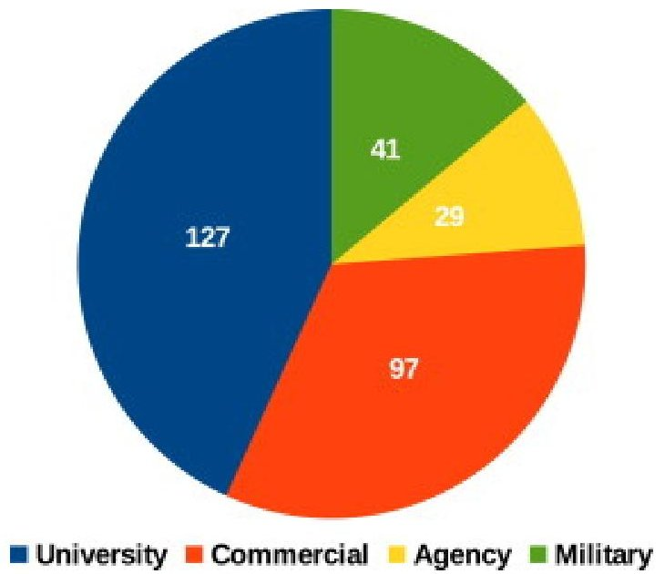
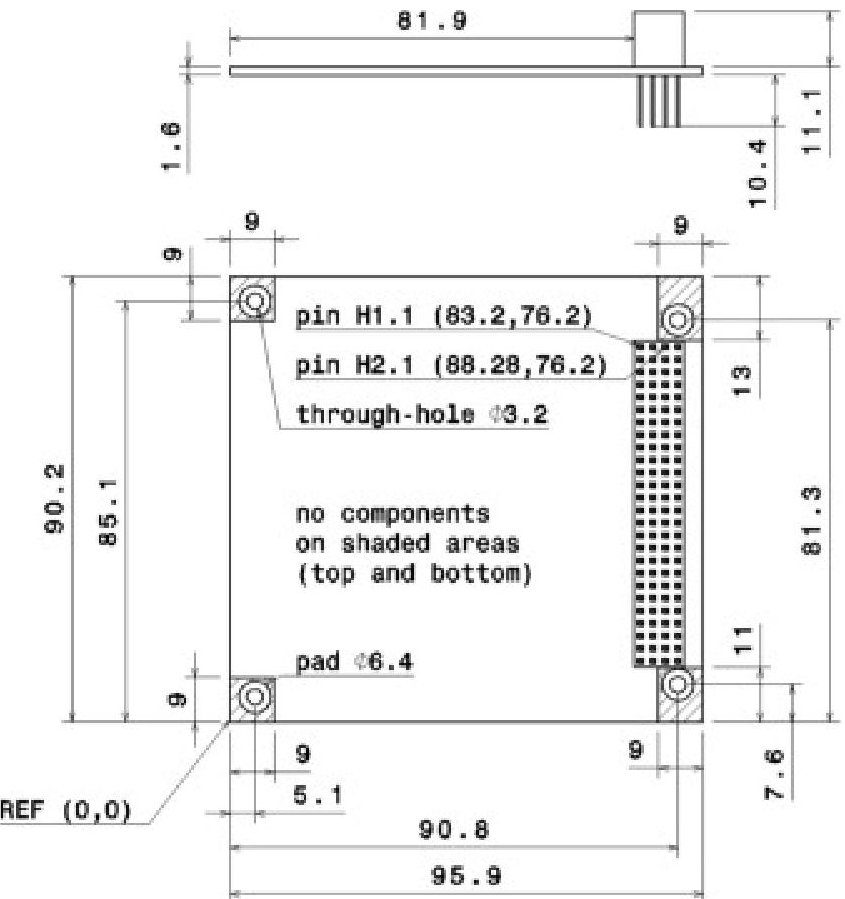
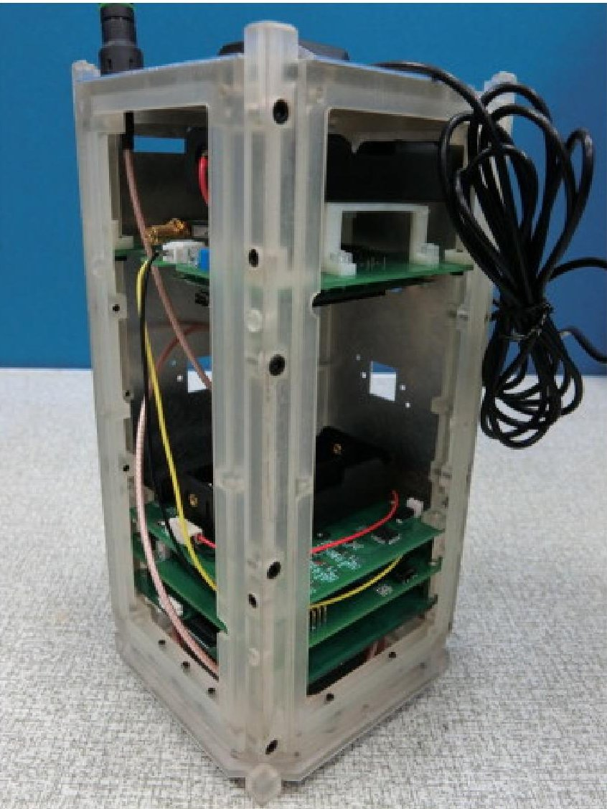

<!-- PDF_PAGE: 1 -->

# Toward open source CubeSat design

Artur Scholz , Jer-Nan Juang DOI: 10.1016/j.actaastro.2015.06.005

## Highlights

- The open source movement is becoming extremely popular in recent years.

- We contrast open source versus closed source design for CubeSat projects.

- Several open source licenses are available today.

- We present an open source CubeSat initiative.

## Abstract

Today, open source software plays a significant role in information technology and consumer electronics. Open source hardware, which is the free exchange of a product's design information, is gaining popularity as well. Both ideologies are motivated by trading away competition against collaboration. In this paper we suggest the application of the open source movement to space technology. In the focus of our discussion are CubeSats, considered as an ideal playground for the introduction of technological and methodological novelties. We examine the legal background of open source designs and contrast the advantages of open source products for developers and users against closed source products. We then present an open source initiative for CubeSat technologies with the intention to encourage the CubeSat community to move towards open design.

## 1. Introduction

Space exploration and utilization has historically been governed by confidentiality, secrecy, and the monopolization of knowledge. Access to space has always been considered as a crucial asset, and the demonstration of "technological firsts" was used to demonstrate engineering supremacy [1]. It just seems too natural to protect the knowledge obtained during the course of the project's life cycle in order to take benefit from the work and financial resources that were invested. Therefore most of us live with the conviction that space is reserved to a few nations that have the know-how and financial resources for its exploitation.

On the other hand, a number of universities had started their own small satellite projects as early as in the 1980s, in order to provide hands-on training for students in this interdisciplinary field of high technology [2]. Here the technical details of systems were made much more accessible, such as in the form of publications and papers, although almost no attempts were made to publish detailed designs to a broader audience. Over time, several universities, mainly in US and Europe, had established small satellite programs for science and education (such as [3],[4],[5],[6]).

In 1999 then, the CubeSat standard was created as a joint effort by professors Jordi Puig-Suari of California Polytechnic State University and Bob Twiggs of Stanford University [7]. The standard specifies mainly the mechanical interface requirements of a 1kg, $ 1 0 \times1 0 \times1 0 \mathrm{c m}^{3} $ nanosatellite. Satellites adhering to this standard would be compatible with the Poly-PicoSatellite Orbital Deployer (P-POD), a standardized launch container developed as well at Stanford University [8]. The P-POD is attached to the upper stage of a launch rocket, carries between one and three of such CubeSats and deploys them into orbit. As such, the P-POD provides a first degree decoupling of the interface between satellite and launch rocket and eases the launcher integration process significantly.

<!-- PDF_PAGE: 2 -->

The motivation for the invention of the CubeSat standard was to enable graduate students to design, build, test and operate satellites within their academic curriculum. The first CubeSats were launched in June 2003 and cumulated in an explosive growth of CubeSat launches in recent years. The success of CubeSats is attributed exactly to its standardized interface with respect to the launcher integration, which led to cheaper launch costs in the range of several tens of thousands of Euros and an accelerated launch preparation schedule.

Triggered by the success of CubeSats, a handful of start-up companies appeared during the second half of the first decade of 2000, and more followed. Founded mainly by graduates who worked on CubeSat missions during their studies, these companies kept strong ties with their (hosting) university, and focused mainly on supporting research and educational missions. Yet, despite having this academic background, the products were sold closed source, with some companies offering the design information for a significant surplus charge. Around the same time, industry and military entered the fast growing CubeSat sector and launched own CubeSat missions [9]. By 2013 a dramatic increase of CubeSats deployed in space is noticeable, as shown in Fig.1. Most of the recent CubeSats were launched as clusters or fleets under the flag of private companies. Nonetheless, the academic world takes the largest share among CubeSat developers, as shown in Fig.2.

Fig.1. CubeSats launched from 2003 to 2014. Compiled using data from M. Swartwout.

<!-- PDF_PAGE: 3 -->

Fig.2. Number of CubeSats that were launched from 2003 to 2014 grouped by ownership. Compiled using data from M. Swartwout.

From this it is evident that academia remains a major player in the CubeSat sector. As such, it has a strong impact on the future of the CubeSat program. The authors of this paper are convinced that CubeSats are not only an ideal tool for teaching hands-on space technology but also a great chance for opening up the access to space technology to a much larger audience, including students from emerging and developing countries.

However, the current trend of increasing commercialization is counter-productive to this objective, as we will elaborate in the following sections. We also observe that a number of universities have established "centres of excellence" for CubeSats, which capitalize on their in-house acquired knowledge. At the same time inter-university collaborations are minimal. This is arguably not in the original interest of the CubeSat concept, which stipulates the free exchange of design information and lessons learned. Therefore, we are convinced that the spirit of the terrestrial open source movement must enter the minds of developers in order to provide for a better prospect of the future of CubeSats.

In the following we first take a glance at the open source movement that exists in information technology and embedded design products and then define the term "open source design". We then examine intellectual property rights and the major open source licenses available today. A large part of this paper is dedicated to show the disadvantages of closed source development versus the benefits gained by open source designs. Finally, a case study of an existing open source CubeSat initiative is presented.

## 2. Terrestrial open source movement

Open source software (OSS) is the backbone of modern society. It is present in almost every field of information technology, such as web servers, operating systems, software development tools, and mobile phones. Open source hardware (OSHW), as discussed in this context, is a relatively new phenomenon that follows the same principles: to allow anyone access to its sources for modification, sharing, building, and selling.

A popular example is the Beagle Board [10], a single-board computer developed to provide education in the design and use of open source software and hardware in embedded computing. The board consist essentially of a powerful system on chip (SoC) processor (which however is proprietary) and a wide range of peripherals. It hosts Ubuntu, Android, and other open operating systems. Design files and extensive documentation are freely available.

<!-- PDF_PAGE: 4 -->

In the same category falls the widely known Arduino [11]. It is an open design processing board that is bundled with an open source integrated development environment (IDE) and libraries. The IDE provides an easy usage of the microcontroller resources through a simplified programming language based on C/C++, allowing people to start programming the Arduino hardware without requiring much background on the underlying technology. It has become hugely famous among hobbyists, and spawned many offspring projects, such as the Arducopter, an open source unmanned helicopter.

Ben Nanonote [12], as another example, is an entire computer system published under open source terms. It is referred to as possibly "the world's smallest Linux laptop", and is one of the very few devices on the market that are completely open source. Yet another prominent example of open computer engineering is the online repository OpenCores [13], which hosts dozens of projects related to the design of central processing units, memory controllers, peripherals, motherboards, and other components.

## 3. Open source design

In this paper, we refer to the combination of open source software and open source hardware as open design. The recognized authorities for open source software regulation are the Free Software Foundation (FSF) and the Open Source Initiative (OSI), founded in 1985 and 1998, respectively. Both differ to some extent in their goals and values, but from a practical point of view agree on many aspects of what it means to produce free or open software. As a summary of the ten rules for open source definition, the OSI states [14], Open source software is software that can be freely used, changed, and shared (in modified or unmodified form) by anyone. Open source software is made by many people, and distributed under licenses that comply with the Open Source Definition.

The definition of open source hardware is more complex. This stems from the fact that usage of hardware differs much from software and, being a relatively new phenomenon, less literature on that topic is available. See Lock [15] for a thorough discussion on this subject. Also, software is easily copied and redistributed, which is not the case for hardware. Hardware modification and production requires access to drawings, schematics, diagrams, design rules, layouts, and other documents. The Open Source Hardware Association (OSHWA) provides the following definition [16]: Open source hardware is hardware whose design is made publicly available so that anyone can study, modify, distribute, make, and sell the design or hardware based on that design. The hardware's source, the design from which it is made, is available in the preferred format for making modifications to it.

Broadly speaking, open source hardware is a physical artefact whose design information is made available under one of the legally binding recognized open source licenses.

## 3.1. Intellectual property rights

A number of mechanics are in place to protect the intellectual property of individuals and entities. The most relevant ones for open source design are discussed in the following.

Copyright grants the creator of original work the right to use and distribute it, and to define the conditions therefore. It is a legal concept that is protected well in most countries, and is usually in effect for a certain time, such as the lifetime of the author plus several decades. It applies to published and unpublished works. Main intention is to allow the author to benefit from their work, financially or else. Copyright is a very useful concept as it allows the author to decide on what to do with the work, such as to transfer it into the public domain.

Whereas copyright protects how information is presented, patents cover the subject matter of this information. For example, copyright law may restrict one from making copies of design files for a certain product, but it would not prevent one from making and using that product. Put differently, copyright only governs the expression of the idea, but not the idea itself. This is where patents come into play,

<!-- PDF_PAGE: 5 -->

which offer the right to exclude others from doing so. In short, patents ensure that the patent owner can take full ownership of its invention with the exclusion of others. Obviously, this is exactly the contrary of what open source design stands for.

Trademarks are typically names, slogans, or symbols, used for identification with goods or services. Trademark rights prevent others from using the same sign for their goods or services, but not from making or offering similar goods or services. As such, they provide a way to label offerings to make them recognizable and accredited by users [17].

## 3.2. Open source licenses

Creators of original work may either write license conditions on their own or adapt or modify existing licenses. Making use of existing licenses provides the advantage of a solid legal groundwork, and they are usually well understood and respected in the community. Basically, an open license is an agreement by the author(s) of original work to allow other people to make use of this work in accordance with the license regulations, without the need of paying licenses fees, as long as the terms of the license are followed. It grants rights to the product, that would otherwise be restricted through copyright or patent law.

Two main categories of open source copyright licenses exist: strong copyleft licenses that require that derivative work must be licensed under the same license; and weak copyleft (i.e. permissive) licenses, which permits the use of different license terms for derived works. The latter would allow modifiers to incorporate their open designs into closed proprietary designs or for merging them with projects which have adopted a different form of open license [18].

Licenses for hardware and software differ naturally [19]. For software projects, the license ensures that the source code is made available. Hardware licenses on the other hand have to provide terms for the user rights on the design information as well as on the manufacturing and usage of the products. Various licenses are available for hardware and software projects and some of the major ones are briefly introduced in the following. See also [20] for an exhaustive treatment of open source licenses.

The GNU General Public License (GPL) and the GNU Lesser General Public License (LGPL) are published by the Free Software Foundation [21]. The GPL allows the user to use, study, share, and modify the received software. It demands that these license conditions are also followed for copies of the original work or derived works. This constitutes a strong copyleft. The LGPL in contrast is a permissive free software license, similar to BSD license and MIT license, that allows developers and companies to use and integrate such work into their own (proprietary) software, without being required to apply the license conditions to their own work. The dominant usage of the LGPL is for software libraries.

The GNU Free Document License (FDL) was designed for manuals, books, documentations, and other reference material, usually distributed together with open source hardware/software. Similar to the GPL, the FDL gives readers the rights to copy, distribute, and modify, requiring that all derivatives be licensed under the same terms (strong copyleft). A dedicated feature is that when copies are sold in larger quantities, the original document or source must be made available to the reader as well.

Creative Commons (CC) is a non-profit organization that has released several licenses [22]. The creators of original work can easily choose a desired license "a-la-carte" that fits their needs in terms of which rights to be waived for others to make use of the work. CC licenses are used for all types of work that underlies copyright, including books, plays, films, music, photographs, and websites. CC itself does not recommend the use of their licenses for software, although this has been done by some, such as for the Arduino boards.

The Tucson Amateur Packet Radio (TAPR) is an international amateur radio organization that published the TAPR Open Hardware Licence (OHL) in the flavour of a share-alike license that developers can apply to documentation and schematics [23]. The key features of the license are that it firstly prevents the filing of patent infringements among people making use of OHL-licensed product, and

<!-- PDF_PAGE: 6 -->

secondly, that it requires modifiers to include both "before" and "after" versions of all files that were modified. The licence is written in the form of a contract between author and recipient, and constitutes a strong copyleft.

The European Organization for Nuclear Research (Conseil européen pour la recherche nucléaire, CERN) has issued the CERN Open Hardware Licence (CERN OHL) that, similar to what GPL is to software, defines the conditions to the use, copying, modification and distribution of hardware design documentation, and the manufacturing and distribution of products [24]. As with other strong copyleft licenses, any modifications must be licensed under the same license conditions, in order to ensure that the whole community will continue benefiting from improvements.

## 4. Downsides of closed source design

In this section we slip into the role of a typical customer of CubeSat products and discuss some of the main risks associated with relying on closed source solutions.

## 4.1. Vendor lock-in

Vendor lock-in describes the situation where customers are dependent on products and/or services from a certain vendor and unable to easily switch to another vendor [25]. A common method of vendors for achieving this is to create incompatibility between otherwise functionally equivalent components. Lock-in works well for closed source products because other vendors can hardly create compatible alternatives. An example is the Microsoft Office suite, which uses proprietary file formats and thus puts a huge barrier to customers for leaving off towards open and free alternatives, such as LibreOffice.

The high risk associated with the vendor lock-in effect for customers of CubeSat products is that if for any reason the company ceases to exist, there will most likely be no further support and replacements for purchased products. Further, vendors can take advantage of the lock-in effect by driving product costs out of proportion.

## 4.2. Incompatibility

Many industries are regulated by international and independent standardization bodies.Compatibility with standards however is not in the best interest of vendors of proprietary products.Compatibility allows users to change providers easily and thus reduce the revenue for the company. For example, the protocols crafted by the Internet Engineering Task Force (IETF) for communicating on the Internet underwent a careful design and testing process before being published as standard. With the rise of popularity of the Internet in the 1990s many proprietary software companies entered the market, inventing new protocols without passing them through an independent standardization process. One well known outcome is the incompatibility among many competing web browsers [26].

Apart from the CubeSat Design Specification, there are no de jure standards applicable to CubeSats. The result is that most CubeSat missions are specific one-off solutions designed for a particular mission. For instance, the commonly used CubeSat board connector differs in pin layout substantially across individual CubeSat developers and vendors. This in turn also creates a lock-in effect.

## 4.3. Lack of technical insight

When knowledge translates to business advantage over competitors, vendors become wary of protecting this asset carefully. Commonly, only the minimum amount of information is shared, such as interface definitions, performance specifications, and instructions for operations. To the user the product is much like a black box. Given the complexity of modern integrated electronic designs, the possibility to examine the product will not aid in obtaining a deeper understanding of how it works. Also, the user will never know for sure if things are implemented in the way as claimed by the vendor (for example, the application of coding quality

<!-- PDF_PAGE: 7 -->

standards). This bears of course the risk for the user of not being able to trace back anomalies to the root cause. For the vendor on the other hand this turns into another line of revenue, by selling replacement products and/or providing integration services.

## 5. Benefits of open source design

Having examined the main disadvantages for the customer of closed source products, we now take a look at some of the main benefits of open design, both for the developer and customer. The question we try to answer is: why should one make use of open source products or engage in open source development in the first place?

## 5.1. Reliability

Open source products have the potential to be superior in reliability than comparable proprietary software products. The reason is simple: with the source code/design freely available for inspection, bugs and design flaws are usually detected much quicker. That is because the product is exposed to a massive peer-review. Steve McConnell states that effectiveness of code review for determining faults in software is about one third more effective than the standard unit testing [27]. Often users of high-end technology products are interested in its internal workings, taking joy in studying them in detail, when given the possibility. On top of that, users may even suggest solutions to problems identified. Open source design ultimately acknowledges that users can best contribute to the improvement of products. NASA for example has initiated the NASA Open Source Agreement with the main motivation to "...increase NASA software quality via community peer review" [28]. For CubeSat missions that would mean that many of the sources of potential mission failures could be eliminated before launch, leading to reduced risks, better mission performance, and improved quality. For example, the loss of ESA's student-built SSETI Express mission caused by a single point failure in the power system could have likely be avoided if more people had been given access to its electronics design [29].

## 5.2. Customization

With the availability of source files it is easy to tweak the software and hardware design as desired. In particular the ability to change hard-coded settings in microcontroller firmware, nowadays embedded on many electronic systems, allows for powerful ways to adapt a given product to specific needs. The freedom to study how a product works and to change it to one's need is in fact one of the main features of open source design. Closed source products on the other hand would require that the vendor incorporates all such changes, no matter how trivial or minor, which is costly and less flexible.

For instance, the transmit and receive frequency of a CubeSat radio communication system is a distinct property that must be set to the value as permitted by the ITU (International Telecommunication Union) for the registered operator of that radio device. This frequency is usually not known at early phases of the CubeSat development cycle and/or may change in the course of the project.

## 5.3. Innovation

Innovation almost always builds upon what came before it. With open source designs, developers can build upon the work of others and advance it. Imitation in that sense must not be mistaken with copying of ideas; it in fact often leads to true innovation. As Bill Joy, co-founder of Sun Microsystems, said: "No matter who you are, most of the smartest people work for someone else." In the open source model thus, companies share knowledge freely with the prospect of getting input for innovation from outside their organization. An example for this is the GENVI Alliance (genivi.org), where several big car manufacturers are working together to promote open source technologies and standards in many of the peripheral components. For CubeSats, open source development could mean that newcomers to the community do not have to reinvent the wheel (as is done frequently) but could rather focus on the advancement of their spacecraft payload, for example.

<!-- PDF_PAGE: 8 -->

## 5.4. Collaboration

Open source by its very nature allows for much better collaboration for a variety of reasons. It gives developers deep insight into how other peoples' products work; an insight that a user manual alone could never provide. It also allows for easier sharing and reuse of work, in the sense that instead of relying on the procurement of products, those could be reproduced wherever and whenever needed. For example, two developer teams could focus on developing different aspects of a common system, sharing their ideas and discussing concepts, and taking advantage of this symbiosis. Also, there would be no concern about non-disclosure agreements or the like. Probably the most prominent example for such a collaboration is the GNU/Linux operation system, which was developed by a large number of loosely coordinated people towards the common goal of establishing a free operating system [30]. In a similar way, open source CubeSat engineering could path the way to a free generic CubeSat reference system that then can be adapted/tailored to specific mission needs. For many popular open source products (such as Blender or LibreOffice) a strong community has grown around it that drives the main part of the development.

## 5.5. Cost

Another important aspect of open source is the potential reduction of costs. For most individuals and many educational institutions, the development of a CubeSat project is prohibitively expensive due to the high prices of commercial products and the costs for testing and verification of newly developed technologies. With an open source approach, such costs can be distributed among a larger number of entities, effectively reducing the cost burden for each. For example, while one institute has carried out the development of a new system component, another institute could then be responsible for the testing of this component to qualify it for space flight. In this way, the redundancy in work effort can be reduced significantly.

## 6. Open source CubeSat projects

There is an increasing number of CubeSat missions that claim to be open source. Misleadingly, the majority of those projects are not open source in the sense that is discussed here they merely integrate some open source modules into their design. While it is of interest to CubeSat developers that an Arduino or Raspberry Pi board was successfully used in space, those projects do not reveal on how these boards were actually integrated into the satellite (compare for example [31], [32], [33], [34]).

On the other hand, using open source hobbyist boards in CubeSats is a challenge in itself. They will have to withstand the harsh environmental conditions during launch and in space, namely radiation, high vacuum, extreme temperatures, vibrations, etc. On top of that, power available on a CubeSat is sparse - a limitation that is usually not of much concern for terrestrial electronics.

With that in mind, the greatest help to aspiring CubeSat developers would be to make available the entire design information of already flown CubeSats. To the knowledge of the authors nobody has yet made an attempt to do that.

## 7. Case study: librecube initiative

In this section we present an open source CubeSat design initiative, which was initiated in early 2014 by the corresponding author. It should serve as an example on how open source CubeSat projects can be realized and published.

## 7.1. Motivation

The motivation for creating this initiative comes from the at times frustrating experience of having built two CubeSat missions in an academic environment. The perception of the author was that the collaboration among the CubeSat community is at a minimum. Most

<!-- PDF_PAGE: 9 -->

conference presentations of CubeSat projects present design and test results but leave out all the specific details. Thus, developments were often delayed due to system elements that were deemed necessary but not at the focus of the mission. For example, the I2C (Inter-Integrated Circuit) bus for the on board communication is present in virtually every CubeSat, yet there is little documentation available from CubeSat groups about their successful implementations.

As a result, any new team deciding to start a CubeSat project is facing the challenge to either start their development (almost) from scratch or to purchase highly priced CubeSat products from the market. The LibreCube Initiative was therefore established to provide an alternative to the existing practice of how CubeSat missions are done.

## 7.2. Overview

The LibreCube Initiative wants to provide a framework for truly open source CubeSat missions. For this, it defines a conceptual reference architecture for a generic CubeSat mission. All the building blocks of such a mission are considered as "black boxes" that are gradually filled (and maintained) by specific LibreCube products. For example, a typical CubeSat mission comprises of ground segment and space segment, just as with any traditional space mission. The space segment comprises of one or more CubeSats. The CubeSat is conceptually decomposed into platform and payload, with the platform composed of the traditional subsystems, such as power system, communication system, attitude and orbit control system, and so on. Subsystems may further be linked to sensors and actuators or other modules, such as solar panels. The LibreCube Initiative hence aims to provide product solutions corresponding to each those subsystems and lower level modules. Over the course of time those products for the ground and space segment shall be sufficient to make up almost any kind of CubeSat mission and be actively maintained to incorporate new features and improved performance.

The three pillars of the LibreCube Initiative are open source, modularity, and compatibility. In the following we describe their meaning for LibreCube and how they are implemented.

Open source aspects were discussed at length in the previous sections. LibreCube applies the open source model in particular to improve reliability and quality of its products through feedback from developers, to share costs through distributed developments, and to create a sense of community among all involved parties in order to foster sharing of ideas and experience. The open source model is implemented by having each product (i.e. subsystem, modules, software applications, etc.) residing in a single Git repository. Git is a decentralized version control system that breaks with the traditional client-server model, and provides each user with a full-fledged repository with complete history and version-tracking capabilities. These repositories are at the time hosted at GitHub ([35]), a well known and free web-based service for hosting Git repositories. Each repository contains all the source information of the product together with open source licenses governing their use.

Modularity is associated with the breakdown of the complex CubeSat space system into many smaller systems. Ideally, the system should be decomposed into smallest meaningful modules, each performing one specific function. This may however not always be economical, hence a compromise on the level of decomposition has to be taken. For example, the attitude control system may be decomposed into sun sensor units, GPS units, magnetorquer units, and an interfacing unit. Given the tight volume and mass constraints of CubeSat, some of the sensors (such as inertial measurement sensor) may however be combined together with other sensors (such as accelerometer) to form a dedicated sensor module. LibreCube tries to closely follow the ECSS (European Cooperation on Space Standardization) Space System Model [36] for the system decomposition. Eventually, individual modules can be aggregated to form larger, more complex systems, and be mixed and matched in a variety of configurations to respond to specific mission needs.

Compatibility is the key aspect to ensure the longevity of the LibreCube framework. The goal here is to be able to easily substitute individual modules with equivalent replacements or later versions, with perhaps improved performance or additional features. Again, modules are considered as black boxes, whose inner workings are encapsulated and hidden from the user to a large extend, similar to

<!-- PDF_PAGE: 10 -->

how it is done at object-oriented programming languages. This requires however that the interfaces of the module are properly defined, in terms of functional capabilities, mechanical, electrical and thermal interface, communication protocol, and so on. One can for example imagine a communication module that serves as the sink for telemetry data. This system may then be replaced in a 'plug and-play" fashion with a more advanced version of higher downlink bitrate, provided that the interface to the other avionics system remains compatible. In order to arrive at a meaningful definition of such interfaces, the use of international space standards are of great importance. CCSDS (Consultative Committee for Space Data Systems) for example specifies protocols for telecommand and telemetry frames that are used on hundreds of space missions, but are in scarce use for CubeSats. LibreCube has embarked on the adoption of such standards for their CubeSat products where feasible. Moreover, the LibreCube Initiative is working on needed dedicated CubeSat standards for their products where they are lacking. For instance, the LibreCube Board Specification has been created to define a common board interface in terms of mechanical, electrical, and software interfacing. The mechanical layout of such a board is shown in Fig. 3.

Fig.3. Mechanical specification of LibreCube boards.

## 7.3. Usage

The LibreCube Initiative runs a website ([37]) that provides information on the LibreCube framework, recommended and applicable standards, naming conventions, and other resources. Above all, it provides summary information about published products and the internet links to access the repositories.

Users would go to this website to find the LibreCube products that they need for their project and download the repository to their computer (termed: "cloning the repository"). The first file to look at is the license file residing in the repository root folder, as it contains the open source license terms applicable to that particular product. TAPR OHL, LPGL, and FDL licenses are typically used for hardware, software, and documentation, respectively.

Users are then free to study and modify the design. The design folder typically contains schematics, source code, printed circuit board layouts, CAD files, and so on. Ideally, all those design files would be compatible with open source software tools to allow users to edit

<!-- PDF_PAGE: 11 -->

them. Due to heritage however, some design files may have been created with proprietary software. In such cases, read-only open file formats are included (proprietary formats will be strictly avoided for all future products). The advantage of using Git repositories is that the user has access to the entire change history of the design.

The documentation folder contains at a minimum a user guide with detailed information about the products functions, interfaces, and operation.

The production folder then contains all the files and information needed for ordering components, manufacturing of boards and parts, and an assembly guide, which also covers the information on how to compile and flash the source code of embedded firmware. Following manufacturing the artefacts are assembled (such as soldering of PCBs) to form the final product.

If such information is available, a verification folder is included that contains verification reports, such as mechanical test conducted with the product.

With all this well structured and complete information at hand, users can reproduce LibreCube products on their own, free of royalty fees and for any purpose. Although the target application for LibreCube products is primarily with CubeSat space missions, other areas of application are conceivable as well, such as in-class teaching of space technology, high altitude balloon flights, airborne vehicles, and rovers.

A demonstrative high altitude balloon experiment had been launched in Spring 2015 at the premises of National Cheng Kung University in Taiwan. It flew for a duration of more than 2h across the southern part of the island and reached an altitude of over 30km. It was composed mainly of LibreCube products, namely a 3D printed double unit CubeSat structure, a power system, a UHF communication system, and a processing board. In addition some commercial off the shelf components were used to form a backup system, which fortunately was not needed. The transmission of telemetry during the flight was successfully received and postprocessed. Shown in Fig. 4 is the assembled system before the balloon launch.

<!-- PDF_PAGE: 12 -->

Fig.4. Open source platform for high altitude balloon experiments.

## 7.4. Involvement

Users can contribute to the LibreCube Initiative in various ways. One way is the submission of bug reports and suggestions for improving existing products. Those inputs may eventually lead to a new revision of the respective product, with duly attribution of the contributing parties.

Moreover, users are encouraged to share their modifications of LibreCube products that add capabilities or improve performance. Users may even decide to submit their own development projects in order to make them available to others via the LibreCube Initiative. This implies that the submitted project will be subjected to an internal review process that ensures that the product and its information repository corresponds to the quality requirements set by the LibreCube framework.

In addition, there are forums and learning resources made available via the LibreCube website that support developers to get started with their mission design and to foster knowledge exchange among the community of LibreCube users.

## 8. Summary and conclusion

Terrestrial open source design is becoming more and more popular among educational institutes and individuals, as well as in industry. This is a result of the dissatisfaction of customers with closed source products for reasons of which some were outlined in this paper. Open design on the other hand has a number of prospects that are of interest as well to the space sector, such as increased reliability.

<!-- PDF_PAGE: 13 -->

As presented in this paper, various open source licenses already exist that provide the legal framework for tackling intellectual property rights of such open source design products. The challenge remains for vendors to adapt their business models to open source products. One way would be to put the focus on providing support rather than on sales (as is the case for Linux distribution vendors). Nevertheless, open sourcing products must not necessary result in a decrease of sales. For example, most customers still prefer to buy Arduino boards from the official distributors instead of clones. Ultimately however, open source is targeted at the needs of its users and developers, rather than the revenue of vendors.

Open source is lowering the barrier to education and access of technology in general. This could also be the case for space technology. The CubeSat sector appears to be an ideal opportunity to prove this. An exemplary implementation was presented in this paper, which aims at providing a platform for such truly open source CubeSat projects. The authors believe that the next big step in space exploration will not be achieved through competition but rather by a collaborative effort of many different people in the spirit of open design.

## Acknowledgements

This research received funding from the Headquarters of University Advancement at the National Cheng Kung University, which is sponsored by the Ministry of Education, Taiwan, ROC. The authors like to thank Jeremy Straub for suggestions on improving this paper.

## References

[1] A.A. Siddiqi The Soviet Space Race with Apollo, University Press of Florida, Gainsville, USA (2003) Google Scholar

[2] M. Sweeting Uosat-an investigation into cost-effective spacecraft engineering Radio Electron. Eng., 52 (1982), pp. 363-378 Crossref View in Scopus Google Scholar

[3] P. Butz, U. Renner, Tubsat-c, a microsat-bus for earth observation payloads, in: Proceedings of 3rd International Symposium Small Satellites Systems and Services, Annecy, France, 1996. Google Scholar

[4] C. Kitts, R. Twiggs, The satellite quick research testbed (squirt) program, in: Proceedings of 8th Annual AIAA/USU Conference on Small Satellites, Logan, Utah, USA, 1994. Google Scholar

[5] F. Graziani, F. Santoni, F. Piergentili, F. Bulgarelli, M. Sgubini, S. Bernardini, Manufacturing and launching student-made microsatellites: "hands-on" education at the university of roma, in: Proceedings of 55th International Astronautical Congress, Vancouver, Canada, 2004. Google Scholar

<!-- PDF_PAGE: 14 -->

[6] Y. Nakamura, T. Eishima, M. Nagai, R. Funase, A. Enokuchi, K. Nakada, Y. Cheng, E. ToshiyukiTakei, T. Funane, F. Sasaki, Y. Nojiri, T. Yamamoto, E. Nagayama, S. Nakasuka, University of Tokyo's ongoing student-lead picosatellite projects-cubesat xi and prism, in: Proceedings of 55th International Astronautical Congress, Vancouver, Canada, 2004. Google Scholar

[7] H. Heidt, J. Puig-Suari, A. Moore, S. Nakasuka, R. Twiggs, Cubesat: a new generation of picosatellite for education and industry low-cost space experimentation, in: Proceedings of 14th Annual/USU Conference on Small Satellites, Logan, Utah, USA, 2000.

[8] I. Nason, J. Puig-Suari, R. Twiggs, Development of a family of picosatellite deployers based on the cubesat standard, in: Proceedings of Aerospace Conference, IEEE, 2002. Google Scholar

[9] M. Taraba, C. Rayburn, A. Tsuda, C. MacGillivray, Boeing's cubesat testbed-1 attitude determination design and on-orbit experience, in: Proceedings of 23th Annual AIAA/USU Conference on Small Satellites, Logan, Utah, USA, 2009. Google Scholar

[10] Beagleboard [online, cited 01.02.2015] <http://beagleboard.org/> . Google Scholar

[11] Open source initiative [online, cited 07.02.2015] <http://arduino.cc/> . Google Scholar

[12] Qi-hardware [online, cited 03.02.2015] <http://en.qi-hardware.com/wiki/main_page> . Google Scholar

[13] Opencores [online, cited 01.02.2015] <http://opencores.org/> . Google Scholar

[14] Open source initiative [online, cited 01.02.2015] <http://opensource.org/> . Google Scholar

[15] J. Lock, Open source hardware, Technical Report, Department of Technology Management and Economics, Chalmers University of Technology, 2013. Google Scholar

[16] Open source hardware association [online, cited 01.02.2015] <http://www.oshwa.org/> .

<!-- PDF_PAGE: 15 -->

[17] H. Anderson, T. Dare Passport without a visa: open source software licensing and trademarks Int. Free Open Source Softw. Law Rev., 1 (2) (2010), pp. 99-110 View in Scopus Google Scholar

[18] A. Katz, L. Moorcrofts, M.L. Partner, J. House, M. Park Towards a functional licence for open hardware Int. Free Open Source Softw. Law Rev., 4 (1) (2012), pp. 41-62 Crossref Google Scholar

[19] J.R. Ackerman Toward open source hardware Univ. Dayton Law Rev., 34 (2008), p. 183 Google Scholar

[20] M.H. Webbink

Packaging open source

Int. Free Open Source Softw. Law Rev., 1 (2) (2010), pp. 83-98

Google Scholar

[21] Free software foundation [online, cited 08.02.2015] <http://www.fsf.org/> . Google Scholar

[22] Creative commons [online, cited 08.02.2015] <http://creativecommons.org/> . Google Scholar

[23] J. Ackermann. The tapr open hardware license [online] (2007) [cited 08.02.2015] https://www.tapr.org/ Google Scholar

[24] M. Ayass, J. Serrano The cern open hardware licence Int. Free Open Source Softw. Law Rev., 4 (1) (2012), pp. 71-78 Crossref Google Scholar

[25] K. Ven, J. Verelst, H. Mannaert Should you adopt open source software? Software, 25 (3) (2008), pp. 54-59 View in Scopus Google Scholar

<!-- PDF_PAGE: 16 -->

[26] B. Phillips Designers: the browser war casualties Computer, 31 (10) (1998), pp. 14-16 View in Scopus Google Scholar

[27] S. McConnell Code Complete, Microsoft Press, Redmond, WA, USA (2004) Google Scholar

[28] Nasa open source software [online, cited 08.02.2015] <http://ti.arc.nasa.gov/opensource/> . Google Scholar

[29] T. Viscor, Sseti-past, present and future, in: Proceedings of 20th Annual AIAA/USU Conference on Small Satellites, Logan, Utah, USA, 2006. Google Scholar

[30] I. Tuomi, Networks of Innovation, Oxford University Press, Oxford, 2002. Google Scholar

[31] Skycube [online, cited 28.05.2015] <http://www.southernstars.com/skycube/> . Google Scholar

[32] Kicksat [online, cited 28.05.2015] <https://kicksat.wordpress.com/> . Google Scholar

[33] Ardusat [online, cited 28.05.2015] <https://www.ardusat.com/> . Google Scholar

[34] Lunarsail [online, cited 28.05.2015] <http://www.lunarsail.com/> . Google Scholar

[35] Github [online, cited 28.05.2015] <https://github.com/> . Google Scholar

[36] Ecss-e-st-70-31c, Technical Report, ECSS Secretariat, ESA-ESTEC, Requirements & Standards Division, Noordwijk, The Netherlands, 2008. Google Scholar

[37] Librecube [online, cited 28.05.2015] <http://librecube.net/> . Google Scholar