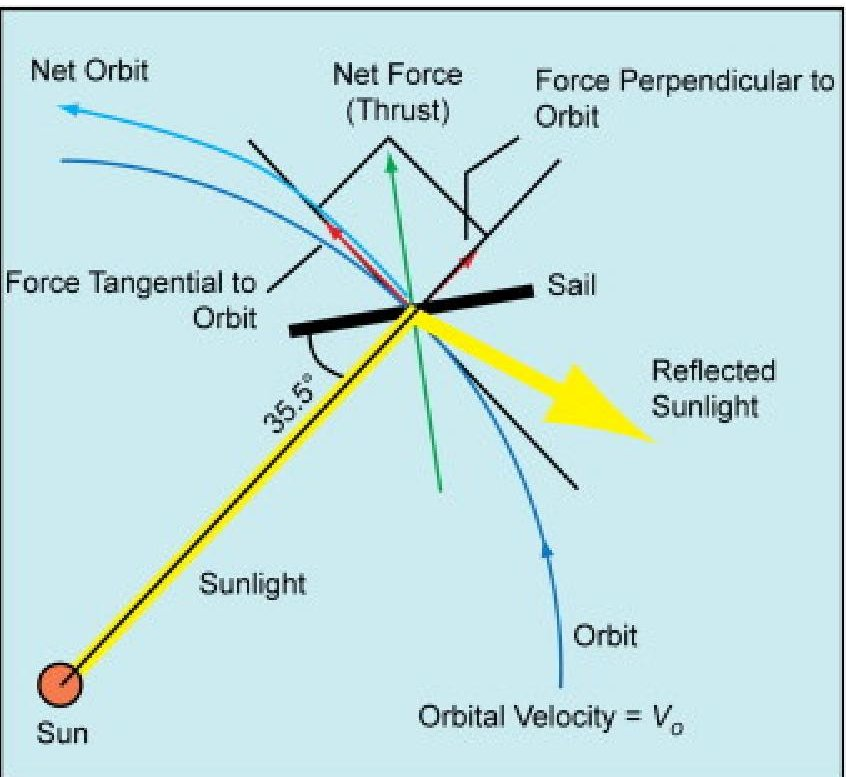
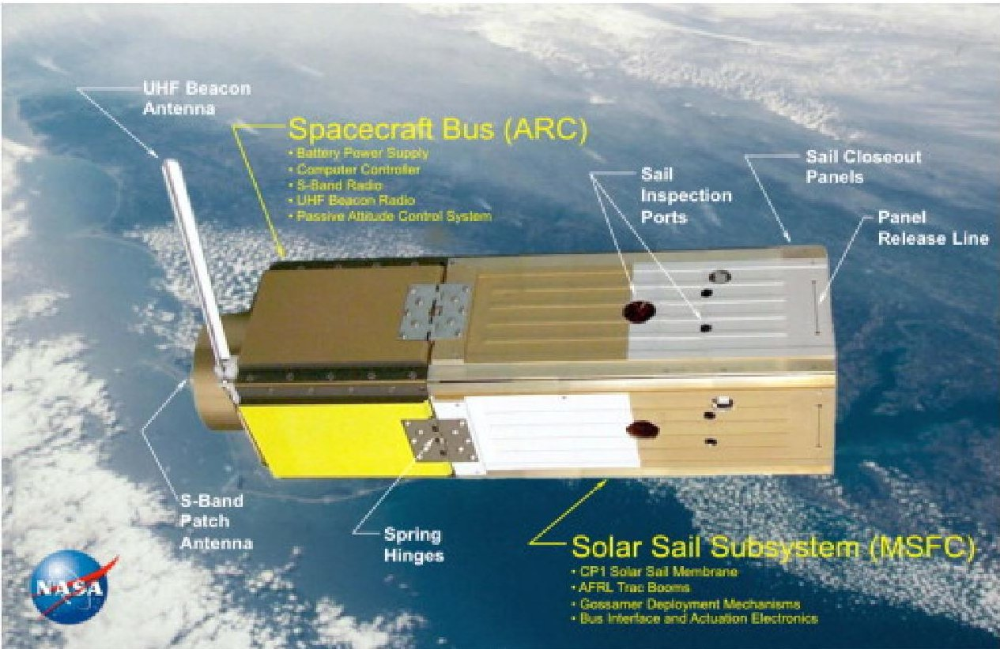
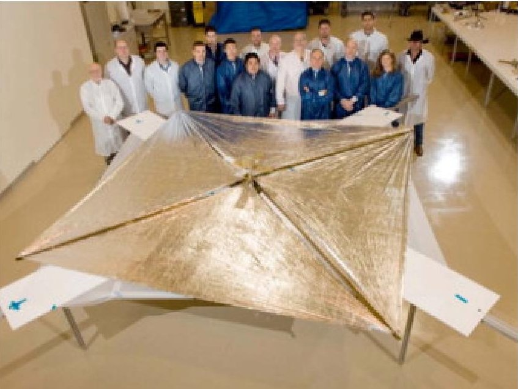
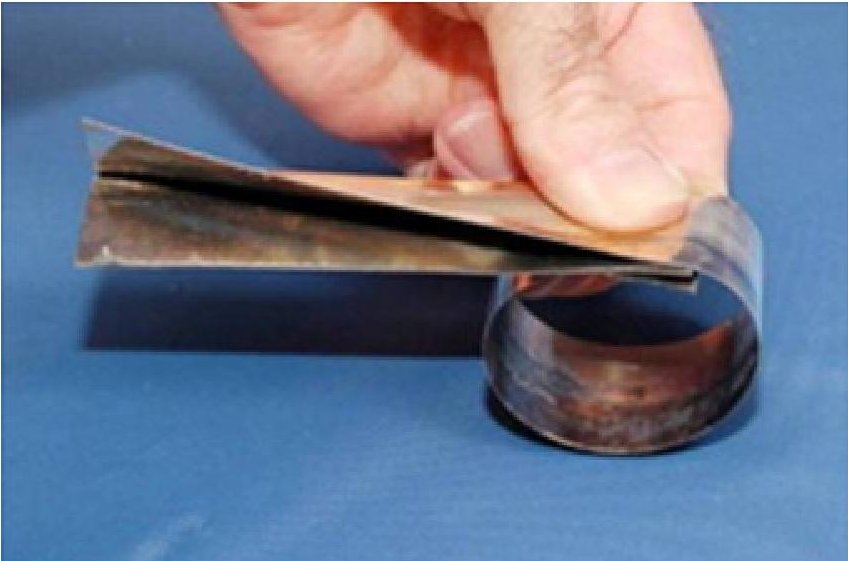
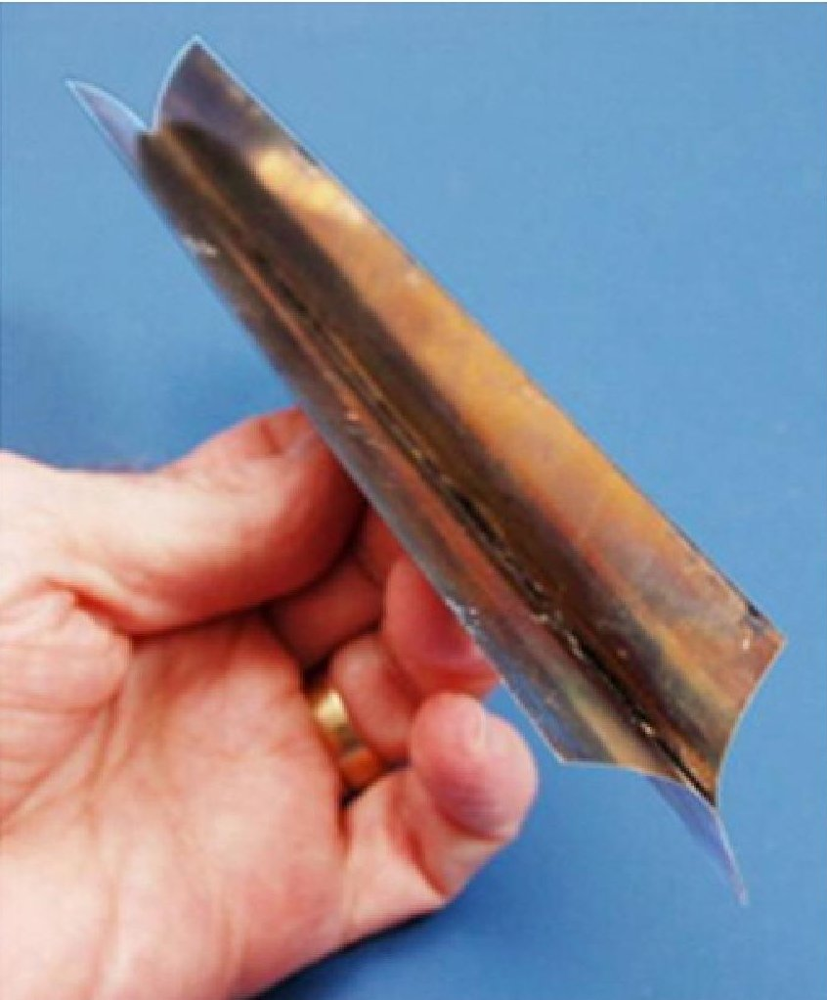
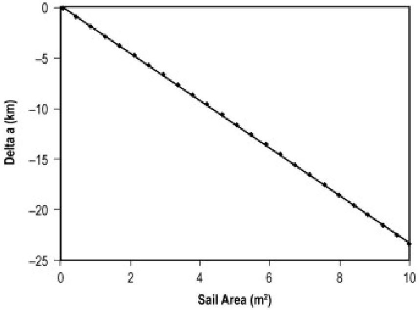
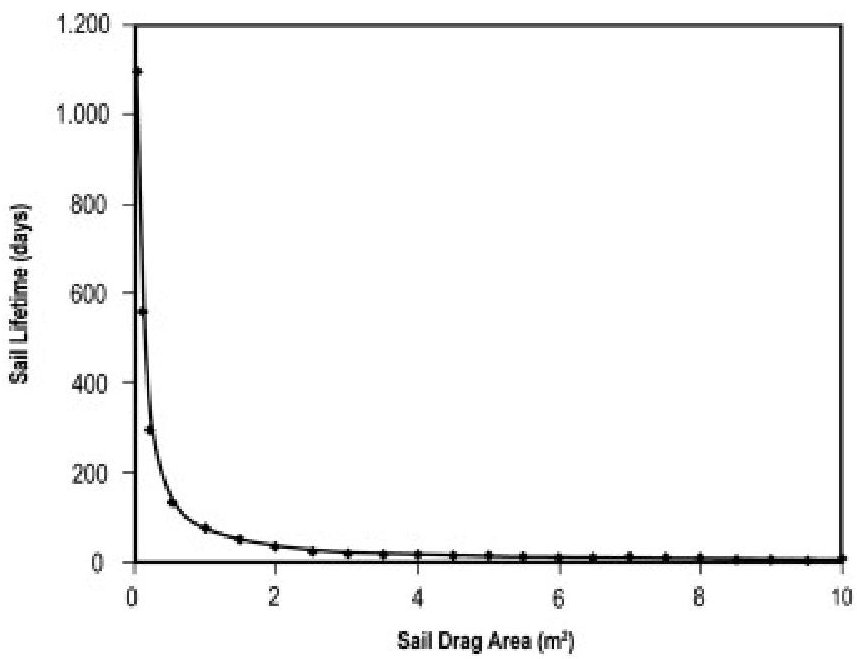

<!-- PDF_PAGE: 1 -->

# NanoSail-D: A solar sail demonstration mission

Les Johnson a , Mark Whorton a , Andy Heaton a , Robin Pinson a , Greg Laue b , Charles Adams c DOI: 10.1016/j.actaastro.2010.02.008

## Abstract

In the early to mid-2000s, NASA made substantial progress in the development of solar sail propulsion systems. Solar sail propulsion uses the solar radiation pressure exerted by the momentum transfer of reflected photons to generate a net force on a spacecraft. To date, solar sail propulsion systems were designed for large robotic spacecraft. Recently, however, NASA has been investigating the application of solar sails for small satellite propulsion. The NanoSail-D is a subscale solar sail system designed for possible small spacecraft applications. The NanoSail-D mission flew on board the ill-fated Falcon Rocket launched August 2, 2008, and due to the failure of that rocket, never achieved orbit. The NanoSail-D flight spare is ready for flight and a suitable launch arrangement is being actively pursued. This paper will present an introduction solar sail propulsion systems and an overview of the NanoSail-D spacecraft.

## 1. Introduction

Solar sail propulsion utilizes the solar radiation pressure exerted by the momentum transfer of reflected light. The integrated effect of a large number of photons is required to generate an appreciable momentum transfer; therefore, a large sail area is required. Since acceleration is inversely proportional to mass for a given thrust force, the mass of the sailcraft must be kept to a minimum.

Fig.1 illustrates how the solar radiation pressure is utilized for propulsion. Incident rays of sunlight reflect off the solar sail at an angle $ \theta $ with respect to the sail normal direction. Assuming specular reflection from a perfectly flat sail membrane, there will be two components of force-one in the direction of the incident sunlight and the second in a direction normal to the incident rays. When the force vectors are summed, the components tangent to the sail surface cancel and the components normal to the surface add to produce the thrust force in the direction normal to the sail surface. For a perfect 40-m $ \times $ 40-m square sail at 1AU from the Sun, the solar radiation thrust force is $ \approx $ 0.03N.

Fig.1. Solar radiation thrust force.

<!-- PDF_PAGE: 2 -->

## 2. NanoSail-D objectives

The objectives of the NanoSail-D project are primarily programmatic, with several technology goals to be serendipitously demonstrated:

- Establish NASA Ames Research Center (ARC)-NASA Marshall Space Flight Center (MSFC) collaborative relationship for future small satellite initiatives. (Comment: MSFC is known for developing NASA's "large" space missions. A partnership with ARC would help diversify the MSFC science portfolio.)

- Deploy first solar sail leveraging work by MSFC approved under the Science Mission Directorate In-Space Propulsion Technology Program [1]. (Comment: The hardware from the solar sail ground demonstration program was in storage and NanoSail-D provided an opportunity to use the hardware and the MSFC expertise developed in the program to fly a relatively low-cost demonstration.)

- Demo orbital debris mitigation technology-drag sail. (Comment: When flown in low-Earth orbit, the aerodynamic drag experienced by the NanoSail will exceed solar photon thrust, resulting in a rapid deorbit of the sail spacecraft. If a similar sail were stowed on a spacecraft and deployed at the end of its life, it might serve as a lightweight deorbit system [2].)

- Ground imaging to reduce spacecraft instrumentation. (Comment: The NanoSail-D is very small and it was impossible to place much diagnostic instrumentation on board. With ground imaging, it would be possible to confirm solar sail deployment, attitude, etc.)

## 3. Performance

Solar sail performance is typically specified in terms of characteristic acceleration that is defined as the acceleration from solar radiation pressure at a distance of 1AU from the Sun. It is both a function of the reflective efficiency of the sail as well as the total system mass and reflective area. To date, solar sail propulsion system design concepts have been investigated for large spacecraft in the tens to hundreds of kilograms mass range, consequently requiring sail areas in the thousands of square meters or larger range [3]. Recently, however, MSFC has been investigating the application of solar sails for small satellite propulsion. If the payload mass can be substantially reduced, then similar characteristic acceleration performance can be achieved with substantially smaller sails, thus reducing the technical risk and cost associated with the sail propulsion system. Moreover, these propulsive solar sails can be doubly utilized to deorbit a small satellite to meet the end-of-mission disposal requirements without the need of a dedicated chemical propulsion system that would otherwise incur parasitic mass and volume impacts. At the same time, ARC has been developing small spacecraft missions that could benefit from this mass-efficient propulsion and deorbit capability. Hence, a synergistic collaboration was established between these two NASA field Centers with the objective of conducting a flight demonstration of solar sail technologies for small satellites.

## 4. NanoSail-D system overview

The NanoSail-D mission was launched on board a Falcon 1 launch vehicle in August 2008. The NanoSail-D, a CubeSat-class satellite consisted of a sail subsystem stowed in a CubeSat 2U volume integrated with a CubeSat 1U volume bus provided by ARC. Shortly after deployment of the NanoSail-D from a Poly Picosatellite Orbital Deployer (P-POD) ejection system, the solar sail was to have deployed

<!-- PDF_PAGE: 3 -->

and mission operations commence. Unfortunately, the launch vehicle failed during ascent and the NanoSail-D never had the opportunity to deploy.

Given a near-term opportunity for launch, the project was met with the challenge of delivering the flight hardware in $ \approx 6 $ mo, which required a significant constraint on flight system functionality. As a consequence, the baseline spacecraft functionality is limited to passive attitude control with no ground command capability and only minimal health and status telemetry sent to the ground. No onboard camera or instrumentation are to be utilized to image the deployed sail or measure the attitude dynamics since these functions require considerable software and avionics infrastructure that was beyond the scope of the project budget and schedule.

The stowed configuration of the NanoSail-D spacecraft is illustrated in Fig. 2. The spacecraft bus, provided by ARC, is configured with a flight-proven computer, power supply, S-band radio, and ultra-high-frequency (UHF) beacon radio. Passive attitude control is provided by permanent bar magnets that are installed in the bus closeout panels. The spacecraft bus occupies the upper one-third volume of the 3U-sized CubeSat-class spacecraft.

## Fig. 2. On-orbit stowed configuration.

The solar sail subsystem occupies the lower two-thirds volume of the spacecraft. Sail closeout panels provide protection for the sail and booms during the launch phase of the mission. These panels have spring-loaded hinges that will be released onorbit, under the command of the spacecraft bus. Fig. 3 shows the fully deployed NanoSail-D in a ground test.

<!-- PDF_PAGE: 4 -->

Fig. 3. NanoSail-D ground deployment test.

ManTech SRS, Huntsville, Alabama, was responsible for design, development, and testing of the sail subsystem for NanoSail-D. Though the sail subsystem was to be utilized as a drag device for the current mission, all the essential components of the sail subsystem are scalable to $ > 4 0 \mathrm{m}^{2} $ sail missions and were merely truncated due to the aggressive timeline of the current mission.

Due to the aggressive time constraints of the mission (from inception to launch in <6mo), the sail subsystem was purposely designed to be as modular as possible with the sail subsystem divided into two primary components-the sail assembly and the boom mechanical assembly. Dividing the subassembly allowed for: (1) separate relevant functional testing of the sail mechanical assembly and the boom mechanical assembly during the development of the system and (2) complete testing of the entire sail subassembly (deployment functionality) prior to integration with the NanoSail-D bus and release electronics. This basic approach allowed for quick incorporation of lessons learned and design modifications during the development at the subsystem and subassembly level without affecting the activities/design of any other components. Once assembled, the sail subassembly consisted of a standalone unit that bolted to the bus and connected to the release electronics. Launch operations consists of a simple, timed, two-actuation system. The initiating event consists of a burn-wire release of the door panels. The door panels protect the sail material and help to constrain it for the launch environment and ascent venting.

The sail membrane is a piece of the $ 4 0 0-\mathrm{m}^{2} $ solar sail tested by NASA in 2005 [1]. The sail is $ 2 \mu\mathrm{m} $ CP1 with 1000A of aluminum on the front, and bare CP1 on the back. CP1 is a clear polyimide developed by NASA and licensed to ManTech SRS Technologies. The exact chemical formulation is proprietary. CP1 has a wide variety of operating temperatures (from cryogenic to $ 2 5 0^{\circ} \mathrm{C} $ ) and is resistant to ultraviolet radiation.

The trac booms, developed by the Air Force Research Laboratory (AFRL), are also rolled onto a boom spool. The stored strain energy of the rolled booms provides the driving force to simultaneously deploy both the booms and the sail quadrants. Fig. 4, Fig. 5 show the trac booms in coiled and uncoiled configurations.

<!-- PDF_PAGE: 5 -->

Fig. 4. The coiled trac boom.

Fig. 5. The uncoiled trac boom.

Mission data are to be comprised by radar cross-sectional area data, optical images, and orbital elements. Radar cross-sectional area data and optical images are to be obtained by the US Army's Reagan Test Site. These data may enable estimation of a lower bound on the deployed sail area (lower bound only because the sail plane was likely not normal to the line of sight during data acquisition, hence, the projected area normal to the line of sight was to be measured). Estimation of the deployed area will be difficult during initial phases of the mission when the sail is to be "tumbling" about the Earth's magnetic field lines during part of the orbit and passively stabilized in the maximum drag orientation near perigee. Hence, the estimation of the deployed area from orbit data will depend on the latter phases of the mission when the orbit circularizes and the sail passively stabilizes due to aerodynamic torque in a

<!-- PDF_PAGE: 6 -->

relatively constant local vertical/local horizontal attitude. In the event that the sail does not stabilize prior to reentry, orbital analysis will allow an estimation of an average ballistic coefficient that may be correlated to an average area.

## 5. NanoSail-D flight demonstration mission operations

Seventy-two hours after deployment of the NanoSail-D from the P-POD ejection system, the solar sail will deploy and mission operations will commence as described in Table 1.

Table 1. NanoSail-D on-orbit operations sequence.

<table border="1"><tr><td>Event</td><td>Hours</td><td>Minutes</td><td>Seconds</td><td>Comments</td></tr><tr><td>Falcon-1 launch</td><td>0</td><td>Launch minus 45</td><td>0</td><td></td></tr><tr><td>NanoSail-D ejection from P-POD; beacon on</td><td>0</td><td>0</td><td>0</td><td>Assume launch plus 45min</td></tr><tr><td>Beacon operating</td><td>6</td><td>0</td><td>0</td><td></td></tr><tr><td>Beacon off period</td><td>66</td><td>0</td><td>0</td><td></td></tr><tr><td>Panels open</td><td>72</td><td>0</td><td>0</td><td></td></tr><tr><td>Booms/sails deploy</td><td>72</td><td>0</td><td>15</td><td></td></tr><tr><td>Optical confirmation of deployment</td><td>73</td><td>44</td><td>0</td><td>Assumed time(one orbit after sail deployment; orbit period1:34)</td></tr><tr><td>S-Band on; listen at 30s and 30s off</td><td>75</td><td>0</td><td>0</td><td></td></tr><tr><td>Deorbit</td><td>120</td><td>10</td><td>0</td><td>Assumed4daysafterdeployment</td></tr></table>

Passive attitude stabilization will be achieved using permanent magnets in the sailcraft bus to initially detumble and orient the body with the magnetic field lines. The magnets are located on opposite sides of the bus with the north-south axes of the magnets oriented perpendicular to the long axis of the spacecraft. The body will be free to rotate about the magnetic field lines as the permanent magnets align with the Earth's magnetic field. Since the orbit plane inclination was to be $ < 1 0^{\circ} $ , the magnetic field lines will be approximately normal to the orbit plane and gravity gradient torques and aerodynamic torques will tend to passively stabilize the sailcraft in an essentially maximum drag attitude (where the sail plane normal vector is approximately pointed in the velocity vector direction).

Since the orbit is elliptical with a 685-km apogee, a 330-km perigee, and $ 9^{\circ} $ inclination, the sailcraft will initially tend to rotate about the magnetic field lines in the proximity of apogee while the higher atmospheric drag at the lower altitudes of perigee will tend to constrain the attitude to the maximum drag orientation. Because rotation rates are a function of tipoff rates, it is not possible to precisely predict the transition from the low-drag, one-axis "tumble" to drag equilibrium state; hence, only upper and lower bounds on mission duration may be estimated. However, the drag force at perigee will tend to circularize the orbit, lowering the apogee, and hence increasing the amount of time in the maximum drag orientation, and ultimately passively stabilizing the attitude in the maximum drag orientation for the duration of the orbit as the orbit tends to become more circular. It is through the means of

<!-- PDF_PAGE: 7 -->

correlating this anticipated orbital motion with orbital simulations that the deployed area of the sail can be estimated and the functionality for deorbiting can be demonstrated.

Fig. 6 shows the type of mission analysis that will be used to estimate the deployed sail area from the orbit decay. Beginning with the initial state vector for the deployed sail, the orbit decay over 24h was determined by propagating the orbit. The change in semimajor axis is a linear function of the deployed sail area, suggesting that the change in orbit energy can be correlated to the deployed sail area and can therefore be used to validate that the sail actually deployed.

Fig. 6. Orbit decay as a function of sail area.

Fig. 7 shows an estimate of the mission elapsed time until the sail reenters the atmosphere, assuming a drag coefficient of 2 with a constant projected frontal area (assuming passive stabilized equilibrium). The sail area varied from $ 1 0 \mathrm{m}^{2} $ (fully deployed sail) to $ 0. 0 3 7 8 \mathrm{m}^{2} $ (no sail deployed).

Fig. 7. Mission duration as a function of sail size.

## 6. Conclusions

<!-- PDF_PAGE: 8 -->

The NanoSail-D would have been the first on-orbit solar sail deployment demonstration. Unfortunately, due to the launch vehicle failure, it never had the opportunity to deploy. MSFC is now working to obtain a launch for the flight spare, which is identical to the original spacecraft used in the August 2008 launch attempt.

## References

[2] P.C.E. Roberts, P.G. Harkness Drag sail for end-of-life disposal from low Earth orbit J. Spacecr. Rockets, 44 (6) (2007), pp. 1195-1203 Crossref View in Scopus Google Scholar

[3] V. Lappas, M. Leipold, A. Lyngvi, et al., Interstellar heliopause probe: system design of a solar sail mission to 200AU, AIAA Guidance, Navigation, and Control Conference and Exhibit, San Francisco, California, August 15-18, 2005.

Google Scholar