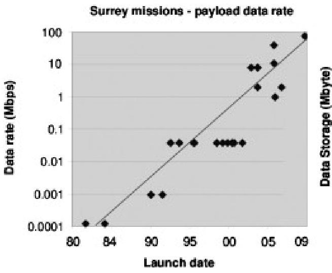
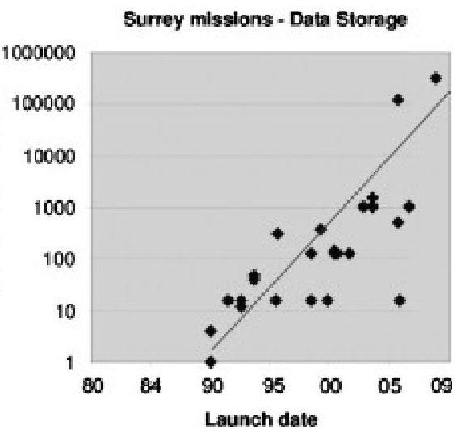
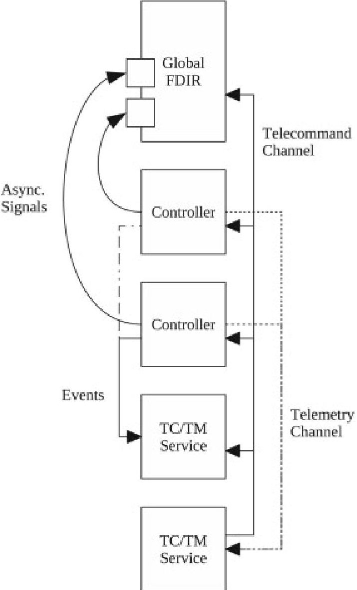
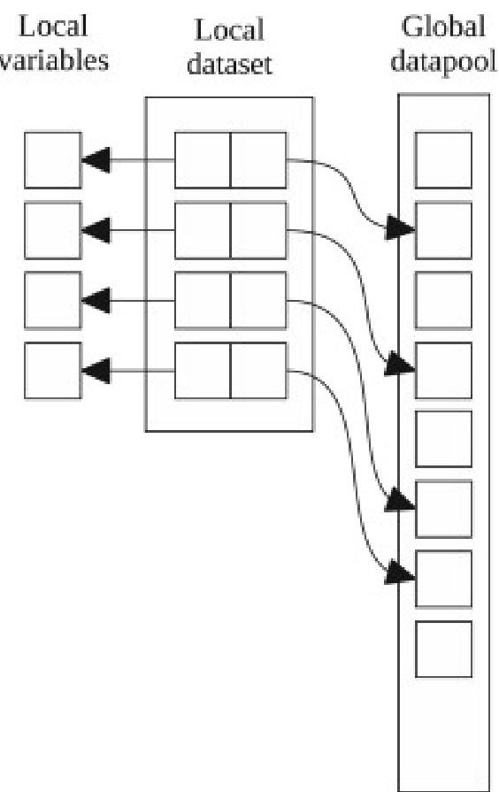
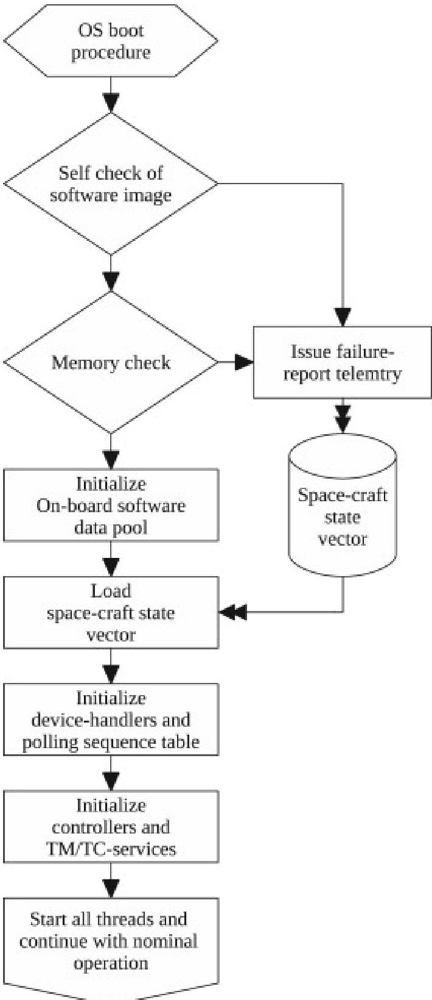
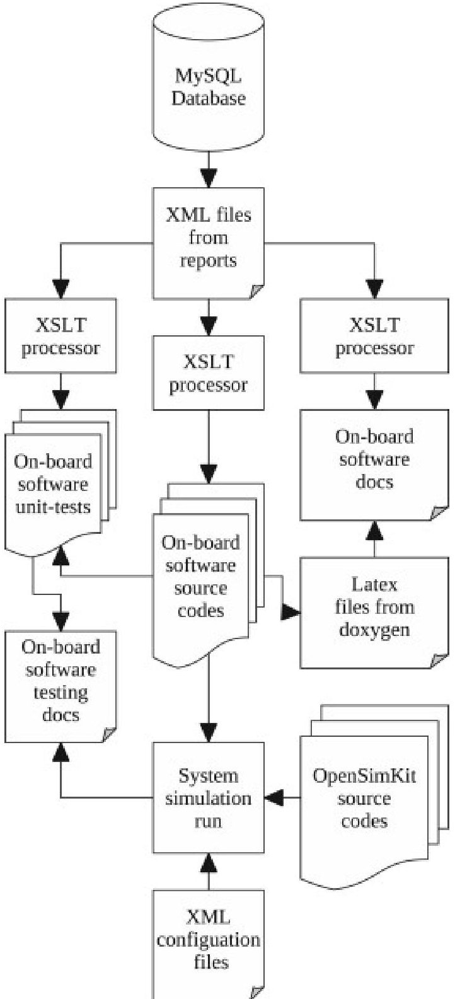

<!-- PDF_PAGE: 1 -->

<div align="center">

# An integrated development framework for rapid development of platform-independent and reusable satellite on-board software

</div>

Claas Ziemke a, Toshinori Kuwahara b 1, Ivan Kossev c DOI: 10.1016/j.actaastro.2011.04.011

## Abstract

Even in the field of small satellites, the on-board data handling subsystem has become complex and powerful. With the introduction of powerful CPUs and the availability of considerable amounts of memory on-board a small satellite it has become possible to utilize the flexibility and power of contemporary platform-independent real-time operating systems. Especially the non-commercial sector such like university institutes and community projects such as AMSAT or SSETI are characterized by the inherent lack of financial as well as manpower resources. The opportunity to utilize such real-time operating systems will contribute significantly to achieve a successful mission. Nevertheless the on-board software of a satellite is much more than just an operating system. It has to fulfill a multitude of functional requirements such as: Telecommand interpretation and execution, execution of control loops, generation of telemetry data and frames, failure detection isolation and recovery, the communication with peripherals and so on. Most of the aforementioned tasks are of generic nature and have to be conducted on any satellite with only minor modifications. A general set of functional requirements as well as a protocol for communication is defined in the SA ECSS-E-70-41A standard "Telemetry and telecommand packet utilization". This standard not only defines the communication protocol of the satellite-ground link but also defines a set of so called services which have to be available on-board of every compliant satellite and which are of generic nature. In this paper, a platform-independent and reusable framework is described which is implementing not only the ECSS-E-70-41A standard but also functionalities for interprocess communication, scheduling and a multitude of tasks commonly performed on-board of a satellite. By making use of the capabilities of the high-level programming language C/C++, the powerful open source library BOOST, the real-time operating system RTEMS and finally by providing generic functionalities compliant to the ECSS-E-70-41A standard the proposed framework can provide a great boost in productivity. Together with open source tools such like the GNU tool-chain, Eclipse SDK, the simulation framework OpenSimKit, the emulator QEMU, the proposed on-board software framework forms an integrated development framework. It is possible to design, code and build the on-board software together with the operating system and then run it on a simulated satellite for performance analysis and debugging purposes. This makes it possible to rapidly develop and deploy a full-fledged satellite on-board software with minimal cost and in a limited time frame.

## 1. Introduction

Small satellites can be categorized in respect to the satellite ordering customer into four different groups. The first group is constituted by the agency ordered satellites which are mainly scientific missions. The second group is constituted by the commercial and industry satellites. This group of satellites is characterized by the goal to create revenue through delivering a product to customers. The third group is constituted by the military satellites which are ordered and operated by military organizations. The last group of small satellites is formed by the university and amateur satellites [1]. These amateur and university small satellites are usually designed following different design principles compared with small satellites of the groups one to three. Those design principles are mostly "Keep it simple, Stupid!" (KISS) and mean that any unneeded complexity should be avoided in order to make the satellite more reliable.

In addition to small budgets, university and amateur satellite projects also are characterized by limited human resources. This lack of human resources, especially in the field of software engineering, the design principles and the usage of non-standard communication protocols often lead to non-optimal operation scenarios.

<!-- PDF_PAGE: 2 -->

All of the aforementioned groups have in common that also small satellites follow Moore's law [2]. The computational power of the on-board data-handling subsystems as well as the data rates and storage capacity have increased significantly in the last years. This trend in data rates and amount is shown in Fig.1: Moore's law for small satellites. Especially when using commercial of the shelf parts, the performance is significantly increased. The rising complexity of the hardware can only be dealt with a more complex software system [3].








<div align="center">

Fig. 1. Moore's law for small satellites [2].

</div>

In order to deal with rising complexity of hardware and software as well as with the limited human resources, an on-board software framework currently is being developed by the author in the course of a university small satellite program. The main design goals of this on-board software framework are re-usability, platform independence, interoperability and extendability. The usage of a framework for the development of a satellite on-board software allows the software engineers to focus on essential features such as control algorithms and mission specific functionalities. It also allows the reuse of generic parts of the on-board software. The usage of standardized communication protocols makes possible the usage of agency ground stations and fosters interoperability.

In addition to the on-board software framework itself, an integrated development flow is currently under development in order to test and verify the proposed on-board software framework. This development flow consists of the following steps: First the on-board software framework runs on Xenomai real-time Linux and can be tested extensively using standard software development practice such as unit testing, code coverage analysis, memory profiling and so on. [4]. After the basic functionality is tested, the on-board software runs inside a simulated on-board computer connected to a simulated satellite. The simulated parts of this environment are then gradually replaced with real hardware, starting with the on-board computer. The on-board software then runs on a development board or a breadboard-model of the on-board computer which again is connected to a simulated satellite. Finally, the on-board software runs on the on-board computer connected to the real satellite hardware. This development flow is called system simulation and is state-of-the-art in industrial satellite projects [5].

The goal of the integrated development framework described in this paper is to allow university and amateur satellite projects to use system simulation in the development process together with the proposed on-board software framework. This can lead to a great boost in productivity because the developers can concentrate on the architectural design of the on-board software and neither have to implement infrastructural features such as schedulers and interprocess communication methods nor testing infrastructures such as simulators. This again can, together with the usage of standardized communication protocols, lead to superior operational scenarios compared to conventional approaches.

## 2. Simulation framework

<!-- PDF_PAGE: 3 -->

For embedded software and especially safety critical software profound testing and verification is essential. Traditionally the testing of the software is done by so called "unit tests" and code coverage analysis [4]. In the case of a satellite on-board software this is not sufficient because these tests only cover the verification. To validate the software, it has to be tested running on the real hardware and communicating with the devices connected to the on-board computer. Since the on-board computer usually is a long-lead item and may not be available early in the development time-line of the on-board software a so called system simulation has to be used instead [5]. In the following sections a system simulation environment is outlined which is completely made of open source tools and does not require expensive hardware.

## 2.1. Selected tools

## 2.1.1. OpenSimKit

A system simulator for a small satellite is made up from two major components. The first is the simulator of the satellite components and environment. It simulates all aspects which are of relevance for the testing of the on-board software and the operational procedures. In the case of a satellite this is not only the satellite's environment such as the gravitational and magnetic field of the earth, atmospheric drag, solar radiation and so on, but also every device on-board of the satellite. The devices are simulated with all relevant aspects such as thermal behavior, electrical properties and communications with the on-board computer. The open source system simulation framework OpenSimKit is used for this purpose [6].

OpenSimKit provides the functionality to simulate complex systems by modeling the system topology. Additionally the OpenSimKit kernel features a differential equation solver that has the ability to solve, on system level, both initial value problems as well as boundary value problems [6]. OpenSimKit is a modular service-oriented framework and is programmed in Java [7]. It is divided into the simulation kernel which is responsible for solving the differential equation system and a model library. In OpenSimKit every part of the satellite and the environment is represented by such a dedicated model object.

Currently, OpenSimKit provides a complete rocket upper stage simulation including propellant and oxidizer tanks, high-pressure blowout tanks, pipes, pressure regulators, valves, a rocket engine and so on. Furthermore, a gravitational model and a structural model are available to provide a coarse orbit propagation. A simple graphical user interface can be used to command the simulator. OpenSimKit furthermore provides interfaces for a real-time 3D visualization with the open-source celestial visualization tool Celestia [8]. The simulator is configured through XML files. This approach is identical to commercial system simulators and has the advantage that the system topology of the simulation can be changed independently from the model implementations. Integration time steps and simulation speed can also be specified in the corresponding XML file.

## 2.1.2. QEMU

The second part of the system simulation is the on-board computer itself. Usually this is done with special hardware that emulates the processor of the on-board computer. This hardware usually is very expensive and complicated to integrate into a system simulation environment. In the case of a small satellite project at a university institute or an amateur small satellite project it may not be possible to purchase such hardware because of the high cost.

Because of this high cost and OpenSimKit is programmed in Java and therefor is not capable of simulating the on-board computer of a satellite in real-time without major re-factoring [9], in the proposed open system simulation environment the task of the processor emulation is conducted by QEMU. QEMU is a machine emulator. It can run an unmodified target operating system and all its applications in a virtual machine. QEMU can emulate a broad range of different hardware architectures including the widely used SPARC architecture. QEMU runs on several host operating systems. The host and target CPUs can be different [10]. The primary usage is

<!-- PDF_PAGE: 4 -->

to run one operating system on-top of another and to provide simulation capabilities for development boards which are not available or to expensive for software developers. For example QEMU is used as back-end for Google's Android software development kit. QEMU also can be used for debugging because the virtual machine can be easily stopped, its state can be inspected, saved and restored [11].

Nevertheless QEMU is targeted towards virtualization and emulating desktop systems such as PCs. Since satellite peripherals substantially differ from standard PC peripherals, these have to be modeled separately. A method to connect QEMU with peripherals modeled in SystemC has been described in [12].

## 2.1.3. SystemC

SystemC is a set of C++ classes and macros which provide an event-driven simulation kernel. These facilities enable a designer to simulate concurrent processes, described using plain C++ syntax. SystemC processes can communicate in a simulated real-time environment, using signals of all data types offered by C++, the SystemC library, or user defined ones. SystemC mimics hardware description languages such as VHDL or Verilog, but is more precisely described as a system level modeling language [13].

SystemC has some advantages over VHDL or Verilog. One of the most important advantages is the fact that it is very easy to simulate the coded process because it can be compiled with a standard C++ compiler. Nevertheless if only a specific subset of SystemC is used the design also can be synthesized and used for FPGA or ASIC development. This makes hardware-software co-development very efficient. Also all available C++ libraries and methods can be used inside a SystemC design. This makes the communication between the SystemC model and the C based QEMU as well as with the Java based OpenSimKit very easy. It shall not be neglected that the usage of network sockets for communication makes the timing behavior of the simulated hardware less accurate, but still the functional behavior of the device stays the same.

## 2.2. Development flow

The typical development flow when using system simulation starts with a completely simulated satellite. The first step of the development flow is to define the architecture of the on-board software. Afterwards the functionalities and the algorithms of the onboard software are defined. The algorithms are tested on a special simulator test-bench called functional verification bench. This simulator configuration is used to verify the logic of the algorithms. At this stage the algorithms still are implemented in Matlab or another high level representation and do not necessarily have the same timing behavior as later in software. In the proposed open-source simulation environment the system simulator is OpenSimKit and the algorithms can run either in SciLab, an open-source Matlab alternative, or in C++ running on Xenomai Linux.

When the algorithms are verified, all on-board software functionalities are implemented and tested in isolated unit tests. After testing the isolated functionalities the on-board software is integrated and verified on the second simulator configuration. This simulator configuration features a system simulator and an on-board computer simulator, running the on-board software. The workbenches cannot represent the behavior of the system one to one because OpenSimKit is implemented in Java and Java is known to have limited real-time performance [9]. Nevertheless only system simulation, even with limited performance, allows the testing of the on-board software as a whole with representative inputs.

The on-board software also has to be tested on the real hardware because of the limited real-time performance of Java and since QEMU even in combination with SystemC, at the current stage of the development, cannot represent an on-board computer in all aspects. For this purpose OpenSimKit will be connected with a development board or a breadboard-model of the on-board computer [5].

<!-- PDF_PAGE: 5 -->

## 2.3. Supported operating systems

The open system simulation framework runs on every platform which is supported by QEMU and has a working Java platform. Currently the development framework has been set up and tested on GNU/Linux and Windows, but it should also work under Mac OS X, NetBSD, FreeBSD, OpenBSD and OpenSolaris. Currently the system simulation framework is not capable of real-time execution, but contemporary personal computers are fast enough to achieve near real-time performance.

## 2.4. Conclusion

The proposed system simulation framework enables the simulation of a complete satellite including the on-board computer. This enables the development and testing of on-board software very early in the product-life cycle of the satellite. Furthermore, it is possible to evaluate the interaction of the on-board software with the satellite's peripherals and the interaction of the whole system with the space environment. This configuration commonly is called software verification facility. Another important benefit of the proposed architecture is the possibility to efficiently co-design the on-board computer and the on-board software of the satellite (hardware-software functional partitioning).

For demonstration purposes a SystemC module has been developed which acts as an external memory to the emulated processor. A 2.6.34 Linux kernel is running on the emulated ARM processor and a standard Linux driver was adapted for the SystemC module. Finally an example algorithm was developed which commands a Hohmann transfer for the rocket upper stage simulated by OpenSimKit. In the future the "VersatilePB" platform emulated by QEMU will be changed to a "Gumstix" platform for which an RTEMS (RTEMS is a real-time embedded operating system) board support package is available. Then a RTEMS driver for the SystemC module will be developed so that a real on-board software can be tested on the proposed software verification facility.

Also an innovative project "Couverture" is currently investigated for their usage in the development framework. Couverture is an open-source project based on QEMU. It modifies QEMU in such a way that it can be used for non-intrusive code coverage analysis Traditionally code coverage analysis is done by equipping the generated object files with hooks so that the coverage information can be gathered while executing the object files. This not always is possible and because it is intrusive may produce non-representative results. Couverture enables non-intrusive coverage analysis which means that a specially equipped QEMU instance produces the coverage data while executing the not equipped binary [14].

## 3. On-board software framework

## 3.1. Framework tools

The selection of an appropriate programming language is essential for the success of a software project. For embedded real-time systems such as a satellite, a programming language has to be chosen which allows direct interaction with the underlying operating system and the hardware. Also memory footprint is a major issue in the case of embedded systems. This rules out all recent high-level languages like Java, Python or Ruby. Also it was chosen to use a widely known language to ease the contribution of other programmers to the project. For those reasons C, C++ and Ada were chosen to be investigated in greater detail.

Ada is a structured, statically typed and object-oriented high-level computer programming language. Ada is strongly typed and compilers are validated for reliability in mission and safety-critical applications [15].

C is an procedural systems implementation language. It was designed to to provide low-level access to memory, to provide language constructs that map efficiently to machine instructions, and to require minimal runtime support. C is therefore useful for many

<!-- PDF_PAGE: 6 -->

applications that had formerly been coded in assembly language. Despite its low-level capabilities, the language was designed to encourage machine-independent programming. A standards-compliant and portably written C program can be compiled for a very wide variety of computer platforms and operating systems with little or no change to its source code [16].

C++ is a statically typed, free-form, multi-paradigm, general-purpose programming language. It is regarded as a middle-level language, as it comprises a combination of both high-level and low-level language features. The language began as enhancements to C, first adding classes, then virtual functions, operator overloading, multiple inheritance, templates, and exception handling among many other features [17].

Because of the following reasons C++ is chosen as the base programming language for the on-board software framework. C++ is one of the most widely used programming languages in the world. It is supported on virtually every hardware and every operating system. It is a multi-paradigm general purpose programming language and is extensible through many well tested open-source libraries. Finally, it is compromised by a combination of both high-level and low-level language features which makes it well suited to program complex system which also have to directly interact with the underlying hardware.

It is not neglected that C++ also has some considerable disadvantages compared to Ada, but it is pragmatic to rather choose a language which might not be the best in means of hardware efficiency and real time performance but rather a language which is widely known. This enables a greater productivity by neglecting a long learning phase and promises to deliver a usable on-board software in a short time frame.

Programming a complex system by only using basic language features is in the best case tedious and unproductive, in reality it is mostly impossible. In order to resolve this problem C++ provides numerous features to directly support library building and use [18]. In the field of embedded systems and especially in the case of programming software for a satellite the used libraries have to be carefully chosen. Key requirements for the used libraries are code quality, efficiency and maintainability. This naturally enforces the usage of open-source libraries because this ensures the maintainability and the possibility to assess the code quality and efficiency. All this requirements are fullfilled for the C++ standard template library and the Boost C++ libraries.

Boost provides free peer-reviewed portable C++ source libraries and emphasizes libraries that work well with the C++ standard template library. Boost aims to establish "existing practice" and provide reference implementations so that Boost libraries are suitable for eventual standardization. Ten Boost libraries are already included in the C++ Standards Committee's Library Technical Report (TR1) and will be in the new C++0x Standard now being finalized. C++0x will also include several more Boost libraries in addition to those from TR1. More Boost libraries are proposed for TR2. Boost is distributed under the Boost license which allows both commercial and non-commercial use [19].

As mentioned in the section above, one main design goal of the proposed on-board software framework is platform independence and portability. This is ensured by the usage of C++. C++ is supported on a wide range of different hardware architectures. Currently the software is built with the gnu compiler collection (GCC) version $ \geq 4. 3. 3 $ which supports over 60 different hardware architectures [20].

The proposed on-board software framework is compatible to multiple operating system application programming interfaces (APIs). The main targeted API is the native API of the real-time executable for multiprocessor systems (RTEMS). RTEMS is an open-source hard real-time operating system that is developed by the On-line Applications Research Corporation. RTEMS has a significant heritage in the space sector and for example is used on the Herschel and Planck missions or on LISA Pathfinder [21]. Currently only the native Xenomai API is supported in addition to the native RTEMS API.

Another main design goal of the proposed on-board software framework is interoperability and re-usability. It is essential to identify a set of functionalities of the on-board software which is of generic nature. A set of generic functionalities is described in the ECSS-E70-

<!-- PDF_PAGE: 7 -->

41A "Ground systems and operations-Telemetry and telecommand packet utilization". While the primary aim of this standard is the structure of telecommand and telemetry packets, it also describes the functionalities that have to be provided in order to be compliant to this standard. The functionalities described in this standard are of generic nature such as "Telemetry packet generation", "Telecommand verification" or "Event reporting" [22]. The proposed on-board software framework aims to provide all these generic functionalities while it is not neccessarily restricted to the described communication protocol.

## 3.2. Programming paradigms and patterns

## 3.2.1. Object orientation

C++ is a multi-paradigm programming language. From the multiple possible programming paradigms the object-oriented paradigm was chosen for the low-level architecture. Object-oriented programming is a programming paradigm in which the program is composed of a set of objects. These objects are again composed of a set of data representing the properties of the object and a set of functions, representing the functionalities of the object. A key of object-oriented programming is the concept of inheritance. This means that an object can inherit attributes and methods from another more general object. This allows code reuse and adaptability of the source code [23].

## 3.2.2. Service oriented architecture

Corresponding to the high-level software architecture requirement of flexibility and extendibility the service oriented architecture is chosen as the high-level programming paradigm. The service oriented architecture is an architectural programming paradigm in which the program is composed of a set of so called software services. Services comprise unassociated, loosely coupled units of functionality that have no function calls to each other embedded in them. Each service implements one distinct action. Instead of services embedding calls to each other in their source code they use defined protocols that describe how services pass and parse messages. This architecture also is implied by the communication standard described above. In this context each service is a thread in the onboard software framework [24].

## 3.2.3. Resource acquisition is initialization

Resource acquisition is initialization is a programming pattern that emphasizes the binding of resources to objects. This enables a very simple way to control the resource, because the acquiring and releasing of the resource is bound to the lifetime of an object. For example in the data pool application programming interface the acquiring of the data pool mutex is done in the constructor of the local dataset object. The global data pool remains locked until the local dataset object is destroyed and the mutex is released in the destructor of the object. This ensures the proper release of the mutex even in case of an exception and also allows a so called commit- roll-back mechanism [25].

## 3.2.4. Intrusive containers

Another important pattern is the usage of so called "intrusive containers". Normally a standard template library container stores a copy of the initial object. In the case of an intrusive container the container only stores a pointer to the object. This means that no dynamic memory allocation or deallocation has to be done when adding an object to the container or removing it from the container. Avoiding dynamic memory allocation is essential in real-time systems because it can lead to unpredictable runtime behavior and to memory leaks. On the downside the programmer has to take care of the lifetime of the objects himself. This enables efficient mechanisms of managing objects. The objects are managed by a single instance in the on-board software framework, while accessing the objects is solely done by the usage of intrusive containers [26].

<!-- PDF_PAGE: 8 -->

## 3.2.5. Visitor pattern

Boost offers a variant library. This variant is a sort of type-safe union which also can store non- "plain-old-data" types. This variants can be "visited" by functions which then are applied to the data of the object in a type-safe manner, regardless of the actual type of the variant. This visitor pattern allows a simple and safe method of manipulating the variant's data and makes the data pool flexible and extensible [27].

## 3.3. Framework architecture

## 3.3.1. General architecture

The on-board software framework is composed of five major parts. The core is formed by the so called "on-board software data pool". The data pool serves as a central instance to hold all information defining the current state of the satellite. The data pool is filled by the device handlers which are the second part of the on-board software framework. The device handlers are serving as translators between the variables in the data pool and the message format which the peripheral hardware understands. On-top of the data pool the controllers are located.

The controllers are responsible for controlling the subsystems of the satellite and are interfacing the data pool. Through this method the controllers are truly platform independent and can be programmed without knowing the underlying hardware properties. The fourth part is formed by the telecommand and telemetry services. They are responsible for telecommand interpretation and telemetry generation. The last part is the failure detection, isolation and recovery system which is spread over all aforementioned parts. In the following sections these parts are described in greater detail. The structure of the on-board software framework is shown in Fig. 2.

<table border="1"><tr><td>Controller layer FDIR</td><td>Software Services</td></tr><tr><td>On-board software datapool</td><td>FDIR</td></tr><tr><td colspan="2">Device handler layer FDIR</td></tr><tr><td colspan="2">Operating system FDIR</td></tr></table>

<div align="center">

Fig. 2. Structure of the on-board software framework.

</div>

## 3.3.2. On-board software data pool

The core of the proposed on-board software framework is the so called on-board software data pool. This data pool is a set of variables which are relevant to multiple threads in the on-board software or are sent or received from hardware devices or have to be interpreted on ground and thus are subject of telemetry generation. Also these variables can be set from ground through telecommands. The on-board software data pool is the major method of interprocess communication between the device handlers and the controllers. The data pool is thread- and exception-safe and has a very simple API. An example of the implementation of the onboard software data pool as well as the usage of the API in a thread is given in the Section 3.4 below. The data pool is a sort of shared memory but in contrary to the latter is type-, exception and thread-safe. It allows the programmer of the controller algorithms and device handler logic to write the code without caring about interprocess communication mechanisms and can be auto-generated from

<!-- PDF_PAGE: 9 -->

an on-board software variable database used in the engineering process of the on-board software. This variable database can also be used to configure the ground station software and telecommand and telemetry packet definition.

## 3.3.3. Device handler layer

The device handler layer is responsible to handle all hardware devices on-board of the satellite. It is composed of a polling sequence table, a thread that executes this polling sequence table and a set of device handler objects. Every device is represented by such a device handler object which provides the functionalities to compose the command messages which are sent to the devices through the operating system's drivers and the functionalities to interpret the response messages received through the drivers. Every device handler is associated with a set of variables in the aforementioned on-board software data pool. By interpreting the relevant variables from the data pool the device handler identifies the mode of the represented hardware and composes a command message to the hardware. This message afterwards is handed-over to the according hardware driver of the interface the hardware is connected to. When receiving a response message from the device driver, the device handler interprets the message and stores the received data in the according variables in the data pool. The device handler functions are executed by the polling sequence table thread according to the user defined and configurable polling sequence table. The polling sequence table can either be a compile time defined structure or can be dynamically altered through telecommands. This approach makes a flexible behavior of the hardware communication possible. For example if a hardware on-board of the satellite is permanently turned off because of a hardware failure, the according device handler can be removed from the system and the according slot in the polling sequence table freed to save system resources for other threads. The device handler logics are mission specific and have to be reimplemented for every mission.

## 3.3.4. Controller layer

The controller layer is responsible to execute all controller algorithms which are needed to control the satellite's subsystems. Typically this layer is composed of an attitude control system, a payload control system, a power control system and a thermal control system. Also in this layer the top-level failure detection, isolation and recovery is located. Each of the aforementioned controllers is represented by a single thread. The threads are scheduled synchronously either by a central scheduler or independently by a dedicated timer. In both configurations the execution behavior can be dynamically controlled through telecommands if needed. The controllers communicate with the hardware solely through the data pool described above. The controller logic itself is not part of the on-board software framework because of the non-generic nature of the controllers. These controllers are mission specific and have to be reimplemented for every mission. The controller logic is made of set of functions which can be added dynamically to the controller threads. The controller threads communicate with each other through the data pool and with the telecommand and telemetry services through the communication channels describe in Section 3.3.7 below.

## 3.3.5. Failure detection, isolation and recovery

The failure detection, isolation and recovery functionalities of the on-board software framework cannot be located in a single layer of the software. Instead it is spread over all layers. Hardware communication problems such as bus errors, glitches or wrong checksums are detected and partially handled in the device handler layer. To make this possible every device handler has a failure detection, isolation and recovery plugin which is a set of functions with the purpose to handle problems and send signals to the top-level failure detection, isolation and recovery thread. The top-level thread then reacts on the problem if needed. For example it turns off the device, switches to a redundant device or triggers a retry of the communication. The same applies to the controller layer.

Every subsystem controller has a failure detection, isolation and recovery plugin which identifies and partially handles problems that might occur in the controller layer. For example the attitude controller should detect any attitude problems such as turning rate violations or sun-avoidance. The handling of the problem again can either be done directly in the plugin of the controller or in the top

<!-- PDF_PAGE: 10 -->

level failure detection, isolation and recovery thread. Again the logic of the plug-ins and the top-level thread is not subject of the onboard software framework, because it is hardware and mission specific [28].

## 3.3.6. Telecommand and telemetry services

The telecommand and telemetry services are a set of threads which constitutes the basic telecommand and telemetry functionalities. These functionalities are of generic nature and a subset have to be implemented on-board of every satellite. The services are based on the ECSS-E70-41A "Ground systems and operations—Telemetry and telecommand packet utilization" standard. The services communicate with each other through the communication channels described below. Parts of the telecommand and telemetry services also can be used for failure detection, isolation and recovery functionalities and interact with controller and device handler logic. The on-board software framework offers functionalities to allow either a clean separation of concerns between the controllers, the device handlers and the telecommand and telemetry services or an integrated approach. This architectural decision has to be made for every mission and is not part of the on-board software framework.

The generation and interpretation of the telemetry and telecommand packets itself is not defined in the telecommand and telemetry services itself but done through plugins. These plugins are of generic nature so that the framework is not limited to the communication protocol defined in the "Ground systems and operations—Telemetry and telecommand packet utilization" standard. The communication protocol has to be defined by the on-board software architect.

## 3.3.7. Communication channels

As mentioned above the main communication method between the controller threads and the hardware is the data pool. Nevertheless there are also five other communication channels which allow interprocess communication.

Three of these channels are implemented as message queues. Multiple instances of these channels can exist in an on-board software and multiple threads can be plugged to any of these channels. The first of these channels is the telecommand channel. Through this channel, the telecommand packets are distributed between the different threads. The telecommand packets are either received through a device handler from the ground or are consumed or produced by a telecommand and telemetry service.

Through the telemetry channel the telemetry packets are distributed between the different threads. Telemetry packets are produced either by a telecommand and telemetry service or by a controller. The telemetry packets either can be sent to the ground directly, filtered out or be stored in a non-volatile telemetry memory for later downlink to the ground station.

Through the telecommand verification and acknowledgement channel information is transported between the different threads and the telecommand verification service. The telecommand verification service then builds telecommand verification or acknowledgement packets from this information. Through this method the step by step execution of telecommands can be observed from the ground.

In addition to these message queues informations can be passed between the threads through so called "events". Events are a method to indicate simple changes in states of the software. For example to indicate a hardware communication error or that a specific variable is out of predefined bounds. No specific information can be transported through an event. Events can be sent asynchronously to a specific thread or set of threads which again can react on the specific event.

Finally, threads can throw signals which can be used to asynchronously call the failure detection, isolation and recovery handler or any other routine. Signals are executed asynchronously and preempt the current running thread. This ensures that specific operations can be executed instantly if needed. Signals are similar to software interupts and specific signal handlers have to be implemented in order

<!-- PDF_PAGE: 11 -->

to deal with the signals. Signal handlers are mission specific and are not part of the framework. A set of signal handlers have to be implemented for every mission if this feature is used in the on-board software design.

## 3.3.8. Configuration of the architecture

The connection of the threads to the specific communication channels is defined when the thread objects are instantiated so that the on-board software architect can plug the threads to the channels as needed for the specific mission. An example configuration is shown in Fig. 3: Interprocess communication. As described in the Section 3.4.4 below the actual connection of the threads to the communication channels is done during system initialization.





<div align="center">

Fig. 3. Interprocess communication.

</div>

The initialization manager will be configured through XML configuration files which are automatically transformed to C++ source code files. These C++ source codes are then compiled and executed during system initialization. The configuration options for every thread include amongst others the stacksize, thread priority, thread properties and communication channels the thread is connected to.

This allows the configuration and initialization of the system without writing any initialization code. The on-board software programmers only have to implement the functionalities of the controller algorithms, the device handlers and the communication protocol if the mission does not use a standard protocol. The on-board software architect can focus on the configuration of the onboard software without having to implement initialization code and routines.

<!-- PDF_PAGE: 12 -->

## 3.4. Framework implementation

## 3.4.1. Data pool

The data pool is implemented as a standard template library map which maps the variables to the according variable IDs so that the variables can be accessed by ID. The usage of the data pool is shown in the code extract to the right.

The "DataSet" object "acsDataSet" initializes an intrusive container which stores the elements needed in the function. The constructor of the "DataSet" object also automatically acquires the global data pool's mutex if it is available or blocks the calling thread. When a new variable of the type "db_xxx_t" is instantiated it automatically inserts itself into the intrusive container as well as the global variable with the ID given in the constructor. After the variable is constructed it can be used like any other variable. It can be used both as right-hand value and as left-hand value in an equation. When the calculations are done the function "doCommit" is called. This functions sets the commit flag of the "DataSet" object. This means that if the destructor is called with the commit flag set to true the values of the local variables are copied to the according data pool variable. If the commit flag is not set, then nothing happens. This means that the values of the local variables are only written to the data pool if no exception happened during the calculations.

This mechanism is called "commit-roll-back" and ensures that no corrupted data is written to the data pool. The whole mechanism is shown in Fig. 4. Because of the use of intrusive containers the whole mechanism does not require any dynamic memory allocation, which as mentioned above is important in real-time systems.

```cpp

void myAcsFunction(){

DataSet acsDataSet;

db_uint16_t sensor_rawdata_x(datapool::sensor_rawdata_x, &acsDataSet);

db_uint16_t sensor_rawdata_y(datapool::sensor_rawdata_y, &acsDataSet);

db_uint16_t sensor_rawdata_z(datapool::sensor_rawdata_z, &acsDataSet);

db_uint16_t sensor_rawdata_sum(datapool::sensor_rawdata_sum, &acsDataSet);

sensor_rawdata_sum=sensor_rawdata_x + sensor_rawdata_y+ sensor_rawdata_z;

acsDataSet.doCommit();

}

```

<!-- PDF_PAGE: 13 -->





<div align="center">

Fig. 4. Concept of data pool API.

</div>

<div align="center">

Source 1: Usage of data pool.

</div>

## 3.4.2. Services and controllers

Every service and controller is implemented as a thread object. The attributes of the thread and the timer are set in the constructor of the thread object. The timer can either be a dedicated timer or a scheduler object. After construction of the thread, the controller algorithm is assigned to the thread and the thread is started. The thread then is scheduled in respect to the defined timing behavior and the priority. In the example Source 1: Usage of data pool, a dummy ACS function is shown which takes three values from the data pool, calculates the sum of these values and writes this sum back to the data pool. In the source code extract Source 2: Defining and starting a thread, this dummy fuction is added to a thread and the thread is started. The more complicated controllers such as the attitude control algorithm can be implemented as state machines if they have more than one operational state. In this case more than one function can be registered to the controller thread, each associated to a specific state of the state machine. Also specific transition

<!-- PDF_PAGE: 14 -->

conditions and transition functions can be specified.

```cpp

status_code status;

Timer myTimer((char*)"ACS",

    ticks_per_second/10, //100ms

    ticks_per_second/10); //100ms

TimedThread myThread((char*)"ACS",

    99,

    MINIMUM_STACK_SIZE*2,

    NO_PREEMPT9TIMESLICE9ASR,

    DEFAULT_ATTRIBUTES,

    &myTimer);

status=myThread.setFunctionality(&myAcsFunction);

if(status==SUCCESS) {

    status=myThread.startThread();

} else{

    //error!!! dealwithit!!!

}

```

<div align="center">

Source 2: Defining and starting a thread.

</div>

## 3.4.3. Device handler

The device handler layer is as mentioned above made from three different parts. The first part is a map of device handlers. Every device of the satellite is represented by a device handler. The map of device handlers is defined during the initialization of the onboard software. Device handlers can be added to or removed from the map dynamically at runtime.

The second part is a list of communication slots called polling sequence table. In the polling sequence table, every communication is defined. Each slot consists of a time, a handler id and an action to be performed by the associated handler. The last part of the device handler layer is the polling task which executes the polling sequence table.

In the source code extract Source 3: Device handler and polling thread, a device handler called "myHandler" is instantiated. Afterwards three functions are set, the command function ("devCommand"), the response function ("devResponse") and the failure detection, isolation and recovery function ("devFDIR-Function"). Then the command slot ("myCommand-Slot"), the response slot ("myResponseSlot") and a polling sequence ("mySequence") are defined. The device handler and the polling slots are then added to the polling sequence table. The timing of the polling is defined by the software architect. Finally the polling thread is instantiated and

<!-- PDF_PAGE: 15 -->

started. Note that the actual starting of the polling thread normally is not done at this place but by an initialization manager which is responsible for initializing the software at startup.

Every device handler has three different methods. One for commanding, one for interpreting the response message and one for the failure detection, isolation and recovery functionalities. If more methods are needed a special function set is planned to be implemented. Through this method the behavior of the polling thread can easily be altered and adapted to the needs of the specific mission.

Because the polling sequence table is implemented in a thread-safe manner it also is possible to distribute the actual polling and device handling over several threads. This allows to devide the devices into mission critical and non-mission critical devices. The mission critical devices can be placed in a seperate thread in order to ensure that the mission critical devices can be operated even during a malfunction in the non-mission critical device handler thread. This approach adds another level of security to the architecture.

The failure detection, isolation and recovery plugin of the device handler is responsible to detect low-level failures. The decision if the failure detection, isolation and recovery plugin directly deals with the failure, for example by initiating a retry, or if it just forwards the error to the global failure detection, isolation and recovery thread through an event or signal is made by the on-board software architect. The framework is implemented in a way that allows both methods. In general it is advisable to handle all failures which are of local nature in the device handler and to handle all failures which have global impact in the global failure detection, isolation and recovery thread.

Device Handler myHandler;

myHandler.setCmdHandler(&devCommand);

myHandler.setRepsonseHandler(&devResponse);

myHandler.setFdirHandler(&devFDIRFunction);

PollingSlot myCommandSlot(0, ticks_per_second/100, true);

PollingSlot myResponseSlot(0, ticks_per_second/50, false);

Polling Sequence mySequence;

mySequence.addDeviceHandler(0, myHandler);

mySequence.addSlot(myCommandSlot);

mySequence.addSlot(myResponseSlot);

PollingThread myPollingThread(&mySequence);

myPollingThread.startThread();

<!-- PDF_PAGE: 16 -->

## 3.4.4. System initialization manager

The initialization of the on-board software is shown Fig. 5. If one of the sanity checks fail, the space-craft will be hibernated and a standard telemetry packet will be sent. This process currently is under development.





<div align="center">

Fig. 5. System initialization.

</div>

## 3.4.5. Sample main function

Following a simple main function is given. Note that this only is an example and is not functional. In some real-time operating systems the main function also has to be renamed because the main function may be owned by a board support package. The "devCommand", "devResponse", "devFDIR" and "myAcsFunction" are defined outside of the main function, either in the same main.cpp file or in another file. The functionality which is shown here will be moved to the aforementioned initialization manager in the future.

<!-- PDF_PAGE: 17 -->

Nevertheless the usage of the initialization manager is not mandatory.

<!-- PDF_PAGE: 18 -->

```c

int my_main() {

uint32_t ticks_per_second=1,000,000,000;

status_code status;

Device Handler devHandler;

devHandler.setCmdHandler(&dev0Command);

devHandler.setRepsonseHandler(&dev0Response);

devHandler.setFdirHandler(NULL);

PollingSlot devCommandSlot(0, ticks_per_second/100, true);

PollingSlot devResponseSlot(0, ticks_per_second/50, false);

PollingSequence mainSequence;

mainSequence.addDeviceHandler(0, devHandler);

mainSequence.addSlot(devCommandSlot);

mainSequence.addSlot(devResponseSlot);

PollingThread pollingThread(&mainSequence);

Timer acsTimer((char*)"ACS",

    ticks_per_second/10, //100ms

    ticks_per_second/10); //100ms

TimedThread acsThread((char*)"ACS",

    99,

    MINIMUM_STACK_SIZE*2,

    NO_PREEMPT|TIMESLICE|ASR,

    DEFAULT_ATTRIBUTES,

    &acsTimer);

status=acsThread.setFunctionality(&myAcsFunction);

status=acsThread.startThread();

status=pollingThread.startThread();

```

return 0;

<!-- PDF_PAGE: 19 -->

Source 4: Simple main function.

## 3.4.6. Conclusion

At the time of writing great parts of the proposed on-board software framework are not yet implemented. The functionalities of the on-board software framework have to be extended and tested. The re-factoring and optimization of the existing code-base is an ongoing process. Furthermore, changes in the upstream libraries have to be merged into the existing code-base.

As mentioned above it is planned to extend the operating system abstraction layer with APIs for eCos and VxWorks. This will enable the usage of the on-board software framework on even more platforms.

The only communication standard currently supported is the ECSS E-70-41A "Ground systems and operations—Telemetry and telecommand packet utilization". It is possible to implement other communications standards as well if this is needed in the future.

Another possibility to extend the on-board software framework is to integrate it with XtratuM. XtratuM is an open source type one hypervisor specially designed for embedded real-time systems available for x86, MIPS and for LEON2 (SPARC v8) processors. It has been developed by the Universidad Politécnica de Valencia (Spain) with contributions of the Lanzhou University (China). It provides a framework to run several operating systems in a robust partitioned environment.

XtratuM can used to build a Multiple Independent Levels of Security (MILS) architecture. All guest operating systems or applications run in user mode and are strictly temporal and spatial isolated. The crash of a single application or operating system can under no circumstances affect the other partitions. If a partition crashes for any reason it can simply be restarted by the hypervisor. The hypervisor manages the inter partition communication, the execution time-line and the access to shared hardware [29].

## 4. Discussion

## 4.1. Implications

The proposed platform independent on-board software framework, together with the open system simulation environment enables a very fast development of on-board software for small satellites, while being compatible with major communication standards. The development can be done on a multitude of development platforms and can easily be integrated into existing development environments.

The usage of reliable and tested operating systems as basis of the on-board software framework keeps the code-base small and makes testing easier. The reuse of generic and thoroughly tested parts of the on-board software enforces reliability of the on-board software.

The resources that are available for software development can be concentrated on functionalities that are of non-generic nature and are essential for the mission. They do not have to be wasted for functionalities that are generic for every mission and are implemented again and again.

The usage of standard communication protocols and the mission scheduling functionalities of the proposed on-board software framework allows the usage of multiple ground stations around the world without the need of dedicated hardware. Agency ground

<!-- PDF_PAGE: 20 -->

stations can be used for contingency operations. Together with the scheduling functionalities this allows operational scenarios which are not common for university or amateur satellites.

It should not be neglected that the usage of an operating system together with the generic nature of the on-board software framework imposes a significant overhead compared with a bare metal on-board software. The proposed on-board software framework does not target cube-sat or similar nano-satellites. Nevertheless if Moore's law is taken into account it seems possible that nano-satellites in the future are powerful enough to use the proposed on-board software framework too.

## 4.2. Integration of the development framework

The integration of the tools described in this paper is an ongoing process. Through integration into a single development framework equipped with a graphical user interface this framework will lead to the possibility of a rapid prototyping and testing platform for satellite on-board software. Such an infrastructure is shown in Fig. 6.

<!-- PDF_PAGE: 21 -->





<div align="center">

Fig. 6. Integrated development flow.

</div>

The information about the configuration of the on-board software framework will be stored in a central database. From this database the configurational source codes are auto-generated through XML reports and XSLT processors. XSLT is a XML translation language which allows to translate XML files to C++ source code as well as to XML based document formats for the on-board software documentation [30]. This documentation is furthermore expanded through source code documentation by doxygen [31].

Also an automated unit-testing framework is under development which allows automated unittesting of the on-board software. Together with the system simulation framework it is possible to extensively test the on-board software. Finally the outputs of the system simulation runs together with the unit-testing outputs and the code-coverage analysis generate the testing documentation of the on-board software. All tools used for this infrastructure are open source and free to use. This ensures maintainability and extendability.

<!-- PDF_PAGE: 22 -->

Because of the fact that all of the used programs and tools are distributed under open-source licenses the proposed framework can be used in non-commercial environments such like universities as well as in commercial endeavors. The availability of the framework free of liabilities and license cost makes the framework very attractive for community satellite projects such as AMSAT or SSETI. Because the source code is available from the OpenSimKit homepage www.opensimkit.org satellite developers are free to add functionalities needed in the specific project and to tune the simulation environment to the special needs of the mission [32].

## References

[1] Anon, Received September 08, 2010, <http://centaur.sstl.co.uk/SSHP/sshp_intro.html> . Google Scholar

[2] M. Sweeting, Small satellites & Moore's Law implications for earth observation, Keynote presentation, 7th IAA Symposium on Small Satellites for Earth Observation, Berlin, Germany, 2009. Google Scholar

[3] N. Wirth

A plea for lean software

Computer, 28 (2) (1995), pp. 64-68

View in Scopus Google Scholar

[4] B. Beizer, Software Testing Techniques, second ed., 1990. Google Scholar

[5] J. Eickhoff Simulating Spacecraft Systems, 978-3-642-01275-4, Springer (2009) Google Scholar

[6] J. Eickhoff, M. Fritz, R. Witt, I. Kossev, M. Kobald, A. Brandt, Opensimkit-an open-source system simulation environment applied to space projects, Presented at the 4th International Conferene on Astrodynamic Tools and Techniques, Madrid, Spain, 3-6 May 2010. Google Scholar

[7] M. Bell Service-oriented Modeling: Service Analysis, Design, and Architecture 978-0-470-14111-3, Wiley & Sons (2008) Google Scholar $ \rangle $

[8] R. Witt, M. Fritz, T. Kuwahara, A. Brandt, C. Laurel, H.-P. Röser, J. Eickhoff, Real-time 3D visualization in satellite development, Presented at the 4th International Conference on Astrodynamic Tools and Techniques, Madrid, 3-6 May 2010.

<!-- PDF_PAGE: 23 -->

[9] A. Nilsson, T. Ekman, K. Nilsson, Real Java for real time-gain and pain, in: Proceedings of the 2002 International Conference on Compilers, Architecture, and Synthesis for Embedded Systems, Grenoble, France, October 8-11, 2002 Google Scholar

[10] F. Bellard, QEMU, a fast and portable dynamic translator, in: Proceedings of the USENIX 2005 Annual Technical Conference, 2005. Google Scholar

[11] P. Brook, D. Jacobowitz, Reversible debugging, Presented at the 2007 GCC Developers' Summit, 2007. Google Scholar

[12] M. Montón, A. Portero, M. Moreno, B. Martínez, J. Carrabina, Mixed SW/SystemC SoC emulation framework, in: IEEE International Symposium on Industrial Electronics (ISIE), 2007. Google Scholar

[13] T. Grötker, S. Liao, G. Martin, S. Swan System Design with SystemC, 978-1-402-07072-3, Springer (2002) Google Scholar

[14] M. Bordin, C. Comar, T. Gingold, J. Guitton, O. Hainque, T. Quinot, Object and source coverage for critical applications with the C OUVERTURE open analysis framework, ERTS2 2010 embedded real-time software and systems. Google Scholar

[15] ISO/IEC 8652:1995: Information technology - Programming languages - Ada International Organization for Standardization, Geneva, Switzerland. <http://www.iso.org/iso/catalogue_detail.htm?csnumber=22983> , Retrieved September 07, 2010. Google Scholar

[16] ISO/IEC IS 9899:1999: Programming languages-C International Organization for Standardization, Geneva, Switzerland, <http://www.iso.org/iso/catalogue_detail.htm? csnumber=29237> , Retrieved September 07, 2010.

Google Scholar

<!-- PDF_PAGE: 24 -->

[17] ISO/IEC IS 14882:2003: Programming languages—C++ International organization for standardization, Geneva, Switzerlandm, http://www.iso.org/iso/catalogue_detail.htm? csnumber=38110f , Retrieved September 07, 2010. Google Scholar

[18] B. Stroustrup The C++ Programming Language, Special ed 978-0-201-70073-2, Addison-Wesley Longman, Amsterdam (2000) Google Scholar $ \rightharpoonup $

[19] B. Karlsson, Beyond the C++ Standard Library, An introduction to boost, Addison-Wesley Longman, Amsterdam, Isbn:978-0-321-13354-0. Google Scholar

[20] R.M. Stallman, Using and porting the GNU compiler collection, Free Software Foundation, Boston, Isbn:1-882114-37-X. Google Scholar

[21] J. Ortega-Ruiz, A. Conchillo, X. Xirgu, C. Boatella Mission critical software in LISA Pathfinder AIP Conference Proceedings, 873 (2006), pp. 697-701 Crossref View in Scopus Google Scholar

[22] Anon, ECSS-E70-41A, Ground System and Operation—Telecommand and Telemetry Packet Utilization, 2003. Google Scholar

[23] E. Gamma, R. Helm, R. Johnson, J. Vlissides Design Patterns: Elements of Reusable Object-oriented Software 978-0-201-63361-0, Addison-Wesley Longman, Amsterdam (1995) Google Scholar

[24] M. Bell Service-oriented Modeling: Service Analysis, Design, and Architecture 978-0-470-14111-3, Wiley & Sons (2008) Google Scholar

[25] B. Stroustrup The Design and Evolution of C++ 0-201-54330-3, Addison-Wesley (1994)

<!-- PDF_PAGE: 25 -->

Google Scholar

[26] O. Krzikalla, I. Gaztañaga, Retrieved September 07, 2010, from lang;http://www.boost.org/doc/libs/1_44_0/doc/html/intrusive.html $ \rangle $ , 2008. Google Scholar $ \rangle $

[27] R.C. Martin The Principles, Patterns, and Practices of Agile Software Development 978-0-135-97444-5, Prentice-Hall International (2002) Google Scholar

[28] R. Gessner, B. Kösters, A. Hefler, R. Eilenberger, J. Hartmann, M. Schmidt, Hierarchical FDIR Concepts in S/C systems presented at SpaceOps 2004, Montreal, Canada, 17-21 May 2004. Google Scholar

[29] M. Masmano, I. Ripoll, A. Crespo, J.J. Metge, XtratuM: a Hypervisor for safety critical embedded systems, 11th Real-time Linux Workshop, Dresden, Germany, 2009. Google Scholar

[30] D. Tidwell XSLT (2nd ed), 978-0-596-52721-1, O'Reilly Media (2008) Google Scholar

[31] D. Heesch, version 2011, doxygen, Manual for Version 1.7.3. Google Scholar

[32] <http://opensimkit.org/resources/osk-j-3.7.0-src.zip> . Google Scholar