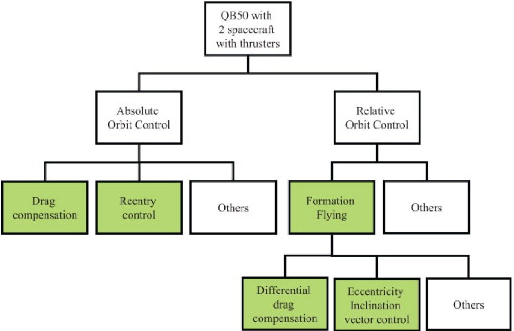
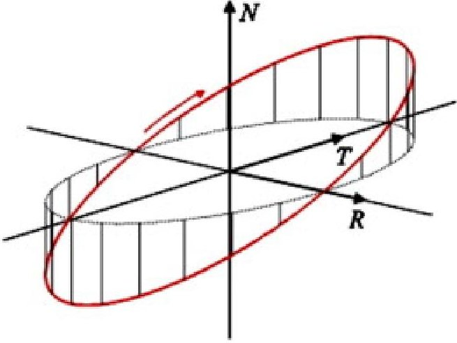

<!-- PDF_PAGE: 1 -->

# Formation flying within a constellation of nano-satellites: The QB50 mission

E. Gill a, P. Sundaramoorthy a, J. Bouwmeester a, B. Zandbergen a, R. Reinhard b DOI: 10.1016/j.actaastro.2012.04.029

## Abstract

QB50 is a mission establishing an international network of 50 nano-satellites for multi-point, in-situ measurements in the lower thermosphere and re-entry research. As part of the QB50 mission, the Delft University of Technology intends to contribute two nano-satellites both being equipped with a highly miniaturized propulsion system in addition to the science payload. This allows to demonstrate formation flying between these two nano-satellites which will enhance the mission both with respect to technology demonstration and science return. The opportunities and challenges of formation flying by a subset of satellites within a constellation of freely floating spacecraft are systematically identified and analyzed.

## Highlights

We describe a novel mission for measurements in the lower thermosphere. We introduce a new approach to integrate formation flying into a swarm mission. We analyze the potential of formation flying for atmospheric science and technology. We present a novel method for GNC requirements for formation flying missions. We analyze actuator and operational needs for the mission.

## 1. Introduction

## 1.1. CubeSats and their objectives

CubeSats are standardized miniature satellites measuring $ 1 0 \times1 0 \times1 0 $ cm and having a mass of about 1kg [1]. The general concept for such satellites originated in 1998 at Stanford University's Space Systems Development Laboratory and the first CubeSats were launched in 2003. CubeSats have been developed primarily as an education tool, e.g. Delfi-C3 [2]. A rapid growth of the number of universities worldwide developing CubeSats is still ongoing with, at present, for example more than 30 universities in Europe.

A secondary objective often is to take benefit from their short development times of 2-4 years for technology demonstration [3]. In addition to these objectives, the use of CubeSats is more and more exploited for commercial services and business, e.g. to support the Automatic Identification System (AIS) in the maritime sector [4], as well as for military applications [5].

The use of CubeSats for science and Earth observation, however, still is in its infancy. This status is primarily caused by the severe constraints that CubeSats imply on scientific missions in terms of the available form factor, mass, power and functional capabilities. A continued miniaturization of payload and components is expected to alleviate some of these constraints in the upcoming future.

## 1.2. Formation flying of small satellites

Formation flying of satellites is typically associated with a small number of spacecraft flying in a concerted way at regional intersatellite separations. An example of a formation flying mission for Earth Observation is the TanDEM-X and TerraSAR-X mission, established in 2010 [6]. While TanDEM-X and TerraSAR-X are large spacecraft both with a mass of about 1200kg, technology advance and constrained space budgets push towards the use of small spacecraft for formation flying missions as well. An example of a formation flying mission of micro-satellites is the Swedish-led Prisma mission, where two spacecraft Mango and Tango of mass 145kg

<!-- PDF_PAGE: 2 -->

and 45kg, respectively, establish an in-orbit test-bed for Formation Flying and Rendezvous technology [7]. Formation flying demonstration of a nano-satellite and a micro-satellite had been attempted in 2000 with the SNAP-1 spacecraft with a mass of 6.5kg and the Tsinghua-1 spacecraft with a mass of 50kg [8]. So far, no formation flying missions using CubeSats have been demonstrated.

## 1.3. QB50 mission characterization

While a single CubeSat does not yet allow for significant scientific research, fundamental scientific questions can be addressed which are inaccessible otherwise when combining a large number of CubeSats with identical sensors into a space network. QB50 has the scientific objective to study the variations of a number of key constituents and parameters in the lower thermosphere (90-320km) with a network of 50 double CubeSats which carry identical sensors. The lower thermosphere is the least explored layer in the Earth's atmosphere.

Within the QB50 mission, all 50 CubeSats will be injected subsequently by a single launcher into a near-circular highly inclined orbit at an expected altitude of about 320km [9]. The preliminary analysis in the following is based on a value of 300km instead. Due to atmospheric drag, the semi-major axes of the CubeSat orbits will decrease and lower layers of the thermosphere will subsequently be probed. The spatial spacecraft distribution of the individual spacecraft is governed by the separation conditions from the launcher and orbital deployers, natural dynamical perturbations as well as the spacecraft characteristics.

QB50 is unique in the sense that no atmospheric network mission for in-situ measurements has been carried out in the past or is planned for the future. A network of low-cost CubeSats is the only realistic option for in-situ measurements in the lower thermosphere.

## 2. Top-level mission analysis

The QB50 mission is unique in establishing a space network at around 300km altitude. Associated with this low altitude is a rapid decay of the satellite orbits and a short mission duration ranging from eight days (solar maximum, maximum spacecraft cross-section) to 85 days (solar minimum, minimum spacecraft cross-section) [9]. Nevertheless, the low altitude provides several unique advantages which are particularly relevant for the QB50 mission [10]:

- Higher payload capacity for a given launcher increasing the number of satellites.

- Orbital lifetime much less than the 25 years stipulated by international regulations.

- Higher data rates for given onboard power due to short communication distances.

- Benign radiation environment facilitating low-cost Commercial-Off-The-Shelf (COTS).

In the following, focus is given to opportunities arising from two QB50 spacecraft being equipped with a propulsion system. Such an enhancement allows adding more dimensions to the science case and realizing innovative technology demonstration opportunities.

It is assumed that the CubeSat propulsion system can be employed within the orbital lifetime of the satellites to modify the spacecraft orbit in a controlled manner. This assumption may not only be supported by capable spacecraft subsystems, such as an Attitude and Orbit Control System (AOCS), but may also be justified by operational procedures. Most importantly, the assumption depends on the planned absolute and relative orbit configuration and specific requirements imposed on the orbit control.

<!-- PDF_PAGE: 3 -->

A systematic concept of opportunities arising from the use of two spacecraft equipped with propulsion systems is shown in Fig.1. Here, we divide concepts into absolute and relative orbit control. Absolute orbit control could, in principle, be used for, e.g., drag compensation or controlled re-entry, both of which have been studied for QB50 in [11].

Fig.1. Concept analysis of an enhanced QB50 space segment comprising two satellites. Each of the satellites is equipped with a propulsion system. Filled boxes indicate potential feasibility.

## 2.1. Formation flying

The availability within the QB50 space segment of two spacecraft both equipped with a propulsion system offers various relative orbit control options. Among these, formation flying is the most interesting option which offers, on a higher abstraction level, the following major opportunities:

1. Enhanced science return.

a. Controlled baselines in space for

- coordinated measurement retrieval and

- enhanced coverage.

b. Adaptation of relative geometry to science needs.

c. Flexibility to change relative configuration within the mission sequence.

d. Enhanced characterization of (relative) atmospheric drag due to adjustable baselines.

<!-- PDF_PAGE: 4 -->

e. Extended cross-calibration of payload.

## 2. Technology demonstration for

a. Propulsion systems.

b. Absolute and relative navigation.

c. Absolute and relative maneuver execution using distributed actuators.

d. Formation flying with CubeSats.

3. Systems Engineering for distributed miniaturized space systems

a. Hybrid space system architecture comprising swarm and formation flying.

b. Autonomy concepts.

c. Operations concepts.

d. Reliability concepts.

There is no fundamental difference between formation flying for CubeSats and formation flying for larger spacecraft. Thus, relative motion configurations can be selected, and adapted during the mission, as for any other formation flying mission. However, depending on the requirements for formation flying, the realization of formation flying might be completely different. This is caused by constraints on the key budgets of the CubeSats in terms of mass, volume, power, as well as aspects such as technologies used, limited functionalities, engineering philosophy and risk approaches. A further difference stems from the limited onboard propellant and the short mission time. Thus, significant changes of orbital planes and highly complex operations sequences appear prohibitive for a formation flying demonstration within QB50.

## 2.2. Formation flying to compensate differential drag

It is assumed that TU Delft provides two identical CubeSats, each equipped with their own propulsion system. Even in such a case, the two satellites will not have a static relative geometry but will, in the absence of relative orbit control, predominantly exhibit an increasing along-track separation. This differential drag effect is caused by various residual effects, such as

- Different atmospheric density due to complex density distribution and variations.

- Different initial conditions, e.g. by the separation sequence and deployment mechanism.

- Different attitude motion causing the spacecraft cross-sectional area to vary.

- Different spacecraft masses due to different thruster activities on each spacecraft.

<!-- PDF_PAGE: 5 -->

Differential drag for non-identical spacecraft may be modeled as differential acceleration $ \Delta a_{D} $ according to

$$
\Delta a _ {D} \approx \frac {1}{2} \left(C _ {D 1} \frac {A _ {1}}{m _ {1}} \rho \left(r _ {1}\right) - C _ {D 2} \frac {A _ {2}}{m _ {2}} \rho \left(r _ {2}\right)\right) v _ {a} ^ {2}
$$

where $ \rho(\mathrm{r}) $ denotes the atmospheric density at position r and $ \nu_{a} $ the spacecraft velocity with respect to the atmosphere. Evidently, differential drag is caused primarily by the difference in the product of the dimensionless drag coefficient $ C_{D} $ (describing the interaction of the atmosphere with the spacecraft surface material) and the area-to-mass A/m ratio for the two satellites with indices 1 and 2, respectively.

For a QB50-type orbit at an altitude of 300km the typical maximum atmospheric density is about $ 3 5 \mathrm{g} / \mathrm{k m}^{3} $ . In the general case of all QB50 spacecraft, two distinct spacecraft may have ballistic coefficients differing by a factor of 2 which corresponds, based on $ C_{D}=2. 3 $ and $ A/m=0. 0 1 \mathrm{m}^{2} / \mathrm{k g} $ , to a differential drag with a magnitude of $ 2. 4 \times1 0^{-5} \mathrm{m} / s^{2} $ . This causes the evolution of a differential semi-major axis of 230m per orbit and an along-track drift of about 2100m per orbit.

Focusing again on formation flying with two identical spacecraft, the asymmetry of one spacecraft flying ahead of the other, different propellant consumption rates as well as different attitude control behaviors may cause differences in the product of drag coefficient and area-to-mass ratio. For the Grace formation consisting of two identical spacecraft, typical maximum differences of 1% have been found with a ratio that even varies over the mission time and has a standard deviation of 0.3% [12]. Given the limitation in precise attitude control for CubeSats, a higher maximum difference is expected and we assume in the sequel a typical maximum difference in ballistic coefficients of 10%. Applying such a situation to the QB50 formation implies a differential acceleration of $ 2. 4 \times1 0^{-6} \mathrm{~ m / s^{2}} $ which corresponds to a velocity increment per orbit of $ 1 3. 2 \mathrm{~ mm / s} $ (209mm/s/day) and leads to a drift in along-track direction of about 214m/orbit. Compensation of differential drag through thrusting thus requires the counteraction of the above perturbations.

Differential drag compensation could enable the treatment of interesting scientific questions. Through differential drag compensation, it could be assured that the along-track separation of the two spacecraft flying in formation stays constant within certain control bounds. While all other spacecraft would drift in along-track direction with up to 2km per orbit this would not be the case for the formation flying subset of spacecraft. Thus, stable observation conditions can be realized through differential drag compensation. Moreover, this would not only enable a stable multi-point sampling of the spatial characteristics of the lower thermosphere, but also enable a specific temporal sampling with $ \Delta t $ where $ \Delta t=\Delta r / \nu $ for an along-track separation between the spacecraft of $ \Delta r $ and an orbital velocity $ \nu $ . By way of example, a 1000km along-track separation for the formation would enable a sampling time of the thermosphere at 130s. The sizing of the along-track separation should be worked out in close cooperation of mission designers and scientists. In addition to the described opportunity of differential drag control for science, the demonstration of differential drag compensation is a very valid technology demonstration objective in itself.

## 2.3. Formation flying based on the control of relative inclination/eccentricity vector

Formations separated solely in along-track direction might show, especially for close and tight formations, a significant collision risk. This situation may originate from dynamical perturbations (e.g. atmospheric drag), differences and uncertainties in initial conditions and orbit determination (e.g. due to sparse tracking), properties of relative motion (e.g. differential semi-major axes causing along-track drift) and limitations in the visibility to ground stations (e.g. long gaps between visibility times enforcing onboard autonomy).

To avoid collision risk conceptually, the so-called eccentricity/inclination $ (e/i) $ -vector separation can be applied. This concept is not new. Instead, it has originally been developed for the safe collocation of geostationary satellites [13] and has been successfully adopted for the first time in LEO to safely switch the satellites of the GRACE formation [14]. Based on the absolute eccentricity $ e_{i} $ and argument

<!-- PDF_PAGE: 6 -->

of perigee $ \omega_{i} $ for the satellite $ i=(1,2) $ , the relative eccentricity vector $ \Delta e $ can be formed according to [15]

$$
\Delta \mathbf {e} = \mathbf {e} _ {2} - \mathbf {e} _ {1} = e _ {2} \binom {\cos \omega_ {2}} {\sin \omega_ {2}} - e _ {1} \binom {\cos \omega_ {1}} {\sin \omega_ {1}} = \delta e \binom {\cos \phi} {\sin \phi}
$$

where $ \delta e $ denotes the amplitude and $ \phi $ the relative phase of the vector. Similarly, the relative inclination vector $ \Delta i $ depends on the absolute inclinations $ i_{i} $ and right ascension of the ascending nodes $ \Omega_{i} $

$$
\Delta \mathbf {i} = \delta i \binom {\cos \theta} {\sin \theta} = \binom {\Delta i} {\Delta \Omega \sin i}
$$

with amplitude $ \delta_{i} $ and phase $ \theta $ , which can be expressed as differences in inclination and right ascension of ascending node according to $ \delta i=i_{2}-\mathrm{i}_{1} $ and $ \Delta\Omega=\Omega_{2}-\Omega_{1}. $

Parallel relative eccentricity and inclination vectors constitute a collision-free geometry, where radial and cross-track separations never vanish at the same time. This implies a coordinated selection of the relative orbital elements which results in an elliptic relative motion perpendicular to the flight direction as depicted in Fig. 2.

Fig. 2. Relative satellite formation geometry based on parallel (e/i)-vector separation in an orbital frame. Radial tangential and normal directions are depicted by R, T, and N, respectively.

Relative eccentricity-inclination vector control has been demonstrated within the Prisma formation flying mission [16]. While differential drag compensation is an interesting option primarily for the QB50 science case, relative eccentricity-inclination vector control has up to now not been demonstrated for nano-satellites or CubeSats. Thus, this concept is especially interesting and challenging for advanced technology demonstration within QB50.

## 3. Formation acquisition and maintenance

## 3.1. Separation conditions and acquisition

The separation concept for QB50 is not yet known. Nevertheless, existing separation systems for CubeSats already provide insights into key characteristics which can be used for requirement specification and preliminary analysis [9]. CubeSats are deployed with a standardized deployment mechanism called P-POD (Poly Picosat Orbital Deployer). The P-POD uses a spring mechanism to glide the

<!-- PDF_PAGE: 7 -->

CubeSats out with an exit velocity of around 1.6m/s. This exit velocity can be adjusted by varying the spring characteristics. Other systems mention explicitly an exit velocity of 1m/s for double-unit CubeSats [17].

Both of the formation flying concepts discussed above will require control to keep the along-track separation at the desired value and within the control bounds. In the following, we assume separation of the two spacecraft at the same time and a maximum drift due to the separation mechanism causing a velocity increment of 1 m/s in along-track direction [17]. This will cause a difference in the spacecraft's semi-major axis of 1.6km which would accumulate to about 15km over one orbit and 240km over one day. Clearly, a drift stop maneuver of the same size will be required to acquire the differential drag compensation configuration. Acquisition of the eccentricity/inclination vector configuration would be even more costly, as the drift would need to be stopped, the along-track separation would need to be removed by two maneuvers, and the eccentricity-/inclination separation geometry would have to be established. It is estimated that this specific acquisition requires at least twice as much as velocity increment than acquisition for the differential drag compensation.

If we consider a typical velocity increment for differential drag compensation of 13.2mm/s/orbit, the daily velocity increment would be 210mm/s, which, over a 30 day period, would accumulate to a total net velocity requirement for differential drag compensation of 6.2m/s. If we would require that, e.g., less than 10% of this operational need should be devoted to an initial drift stop maneuver, we could provide an upper boundary for the allowed separation angle with respect to the along-track direction of acos(0.62) $ \approx 5 2^{\circ}. $

In addition to the flight dynamics requests, a key challenge is the short mission timeline along with the complexity of the process for formation acquisition. In the following Table 1, an attempt is made to consider a realistic timeline for formation acquisition based on the author's experience with operations of formation flying missions [15].

Table 1. Sample timeline and activities for formation acquisition based on differential drag compensation within QB50 relative to separation of the second spacecraft (SC2) at time $ T_{0} $

<table border="1"><tr><td>Timing</td><td>Activity</td></tr><tr><td>$T_{0}-\Delta t$</td><td>Separation SC1</td></tr><tr><td>$T_{0}$</td><td>Separation SC2</td></tr><tr><td>$T_{0}+1\text{h}$</td><td>Deployment of solar arrays and antennas</td></tr><tr><td>$T_{0}+1\text{day}$</td><td>Tracking of SC1 and SC2</td></tr><tr><td>$T_{0}+2\text{day}$</td><td>Completed check-out SC1 and SC2</td></tr><tr><td>$T_{0}+3\text{day}$</td><td>Switching on payload on SC1 and SC2</td></tr><tr><td>$T_{0}+3\text{day}$</td><td>Determination of relative motion and drift</td></tr><tr><td>$T_{0}+6\text{day}$</td><td>Thrust maneuver dry run SC1
Continued Drift Phase</td></tr><tr><td>$T_{1}=T_{0}+tbd\text{days}$</td><td>Formation acquisition through maneuver SC1</td></tr><tr><td>$T_{1}+3\text{day}$</td><td>Verification of formation acquisition</td></tr></table>

<!-- PDF_PAGE: 8 -->

Thus, based on a nominal mission duration of 30 days, the acquisition sequence may take half of the entire mission duration. As consequence, engineering the spacecraft and the mission for simplicity and robustness is mandatory for any formation flying activities within QB50.

## 3.2. Formation keeping

We limit the discussion on maneuver needs for formation keeping to the case of differential drag compensation. Based on a difference in the ballistic coefficients of 10%, two QB50 spacecraft at 300km altitude will experience a differential acceleration of $ 2. 4 \times1 0^{-6} \mathrm{~ m / s^{2}} $ which corresponds to a velocity increment per orbit of 13.2mm/s and leads to a drift in along-track direction of about 214m/orbit.

In the sequel, a coarse mission planning is provided for formation keeping of two CubeSats to realize differential drag compensation. We base this planning on a layered approach which assumes order of magnitude differences between characteristic length parameters in along-track direction, as shown in Table 2.

Table 2. Characteristic formation flying parameters for QB50 preliminary mission analysis.

<table border="1"><tr><td>Parameter</td><td>Variable/Relation</td><td>Sample scenario</td></tr><tr><td>Along-track separation</td><td>$d_{1}$</td><td>1000km</td></tr><tr><td>Control window size</td><td>$d_{cw}=d_{1}\times10^{-1}$</td><td>100km</td></tr><tr><td>Control accuracy requirement</td><td>$\sigma_{c}=d_{CW}\times10^{-1}$</td><td>10km</td></tr><tr><td>Navigation accuracy requirement</td><td>$\sigma_{n}=\sigma_{c}\times10^{-1}$</td><td>1km</td></tr></table>

Let us assume two spacecraft in formation flight at a targeted separation $ d_{1} $ of 1000km. This would correspond to a temporal resolution of thermospheric parameters of about 2min and probably is a lower limit of what atmospheric scientists would be interested in. Then, it is a reasonable assumption to allow a control window $ d_{CW} $ significantly smaller than the along-track separation. Since for QB50 there are no strict requirements on the size of the control window expected from the scientists (e.g. no interferometry), a factor of 10 is justified for the definition of the control window size. Thus, the control window which we should respect would be 100km which is, in general formation flying terms, a relaxed requirement. Staying within a certain control window of size $ d_{CW} $ requires controlling the relative motion typically a factor of about 10 better than the size of the window, which would be 10km in our example. The required control accuracy $ \sigma_{c} $ again is the summed square of various contributions, such as navigation accuracy, thruster misalignments and performance uncertainties, as well as the attitude pointing accuracy. Thus, we may suggest a navigation accuracy $ \sigma_{n} $ which provides only a small contribution to the control accuracy which we express by another factor of 10. Finally, we arrive at a rough estimate of the required navigation accuracy of 1km in this specific example.

Based on a free drift of the spacecraft in along-track direction of about 214m per orbit, half of the control window would be traversed in 15 days. If we would employ an impulsive maneuver strategy, a total maximum of two single maneuvers would suffice to stay within the control window for a period of 60 days. For technology demonstration, a scenario with more frequent and less strong maneuvers for formation keeping would be preferred, as it would decrease the size of the control window. In total, the velocity requirement for a 60 day formation keeping duration would be about 12.4m/s.

We consider in the following a scenario where two active spacecraft demonstrate formation acquisition and differential drag compensation demonstration. Both formation acquisition and formation keeping may be achieved with one active and one passive spacecraft. However, as advanced autonomous control concepts shall be demonstrated using simultaneously executed orbit maneuvers

<!-- PDF_PAGE: 9 -->

on the spacecraft, two active spacecraft are considered. Moreover, a careful redundancy concept along with optimized design and manufacturing processes call for two identical active spacecraft instead of an active and passive one. The following Table 3 provides an estimate on the total spacecraft budget for the expected velocity increments.

Table 3. Characteristic budget for velocity increments per spacecraft.

<table border="1"><tr><td>Parameter</td><td>Magnitude</td><td>Times needed</td><td>Velocity increment(m/s)</td></tr><tr><td>Formation acquisition</td><td>1.0m/s</td><td>1</td><td>1.0</td></tr><tr><td>Differential drag control</td><td>0.1m/s/day</td><td>30 days</td><td>3.1</td></tr><tr><td>Contingencies during control</td><td>0.05m/s/day</td><td>30 days</td><td>1.6</td></tr><tr><td>Additional Margin</td><td>10%</td><td>1</td><td>0.6</td></tr><tr><td>Total</td><td></td><td></td><td>6.3</td></tr></table>

In the table, we have accounted for the fact that each spacecraft shares 50% of the propulsion required for the differential drag control. We assume a high 50% overhead for contingencies due to the limitations of the CubeSat functionality, e.g. for attitude determination and control which impacts the propulsion performance.

The sizing of a possible controlled re-entry maneuver with these spacecraft is provided in [11]. The same reference also discusses implementation concepts and technologies on guidance, navigation and control as well as the propulsion technology for formation flying demonstration within QB50.

## 4. Opportunities and challenges

## 4.1. Science

The opportunity of enabling flexible and controllable baselines between sensors situated on several distributed spacecraft in the lower thermosphere is new. This, together with the fact that a final payload selection has not yet been made leaves tremendous opportunities and challenges for research on the use of formation flying for lower thermosphere science. Observables could be, but are not limited to, total mass density, number densities of one or more neutral atmospheric constituents, neutral temperature or neutral wind speed, atmospheric drag measurements reconstructed from spacecraft navigation means, and signal sounding using GPS L-band signals.

Formation flying offers adjustable spatial scales for multi-point measurements. Current state-of-the-art thermosphere data comes from CHAMP and GRACE. It is in the form of total mass density records sampled every 10s, thus being equivalent to an along-track spatial scale of about 77km. Atmospheric scientists distinguish short-scale (less than 160km) from medium-scale (160-1000km) to large-scale (up to several thousand kilometers) density variability. However, relatively little is known about density or drag fluctuations at spatial short-scales. Short scale variations, which might be a scientific point of interest to be covered by formation flying, are probably also more easily observed in winds than in density and temperature [E. Doornbos, priv. comm.]. Another potential area of interest on shorter scale phenomena would be gravity waves propagating from the mid- and lower atmosphere.

## 4.2. Technology and engineering

<!-- PDF_PAGE: 10 -->

Formation flying of CubeSats is a tremendous opportunity and challenge in general and within QB50 in particular. Apart from the scientific aspects, discussed above, formation flying could enable operational services in relation to tracking and communication. It also enables advanced technology demonstration of miniaturized actuators and sensor technologies. Furthermore, aspects such as situational awareness might be supported with the help of formation flying in addition to constellation concepts only. Inspection of valuable space assets which would involve close formation flight are also of future interest.

Specific to QB50, propulsion, attitude control, and orbit control are the key additional technologies which can be demonstrated. A successful demonstration of propulsion would increase the technology readiness level and enhance the capabilities of future CubeSats further [18]. Attitude control is a key enabler for advanced CubeSat functionality with respect to the power subsystem, the communication subsystem and the payload requirements. Miniaturization of components such as sensors and actuators is an ongoing activity, although at this point in time mostly individual components are demonstrated without integrating them into an operational system. Orbit control using propulsion is another advanced functionality for CubeSats. Opportunities related to this are orbit changes to support mission requirements which could assist e.g. de-orbiting, drag compensation, repeat orbit acquisition and maintenance.

Challenges in advanced technology demonstration are twofold. On one hand, capable subsystem functionality might be required to demonstrate certain technology. By way of example, to demonstrate orbit changes by thrusting a propulsion system onboard a CubeSat, a 3-axes attitude control might be required. However, it might in the foreseeable future not be possible to integrate this together with a propulsion system in a CubeSat. In particular, 3-axes attitude control might be challenging at the low altitudes of QB50 satellites as disturbance torques may accumulate more rapidly than at higher altitudes. On the other hand, traditional ways of thinking could be abandoned and the limitations of CubeSat functionality could be incorporated into the design. To use the same example as above, thrust activities might still be conducted without a 3-axis attitude control capability through execution of thrust when the rotating spacecraft is oriented in along-track direction thus relying on the onboard attitude knowledge rather than its control. Verification of the maneuver performance can be achieved using Twoline elements, if a sufficiently long time between the maneuver execution and the epoch of the Twoline elements is accounted for.

The proposed concept of formation flying using CubeSats is an integral part of the Delfi roadmap on CubeSat developments at the Delft University of Technology. A first triple-unit CubeSat, Delfi-C3, has been launched in 2008 [18] and is in early 2012, in operations for more than 3.5 years. The successor of Delfi-C3, the triple-unit CubeSat Delfi-Next, will implement active attitude control using magnetometers, magnetorquers, sun sensors and reaction wheels [19]. Furthermore, Delfi-Next will demonstrate, as one of the payloads, the propulsion system $ \mathrm{T}^{3} \mu\mathrm{PS} $ which is based on a cold gas thruster [20]. The system employs several Cool Gas Generators which, when in orbit, catalytically decompose a specific monopropellant for use in the cold gas thruster [21]. Both active attitude control and propulsion capabilities are key functionalities required for formation flying. Technology and know-how established within Delfi will be used for the development of the formation flying satellites within QB50.

## 4.3. Concept and architecture

Apart from scientific and technology opportunities and challenges, the Systems Engineering of CubeSats equipped with a propulsion system in general and within QB50 in particular offers new research areas. Within QB50, there are various and increasingly higher systems levels involved:

- Spacecraft System.

- Formation Flying System.

- QB50 Space Segment System.

<!-- PDF_PAGE: 11 -->

- QB50 Mission System.

The engineering of CubeSats with propulsion systems requires specific demands on security, legal and regulatory aspects, launcher integration and testing, verification and validation. The formation flying system represents a different quality of a space system than a single satellite due to its distributed nature. It constitutes a mission in itself within the larger QB50 mission with different distribution concepts (formation versus swarm). Thus, a highly innovative hybrid space segment can be realized which is unique and offers new research areas.

Implementing a formation flying mission into the larger QB50 mission may, apart from its scientific and technological opportunities, cause various system level challenges. These include potentially additional requirements on the separation mechanism of the satellites as well as more complex operations. However, the QB50 mission design will allow heterogeneous elements, as it will incorporate, in addition to the formation flying demonstration, other technology and re-entry demonstrations.

## 4.4. Operations

It is obvious that the concept, design, implementation, verification and operations of the QB50 mission will be a tremendous challenge due to the distributed nature of the space and ground segment, the number of parties involved, and the constraints on budget and schedule.

In contrast to the mission operations, the operations of the two active spacecraft will be performed centralized at the control center at the Delft University of Technology. This will enable a close coordination for formation flying and a single interface to QB50 mission operations. Still, other ground stations than the one in Delft might be used for telemetry reception and telecommand transmission.

Based on the CubeSat design and the demands from propulsion, attitude, and scientific payload, it might be difficult to accommodate a transceiver for an intersatellite link on the two spacecraft. Thus, the baseline for formation control will be realized through a ground-in-the-loop concept which involves communication links to both spacecraft via a ground station and with limited onboard autonomy. This limits the complexity of the space segment and reduces spacecraft mass. However, it inherently links formation control activities to ground station contacts and thus implies higher margins on the achievable formation control accuracy as compared to a continuous formation control using an intersatellite link.

## 5. Summary and conclusions

We have analyzed the enhancement of the QB50 space network with two spacecraft capable of demonstrating formation flight. QB50 is a mission which employs 50 CubeSats equipped with identical scientific payload to perform multi-point, in-situ measurements in the lower thermosphere and re-entry research.

Within formation flying, differential drag compensation and relative eccentricity-inclination vector control have been proposed as potential configurations. Both scenarios have been analyzed in terms of their characteristics, opportunities and demands. The formation acquisition and keeping has been discussed, requirements on velocity increments have been established. The enhancement provided by formation flying within QB50 has been discussed in the context of scientific, technological, architectural, conceptual, and operational opportunities and challenges. Technologies and know-how available at the Delft University of Technology on CubeSat developments from its Delfi-C3 and Delfi-Next missions will be used as baseline for the development of the formation flying mission within QB50.

<!-- PDF_PAGE: 12 -->

Enhancing the QB50 mission with CubeSat spacecraft demonstrating formation flying is novel, innovative and unique. In that context, a variety of new research areas have been identified in science, technology, engineering and operations which will enhance the QB50 mission and beyond.

## References

[1] R. Twiggs Origin of CubeSats H. Helvajian, S.W. Janson (Eds.), Small Satellites: Past, Present, and Future, The Aerospace Press, El Segundo, California, USA (2008) Google Scholar

[2] W.J. Ubbels, F.A. Mubarak, C.J.M. Verhoeven, R.H. Hamann, G.L.E. Hamann, The Delfi-C3 Student Nanosatellite-An Educational Testbed for New Space Technology, AMSAT UK, 21st Annual Colloquium, Surrey, UK, July 28-30, 2006. Google Scholar

[3] R.H. Hamann, C.J.M. Verhoeven, A.A. Vaartjes, A.R. Bonnema, Nanosatellites for MicroTechnology Prequalification: The Delfi Program of Delft University of Technology, 6th Symposium on Small Satellites for Earth Observation, Berlin, Germany, April 23-26, 2007. Google Scholar

[4] $ \varnothing $ . Helleren, $ \varnothing $ . Olsen, B.T. Narheim, AISSat-1—Demonstrating Operational Service from a Nano Satellite, Small Satellite Systems and Services Symposium (4S), Funchal, Portugal, 31 May-4 June, 2010. Google Scholar $ \rightharpoonup $

[5] C.C. Venturini, L.R. Abramowitz, J.D. Johansen, J.G. Gee, CubeSat Developmental Programs— Working with the Community, AIAA SPACE 2009 Conference & Exposition, AIAA-6501, Pasadena, USA, 14-17 September, 2009. Google Scholar

[6] G. Krieger, I. Hajnsek, P. Lopez Dekker, S. Baumgartner, M. Rodriguez Cassola, F. De Zan, P. Prats, K. Papathanassiou, M. Zink, A. Moreira, TanDEM-X Scientific Results and Future Formation Flying SAR Missions, Proceedings of the International Conference on Spacecraft Formation Flying Missions & Technologies (SFFMT), St-Hubert, Québec, Canada, 18-20 May, 2011. Google Scholar

[7] S. Persson, S. D'Amico, J. Harr, J. Jorgensen, Flight Results from PRISMA Formation Flying and Rendezvous Demonstration Mission, International Astronautical Congress IAC-10.B4.2.9,

<!-- PDF_PAGE: 13 -->

Prague, Czech Republic, 27 September-1 October, 2010. Google Scholar

[8] C.I. Underwood, G. Richardson, J. Savignol In-orbit results from the SNAP-1 nanosatellite and its future potential Philos. Trans. R. Soc. London A (361) (2003), pp. 199-203 View in Scopus Google Scholar

[9] P.P. Sundaramoorthy, E. Gill, C.J.M. Verhoeven, R. Reinhard, C. Asma, Preliminary Orbit Analysis of the QB50 Satellite Cluster; 4th International Conference on Astrodynamics Tools and Techniques, Madrid, Spain, 3-6 May, 2010. Google Scholar

[10] J. Muylaert, R. Reinhard, C. Asma, QB50, An International Network of 50 Double CubeSats for Multi-Point, In-situ Measurements in the Lower Thermosphere and Re-entry Research, ESA Atmospheric Science Conference, Barcelona, Spain, 7-11 September, 2009. Google Scholar

[11] E. Gill, P. Sundaramoorthy, J. Bouwmeester, B. Sanders, Formation Flying to Enhance the QB50 Space Network, Small Satellite Systems and Services Symposium (4S), Funachal, Portugal, 31 May-4 June, 2010. Google Scholar

[12] E. Gill, H. Runge

Tight formation flying for an along-track SAR interferometer

Acta Astronaut., 55 (3-9) (2004), pp. 473-485

View PDF View article View in Scopus Google Scholar

[13] M.C. Eckstein, C.K. Rajasingh, P. Blumer, Colocation Strategy and Collision Avoidance for the Geostationary Satellites at 19 Degrees West, International Symposium on Space Flight Dynamics, Centre National d'Etudes Spatiales, Toulouse, 1989. Google Scholar

[14] O. Montenbruck, M. Kirschner, S. D'Amico, S. Bettadpur E/I-vector separation for safe switching of the GRACE formation Aerosp. Sci. Technol., 10 (7) (2006), pp. 628-635 View PDF View article View in Scopus Google Scholar

[15] E. Gill, S. D'Amico, O. Montenbruck

<!-- PDF_PAGE: 14 -->

Autonomous satellite formation flying for the PRISMA technology demonstration mission

AIAA J. Spacecr. Rockets, 44 (3) (2007), pp. 671-681

Crossref View in Scopus Google Scholar

[16] S. D'Amico, Autonomous Formation Flying based on GPS一PRISMA Flight Results, 6th International Workshop on Satellite Constellation and Formation Flying, 1-3 November 2010, Taipei, Taiwan 2010. Google Scholar

[17] S. Roemer, S. Stolz, SPL and DPL Flight Proven Light Weight Deployment Mechanism for Single and Double Cubesats, Small Satellite Systems and Services Symposium (4S), Funchal, Portugal, 31 May-4 June, 2010. Google Scholar

[18] J. Bouwmeester, G. Brouwer, E. Gill, G. Monna, J. Rotteveel, Design Status of the Delfi-next Nanosatellite Project; 61st IAC, Praque, Czech Republic, 27 September-1 October, 2010. Google Scholar

[19] G. Brouwer, J. Bouwmeester, From the Delfi-C3 Nano-Satellite Towards the Delfi-n3Xt Nano Satellite, SSC09-XII-12, 23rd Annual AIAA/USU, Small Satellites Conference, Utah, 2009. Google Scholar

[20] C. Muller, L. Perez Lebbink, B.T.C. Zandbergen, G.F. Brouwer, R. Amini, D. Kajon, B. Sanders, Implementation of the T3 Micropropulsion System in the Delfi -n3Xt Satellite, 7th IAA Symposium on Small Satellites for Earth Observation, May 2009, Berlin, Germany 2009. Google Scholar

[21] E. Gill, G.L.E. Monna, J.M.A. Scherpen, C.J.M. Verhoeven, Dutch MicroSystems Technology for the Next Generation of Small Satellites, 6th ESA Round Table on Micro & NanoTechnologies for Space, October 8-12, 2007, Noordwijk, The Netherlands, 2007. Google Scholar