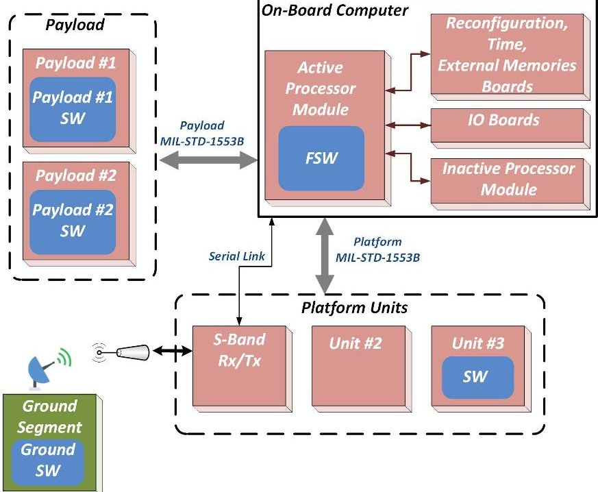
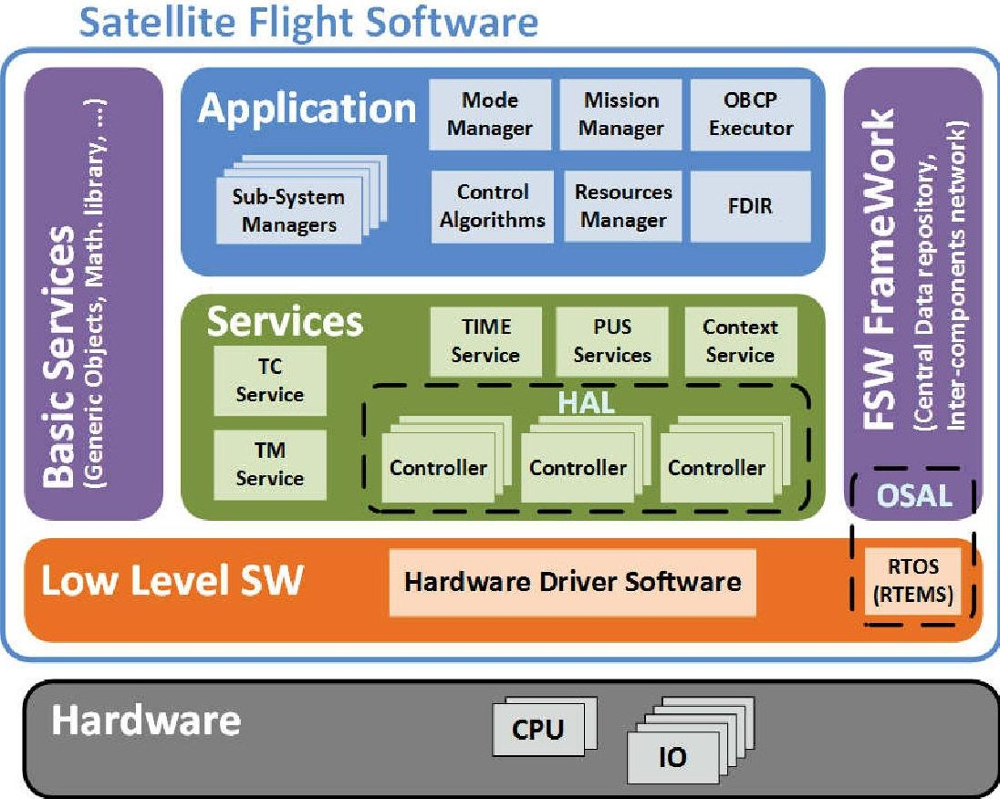
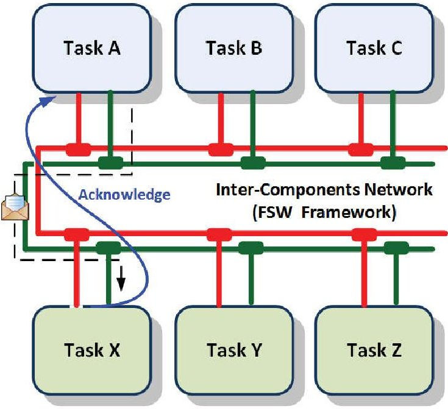
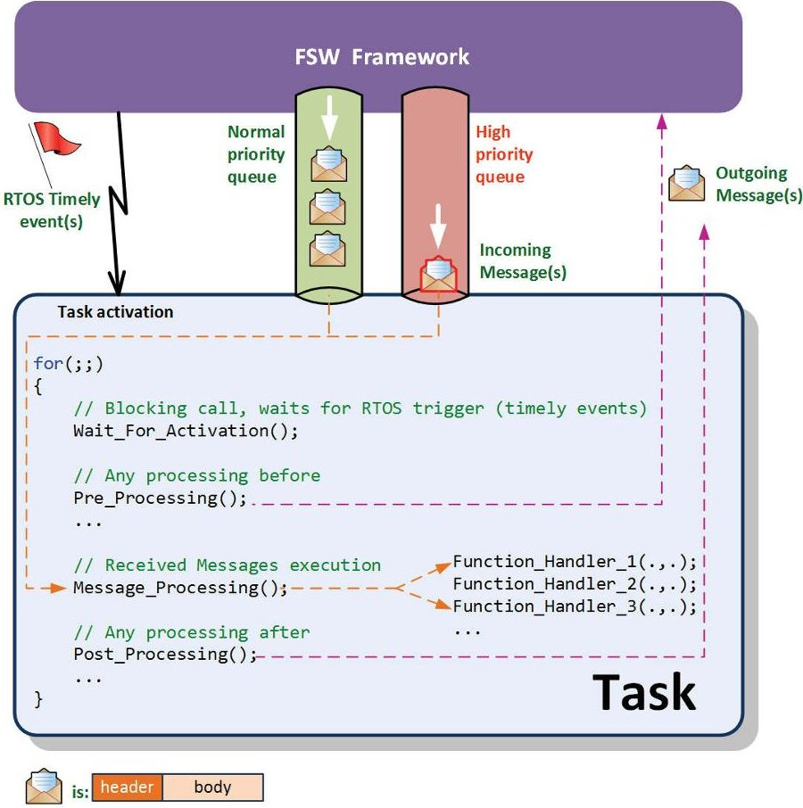
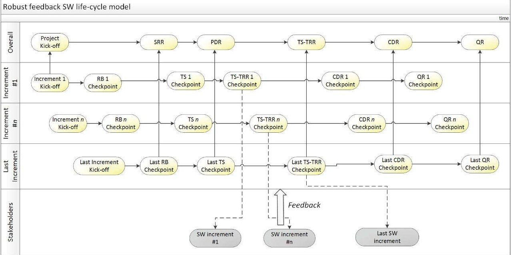
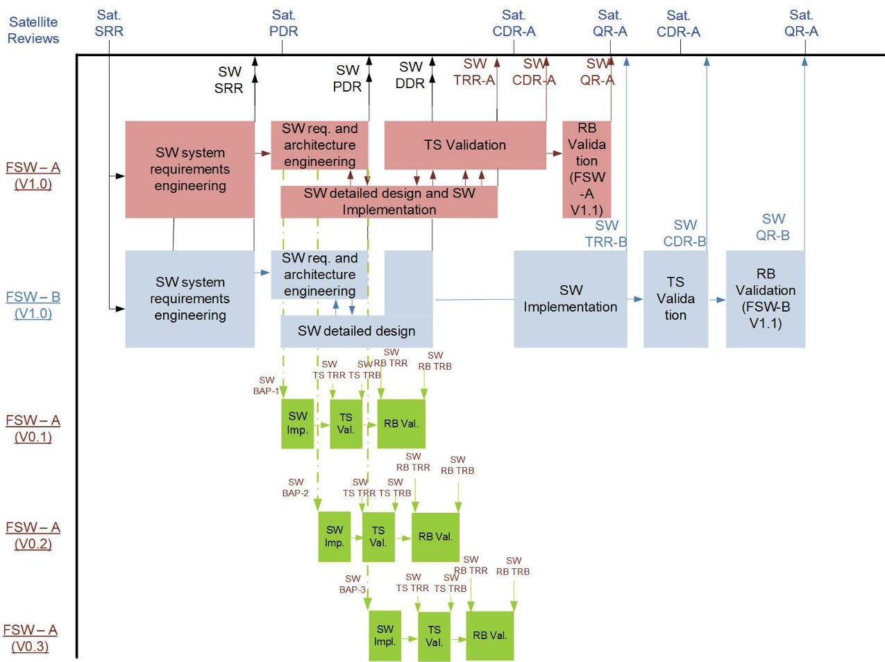
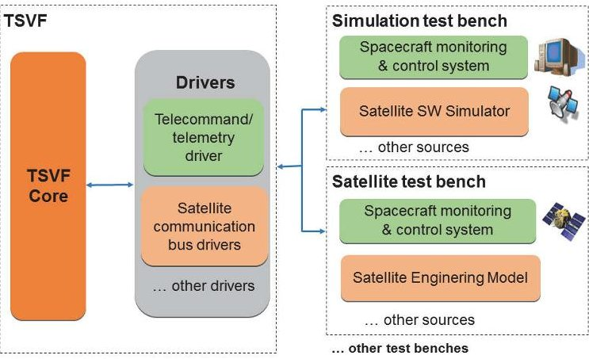
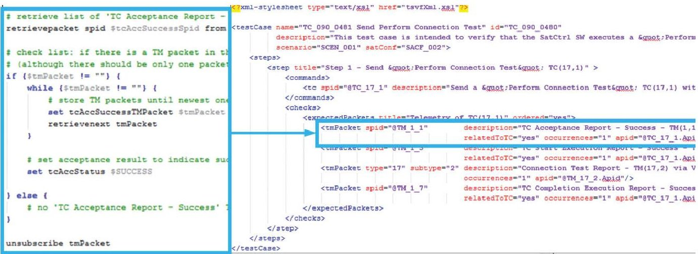

<!-- PDF_PAGE: 1 -->

# Development strategies for the satellite flight software on-board Meteosat Third Generation

Massimo Tipaldi

OHB Italia SpA, Milano (Italia)

Email: mtipaldi@cgspace.it

University of Sannio, Department of Engineering, Benevento (Italy)

Email: mtipaldi@unisannio.it

Cedric Legendre, Olliver Koopmann, Massimo Ferraguto, Ralf Wenker

OHB System AG, Bremen (Germany)

Email: cedric.legendre, olliver.koopmann, massimo.ferraguto, ralf.wenker@ohb.de

Gianni D'Angelo

University of Sannio, Department of Law, Economics, Management and Quantitative Methods, Benevento (Italy) Email: dangelo@unisannio.it

## Abstract

Nowadays, satellites are becoming increasingly software dependent. Satellite Flight Software (FSW), that is to say, the application software running on the satellite main On-Board Computer (OBC), plays a relevant role in implementing complex space mission requirements. In this paper, we examine relevant technical approaches and programmatic strategies adopted for the development of the Meteosat Third Generation Satellite (MTG) FSW. To begin with, we present its layered model-based architecture, and the means for ensuring a robust and reliable interaction among the FSW components. Then, we focus on the selection of an effective software development life cycle model. In particular, by combining plan-driven and agile approaches, we can fulfill the need of having preliminary SW versions. They can be used for the elicitation of complex system-level requirements as well as for the initial satellite integration and testing activities. Another important aspect can be identified in the testing activities. Indeed, very demanding quality requirements have to be fulfilled in satellite SW applications. This manuscript proposes a test automation frame-

<!-- PDF_PAGE: 2 -->

work, which uses an XML-based test procedure language independent of the underlying test environment. Finally, a short overview of the MTG FSW sizing and timing budgets concludes the paper.

Keywords: Satellite flight software, Layered software architecture, SW model-driven design, SW development life cycle models, Software testing automation, European cooperation for space standardization.

## 1. Introduction

Nowadays, satellites are becoming increasingly software dependent [1]. The application software running on the satellite main On-Board Computer (OBC), which is hereafter referred to as Satellite Flight Software or simply Flight Software (FSW), can be regarded as a system-level entity. It plays a relevant role in implementing space mission complex requirements and is the main interface during the space mission operational phase [2]. The FSW provides all the necessary functions for nominal and contingency operations of the satellite. Moreover, it enables the ground operators to control and to supervise its various sub-systems for the whole mission. Amongst the other things, the FSW manages the mission phases, the satellite modes [3], the ground interface, the satellite Attitude and Orbit Control System (AOCS), the thermal control, the satellite health management (also referred to as Failure Detection, Isolation, and Recovery (FDIR)), and the on-board mission operation execution. The FSW is in charge of managing the decision making processes with limited autonomy degree [4], which in the future could be implemented via machine learning based algorithms (see [5], [6], and [7]).

The overall FSW development is time-critical and it is usually necessary to have a software product (including the binary and the associated documentation) available as soon as possible in order to support the overall satellite integration, testing, and validation activities. All these aspects pose a challenge to the FSW development teams, which need to adopt both programmatic and technical strategies to provide the stakeholders with a timely delivery of SW

<!-- PDF_PAGE: 3 -->

products fulfilling the project quality standards [8]. The FSW life cycle and quality requirements are to be defined at the very beginning of any space SW project. The European space community usually adopts the ECSS-E-ST-40C [9] and the ECSS-Q-ST-80C [10] standards, which are normally tailored according to the associated SW criticality levels and programmatic constraints. Moreover, the FSW should not be built from scratch. In particular, SW teams should maximize the reuse of building blocks and of solutions from one space mission to the next one. The European Space Agency (ESA) advocates a model-based design flow (for instance, based on the Unified Modeling Language (UML)) rather than a document-centric approach. A model-based design approach implies creating and exploiting domain models, which are conceptual models of all the topics related to a technical context, e.g., FSW applications for satellites. The use of modeling languages helps to specify models in a certain level of abstraction, which are then used to support the software development. Models allow sharing a common vision and knowledge among technical and non-technical stakeholders, facilitating and promoting the communication among them. As far as FSW applications for satellites are concerned, a series of funded research initiatives have delivered interesting results. Amongst the other things, we can mention the On-board Software Reference Architecture (OSRA) [11], and the Correctness, Modeling and Performance of Aerospace Systems (COMPASS) toolset [12]. The former imposes constraints for the FSW component integration via admissible structured data types and interaction patterns, whereas the latter focuses on more rigorous design and formal verification.

As a rule, the current trend for space missions is to build "Better, Faster, Cheaper" products, which can be translated into "Earlier, After, Softer" from a software point of view) [11]:

- "Earlier": FSW preliminary versions should provide the basic functionality (e.g., Telecomand (TC) and Telemetry (TM) processing) as soon as possible for early testing purposes and for integrating the firstly delivered

<!-- PDF_PAGE: 4 -->

hardware units.

- "After": the FSW design should be modular to ease adaptive, perfective, and corrective maintenance needed at any stages of the space mission. A layered design is usually adopted.

- "Softer": data-driven solutions should be considered to the maximum extent possible to allow service configuration [13] via TC without patching the FSW on-board. Moreover, uploadable executable specification techniques [14] should allow the extension of the FSW capabilities without patching the existing code. This can be achieved by the On-board Control Procedures (OBCP) [15], script-like files uploaded and executed by an on-board virtual machine.

In this paper, we merge, revisit, and extend the contents of our conference proceeding papers concerning the Meteosat Third Generation (MTG) satellite FSW, which has been developed at OHB System AG over the last few years (see [2], [16], and [17]). Fig. 1 shows the MTG FSW context diagram. MTG is a cooperative undertaking between the European Space Agency (ESA) and the European Organization for the Exploitation of Meteorological Satellites (EUMETSAT). It aims at providing Europe with an operational satellite constellation able to support accurate prediction of meteorological phenomena and the monitoring of climate and air composition. The paper has been organized as follows. Section 2 presents the FSW layered model-based architecture as well as the means for ensuring a robust and reliable interaction among the FSW components. Section 3 focuses on the selection of an effective software development life cycle model. In particular, by combining plan-driven and agile approaches, the need of having preliminary SW versions used for the elicitation of complex system-level requirements as well as for the initial satellite integration and testing activities can be fulfilled. Another important aspect can be identified in the testing activities since very demanding quality requirements have to be usually fulfilled in satellite SW applications. In this respect, Section 4 proposes a testing

<!-- PDF_PAGE: 5 -->

Figure 1: FSW context diagram in MTG satellite

automation framework, where an XML-based test procedure language independent of the underlying test environment is used. Finally, Section 5 outlines the MTG FSW memory sizing and timing budgets, and Section 6 concludes the paper.

## 2. An overview of the MTG FSW architecture

The FSW static architecture is composed of horizontal and transversal layers, as depicted in Fig. 2. The former can encapsulate some mission specific functionality, whereas the latter provide mission independent software packages. The complete FSW architecture is modeled as a set of passive and active components interacting via services provided by the FSW framework (e.g. data access to the central data repository, message exchange). The Unified Modeling Language (UML) is used to model and design the FSW. In the following, we outline the functionality set implemented in the FSW static architecture:

<!-- PDF_PAGE: 6 -->

Figure 2: FSW static architecture

- The Application Layer performs mainly the satellite mode and mission management, the subsystems management, and the system level FDIR.

- The Services Layer contains the general purpose data handling services, in particular the Packet Utilization Standard (PUS) services [13]. Additionally, all the hardware controllers are grouped in the Hardware Abstraction sub-Layer (HAL). The latter interfaces with the OBC input/output (IO) boards and the communication buses, such as the MIL-STD-1553B [18].

- The Low Level SW Layer includes the Real-Time Operating System (RTOS) and the OBC Hardware Driver Software accessing the dual redundant CPU mother boards and the IO boards.

- The FSW Framework transversal layer contains the most essential func-

<!-- PDF_PAGE: 7 -->

tionality of a software-bus. Thus, it provides an access to the central data repository and connectivity among the software components via messaging protocol. The Real-Time Operating System is also encapsulated within the Operating System Abstraction Layer (OSAL).

- The Basic Services transversal layer contains all the generic objects (e.g.: queue or list management, data pool, mathematic library) that can be used by any software components. Those ones are mission independent and re-usable objects.

The FSW is organized as a hierarchical structure of UML packages and classes. A package contains either sub-packages or classes. Each package contains a SW component, encapsulating a dedicated functionality based on the FSW functional decomposition. The FSW classes and packages can be entirely mission independent, mission data dependent (due to configuration parameters), partly mission dependent (due to configuration parameters and specific SW logic parts), or entirely mission-dependent. A high degree of flexibility can be achieved by applying a table-driven software design. It relies on configuration and look-up tables in order to minimize the code size and complexity. Additionally, this approach minimizes the effort to be spent on software development, testing, and maintenance. As for the latter, tables can be easily updated via TC without any recompilation of the software during the space mission life time.

## 2.1. The FSW dynamic architecture

The RTOS provides means to allocate SW tasks into execution threads, which concurrently compete for resources. The task scheduling is carried out by the RTOS scheduler that allocates the processor by using a priority-based preemptive mechanism. Such scheduler selects the highest priority task that is ready to run when allocating the processor to a task. The priority of each task is determined by its fixed priority as defined at compile time and its runtime modifications as defined by the RTOS policies. In particular, to avoid task starvation and deadlocks due to shared resources, the FSW uses the priority

<!-- PDF_PAGE: 8 -->

ceiling mechanism, which ensures that a low priority task receives the CPU time when a high priority task is waiting for the same resource.

In order to timely acquire the large volume of data received via the OBC communication buses, two frequencies have been chosen, that is to say, the so-called 10 Hz minor frame and the 1 Hz major frame. This is also in line with the need of processing periodically such data and to activate the related functionality, such as the satellite parameter monitoring and reporting or the thermal control loops. To support a precise synchronization with such frames, the on-board time board of the OBC provides dedicated periodic pulse lines as reference for the major and minor frames. For activation of cyclic tasks, RTOS events are used and synchronously triggered by such hardware pulse lines.

The FSW multi-tasking design follows such time-periodically driven approach. However, some specific functionality can be started a-periodically, such as the memory dumping or the TC handling. As consequence, FSW tasks can be categorized as following:

- Driver tasks: hardware controllers are handled by dedicated tasks, which are synchronized on hardware events via interrupts service routine. Those tasks manage data IO transfers for data acquisition or command transmission over the communication buses, and are subject to time responsiveness.

- Real-Time tasks: this category mainly consists of cyclic tasks, which perform the processing of data acquired by the driver tasks and compute the commands to be transmitted to the satellite units in the next cycle. In the MTG FSW, there are the hard real-time tasks activated at 10Hz, and the firm real-time at 1Hz. As an example, the hard real-time task performs the following activities: satellite attitude control and propulsion actuator commanding. The firm real-time task is dedicated to the housekeeping telemetry packet generation and the satellite mode management.

- Background tasks: this category hosts tasks not subject to any deadline and of rather a-periodic and potentially long-term nature. For instance, the dumping of large memory areas belongs to this category.

<!-- PDF_PAGE: 9 -->

Figure 3: FSW inter-components network

## 2.2. Inter-component networking

The increasing FSW complexity raises a real challenge in term of FSW design, especially in the context of multi-threading SW applications. The classic Application Programming Interface (API) approach is no longer suitable when quite a number of SW components are dynamically interconnected each other [8]. To properly solve this issue and ensure design correctness by construction, networking technologies offer more reliable solutions.

In the MTG FSW, a software-bus is designed to provide a thread-safe connectivity among software components (see Fig. 3). It is implemented by the Message Service, which is part of the FSW Framework. The client-server paradigm is applied. A standard message format is applied; it includes a header field and a data field. The former gathers information like routing destination, handler function identifier, protocol control attributes, and a reference to the client sender for the acknowledgment notification. The latter contains all the needed arguments to be provided to the message handler function for the message processing.

In order to better cope with real-time issues and timely message processing, client can set two different message priorities, that is to say, normal or high

<!-- PDF_PAGE: 10 -->

Figure 4: FSW task skeleton and network interfaces

(see Fig. 4). Consequently, for every task supporting message handling, two communication pipes, one per priority, are provided. The RTOS Message Queue Manager is used to ensure tread-safety during messages insertion/extraction to/from their recipient objects. To minimize the processing overhead at the server side, a predefined number of messages are fetched and processed at every tasks activations, firstly from the high priority queue, then from the normal priority one. Depending on the acknowledge level requested by the client in the message header, the execution completion of its message requests can be notified, ensuring robust and trustworthy message exchanges. Moreover, the proposed approach also allows to regulate the message generation upstream at client side in order to minimize the burst emission and potential queue overflow situation. In any case, thanks to the returned status information or the absence

<!-- PDF_PAGE: 11 -->

of acknowledgment, communication anomalies can be detected and misbehaving components can be isolated.

## 3. The robust feedback software life cycle model

As above mentioned, the definition of the SW development life cycle model is one of the major tasks to be performed at the very beginning of any space SW project. The European space community usually adopts the ECSS-E-ST-40C [9] (which defines the principles and requirements applicable to space software engineering) and the ECSS-Q-ST-80C [10] (which defines the principles and requirements applicable to space software product assurance). They are applicable to all the SW items within space flight and ground systems and cover all the space software engineering aspects. The ECSS requirements are usually tailored according to the associated SW criticality levels, ranging from Level A (software whose anomalous behavior would cause or contribute to a failure resulting in a catastrophic event) up to Level D (software whose anomalous behavior would cause or contribute to a failure resulting in a negligible event).

Even though the ECSS-E-ST-40C standard does not prescribe a specific software development life cycle, the waterfall model seems to be the privileged choice. This process can offer a systematic approach and is in line with the satellite/system level reviews. However, in space SW projects, the underlying principles of the waterfall model are usually not fulfilled since it is challenging to finish a development phase before moving into the next one. The overall SW development is time-critical and it is usually necessary to have preliminary software versions available as soon as possible in order to support the overall satellite integration and testing activities. Such preliminary SW versions also contribute to the elicitation of complex system-level requirements (for instance, the satellite failure management concepts). In this section, the SW waterfall paradigm has been combined with a SW incremental development approach in order to exploit their benefits and counterbalance their flaws at the same time. The proposed methodology is referred to as "Robust Feedback Software Life

<!-- PDF_PAGE: 12 -->

## 3.1. Background and motivation of the proposed methodology

The study on how to organize phases, people and resources along the development and the evolution of complex SW applications has been a main focus of software engineering since its inception [19].

Nowadays, we can recognize that two broad classes of software processes are in use: plan-driven and agile processes [20]. In plan-driven processes, all the activities are executed steadily downwards, from the user requirement analysis down to operation and maintenance. Plan-driven methods can be appealing to the modern industry since they assure a systematic approach in the SW development and testing. The main disadvantage of plan-driven processes is their rigidity. They demand for a set of clear and stable user requirements, where little feedback is expected from the development, and are based on the assumption that the system is needed as a turn-key only at the end of the full development process. Recycles and feedbacks from more advanced development stages are costly and difficult to implement. This is more suitable to projects with limited level of novelty and stringent schedule constraints. As matter of fact, software development involves a continuous learning-by-practice process. Requirements and design decisions can be revised during implementation, testing and even software operation. Differently, planning in agile processes is incremental and is led by practice and implementation [21]. Testing and customer feedback occur simultaneously with development. Interactions among stakeholders take priority over processes and tools, and working software takes priority over documenting procedures. However, a complete agile approach is regarded as a risky choice in case of complex, expensive and critical SW applications, such as the ones embedded into space systems.

As for the MTG FSW, by combining a plan-driven approach with an agile process, the proposed SW development model exploits their benefits and counterbalance the related flaws. A pure SW waterfall model approach can be used for software with stable and definite requirements. Yet, this is not the case of

<!-- PDF_PAGE: 13 -->

space SW applications. In addition, internal and external stakeholders need to have preliminary intermediate SW versions which contribute in turn to the SW requirement elicitation.

In order to support the reader in the full comprehension of this section, the ECSS-E-ST-40C SW reviews and related objectives are shortly outlined:

- The SW System Requirements Review (SW-SRR) is held at the end of the planning phase and aims at defining of the SW Requirements Baseline (RB).

- The SW Preliminary Design Review (SW-PDR) is held at the end of the specification phase and aims at defining of the Technical Specification (TS, i.e., the SW functional and interface requirements) and the SW architecture.

- The SW Detailed Design Review (SW-DDR) is held at the end of the design phase and aims at finalizing of the SW detailed design and interfaces.

- The SW Test Readiness Review (SW-TRR) is held at the end of the software implementation/validation dry-run phase and aims at baselining of the SW source code and reviewing the SW requirement validation test cases.

- The SW Critical Design Review (SW-CDR) is held at the end of the official software TS validation phase and aims at checking that all the TS requirements have been successfully verified.

- The SW Qualification Review (SW-QR) is held at the end of the official software RB validation phase and aims at checking that all the RB requirements have been successfully verified. Afterwards, the SW can enter the acceptance phase, where the SW is validated in its final environment.

<!-- PDF_PAGE: 14 -->

Figure 5: The robust feedback SW life cycle model

## 3.2. The key-aspects of the proposed SW life cycle model and its application to the MTG FSW

The robust feedback software life cycle model is based on the following principles (see Fig. 5):

- The development, the verification, and the validation activities of the fully functional SW versions are subject to the full ECSS-E-ST-40C life cycle reviews and follow overall a waterfall SW life cycle (robustness feature).

- Prior to the SW final versions, a limited number of SW increments (also named preliminary SW versions) are developed. Their development approach is marked out by a lightweight SW development life cycle, where each activity is kicked-off by a corresponding lightweight checkpoint.

- Technical and programmatic lessons learnt coming from the increment N are incorporated in the increment N+1 (feedback feature).

- Along the life cycle of the fully functional SW versions, SW reviews can be started under the precondition that the corresponding check-points of all

<!-- PDF_PAGE: 15 -->

the SW increments are completed and their outcome processed (feedback feature).

- Stakeholders can use preliminary SW versions and provide some feedback to all the SW development phases.

Unlike the formal and challenging SW reviews outlined in section 3.1, the SW checkpoints aim at verifying that a certain maturity level of the product being developed has been achieved. Moreover, they are not blocking reviews. In this way, the general quality of the SW product can improve in a stepwise manner, allowing a steady production with a fall-back possibility to the next step. This approach allows to increase the success likelihood of the formal SW reviews.

The number of SW increments to be developed, their contents and the related qualification level are the crucial aspects for the proposed methodology to work. Their contents have to be chosen in order to cater for the stakeholder needs, bearing in mind the consolidation of the lowest SW layers and infrastructure in the earliest SW versions, and then focusing on the mission level requirements. In case of the MTG FSW project, three SW increments were developed ahead the fully functional SW, i.e. V0.1, V0.2 and V0.3. Tab.1 outlines the functionality included in the different SW increments, their testing level and the intended usage. The SW increment qualification status is identified by the term "functionally tested", which means black-box testing against the SW Requirements Baseline/Technical Specification and partial unit/integration testing. On the other hand, the fully functional SW versions undergo the full verification and validation process, as prescribed by the assigned SW criticality level. All the SW versions can be tested via satellite SW simulation and/or HW-in-the-loop simulation. The proposed approach has to be supported by strict SW configuration management policies. The portion of the SW requirement baseline flown down into the different SW versions has to be carefully managed and poses a lot of challenges which have to be addressed in advance. They can lead to specific customization of the selected SW factory tools.

Since the MTG constellation is formed by two types of satellite,

<!-- PDF_PAGE: 16 -->

Table 1: FSW increment overview in MTG satellite project

<table border="1"><tr><td>FSW Version</td><td>FSW Testing Level</td><td>FSW Version Contents</td><td>Objectives at Platform/Satellite Level</td></tr><tr><td>V0.1</td><td>Functionally tested</td><td>Basic service provision (such as telemetry packet forwarding to ground[13]), communication buses, analog&amp;discrete channels and preliminary HW drivers.</td><td>It can be used to support preliminary on-board computer interface verification activities.</td></tr><tr><td>V0.2</td><td>Functionally tested</td><td>Sensor&amp;actuator management for satellite attitude and orbit control, open-loop satellite attitude control, on-board resource monitoring and consolidated HW drivers.</td><td>It can be used to start the integration of the platform unit engineering models.</td></tr><tr><td>V0.3</td><td>Functionally tested</td><td>On-board telemetry storage service, basic payload management, on-board fault management&amp;satellite autonomy infrastructure, complete platform subsystem management and closed-loop satellite attitude control.</td><td>It can be used to complete the testing activities of the satellite platform engineering model.</td></tr><tr><td>V1.0</td><td>Fully functional and TS validated SW version</td><td>Fully functional and TS level fully verified/validated SW version (complete payload management,satellite mode/fault management,satellite autonomy).</td><td>It can be used for the testing of the satellite engineering model (platform plus payload).</td></tr><tr><td>V1.1</td><td>Fully functional and RB validated SW version</td><td>RB level fully verified/validated SW version.</td><td>It can be used for the testing of the satellite flight model (platform plus payload).</td></tr></table>

two different FSW applications have been actually developed. In this manuscript, they are named FSW-A and FSW-B. Fig. 6 shows a de-

<!-- PDF_PAGE: 17 -->

Figure 6: The robust feedback SW life cycle model in MTG

tailed implementation of the robust feedback SW life cycle model in MTG. The two fully functional FSW-A 1.0 and FSW-B 1.0 are subject to the ECSS-E-ST-40C life cycle reviews and follow the waterfall SW life cycle. Moreover, their synchronization with the satellite reviews is also shown. FSW-A and FSW-B have a relevant number of common requirements. They mainly differ in the SW components responsible for the payload management. The preliminary FSW increments (FSW-A 0.1, FSW-A 0.2, and FSW 0.3) implement such common requirements in a stepwise approach. Moreover, in order to identify and exploit their commonalities, FSW-A and FSW-B have been developed contemporary up to the SW DDR. The development of the preliminary FSW-A increments is marked out by a lightweight

<!-- PDF_PAGE: 18 -->

SW life cycle, featured by the following checkpoints:

- SW Build Assessment Points (SW BAPs) to assess the inputs needed for the implementation of the related SW increment (e.g. SW requirements, SW design, telemetry and telecommand packet definitions).

- SW test readiness reviews focusing on the TS and RB level testing specification.

- SW test review board addressing the corresponding test results.

## 4. A testing automation framework for critical space SW

Nowadays, more and more importance is being attached to the SW testing activities in the industry, where teams can be allocated solely for SW testing [22]. Many SW practitioners show their awareness in test process definition and improvement, testing automation, testing tools, and standardization. Proper SW testing can improve the SW product quality and the testing effort is dependent on the tolerance for risk and on the definition of "good enough". The tolerance for risk and the weight of importance for the SW quality have an inverse relationship.

All these aspects are particularly true in case of critical space SW applications, which require high quality development standards (see [9] and [10]). The total effort in SW Verification and Validation (V&V) activities is considerably higher than the one spent in SW detailed design and implementation. An attentive assessment of the SW V&V strategy and technological support should be performed in the early phases of the project in order to avoid any serious project delay and to preserve the product quality. The following aspects were taken into account in the MTG FSW project:

- Adequate manpower have been assigned to the SW V&V activities, especially during the advanced phases of the project, where SW testing engineers should outnumber SW development engineers.

<!-- PDF_PAGE: 19 -->

- The SW V&V team is an independent team and cooperates with the satellite testing team.

- The SW V&V team is more subject to the SW product assurance management rather than the SW project management.

This section describes the Technical Specification Validation Framework (TSVF), a testing environment used in the MTG FSW project. It has been used to verify the implementation of the FSW TS functional and performance requirements and provides a framework to design test cases, to implement the corresponding test procedures, to execute a full SW test campaign, and to analyze the test results automatically.

## 4.1. Background and motivation of the proposed test automation approach

The nominal and non-nominal behavior of the MTG FSW can be derived from its functional and performance requirements as collected in the MTG FSW Requirements and Interface Control Documents. They form the SW Technical Specification (TS) [9]. The TSVF framework supports the SW V&V activities at TS level. It can be regarded as a test automation SW tool (separate from the application SW being tested) used to control the execution of the tests and the comparison of the actual results with the predicted ones. The following aspects provide the business and technical requirements for the TSVF development and usage:

- Independence from the test environment to encourage its usage in different projects and/or at different testing level.

- Test case implementation by means of a test procedure language allowing a straightforward implementation of the test cases by using a more test-based view (similar to the PLUTO language [23]).

- Data driven capabilities, e.g. test case/procedure definition via configuration data.

<!-- PDF_PAGE: 20 -->

- Automatic test case execution and test result analysis, including consistency checks to identify unforeseen behavior of the SW product.

- Completeness and conformance of the test results to expected behavior.

- Interaction between the test operator and the system under test.

- Archive of all the information gathered from the system under test during the test campaign to enable off-line analysis.

- Black box testing verification for the FSW.

- Reuse of test artifacts in SW and satellite/sub-system level test campaigns with only minor adaptation effort.

The TSVF allows performing tests at telecommand and telemetry packet level, that is to say, it cannot be used for white box testing verification. It has been developed by considering the typical constraints and features of satellite on-board SW applications:

- SW criticality level B (see [9] and [10]), which requires complex and time-consuming testing activities.

- Huge amount of data produced during the SW test execution and high concurrency in data computation.

- Demanding requirements on data accuracy, on-line analysis data, and data diversity (i.e. data/information coming from heterogeneous sources/devices).

- Space Agencies specific protocols and formats, such as the Space Link Extension (SLE) protocol for telecommand/telemetry exchange [24] or the management of Mission Information Base (MIB) files [25].

Being the test case design very close to the corresponding test script, SW testing engineers can focus more on the test case design and requirement coverage rather than spending a lot of time in coding lengthy and error-prone test scripts. An additional feature of the TSVF is the capability of executing test

<!-- PDF_PAGE: 21 -->

scripts in different satellite models (e.g. satellite simulators, HW-in-the-loop satellite simulators, satellite engineering model, satellite flight model). Apart from some TSVF reconfiguration, test cases can be designed and implemented independently of the test environment set-up. By doing so, it is possible to reuse the same test cases at different testing levels (e.g. SW requirement baseline, SW technical specification, and satellite/subsystem level). Modifications are necessary only to update the test case logic, if dictated by the different level of requirements to be verified. Thanks to this reuse capability, it is possible at SW level to define test cases based on complex mission scenarios which can be run in advance on satellite simulators and then used for later test campaign at satellite level. This mitigates the fact that a satellite engineering or flight models are usually a bottleneck in the test campaign, whereas it is possible to install as many satellite SW simulators as needed.

## 4.2. TS validation framework

The TSVF framework architecture consists of the following main parts, as illustrated in Fig. 7:

- The TSVF Core controls the execution of the test scripts and the handling/analysis of the test results.

- An appropriate set of drivers, one for each type of test bench component, provides the interface between the TSVF Core and the connected test bench. Each driver can be (re-)configured in order to establish the correct communication with the respective component provided by the selected test bench.

The main capabilities of the drivers are the forwarding of telecommands (TCs) from the TSVF Core to the test bench components as well as the gathering and forwarding of the retrieved data coming from the test bench components to the TSVF Core. The TSVF framework communicates with the different types of components on the test bench including device interfaces, SW based simulation models, emulated avionics models, and environmental models of the

<!-- PDF_PAGE: 22 -->

Figure 7: TSVF architecture and interfaces

system under test. The capabilities of the TSVF are limited by the technical constraints of the test bench, e.g. it is not possible to manage the traffic of the satellite communication buses if the test bench does not provide a monitoring feature for analyzing the data sent over such buses.

In order to conduct a test campaign via the TSVF, the following information has to be provided: the used test bench, the driver configurations, the binary of the SW under test, the MIB files applicable for the SW under test, specific configurations/parameter sets applicable for the SW under test (e.g. its initial context and the formats of the satellite communication bus send lists), and further test campaign parameters, such as the target folder for storing the test execution data and analysis results.

Once the TSVF setup is finished, the test execution can be started. The test cases are described in XML format in order to take advantage of the flexibility and the readability offered by the XML standard. Compared to the traditional approach of implementing complex and lengthy scripts written in procedural programming or scripting languages (e.g. TCL/Tk and $ \mu $TOPE [26]), the XML approach notably reduces the gap between concepts and assumptions that reside in the mind of satellite system engineers and what is actually implemented

<!-- PDF_PAGE: 23 -->

in the test script. Instead of requiring a deep knowledge about the used programming language, the test engineers can really focus on the test design and the implementation of the actual test logic by using a test description language that is completely independent of the used test bench and technology.

The TSVF framework controls the system under test and its test environment during the test campaign. This means that the following operations can be performed automatically: loading the SW binary onto the selected test bench, starting/stopping/resuming the SW under test, injecting errors during the test case execution (e.g. parity error on the satellite communication buses), sending TC packets, checking the format and content of the test case description files, and analyzing the test results. Tests can be run in an automated and/or step-by-step mode. For each executed test case, the TSVF framework can generate a report summarizing the results of its execution and a set of log files containing the details of the test case execution and the analysis performed.

The TSVF can be adapted for different test benches. For instance, the TSVF architecture allows including new drivers, e.g. in case the traffic over an additional communication bus has to be monitored.

## 4.2.1. Test case definition using XML

Unlike traditional test environment requiring the implementation of complicated test scripts (e.g. using the Tcl language [26]), the test case definition for the TSVF follows a well-structured XML approach that allows a convenient definition of the different test steps on a higher abstraction level. A dedicated hierarchy of XML tags reduces the amount of information that is necessary for defining a test case to the minimum that is actually required for defining the pure test logic, without having to consider any details of the concrete test implementation. Each test case consists of one or more test steps, each of which contains a set of commands and checks to be performed. The variety of possible checks ranges from occurrences and content of certain types of telemetry packets and parameters up to checks of the timing and data that is sent over the satellite communication buses (e.g. the MIL-STD-1553B serial multiplex data

<!-- PDF_PAGE: 24 -->

Figure 8: XML test case definition vs μTOPE script

bus [27]).

Fig. 8 illustrates a comparison of the traditional Tcl/ $ \mu $TOPE scripting with the XML based test case definition provided by the TSVF framework. The box in the right part of the figure (the one that partially overlaps the other one) shows an XML based test definition for a basic test of the communication between satellite and ground by using Packet Utilisation Standard (PUS) service 17 [13]. The test consists of a single test step for sending a "Perform Connection Test" telecommand to the satellite and checking that all four expected telemetry packets are received on ground. Due to the high abstraction level in the test case definition in the XML file, each command and each check is represented by a single XML line. The left box of Fig. 8 (the one which is partially hidden by the right one) shows a small code snippet of the Tcl/$ \mu $TOPE script which corresponds to the XML file shown in the right box. The entire XMLL file consists of only 20 lines of code. Indeed, more Tcl/$ \mu $TOPE code lines are always needed to implement a test case, and thus the implementation of test scripts can be error-prone. For instance, as shown in Fig. 8, the verification of the telemetry packet "Telecommand Acceptance - Success" (which does not contain any parameter) requires 10 Tcl/$ \mu $TOPE language code lines - not taking into account any processing or logging

<!-- PDF_PAGE: 25 -->

of the result. In the TSVF, the same aspect can be implemented by one XML language code line. In particular, in Tcl/$\mu$TOPE, we need to define a while loop control flow statement to implement the waiting for the incoming telemetry packets during the test script execution. Considering that we have to manage three telecommand acceptance/execution confirmation packets and one "Connection Test Report" packet, we have to write 40 Tcl/$\mu$TOPE language code lines. By using the TSVF, we only need 4 XML language code lines.

## 4.2.2. Test result analysis approach

The TS validation aims at confirming that the functional and performance TS requirements have been implemented completely and correctly in the SW product under test. This means defining testing scenarios and classifying all the received information according to specific matching rules in the test scripts. The matching rules define a mechanism for the identification and classification of a subset of the received satellite telemetry packets and parameters during the test campaign. Even though telemetry packets are produced by the different satellite units, matching rules can be derived by combining checks applicable to any telemetry packet and parameter such as:

- Single parameter value against an expected value.

- Time constraints, for example the time stamp of the telemetry packets, its reception time, and its generation frequency.

- Satellite communication bus profiling to verify the time and the data transferred on the physical links connected to the different satellite units.

- Correlation among parameters coming from different sources and complex expressions combining results of more elementary checks.

The test case is considered as passed if all the defined matching rules are fulfilled and no unexpected behavior is observed. The matching rule definition is driven by the requirements to be verified and can be implemented via XML directives. The results of the matching rules are logged in HTML format.

<!-- PDF_PAGE: 26 -->

Table 2: EEPROM bank memory budget

<table border="1"><tr><td>Layer</td><td>Code[kBytes]</td><td>Usage[% of 4MBytes]</td></tr><tr><td>Application</td><td>792</td><td>19</td></tr><tr><td>Services</td><td>400</td><td>10</td></tr><tr><td>Basic Services</td><td>19</td><td>0.5</td></tr><tr><td>FSW Framework</td><td>28</td><td>0.7</td></tr><tr><td>Low Level SW</td><td>93</td><td>2.3</td></tr><tr><td>Total</td><td>1332</td><td>32.5</td></tr></table>

## 5. An overview of the MTG FSW memory sizing and timing budgets

This section outlines the FSW memory sizing and timing budgets, measured on its final version. They are actually estimated and/or measured during the whole FSW development life cycle in order to check that they are in line with the capabilities of the selected HW units (including the communication buses) and with the projects requirements.

## 5.1. FSW memory budgets

The Processor Module EEPROM contains the complete FSW code and compile-time initialized data. The EEPROM full size is 8 MBytes, containing 2 banks of 4 MBytes each. Each bank stores a FSW image. One of the images is a candidate to be changed in orbit by uploading software upgrades or bug fixes, whereas the other one is used as backup or "golden image", which can be used in any contingency situation. The EEPROM bank memory budget is shown in table 2. The measurements show that the EEPROM usage is 32.5% which means having a margin of 67.5%

The FSW is copied during the OBC boot phase from the EEPROM into the RAM, whose memory budget is shown in table 3. Beside the FSW image, we have to take into account some memory space needed for the run-time data not

<!-- PDF_PAGE: 27 -->

Table 3: RAM memory budget

<table border="1"><tr><td>RAM item</td><td>Size
[KBytes]</td></tr><tr><td>FSW Image
(TEXT，DATA，RODATA segments)</td><td>1332</td></tr><tr><td>FSW un-initialised runtime data，
e.g. PUS service configuration
(BSS segment)</td><td>2075</td></tr><tr><td>SW maintenance reserved area，
e.g., SW patches and OBCP</td><td>194</td></tr><tr><td>RTOS workspace and task stacks</td><td>733</td></tr><tr><td>Total</td><td>4334</td></tr></table>

initialized at compile time and for SW maintenance. The measured FSW RAM budget shows a margin of 47% of the 8 MBytes RAM.

Besides the RAM and the EEPROM memories (included in the OBC Processor Module), other external memory supports are provided: the Safeguard Memory (SGM) and the Mass Memory (MM) boards. Details on the SGM and MM occupation and corresponding margins are not provided for the sake of brevity.

The SGM board provides the following memory bank types:

- 512 kBytes persistent RAM: stored data survive the Processor Module re-boot.

- Three 128 kBytes sized banks of non-volatile EEPROM : stored data survive the OBC power on/off cycles.

The SGM is used to maintain essential FSW context data to be restored in case of power drop or reset. Such context data are organized into functional tables and are protected against corruption by the Cyclic Redundancy Check

<!-- PDF_PAGE: 28 -->

(CRC). For instance, the SGM RAM can store the AOCS algorithm configuration values, the telemetry packet definitions (per satellite subsystem and mode), the on-board critical event log, and the on-board resource configuration tables. The measured FSW SGM RAM budget shows a margin of 50.2% out of the 512 kBytes available. The SGM EEPROM contains a small subset of data stored in the SGM RAM with a margin of about 90%. The 512MBytes SDRAM MassMemory can contain the following data: OBCPs, thruster history log, spacecraft separation sequence log, and high rate telemetry packets. It has a margin of 68%.

## 5.2. FSW timing budgets

The FSW CPU load measurements, performed under both nominal conditions and worst-case scenarios, show a margin of 40%. SW schedulability analysis performed via an extension of the Response Time Analysis method [28] shows that all the FSW tasks can perform their own activities within the prescribed deadlines.

As for the communication buses usage, we have the following situation:

- Platform MIL-STD-1553B: 33%.

- Internal OBC Bus: 21%.

- Payload MIL-STD-1553B: 47%.

Finally, the FSW initialization time is subject to some constraints in order to minimize the mission outage and to avoid payload instruments optics to be damaged by potential sun intrusion. It is required that the FSW is able to control the OBC boards and the electrical power distribution, and then to operate the AOCS within two specific times after the Processor Module reboot. As for these two timings, a margin greater than 35% has been measured.

## 6. Conclusion and future work

This paper has presented some relevant technical solutions and programmatic strategies adopted for the development of the Meteosat Third Generation

<!-- PDF_PAGE: 29 -->

(MTG) Satellite Flight Software (FSW), that is to say, the application software running on the MTG satellite main On-Board Computer (OBC). In particular, we have presented its layered model-based architecture, the robust feedback software life cycle model (where plan-driven and agile approaches are combined), and the Technical Specification Verification Framework (TSVF, a testing automation environment for the verification of the FSW functional and performance requirements).

As for the MTG FSW layered component-based architecture, we have shown the usage of SW networking solutions to provide a thread-safe connectivity among its software components. We have also advocated a model-based design approach with the aim of reusing consolidated building blocks from one space mission to the next one, and thus reducing the overall satellite development costs. As for future activities, we are currently investigating how this model-based approach can support early functional SW verification activities in order to secure the FSW development phase and prevent schedule drifts.

In the proposed robust feedback software life cycle model, the classical waterfall model has been extended by incorporating an incremental SW development process since SW preliminary versions are needed in advance for the elicitation of complex system-level requirements and for the initial satellite integration/testing activities. The proposed approach provides timely feedback from the preliminary SW increments into the main software production line (which follows the classical waterfall model). The SW preliminary versions are developed according to a lightweight SW life cycle model. An ad-hoc definition of their functionality perimeter is crucial for this approach to work.

As for the TSVF, we have highlighted the fact that it offers a framework to set up, design, implement, and run the complete SW test campaign, where error-prone activities (e.g., the test procedure implementation and the test result analysis) are supported by relevant automation tooling means. Test scripts are implemented via an XML-based language. Future activities can include the adoption of a more natural testing language, the usage of flowcharts to edit test procedures, and the extension of this framework to the satellite/end-

<!-- PDF_PAGE: 30 -->

to-end testing activities.

## Acknowledgment

The authors would like to thank all the MTG FSW team members for their strong commitment and valuable contribution, essential ingredients to face the daily challenges of the MTG space programme. This manuscript is dedicated to the memory of Ralf Wenker.

## References

[1] A. Mavridou, E. Stachtiari, S. Bliudze, A. Ivanov, P. Katsaros, J. Sifakis Architecture-based design: A satellite on-board software case study, in: Procedings of the 13th International Conference on Formal Aspects of Component Software, 2016, pp. 1-38.

[2] M. Tipaldi, M. Ferraguto, C. Moellmann, B. Bruenjes, A robust development process for space SW projects, in: 2016 IEEE Metrology for Aerospace (MetroAeroSpace), 2016, pp. 348-352.

[3] M. Tipaldi, M. Witzmann, M. Ferraguto, L. Glielmo, An approach for geostationary satellite mode management, in: IFAC-PapersOnLine, Vol. 50, 2017, pp. 7241-7246.

[4] M. Tipaldi, L. Glielmo, A survey on model-based mission planning and execution for autonomous spacecraft, IEEE Systems Journal (2017) 1- 13doi:10.1109/JSYST.2017.2720682.

[5] G. D'Angelo, M. Tipaldi, L. Glielmo, S. Rampone, Spacecraft autonomy modeled via markov decision process and associative rule-based machine learning, in: 2017 IEEE International Workshop on Metrology for AeroSpace (MetroAeroSpace), 2017, pp. 324-329.

<!-- PDF_PAGE: 31 -->

[6] G. D'Angelo, S. Rampone, F. Palmieri, Developing a trust model for pervasive computing based on apriori association rules learning and bayesian classification, Soft Computing 21 (21) (2017) 6297-6315.

[7] G. D'Angelo, S. Rampone, F. Palmieri, An artificial intelligence-based trust model for pervasive computing, in: 2015 10th International Conference on P2P, Parallel, Grid, Cloud and Internet Computing (3PGCIC), 2015, pp. 701-706.

[8] D. Dvorak, NASA Study on Flight Software Complexity, Tech. Rep., California Institute of Technology, 2009.

[9] ECSS-E-ST-40C: Space Engineering - Software, European Cooperation for Space Standardization, 2009.

[10] ECSS-Q-ST-80: Space product assurance - Software product assurance European Cooperation for Space Standardization, 2009.

[11] COrDeT-3 On-Board Software Reference Architecture:Specification, ESA Publication, D02-OSRA-SPEC, Issue 1.0, 2014.

[12] M. Bozzano, A. C. J. Katoen, V. Nguyen, T. Noll, M. Roveri, The COMPASS approach: correctness, modeling and performability of aerospace systems, in: Proceedings of the 28th International Conference on Computer Safety, Reliability, and Security, 2009, pp. 173-186.

[13] ECSS-E-70-41A: Ground Systems and Operations - Telemetry and Telecommand Packet Utilization, European Cooperation for Space Standardization, 2003.

[14] G. Cancro, W. Innanen, R. Turner, C. Monaco, M. Trela, Uploadable executable specification concept for spacecraft autonomy systems, in: IEEE Aerospace Conference, 2007, pp. 1-12.

[15] M. Tipaldi, M. Ferraguto, T. Ogando, G. Camatto, T. Wittrock, B. Bruenjes, L. Glielmo, Spacecraft autonomy and reliability in MTG satellite

<!-- PDF_PAGE: 32 -->

via On-board Control Procedures, in: 2015 IEEE Metrology for Aerospace (MetroAeroSpace), 2015, pp. 155-159.

[16] I. Fernandez, A. D. Cerbo, E. Dehnhardt, M. Tipaldi, Test automation for critical space software, in: 2016 IEEE Metrology for Aerospace (MetroAeroSpace), 2016, pp. 551-555.

[17] R. Wenker, C. Legendre, M. Ferraguto, M. Tipaldi, A. Wortmann, C. Moellmann, D. Rosskamp, On-board software architecture in MTG satellite, in: 2017 IEEE Metrology for Aerospace (MetroAeroSpace), 2017, pp. 318-323.

[18] ECSS-E-ST-50-13C: Interface and communication protocol for MIL-STD 1553B data bus onboard spacecraft, European Cooperation for Space Standardization, 2008.

[19] C. Ghezzi, M. Jazayeri, D. Mandrioli, Fundamentals of Software Engineering (2nd edition), Pearson Education (Addison Wesley), 2003.

[20] I. Sommerville, Software Engineering (9th edition), Pearson Education (Addison Wesley), 2011.

[21] K. Beck, C. Andres, Extreme Programming Explained: Embrace Change (2nd edition), Addison Wesley, 2004.

[22] V. Garousi, J. Zhi, A survey of software testing practices in Canada, Journal of Systems and Software 86 (5) (2013) 1354-1376.

[23] ECSS-E-ST-70-32C: Space engineering Test and operations procedure language, European Cooperation for Space Standardization, 2008.

[24] Space Link Extension Services Executive Summary, Informational Report CCSDS 910.0-G-2 (Green Book), 2006.

[25] R. Osorio, T. Beech, SCOS-2000 release 4.0 : Multi-mission/multi-domain capabilities in ESA SCOS-2000 MCS Kernel, in: IEEE Aerospace Conference, 2006, pp. 1-17.

<!-- PDF_PAGE: 33 -->

[26] J. Eickhoff, Simulating Spacecraft Systems, Springer Aerospace Technology, 2009.

[27] ECSS-E-50-13 Draft C: Space Engineering - Interface and communication protocol for MIL-STD-1553B data bus onboard spacecraft, European Cooperation for Space Standardization, 2008.

[28] N. Cecere, M. Tipaldi, R. Wenker, U. Villano, Measurement and analysis of schedulability of spacecraft on-board software, in: 2016 IEEE Metrology for Aerospace (MetroAeroSpace), 2016, pp. 545-550.