<!-- PDF_PAGE: 1 -->

# A deorbiter CubeSat for active orbital debris removal

Houman Hakima a , Michael C.F. Bazzocchi a , M. Reza Emami a b DOI: 10.1016/j.asr.2018.02.021

## Abstract

This paper introduces a mission concept for active removal of orbital debris based on the utilization of the CubeSat form factor. The CubeSat is deployed from a carrier spacecraft, known as a mothership, and is equipped with orbital and attitude control actuators to attach to the target debris, stabilize its attitude, and subsequently move the debris to a lower orbit where atmospheric drag is high enough for the bodies to burn up. The mass and orbit altitude of debris objects that are within the realms of the CubeSat's propulsion capabilities are identified. The attitude control schemes for the detumbling and deorbiting phases of the mission are specified. The objective of the deorbiting maneuver is to decrease the semi-major axis of the debris orbit, at the fastest rate, from its initial value to a final value of about 6471 km (i.e., 100 km above Earth considering a circular orbit) via a continuous low-thrust orbital transfer. Two case studies are investigated to verify the performance of the deorbiter CubeSat during the detumbling and deorbiting phases of the mission. The baseline target debris used in the study are the decommissioned KOMPSAT-1 satellite and the Pegasus rocket body. The results show that the deorbiting times for the target debris are reduced significantly, from several decades to one or two years.

## 1. Introduction

Space debris are generally considered to be man-made objects in Earth orbit, which no longer serve useful purposes. A large number of such objects are currently in orbit, as a result of the space development that has been ongoing since the mid-20th century. The number of space debris has increased in recent years due to intentional or accidental explosion and collision of orbital objects. The accumulation of space debris has been particularly evident in the low Earth orbit (LEO) region that extends to an altitude of about 2000 km, as shown in Fig. 1. Consequently, the problem of space debris has become a major concern in the space community. The collision between Iridium 33 (operational) and Cosmos 2251 (debris) in 2009 exposed the real threat that orbital debris can pose to space assets. The collision resulted in the creation of an additional 2000 items of debris that are now tracked from the ground using radars (NASA, 2017, NASA, 2016). These events, in addition to numerous near-miss events, have reasserted the need for mandatory disposal of decommissioned satellites. With increased awareness of the space debris issue, space agencies in major space-faring countries are conducting studies of methods to eliminate space debris, and some agencies have already announced plans to perform technology demonstration missions in the near future, e.g., e.Deorbit by the European Space Agency (ESA) in 2023 (Clean Space, 2015, Bastida Virgili et al., 2014) and CleanSpace One by the Swiss Federal Institute of Technology in Lausanne in 2018 (Richard et al., 2013).

<!-- PDF_PAGE: 2 -->

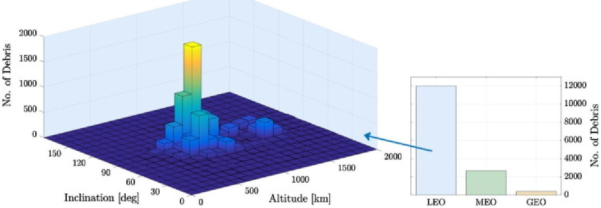

Fig. 1. Distribution of debris objects in geocentric orbits (as of Feb. 2017 Kelso, 2017).

Debris removal strategies can be broadly classified into two categories (Seong et al., 2017): (a) active removal methods, and (b) passive removal methods. In the case of active methods, an external agent applies force to space debris that has no control authority over its position or attitude, and thus is incapable of deorbiting itself. Many such methods are currently under study, such as the use of space tug (net (Starke et al., 2010, Guang and Zhang Jing-rui, 2012) or robotic manipulator (Reintsema et al., 2010, Nishida and Kawamoto, 2011)), ion-beam shepherd (Bombardelli and Pelaez, 2011), and ground-based and space-based high-power lasers (Phipps et al., 1996, Yang et al., 2016). In the case of passive methods, an object to be cleared remains capable of operating its internal actuators, for instance to deploy a drag sail (Visagie et al., 2015). Alternatively, the object may activate its thrusters to deorbit itself. Passive removal methods cannot be applied to the great majority of objects currently in orbit (Seong et al., 2017), but could be applied in future space missions.

Several researchers have investigated the concept of space debris removal using a chaser vehicle, known as a "mothership," that captures a sizable target debris, nullifies its angular rates (a process known as a detumbling maneuver), and then attaches deorbiting devices to the debris. The devices then independently proceed to deorbit the debris using a form of propulsion system. Many studies (Castronuovo, 2011, Tadini et al., 2014, DeLuca et al., 2013, Astroscale, 2016) have considered chemical propulsion systems as the deorbiting devices. Electrodynamic tether (EDT) capabilities have also been investigated in deorbiting space debris (William Barbee et al., 2011, Nishida et al., 2009). An alternative approach is based on the utilization of detumbling devices that are deployed by a mothership. A number of these devices dock with a target debris and detumble it, after which the mothership captures the stabilized debris and deorbits it. For example, in Udrea and Nayak (2015) the detumbling devices are considered to be in the form of CubeSats that cooperatively detumble the debris using their chemical thrusters. The mothership captures the debris once the debris attitude is stabilized, and uses its propulsion system to deorbit the system in a controlled manner. Also, Savioli et al. (2013) propose a mission concept in which a large mothership carries several modular, microsatellite-sized remover units of different kinds (namely, EDT, electric thruster, and hybrid rocket modules) in orbit, which are then attached to a 50-kg main bus (also carried by the mothership), and the whole compound system is then attached to the debris by the mothership. The type and number of deorbiting units depend on the orbit and characteristics of the target debris object to be removed.

In this paper, the proposed approach is based on the utilization of CubeSats, similarly to Udrea and Nayak (2015). But in our approach, a single CubeSat (called deorbiter CubeSat) is used for the removal of a target debris, unlike in Udrea and Nayak (2015) where several CubeSats in addition to the mothership are expended for the removal of a single debris. Further, the deorbiter CubeSat makes use of its onboard reaction wheels to detumble the debris, instead of using expendable propellants. Lastly, and most importantly, the deorbiter

<!-- PDF_PAGE: 3 -->

CubeSat uses its low-thrust propulsion system to deorbit the debris over time; hence, the mothership will not need to be involved during the deorbiting maneuver, and can move on to the next target debris.

Therefore, the objectives of this paper are to:

1. introduce the concept of active removal of sizable space debris based on the utilization of CubeSats;

2. determine the feasible range of debris masses and orbits, given the amount of propellant on the deorbiter CubeSat;

3. investigate the detumbling of the debris using the CubeSat's attitude control system;

4. investigate the deorbiting of the debris using the CubeSat's low-thrust propulsion system; and

5. verify the performance of the deorbiter CubeSat in active debris removal missions through two case studies.

Based on the aforementioned objectives, this paper is structured as follows: Section 2 presents the deorbiter CubeSat mission concept followed by a discussion of the preliminaries in Section 3. The detumbling approach is detailed in Section 4, and the deorbiting strategy and trajectory analysis are explained in Section 5. The performance of the deorbiter CubeSat during the detumbling and deorbiting phases of the mission is verified in Section 6, in light of the results from two case studies. Some concluding remarks are made in Section 7.

## 2. Mission concept

The proposed approach to the active removal of orbital debris is based on the utilization of deorbiter CubeSats. A CubeSat is a class of miniaturized satellites that can be made up of one or more cubic units, each measuring roughly 10cm to a side with a typical mass of up to 2kg (California Polytechnic State University, 2014). The number of joined units classifies the size of the CubeSat. For instance, a three-unit (3U) CubeSat is made up of three cubic units and has an envelope of $ 1 0 \mathrm{c m} \times 1 0 \mathrm{c m} \times 3 0 \mathrm{c m} $ . Further details regarding the CubeSats specification and standard can be found in the CubeSat Design Specification document (California Polytechnic State University, 2014). The deorbiter CubeSat uses an 8U form factor, roughly 23cm (Innovative Solutions in Space, 2015) to each side, with a wet mass of 16kg and a dry mass of 9kg. The CubeSat bus is commercially available (Innovative Solutions in Space, 2015), and its dimensions are in accordance with the supplier's specifications of the 8-Unit CubeSat structure. A discussion on the feasibility of the deorbiter CubeSat design is presented in Section 2.1.

In the proposed approach, a mothership carries multiple deorbiter CubeSats to remove multiple pieces of debris from orbit. After separation from the launch vehicle, the mothership acquires a relative orbit of a few kilometers with respect to the target debris, from where it estimates the attitude state of the debris using on-board optical sensors and computer vision algorithms, using methods that are described in the literature such as Andrea Antonello and Panagiotis Tsiotras, 2017, Kucharski et al., 2014. Once an initial estimate is obtained, a deorbiter CubeSat is deployed from the mothership, after which the mothership moves on to the next debris and repeats the aforementioned steps. The deployed CubeSat performs a rendezvous maneuver with the debris and attaches to it, and then proceeds to detumble the debris using its on-board attitude determination and control subsystem (ADCS). Next, the CubeSat proceeds to deorbit the debris using its low-thrust propulsion system. Since plane change maneuvers demand excessive amount of propellant, the present work prefers the initial and final orbits to be in the same orbital plane, i.e., no change of orbital inclination is required by the deorbiter CubeSat. Also, the core focus of the work is on the detumbling and deorbiting phases of the mission, and rendezvous and docking are left for future studies.

<!-- PDF_PAGE: 4 -->

A summary of the deorbiter CubeSat concept of operations is provided in Table 1. An overview of the deorbiter CubeSat's conceptual design is presented in Section 2.1. Considering the CubeSat's propulsion capabilities, the permissible target debris mass and orbit are identified in Section 2.2.

Table 1. Concept of operations of the deorbiter CubeSat mission.

<table border="1"><tr><td>Agent</td><td>Operation</td></tr><tr><td>Mothership</td><td>(a) Launch and insertion into an initial orbit(b) Orbital phasing maneuver with target debris(c) Inspection of the target debris,and attitude state determination(d) Task planning,trajectory design,and deployment of the CubeSat</td></tr><tr><td>CubeSat</td><td>(e) Docking with the target debris(f) Damping the debris attitude rates(detumbling)(g) Removing the debris from orbit(deorbiting)</td></tr></table>

## 2.1. Deobiter CubeSat preliminary design

The deorbiter CubeSat is primarily designed based on the utilization of commercially available components. A key driver in the design of the deorbiter is the type and size of the propulsion system that fits the CubeSat bus. In most CubeSat missions, thrusters are mainly used for station keeping, which generally requires a small amount of propellant. In the case of the deorbiter CubeSat, however, the thruster is a vital component in achieving the primary mission objective, i.e., to provide sufficient delta-v (several kilometers per second) to successfully deorbit a sizable debris. The required delta-v can be provided either by an electric propulsion system or a conventional chemical propulsion system. A key advantage of the electric propulsion system is that it consumes much less propellant than its chemical counterpart to produce a certain amount of delta-v; however, at the expense of a longer mission duration. NASA (2017) provides an overview of the current state of the art propulsion systems that are specifically designed for small spacecraft. Given the limited volume available to the propulsion system on the deorbiter CubeSat and the high delta-v requirements, it is imperative to utilize an electric propulsion system.

The deorbiter CubeSat current design is based on an 8U cubic form factor, measuring roughly 23cm to each side (in the stowed configuration). The 8U form factor was selected since it provides sufficient space for a BIT-3 ion thruster (Busek Co. Inc., 2014) (by Busek Space Propulsion and Systems) with a 7kg solid iodine reservoir, as well as all other avionics, sensors, and actuators that have been envisioned for the deorbiter CubeSat mission. It is worth noting that BIT-3 has been rated for both xenon and iodine propellants. For the deorbiter CubeSat mission, iodine is the propellant of choice, primarily since it is solid at room temperature and has a very low storage pressure, allowing for constructing the propellant tank out of lightweight materials such as plastic (as opposed to the high pressure vessels and feeding system that xenon requires).

In previous designs of the deorbiter CubeSat, it was determined (Hakima and Emami, 2017) that in order to meet the power requirements, the CubeSat should have deployable solar panels to increase the available surface area for solar cells, resulting in an

<!-- PDF_PAGE: 5 -->

improvement in the electrical power generation. As such, four deployable solar panels have been included in the design which, when extended, lie in the xz-plane of the CubeSat. Fig. 2 provides an exploded view of the deorbiter CubeSat.

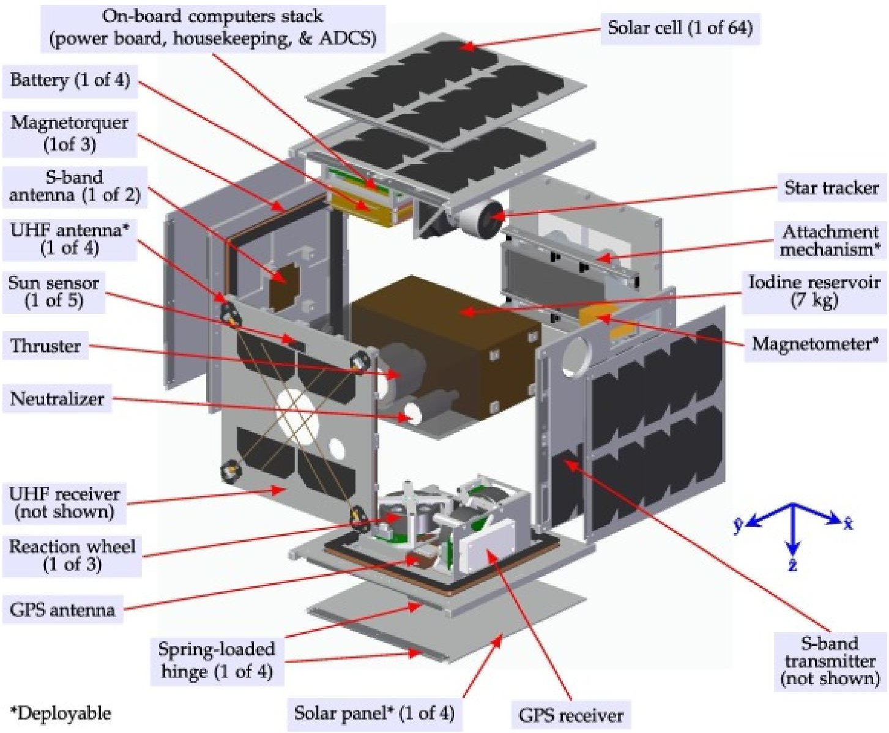

Fig. 2. Exploded view of the deorbiter CubeSat.

The power subsystem of the deorbiter CubeSat includes four battery banks, each capable of providing 53.2W.h of electrical energy, 7.2A.h of current, and 7.4V of voltage (Nader et al., 2016). Since the BIT-3 thruster is rated at 28V, the batteries are connected in series to provide 29.6V of total voltage, 213.1W.h of electrical energy, and 7.2A.h of current capacity. The solar cells that are used on the CubeSat can each produce about 1.1W.h of electrical energy (AzurSpace's Triple Junction Solar Cell 3G30C-Advanced, 30% efficiency, $ 8 \mathrm{c m} \times4 \mathrm{c m}, $ $ 80 \mu\mathrm{m} $ thick (Azure Space Solar Power GmbH, 2016)) when pointed directly at the Sun. In this design of the deorbiter CubeSat, 10 solar cells can fit on each of the four deployable solar panels. On the primary structure of the CubeSat, solar cells have been attached such that they do not obstruct the field of view of the optical instruments (e.g., the star tracker) and the antennas. As such, six cells can be attached to the +x panel, four to the +y panel, four to the $ -x $ panel, eight to the $ -z $ panel, and none to the $ +z $ and $ -y $ panels (the latter is due to the fact that the CubeSat attaches to the debris from the $ -y $ side and hence it will be permanently shadowed). These cells are included mainly to eliminate a death mode in which CubeSat's +y side points away from the Sun indefinitely and the electrical energy generation becomes negligible. They can also contribute to the electrical energy generation by collecting the solar radiation reflected off the Earth's surface. Given the aforementioned number of cells, the CubeSat can generate at least about 48.5W.h of electrical energy when the +y side is pointed at the Sun.

The deorbiter CubeSat's total mass must be less than 16.0 kg-a constraint that is imposed by the CubeSat bus manufacturer (Innovative Solutions in Space, 2016). This is shown to be the case in Table 2, where the total CubeSat's mass, excluding the attachment

<!-- PDF_PAGE: 6 -->

Table 2. Summary of deorbiter CubeSat's mass budget. The mass values include contingencies. References to the components' data sheets are provided.

<table border="1"><tr><td>Subsystem</td><td>Mass[kg](% of total)</td><td>Key components(×Quantity)</td></tr><tr><td>Structures</td><td>3.05(20%)</td><td>Primary structure Innovative Solutions in Space(2015); solar panel substrate$ ^{*}$(×4); reaction wheel, star tracker,and magnetometer mounts$ ^{*}$(each×1)</td></tr><tr><td>ADCS</td><td>1.42(10%)</td><td>Reaction wheel(×3) Sinclair Interpalentary(2016);Sun sensor(×5) New Space Systems(2017);star tracker(×1) Sinclair Interpalentary(2015);magnetometer(×1) ZARM Technik AG(2016);magnetorquer$ ^{*}$(×3);GPS receiver(×1) SkyFox Labs(2017)和 antenna(×1) SkyFox Labs(2017);computer(×1) Cube Space(2017)</td></tr><tr><td>Power</td><td>1.25(9%)</td><td>Battery(×4) Nader et al.(2016);power board(×1) Clyde Space(2017);solar cells(×64) Azure Space Solar Power GmbH(2016)</td></tr><tr><td>C&amp;DH</td><td>0.10(1%)</td><td>House keeping computer Innovative Solutions in Space(2016)</td></tr><tr><td>Comms</td><td>0.20(1%)</td><td>S-band transmitter(×1) IQ Wireless GmbH(2016)和 antenna(×2) IQ Wireless GmbH(2017),UHF receiver(×1) GOM Space(2016)和 antenna(×4) GOM Space(2014)</td></tr><tr><td>Propulsion</td><td>8.58(58%)</td><td>Ion thruster(×1) Busek Co. Inc.(2014),7-kg iodine reservoir(×1)</td></tr><tr><td>Integration</td><td>0.16(1%)</td><td>Fasteners and wiring harnesses</td></tr><tr><td>Total</td><td>14.75(100%)</td><td>-</td></tr><tr><td>Target</td><td>16.00</td><td>-</td></tr><tr><td>Margin</td><td>1.25</td><td>-</td></tr></table>

*

Mass obtained from Solid Edge computer aided design software.

<!-- PDF_PAGE: 7 -->

In terms of the attachment system, there are a number of seemingly viable concepts for space applications that have been proposed by the research community. These methods are chemical adhesion, synthetic gecko feet, magnetic grippers, mechanical grippers, and electroadhesion (Shan et al., 2016). Each method has attributes that make it desirable, but also unfavorable for space use. Chemical adhesion can generate a strong bond, but cannot be easily re-used once the bond is cured. In the deorbiter CubeSat mission, however, since the CubeSat stays attached to the debris throughout the deorbiting maneuver, the fact that the chemical method is a single-use concept is not a concern. However, the main drawback of the chemical method is that the bonding agents would have to be able to bond under space conditions in the absence of oxygen. Synthetic gecko feet work on the principle of van der Waals forces (Sitti and Fearing, 2003, Estrada et al, 2016), which can have difficulty adhering to rough surfaces. Using magnetic grippers can produce strong adhesion, but its use is limited to only ferromagnetic surfaces. Since some space objects are non-ferromagnetic, such as glass or Mylar, the use of magnets would not be suitable. Robotic arms are commonly used on space stations to handle large payloads, but they require pre-designed gripping appendages on target objects. Also, they are generally heavy and bulky, rendering their use in the deorbiter CubeSat mission unsuitable. Electroadhesion is another method that can be repeatedly used on rough and smooth surfaces (Saravia and Udrea, 2016). The method works based on the principles of the electrostatic forces. Even when dust particles are present, adhesion can still be achieved (Saravia and Udrea, 2016). Electroadhesion pads are able to adhere to various types of surfaces whether they are conductive, semi-conductive, or insulating surfaces (Ruffatto et al., 2014), at the price of consuming electrical energy throughout their operation. Also, they produce relatively lower adhesion force compared to the other methods. It should be noted that suction does not work in the vacuum, and hence it is not considered for space applications. Considering the above, the candidate solutions for the attachment mechanism in the deorbiter CubeSat mission could be the chemical method, gecko-inspired adhesion, and electroadhesion. The selection details of the attachment mechanism are left to the future studies.

## 2.2. Scope of the mission

In order to transfer a debris object from its initial orbit to a lower orbit, a certain amount of change in orbital velocity (delta-v, $ \Delta v $ ）of the debris is required. For a certain debris object, the amount of $ \Delta v $ that can be produced is in turn limited by the amount of available propellant, and by the CubeSat's propulsion system specification. As stated in Section 2.1, the deorbiter CubeSat can carry 7 kg of iodine propellant, and uses the BIT-3 ion thruster as the source of propulsion. Table 3 lists the nominal specification of BIT-3 with iodine as the propellant.

Table 3. BIT-3 relevant technical specifications Busek Co. Inc. (2014).

<!-- PDF_PAGE: 8 -->

<table border="1"><tr><td>Parameter</td><td>Value/description</td></tr><tr><td>Propellant</td><td>Iodine(solid storage)</td></tr><tr><td>Power</td><td>56-80W</td></tr><tr><td>Input voltage</td><td>28V(DC)</td></tr><tr><td>Dimensions</td><td>18.0cm×8.8cm×10.2cm</td></tr><tr><td>Propellant mass flow rate($\dot{m}_{\mathrm{p}}$)</td><td>48μg·s-1</td></tr><tr><td>Thrust($T$)</td><td>0.66-1.24mN</td></tr><tr><td>Specific impulse($I_{\mathrm{sp}}$)</td><td>1400-2640s</td></tr><tr><td>Thruster mass</td><td>1.5kg</td></tr><tr><td>Propellant utilization efficiency($\eta_{\mathrm{p}}$)</td><td>68%</td></tr></table>

Given the amount of propellant and the thruster's specific impulse, $ I_{\mathrm{sp}} $ , there are two factors that are involved in selecting the debris object. First, the mass of debris dictates the amount of $ \Delta v $ that can be produced by the CubeSat's propulsion system, as described by the rocket equation (Goebel and Katz, 2008):

$$
\Delta v = I _ {\mathrm {s p}} g _ {0} \ln \left(\frac {m _ {\mathrm {p}}}{\bar {m}} + 1\right)
$$

where $ g_{0}=9. 8 1 \mathrm{m} \cdot \mathrm{s}^{-2} $ is the standard gravity, and $ \overline{m} $ is the dry mass of the system, which is the sum of debris' mass, $ m_{\mathrm{d}} $ , and CubeSat's dry mass, $ \overline{m}_{\mathrm{c}}=9 $ kg. Also, $ m_{\mathrm{p}}=7 $ kg is the propellant mass. Secondly, given the $ \Delta v $ and assuming a final orbit altitude of $ h_{\mathrm{f}}=1 0 0 $ km, the permissible debris initial orbit altitude, $ h_{0} $ , can be estimated using the following:

$$
\Delta v = \left| \sqrt {\frac {\mu_ {\oplus}}{h _ {0} + R _ {\oplus}}} - \sqrt {\frac {\mu_ {\oplus}}{h _ {f} + R _ {\oplus}}} \right|
$$

where $ R_{\oplus}\approx 6 3 7 8. 1 \mathrm{k m} $ and $ \mu_{\oplus}=3 9 8, 6 0 0 \mathrm{k m}^{3} \cdot \mathrm{s}^{-2} $ are the Earth radius and standard gravitational parameter, respectively. In Eq. (2), the general assumption is that the initial and final debris orbits are circular and co-planar. This is a conservative assumption (as it will be shown in the case study in Section 6), since objects in non-circular orbits come closer to Earth (as they travel through the perigee point of the orbit,) and hence experience a larger drag force due to a higher atmospheric density. Fig. 3 shows the amount of propellant required (values on the contour lines) as a function of debris mass, $ m_{\mathrm{d}} $ , and initial orbit altitude $ h_{0} $ , assuming no contribution from the atmospheric drag. The green region indicates debris objects that are within the realms of deorbiter CubeSat's propulsion capabilities, i.e., $ m_{\mathrm{p}} \leqslant 7. 0 \mathrm{k g}. $

<!-- PDF_PAGE: 9 -->

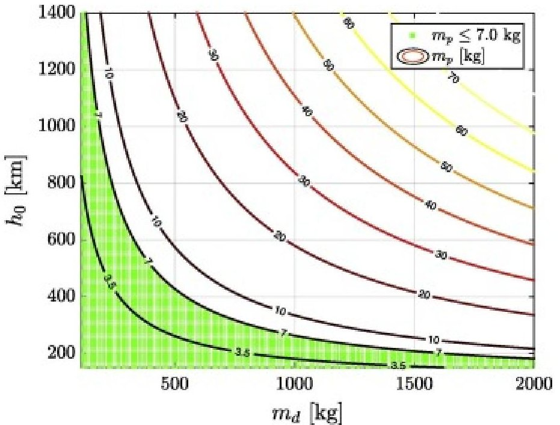

Fig. 3. Contour plot of required propellant mass, $ m_{\mathrm{p}} $ , vs. debris mass, $ m_{\mathrm{d}} $ , and initial orbit altitude, $ h_{0} $ assuming a final orbit altitude of $ h_{\mathrm{f}}=100 \mathrm{~km} $ , a propellant utilization efficiency of $ \eta_{\mathrm{p}}=68\% $ for the thruster, and no contribution from the atmospheric drag.

It must be noted that in Fig. 3, if the contribution from atmospheric drag force is included, the feasible region can be extended. However, the current figure represents a conservative feasible region.

An underlying assumption in the deorbiter CubeSat mission concept is that the mothership delivers the CubeSat into orbit, performs rendezvous and orbit phasing maneuvers with the debris, and deploys the CubeSat in the close vicinity of the debris for the final attachment phase. However, in order to roughly estimate how much propellant should be reserved on the CubeSat for the attachment procedure, we consider a scenario in which the mothership deploys the CubeSat in an orbit that is 10km away from the target debris orbit (a conservative assumption). As such the CubeSat would have to perform a coplanar orbital maneuver to reach the target debris orbit. Assuming that the target debris is in a 400-km circular orbit, the CubeSat would have to burn about 0.002kg of propellant in order to reach the target debris orbit (obtained from Eq. (2)), which is less than 0.03% of the available propellant mass on the CubeSat.

Once arrived at the target orbit, the CubeSat then proceeds to an orbit phasing maneuver with the target debris. For the orbit phasing maneuver, the following quadratic equation describes the relation between orbital angular distance, $ \Delta \theta $ , total thrusting time, $ \Delta t_{\mathrm{th}} $ , and total phasing time, $ \Delta t_{\mathrm{ph}} $ , assuming a circular reference orbit (Massachusetts Institute of Technology, 2017):

$$
\frac {1}{2} \Delta t _ {\mathrm {t h}} ^ {2} - \Delta t _ {\mathrm {t h}} \Delta t _ {\mathrm {p h}} + \frac {2}{3} \frac {m _ {\mathrm {c}} \left(R _ {\oplus} + h\right) \Delta \theta}{T} = 0
$$

where h is the altitude of the reference orbit. Eq. (3) shows that orbit phasing can be accomplished with different choices of thrusting time; a smaller $ \Delta t_{\mathrm{th}} $ yields to a larger $ \Delta t_{\mathrm{ph}} $ (with $ \Delta t_{\mathrm{th}}\leqslant\Delta t_{\mathrm{ph}} $ ). A limiting case is when $ \Delta t_{\mathrm{th}}=\Delta t_{\mathrm{ph}} $ , i.e., deorbiter CubeSat continuously thrusts during the orbit phasing and hence does not coast in any intermediate orbit, which results in minimum $ \Delta t_{\mathrm{ph}} $ at the expense of a larger fuel consumption. Given $ \Delta t_{\mathrm{ph}} $ and $ \Delta t_{\mathrm{th}} $ from Eq. (3), the required delta-v to perform orbit phasing, $ \Delta v_{\mathrm{ph}} $ , can then be computed from the following (Massachusetts Institute of Technology, 2017):

$$
\Delta v _ {\mathrm {p h}} = \frac {4}{3} \frac {\left(R _ {\oplus} + h\right) \Delta \theta}{\left(2 \Delta t _ {\mathrm {p h}} - \Delta t _ {\mathrm {t h}}\right)}
$$

<!-- PDF_PAGE: 10 -->

Lastly, the amount of required propellant for orbit phasing maneuver, $ m_{\mathrm{p h}} $ , can be obtained from Eq. (1) given the thruster parameters in Table 3. The results from six different scenarios are presented in Table 4. In all cases, the initial angular distance between the CubeSat and the debris is assumed to be maximum, i.e., $ \Delta\theta=\pi. $

Table 4. Results of orbit phasing between CubeSat and target debris. Assumptions: $ \Delta\theta=\pi, I_{\mathrm{sp}}=2 6 4 0 $ s, and $ T=1. 2 4 \mathrm{m N}. $

<table border="1"><tr><td>Case</td><td>h[km]</td><td>$\Delta t_{\mathrm{th}}/\Delta t_{\mathrm{ph}}$</td><td>$\Delta t_{\mathrm{ph}}[\mathrm{h}]$</td><td>$\Delta v_{\mathrm{ph}}[\mathrm{m/s}]$</td><td>$m_{\mathrm{ph}}[\mathrm{kg}]$</td></tr><tr><td>1</td><td>500</td><td>1/2</td><td>177.81</td><td>45.0</td><td>0.016</td></tr><tr><td>2</td><td>500</td><td>1</td><td>154.0</td><td>51.97</td><td>0.018</td></tr><tr><td>3</td><td>1000</td><td>1/2</td><td>184.16</td><td>46.61</td><td>0.016</td></tr><tr><td>4</td><td>1000</td><td>1</td><td>159.0</td><td>53.82</td><td>0.019</td></tr><tr><td>5</td><td>2000</td><td>1/2</td><td>196.24</td><td>49.67</td><td>0.017</td></tr><tr><td>6</td><td>2000</td><td>1</td><td>169.95</td><td>57.36</td><td>0.020</td></tr></table>

Considering the results from both orbital maneuvers (i.e., change of orbit radius and orbit phasing), the amount of expended propellant to reach the debris is evidently negligible compared to the mass of available propellant on the CubeSat (i.e., 7 kg).

## 3. Preliminaries

## 3.1. Reference frames

In this work, five coordinate systems are of interest. The first frame is the geocentric-equatorial frame, $ \mathcal{F}_{\mathrm{G}} $ , which is an inertial frame with origin at the Earth's center. Its x-axis, $ \widehat{\mathbf{x}}_{\mathrm{G}} $ , points towards the vernal equinox, its $ \hat{\mathbf{z}}_{\mathrm{G}} $ points towards the north pole, and its y-axis, $ \widehat{\mathbf{y}}_{\mathrm{G}} $ , completes the right-handed triad.

The second frame is the perifocal frame, $ \mathcal{F}_{\mathrm{p}} $ , whose origin is also at the Earth's center. Its x-axis, $ \widehat{x}_{\mathrm{p}} $ , points towards the orbit's perigee, its z-axis, $ \hat{z}_{\mathrm{p}} $ , is perpendicular to the orbital plane and is parallel to the orbital angular momentum vector, and its y-axis, $ \widehat{y}_{\mathrm{p}} $ , completes the triad. The rotation from frame $ \mathcal{F}_{\mathrm{G}} $ to frame $ \mathcal{F}_{\mathrm{p}} $ is obtained from $ \mathbf{C}_{\mathrm{pG}}=\mathbf{C}_{z}(\omega)\mathbf{C}_{x}(i)\mathbf{C}_{z}(\Omega) $ (De Ruiter et al., 2013), where $ \omega,i $ and $ \Omega $ are the argument of perigee, inclination, and right ascension of the ascending node (RAAN), respectively, and $ \mathbf{C}_{x},\mathbf{C}_{y} $ , and $ \mathbf{C}_{z} $ denote the Euler's principal rotation matrices about x-axis, y-axis, and z-axis, respectively.

The third frame is the orbital frame, $ \mathcal{F}_{0} $ , which has its origin at the center of mass of the satellite. The frame rotates as the satellite progresses in its orbit, and hence is non-inertial. The x-axis of the orbital frame, $ \widehat{x}_{0} $ , is in the anti-nadir direction, its z-axis, $ \widehat{z}_{0} $ , is parallel to the orbital angular momentum vector, and its y-axis, $ \widehat{y}_{0} $ , completes the system. The orientation of the frame $ \mathcal{F}_{0} $ with respect to (w.r.t.) the frame $ \mathcal{F}_{p} $ can be obtained by a rotation about $ \hat{z}_{p} $ , i.e., $ \mathbf{C}_{\mathrm{op}}=\mathbf{C}_{z}(v) $ , where v is the true anomaly angle.

Lastly, the principal axes frames of the CubeSat and the debris object are denoted by $ \mathcal{F}_{c} $ and $ \mathcal{F}_{d} $ , respectively.

## 3.2. CubeSat-debris combined system

<!-- PDF_PAGE: 11 -->

Fig. 4 shows a system of three rigid bodies made up of the deorbiter CubeSat, the reaction wheel assembly (RWA), and the debris. The system is assumed to tumble about $ \mathcal{F}_{\mathrm{d}} $ , under the assumption that the system's center of mass coincides with that of the debris. Since the mass of the debris object is typically much larger than that of the CubeSat, the shift in the debris center of mass due to the landed deorbiter CubeSat is small (on the order of millimeters for a 500kg debris). Hence, the shifting has negligible effects on the dynamics of the system. However, if the debris mass is considerably smaller, the shift in the center of mass will need to be accounted for, as it will affect the overall detumbling maneuver time.

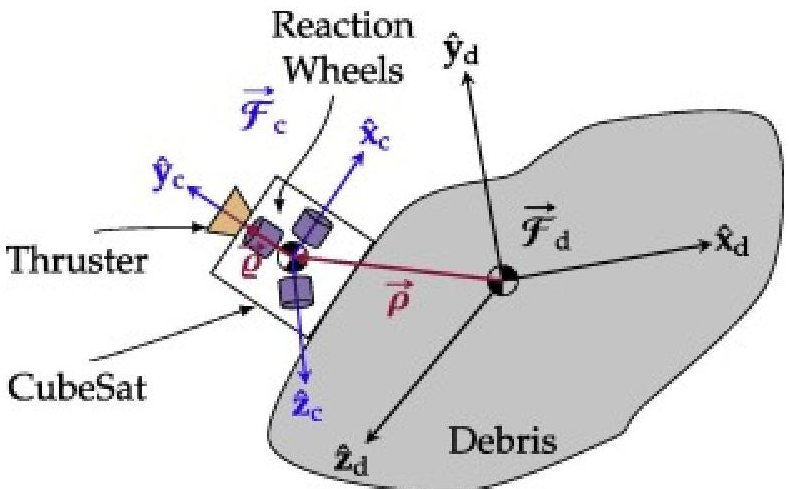

Fig. 4. Deorbiter CubeSat attached to a debris.

The RWA is mounted inside the CubeSat, and consists of three mutually perpendicular reaction wheels, each rotating about one of the basis vectors of $ \mathcal{F}_{c} $ . The CubeSat is attached rigidly to the exterior of the debris object throughout the detumbling maneuver, hence the orientation of $ \mathcal{F}_{c} $ w.r.t. $ \mathcal{F}_{d} $ denoted by $ C_{d c} $ remains invariant.

Using the parallel axis and the rotational transformation theorems (De Ruiter et al., 2013, Hughes, 1986), the combined CubeSat's and reaction wheels' moment of inertia (MOI) expressed in $ \mathcal{F}_{\mathrm{d}} $ and denoted by $ \mathbf{J}_{\mathrm{c}} $ is:

$$
\mathbf {J} _ {\mathrm {c}} = \mathbf {C} _ {\mathrm {d c}} \left(\mathbf {I} _ {\mathrm {c}} + \mathbf {I} _ {\mathrm {w}} + m _ {\mathrm {c}} \left(\boldsymbol {\rho} ^ {\top} \boldsymbol {\rho} \mathbf {1} - \boldsymbol {\rho} \boldsymbol {\rho} ^ {\top}\right)\right) \mathbf {C} _ {\mathrm {d c}} ^ {\top}
$$

where $ \mathbf{I}_{\mathrm{c}} $ and $ \mathbf{I}_{\mathrm{w}} $ denote the principal MOI matrices of the CubeSat and RWA, respectively, $ \rho $ is the translation between $ \mathcal{F}_{\mathrm{c}} $ and $ \mathcal{F}_{\mathrm{d}} $ (i.e., the attachment location of the CubeSat w.r.t. the debris center of mass), $ m_{\mathrm{c}} $ is the CubeSat's overall mass (including the RWA), and 1 denotes a $ 3\times 3 $ identity matrix. The overall MOI of the system is therefore $ \mathbf{I}=\mathbf{J}_{\mathrm{c}}+\mathbf{I}_{\mathrm{d}}. $

Further, as shown in Fig. 4, the thruster is aligned with the CubeSat's y-axis, $ \widehat{y}_{\mathrm{c}} $ , and $ \varrho $ defines the location of the thruster's point of action w.r.t. CubeSat's center of mass. The thrust vector defined in $ \mathcal{F}_{\mathrm{c}} $ is therefore $ \mathbf{T}=[0- T 0]^{\top} $ , where T is the thrust specific force (i.e., per unit mass).

In what follows, the dynamics and kinematics of the detumbling and deorbiting maneuvers will be discussed. Euler's equations of motion and the attitude quaternions are coupled and integrated simultaneously for the detumbling maneuver, given the detumbling control law. Gauss' variational equations are then formulated and integrated numerically to investigate the deorbiting maneuver.

## 4. Detumbling maneuver

Detumbling refers to the maneuver during which the angular rates of debris object are zeroed. The maneuver is performed through the utilization of the deorbiter CubeSat ADCS. In particular, the CubeSat is equipped with a set of three reaction wheels (RW) that are

<!-- PDF_PAGE: 12 -->

used to damp the angular momentum of the tumbling debris, and subsequently reduce its angular velocities. There is a limit to the amount of momentum that can be stored on each wheel and a wheel reaches its saturation point when it is spinning at its maximum angular velocity. As a result, the RW can no longer be accelerated to produce torque, hence control authority is lost in one direction. To reclaim full control, the wheel would need to unload the stored momentum. The two primary control hardware items used for this purpose are the magnetic torquers and reaction thrusters (Sidi, 1997), with the first option being the most common in CubeSats. Appendix A describes the momentum unloading control law that is implemented in the simulation. It will be assumed that the spacecraft attitude controller stops functioning for the duration of reaction wheel desaturation. During the process, the thruster is turned off and magnetorquers are utilized to counteract the parasitic torques produced by the reaction wheels.

## 4.1. Attitude dynamics and kinematics

Euler's equations of motion for the combined CubeSat-debris system can be described as follows:

$$
\mathbf {I} \dot {\omega} = \tau_ {\mathrm {e}} + \mathbf {C} _ {\mathrm {d c}} \tau_ {\mathrm {w}} - \omega^ {\times} \left(\mathbf {I} \omega + \mathbf {C} _ {\mathrm {d c}} \mathbf {h} _ {\mathrm {w}}\right)
$$

where $ \tau_{\mathrm{w}} $ is the control torque supplied by the reaction wheels, $ (\cdot) $ denotes the derivative w.r.t. time, $ (\cdot)^{\times} $ denotes the skew-symmetric matrix operator, $ \omega $ is the angular velocity of the system, and $ \tau_{\mathrm{e}} $ denotes the external disturbance torque acting on the system.

The main external disturbance torque, $ \tau_{\mathrm{e}} $ , acting on the system is the gravity gradient torque, $ \tau_{\mathrm{g}} $ , and the parasitic torque due to thrust force line of action misalignment from the debris center of mass, $ \tau_{\mathrm{th}} $ :

$$
\tau_ {\mathrm {e}} = \tau_ {\mathrm {g}} + \tau_ {\mathrm {t h}}
$$

The gravity gradient torque can be modeled as follows (De Ruiter et al., 2013):

$$
\tau_ {\mathrm {g}} = \frac {3 \mu_ {\oplus}}{r ^ {5}} \mathbf {r} _ {\mathrm {d}} ^ {\times} \mathbf {I r} _ {\mathrm {d}}
$$

where r is the distance of center of mass of the system from the Earth's center, and $ \mathbf{r}_{\mathrm{d}}=\mathbf{C}_{\mathrm{dG}} \mathbf{r} $ is the orbital position of the system described in $ \mathcal{F}_{\mathrm{d}} $ , where r is the inertial position of the system, and $ \mathbf{C}_{\mathrm{dG}} $ is the rotation matrix from $ \mathcal{F}_{\mathrm{G}} $ to $ \mathcal{F}_{\mathrm{d}} $ .

The parasitic torque due to the misalignment between the thrust vector and debris center of mass can be obtained from the following:

$$
\boldsymbol {\tau} _ {\mathrm {t h}} = \left(\boldsymbol {\rho} + \mathbf {C} _ {\mathrm {d c}} \boldsymbol {\varrho}\right) ^ {\times} \mathbf {C} _ {\mathrm {d c}} \mathbf {T}
$$

The attitude kinematics of the system can be modeled using $ \omega $ and quaternions $ ^{1} $ rates of change $ \in $ and $ \eta $ as follows:

$$
\left[ \begin{array}{c} \in \\ \eta \end{array} \right] = \frac {1}{2} \left[ \begin{array}{c} \eta \mathbf {1} + \in^ {\times} \\ - \in^ {\mathsf {T}} \end{array} \right] \omega
$$

Eqs. (6), (10) fully describe the attitude motion of the system, which can be integrated numerically to simulate the system's attitude over time.

## 4.2. Control technique

<!-- PDF_PAGE: 13 -->

Satellites are required to dampen their tip-off rates upon release from launch vehicles to meet pointing requirements of their on-board instruments, aim their thrusters in a certain direction, etc. Similarly, the deorbiter CubeSat must stabilize the debris attitude, i.e., nullify its initial angular rates, before proceeding to deorbit, which requires pointing the thruster in a certain direction (see Section 5.1 for more details.) Depending on the control objectives, there are several control schemes that can be adopted to detumble the debris. In this work, the time-optimality of the controller is highly desired since the amount of torques that can be exerted by the reaction wheels system are small given the large mass of the target debris. Naturally, it takes a considerable amount of time to nullify the debris momentum.

The time-optimal detumbling controller considered here drives the system from an initial angular velocity, $ \omega_{0} $ , to rest in minimum time. Meanwhile, the magnitude of the torque input is restricted to be below the maximum torque $ \tau_{\mathrm{w}}^{\mathrm{max}} $ that each reaction wheel can provide. It can be shown that the optimal control torque $ \tau_{\mathrm{w}}^{*} $ provided by the RWA has the following form (Aghili, 2009, Aghili, 2009):

$$
\tau_ {\mathrm {w}} ^ {*} = \left\{ \begin{array}{l l} - \frac {\mathrm {I} \omega}{\| \mathrm {I} \omega \|} \tau_ {\mathrm {w}} ^ {\max } & \mathrm {i f} \| \omega \| \geqslant \sigma \\ 0 & \mathrm {o t h e r w i s e} \end{array} \right.
$$

for an arbitrary small $ \sigma $ below which the system is considered to be detumbled. Aside from its simplicity and time optimality, Eq. (11) guarantees that the torque demanded from each wheel does not exceed the wheel's torque capacity, $ \tau_{\mathrm{w}}^{\mathrm{max}} $ , unlike in typical PID (proportional-integral-derivative) controllers which require the tuning of the gain matrices (a process known as the gain scheduling) to ensure that the demanded torque stays below a threshold value.

## 5. Deorbiting maneuver

Once the debris object is detumbled, the deorbiter CubeSat begins a deorbiting maneuver to move the debris to a final decaying orbit whose semi-major axis is $ a_{\mathrm{f}}=R_{\oplus}+1 0 0 \mathrm{k m} $ . This section will outline the method for modeling the evolution of the debris orbit as the deorbiter CubeSat provides a deorbiting thrust. Further, the reaction wheels previously used for detumbling are employed for attitude control of the deorbiter CubeSat. Active attitude control is critical for ensuring the thrust angles are properly aligned in order to maximize the change in semi-major axis of the orbit. Since reaction wheels periodically become saturated, at such points a short delay in the deorbiting maneuver will take place to allow for momentum unloading. After the reaction wheels complete their momentum unloading and the required attitude is reobtained, the deorbiter CubeSat will continue providing the deorbiting thrust. In this work, the deorbiter CubeSat is considered to provide a continuous low thrust on the debris orbit while the attitude of the system is in the correct orientation. As such, the force provided by the deorbiter CubeSat can be modeled as a time dependent perturbation on the debris orbit. A common method for modeling the effects of perturbations on the evolution of an orbit is through Gauss' variational equations. These equations express the rate of change of the orbital elements, as follows (Kemble, 2006):

$$
\dot {a} = \frac {2 a ^ {2}}{h} \left[ e \sin v \quad \frac {p}{r} \quad 0 \right] \mathbf {F}
$$

$$
\dot {e} = \frac {1}{h} \left[ p \sin v \quad (p + r) \cos v + r e \quad 0 \right] \mathbf {F}
$$

$$
\dot {i} = \frac {r}{h} \left[ 0 0 \cos (\omega + v) \right] \mathbf {F}
$$

<!-- PDF_PAGE: 14 -->

$$
\dot {\Omega} = \frac {r}{h} \left[ 0 0 \frac {\sin (\omega + v)}{\sin i} \right] \mathbf {F}
$$

$$
\dot {\omega} = \frac {1}{h} \left[ - \frac {p}{e} \cos v \quad \frac {p + r}{e} \sin v \quad \frac {r \sin (\omega + v)}{\tan i} \right] \mathbf {F}
$$

$$
\dot {v} = \frac {h}{r ^ {2}} + \frac {1}{h e} [ p \cos v - (p + r) \sin v 0 ] \mathbf {F}
$$

where a is the semi-major axis, e is the eccentricity, i is the inclination, $ \Omega $ is the right ascension of the ascending node (RAAN), $ \omega $ is the argument of perigee, and v is the true anomaly. Also, $ p=a \left( 1-e^{2} \right) $ is the semi-latus rectum, and $ h=\sqrt{\mu p} $ is the orbit angular momentum. Further, F is the vector of external perturbative forces (disturbance and control) acting on the system, defined as follows:

$$
\mathbf {F} = \mathbf {f} _ {\mathrm {a}} + \mathbf {f} _ {\mathrm {g}} + \mathbf {T}
$$

where $ \mathbf{f}_{\mathrm{a}} $ $ \mathbf{f}_{\mathrm{g}} $ , and $ \mathbf{T} $ are the atmospheric drag, the gravitational perturbations due to non-spherical Earth, and the thrust forces, respectively, all per unit mass and defined in $ \mathcal{F}_{\mathrm{o}} $ . The atmospheric drag can be modeled as follows (Landis Markley and Crassidis, 2014):

$$
\mathbf {f} _ {\mathrm {a}} = - \frac {1}{2} C _ {\mathrm {D}} \rho_ {\mathrm {a}} \frac {A}{m} \| \mathbf {v} \| \mathbf {v}
$$

where $ C_{\mathrm{D}} $ is the dimensionless drag coefficient $ (\sim2.0 $ (Wertz,1978)) $ A $ is the cross-sectional area in the direction of the incident atmosphere, m is the total mass of the system which is assumed to stay constant throughout the maneuver, $ \rho_{\mathrm{a}} $ is the density of the atmosphere, and v is the velocity of the satellite relative to the atmosphere. The atmospheric density model that is adopted in this work is the 1976 standard model, which is a table look-up model based on the satellite's altitude, with a valid range of 86-1000 km (NASA,1976, Landis Markley and Crassidis,2014). The drag force $ \mathbf{f}_{\mathrm{a}} $ acts on the system in the direction opposite to v, reducing the system's kinetic energy and orbital angular momentum, thereby causing the eccentricity and semi-major axis to decay.

The gravitational perturbations considered in this study is due to the dominant zonal coefficient, $ J_{2} $ , which can be approximated in $ \mathcal{F}_{G} $ as follows (De Ruiter et al., 2013):

$$
\mathbf {f} _ {\mathrm {g}} = \frac {3 \mu J _ {2} R _ {\oplus} ^ {2}}{2 r ^ {5}} \left(\left(5 \frac {\left(\mathbf {r} ^ {\top} \mathbf {z}\right) ^ {2}}{r ^ {2}} - 1\right) \mathbf {r} - 2 \left(\mathbf {r} ^ {\top} \mathbf {z}\right) \mathbf {z}\right)
$$

where $ J_{2}\approx 1. 0 8 2 6\times 1 0^{-3} $ , and $ \mathbf{z}=[[0\quad 0\quad 1]]^{1} $ . It has been shown that the $ J_{2} $ -perturbations only affect RAAN $ (\Omega) $ and the argument of perigee $ (\omega) $ in the long-run, and has zero net effect on the remaining orbital elements (Wertz, 1978, De Ruiter et al., 2013). To include $ J_{2} $ perturbations in the variational equations, $ \mathbf{f}_{g} $ must be defined in frame $ \mathcal{F}_{o} $ . This is achieved by defining r and z in $ \mathcal{F}_{o} $ and then substituting them in Eq. (20), which yields to De Ruiter et al. (2013):

$$
\mathbf {f} _ {\mathrm {g}} = \frac {3 \mu_ {\oplus} J _ {2} R _ {\oplus} ^ {2}}{2 r ^ {4}} \left[ \begin{array}{c} 3 \sin^ {2} i \sin^ {2} (\nu + \omega) - 1 \\ - \sin^ {2} i \sin (2 (\nu + \omega)) \\ - \sin 2 i \sin (\nu + \omega) \end{array} \right]
$$

<!-- PDF_PAGE: 15 -->

## 5.1. Steering technique

The thrust vector, $ \mathbf{T} $ , in Eq. (18), can be defined in the frame $ \mathcal{F}_{0} $ as a function of two steering angles, $ \alpha $ and $ \beta $ (Kemble, 2006), as follows:

$$
\mathbf {T} = \left[ \begin{array}{c} T \sin \alpha \cos \beta \\ T \cos \alpha \cos \beta \\ T \sin \beta \end{array} \right]
$$

where $ \alpha $ is the azimuth angle between the thrust vector and the y-axis of orbital frame $ \widehat{y}_{0} $ , and $ \beta $ is the elevation angle between the thrust vector and the orbital plane.

Eq. (22) can be substituted in Eqs. (12),(13),(14),(15),(16) to obtain the rate of change of the orbital elements as functions of the steering angles. In this work, since the deorbiting of the system is of interest, the control objective is to adjust the steering angles such that the rate of decay in orbit's semi-major axis is maximized. As such, Eq. (12) can be re-written explicitly in steering angles, as follows:

$$
\dot {a} = \frac {2 a ^ {2} T \cos \beta}{\sqrt {\mu a \left(1 - e ^ {2}\right)}} \left(e \sin v \sin \alpha + \left(1 + e \cos v\right) \cos \alpha\right)
$$

To find the optimum steering angles $ \alpha^{*} $ and $ \beta^{*} $ that maximize the rate of decay of the semi-major axis, first it should be noted that the thrust vector must lie in the orbital plane. That is, $ \beta^{*} $ = 0. Then, Eq. (23) can be differentiated w.r.t.the remaining steering angle, $ \alpha $ , and set to zero, as follows:

$$
\frac {\partial a}{\partial \alpha} = \frac {2 a ^ {2} T}{\sqrt {\mu a \left(1 - e ^ {2}\right)}} \left(e \sin v \cos \alpha - \left(1 + e \cos v\right) \sin \alpha\right) = 0
$$

which yields to

$$
\alpha^ {*} = \arctan \left(\frac {e \sin v}{1 + e \cos v}\right) + \pi
$$

In other words, to maximize the rate of decay of the semi-major axis, the system's attitude must be adjusted continuously such that the thrust vector points in the opposite direction of the instantenous orbital velocity vector. The optimal steering angles for the remaining orbital elements can be derived in a similar fashion, as shown, for example, in Kemble, 2006, Ruggiero et al., 2011.

## 6. Case study

To verify the performance of the deorbiter CubeSat, two case studies are presented. In each case, a target debris is selected and the performance of various attitude and orbit control parameters of the deorbiter CubeSat are investigated. The debris object selected for this study are the defunct KOMPSAT-1 satellite and the Pegasus rocket body (more specifically, the spent Orion 50 XL motor.) The orbital parameters pertaining to each debris at epoch June 1, 2017, 00:00:00 Universal Coordinated Time (UTC) are outlined in Table 5. Both debris are within the feasible region of the deorbiter CubeSat mission (see Section 2.2). KOMPSAT-1 resides in a near-circular, highly-inclined orbit with an average altitude of 650km. Orion 50 XL, on the other hand, resides in an orbit with a lower inclination but a much larger eccentricity, with a perigee altitude of about 420km and an apogee altitude of 1400km.

<!-- PDF_PAGE: 16 -->

Table 5. Orbital parameters of the target debris at epoch 2017-06-01 00:00:00 UTC, obtained from the Systems Tool Kit (STK) program.

<table border="1"><tr><td>Parameter</td><td>KOMPSAT-1(NORAD26032)</td><td>PegasusR/B(NORAD26375)</td></tr><tr><td>Semi-major axis,a</td><td>7031.1km</td><td>7287.7km</td></tr><tr><td>Eccentricity,e</td><td>0.002563</td><td>0.067305</td></tr><tr><td>Inclination,i</td><td>97.79°</td><td>69.03°</td></tr><tr><td>RAAN,Ω</td><td>297.81°</td><td>130.54°</td></tr><tr><td>Arg.of perigee,ω</td><td>92.06°</td><td>234.46°</td></tr><tr><td>True anomaly,v</td><td>189.88°</td><td>150.15°</td></tr></table>

As stated previously, the deorbiter CubeSat is equipped with three reaction wheels that are used to detumble the debris, and to steer the system during the deorbiting maneuver. The CubeSat makes use of the Sinclair Interplanetary's RW3-0.060 reaction wheel, which can provide 20 mN $ \cdot $ m of torque and has a momentum capacity of 0.18 N $ \cdot $ m $ \cdot $ s (Sinclair Interpalentary, 2016). The overall mass of the deorbiter CubeSat is taken to be $ m_{\mathrm{c}}=16 $ kg, of which 7 kg is the propellant mass, and the remaining 9 kg accounts for the dry mass of CubeSat (e.g., structure, thruster, and reaction wheels - see Table 2) The MOI of the CubeSat is found to be $ \mathbf{I}_{\mathrm{c}}=\mathrm{d i a g}(0.11,0.11,0.11)\mathrm{kg}\cdot $ $ \mathrm{m}^{2} $ , which is obtained from the standard MOI equation for a solid cuboid with homogeneous mass distribution. Lastly, the position of the ion thruster defined in $ \mathcal{F}_{\mathrm{c}} $ is $ \varrho=\left[ \begin{array}{lll}0&0.1&0\end{array} \right]^{\mathrm{T}} $ m. The simulation parameters pertaining to debris objects and CubeSat's attachment configurations are reported in Table 6. With regards to the initial body rates, there are several references (e.g., Biondi et al., 2016, Lambour et al., 2000, Choi et al., 2016) in the literature which have modeled and estimated the expected body rates of different types of debris objects (e.g., highly heterogeneous structures, rocket bodies, and large satellites). The selected initial body rates in this study are an order of magnitude larger than the expected tumbling rates, in order to ensure a conservative simulation as well as to compensate for any additional momentum transferred to the debris during the landing of the CubeSat.

Table 6. Simulation parameters pertaining to KOMPSAT-1 and Orion 50 XL debris objects.

<table border="1"><tr><td>Debris object</td><td colspan="3">$I_{\mathrm{d}}[\mathrm{kg}\cdot\mathrm{m}^{2}]$</td><td>$\omega_{0}[\mathrm{rad}\cdot\mathrm{s}^{-1}]$</td><td>$C_{\mathrm{cd}}$</td><td>$\rho[\mathrm{m}]$</td></tr><tr><td>KOMPSAT-1</td><td colspan="3">$\begin{bmatrix}294.6&0&0\\0&209.8&0\\0&0&129.6\end{bmatrix}$</td><td>$\begin{bmatrix}1.5\\-1.0\\-0.5\end{bmatrix}$</td><td>$C_{y}(\frac{2\pi}{3})C_{z}(-\frac{\pi}{2})$</td><td>$\begin{bmatrix}0.7\\0.0\\1.0\end{bmatrix}$</td></tr><tr><td>Orion 50 XL</td><td colspan="3">$\begin{bmatrix}325.4&0&0\\0&325.4&0\\0&0&75.1\end{bmatrix}$</td><td>$\begin{bmatrix}-2.5\\2.5\\-0.5\end{bmatrix}$</td><td>$C_{y}(\frac{\pi}{4})C_{z}(-\frac{\pi}{6})$</td><td>$\begin{bmatrix}0.2\\0.6\\0.3\end{bmatrix}$</td></tr></table>

## 6.1. Case 1: KOMPSAT-1

Korea Multi-Purpose Satellite-1 (KOMPSAT-1, also known as Arirang-1) was an Earth-observation satellite developed primarily by the Korea Aerospace Research Institute (KARI). The spacecraft was launched in 1999, with the main objective of remote sensing (imagery) of the Earth's surface (Korea Aerospace Research Institute, 2017). KARI lost contact with the satellite in Dec. 2007, and the mission was

<!-- PDF_PAGE: 17 -->

officially terminated in Jan. 2008 (European Space Agency, 2017). The satellite bus consists of a hexagonal platform (see Fig. 5), approximately 2.4 m long and 1.3 wide, and two solar arrays that are extended laterally, each about 2.0 m long and 1.0 m wide (Kim, 1999). The overall dry mass of the spacecraft is 440 kg (Kim, 1999).

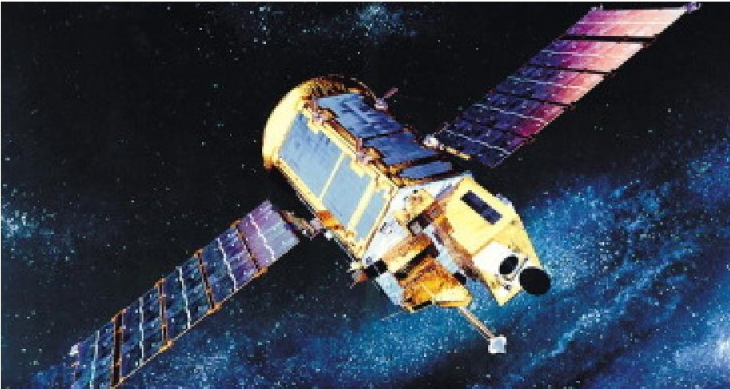

Fig. 5. Artist's view of the KOMPSAT-1 spacecraft in orbit (image credit: KARI Korea Aerospace Research Institute (2017)).

During the mission, the deorbiter CubeSat is considered to be attached rigidly to the debris on the +x surface of the spacecraft and away from its center of mass, as shown in Fig. 6. In this case, the parasitic torque due to the thrust misalignment would be substantial. The attachment location described in $ \mathcal{F}_{\mathrm{d}} $ as well as the orientation of the CubeSat w.r.t. the debris is reported in Table 6. The MOI of KOMPSAT-1 was obtained from Won (1999).

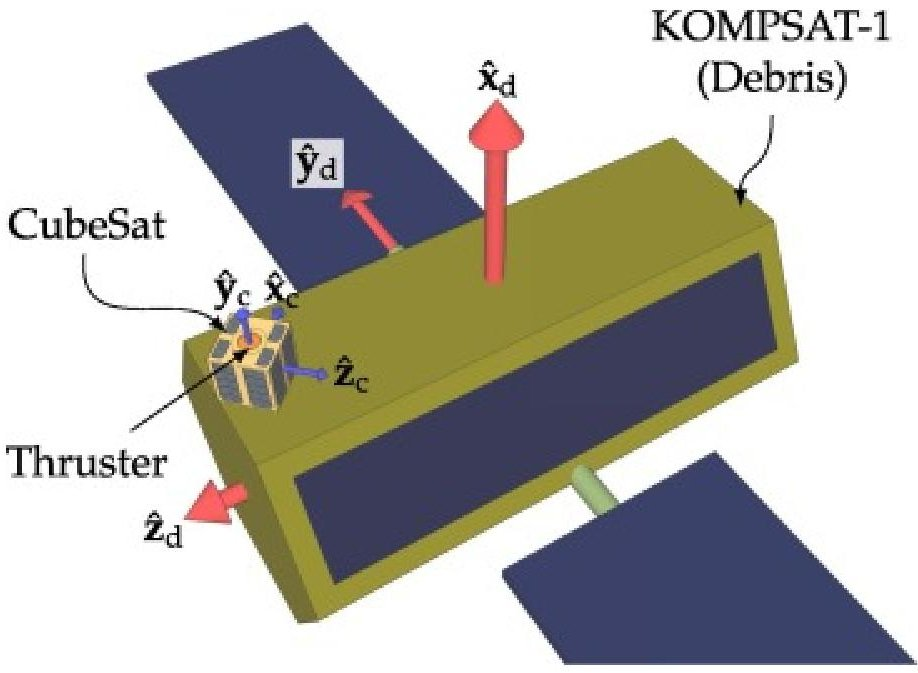

Fig. 6. CubeSat attached to KOMPSAT-1 (simplified models; true scale).

Also, as seen in Fig. 6, the CubeSat's y-axis (i.e., $ \widehat{y}_{c} $ ) and the debris x-axis (i.e., $ \widehat{x}_{c} $ ) are parallel. As such, the +x surface of the spacecraft and the solar panels are in the direction of the incident atmosphere during the deorbiting maneuver. Given the dimensions of the spacecraft bus and the solar panels in Kim (1999), the total cross-sectional area of the satellite is calculated to be $ A\approx 7.0\mathrm{m}^{2}. $

## 6.2. Case 2: Pegasus rocket body

<!-- PDF_PAGE: 18 -->

The Pegasus launch system by Orbital ATK Inc. is an aircraft-launched, three-stage rocket for the deployment of small satellites into LEO (Orbital ATK, 2016). Each stage of Pegasus uses a variation of the Orion solid rocket motors. An extended version of Pegasus is the Pegasus XL (extended length) model, which features lengthened first and second stage motors. The standard configuration of the Pegasus XL launch vehicle is outlined in Table 7. Since 1990, Pegasus and Pegasus XL have delivered more than 75 satellites to LEO in 40 launches (Orbital ATK, 2017).

Table 7. Configuration of the Pegasus XL's three stages Orbital ATK (2016).

<table border="1"><tr><td>Stage</td><td>Orion motor</td><td>Overall length[m]</td><td>Motor diameter[m]</td><td>Dry mass[kg]</td><td>Propellant mass[kg]</td></tr><tr><td>1</td><td>50S XL</td><td>10.27</td><td>1.28</td><td>1286.84</td><td>15034.32</td></tr><tr><td>2</td><td>50XL</td><td>3.07</td><td>1.28</td><td>366.50</td><td>3914.96</td></tr><tr><td>3</td><td>38</td><td>1.34</td><td>0.97</td><td>93.44</td><td>770.20</td></tr></table>

The debris object chosen for the Case-2 study is the Pegasus XL's second stage motor, namely Orion 50 XL. The rocket (Pegasus XL) was launched on Jun. 7, 2000 to deliver the TSX-5 satellite into orbit. The Orion 50 XL motor delivered the third stage and its payload to a suitable point in orbit, where the third stage was ignited and Orion 50 XL was discarded. Since then, the Orion motor has been included in the space debris catalog.

Fig. 7 shows the configuration of the deorbiter CubeSat and Orion 50 XL R/B that is considered in the study. For simulation purposes, the Orion XL's MOI is approximated using the standard MOI equation for a cylinder with a radius of 1.28 m, a height of 3.07 m, and a mass of 366.5 kg, and (and was reported in Table 6).

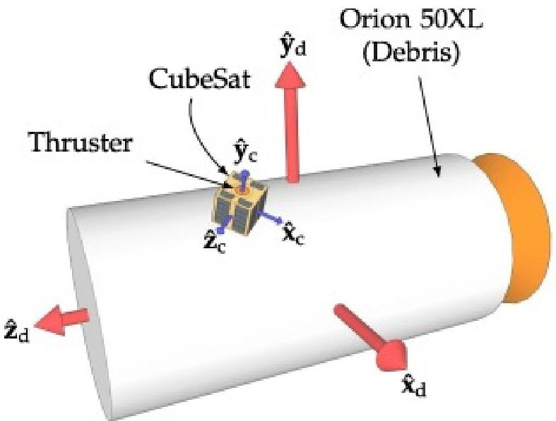

Fig. 7. CubeSat attached to Orion 50 XL (simplified models; true scale).

## 6.3. Results and discussion

Fig. 8 shows KOMPSAT-1's and Orion 50 XL's body rates profiles that result from the execution of the detumbling control law. Evidently, the magnitude of the debris body rate vector, $ \| \omega \| $ , continuously decreases in both cases. Regarding KOMPSAT-1, the detumbling is accomplished in about 19 days (Fig. 8a), and for Orion 50 XL, in about 9 days (Fig. 8b). In the case of KOMPSAT-1, the momentum unloading process occurs 3298 times (about 25 days), whereas in the case of Orion 50 XL, it occurs 1116 times (about

<!-- PDF_PAGE: 19 -->

8 days). Evidently, a considerable amount of time is spent on unloading the momentum off the reaction wheels in both cases. This is expected since debris' MOI are several orders of magnitude larger than that of the reaction wheels. Also, the initial tumbling rates were deliberately set to large values. Hence, the reaction wheels saturate frequently.

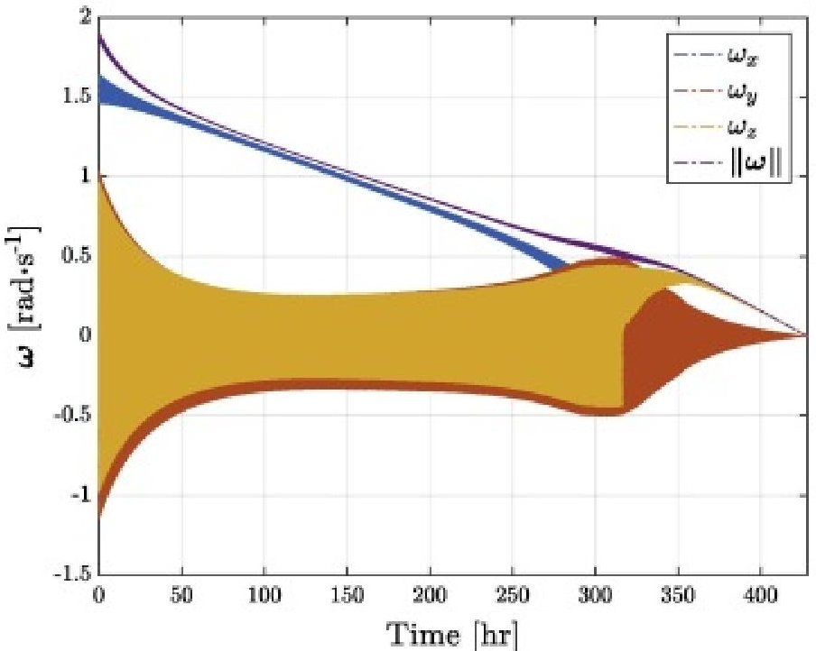

(a) KOMPSAT-1's body rates

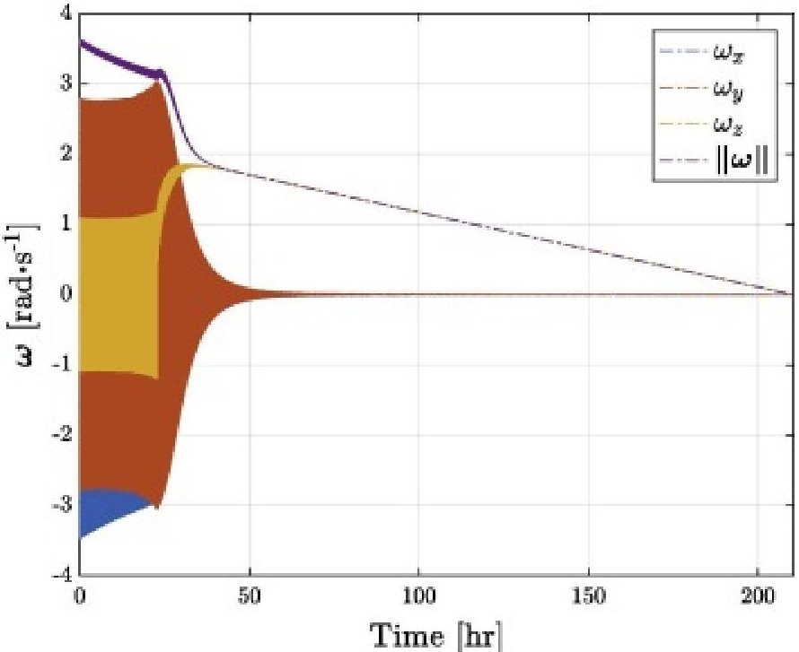

(b) Orion 50 XL's body rates

Fig. 8. Debris body rates profile during the detumbling maneuver for (a) KOMPSAT-1, and (b) Orion 50 XL.

Fig. 9 shows the debris orbital trajectories and semi-major axis profiles during the deorbiting maneuvers. Regarding KOMPSAT-1, the CubeSat's propulsion system along with the atmospheric drag, reduces the semi-major axis from its initial value of 7045 km to 6478.1 km within 596 days (i.e., 1.6 years). In the case of Orion 50 XL, the semi-major axis is reduced from 7290 km to 6478.1 km within 417 days (i.e., 1.1 years). For debris objects with altitudes over 500 km, the time for natural orbital decay is often measured in decades (NASA, 2017). In fact, STK's Lifetime tool estimates that the KOMPSAT-1's and the Orion 50 XL's remain in orbit for about 95 years and 22 years, respectively. These values were obtained based on the best-case assumption that the debris maintain their maximum cross-section areas (i.e., $ A=7.0\mathrm{m}^{2} $ for KOMPSAT-1, and $ A=3.9\mathrm{m}^{2} $ for Orion 50 XL) perpendicular to the orbital velocity direction throughout their lifetimes. The deorbiter CubeSat manages to remove the debris in a fraction of the natural decay times.

<!-- PDF_PAGE: 20 -->

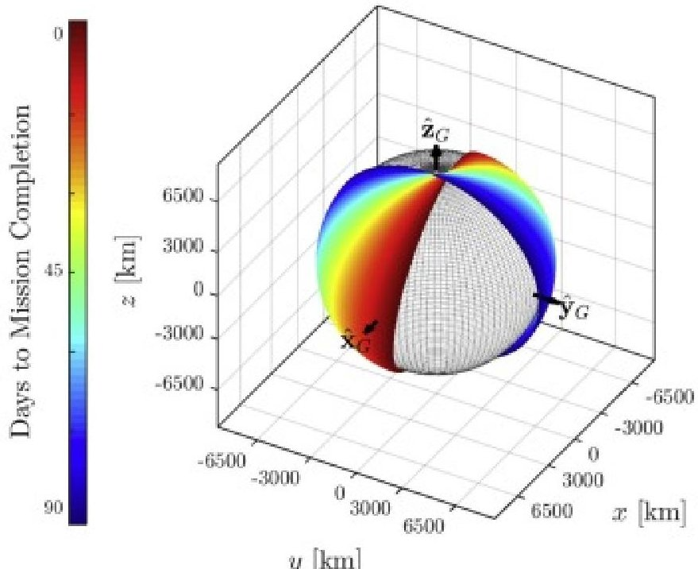

y[km]

(a) KOMPSAT-1's orbital trajectory (White sphere: Earth)

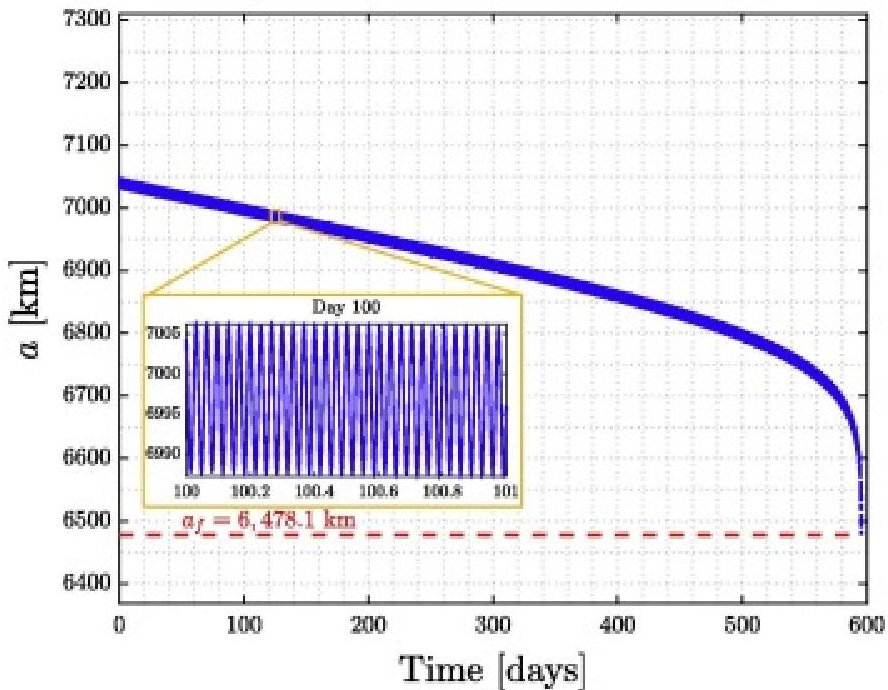

(b) KOMPSAT-1's semi-major axis profile

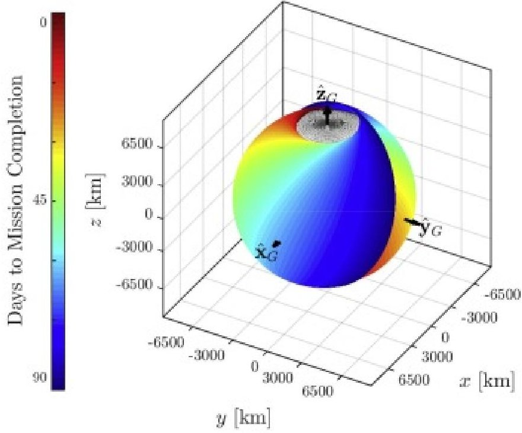

(c) Orion 50 XL's orbital trajectory

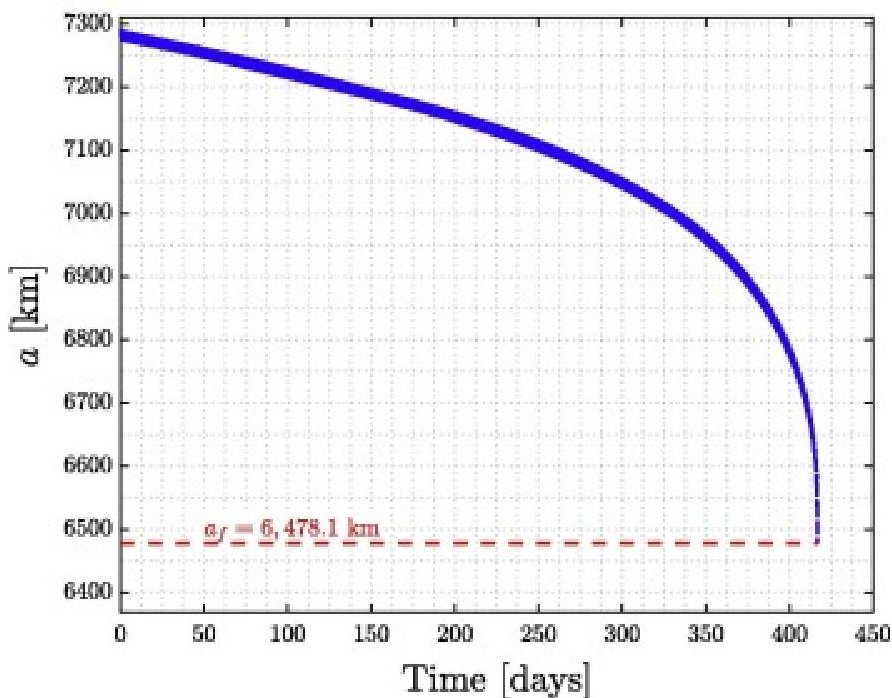

(d) Orion 50 XL's semi-major axis profile

Fig. 9. (a) and (c) Low-thrust spiral orbital trajectory of the system during the last 90 days; (b) and (d) reduction of the debris semi-major axes to $ a_{\mathrm{f}}=6 4 7 8. 1 $ km.

Also evident in Fig. 9a and c is the nodal regression of the debris objects as they undergo the deorbiting action. This is due to the inclusion of the J2-perturbation in the simulation. In the long run, while $ J_{2} $ has secular effects on RAAN (and the arg. of perigee), it only has periodic effects on the semi-major axis (i.e., the semi-major axis values oscillate about a mean value), as outlined in Fig. 9b. Although not plotted, similar periodic-only phenomena can be seen in the orbit inclination and eccentricity. Lastly, the nodal regression of Orion 50 XL is larger than that of KOMPSAT-1, which is partly due to the smaller inclination of the Orion 50 XL's orbit relative to that of KOMPSAT-1.

<!-- PDF_PAGE: 21 -->

Fig.10 shows a plot of the debris altitude profile and the forces that act on the system over the course of the deorbiting maneuver. Due to its low eccentricity, the KOMPSAT-1's altitude shows a gradual change per orbit, as seen in Fig.10a. Therefore, the atmospheric drag acting on the system also shows small variation over the course of an orbit, as seen in Fig.10b. KOMPSAT-1's deorbiting maneuver can be broken down into two parts. The first part includes days 1-500, where the altitude of the system is larger than 430km and the thrust force is larger than the drag force. The second part includes the remaining days of the mission during which the altitude is below 430km and the drag force becomes larger than the thrust force. In the first part, the altitude of the system is reduced from 670km to 430km (i.e., 240km reduction) in about 500days, whereas in the second part, the altitude drops from 430km to 110km (i.e., 320km reduction) in less than 100days. Although not considered in this study, the deorbiter CubeSat could have turned off its thruster at day 500 and allow the system to continue the deorbiting due to the atmospheric drag only, hence saving propellant and power. To benefit from the maximum drag force, however, the CubeSat should continue steering the system to keep the largest cross-section of the debris in the orbital velocity direction.

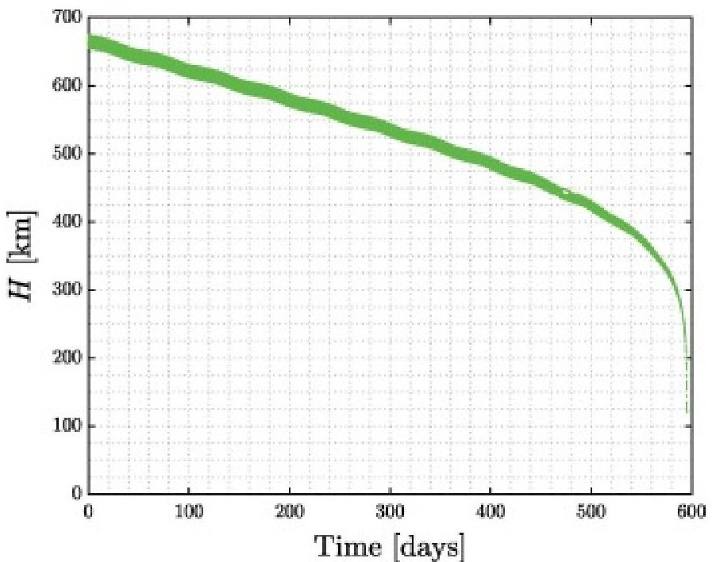

(a) KOMPSAT-1's altitude profile.

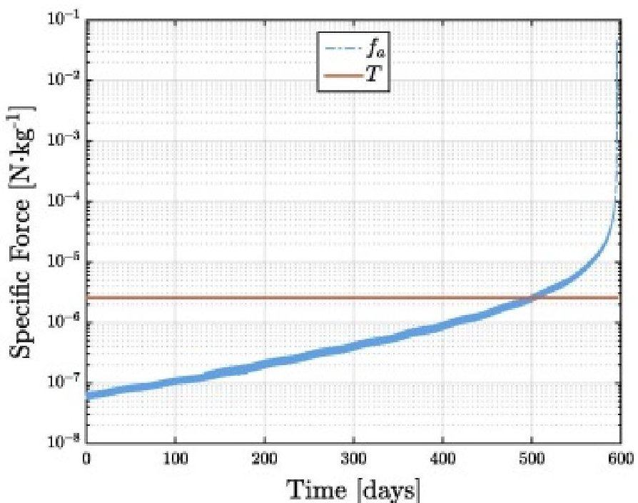

(b) Forces acting on KOMPSAT-1

(c) Orion 50 XL's altitude profile

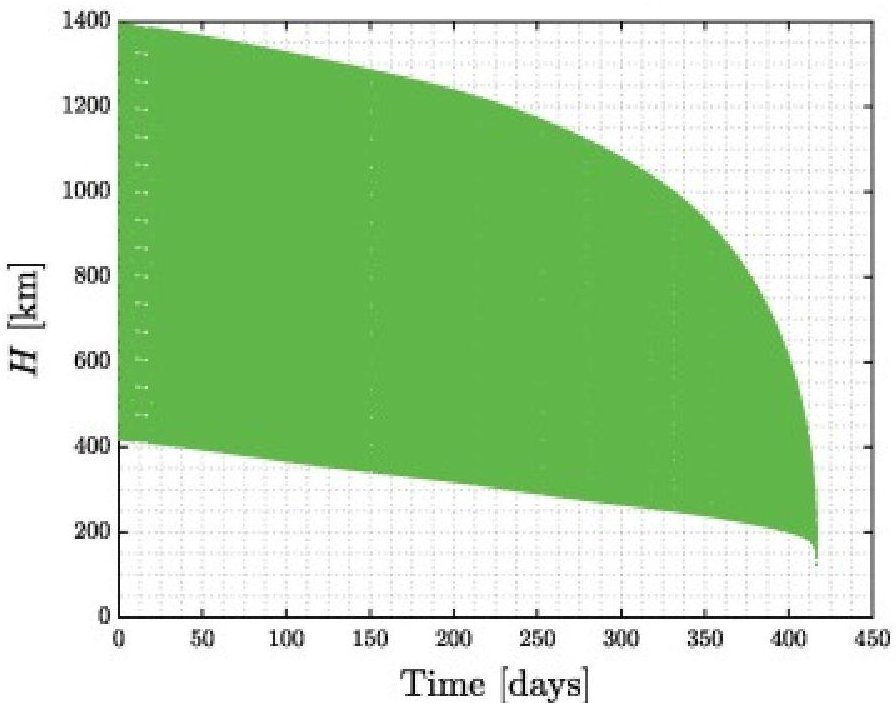

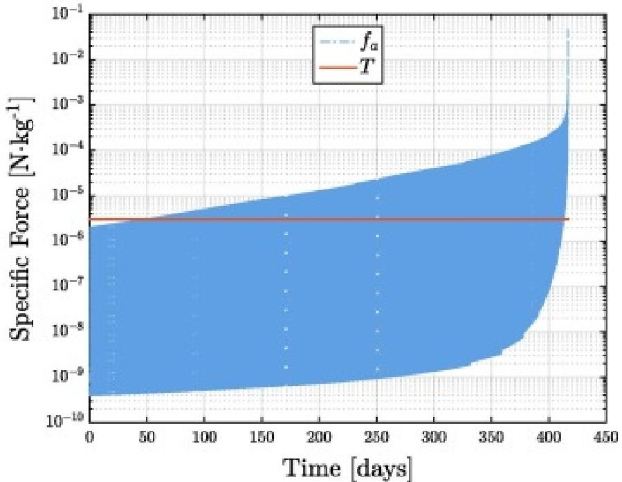

(d) Forces acting on Orion 50 XL

Fig. 10. (a) and (c) Reduction of the debris altitude; (b) and (d) drag and thrust forces acting on the system.

<!-- PDF_PAGE: 22 -->

On the contrary, Orion 50 XL's altitude shows large variations per orbit, as seen in Fig. 10c, which is due to its higher orbit eccentricity relative to KOMPSAT-1. For instance, during the first few days of the mission, Orion's altitude varies from about 1400 km (apogee altitude) to about 400 km (perigee altitude) in a single orbit. However, the orbit becomes more circular as the apogee altitude decays more rapidly than the perigee altitude. This phenomenon is less evident in KOMPSAT-1's case, due to its small eccentricity. Further, the drag force experienced by Orion 50 XL varies by more than three orders of magnitude during an orbit, as seen in Fig. 10d. Clearly, drag force is the largest at the perigee. After about 60 days into the mission, the drag force begins to exceed the thrust force for a fraction of each orbit, but never for an entire orbit. The overall increase in the drag force magnitude is in accordance with Eq. (19), since the atmospheric density and the orbit velocity increase at lower altitudes.

To estimate the total propellant mass consumed during the deorbiting maneuver, the following equation can be used:

$$
m _ {\mathrm {p}} = \frac {\dot {m} _ {\mathrm {p}}}{\eta_ {\mathrm {p}}} \Delta t _ {\mathrm {d e o r b}}
$$

where $ \Delta t_{\mathrm{deorb}} $ denotes the duration of the deorbiting maneuver. Given the specification of the BIT-3 thruster in Table 3, the consumed propellant mass is found to be $ m_{\mathrm{p}} \approx 4.24 \mathrm{~kg} $ in the case of KOMPSAT-1, and $ m_{\mathrm{p}} \approx 2.97 \mathrm{~kg} $ in the case of Orion 50 XL. In both cases, the consumed propellant mass is below the 7.0 kg limit.

A preliminary cost breakdown of the deorbiter CubeSat has been compiled and reported in Hakima and Emami (2017). It is estimated that the overall cost the hardware is about $600,000 USD, whereas large space debris, such as KOMPSAT-1 and Orion 50 XL, tend to cost in the order of hundreds of millions.

Considering the results of the two specific case studies, it can be inferred that these maneuvers can be accomplished using a smaller CubeSat. Lastly, further studies should investigate thrusting during the deorbiting maneuver only until the thrust force and the atmospheric drag force are on the same order of magnitude. Although this may increase the deorbiting time, it is likely that the CubeSat's size and mass would be reduced considerably.

## 7. Conclusions

The applicability of a CubeSat in deorbiting sizable Earth-bound space debris was investigated. Considering the CubeSat's available propellant mass, a feasible region was identified for the deorbiter CubeSat mission, based on the target debris masses and orbit radii. Two specific debris objects were selected for the case studies, namely the defunct KOMPSAT-1 satellite and the spent Orion 50 XL motor, and an 8U CubeSat was modeled for the simulation. The detumbling of the debris objects was studied based on a time-optimal control law. The results from the detumbling maneuver analyses showed that the angular velocities of the debris can be completely nullified within a matter of days, for a representative set of tumbling rates and magnetorquer specifications. Also, it became evident that the reaction wheels saturate often, and hence the momentum unloading by means of the magnetorquers must be further investigated in future studies. Further, using a low-thrust propulsion system, debris objects were transferred from their initial orbits to a final orbit of 100km above Earth, where the atmospheric drag is high enough to cause the bodies to burn up. The maneuver was accomplished in a one-year timeframe for Orion 50 XL, and in less than two years for KOMPSAT-1, both of which are much shorter than the natural decay of the debris objects. It was estimated that KOMPSAT-1 would take about a century to naturally decay, and Orion 50 XL about two decades. Both objects were deorbited using only half of the available CubeSat's propellant. Future studies will investigate the rendezvous maneuver and the latching mechanism, as well as the CubeSat's power requirements.

## Acknowledgment

<!-- PDF_PAGE: 23 -->

The authors would like to extend their appreciations to ESA's Space Debris Office (ESOC) for granting access to the DISCOS catalog (Database and Information System Characterising Objects in Space), and to Analytical Graphics Inc.for providing EAP license (Educational Alliance Program) for the STK application.

## Appendix A. Reaction wheels momentum unloading

When any of the three reaction wheels reaches its maximum momentum, then the momentum unloading process begins, during which the momentum of all three wheels will be nullified through the utilization of the on-board magnetorquers. There are three identical vacuum-core, square magnetorquer coils on the deorbiter CubeSat, each capable of producing a maximum magnetic moment of $ M^{\mathrm{max}}=5 \mathrm{A} \cdot \mathrm{m}^{2} $ , while consuming 1 A of current and about 3.5 W of electrical power. Each magnetorquer is made up of 150 turns of copper wire (gauge 24, diameter of 0.52 mm, and current rating of 3.5 A), and has dimensions of roughly $ 1 8 \mathrm{c m} \times1 8 \mathrm{c m} \times5 \mathrm{c m}. $

A widely used control algorithm for reaction wheel momentum unloading using magnetorquers is the following bang-bang law (Camillo and Markley, 1980):

$$
\mathbf {M} = M ^ {\max } \cdot \operatorname {s i g n} \left(\Delta \mathbf {h} _ {\mathrm {w}} ^ {\times} \mathbf {B} _ {\mathrm {c}}\right)
$$

where $ \mathbf{M} $ is the magnetic dipole moment produced by the magnetorquers, $ \Delta\mathbf{h}_{\mathrm{w}} $ is the excess momentum to be removed, $ \mathbf{B}_{\mathrm{c}}=\mathbf{C}_{\mathrm{c i}}\mathbf{B}_{\mathrm{i}} $ is the (measured) Earth magnetic field, and $ \operatorname{sign}(\cdot) $ is the signum vector function that returns the sign of each element of its argument. Also, $ \mathbf{B}_{\mathrm{i}} $ is the geomagnetic field expressed in $ \mathcal{F}_{\mathrm{i}} $ which is modeled as a dipole (see Appendix H in Wertz, 1978). Lastly, the reaction wheels momentum unloading torque using the magnetorquers, $ \tau_{\mathrm{m}} $ , is defined as follows:

$$
\boldsymbol {\tau} _ {\mathrm {m}} = \mathbf {M} ^ {\times} \mathbf {B} _ {\mathrm {c}}
$$

## References

Aghili, 2009 Farhad Aghili Time-optimal detumbling control of spacecraft J. Guid. Control Dyn., 32 (5) (2009), pp. 1671-1675 Crossref View in Scopus Google Scholar

Aghili, 2009 Aghili, Farhad, 2009. Optimal control of a space manipulator for detumbling of a target satellite. In: 2009 IEEE International Conference on Robotics and Automation, May 2009, pp. 3019-3024.

Andrea Antonello and Panagiotis Tsiotras, 2017 Antonello, Andrea, Tsiotras, Panagiotis, 2017. Deorbiter cubesat: preliminary design and systems engineering budgets. In: Proceedings of the 67th International Astronautical Congress, IAC:, Guadalajara, Mexico. Google Scholar

<!-- PDF_PAGE: 24 -->

Astroscale, 2016 Astroscale, 2016. ADRAS 1: End of Life Services. <http://astroscale.com/services/adras-1 (Accessed: 2017-02-09). Google Scholar

Azure Space Solar Power GmbH, 2016. 30% Triple Junction Gaas Solar Cell. <http://www.azurspace.com/images/products/0004148-00-01_DB_GBK_80m.pdf >

(Accessed: 2017-12-01).

Google Scholar

Bastida Virgili et al., 2014 Bastida Virgili, B., Lemmens, S., Krag, H., 2014. Investigation on EnviSat Attitude Motion. e.Deorbit Workshop. Google Scholar

Biondi et al., 2016 Biondi, G., Mauro, S., Mohtar, T., Pastorelli, S., Sorli, M., 2016. Feature-based estimation of space debris angular rate via compressed sensing and kalman filtering. In: 2016 IEEE Metrology for Aerospace (MetroAeroSpace), pp. 215-220. Google Scholar

Bombardelli and Pelaez, 2011 Claudio Bombardelli, Jesus Pelaez Ion beam shepherd for contactless space debris removal J. Guid. Control Dyn., 34 (3) (2011), pp. 916-920 Crossref View in Scopus Google Scholar

Busek Co. Inc., 2014 Busek Co. Inc., 2014. 3 cm RF ion thruster (BIT-3), 70010819 Rev. A. Google Scholar

California Polytechnic State University, 2014. CubeSat Design Specification. Rev. 13. Google Scholar

Camillo and Markley, 1980 P.J. Camillo, F.L. Markley Orbit-averaged behavior of magnetic control laws for momentum unloading J. Guid. Control Dyn., 3 (6) (1980), pp. 563-568 2017/12/14 Crossref View in Scopus Google Scholar

Castronuovo, 2011 M.M. Castronuovo Active space debris removal - a preliminary mission analysis and design Acta Astronaut., 69 (2011), pp. 848-859 View PDF View article Google Scholar

<!-- PDF_PAGE: 25 -->

Choi et al., 2016 Jin Choi, Jung Hyun Jo, Myung-Jin Kim, Dong-Goo Roh, Sun-Youp Park, Hee-Jae Lee, Maru Park, Young-Jun Choi, Hong-Suh Yim, Young-Ho Bae, Young-Sik Park, Sungki Cho, Hong-Kyu Moon, Eun-Jung Choi, Hyun-Jung Jang, Jang-Hyun Park

Determining the rotation periods of an inactive leo satellite and the first korean space debris on GEO, KOREASAT

J. Astron. Space Sci., 33 (2) (2016), pp. 127-135

Crossref View in Scopus Google Scholar

Clean Space, 2015 Clean Space, 2015. e.Deorbit Implementation Plan. Tech. Rep., ESA. Ref. ESA-TEC-SC TN-2015-007. Google Scholar

Clyde Space, 2017 Clyde Space. 3rd Generations EPS. <https://www.clyde.space/products/18-3rd generation-1u-eps (Accessed: 2017-12-01). Google Scholar

Wertz, 1978 Wertz, J.R. (Ed.), 1978. Spacecraft Attitude Determination and Control, vol. 73, Springer, Netherlands. Google Scholar

Cube Space, 2017 Cube Space. Cubesat Sun Sensor. <https://www.cubesatshop.com/product/cubecomputer/ > (Accessed: 2017-12-01). Google Scholar

DeLuca et al., 2013 L.T. DeLuca, F. Bernelli, F. Maggi, P. Tadini, C. Pardini, L. Anselmo, M. Grassi, D. Pavarin, A. Francesconi, F. Branz, S. Chiesa, N. Viola, C. Bonnal, V. Trushlyakov, I. Belokonov Active space debris removal by a hybrid propulsion module Acta Astronaut., 91 (2013), pp. 20-33 View PDF View article View in Scopus Google Scholar

De Ruiter et al., 2013 Anthon H.J. De Ruiter, Christopher J. Damaren, James R. Forbes Spacecraft Dynamics and Control: An Introduction Wiley (2013) Google Scholar

Estrada et al, 2016 Estrada, M.A., et al., 2016. Free-flyer acquisition of spinning objects with gecko-inspired adhesives. In: 2016 IEEE International Conference on Robotics and Automation (ICRA), May 2016, pp. 4907-4913. Google Scholar

<!-- PDF_PAGE: 26 -->

European Space Agency, 2017 European Space Agency. KOMPSAT-1 (Korea Multi-Purpose Satellite- 1)/Arirang-1. <https://directory.eoportal.org/web/eoportal/satellite-missions/k/kompsat-1 (Accessed: 2017-03-03). Google Scholar

Goebel and Katz, 2008 D.M. Goebel, I. Katz Fundamentals of Electric Propulsion: Ion and Hall Thrusters Jet Propulsion Laboratory, California Institute of Technology (2008) Google Scholar

GOM Space, 2014 GOM Space, 2014. NanoCom ANT430 Datasheet 70cm Band CubeSat Antenna. <https://gomspace.com/UserFiles/Subsystems/datasheet/gs-ds-nanocom-ant430-20.pdf >

(Accessed: 2017-12-01).

Google Scholar

GOM Space, 2016 GOM Space, 2016. NanoCom AX100. <https://gomspace.com/UserFiles/Subsystems/datasheet/gs-ds-nanocom-ax100-33.pdf >

(Accessed: 2017-12-01).

Google Scholar

Guang and Zhang Jing-rui, 2012 Guang, Zhai, Jing-rui, Zhang, 2012. Space tether net system for debris capture and removal. In: 4th International Conference on Intelligent Human-Machine Systems and Cybernetics (IHMSC), vol. 1, pp. 257-261. Google Scholar

Hakima and Emami, 2017 Hakima, Houman, Emami, Reza, 2017. Deorbiter cubesat: preliminary design and systems engineering budgets. In: Proceedings of the 68th International Astronautical Congress, IAC:, Adelaide, Australia. Google Scholar

Hughes, 1986 Peter C. Hughes

Spacecraft Attitude Dynamics

Dover Publications Inc. (1986)

Google Scholar

Innovative Solutions in Space, 2015 Innovative Solutions in Space, 2015. Cubesat Structures. <https://www.isispace.nl/wp-content/uploads/2016/02/ISIS-CubeSat-Structures-Brochure-v1.pdf > (Accessed: 2017-12-01). Google Scholar

<!-- PDF_PAGE: 27 -->

Innovative Solutions in Space, 2016 Innovative Solutions in Space, 2016. ISIS Advised Envelopes. <https://www.isispace.nl/wp-content/uploads/2015/12/ISIS.STS_.0.0.001-RevC-Sheet1-1-The CubeSat-Family-A0.pdf >.

Innovative Solutions in Space, 2016 Innovative Solutions in Space, 2016. On-Board Computer iOBC. <https://www.isispace.nl/wp-content/uploads/2016/02/iOBC-Brochure-v1.pdf > (Accessed: 2017-12-01).

IQ Wireless GmbH, 2016 IQ Wireless GmbH, 2016. Highly Integrated S-band Transmitter for Pico and Nano Satellites. <http://www.iq-spacecom.de/images/downloads/HiSPiCO_Datasheet.pdf (Accessed: 2017-12-01).

Google Scholar

IQ Wireless GmbH, 2017 IQ Wireless GmbH. Patch Antenna. <http://www.iq- spacecom.de/images/downloads/Patch_Antennas_Flyer.pdf (Accessed: 2017-12-01). Google Scholar

Kelso, 2017 Kelso, T.S., 2017. Satellite catalog SATCAT. <https://celestrak.com/satcat/search.asp (Accessed: 2017-02-05). Google Scholar

Kemble, 2006 S. Kemble Interplanetary Mission Analysis and Design Springer-Verlag, Berlin Heidelberg (2006) Google Scholar

Kim, 1999 Byung Kyo Kim An overview of the korea multi-purpose satellite (Kompsat) Fei-Bin Hsiao (Ed.), Microsatellites as Research Tools, Proceedings of COSPAR Colloquium on Microsatellites as Research Tools, COSPAR Colloquia, vol. 10, Pergamon (1999), pp. 66-73 View PDF View article View in Scopus Google Scholar

Korea Aerospace Research Institute, 2017 Korea Aerospace Research Institute. Korea Multi-Purpose Satellite (Arirang) 1. <https://www.kari.re.kr/eng/sub03_02_01.do#link > (Accessed: 2017- 03-01).

Google Scholar

<!-- PDF_PAGE: 28 -->

Kucharski et al., 2014 D. Kucharski, G. Kirchner, F. Koidl, C. Fan, R. Carman, C. Moore, A. Dmytrotsa, M. Ploner, G. Bianco, M. Medvedskij, A. Makeyev, G. Appleby, M. Suzuki, J.M. Torre, Z. Zhongping, L. Grunwaldt, Q. Feng Attitude and spin period of space debris envisat measured by satellite laser ranging IEEE Trans. Geosci. Rem. Sens., 52 (12) (2014), pp. 7651-7657 View in Scopus Google Scholar

Lambour et al., 2000 R. Lambour, R. Bergemann, C. von Braun, E.M. Gaposchkin Space-based visible space object photometry: initial results J. Guid. Control Dyn., 23 (1) (2000), pp. 159-164 2017/12/15 Crossref View in Scopus Google Scholar

Landis Markley and Crassidis, 2014 F. Landis Markley, John L. Crassidis Fundamentals of Spacecraft Attitude Determination and Control Springer-Verlag, New York (2014) Google Scholar

Massachusetts Institute of Technology, 2017 Massachusetts Institute of Technology. Analytical Approximations for Low Thrust Maneuvers. <https://ocw.mit.edu/courses/aeronautics-andastronautics/16-522-space-propulsion-spring-2015/lecture-notes/MIT16_522S15_Lecture6.pdf (Accessed: 2017-11-19). Google Scholar

Nader et al., 2016 Nader, Ronnie, et al., 2016. High energy density battery array for cubesat. In: 67th International Astronautical Congress, September 2016. Google Scholar

NASA, 1976 NASA, 1976. U.S. Standard Atmosphere 1976. N77-16482. Google Scholar

NASA, 2016 NASA, 2016. Orbital Debris: Quarterly News, vol. 20(1 and 2). Google Scholar

NASA, 2017 NASA. Orbital Debris Management and Risk Mitigation. <https://www.nasa.gov/pdf/692076main_Orbital_Debris_Management_and_Risk_Mitigation.pdf> (Accessed: 2017-02-04). Google Scholar

<!-- PDF_PAGE: 29 -->

NASA, 2017 NASA, 2017. State of the Art of Small Spacecraft Technology. <https://sst-soa.arc.nasa.gov > (Accessed: 2017-11-16). Google Scholar

NASA, 2017 NASA. Frequently Asked Questions: Orbital Debris. <https://www.nasa.gov/news/debris_faq.html (Accessed: 2017-03-20). Google Scholar

New Space Systems, 2017 New Space Systems, 2017. Cubesat Sun Sensor. <http://www.newspacesystems.com/wp-content/uploads/2016/05/NewSpace-DS-Cubesat Sun-Sensor-1.pdf > (Accessed: 2017-12-01). Google Scholar

Nishida and Kawamoto, 2011 Shin-Ichiro Nishida, Satomi Kawamoto "Strategy for capturing of a tumbling space debris Acta Astronaut., 68 (1) (2011), pp. 113-120 View PDF View article View in Scopus Google Scholar

Nishida et al., 2009 Shin-Ichiro Nishida, Satomi Kawamoto, Yasushi Okawa, Fuyuto Terui, Shoji Kitamura Space debris removal system using a small satellite Acta Astronaut., 65 (1) (2009), pp. 95-102 View PDF View article View in Scopus Google Scholar

Orbital ATK, 2016 Orbital ATK, 2016. Propulsion Products Catalog, No. 16-S-1432. Google Scholar

Orbital ATK, 2017 Orbital ATK. Pegasus Mission History. <http://www.orbitalatk.com/flight systems/space-launch-vehicles/pegasus/docs/Pegasus%20Mission%20History.pdf (Accessed: 2017-03-05).

Google Scholar

Phipps et al., 1996 C.R. Phipps, G. Albrecht, H. Friedman, D. Gavel, E.V. George, J. Murray, C. Ho, W. Priedhorsky, M.M. Michaelis, J.P. Reilly Orion: clearing near-earth space debris using a 20-kW, 530-nm, earth-based, repetitively pulsed laser Laser Part. Beams, 14 (1) (1996), pp. 1-44 View in Scopus Google Scholar

Reintsema, D., Thaeter, J., Rathke, A., Naumann, W., Rank, P., Sommer, J., 2010. Deos-the german robotics approach to secure and de-orbit malfunctioned satellites from low

<!-- PDF_PAGE: 30 -->

earth orbits. In: Proceedings of the i-SAIRAS, pp. 244-251. Google Scholar

Richard, M., Kronig, L., Belloni, F., Rossi, S., Gass, V., Araomi, S., Gavrilovich, I., Shea, H., Paccolat, C., Thiran, J.P., 2013. Uncooperative rendezvous and docking for microsats: the case for CleanSpace One. In: 6th International Conference on Recent Advances in Space Technologies.

Ruffatto et al., 2014 Ruffatto, D., Beganovic, D., Parness, A., Spenko, M., 2014. Experimental results of a controllable electrostatic/gecko-like adhesive on space materials. In: 2014 IEEE Aerospace Conference, Big Sky, MT, March 2014.

Ruggiero et al., 2011 Ruggiero, A., Pergola, P., Marcuccio, S., Andrenucci, M., 2011. Low-thrust maneuvers for the efficient correction of orbital elements. In: 32nd International Electric Propulsion Conference, Wiesbaden, Germany. Google Scholar

Saravia and Udrea, 2016 Saravia, W., Udrea, B., 2016. Highly compliant active clinging mechanism. In: 2016 IEEE Aerospace Conference, March 2016. Google Scholar

Savioli et al., 2013 Savioli, L., Francesconi, A., Maggi, F., Olivieri, L., Lorenzini, E., Pardini, C., 2013. Space debris removal using multi-mission modular spacecraft. In: Proceedings of the 6th European Conference on Space Debris, Darmstadt, Germnay, vol. 723. ESA Special Publication. Google Scholar

Seong et al., 2017 Jae-Dong Seong, Hae-Dong Kim, Ha-Yeon Choi A study of a target identification method for an active debris removal system Proc. Inst. Mech. Eng., Part G: J. Aerospace Eng., 231 (1) (2017), pp. 180-189 Crossref View in Scopus Google Scholar

Shan et al., 2016 Minghe Shan, J. Guo, E. Gill Review and comparison of active space debris capturing and removal methods Prog. Aerospace Sci., 80 (2016), pp. 18-32 View PDF View article View in Scopus Google Scholar

Sidi, 1997 Marcel J. Sidi Spacecraft Dynamics and Control: A Practical Engineering Approach

<!-- PDF_PAGE: 31 -->

Cambridge University Press (1997)

Google Scholar

Sinclair Interpalentary, 2015 Sinclair Interpalentary, 2015. Second Generation Star Tracker (ST-16RT2). <http://www.sinclairinterplanetary.com/starttrackers > (Accessed: 2017-12-01). Google Scholar

Sinclair Interpalentary, 2016 Sinclair Interpalentary, 2016. Third Generation Reaction Wheels (RW3) Interface Control Document. <http://www.sinclairinterplanetary.com/reactionwheels (Accessed: 2017-02-09). Google Scholar

Sitti and Fearing, 2003 Metin Sitti, Ronald S. Fearing Synthetic gecko foot-hair micro/nano-structures as dry adhesives J. Adhes. Sci. Technol., 17 (8) (2003), pp. 1055-1073 View in Scopus Google Scholar

SkyFox Labs, 2017 SkyFox Labs, 2017. Ultra Low Power Cubesat GPS Receiver piNAV-L1. <http://www.skyfoxlabs.com/pdf/piNAV-L1_datasheet_rev_J.pdf (Accessed: 2017-12-01). Google Scholar

SkyFox Labs, 2017 SkyFox Labs, 2017. Mini Active GPS-L1 Patch Antenna miniPATCH-L1. <http://www.skyfoxlabs.com/pdf/miniPATCH-L1_Datasheet_rev_A.pdf (Accessed: 2017-12-01). Google Scholar

Starke et al., 2010 Starke, Juergen, Bischof, Bernd, Foth, W.-O., et al., 2010. Roger a potential orbital space debris removal system. In: 38th COSPAR Scientific Assembly, vol. 38, p. 2. Google Scholar

Tadini et al., 2014 P. Tadini, U. Tancredi, M. Grassi, L. Anselmo, C. Pardini, A. Francesconi, F. Branz, F. Maggi, M. Lavagna, L.T. DeLuca, N. Viola, S. Chiesa, V. Trushlyakov, T. Shimada Active debris multi-removal mission concept based on hybrid propulsion Acta Astronaut., 103 (2014), pp. 26-35 View PDF View article View in Scopus Google Scholar

Udrea and Nayak, 2015 Udrea, B., Nayak, M., 2015. A cooperative multi-satellite mission for controlled active debris removal from low earth orbit. In: Proceedings of the 2015 IEEE Aerospace Conference, pp. 1-15. Google Scholar

<!-- PDF_PAGE: 32 -->

Visagie et al., 2015 Lourens Visagie, Vaios Lappas, Sven Erb Drag sails for space debris mitigation

Acta Astronaut., 109 (2015), pp. 65-75

View PDF View article View in Scopus Google Scholar

William Barbee et al., 2011 Barbee, Brent William, Alfano, Salvatore, Pinon, Elfego, Gold, Kenn, Gaylor, David, 2011. Design of spacecraft missions to remove multiple orbital debris objects. In: Proceedings of the 2011 IEEE Aerospace Conference, Washington, DC, pp. 1-14.

Google Scholar

Won,1999 Chang-Hee Won

Comparative study of various control methods for attitude control of a LEO satellite Aerospace Sci. Technol., 3 (5) (1999), pp. 323-333

View PDF View article View in Scopus Google Scholar

Yang et al., 2016 Fan Yang Yang, Bron Nelson, Jonathan Aziz, Roberto Carlino, Andres Dono Perez, Nicolas Faber, Cyrus Foster, Chad Frost, Chris Henze, Arif Goktug Karacalioglu, Creon Levit, William Marshall, James Mason, Conor O'Toole, Jason Swenson, Simon P. Worden, Jan Stupl Lightforce photon-pressure collision avoidance: efficiency analysis in the current debris environment and long-term simulation perspective

Acta Astronaut., 126 (Suppl. C) (2016), pp. 411-423

Space Flight Safety

Crossref Google Scholar

ZARM Technik AG, 2016 ZARM Technik AG, 2016. AMR Magnetometer. <http://www.zarm- technik.de/products/magnetometer/ > (Accessed: 2017-12-01).

Google Scholar