<!-- PDF_PAGE: 1 -->

# A transformation methodology for Capella to Event-B models with DSL verification

Khaoula Bouba a , Abderrahim Ait Wakrime a , Yassine Ouhammou b , Redouane Benaini a DOI: 10.1016/j.cola.2023.101241

## Abstract

Capella/Arcadia helps engineers design complex system models, but as models grew in complexity, simulation and verification became necessary. An automatic model-to-model transformation approach was proposed to interpret the dynamic behavior of the semiformal Capella models. Custom domain-specific languages were introduced to assess the syntax of these models. The approach was applied to the Adaptive Exterior Light system, transforming Capella models into Event-B models for safety verification. The paper provides traceability between Capella and Event-B meta-models to aid interpretation of verification results.

## 1. Introduction

The Model-Based System Engineering (MBSE) approach involves creating a model of a complex system's architecture to capture customer requirements and needs. Designing architecture for complex systems such as airplanes, satellites, or trains involves building extensive and heterogeneous models that are shared among a large group of stakeholders. For that reason, Thales has developed a method called Arcadia [1] and a modeling tool called Capella [1] to help designers describe the architecture of complex systems. However, errors could have a significant negative impact on the project if it is not detected until the later stages of integration. Therefore, it is crucial to have tools for verifying and validating the model in the early stages of design to mitigate such risks. (Kai Chen et al. 2005) [2] explore the semantics of Domain-Specific Modeling Languages (DSMLs) from two perspectives: structural and behavioral. While the authors acknowledge that the semantic of the Domain Specific Language (DSL) can be approached separately in these two ways, but we emphasize that an ideal and complete definition of DSL semantics should encompass both aspects. The structural aspect involves defining concepts and their relationships, while the behavioral aspect is concerned with interpreting how these concepts are executed. Capella, provides a better architecture quality by structuring the engineering process into distinct phases that separate needs analysis (operational and system analysis) from solution development (logical and physical architectures). But on the other hand, it lacks a behavioral semantic. This means that behavior part of Capella models requires an executable semantic for verification. To solve this problem, we propose an innovative challenge in which Capella models are automatically transformed into Event-B [3] models, allowing the formal verification of these models. The process involves first identifying the requirements of the system using an operational Capella diagram called OAB, as previously demonstrated in [4]. These requirements are then represented as system functions in a new system Capella diagram called SAB, which is a novel contribution that has not been previously proposed in the [4]. We introduce two controller DSLs for Capella: one tailored for operational analysis and the other dedicated to system analysis. They are utilized to check the uniqueness of component names, verify the syntax of certain components, to ensure accurate M2M transformations and generate correct Event-B models. Moreover, we have the capability to incorporate a safety dimension into Capella models by defining safety properties using specific syntaxes, as elaborated in this paper. Through our DSLs, we check the syntaxes of the functional properties and non-functional (safety) properties, which will subsequently be translated into Event-B invariants. This approach enables Capella users, even those unfamiliar with Event-B, to validate their Capella models effectively. Finally, we use our new transformation solution to convert the SAB diagram into Event-B specifications, extending our previous work proposed in the [4] where we focused only on transforming the OAB diagram into an Event-B model without DSL proposal.

The rest of the paper is organized as follows. In Section 2, the paper reviews relevant research in the field. Section 3 introduces several key concepts, including the Capella/Arcadia as model-based engineering practice, DSL, and Event-B formal method. In Section 4, the

<!-- PDF_PAGE: 2 -->

Capella and Event-B meta-models are presented. The paper then proposes our transformation approach, which involves six steps, in Section 5. The experimental results are presented in Section 6. The paper concludes, in Section 7, with a summary of the findings and suggestions for future research.

## 2. Related work

The papers reviewed focus on automatic generation for Event-B models or other models, from a range of programming and modeling languages, employing various techniques such as DSLs and vice versa. The [5] discusses a E2ALL tool that generates C, C++, and Java code from Event-B, which is implemented as a plugin in the RODIN platform. The authors describe the translation process, which involves preprocessing the Event-B code into target language context files, followed by lexical and syntactic analysis, event scheduling, and code validation. The [6] presents a tool that generates JML-annotated Java code from an Event-B model. Two case studies are presented: one for the development and validation of a social event planning Android application, and another for the tokeneer system, a secure authentication system that uses fingerprint scanning to enter an enclave. The [7] describes a tool that translates VHDL hardware description language from Event-B code. The hardware system is first formalized using Event-B notation, and then the mapping between Event-B components and VHDL is performed. The [8] proposes mapping rules for Event-B components into Python, which can help improve the correctness of Event-B models by validating and verifying them using the Python programming language in the early stages of software development. They validated the Event-B model using the RODIN tool and executed the corresponding Python code to check correctness. The [9] presents an interesting B2C extension tool to RODIN that generates C code automatically from Event-B. The translation is done in three phases, with the first phase involving syntax mapping between Event-B and C. In [10], authors introduce a tool called SD2EventB that uses a meta-model transformation to reason about UML sequence diagrams using Event-B events, which helps verify the flexible workflow of cloud services. The [11] proposes an integrated approach to modeling the impact of cyber-security attacks on the safety of networked control systems. The authors define the principles of modeling networked control systems in SysML, enabling explicit reasoning about safety-security interactions. They also introduce a methodology for translating SysML BDDs, SDs, and SMDs into Event-B. The [12] highlights the use of Model-Driven Engineering (MDE) and DSLs in addressing the problems of High Performance Computing (HPC), particularly as they pertain to supercomputing, through two specific projects: Modane and NabLab. The authors present their report on their experience through the Modane and NabLab projects, by explaining the initial objectives for adopting MDE and DSLs, and then the lessons learned. Furthermore, they shed light on the enduring challenges by proposing research tracks in the field. In the [13], a MBSE and model-based safety analysis (MBSA) approach is presented for analyzing safety in the Clarity project, with a focus on using formal methods for safety-critical systems. In cases where the consequences of failure in safety-critical systems can be severe, it may be more suitable to use formal methods instead of MBSA. This is because formal methods, such as theorem proving and model checking, can offer stronger guarantees of correctness, even though they may require more resources and expertise than MBSA techniques [14], [15]. For a such reasons, we presented in the [4], a systematic formal verification of Capella's behavioral models using the Event-B method in a transparent way. This is achieved by translating Capella models into Event-B specifications using automatic model-to-model transformations, allowing for a more appropriate analysis of safety-critical systems.

Our work introduces a transformation approach that uses Event-B to check system requirements in Capella's operational and system analysis models. This involves also, using two DSLs to check the uniqueness of component names and verify that the syntax of Capella components is suitable for our transformation process.

## 3. Background

Before presenting our contribution, we need to recall some basic concepts and definitions.

<!-- PDF_PAGE: 3 -->

Capella is a model-based engineering tool created by Thales that is widely used in industry. It is a solution based on UML/SysML and NAF standards and provides methodological guidance to system, software, and hardware architects using the ARChitecture Analysis and Design Integrated Approach (Arcadia) method, which is a model-based engineering method that focuses on functional analysis and the allocation of functions to architecture components. However, since Capella is closely tied to the Arcadia method, it is not a general-purpose modeling language and can be challenging for users to transition from existing system engineering processes based on documents. In addition to that, system engineers must ensure consistency with the Capella transition mechanism to meet user requirements.

A DSL [16], [17] is a specialized language designed for a specific domain's use. It operates at a higher level of abstraction and is tailored to address particular problem classes, resulting in concise and easily maintainable applications. DSLs capture common design patterns within a specific domain, simplifying model creation for developers. In this context, a model represents a simplified or abstract version of a system built for a specific purpose. By providing notations and symbols that are familiar to domain experts, DSLs bridge the gap between programmers and domain experts. This aligns with the findings of [18], where the authors emphasize the importance of extending the functionalities of visual domain-specific modeling tools to facilitate reference implementation. Xtext [19] is a framework that can help to implement a custom DSL with the appropriate IDE support.

Event-B [3] is a formal method used for system-level modeling and analysis. It relies on set theory as a modeling notation and incorporates refinement to represent systems at various abstraction levels. The use of mathematical proof is a fundamental aspect of Event-B, ensuring consistency between different refinement levels and verifying the system's correctness. The primary goal of using Event-B is to obtain formal proofs for the system's main safety properties, ensuring that the system behaves as intended and meets its requirements. By combining systematic modeling, refinement, and mathematical proof, Event-B offers a robust approach for developing reliable and verifiable systems.

## 4. Capella to Event-B: Bridging meta-models for system engineering

## 4.1. Operational and system analysis meta-models

The Capella meta-model is a semi-formal modelization of the concepts, relationships, and rules used in the Capella tool to represent system models. These elements include things like operational/system components, interfaces, functions, and requirements, as well as the relationships between them. In our work, the operational analysis and system analysis levels are th highlight of our work. Due to the size of Capella meta-model, our meta-models includes only the classes that can be directly mapped to the Event-B metamodel. We employed the Eclipse Modeling Framework (EMF) to construct the meta-model [20], [21]. In Fig.1, Fig.2, we collected the main concept of the operational analysis and system analysis meta-model, respectively.

Within the operational analysis meta-model, entities are represented by the Entity class, which signifies real-world entities that can interact with the system and its users. Entities can have roles, such as driver or pilot, and perform operational activities which are process steps taken to achieve a particular objective. These operational activities are linked together through operational interactions, allowing for information exchange. Constraints are elements that span multiple perspectives and can be applied to components in several perspectives, permitting users to incorporate rules into the model that should be upheld in every reachable state of the system. Finally, operational processes involve a series of activities and interactions that are sequentially carried out to achieve a specific goal.

The system analysis meta-model consists of several key concepts, including system components that can represent the entire system or any external actor (human or non-human) interacting with it. System components can perform system functions, which are behaviors or services provided by the system or an actor. The functional exchanges connect these system functions, and we can identify a specific path among all the possible ones using functional chains. Missions and capabilities represent the system's ability to

<!-- PDF_PAGE: 4 -->

provide a high level of service to achieve an operational objective. These two elements are not mapped to any element in the target model because they are applicable to other types of models, not the one we have chosen.

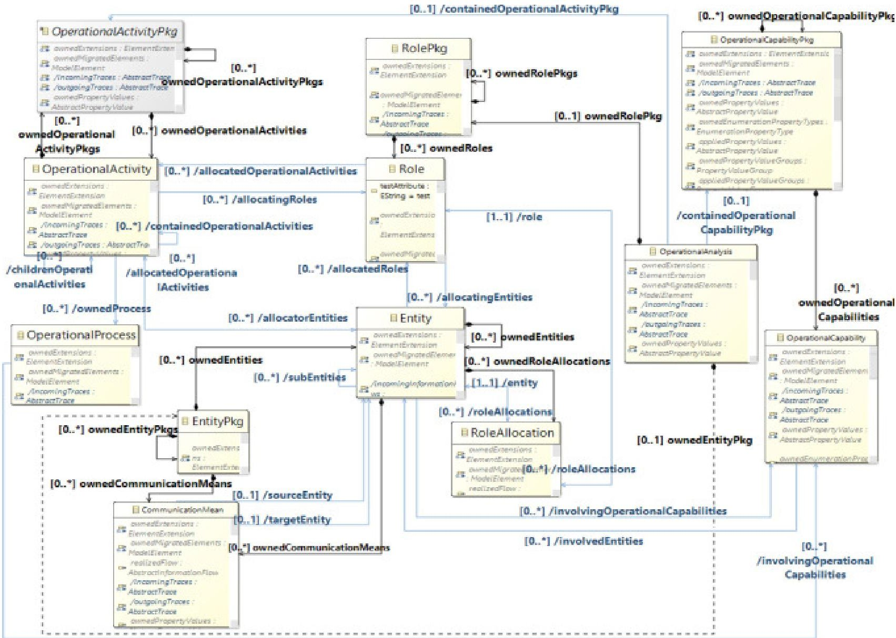

Fig. 1. Operational analysis meta-model.

<!-- PDF_PAGE: 5 -->

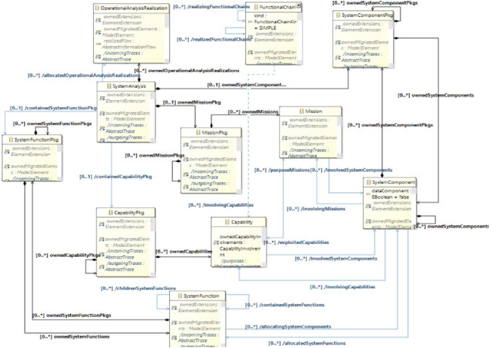

Fig. 2. System analysis meta-model.

## 4.2. Event-B meta-model

The Event-B meta-model is a semi-formal modelization that defines the structure and the rules for constructing Event-B models. The Event-B model consists of a machine, which represents dynamic data and behavior, and may include one or more contexts that model static data structures or configurations. Events are a key component of the machine, and consist of guards and actions. Guards are conditions that determine whether an event is enabled or not, based on the machine's variables. If all guards are true, the event is enabled. Actions, on the other hand, update state variables when the event occurs. Invariants are state predicates that define variable types and specify correct properties that must always be true. Violating these invariants can lead to inconsistencies in the system. Finally, the INITIALIZATION event is used to set the initial values of the variables. The Fig. 3 depicts the proposed meta-model for Event-B using EMF.

<!-- PDF_PAGE: 6 -->

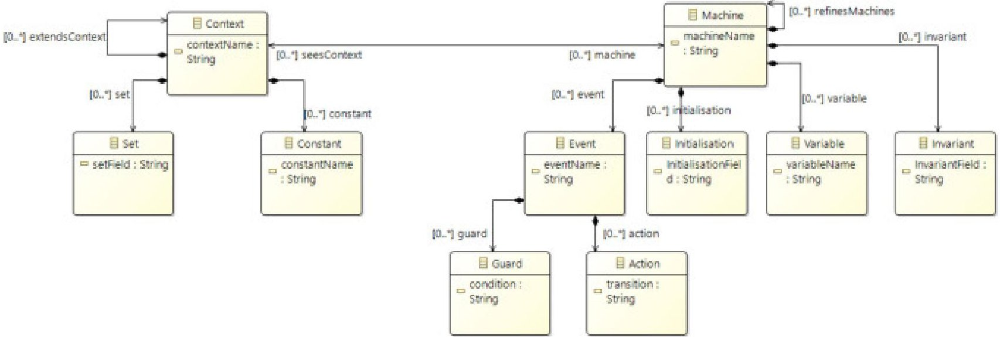

Fig. 3. Event-B meta-model.

## 4.3. Capella to Event-B DSLs

As mentioned above, DSLs are designed to address specific problems within a particular field. The process of developing a DSL [16] involves five main stages. The first stage is Decision Analysis, which involves understanding the domain, identifying relevant concepts and relationships, and establishing domain boundaries. The second stage is Design, where the DSL is designed to address the domain-specific problems identified in the previous stage. The third stage is Implementation, where the concrete language is implemented using existing tools. The fourth stage is Evaluation, which determines whether the DSL meets the needs of the business. Finally, the fifth stage is Maintenance, which involves ongoing updates to the DSL to accommodate changes in business requirements.

In our approach, we apply both the "Specialization or Extension" design pattern and the "Interpreter" and "Compiler/Application Generator" implementation patterns [16]. By introducing new syntaxes for existing Capella elements, we extend the core language, ensuring seamless integration and user-friendliness. These enhancements are verified using Xtext, acting as an interpreter that parses DSL code and validates it against defined grammar and rules. Moreover, Xtext serves as a compiler or application generator, facilitating the generation of validated Capella models or related artifacts.

For the design process, we determine which concepts should be restyled in the Capella model to accurately represent the target requirements. In Capella, a constraint is a component that can be linked to any model element. It is a cross-perspective element, meaning that it can be applied to elements in any perspective of the model. In other words, constraints are not limited to a specific view or perspective and can be used to define requirements or constraints for any element in the model. Fig. 4, Fig. 5 illustrate the syntax rules of the constraint that need to be followed when they are connected to a specific operational or system analysis model element.

During the implementation phase, we adopted a Grammar-driven approach [17], [19] to develop our custom DSLs. It is a textual approach which involves defining the language structure using formal grammars, which are sets of rules that govern the syntax of the Capella elements. Subsequently, we created parsers capable of reading and interpreting the DSL based on its grammar. Our main goal was to design two new DSLs, namely the Operational Analysis DSL and System Analysis DSL. To achieve this, we devoted considerable time to understanding the existing meta models of Capella, which are extracted from the existing ecore models. Changing these meta models was essential to ensure that component names are unique and to introduce the desired syntax for specific components, ensuring compatibility with our mapping rules. Notably, our DSLs are textual in nature. We meticulously check the syntax of the corresponding XMI files of Capella models to ensure seamless integration and consistent representation. In Fig. 6, an extract of the new

<!-- PDF_PAGE: 7 -->

meta-model for the operational analysis model is presented. The Constraint class now has additional linked classes, including InitializationExp and InvariantExp. By combining all the additional classes with the Constraint class, specific syntaxes can be checked, allowing each constraint to be transformed into a particular topic in the target meta-model. In addition, Fig. 7 illustrates an extract of the new meta-model of the system analysis.

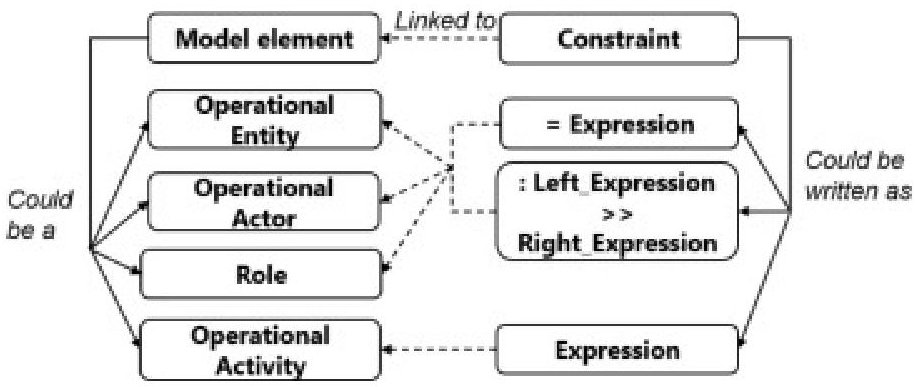

Fig. 4. Constraint syntaxes for the operational analysis elements.

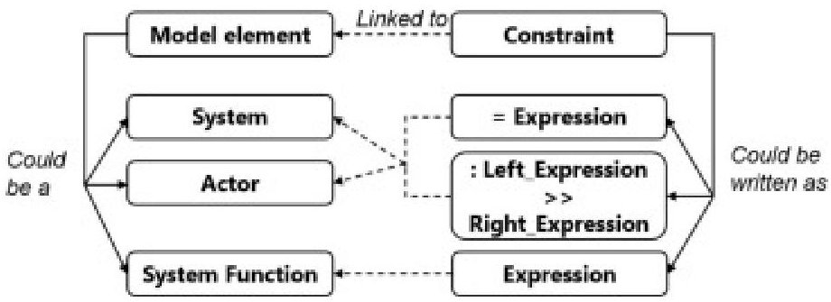

Fig. 5. Constraint syntaxes for the system analysis elements.

<!-- PDF_PAGE: 8 -->

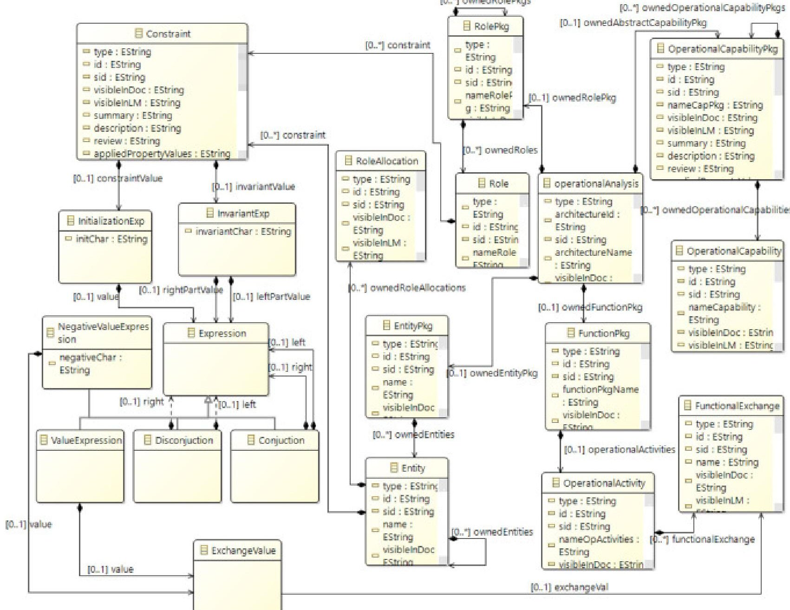

Fig. 6. The new operational analysis meta-model.

<!-- PDF_PAGE: 9 -->

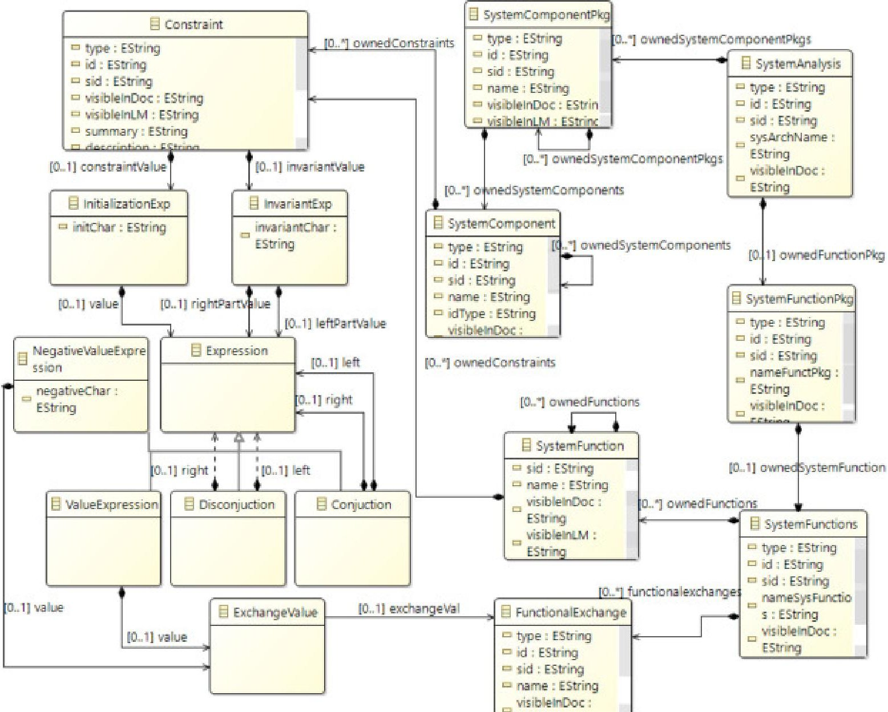

Fig. 7. The new system analysis meta-model.

## 5. Proposed approach

## 5.1. Transforming Capella to Event-B: What prompted the shift?

Capella, a modeling tool, does not have a built-in way to define behavioral semantics. One solution could be to modify the Capella meta-model and add a specific type of semantic (either axiomatic or operational) to address this. However, this approach may not be appropriate because Capella is designed to be independent of any specific usage or purpose. Instead, any operational semantics needed for a particular design project should be defined separately from Capella and tailored to meet the specific needs of the designer (to follow the principle of separation of concerns). Additionally, adding a comprehensive semantic model capable of supporting behavior simulation within Capella would make the tool significantly more complex, increase the costs associated with maintaining and updating the models, and may not be feasible or necessary for every project.

Therefore, we suggest adding an operational semantics to Capella models by using a series of transformations. Each transformation focuses on a specific aspect aiming to achieve that objective. The proposed approach involves a chain of transformations that need to be carried out in sequence, which include modeling, enrichment, syntax check, mapping, Event-B generation, and verification/validation.

<!-- PDF_PAGE: 10 -->

We start by making a Capella model and adding constraints, presenting functional and non-functional properties. Our custom DSLs check these constraints for syntax to ensure they match our mapping rules. Once verified, we proceed to transform our Capella model into an Event-B model. Finally, we verify the system's behavior by ensuring the correctness of its Event-B model. In this process, we are not just examining semantics; we are conducting a comprehensive semantic evaluation of the Capella model itself.

## 5.2. Transformation steps

This section presents the six transformation steps, of our approach, presented in Fig. 8 in details.

Modeling: In this phase, the requirements for the system are analyzed and defined. This includes understanding the needs of the stakeholders, identifying system functions and features, and determining performance requirements. Later on, we pass to visualize the system's structural aspects and the essential data elements by describing its behavior, structure, and potentially its data flow, including both input data and output data. Capella models provide a visual representation of the system and can be used to test and validate the system design, as well as to communicate the design to stakeholders and other team members.

Enrichment: After creating the Capella model, we enrich its components with constraints, which are rules that govern the behavior of the system. These constraints include safety requirements, performance requirements, and other limitations that are specific to the system being designed. Defining these constraints is a critical step in our approach, as it helps to ensure that the system is designed to meet all necessary requirements and specifications. By incorporating constraints into the Capella model, engineers can evaluate the system's behavior under different conditions, identify potential issues or limitations, and make adjustments as needed.

Syntax check: Parser-based editing [19] is the common approach used in the Grammar-driven workbenches. As mentioned above, the Grammar-driven approach generates automatically a parser after the grammar of the DSL is defined by the language developer. This parser translates textual code into an abstract syntax tree (AST). So, the parser matches the Capella file (.capella) - representing the XMI interpretation of the Capella model - with the language grammar to construct the AST of the program. The syntax of the constraints is an essential component that needs to be checked and their values must match one of the syntaxes presented in Fig. 4, Fig. 5. If the syntax check succeeds, the transformation into Event-B can proceed. However, if the check fails, meaning that the syntax of the constraints does not match any of the defined syntaxes, then the syntax of the constraints needs to be updated before passing to the transformation. Additionally to that, it verifies in the operational analysis model, whether the names of entities, actors, roles, and activities are unique. Similarly, in the system analysis, it checks the unicity of the system actors and functions names. By ensuring component name uniqueness, we take the first step towards performing semantic checks. We perform this thorough verification of the syntax to ensure a strict compliance with our predefined rules. This process acts as a proactive measure, assuring that Capella's elements align precisely with the established mapping rules. As a result, we can have a full automatic generation of an accurate Event-B model without requiring any manual intervention by users who are unfamiliar with Event-B.

Mapping: During the mapping step in the model transformation process, the goal is to translate the refactored Capella model into a model that conforms to the concepts defined by the target meta-model. The target meta-model is a legacy meta-model that provides a behavioral semantic, along with simulation and analysis tools. Essentially, the mapping step involves taking the Capella meta-model concepts and converting them into concepts of the Event-B meta-model, while preserving the system's behavior and interactions. Formally, the relation between the source Capella elements and the target event-B elements can be spelled as follows:

Source_Capella_Element $ \overset{Rule}{\Longrightarrow} $ Target_Event-B_Element

In most cases, all components in the Capella model, except for the constraint element, undergo a straightforward 1:1 mapping during the conversion process. However, the constraint element follows a 1: $ ^{*} $ mapping since it can be transformed into various Event-B

<!-- PDF_PAGE: 11 -->

elements based on its value. This step is important because it allows engineers to use existing simulation and analysis tools that are designed for the target meta-model, which can help to improve the accuracy and efficiency of the system design process.

The following rules highlight the formal presentation of the mapping rules for the operational analysis model.

Operational Entity $ \Longrightarrow $ Set

Operational Actor $ \Longrightarrow $ Set

Operational Role $ \Longrightarrow $ Set

Operational Activity $ \Longrightarrow $ Event

Operational Interaction $ \Longrightarrow $ Set's Element (state)

Constraint $ \Longrightarrow $ Initialization, Invariant

The following rules provide the formal presentation of the mapping rules for the system analysis model.

System Actor $ \Longrightarrow $ Set

System Function $ \Longrightarrow $ Event

Functional Exchange $ \Longrightarrow $ Set's Element (state)

Constraint $ \Longrightarrow $ Initialization, Invariant

Event-B generation: The aim of this step is to use a model-to-model transformation, to convert the Capella model into an Event-B model. This transformation will enable the automatic verification of Capella models, bringing the advantages of formal methods to practitioners in the industry. The resulting Event-B model will capture the content and structure of the original Capella model, but in a format that is more amenable to formal analysis and verification.

<!-- PDF_PAGE: 12 -->

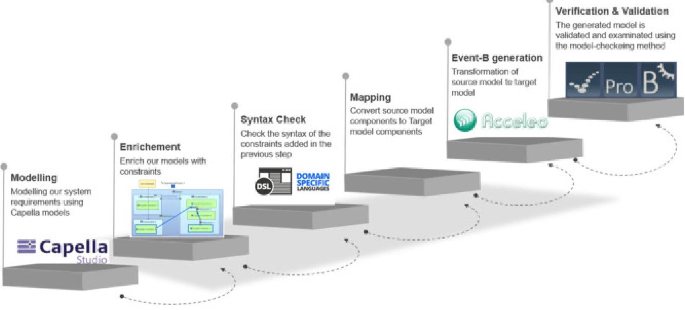

Fig. 8. Transformation approach steps.

Verification/Validation: In this step, the model is validated and checked for errors using the model-checking method. The goal is to ensure that the model is consistent and free of errors, which is important for improving the quality of the final product and reducing the risk of errors and delays. This process allows us to explore different scenarios and validate the system's functional and safety properties. In doing so, we introduce an additional formal layer to Capella, enabling the verification of the system's semantic behavior through the corresponding Event-B model aligned with the original Capella model. By creating an accurate and comprehensive models of the system, engineers and designers can better understand the system's behavior and interactions, and identify potential issues or limitations before they become major problems. If any problems are identified during the model-checking step, engineers and designers will need to maintain and update the Capella model as necessary. During this verification process, there is currently no automated feedback mechanism to update the Capella models. This could entail modifying the Capella model and converting it into an Event-B model to tackle the detected issues. This iterative process might be executed several times until no problems or errors are identified by the model-checking method during the Event-B verification step.

## 6. Experiments

## 6.1. Adaptive exterior light system case study

This example is about a system found in many modern cars, called the adaptive exterior light system (ELS), which helps improve the driver's visibility without blinding other drivers. The system uses sensors to read data such as the car's speed and outside light levels, and then controls the car's lights accordingly. Furthermore, a new aspect is being considered that uses cameras to monitor the driver's behavior, such as their level of attention and driving skills, in order to improve transportation safety.

In the next section, we show the results of the transformation steps outlined in Section 3 by using our case study as an example.

## 6.2. Model transformation

<!-- PDF_PAGE: 13 -->

## 6.2.1. Modeling & enrichment steps

To begin, we started by creating the operational architecture that outlines the needs of the customer in terms of actors/users, their capabilities, and activities. The behavioral requirements of the ELS are then divided into two main functionalities - changing the global settings of the system and controlling the lights. The Fig. 9 presents the operational architecture model that was designed in our previous paper [4]. The system analysis involves specifying the functions of the system to be implemented and their hierarchical structure. The intended behavior of each system function is also described, along with the interactions and dependencies between them in Fig. 10. The system includes various parameters that allow the user to control the desired behavior by using the rotary light switch, pitman arm, hazard warning light switch, darkness switch, or ignition key.

After creating the models, we need to add constraints to the model elements. In our use-case, these constraints serve as safety requirements that are specific to our system. For example, they may include instructions such as stopping the car once the frontal camera detects that the driver is drowsy, or ensuring that all doors are closed while the car is moving. It is an essential step in our process, because it ensures that the system is designed in compliance with all the necessary specifications and requirements. it helps us also to test the system's behavior under various conditions, detect any possible issues or limitations, and adjust them accordingly.

## 6.2.2. Syntax check step

For developing our textual Domain-Specific Language, we specify two grammars for our new customized Capella language using Xtext Workbench. It generates a parser that can recognize the syntax of our proper DSLs, and provides a new workbench that defines their syntaxes in a user-friendly manner. By using that parser, we can verify the uniqueness of component names, and check that the constraints added by the user are valid and match the predefined syntax illustrated in Fig. 4, Fig. 5. In addition, whether in operational or system analysis, each exchange between activities or functions corresponds to a new state of a subsystem, and so it is important that the constraints defined in the DSL reflect these values. By ensuring that the constraints are composed of the values exchanged between activities or functions, we can guarantee that the DSL accurately models the behavior of the subsystems. This is because the constraints govern the secure behavior of the subsystems, and by using the same values as those exchanged between activities or functions, we can ensure that the subsystems behave correctly according to the system requirements. In Fig. 11, we present a snippet of the grammar responsible for validating the syntax of constraint values within the Operational Analysis model.

Inтекты, engineON, engineOFF, activeCam, inactiveCam, activeLights, inactiveLights, normal, drowsy, in_Control. If a constraint contains other values, the parser will detect a syntax error and suggest replacing the value with one of the acceptable values. Also, we check that the names of the operational etities, actors, roles and activities are unique.

<!-- PDF_PAGE: 14 -->

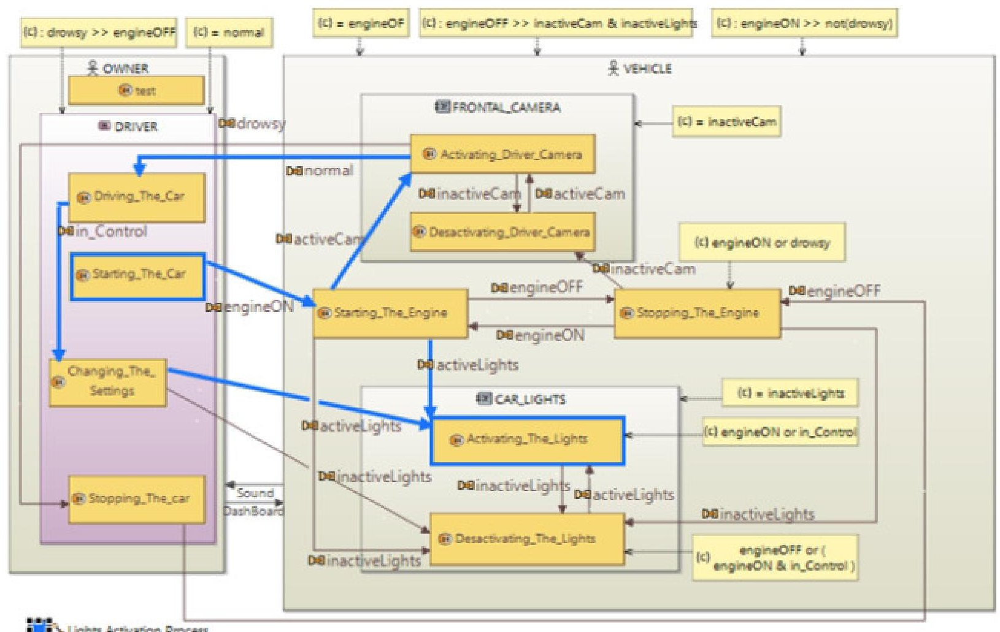

Fig. 9. Operational architecture diagram (OAB).

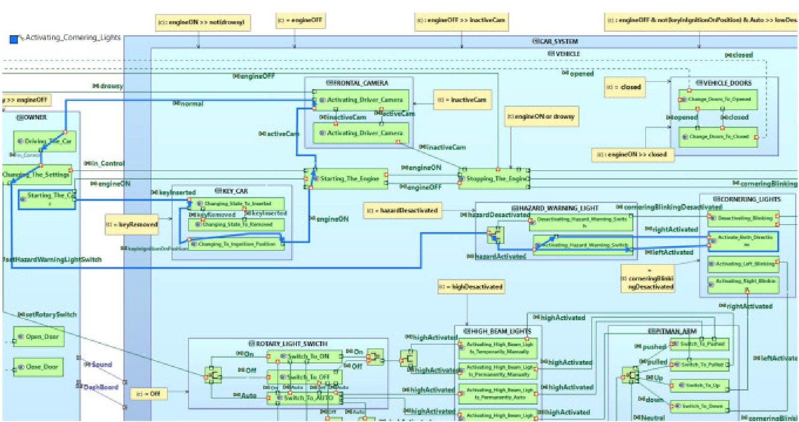

Fig. 10. System architecture diagram (SAB).

<!-- PDF_PAGE: 15 -->

Constraint:

(Constraint)

'<ownedConstraints'

'xsi:type' type=EString

'id' id=EString

('sid' sid=EString)?

('name=' ''' ((constraintValue= InitializationExp)?

(invariantValue= InvariantExp)? ''')

))

('visibleInDoc' visibleInDoc=EString)?

('visibleInLM' visibleInLM=EString)?

('summary' summary=EString)?

('description' description=EString)?

('review' review=EString)?

('appliedPropertyValues' appliedPropertyValues=EString)?

('appliedPropertyValueGroups' appliedPropertyValueGroups=EString)?

('status' status=EString)?

('features' features=EString)?

('constrainedElements' constrElmts=EString)?

('>' | '/>')?

(ownedPropertyValues+=AbstractPropertyValue)?

(ownedEnumerationPropertyTypes+=EnumerationPropertyType)?

(ownedPropertyValueGroups+=PropertyValueGroup)?

(exprSpecification+=OpaqueExpression)?

('</ownedConstraints>')?

;

InitializationExp:

initChar=('=')? value=Disconjunction;

InvariantExp:

invariantChar=':' leftPartValue=Disconjunction INVARIANT_CHARACTER2

rightPartValue=Disconjunction;

NegativeValueExpression:

'(' negativeChar='not' value=ExchangeValue ')'

;

ValueExpression:

value=ExchangeValue

;

FunctionalExchange:

'<ownedFunctionalExchanges'

'xsi:type' type=EString

'id' id=EString

('sid' sid=EString)?

'name=' ''' name=ID '''

('visibleInDoc' visibleInDoc=EString)?

('visibleInLM' visibleInLM=EString)?

('summary' summary=EString)?

('description' description=EString)?

('review' review=EString)?

('kindOfRate' kindOfRate=RateKind)?

('appliedPropertyValues' appliedPropertyValues=EString)?

('appliedPropertyValueGroups' appliedPropertyValueGroups=EString)?

('status' status=EString)?

('features' features=EString)?

('realizedFlow' realizedFlow=EString)?

('target' target=EString

'source' source=EString

('interrupts' interrupts=EString)?

('transformation' transformation=EString)?

('selection' selection=EString)?

('exchangeSpecifications' exchangeSpecifications=EString)?

('exchangedItems' exchangedItems=EString)?

('isMulticast' isMulticast=EString)?

('isMultireceive' isMultireceive=EString)?

Disconjunction returns Expression:

Conjunction ({Disconjunction.left=current} 'or' right=Conjunction)*

Conjunction returns Expression:

Primary ({Conjunction.left=current} '&amp;' right=Primary)*

Primary returns Expression:

ValueExpression | NegativeValueExpression | '(' Disconjunction ')'

ExchangeValue:

exchangeVal=[FunctionalExchange]

Fig. 11. Extracted Grammar from Meta-Model in Fig. 6.

During the system analysis, the functions within the system exchange values to represent different states. Specifically, these values are: darkActivated, darkDesactivated, keyInIgnitionOnPosition, keyInserted, keyRemoved, Auto, Off, On, engineOFF, engineON highActivated, highDesactivated, activeCam, inactiveCam, closed, opened, normal, drowsy, in_Control, hazardDesactivated, hazardActivated, lowActivated, lowDesactivated, corneringBlinkingDesactivated, rightActivated, leftActivated, Neutral, pulled, Up pushed, down. The same validation procedures that were previously discussed are used again to ensure that the constraints defined in the DSL correspond to the values exchanged between the functions in the system. Further, we check that the names of the system actors and functions and activities are unique.

We demonstrate our process of syntax checking, using the FRONTAL _CAMERA subsystem, where we reveal that its function names were not unique, leading to errors detected by our grammar in Fig. 12. In Fig. 13, we found that the constraints linked to the VEHICLE_DOORS subsystem, contained incorrect values such as Wrong_Value, Wrong_Value 1, and Wrong_Value 2, making them invalid.

<!-- PDF_PAGE: 16 -->

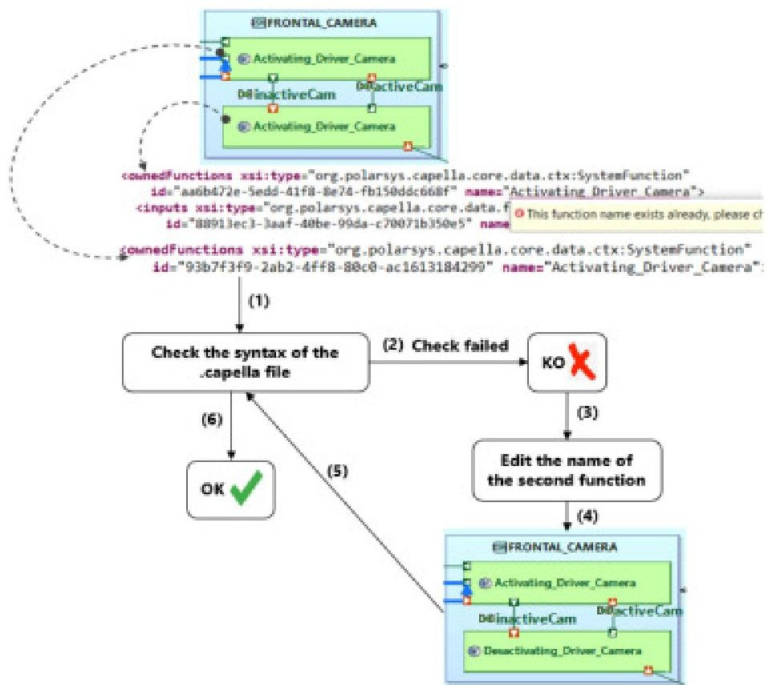

Fig. 12. Name unicity check.

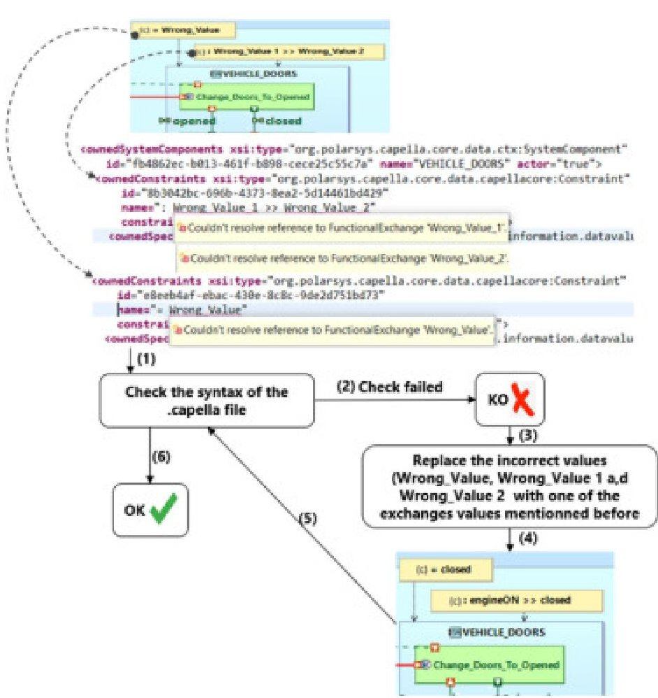

Fig. 13. Constraint syntax check.

## 6.2.3. Mapping step

<!-- PDF_PAGE: 17 -->

The Fig. 14, Fig. 15 depict the fundamental components of a Capella operational and system architecture models and how they are mapped to corresponding components in an Event-B model.

The Event-B conversion process for Capella operational analysis architecture diagrams involves selecting operational entities, actors, and roles that contain at least one operational activity, and converting them into sets. Likewise, in the system analysis architecture diagram, systems and actors with at least one system function are also transformed into sets. For each set, we create a variable with the format "Var_Set_Name".

The constraints that start with "=" are transformed into initialization events, and those that start with ":" are transformed into invariants. The initilized value presents the initial state of the model element in question, while the invariants are the properties that must be maintained throughout the execution of any event. Finally, operational activity or system function is transformed into an event.

The conversion of operational activities and system functions into events is not a straightforward process. Certain criteria must be fulfilled first. Fig. 16, Fig. 17 present a variety of operational activities and system functions, of which we will explain the transformation semantics of each.

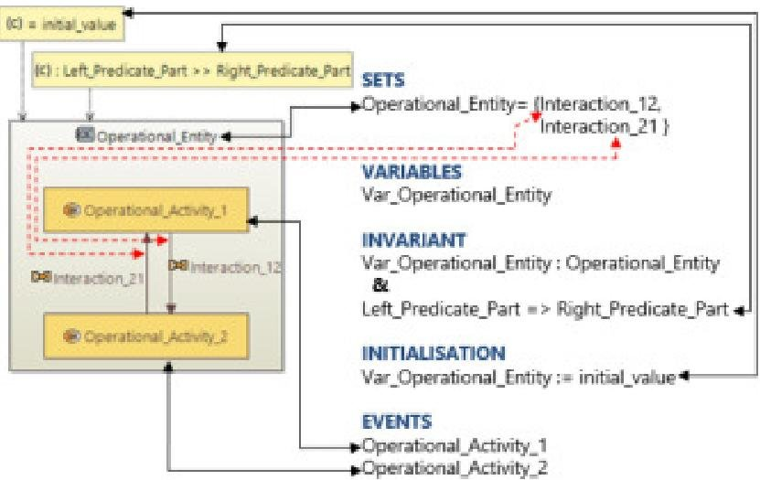

Fig. 14. Mapping of OA model to Event-B model.

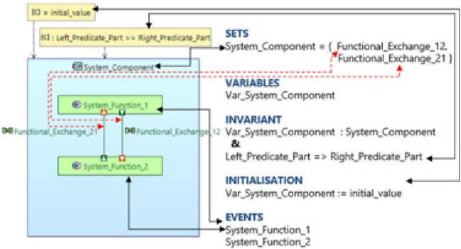

Fig. 15. Mapping of SA model to Event-B model.

We will be discussing only the process of transforming operational activities into events. However, it is important to note that the same transformation semantics are also applied to system functions in the system analysis model. This means that the process of

<!-- PDF_PAGE: 18 -->

transforming system functions into events follows the same principles as that of operational activities.

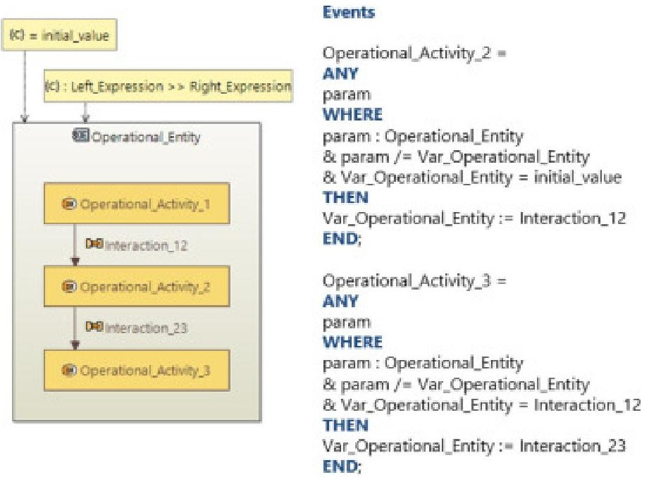

Fig. 16. Transformation of OA activities to Event-B events.

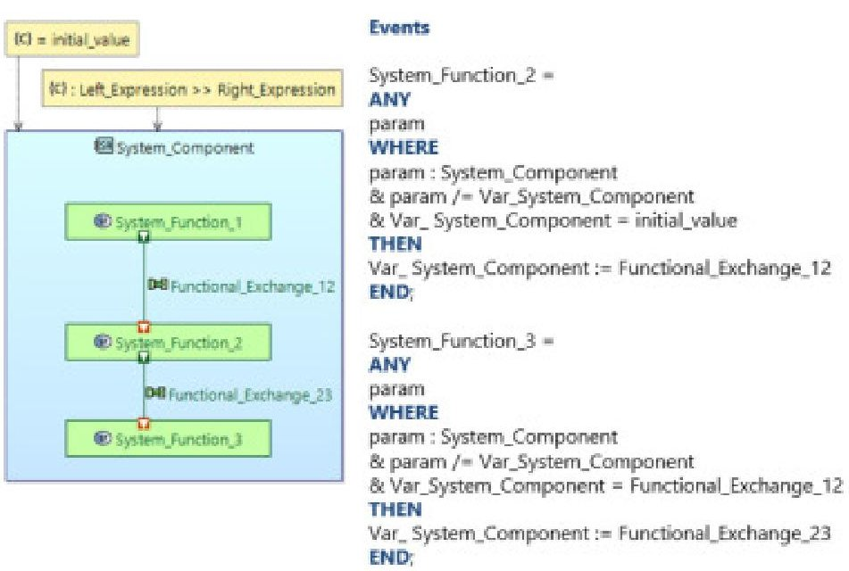

Fig. 17. Transformation of SA functions to Event-B events.

<!-- PDF_PAGE: 19 -->

<table border="1"><tr><td>Capella OA activity</td><td>Corresponding event</td><td>Event-B(Event pre-condition)</td><td>Description of the pre-condition</td><td>Event-B(Event post-condition)</td><td>Description of the post-condition</td></tr><tr><td>Operational_Activity_1</td><td>No event</td><td>No pre-condition</td><td>No description</td><td>No post-condition</td><td>No description</td></tr><tr><td>Operational_Activity_2</td><td>Operational_Activity_2=</td><td>C) = initial_value</td><td>Capella activities can be arranged in a specific sequence or order to represent a workflow or process. This sequencing entails that the pre-condition of one activity&#x27;s event is the post-condition of the event corresponding to the previous activity. In our specific case, Operational_Activity_1 remains unconverted into an event. Consequently, the system maintains its original state, as denoted by the initial_value. As a result, we include the initial value as a pre-condition for the Operational_Activity_2 event</td><td>Interaction_12</td><td>Regarding the post-condition, it corresponds to the incoming arrows pointing to Operational_Activity_2. These incoming arrows convey the new state of the system. Therefore, upon the execution of this event, the system&#x27;s value will be updated to match that of the incoming arrow, interaction_12. Hence, we have assigned the value of interaction_12 to the system&#x27;s variable as a post-condition.</td></tr><tr><td>Operational_Activity_3</td><td>Operational_Activity_3=</td><td>Interaction_12</td><td>We will maintain the same semantic. Consequently, the pre-condition for Operational_activity_3 corresponds to the post-condition of Operational_Activity_2, which is represented by interaction_12.</td><td>Interaction_23</td><td>Similarly, in this case, the post-condition corresponds to the values of the incoming arrows directed towards Operational_Activity_3, specifically represented by interaction_23. Consequently, we&#x27;ve designated interaction_23 as a post-condition for the corresponding event. This signifies that following the event&#x27;s execution, the system&#x27;s state will be set to interaction_23.</td></tr></table>

Fig. 18. Mapping OA Activities to Event-B events with Pre and Post-Conditions.

<!-- PDF_PAGE: 20 -->

<table border="1"><tr><td>Capella SA function</td><td>Corresponding event</td><td>Event-B(Event pre-condition)</td><td>Description of the pre-condition</td><td>Event-B(Event post-condition)</td><td>Description of the post-condition</td></tr><tr><td>System_Function_1</td><td>No event</td><td>No pre-condition</td><td>No description</td><td>No post-condition</td><td>No description</td></tr><tr><td>System_Function_2</td><td>System_Function_2=</td><td>ICI=initial_value</td><td>In the Capella system, functions can be organized in a particular sequence to depict a functional chain process. This sequencing implies that the pre-condition of one function&#x27;s event becomes the post-condition of the event corresponding to the preceding function. In our specific scenario, System_Function_1 remains unconverted into an event. Consequently, the system retains its initial state, indicated by the initia_value. Therefore, we incorporate the initial_value as a pre-condition for the System_Function_2 event.</td><td>Functional_Exchange_12</td><td>Concerning the post-condition, it aligns with the incoming arrows directed towards System_Function_2. These incoming arrows indicate the system&#x27;s updated state. Consequently, after the execution of this event, the system&#x27;s value will be synchronized with that of the incoming arrow, Functional_Exchange_12. Thus, we have designated the value of Functional_Exchange_12 as the post-condition for the system&#x27;s variable.</td></tr><tr><td>System_Function_3</td><td>System_Function_3=</td><td>Functional_Exchange_12</td><td>We will preserve the identical semantics. As a result, the precondition for System_Function_3 aligns with the post-condition of System_Function_2, indicated by Functional_Exchange_12</td><td>Functional_Exchange_23</td><td>In a parallel manner, the post-condition here corresponds to the values arriving via the arrows directed at System_Function_3, precisely denoted by Functional_Exchange_23. Accordingly, we have assigned Functional_Exchange_23 as the post-condition for the respective event. This indicates that after the event&#x27;s execution, the system&#x27;s state will match that of Functional_Exchange_23.</td></tr></table>

Fig. 19. Mapping SA functions to event-B Events with Pre and Post-Conditions.

<!-- PDF_PAGE: 21 -->

SYSTEM

OperationalAnalysis

SETS

FRONTAL_CAMERA = { activeCam,inactiveCam };

CAR_LIGHTS = { activeLights,inactiveLights };

VEHICLE = { engineOFF,engineON };

DRIVER = { normal,drowsy,in_Control }

VARIABLES

Var_VEHICLE,

Var_CAR_LIGHTS,

Var_DRIVER,

Var_FRONTAL_CAMERA

INVARIANT

Var_VEHICLE : VEHICLE &

Var_CAR_LIGHTS : CAR_LIGHTS &

Var_DRIVER : DRIVER &

Var_FRONTAL_CAMERA : FRONTAL_CAMERA &

(Var_VEHICLE = engineON => Var_DRIVER /= drowsy) &

(Var_DRIVER = drowsy => Var_VEHICLE = engineOFF) &

(Var_VEHICLE = engineOFF => (Var_FRONTAL_CAMERA = inactiveCam &

Var_CAR_LIGHTS = inactiveLights) or Var_CAR_LIGHTS = activeLights)

INITIALISATION

Var_VEHICLE := engineOFF ||

Var_CAR_LIGHTS := inactiveLights ||

Var_DRIVER := normal ||

Var_FRONTAL_CAMERA := inactiveCam

Fig. 20. Extract of the generated Event-B model from OA model (part1).

<!-- PDF_PAGE: 22 -->

Starting_The_Engine =

ANY

param

WHERE

param : VEHICLE & param /= Var_VEHICLE

& Var_VEHICLE = engineOFF

THEN

Var_VEHICLE := engineON;

Var_DRIVER := normal

END;

Stopping_The_Engine =

ANY

param

WHERE

param : VEHICLE & param /= Var_VEHICLE

& (Var_VEHICLE = engineON or Var_DRIVER = drowsy)

THEN

Var_VEHICLE := engineOFF;

Var_FRONTAL_CAMERA := inactiveCam;

Var_CAR_LIGHTS := inactiveLights

END;

Stopping_The_car =

ANY

param

WHERE

param : DRIVER & param /= Var_DRIVER

& Var_FRONTAL_CAMERA = activeCam

THEN

Var_DRIVER := drowsy;

Var_VEHICLE := engineOFF;

Var_FRONTAL_CAMERA := inactiveCam;

Var_CAR_LIGHTS := inactiveLights

END;

Changing_The_Settings =

ANY

param

WHERE

param : DRIVER & param /= Var_DRIVER

& Var_DRIVER = normal

THEN

Var_DRIVER := in_Control

END;

Fig. 21. Extract of the generated Event-B model from OA model (part2).

SYSTEM

SystemAnalysis

SETS

VEHICLE_DOORS = {closed, opened};

KEY_CAR = {keyInIgnitionOnPosition, keyInserted, keyRemoved}

VARIABLES

Var_VEHICLE_DOORS,

Var_KEY_CAR

INVARIANT

Var_VEHICLE_DOORS : VEHICLE_DOORS &

Var_KEY_CAR : KEY_CAR

INITIALISATION

Var_VEHICLE_DOORS := closed ||

Var_KEY_CAR := keyRemoved

Fig. 22. Extract of the generated Event-B model from SA model (part1).

<!-- PDF_PAGE: 23 -->

ENTS

Changing_State_To_Removed =

ANY

param

WHERE

param : KEY_CAR & param /= Var_KEY_CAR

& Var_KEY_CAR = keyInserted

THEN

Var_KEY_CAR := keyRemoved

END;

Changing_To_Ingnition_Position =

ANY

param

WHERE

param : KEY_CAR & param /= Var_KEY_CAR

& Var_KEY_CAR = keyInserted

THEN

Var_KEY_CAR := keyInIgnitionOnPosition

END;

Change_Doors_To_Opened =

ANY

param

WHERE

param : VEHICLE_DOORS & param /= Var_VEHICLE_DOORS

& Var_VEHICLE_DOORS = closed

THEN

Var_VEHICLE_DOORS := opened

END;

Change_Doors_To_Closed =

ANY

param

WHERE

param : VEHICLE_DOORS & param /= Var_VEHICLE_DOORS

& Var_VEHICLE_DOORS = opened

THEN

Var_VEHICLE_DOORS := closed

END;

Fig. 23. Extract of the generated Event-B model from SA model (part2).

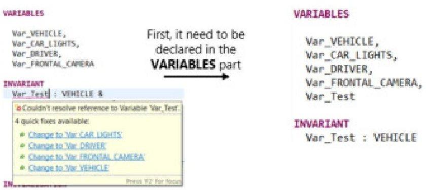

Fig. 24. Syntax check of Event-B model variables.

<!-- PDF_PAGE: 24 -->

Starting_The_Engine =

ANY

param

WHERE

param : VEHICLE

& param /= Var_VEHICLE

& Var_VEHICLE = engineOFF

THEN

Var_VEHICLE := engine;

Var_DRIVER :=

END;

The assigned value

must belong to the

VEHICLE set shown

in Figure 20

Starting_The_Engine =

ANY

param

WHERE

param : VEHICLE

& param /= Var_VEHICLE

& Var_VEHICLE = engineOFF

THEN

Var_VEHICLE := engineON;

Var_DRIVER := normal

END;

Fig. 25. Syntax check of Event-B model events.

OK State Properties (5)

invariant_ok

Var_CAR_LIGHTS = inactiveLights

Var_DRIVER = drowsy

Var_FRONTAL_CAMERA = inactiveCam

Var_VEHICLE = engineOFF

Fig. 26. Invariant preservation during the model-checking for the Event-B model of the operational analysis model.

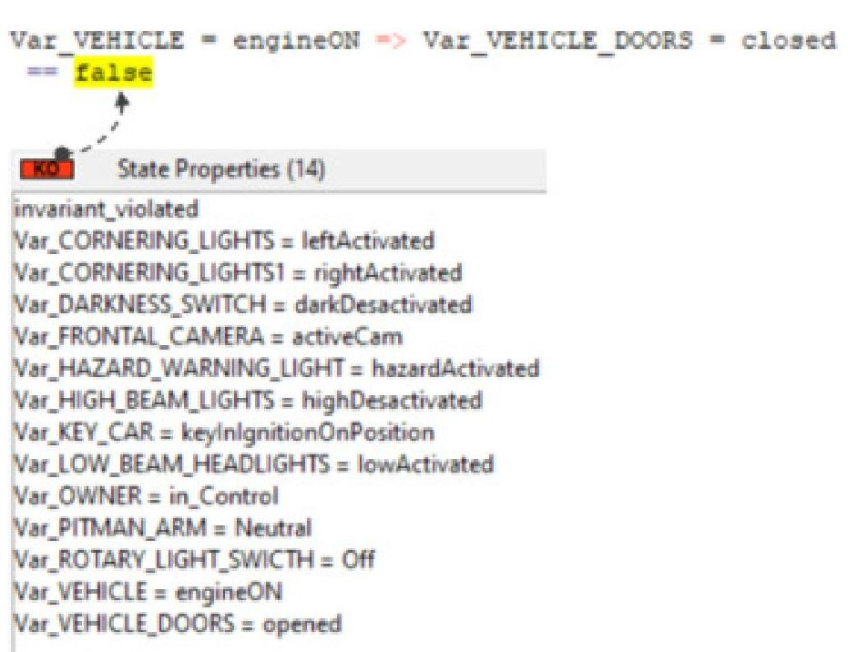

Fig. 27. Invariant violation during the model-checking for the Event-B model.

<!-- PDF_PAGE: 25 -->

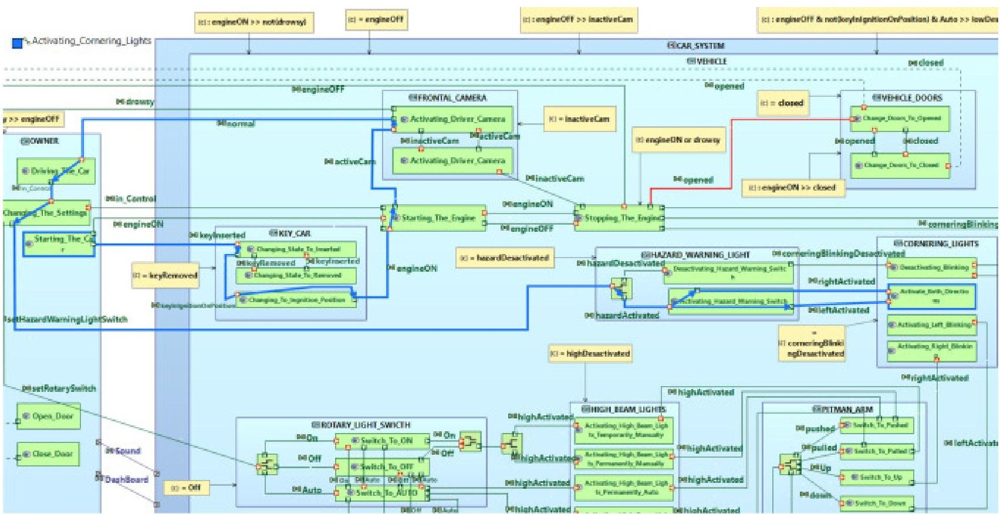

Fig. 28. The modified system analysis model. (For interpretation of the references to color in this figure legend, the reader is referred to the web version of this article.)

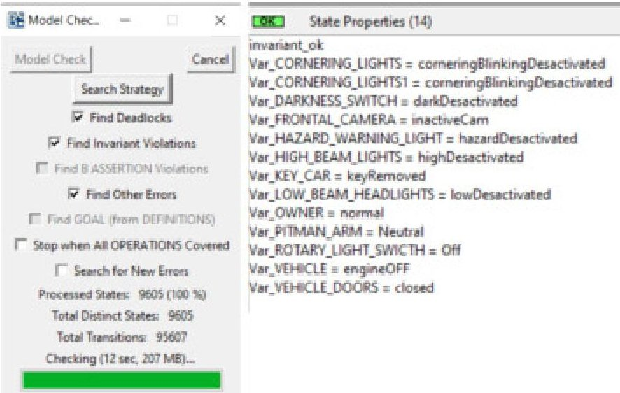

Fig. 29. Invariant preservation during the model-checking for the Event-B model for the system analysis model.

- Operational_Activity_1: The model element in question is not being converted into an event because the transformation process only applies to operational activities that have some form of input information. This input is represented by the Interaction model element. In contrast, Operational_Activity_2 has Intercation12 as input, and Operational_Activity_3 has Interaction23 as input. In other words, these operational activities have specific input information that makes them eligible for transformation into events, whereas the model element in question does not have such input information.

<!-- PDF_PAGE: 26 -->

- Operational_Activity_2: As mentioned above, this activity element is transformed into event that have a guard and an action. Within each operational entity or role, the interactions exchanged between its activities represent the different states of that entity or role. The input interaction linked to a specific activity indicates the new state of the entity or role corresponding to that activity. Therefore, after executing the activity, the state of the entity or role is updated to the value of its input interaction. For instance, in our example the Operational_Activity_2 has Interaction12 as its input, so after the activity is executed, the state of Operational_Entity will become Interaction12. Since executing Operational_Activity_2 results in the system's state changing to Interaction12, the action of the corresponding event will be Interaction12; Because an action represents the system's state transition after the execution of its corresponding event. This implies that when the Operational_Activity_2 event is executed, it will update the state variable of the Operational_Entity to Interaction12. The guard for an activity is the input interaction of its previous activity, but if there is no input interaction, the initialized value is used as a guard. In this case, since Operational_Activity_1 has no input interaction, the guard for Operational_Activity_2 event is the initialized value. The Operational_Activity_2 event is executed only when the system state equals the initialized value in the constraint (param = initial_value), and the post-execution result is to update the Operational_Entity state to Interaction12 (Var_Operational_Entity: = Interaction12).

- Operational_Activity_3: Operational_Activity_3 is also transfo rmed into an event, which has a guard and an action. The guard of this event is set to the input interaction of its previous activity, which is Interaction12. This means that Operational_Activity_3 can only be executed when the system's state is already in the Interaction12 state (param = Interaction12). The action of this event is set to Interaction23, which represents the new state of the system after the execution of this event. Therefore, after executing Operational_Activity_3, the system's state will be updated to Interaction23 (Var_Operational_Entity: = Interaction23).

In order to enhance user comprehension, we provide Fig.18, Fig.19, illustrating the graphical preconditions and post-conditions associated with each generated event, along with an explanation of the rationale behind their selection.

## 6.2.4. Event-B generation step

We present in Fig. 20, Fig. 21 the Event-B specification generated from the operational analysis model. Similarly, we present in Fig. 22, Fig. 23, the Event-B model that corresponds to the system analysis model respectively.

The VEHICLE entity and DRIVER role are converted into sets with corresponding variables Var_VEHICLE and Var_DRIVER that indicate their state. These model elements are linked to various constraints, such as an "= engineOFF" constraint for the VEHICLE entity that is mapped as an initialization event (Var_VEHICLE: = engineOFF) in the Event-B model, signifying that the vehicle starts in an OFF state. The other two constraints that start with a ":" are mapped as invariants, such as the ": engineOFF >> inactiveCam & inactiveLights" constraint, which means that if the engine is off, then the lights and camera are also off (Var_VEHICLE = engineOFF => (Var_FRONTAL_CAMERA = inactiveCam & Var_CAR_LIGHTS = inactiveLights)). The second constraint is another invariant that states if the engine is on, then the driver is not drowsy. In other words, if the vehicle's engine is running, the driver should be alert and not feeling sleepy. This constraint is represented using a specific syntax, where "Var_VEHICLE = engineON" represents the condition of the engine being on, and "Var_DRIVER / = drowsy" represents the condition of the driver not being drowsy that should be respected.

Next, the operational activities Starting_The_Engine and Stopping_The_Engine are mapped to events. Starting_The_Engine involves two interaction inputs (engineON), which will result in the action of the corresponding event being (Var_VEHICLE: = engineON). These interaction inputs are derived from two other activities: Stopping_The_Engine and Starting_The_Car. The input interactions serve as guards for the Starting_The_Engine event. However, since Starting_The_Car activity does not have any interaction input, only

<!-- PDF_PAGE: 27 -->

the input interaction of the Stopping_The_Engine activity (engineOFF) is considered as a guard for this event. As a result, if the current state of the vehicle system is engineOFF (i.e., Var_VEHICLE = engineOFF), and we trigger the Starting_The_Engine event, then the state of the vehicle system will change to engineON (i.e., Var_VEHICLE: = engineON). The same transformation is applied to the second activity.

The same mapping approach is applied to the DRIVER role, which is linked to two constraints. The first constraint, "= normal", sets the initial value of the Var_DRIVER variable (Var_DRIVER: = normal). The second constraint, ": drowsy >> engineOFF", expresses the following invariant (Var_DRIVER = drowsy => Var_VEHICLE = engineOFF). This means that if the driver is drowsy, the engine must stop and turn off. There are four different activities that will be transformed into events, except for the "Starting_The_Car" activity, which has no interaction input. For the remaining activities, the same transformation semantics explained earlier for the VEHICLE entity's activities will be followed.

The KEY_CAR and VEHICLE_DOORS are two system actors that are mapped into sets, creating the Var_KEY_CAR and Var_ VEHICLE_DOORS variables that represent their states. These actors are also linked to different constraints. For the KEY_CAR actor, the " = keyRemoved" constraint is used to express the initial state of this subSystem, which means that the key car is initially removed (Var_KEY_CAR: = KeyRemoved). In addition, it has three activities mapped to events, including the "Changing_State_To_Inserted" function, which has two functional exchanges (keyInserted) as inputs. This means that the action of the corresponding event is to set Var_KEY_CAR to the value of the keyInserted exchange (Var_KEY_CAR: = KeyInserted). These inputs come from two activities, Starting_The_Car and Changing_State_To_Removed, and their input exchange values act as guards for this event. However, since Starting_The_Car has no exchange value as input, only the exchange value of the input of the Changing_State_To_Removed activity is considered as a guard for this event (Var_KEY_CAR = KeyRemoved). The same transformation semantic is applied to the Changing_State_To_Removed and Changing_To_Ingnition_Position activities.

Similar to the KEY_CAR, the VEHICLE_DOORS is linked to two constraints: "= closed" for its initial state, which is expressed as (Var_VEHICLE_DOORS: = closed) in the INITIALIZATION part of the Event-B model, and ": engineON $ \gg $ closed" for its invariant, which is mapped as (Var_VEHICLE = engineON => Var_VEHICLE_DOORS = closed). This means that when car is moving, the doors should remain closed. The VEHICLE_DOORS has two functions that are mapped as events, using the same transformation approach as before.

Another aspect we have worked on is creating a grammar for the Event-B model. This only allow us to ensure that the syntax of the generated Event-B model from the Capella model is correct, before proceeding to the verification and validation phase.

For instance, if we attempt to use a variable that has not been declared, or assign an incorrect value to a variable in the Event-B model that is generated from the operational analysis model (as shown in Fig. 24, Fig. 25 respectively), an error is generated.

## 6.3. Verification and validation

ProB [22] can be used as a complement to model checkers and as an animator, which is important for detecting a range of problems during verification, including unexpected behavior of a model. By visualizing the behavior of an Event-B machine with ProB's animator, using different operational scenarios, we can analyze all the accessible states of the machine and check whether the demonstrated properties hold. If the animation of these scenarios validates our specification, we can conclude that it has been tested and verified. If not, we need to go back to the initial specification to find conflicts, correct unacceptable behaviors, and reapply the animation to ensure that the specification meets the requirements.

This work is based on the verification using model- checking. Model-Checking [23] is a verification method that checks whether a system description adheres to specified properties by modeling the system's behavior and formalizing the expected properties using

<!-- PDF_PAGE: 28 -->

first-order logic formulas. Our experiments were conducted on a 64-bit PC running Windows 10 with an Intel Core i7, 2.9 GHz Processor having 2 cores and 8 GB RAM.

We aim to ensure that in the Event-B model generated from the operational analysis, the engine must be stopped whenever the frontal camera detects that the driver is "drowsy" to prevent any hazardous situation. Using the ProB model-checker, we employed a mixed breadth and depth search strategy, and the results showed that there is no invariant violation, and our property will always be satisfied as seen in Fig. 26, with 100% coverage of checked states, 7 distinct states, 20 transitions.

Similarly, we also need to ensure this property in the Event-B model created from the system analysis, as well as verifying that the doors remain closed when the engine is running. However, in Fig. 27, we observed an invariant violation because the second property was not satisfied.

To address this issue, we modify our Capella system model by adding a functional exchange in red color (as seen in Fig. 28), regenerated the corresponding Event-B model, and performed verification again using the ProB model-checker. We found that the violation was resolved, and both properties were preserved (see Fig. 29). The coverage was 100% of checked states, 9605 states, and 95,607 transitions.

## 7. Conclusion and future works

Developing critical systems is a complex undertaking that requires collaboration across various stages such as specification, design, and verification. However, no single modeling language or tool can fully address all these aspects. As Capella has become increasingly popular for system design and modeling, we took the challenge to introduce a new solution that transforms Capella models into Event-B models, allowing industrial practitioners to benefit from formal methods. This paper presents two custom DSLs that check the uniqueness of component names and verify specific syntaxes of Capella models, followed by an automated translation process that converts Capella models into Event-B specifications. The syntax of the resulting Event-B models are then checked using a new custom DSL that we developed, and further they are validated using the ProB model-checker to ensure that invariants are maintained for a given initial state, and to verify that the system description adheres to specified properties in Event-B.

For future works, we plan make our transformation approach more automatic and integrate it within the Capella tool by creating a plugin. This will allow users to verify the syntax of their Capella models, check that the component names are unique, apply the transformation process, generate the corresponding Event-B model, and check only its syntax, with a single click. By streamlining this process, we aim to enhance the usability and accessibility of our approach, making it more convenient and efficient for industrial users. Also, we are intending to introduce a refinement methodology for Capella and Event-B models. This approach involves starting with an abstract model that represents the system specifications and gradually developing the system model using a correct-by- construction process. The concrete model is developed incrementally by adding more details while ensuring that the properties and functionality of the previous abstract models are maintained.

## Declaration of competing interest

The authors declare that they have no known competing financial interests or personal relationships that could have appeared to influence the work reported in this paper.

## References

[1] Roques Pascal

<!-- PDF_PAGE: 29 -->

Modélisation architecturale des systèmes avec la méthode Arcadia: guide pratique de Capella

ISTE Group (2018)

Google Scholar

[2] Chen Kai, Sztipanovits Janos, Abdelwalhed Sherif, Jackson Ethan Semantic anchoring with model transformations Model Driven Architecture-Foundations and Applications: First European Conference, ECMDA-FA 2005, Nuremberg, Germany, November 7-10, 2005. Proceedings 1, Springer (2005), pp. 115-129 Crossref View in Scopus Google Scholar

[3] Abrial Jean-Raymond Modeling in Event-B: System and Software Engineering Cambridge University Press (2010) Google Scholar

[4] Bouba Khaoula, Ait Wakrime Abderrahim, Ouhammou Yassine, Benaini Redouane Towards the strengthening of Capella modeling semantics by integrating event-b: A rigorous model-based approach for safety-critical systems Model and Data Engineering: 11th International Conference, MEDI 2022, Cairo, Egypt, November 21-24, 2022, Proceedings, Springer (2022), pp. 119-132 Google Scholar

[5] Dominique Mery, Neeraj Kumar Singh, Automatic code generation from Event-B models, in: Proceedings of the 2nd Symposium on Information and Communication Technology, 2011, pp. 179-188.

[6] Rivera Victor, Catano Néstor, Wahls Tim, Rueda Camilo Code generation for Event-B Int. J. Softw. Tools Technol. Transf., 19 (2017), pp. 31-52 Crossref View in Scopus Google Scholar

[7] Ostroumov Sergey, Tsiopoulos Leonidas VHDL code generation from formal Event-B models 2011 14th Euromicro Conference on Digital System Design, IEEE (2011), pp. 127-134 Crossref View in Scopus Google Scholar

[8] Karmakar Rahul A framework for component mapping between Event-B and Python

<!-- PDF_PAGE: 30 -->

Ambient Communications and Computer Systems: Proceedings of RACCCS 2021, Springer (2022), pp. 129-139

Crossref View in Scopus Google Scholar

[9] Wright Steve Automatic generation of C from Event-B Workshop on Integration of Model-Based Formal Methods and Tools, Citeseer (2009), p. 14 Google Scholar $ \rangle $

[10] Hlaoui Yousra Bendaly, Younes Ahlem Ben, Ayed Leila Jemni Ben, Fathalli Manel From sequence diagrams to event b: A specification and verification approach of flexible workflow applications of cloud services based on meta-model transformation 2017 IEEE 41st Annual Computer Software and Applications Conference (COMPSAC), Vol. 2, IEEE (2017), pp. 187-192 View in Scopus Google Scholar

[11] Poorhadi Ehsan, Troubitsyna Elena, Dán György Analysing the impact of security attacks on safety using SysML and Event-B Model-Based Safety and Assessment: 8th International Symposium, IMBSA 2022, Munich, Germany, September 5-7, 2022, Proceedings, Springer (2022), pp. 170-185 Crossref View in Scopus Google Scholar

[12] Lelandais Benoît, Oudot Marie-Pierre, Combemale Benoit Applying model-driven engineering to high-performance computing: Experience report, lessons learned, and remaining challenges J. Comput. Lang., 55 (2019), Article 100919 View PDF View article View in Scopus Google Scholar

[13] Sango Marc, Vallée Frédérique, Vié Anne-Catherine, Voirin Jean-Luc, Leroux Xavier, Normand Véronique MBSE and MBSA with Capella and safety architect tools Complex Systems Design & Management: Proceedings of the Seventh International Conference on Complex Systems Design & Management, CSD&M Paris 2016 7, Springer (2017), p. 239 Crossref Google Scholar

[14] Bougacha Racem, Wakrime Abderrahim Ait, Kallel Slim, Ayed Rahma Ben, Dutilleul Simon Collart A model-based approach for the modeling and the verification of railway signaling system ENASE (2019), pp. 367-376 Crossref View in Scopus Google Scholar

<!-- PDF_PAGE: 31 -->

[15] Ait Wakrime Abderrahim, Ben Ayed Rahma, Collart-Dutilleul Simon, Ledru Yves, Idani Akram Formalizing railway signaling system ERTMS/ETCS using UML/Event-B Model and Data Engineering: 8th International Conference, MEDI 2018, Marrakesh, Morocco, October 24-26, 2018, Proceedings 8, Springer (2018), pp. 321-330 Crossref View in Scopus Google Scholar

[16] Mernik Marjan, Heering Jan, Sloane Anthony M. When and how to develop domain-specific languages ACM Comput. Surv. (CSUR), 37 (4) (2005), pp. 316-344 Crossref View in Scopus Google Scholar

[17] Bettini Lorenzo Implementing Domain-Specific Languages with Xtext and Xtend Packt Publishing Ltd (2016) Google Scholar

[18] Djukić Verislav, Popović Aleksandar Handling complex representations in visual modeling tools for MDSD/DSM by means of code generator languages J. Comput. Lang., 75 (2023), Article 101208 View PDF View article View in Scopus Google Scholar

[19] Voelter Markus, Benz Sebastian, Dietrich Christian, Engelmann Birgit, Helander Mats, Kats Lennart C.L., Visser Eelco, Wachsmuth G.H.

DSL engineering-designing, implementing and using domain-specific languages (2013)

Google Scholar

[20] Steinberg Dave, Budinsky Frank, Merks Ed, Paternostro Marcelo EMF: Eclipse Modeling Framework Pearson Education (2008) Google Scholar

[21] Ozkaya Mert, Akdur Deniz What do practitioners expect from the meta-modeling tools? A survey J. Comput. Lang., 63 (2021), Article 101030 View PDF View article View in Scopus Google Scholar

[22] Leuschel Michael, Butler Michael ProB: an automated analysis toolset for the B method

<!-- PDF_PAGE: 32 -->

Int. J. Softw. Tools Technol. Transf., 10 (2008), pp. 185-203 Crossref View in Scopus Google Scholar

[23] Clarke Jr. Edmund M., Grumberg Orna, Kroening Daniel, Peled Doron, Veith Helmut Model checking. Cyber physical systems series (2018) Google Scholar