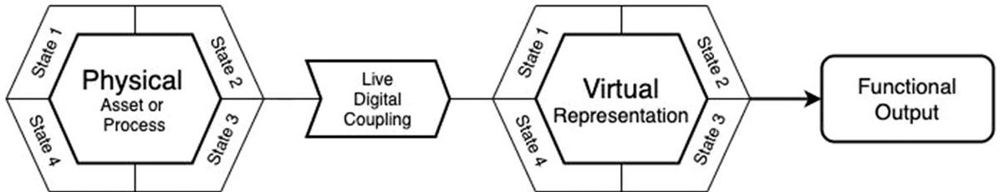
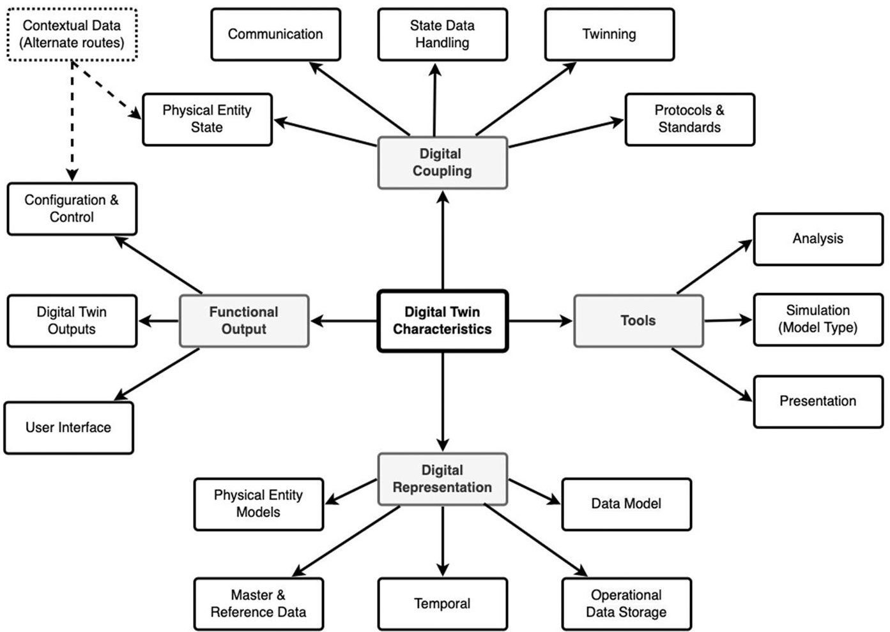
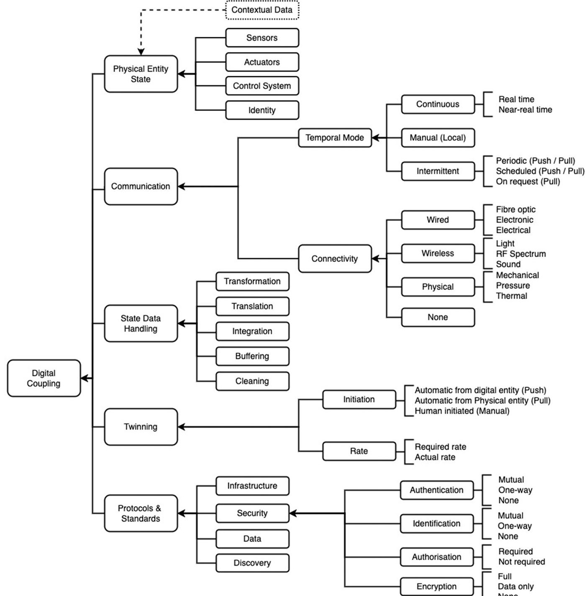
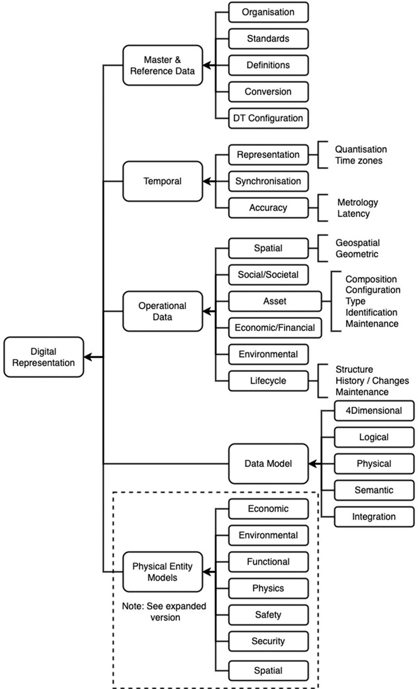
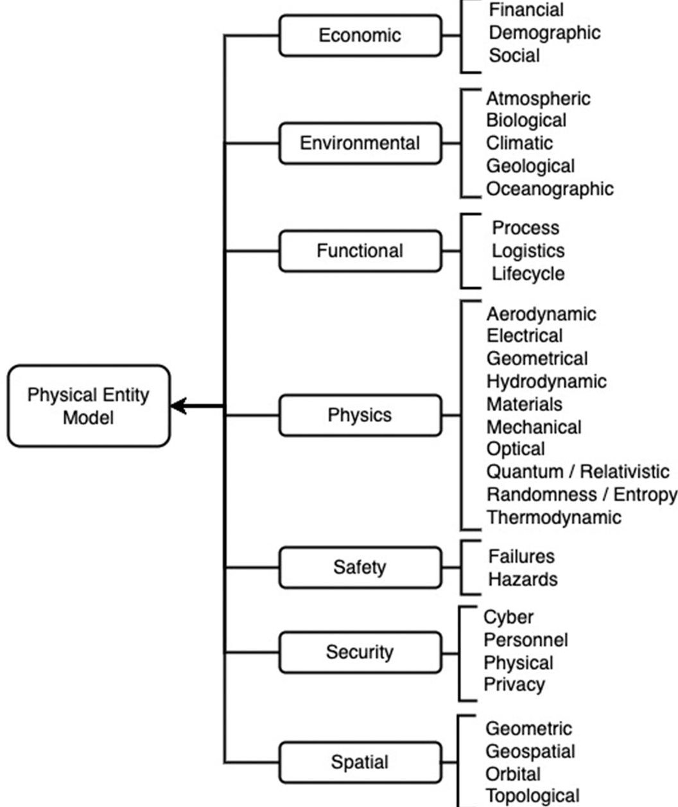
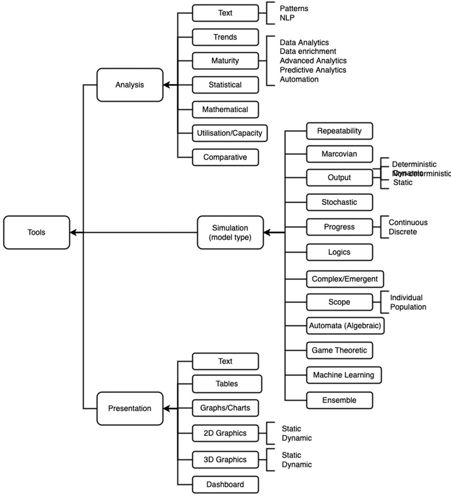
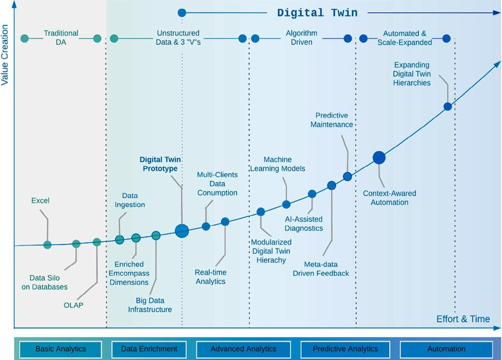
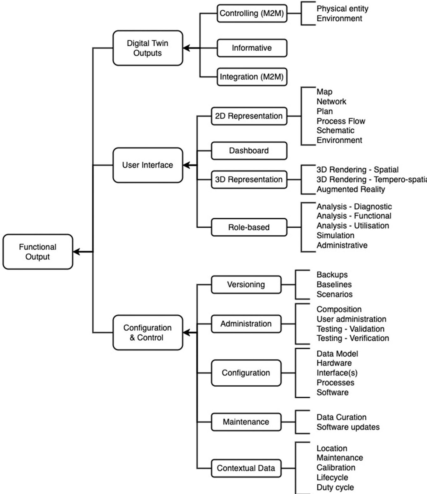

<!-- PDF_PAGE: 1 -->

# Digital twins: An analysis framework and open issues

Hugh Boyes $ ^{*} $ , Tim Watson

Cyber Security Centre, WMG, University of Warwick, Coventry CV4 7AL, UK

## ARTICLE INFO

Keywords:

Digital twin

Smart systems

Cyber-physical systems

Industrial automation & control systems (IACS)

## ABSTRACT

The concept of twinning an operational physical system with a functional replica is not new, having been practiced in the space sector for over 50 years. Advances in digitalisation have created opportunities to extract data, obtain insights and achieve greater situational awareness of a physical system's performance. Increasing interest in the concept has led to a proliferation of digital twin definitions, which are used to frame discussions about specific digital twins. Consequentially comparison of the capabilities of specific digital twins is difficult as they are analysed using different definitions. This paper proposes an analysis framework that enables the characteristics of all digital twins to be matched to this framework. Using this framework, a digital twin may be characterised, or two or more digital twins may be compared. By establishing a framework that contains common functional characteristics, we aim to reduce the confusion caused by the plethora of digital twin definitions and their interpretation by suppliers. By focusing only on functionality and not addressing non-functional requirements the analysis allows comparison of different physical and logical instantiations of digital twins.

## 1. Introduction

The concept of digitally modelling the behaviour and performance of physical entities is well established. However, the concept of a 'digital twin' is the subject of an increasing volume of literature and international standardisation work currently underway (ISO/IEC:Undated]. The term 'digital twin' was first used in relation to a digital counterpart, or 'twin', of Alan Alda's voice in "Alan Alda meets Alan Alda 2.0." (Hodgins, 1998). Although a significant volume of literature has sought to define the concept, there appears little agreement on the composition of a 'digital twin'. Referring to something as a 'twin' implies a relationship with another entity, but as with twin cities and human twins the degree of similarity can vary considerably. In industrial and academic situations, the absence of an analysis framework makes it difficult to compare the capabilities and functionality of different instances of digital 'twins'. We anticipate the ability to characterise a digital representation of a physical entity in a systematic manner will enable analysis of cross-cutting topics and patterns. Without such a framework these may be obscured when focusing on the technology employed or sector-specific issues. By adopting a modular functionality approach, an engineer or researcher can focus on those elements of a digital twin of particular interest. For example, if the focus of a digital twin study was on smart city transport management applications, the researcher may choose to ignore the live digital coupling. The researcher may then focus

on two categories: Digital Representation to consider how different modes of transport are represented and modelled; and Tools to explore what analysis and simulation tools are used and how the results may be visualised.

Modelling a physical entity, whether in the design or operational phases of an asset's lifecycle, is neither a new nor innovative phenomenon. The aerospace industry has a significant track record of employing combinations of computational and physical models to manage space systems. For example, the NASA Apollo programme employed a physical copy supported by computational models in the late 1960s. These tools were essential in handling the accident that affected Apollo 13 during the evening of Monday 13th April 1970 (NASA, 1970). Using flight simulators at Houston and Kennedy Space Centres "maneuvers that still remained to be executed were simulated in complete detail." Engineers and astronauts used physical copies of the command and lunar modules as a testbed to fashion and test makeshift adapters so that cartridges used to remove $ \mathrm{C O_{2}} $ from the spacecraft air could be redeployed from lunar to command modules.

Building on this experience, in the 1980s and 1990s increasingly sophisticated digital models of satellites were used with connectivity provided via satellite telemetry tracking and control (TT&C) communications (Topp, 1988). Satellite sensors provided data about platform health, operation, orbital data and payload configuration. This information was used to model and test specific changes to maintain orbits or

<!-- PDF_PAGE: 2 -->

plan satellite configuration and operational changes prior to sending the necessary telemetry commands to the satellite. These were probably the first instances of digital twins as there were no earth-based satellites used in the rehearsal and testing of manoeuvres.

As noted in literature reviews examined as part of this research (e.g., Jones et al., 2020, and Lee et al., 2021) there is a lack of a consolidated and consistent view of what comprises a digital twin, and there is no universal definition available. To the knowledge of the authors, no studies have been undertaken to create an analysis framework like the one available for the Industrial Internet of Things (IIoT) (Boyes et al., 2018). Hence, the aim of this study is to deliver the first comprehensive model providing a means of characterizing entities that are described as digital twins. Our research sought to answer the following questions:

RQ1 - What is the definition of a digital twin?

RQ2 - What is the difference between a cyber-physical system and a digital twin?

RQ3 - What functional components can be found in the architecture of a digital twin?

RQ4- What are typical characteristics of the functional components?

This paper is structured as follows: Section 2 outlines the research methodology regarding definition of the concept of a digital twin and its architecture. Section 3 reviews the current state of research concerning the definition and composition of digital twins. Section 4 builds on our analysis of existing research, and through use of a generic digital twin definition and functional analysis sets out our proposed framework. Section 5 discusses proposed uses of the framework and illustrates it using the characterisation of a digital coupling between a semiautonomous vehicle and its digital twin. Section 6 identifies and discusses gaps in the current literature that need to be addressed in the future and our conclusions are provided in Section 7.

Our contribution is an analysis framework that may be employed to characterise a digital twin when seeking to compare capabilities and functionality in industrial situations or when selecting comparable digital twins for research.

## 2. Research methodology

To address our research questions, we adopted a two-phase approach. The initial phase focusing on the first and second research questions, seeking to obtain an overview of relevant existing literature that reviewed and/or characterised digital twins. The second phase focused on the third and fourth questions exploring relevant literature related to the architecture of digital twins.

In the first phase, searches were conducted on IEEExplore, Science Direct and Scopus using search strings "digital twin" + "literature review" and "digital twin" + "survey". Papers were selected from the search results where they met the following criteria:

- search terms appeared in the title and/or abstract and the paper contained a structured literature review;

- written in English and published in a journal.

This search and selection yielded a total of 11 papers which are discussed in Section 3.1. There is considerable duplication in this literature with reviews largely citing a common corpus of material concerning the definition of digital twins.

To source literature relevant to our third and fourth research questions we conducted searches on IEEExplore, Science Direct and Scopus using search strings "digital twin" + "architecture", "digital twin architecture" and "architecture of digital twin". Papers were selected from the search results where they met the following criteria:

- search terms appeared in the title and/or abstract

- the paper discussed the architecture or composition of a digital twin;

- written in English and published in a journal.

The searches yielded a total of 823 papers, which once limited to those published in journals and written in English, was reduced to 252 papers. Initial screening based on the title and abstracts reduced this to 57 papers where there was some discussion of digital composition or architecture. Those short listed were subjected to more detailed review to identify papers that specifically addressed the architecture and composition of digital twins rather than describing their architectural role in organisations and/or specific applications.

## 3. Review of related work

## 3.1. Literature reviews of digital twins

In seeking to answer our research question regarding the definition of a digital twin, 11 literature reviews were analysed. Since the first substantive definition of the term digital twin published in 2010 by NASA (Shafto et al., 2010), there have been numerous definitions proposed. Table 1 summarises the number of definitions cited and the authors' findings. A consistent theme emerging from these reviews is the lack of a clear universal definition. The proliferation of definitions both within individual industry sectors and across sectors presents a challenge for those seeking to characterise or compare digital twins. For example, Juarez et al. refer to "an almost complete list of different definitions" (Negri et al., 2017), a list comprising only 17 definitions, in four years the number has more than doubled to at least 46 in 2019 (VanDerHorn and Mahadevan, 2021). During the authors' research further definitions were identified in 2020 and 2021, for example, (ISO, 2021) and (Catapult, 2021).

A suggested cause of this multitude of definitions is the lack of a common understanding of the term digital twin (Cimino et al., 2019). This may be partly explained by the suggestion that the various definitions and concepts depend strongly on the respective digital twin application context (Schleich et al., 2017). The absence of a settled definition of a digital twin may partly reflect the interests of the communities defining the term. The situation is being further complicated by

Table 1

- Summary of findings regarding digital twin definitions.

<table border="1"><tr><td>Reference</td><td>Summary</td></tr><tr><td>Barricelli et al.:2019</td><td>Cites 29 different definitions out of 75 papers reviewed, refers to repetition.</td></tr><tr><td>Tao et al.(2019)</td><td>Very limited discussion of definitions focuses on two(NASA:Glaessgen and Stargel,2012,Graves:2014)</td></tr><tr><td>Errandonea et al.(2020)</td><td>Cites 4 definitions.Considers the complexity of the concept results in a variety of definitions.Suggests some definitions are incorrect.</td></tr><tr><td>Fuller:et al.(2020)</td><td>Cites 6 definitions.Suggests that academia and industry have not helped to distinguish digital twins from general computing models and simulations.</td></tr><tr><td>Jones et al.(2020)</td><td>Refers to lack of consolidated and consistent view.Noted lack of consistency in breadth of characterisations and definitions.</td></tr><tr><td>Lim et al.(2020)</td><td>Cites 8 definitions. Considered the core of a digital twin remained the same.</td></tr><tr><td>Liu et al.(2021)</td><td>Cites 21 definitions. Considered development still to be in its infancy and identified the lack of a universal definition and implementation framework.</td></tr><tr><td>Juarez et al.(2021)</td><td>Cites 34 definitions.Notes the lack of a unified or generic modelling method and the absence of generic benchmarks for use in digital twin development.</td></tr><tr><td>Opoku et al.(2021)</td><td>Cites 25 definitions.Notes that digital twins can be implemented using different technologies.Identifies need for a clearer definition of the concept.</td></tr><tr><td>Semeraro et al.(2021)</td><td>Cites 30 definitions.Consider that industry and academia define a digital twin in several different ways</td></tr><tr><td>VanDerHorn and Mahadevan(2021)</td><td>Cites 46 definitions.Suggests the variety of definitions proposed over nearly two decades has diluted the original concept(Grieves,2011)</td></tr></table>

<!-- PDF_PAGE: 3 -->

vendors promoting IT solutions as digital twins that have significant variations in capability, granularity of the representation and connectivity to the physical system that it is twinned with.

Rather than creating yet another digital twin definition, we have chosen to use the following recent generic definition: "A live digital coupling of the state of a physical asset or process to a virtual representation with a functional output" (Catapult, 2021). During our research, this was the closest we have found to a universal definition. It does not make assumptions about: the purpose or use of the digital twin; the nature of the physical entity that is being twinned; or the sector in which it is used. Whilst covering key concepts conveyed in other definitions, its nuanced wording is independent of sector and application. Furthermore, by not requiring a digital twin to specifically include a virtual-to-physical connection it makes the definition more universal. This was observed (Jones et al., 2020) as being a benefit of a longer definition of a digital twin in the CIRP Encyclopaedia (Stark and Damerau, 2019). Avoiding the insistence on two-way connectivity is certainly beneficial when considering a digital twin of, for example, the natural environment (Catapult, 2021).

The focus of and approach to the literature reviews in Table 1 varied considerably. The definition and perceived history of digital twins featured in the review of digital twins in the manufacturing and product lifecycle management (PLM) disciplines by Jones et al. (2020) and Semerano et al. (2021).

A thematic analysis approach with limited functional analysis was adopted by Jones et al. (2020). In contrast, Semerano et al. (2021) addressed topics including application contexts; the life cycle phases; the functions; the architecture and the components. Results from these reviews, generated using thematic analysis or text mining techniques, generate often abstract concepts. Such outputs lack the detail required to characterise the functionality of digital twins, for example, referring to types of technology rather that the functionality it delivers.

Some reviews adopted a survey approach, which while still providing significant coverage of digital twin definitions, examined the topics from different perspectives, including use, design, and lifecycles. The emphasis of these survey-based literature reviews tends to be on catalogue specific attributes of digital twins, for example, applications, technologies employed, etc. This approach has limitations when seeking to understand the functional composition of digital twins rather than a catalogue of uses or technologies.

Baracelli et al. examined use cases, discuss design implications (e.g., socio-technical and collaborative design) and the lifecycles of both physical and digital twins (Barricelli et al., 2019). Their high-level discussion of digital twin capabilities was at a level of detail comparable to that provided in Jones et al. (2020). The range of digital twin uses found in the literature was discussed by Liu et al. (2021). However, their analysis does not relate use of specific technologies to applications or industry sectors, which would be helpful in interpreting different digital twin definitions. A similar approach by Lim et al. (2020), effectively catalogued digital twin technologies (referred to as techniques) covering communication, representation, computation and microservices. Their focus was primarily on business benefits rather than digital twin capabilities. Fuller et al. (2020) also adopted a technology focused approach with limited discussion of digital twin use in specific application domains (e.g., health, manufacturing etc.).

## 3.2. Other work identified from literature reviews

As noted in Section 2, a snow-balling approach was adopted when examining the literature reviews, through which we located other relevant literature addressing RQ1 and RQ2.

Analysis of enabling technologies and tools for digital twins contributed to our understanding and characterisation of data processing with a digital twin (Qi et al., 2021). However, the representation of the composition of a digital twin, drawn from Rasheed et al. (2020), Fig. 5) is high-level and appears functionally incomplete.

A high-level taxonomy of digital twins (van der Valk et al., 2020) lacks the sufficient granularity to provide a basis for detailed comparison of different digital twins. For example, its treatment of the dimension 'accuracy' allows for two mutually exclusive characteristics: identical and partial. This characterisation of model accuracy is unhelpful. For example, it provides no indication of their level of detail, any degree of deviation between model behaviour and reality, or fitness for purpose. Concerns about accuracy and/or trustworthiness of models can arise in the cases of insufficient or inappropriate detail, or regarding acceptable differences between actual and predicted behaviour.

Other literature referenced by the reviews characterised digital twins using application dimensions (Uhlenkamp et al., 2019) or developed a taxonomy for simulative applications (van der Valk et al., 2020 Dec). None of the literature reviewed in our research developed a taxonomy that would permit thorough characterisation of digital twins. Essentially the taxonomies lacked a level of detail sufficient to ascertain the degree of functional similarity, or the nature and scale of any differences.

An approach towards a semantic construction digital twin (Boje at al, 2020), links developments in Building Information Modelling (BIM) and 3D modelling to potential uses. Its consideration of potential future technologies and functional capabilities is high-level and generic. A significant gap was the lack of any assessment of whether and how the various elements could coexist or be integrated. This gap is relevant when considering the application and potential limitations of different types of modelling (Rasheed et al., 2020). For example, a digital twin that solely works in near-real time may not require the functional components necessary for storage and management of time series data.

Existing work on characterisation of digital twins potentially offers a contribution towards establishing terminology representing core and optional functionality.

A proposed "Digital Twin 8-dimension model" (Stark et al., 2019), comprised four dimensions focused on a digital twin's context and environment (connectivity modes, integration breadth, product lifecycle and human interaction). The remaining four dimensions addressed the digital twin's behaviour and capability richness (update frequency, CPS intelligence, simulation capabilities and digital model richness). Whilst these dimensions potentially contribute to our research their derivation and the supporting categories are neither explained nor justified. In the absence of an explanation it is unclear what other dimensions may have been considered and discarded.

An industry consortium view identifies eight features or potential characteristics of digital twins (Harper et al., 2019). These features comprise: document management, model, 3D representation, simulation, data model, visualisation, model synchronisation, and connected analytics. Whilst there is some overlap between these features and the dimensions mentioned above, the terminology is inconsistent. In the industry view, it is unclear why both visualisation and 3D representation are included - one is a subset of the other. The consortium document also enumerates nine architectural evaluation criteria, although these are not supported by a reference or functional architecture.

## 3.3. Comparison of a digital twin versus a cyber-physical system (CPS)

Our second research question concerned the difference between a cyber-physical system and a digital twin. As mentioned in Section 3.1 two of the literature reviews (Errandonea et al. (2020), and Fuller et al. (2020)) highlighted that there were misconceptions regarding the definition.

A failure by academia and industry to distinguish digital twins from general computer models is discussed by Fuller et al. (2020). This is an important issue as general computer models normally operate in information technology environments, whereas a digital twin running an operational environment will typically require the same level of security, resilience, etc as the operational system it is coupled to. Another misconception relates to 3D models. For example, whether a digital twin includes an exact 3D model of a physical thing or whether a digital twin

<!-- PDF_PAGE: 4 -->

is just a 3D model (Fuller et al., 2020, p.108594).

A potential source of misconceptions is the existence of concepts closely related to digital twins (Errandonea et al., 2020, p.2), such as simulations, Internet of Things (IoT) and cyber-physical systems (CPS). The confusion arises from these concepts being components of digital twins. Certainly, the overlap between Industrial IoT (IIoT) and digital twins can be considerable due to the significant overlaps in technologies Boyes et al., 2018). The confusion between digital twins and CPS is more fundamental as many of the physical entities for which a digital twin may be created will be CPS.

An often-cited definition of a CPS is the "Integrations of computation with physical processes. Embedded computers and networks monitor and control the physical processes, usually with feedback loops where physical processes affect computations and vice versa" (Lee, 2007). The nature of CPS varies considerably from national/regional infrastructure (i.e., energy and water distribution) and manufacturing and process plants, to the heating ventilation and air conditioning systems in buildings, or vehicles, ships, and aircraft. In these CPS the integral cyber element comprises, at a minimum, the industrial automation and control system (IACS) elements required to safely, and securely, operate the CPS.

The failure of some authors to distinguish the difference between the cyber part of a CPS and a digital twin has significant safety and security implications. For example, (Schroeder et al. 2016) describes a CPS as "a set of physical devices, objects and equipments that interact with a virtual cyberspace through a communication network". This formulation does not recognise that the physical and cyber (digital) elements comprise a control system where measurements from sensors are processed to determine what if any control signals should be fed to actuators to maintain, or achieve, a desired operational outcome. They continue by stating that "each physical device will have its cyber part as a digital representation of the real device, culminating in the 'Digital Twin'." This formulation misses the point that many of the cyber parts are there to maintain and operate control functions not to digitally represent a component, sub-system, etc.

Unfortunately, such misconceptions can be magnified as others build upon them. For example, Autiosalo (2018) citing, Schroeder et al. (2016), goes further and proposed that a compact definition: "Digital Twin is the cyber part of a Cyber-Physical System". From an industrial systems perspective this is clearly not the case as physical system (CPS) are capable of operating without a digital twin, as many do today. What sets a CPS apart from a digital twin is that the cyber components of a CPS are inseparable and integral elements of the overall system design, and necessary for the control, safety and security of the CPS's operation.

Other literature has correctly recognised the difference. For example, use of a digital twin to simulate a CPS system or product (Negri et al., 2017), i.e., the digital twin is an adjunct to rather than a component of the CPS. To fulfil such a role the digital twin may receive sensor data, have access to information about the CPS configuration. The digital twin may also employ an integrated multi-physics models to simulate the behaviour of the physical twin, such as the inertia or resistance encountered in physical movements. In essence the difference between a CPS and a digital twin lies in the composition. The former being a holistic system while the latter is an interconnected virtual model that represents the physical object (Zheng and Sivabalan, 2020).

## 3.4. Existing work concerning architecture models of digital twins

Before considering existing works, the context of the review needs to be established with regards to the concept of a functional architecture used in the comparison of different instantiations of digital twins. With regards to digital systems, an architecture typically refers to the overall system design, including the logical and physical interrelationships between its components and between the system and its environment. In seeking to establish a functional architecture this research aims to define architectural components and their relevant characteristics, whilst remaining technology neutral. In reviewing literature related to digital

twin architectures we aim to differentiate between architectures developed for specific implementation or type(s) of application, and those of a more general nature. For example, the former may relate to a digital twin developed for a specific industrial sector, which the authors may imply can be generalised. The latter may be more generic in terms of sectoral use but tailored to the nature of the application(s).

## 3.4.1. Architectural models in the literature

Layer models are common approach to describing architectures of CPS, IIoT and digital twins. These models seek to emulate the layer approach found in the Purdue enterprise reference architecture model (Williams, 1994). Examples of the use of this approach for digital twins include:

- a 3-layer architecture comprising physical controls, cyber-physical synchronisation, and a cyber model (Leng et al., 2020)

- a 3-layer architecture (data visualisation, data processing and a semantic layer) with an optional data acquisition layer. The semantic 'layer' located parallel to the visualisation and processing layers, providing the overall system model and data integration. (Haße et al., 2020)

- a 3-layer model consisting of four parts: three layers (physical, digital, and cyber) and communication for data exchange among the three layers (Aheleroff et al., 2021)

- a 4-layer model comprising the physical layer, data extraction and consolidation layer, cyberspace layer and the interaction layer (Zheng and Sivabalan, 2020)

- a 5-layer model comprising a virtual component motion joint level, component/device logic level, production line logic level, data aggregation/scene logic level, and digital twin information (Fan et al., 2021)

- a 5-layer model comprising data acquisition layer, transmission layer, digital modelling layer, model integration layer and services layer (Lu et al., 2020)

- a 6-layer model adapting a 5-level CPS architecture (Lee et al., 2015) the layers comprise physical devices, data acquisition, local data repositories, IoT gateway, cloud-based information repositories, and an emulation and simulation layer. (Redelinghuys et al., 2020)

- a 6-layer model comprising the following layers: physical, ingestion, persistence, inference, service and consumption (Mostafa et al., 2021, Fig. 2).

As illustrated above, there are differing approaches and little consistency between the proposed architecture layer models. These models generally lack the functional granularity required to build a functional architecture and some of the models are tailored to specific situations. An example of a specialised architecture is the 5-layer model proposed by Fan et al. (2021). The authors suggest that it represents a general architecture of digital-twin visualisation for flexible manufacturing systems (FMS). On evaluation it is clearly tailored to the robotic arm discussed in the paper and whilst the model describes the business purpose of the layers there is no functional breakdown of its component layers.

In the literature there are various interpretations about what comprises an architecture, both as a concept and in their composition. A generic digital twin architecture reference model proposed by Lim et al. (2020) described a high-level design and usage process for optimisation of product family design. While the model contains a selection of potential components, both physical and digital, there is no clear separation of the physical entity from the digital twin. Some of the models focus on technology, for example, a physical layer comprising communication types and their protocols, and physical systems (e.g., smart devices, sensors, machines, etc.) (Zheng and Sivabalan:, 2020). The representation of the models can vary considerably, for example, enumeration of a UML list of eight elements (Access Control, API, Communications Interface, Event Source, HMI, Method, Physical Model,

<!-- PDF_PAGE: 5 -->

and Storage) (Schroeder et al., 2020).

Some of the literature seeks to define an architecture, but the proposal is difficult to discern. For example, an object-oriented architecture presented as a requirements framework rather than an architectural model (Moyne et al., 2020). In another example, the authors identified six digital twin interactions ("Interoperability, Information Model, Data Exchange, Administration, Synchronisation, Publish / Subscribe") and proposed nine evaluation criteria (Harper et al., 2019). This approach is of limited utility as it essentially treats the digital twin as a monolithic data processor. Whilst they provide a table relating the six interactions and nine criteria, they do not explore the composition of a digital twin or relationships between its component parts. The composition of a digital twin is significant as safety and security issues are likely to arise if the digital twin could override the local control within the physical entity. The trustworthiness of individual functional components may need to be assured, which is difficult if the digital twin is a monolithic data processor.

A commonly cited digital twin architecture proposed an architecture reference model for the cloud-based cyber-physical systems (Alam and El Saddik, 2017). The authors base their model on three key properties of CPS, i.e., computation, communication, and control, elaborating them for a cloud-based CPS (i.e., C2PS). The proposed architecture (Alam and El Saddik, 2017, p.2055, Fig. 3) contains Functional Units in both the Cloud Cyber Thing and the Physical Thing, but there is no discussion of the types of function provided by these units. The cyber functional units appear to be modelling or simulating physical functional units (e.g., components or sub-systems), i.e., they are a representation of the physical element. It is unclear how this reference architecture would accommodate applications, for example, system-level temporal analysis of past, or the potential future, behaviour of a Physical Thing.

A potential step towards functional architecture is a list of distinguishable features that may be found in digital twins (Autiosalo et al., 2019). This list includes data link, coupling, identifier, security, data storage, user interface, simulation model, analysis, artificial intelligence, and computation. Autiosalo et al. do not claim the list is exhaustive, but it does provide a starting point for categorising functionality. The work by Zheng et al. (2019), Fig. 1) provides an application framework comprising three functional modules (i.e., physical space, information processing layer, and virtual space). This provides some functional breakdown, but again lacks the granularity required to compare the composition and capability of digital twins. Whilst there is an analysis of a proposed information processing layer (Zheng et al., 2019, Fig. 3) it excludes some of the practical functionality required for twinning, e.g., the synchronisation and communication functions.

A high-level digital twin architecture for cyber-physical production systems is proposed by Talkhestani et al. (2019) comprising "a unique ID in the cyber world, models and associated interfaces to tools, models' version management, the operation data of the physical asset, organization and technical data of the asset, information about its relations to other DTs and an interface to communicate with other DTs as well as an interface to communicate with the real world." Although this is more granular it still lacks the detail necessary for comparison of digital twins, e.g., the nature of the models employed. Another manufacturing-related digital twin architecture (Zhang, 2021, Fig. 4) focuses on scheduling, with the digital twin structure based on information and data models supporting a scheduling process. The architecture proposed is specific to the tasks(s) involved

and does not lend itself to providing a generic approach for comparison of digital twins.

A digital twin reference architecture model in Industry 4.0 is presented as a 3D layered model (Aheleroff et al., 2021, Fig. 5). Five digital twin layers are arranged vertically, comprising the physical, communication, digital, cyber and application layers. The other two axes are the "Value Life-cycle", a proposed agile iterative/incremental approach to development lifecycle (Aheleroff et al., 2019), and data flow based on a digital twin integration hierarchy (Kritzinger et al., 2018). The latter comprises four levels of integration, i.e., digital model, digital shadow, digital twin and digital twin predictive. It is unclear how this reference architecture is intended to work or relate to practical implementations of digital twins. For example, each slice in the lifecycle axis would comprise 20 'cells' into which a capability of functionality could be assigned.

## 3.4.2. Approaches to designing a digital twin

The literature relating to digital twin design currently offers limited insights into the approach required for their design. It often focuses on a relatively small physical entity, e.g., a manufacturing cell, rather than an entire factory or site. Jiang at al. (2021) examined the modelling and implementation of the connection between twins. They advocated analysis using five basic elements (man, machine, material, method, and environment) and two relationships (production and logistics). This approach was predicated on the creation of a hierarchical structure to model discrete manufacturing systems using finite state techniques. However, they state that in using this approach, it is difficult to describe complex systems. Yet these are precisely the sort of systems that might benefit from having a digital twin.

Ala-Laurinaho et al. (2020) observe that "there is no standardized architecture for building digital twins". A consequence of the diverse implementations is that interoperability of digital twins is complicated. They suggest adopting a modular approach that employs independent software blocks or systems, i.e., functional components, thus allowing flexibility when designing and building digital twins. This can ease replacement and integration when adding, removing, or upgrading individual functional elements to deliver scalability or improve performance (Ala-Laurinaho et al., 2020, p.228682).

In software development a common approach to developing modular architectures is to employ design patterns. The design of digital twins using a design pattern catalogue has been considered by (Tekinerdogan and Verdouw, 2020), and whilst the use of design patterns has some merits, their approach is flawed in two respects. Firstly, the level of abstraction is very high, so the patterns focus on uses of digital twins rather than the internal composition of a digital twin. Secondly, for "control-based digital twins" their conceptual model implies the digital twin directly interacts with actuators in the physical entity. This creates significant safety and security issues as the digital twin could override the local control within the physical entity.

Adamenko et al. (2020) proposed that a digital twin must be adaptable, capable of being changed to reflect the modification of the physical entity, or its environmental and/or operating conditions. This is a prudent approach as the lifecycle of cyber-physical systems tends to be considerably longer than many IT systems. For a digital twin to be adaptable, system engineering practice would anticipate adoption of a modular architecture enabling incremental changes and permitting

Fig. 1. - What is a digital twin? (Catapult, 2021).

<!-- PDF_PAGE: 6 -->

verification and validation of new or modified modules. Adamenko et al. (2020) do not address modularity, instead focusing on the use of data-based versus system-based design. Neither do they address how a digital twin designer might choose which type of twin is appropriate for a specific purpose based on the users' functional requirements. With regards to identifying the information model requirements for a digital twin a five-step process has been proposed (Schuh et al., 2018). This could be used to feed requirements into a system engineering process employed to design a digital twin. A requirement-driven digital framework (Moyne et al., 2020) addresses concepts such as autonomy, extensibility, interchangeability, interoperability, maintainability, and re-usability across a digital twin lifecycle. Whilst it discusses an object-oriented (OO) approach to digital twin design it does not present an OO architecture.

In the architectural practice regarding design of built assets, there is often tension between considering architecture in terms of function (i.e., use, adjacencies and/or connectivity) and the envisaged structural form, (i.e., the overall appearance, layout of space, etc). Similar tensions exist in the emerging architectural approach to digital twins. For example, it has been suggested that "the key architectural decision in designing digital twins is to define their internal structure as well as the content that must be maintained in them" (Malakuti and Gruner, 2018). They considered that four architectural aspects may be used to classify digital twin design decisions: internal structure and content, APIs and usage, integration, and the runtime environment. This approach is consistent with the technology focused layer models we reviewed. However, a limitation of this approach is that over the lifecycle of a physical entity its digital counterpart may undergo several technology refreshes. If the digital twin is described in terms of its functional architecture and components, then for comparison purposes, it matters less how the digital twin is implemented providing functionality remains unchanged.

Adamenko et al. (2020) observed that a "digital twin can be either data-based or systems-based". In the former, the data are structured according to specific design criteria, e.g., to support different analysis modes, whereas in the latter various models may be combined with configuration data to deliver a single, integrated representation of the target physical entity. When designing a digital twin, Boschert and Rosen (2016) propose that the architect should describe its purpose(s) and derive a set of tasks (i.e., a process comprising a series of functions) that fulfil the purpose. Adopting such an approach will focus the design on the required functional components. This can enable consideration of whether a digital twin is data-based or systems-based to be informed by the required tasks rather than driven by technology choices.

## 3.5. Summary of existing work

From our review of existing work on digital twin architectures it is evident that there is no consensus regarding architectural models. For example, the variety of 3-, 4-, 5- and 6-layer models. Neither does the reviewed literature provide a clear direction regarding the approach to be employed when developing the architecture or design of a digital twin, which we intend to address in a future paper. Some of the existing work focuses on the technology stack, in some cases apportioning specific technologies to parts of a layer model. Other literature adopts a more functional approach, considering the processing of data. However, this work is either focused on a specific use case for a digital twin or lacks the granularity that would be appropriate for comparison of digital twins. This paper therefore seeks to fill the apparent gap by providing an analytical framework that permits the characterisation of the functionality in individual digital twins. By doing so it provides a basis for comparing digital twins, for example, to establish the extent and nature of analysis, modelling or simulation. In the next section we start by analysing digital twin composition based on a definition, rather than building on existing incompatible or incomplete work.

## 4. Functional components of a digital twin

This Section analyses the composition of a digital twin using as a starting point the AMRC definition (Catapult, 2021): "A live digital coupling of the state of a physical asset or process to a virtual representation with a functional output." This definition was chosen from those reviewed as it is independent of domain or industry sector in which the digital twin is deployed.

## 4.1. High-level composition

AMRC illustrated its digital twin definition (Catapult, 2021), as shown in Fig. 2, with the virtual representation receiving data from the physical entity via the live digital coupling and processing data to provide a functional output. The definition was supported by further high-level definitions of the six components as listed in Table 2.

We propose that, in its simplest form, a digital twin (or virtual representation) that conforms to the AMRC definition (21) is a digital process comprising components that:

- handle the reception, formatting and processing of the operational state data;

- provide a digital model representing the salient properties, behaviour and operation of the physical twin over its twinned lifecycle; and

-сессуары для компьютера.

A digital process has fewer physical constraints and may be implemented as a distributed process. If instantiated as a distributed system the digital process would have properties, but no global state, which is an important different compared to non-distributed systems.

Considering features mentioned in the reviewed literature, we propose to include optional components that:

- provide storage and/or retrieval of data

- comprise a toolkit enabling analysis, simulation and visualisation of the physical twin at appropriate levels of fidelity and temporal granularity;

- provide tools to allow data about the physical entity and its environment to be curated.

## 4.2. Functional analysis

In In software development a functional architecture may be established as "a basis for deriving the structural configuration and physical architecture for the software product" (Schmidt, 2013, p.173). Schmidt records that the architecture, derived from business or operational requirements, expresses the purpose or use of the software product (Schmidt, 2013, p.173). Our approach is not based on conducting a full functional analysis, which would be required when designing a system and validating its requirements. Instead, we focus on a set of elements or

Table 2

- Definition of Components in Fig. 1 (Catapult, 2021).

<table border="1"><tr><td>Component</td><td>Definition</td></tr><tr><td>Live</td><td>the state information is available in a timeframe that is close enough to the underlying event</td></tr><tr><td>Digital coupling</td><td>the transmission mechanism between data source(s) and data consumption method(s) using a digital carrier medium</td></tr><tr><td>State</td><td>the particular condition the unique physical asset or process is in at a specific time</td></tr><tr><td>Physical asset or process</td><td>an entity with an existence that has economic, social or commercial value.</td></tr><tr><td>Virtual representation</td><td>an analogous description or logical model to its physical asset or process</td></tr><tr><td>Functional output</td><td>information transmitted to a system or human observer that is actionable to deliver value</td></tr></table>

<!-- PDF_PAGE: 7 -->

components that may be found in a generic digital twin architecture. Schmidt describes a functional component as representing "a complex task the software product must perform" (Schmidt, 2013, p.176). During system design the complexity of these components may require several layers of disaggregation to arrive at a collection of functional units, each of which "perform a single, non-complex task" (Schmidt, 2013, p.177).

Drawing on the existing literature our analysis sought to derive a set of complex functional components that may be used as the basis for comparing the capability of different digital twins. Using the composition outlined in Section 4.1 and adopting a modular approach we propose four functional categories (i.e., the digital coupling, tools, digital representation and functional output). These categories contain a total of sixteen complex functional components as illustrated in Fig. 2. In arriving at this number of components we have sought to strike a balance between the level of functional decomposition and the granularity offered to provide a robust means of comparing digital twin capabilities.

The remainder of this Section discusses the four top-level categories and their decomposition it into functional components.

## 4.3. Digital coupling

The Live Digital Coupling, in Fig.1, effects the transfer of the required operational state data from the physical entity to the digital representation. If, as suggested by Bowman et al. (2022), a digital twin is created for "a specified purpose or scenario" and it is updated with "inputs of 'real-world data' from its physical counterpart", then the characteristics of the digital coupling will be influenced by the nature, volume and timeliness of the state data that is being transferred. Connectivity between physical and digital twins is an area where there is limited consensus. In the analysis below, the AMRC approach to the coupling is adopted, i.e., it provides a flow of data from the physical entity. Mandating that there must be an automatic flow of data from the digital twin to the physical entity is problematics as it implies that the digital twin is performing a control function. This could raise concerns about

the separability of the twins and the ability of the physical entity to operate independently. Adopting the AMRC approach, we treat information flowing from the digital twin to users, or where applicable to other systems (including digital twins), as being addressed through the functional output.

As noted by Kong et al. (2021) the process of data collection and transfer can be affected by a harsh physical environment, leading to data loss or abnormal data. Processing may be required to identify and where practical resolve data quality issues before the raw data can be used. Data transformation may be necessary to reconstitute an original data stream, which has been compressed and/or segmented for transmission. As suggested by Kong et al. during data reception it may be appropriate and proportionate to create various types, or formats, of pre-processed data. These may subsequently be retrieved according to the needs of different algorithms. As observed by Adamenko et al. (2020) a digital twin must be adaptable, enabling users to record changes. Depending on the digital twin's purpose and the algorithms or models in use, relevant changes to the physical entity may include:

- modification of the physical entity itself, e.g., replacement or upgrading of a component or subsystem);

- environmental aspects (e.g., changes to the installation environment - humidity, temperature, etc.)

- spatial aspects (e.g., it is physically relocated),

- modifications to operational use (e.g., duty cycle, frequency of maintenance or recalibration).

Where the changes are likely to affect the purpose or operation of the digital twin they should be captured as updates to the reference and master data used in the digital representation. Noting Adamenko et al. suggestion that the digital twin should be adaptable via the model parameters, we propose inclusion of 'Contextual Data' which may be derived from the physical entity and the user.

We propose that five functional components should be associated

Fig. 2. - Functional composition of a Digital Twin.

<!-- PDF_PAGE: 8 -->

with the live digital coupling, comprising:

a) Physical Entity State - to achieve synchronisation of the digital twin with the state of the physical entity requires a periodic flow of state data. This may be sourced directly from sensors and actuators deployed on, in, or associated with the physical entity. Alternatively, for cyber-physical assets the state data may be sourced from any automation or control system that forms part of the physical entity. In addition to the state data the physical entity should provide information about its identity, this may only be a unique identifier (e.g., a serial number) or could include additional information about its version/build state.

b) Communication - The communications functionality that establishes a connection between the physical entity and the digital twin over which state data will be transferred. The form of this coupling will be determined by factors such as the nature of the physical entity, its operating mode and environment, data volumes, the flow rate necessary to achieve the desired twinning rate. The communications may not be continually connected, i.e., always on, it may be scheduled, or only connected on demand. This intermittent connection may be necessary to conserve energy (e.g., for battery-

powered physical entities), or may be a consequence of the operating environment (e.g., when the physical entity is able to establish connectivity), or for security reasons.

c) State Data Handling- This functionality provides any processing of the state data into a format that is (i) suitable for transmission over the digital coupling, and (ii) usable by the digital representation. A range of transformations may be required to support the transfer of state data. For example, where continuous coupling is available this may involve preparing data for streaming, but also handling temporary storage (buffering) when the capacity of the coupling becomes degraded, or connectivity is lost. Where the digital coupling is only periodically connected the processing may involve consolidating data into files and managing their transfer. On reception by the digital twin, and in readiness for storage and/or use, there is a need to extract and format state data and provision appropriate metadata. Functionality may also be provided to clean, detect and correct errors, and pre-process data ready for use by the digital representation.

d) Twinning - Depending on the purpose/scenario the digital twin was designed to satisfy, the twinning process needs to be appropriately managed to deliver optimum synchronisation of the state data.

Fig. 3. - Digital Coupling Characteristics.

<!-- PDF_PAGE: 9 -->

e) Protocols & Standards - This functionality relates to the protocols used to manage the operation of the digital coupling, e.g., establishing the end-to-end connectivity, handling transfer errors, loss of connectivity, etc. In their review Liu et al. (2021) provide a list of common communications technologies and application layer protocols referenced in the literature. An important set of protocols will relate to the security of the coupling and the security of the operational data. The choice of protocols will be determined by factors such as: the nature of the physical entity; its relationship with the digital representation; the purpose(s) for which the twinning relationship is employed; and in the case of security protocols - the risks associated with its compromise.

The five categories of connectivity-related characteristics identified in Fig. 3 are intended to provide a means of comparing the nature of live digital couplings between different pairs of twins, and different twinning applications. The Digital Coupling characteristics will be influenced by the nature and location of the physical entity as well as factors such as the volume of data to be handled, capacity of potential communications bearers and the cost of backhauling the data to the digital twin.

In some circumstances it may be impractical or undesirable (e.g., for operational security reasons) to provide a continuously available digital link between the twins. This may for example arise from constraints relating to the operating environment, the volumes of data to be transferred exceeding the available bandwidth, or the availability of power in the physical entity for communications. A link could be automatically established periodically, either on a schedule or event triggered, using a software defined network, such that the digital coupling is only in place for the period necessary for data transfer. Alternatively, where there is no live connection, data may be periodically retrieved manually. An example of this situation would be a mobile device deployed in a hazardous and electrically noisy environment, where it autonomously executes defined tasks. On completion, an operator retrieves logged data stored in the device, then reviews the mission and device performance using a digital twin.

Decisions regarding engineering of a particular coupling will depend on both Communications and Twinning characteristics. For example, the bandwidth required depends on data volumes and the acceptable latency between observed changes occurring in the physical world and their availability for processing in the digital twin. Data reception characteristics will reflect the degree to which the digital twin has to consolidate data from multiple sources (integration), reconstitute observations, e.g., from proprietary to open formats (transformation) or convert between different representational formats, e.g., between different measurement units or scales (translation). Regarding data cleaning, Lu et al. (2020) examine the need to clean low-quality raw data before it is processed. They suggest that domain knowledge may need to be applied to make a reasonable prediction of values for any missing data. Their approach presumes that it is reasonable to substitute these predicted values and there are no security concerns regarding such missing data.

## 4.4. Virtual representation

The functional components that support the virtual representation shown in Fig.1 have been split into two groups:

- those concerning the digital representation of the physical entity (i.e., the data and information), and

- those related to optional tools that support manipulation of the data and information.

## 4.4.1. Digital representation

This functionality both stores the data and represents a physical entity using logical, relationship and functional models. There is a

tendency, noted by Kong et al. (2021) for operational data to be organised in a flat representation. Such an approach cannot reflect the coupling relationships between data, and thus hinders efficient data retrieval. The choice and use of alternative representations (e.g., hierarchical, or semantic) therefore remains an open research area. As discussed by Kong et al. and referred to above, different applications and algorithms may have diverse inputs and output requirements, and therefore different preferences for the format and granularity of the data. Design decisions taken regarding data representation and algorithms will affect both data model design and functionality it supports. Operational decisions regarding data retention, in terms of volumes granularity and storage durations, will have similar effects.

Drawing on the references listed in Table 1 and their supporting references, Fig. 4 shows the proposed five functional components, collating and categorising data and models referred to in the literature. The functional components are:

a) Data model - this comprises the physical and logical data models that define the information employed in the virtual representation. It may function as an integration data model allowing data from different domains to be combined in the digital twin.

b) Operational data storage - this encompasses data collected via the Digital Coupling relating to the operation, condition, and use of the physical entity and any relevant environmental or situational data. In all cases, the data storage requirements depend on the digital twin's functionality and how closely the physical entity is to be mirrored. Data retention will be determined by the extent to which historical data is required to support the analysis and simulation functions. The storage functionality may also include processing to reduce stored data volumes through compression or other volume reduction techniques.

c) Master & reference data - This encompasses data required to set parameters, conditions, or limits in the model(s) of physical entity. It may include:

i. information about the initial build state of the physical entity;

ii. geospatial or other location data where this cannot be supplied by the physical entity;

iii. maintenance and support information, e.g., date last inspected or tested, warranty and other expiry dates. This data could include parameters such as: maximum load limits, mean-time-to-failure that change depending on temperature, etc.;

iv. configuration information, such as change of hardware and software components within the physical entity;

v. other data or information external to the physical entity that is required by the virtual representation;

vi. changes to any of the above that will affect the operation of the digital twin; and

vii. where applicable economic, financial, and regulatory data used in cost or financial modelling of the physical entity's operation or use. Where the physical entity operates within a regulatory regime, additional compliance and certification data may be stored, including dates of regulatory changes affecting the current physical entity/entities.

d) Physical entity model(s) - The use of verified and validated physical and/or process models that digitally represent the operation of the physical entity. These will be based on a defined set of operational, master and reference data. The nature, composition and fidelity of such models will be determined by the digital twin's purpose and any functional outputs required from it.

e) Temporal - This functionality relates to the ability of the digital representation to model performance or behaviour over different periods with varying levels of granularity. For example, to support trend analysis of a physical entity over long periods (i.e., years or decades) versus analysis of short-term phenomena (i.e., with durations of say minutes or seconds). The temporal functionality will also

<!-- PDF_PAGE: 10 -->

Fig. 4. - Digital Representation Characteristics.

influence how closely the state data for the physical entity, as digitally represented, reflects the real-world behaviour and situation.

Whilst digital twins are built upon data and/or information, at the heart of the digital representation will be computational and logical models representing the physical entity. Building on analysis by Liu et al. (2021) and a review of computational modelling (Walport et al., 2018), the physical entity models category enumerates a range of model types that may be used in a digital twin, see Fig. 5. The inclusion of a randomness model is to accommodate a potential need to model a system's randomness, i.e., the entropy available in the physical system. It is

important to recognise that depending on the purpose of the digital twin, as highlighted by Cimino et al. (2021), specific physical phenomena may be ignored if irrelevant or "faked" if immaterial to specific calculation or simulation.

As noted by Cimino et al. (2021), in a digital twin, time is not an independent variable and is reversible, i.e., it is generally true that analysis and simulation can move backwards and forwards along a temporal continuum and do so at a faster or slower rate than the events or observations occurred. The Temporal category in Fig. 4 covers characteristics that are important if the temporal relationships between data are to be preserved. For example, it is important to know how time

<!-- PDF_PAGE: 11 -->

Fig. 5. - Physical Entity Model Characteristics (Expansion of box in previous figure).

is represented, particularly where issues may arise from the process by which timestamps or other temporal markers are applied to data and the ability to synchronise them across systems, processes and real-world locations.

## 4.4.2. Tools

As proposed earlier in this paper, a digital twin is fundamentally a digital process that can be employed to support decision-making about a physical entity (i.e., an asset, system, or process). The decision-making is likely to be supported by a toolset comprising a selection of analysis, simulation, and presentation tools. Analysis of digital twins suggests that the digital representation is likely to be based on a tri-model approach comprising combinations of parametric digital models, computational models, and graph-based models (Zheng and Sivabalan, 2020).

As recorded by Cimino et al. (2021) the analysis and simulation performed may be used for a variety of decision-making purposes, including:

a) design/reconfiguration - to set up or modify the physical entity and its control for the present purpose;

b) operation/scheduling - to allocate and manage resources and inventory at operation time;

c) maintenance - to ensure continuity of operation and health of the physical entity;

d) interfacing - to properly design and manage real-world connections, e.g., suppliers;

e) financial - to forecast/assess/analyse technical costs and revenues.

For all but the simplest decisions, analytical tools will be required to select, process, and evaluate data and information. Where an analytical approach is insufficient van der Valek et al. (2020) opined that simulation would be employed. However, this opinion is not consistent with most applications discussed in the literature listed in Table 1. In establishing characterisation criteria, we have chosen to treat visualisation as a separate functional component. The rationale for this is that some outputs from analysis or simulation may be directly processed by other systems, without the need for a human-machine interface.

The tools available in a digital twin are likely to comprise combinations of three types of functional component. Based on our review of the literature listed in Table 1 and their supporting references relating to analysis and simulation the three types are:

a) Analysis - tools used to analyse the behaviour, performance, and operation of the physical entity. The analysis may be based on historic and/or current operational and environmental data. It may also include planned or possible future operational and environmental data based on projections, e.g., of future market demand.

b) Simulation - tools used to simulate the behaviour, performance, and operation of the physical entity. For example, a simulation tool may be used to undertake a what-if analysis of how the physical entity may perform or behave in future or under specific circumstances (e.g., in the past, present or future).

<!-- PDF_PAGE: 12 -->

c) Presentation - the functionality of this component provides the processing necessary for visualisation of analysis and simulation results. This is not the actual output or display of data to a human user as that forms part of the functional output.

Fig. 6 illustrates sets of characteristics regarding analysis, simulation and presentation tools.

The combinations of characteristics employed will be determined by the purpose(s) for which the digital twin was created. Walport et al. (2018) provide an overview of digital modelling techniques which provides a valuable summary of those which may be used in the development of a digital twin. The characteristics listed are comprehensive but not exhaustive, however based on the reviewed literature they appear representative of those that are most likely to be encountered in digital twins. Depending on the nature of the physical entity and its sensitivity, access to some tools may be strictly controlled.

4. 4.2.1. Analysis. In characterising a digital twin, we have used the

term analysis to represent the principally computational processing of stored and/or received data and information. Typically, this will involve either interrogation and investigation of data from and about the physical entity and its environment, or comparison of observed/ collected data with outputs from simulations.

(Mostafa et al. 2021) noted that data analytics models typically mature over time through a series of processes and initiatives. They suggest that increasing business value is derived from the different activities illustrated in Fig. 7. Some activities lead to development of a prototype digital twin others enrich the prototype by adding advanced features.

As shown in Fig. 6, various types of analysis that may be employed individually or in combination:

a) Text - use of natural language processing or pattern recognition techniques to identify events of interest in system logs, reports, maintenance records, etc.

Fig. 6. - Tools Characteristics.

<!-- PDF_PAGE: 13 -->

Fig. 7. - Generic data analytics maturity model (Mostafa et al., 2021, Fig. 1).

b) Trends - identification of patterns in data series (e.g., temporal, spatial, etc.)

c) Maturity

d) Statistical - processing data to calculate values such as maximum, minimum, average, etc.

e) Mathematical - use of predefined algorithms to calculate results or parameters, such as loads, volumes, costs, schedules, etc.

f) Stateful/Combinational - identification of logical outcomes and/or relationships, e.g., if X then Y, if X then Y or Z, etc.

g) Utilisation/capacity - assessment of use and spare capacity in an asset, system or process.

h) Comparative - comparison of two or more data sets or scenarios.

The nature and format of analysis outputs will depend on the intended use, including any metadata required to support visualisation, onward transmission, or retention and storage.

4. 4.2.2. Simulation. The concept of simulation as a core element of a digital twin was established by Glaessgen and Stargel (2012). Simulations can be used to explore how the physical entity will perform considering changes to the entity itself or the environment in which it operates or is intended to operate. The outputs may be used to assess the behaviour or impact on the physical entity and/or its environment. For example, a satellite's digital twin could predict during an eclipse season the impact of loss of sunlight on orbital dynamics and the reduction in power from its solar arrays. By considering degradation of the physical state of on-board systems and the current operational demands, the digital twin would permit ground controllers to determine appropriate measures that balance operational demands with maintaining the health and longevity of the platform. This may involve several simulations employing up to date telemetry data. The necessary commands would then be passed to the satellite via the telemetry, tracking and command (TT&C) system and data from the received telemetry used to update the state of the satellite's digital twin.

The potentially wide range of simulation types that may be employed is illustrated in Fig. 6. The combination implemented for a specific digital twin will determine the behaviour of the physical entity models

illustrated in Fig. 5. For example, to achieve repeatability, a deterministic model may be employed to assess the thermodynamic effects on a satellite when it is eclipsed and no longer illuminated by the sun. As noted by Cimino et al. (2021) using a simulation, potentially anything can be 'measured' if the underlying model is constructed with sufficient fidelity. For example, rather than relying on temperature measurements at specific points within the satellite, a simulation could calculate the temperature differentials and gradients across components. Thermal analysis of this type can be used in decisions about the onboard thermal controls and their impact on spacecraft batteries and component/sub-system life.

Important differences exist between analysis of data from the physical entity and the data generated during a simulation. In the latter case, time is no longer an independent variable and is in principle reversible (Cimino et al., 2021). These differences are significant as they potentially allow what-if scenarios to be projected both of futures states based on changes to current parameters and rewinding to some previous point to assess what might have happened if an earlier decision or action had been different. However, this assumes that you can simulate faster than real time or else you can't overtake the physical system to predict future states. It also assumes that you can model any randomness in the physical system, i.e., that the simulation model has not ignored or "faked" any significant physical phenomena (Cimino et al., 2021).

4. 4.2.3. Presentation. The presentation component, as characterised in Fig. 6, provides functionality to transform data into a form suitable for human use. The nature of the visualisation will depend on the purpose of the digital twin. In many cases it may be unnecessary to create complex 3D representations of the physical entity.

## 4.5. Functional output

As defined by AMRC (Catapult, 2021) the functional output is the information transmitted to a system or human observer that is actionable to deliver value. The functional output therefore needs to be aligned with the purpose(s) for which the digital twin was conceived. It may comprise both a human-to-machine interface (HMI), for operators and

<!-- PDF_PAGE: 14 -->

administrators, and machine-to-machine (M2M) interfaces for use by other systems. One such connection could be the physical twin itself. For example, to provide updated information that the physical twin will use in its own processing. Other M2M interfaces could include provision of data to corporate systems, such as enterprise resource planning (ERP), materials resource planning (MRP), etc.

In the literature there is a suggestion that user interfaces must be designed so a user can receive information and perform required actions without much prior knowledge (Adamenko et al., 2020). Whilst this may be acceptable in some circumstances for specific simulations or other offline analyses, there could be significant safety and security risks if the functional outputs are misunderstood. An important suggestion offered by Adamenko et al. (2020), is that distinctions are made between the different user groups. They expressed concern that a common single interface for all users would be overloaded with too much information. However tailoring of user interfaces has implications both for the

formatting of outputs and their organisation as part of the user's HMI.

The functional output is likely to comprise a combination of three functional components:

a) Digital twin output - this functionality provides the processing necessary for visualisation of analysis and simulation results. It may also provide outputs that can be used by other systems and/or the physical entity. For example, if a simulation indicates that specific configuration changes to the physical entity will result in improved performance these changes may be output as configuration data to be deployed in the physical entity. The extent to which such outputs may be used to automatically change the physical entity's operation will be determined by several factors including safety and security. Another consideration will be the physical entity's ability to accept and automatically implement any proposed changes.

Fig. 8. - Functional Output Characteristics.

<!-- PDF_PAGE: 15 -->

b) Digital twin configuration & control - this functionality enables an authorised user to make modify the way that the digital twin operates. For example, a system administrator may modify operation of individual functional components or make changes to the way that the digital twin handles data. This functionality may be delivered through secured options in the user interface. Contextual data provided by the asset operator/owner relates to information about the physical entity and/or its environment which is not available/ accessible through the digital coupling.

c) User interface - this interface provides the means to allow a human to interact with the digital twin. Depending on user types and permission-based access control a user may use this interface to:

i. control the digital twin;

ii. analyse and/or simulate the behaviour or performance of the physical entity;

iii. perform system administration, e.g., configuration and maintenance of the digital twin; and

iv. perform user administration, e.g., addition or removal of users and modification of their access permissions.

## 4.5.1. Digital twin outputs

The digital twin may provide a variety of outputs, with different end users. For a digital twin that provides digital feedback to the physical entity or things controlling its environment, M2M outputs may provide data that can be used by control systems to effect changes. The digital twin may provide information outputs to users or for processing by an organisation's enterprise systems (e.g., ERP, MRP, etc.). Fig. 8 illustrates sets of characteristics regarding functional outputs.

## 4.5.2. User interface

As noted by Adamenko et al. (2020) the design of the user interface must address the needs of different user groups, thus ensuring users can effectively complete tasks without being overloaded with too much information. The user interface may therefore be tailored in terms of both the content/interaction provided by user role as well as the format in which it is presented (dashboards, 2D or 3D visualisations, etc.). Ma et al. (2019) noted that the digital twin's HMI may extend beyond the traditional screen and keyboard to encompass a broader range of technologies enabling integration of real and simulated data, for example, virtual reality (VR), augmented reality (AR), haptic interaction, voice interaction and gesture recognition.

## 4.5.3. Configuration & control

These characteristics relate to management of a digital twin's operation and functionality though typical administrative functions enabled through role-based access control. As discussed by Stjepandić et al. (2022) a digital twin may evolve over its lifecycle and if the maintenance or updating goes beyond the updating of master and reference data (e.g., system or component parameters) versioning of the digital representation must be managed. For some changes, it may be possible to automatically update the twin using self-capabilities (e.g., discovery and self-configuration of new or modified hardware and/or software components).

Cimino et al. (2021) suggest that through its simulation capability a digital twin has the nature of a multiverse, offering the potential for multiple worlds (past, current, and possible). Whilst only one reality exists for the physical entity, in the virtual representation a user may, for example, pre-test a reconfiguration, investigate the causes for a malfunction, or generate synthetic data for pre-tuning a physical entity. Stjepandić et al. (2022) highlight the need for configuration lifecycle management to maintain traceability of the digital thread and hence repeatability of any analysis or modelling. The importance of traceability increases along with the level of integration of the digital twin with other systems. As does the need for associated validation and verification of any modified tools, composition, components and/or

data.

## 5. Digital twins: using the analysis framework

In the previous section we identified sixteen functional components grouped in four top-level categories (i.e., Digital Coupling, Digital Representation, Tools, and Functional Output), as illustrated in Fig. 2. The existence, nature, scale, and complexity of these components may vary considerably depending on the physical entity that is being twinned and the purpose of the twinning.

We envisage that the framework may be used to:

a) characterise or analyse a particular digital twin and its relationship to the mirrored physical entity; or

b) compare different physical entity/digital twin implementations.

The characterisation use, illustrated in Table 3, may be particularly applicable when assessing fitness for purpose of a specific implementation, e.g., when considering whether the scope and nature of any tools are appropriate and sufficient for a specific use case. The comparison use may be employed when choosing to select a particular combination of physical entities and associated digital twins. For example, when assessing tender offers from alternative suppliers where the claimed functionality may not be supported by the proposed architecture. Both uses may be employed in a research context when seeking to assess the functionality or composition of digital twins. Table 3.

Table 3 only summarise the functionality for the connection between a specific physical entity (e.g., a semi-autonomous ground transportation system) and its digital twin. Depending on a user's needs similar tables could be produced for each of the four top-level categories.

Table 3

- Example Characterisation of Digital Coupling.

<table border="1"><tr><td colspan="3">Characteristics</td><td>Status</td></tr><tr><td rowspan="22">Digital couping</td><td rowspan="4">Physical Entity State</td><td>Sensors</td><td>Data from all sensors is accessible</td></tr><tr><td>Actuators</td><td>No access to actuators settings</td></tr><tr><td>Control System</td><td>No access to control system data</td></tr><tr><td>Identity</td><td>Identified using supplier&#x27;s serial no</td></tr><tr><td rowspan="2">Communication</td><td>Temporal Mode</td><td>Intermittent connectivity(Pull)</td></tr><tr><td>Connectivity</td><td>Wireless-RF-5G</td></tr><tr><td rowspan="5">State Data Handling</td><td>Transformation</td><td>A-to-D conversion of acceleration data</td></tr><tr><td>Translation</td><td>All text&amp;numeric data in ASCII</td></tr><tr><td>Integration</td><td>Not available</td></tr><tr><td>Buffering</td><td>Limit=100Mbytes(5minofalldata)</td></tr><tr><td>Cleaning</td><td>No</td></tr><tr><td rowspan="2">Twinning</td><td>Initiation</td><td>Automatic-Push fromPhysicalEntity</td></tr><tr><td>Rate</td><td>Required-to be specifiedby userActual-Complete data0.5-1.5Hz</td></tr><tr><td rowspan="4">Protocols&amp;Standards</td><td>Infrastructure</td><td>IPv4</td></tr><tr><td>Security</td><td>Authentication-&gt;AvailableIdentification-&gt;DeviceSerialNumberAuthorisation-&gt;NotavailableEncryption-&gt;Unencrypted</td></tr><tr><td>Data</td><td>SOAP</td></tr><tr><td>Discovery</td><td>mDNS</td></tr></table>

<!-- PDF_PAGE: 16 -->

## 6. Discussion, gaps and recommendations for future research

The approach used to develop the analysis framework presented here is consistent with that used by MITRE in the development of their MAEC (Kirillov et al., 2015) method used for malware attribute enumeration and characterisation. As with the development of MAEC, it is inappropriate to employ a taxonomy based on a single top-down tree structure, as specific instances or applications of a digital twin may result in its classification under multiple branches of the tree.

The value of this proposed multidimensional approach is that it allows classification of a digital twin based on pre-defined attributes that can be used in systematic studies. Depending on the nature of a study, the researcher can decide which categories and classes to employ, thus allowing the focus to be narrowed or broadened to suit the specific research question. For example, if the focus of a study was on digital twins used for smart city transport management, the researcher may choose to ignore the live digital coupling and focus on the following categories:

a) digital representation - to allow assessment of what different modes of transport are represented and modelled; and

b) tools - enabling assessment of what analysis and simulation tools are used and how the results are visualised.

The framework set out in this paper provides a mechanism for systematic collection of information about digital twins. It was developed as part of a research initiative investigating digital twin security issues.

## 6.1. Common misconceptions regarding digital twins

The hype surrounding digital twins has led to some common misconceptions as described below:

a) Unlimited use cases. In developing a digital twin, design decisions will determine the performance and quality of the outputs generated. Different use cases are likely to require varying levels of data and information. Compromises required to achieve acceptable fidelity and timeliness of outputs for a specific use case may constrain or prevent use of the digital twin for a more complicated use case.

b) Federation of digital twins. It is suggested that a system can be represented by the instantiation and integration of digital twins representing the components sub-systems and/or parts. This proposition assumes that there are common and compatible use cases supported by the portfolio of digital twins that are being integrated. It also presumes that the twins can operate in a synchronous spatiotemporal manner, i.e., they are running at the same speed and occupying the same environment with compatible levels of data quality.

c) 3D model and/or representation. Digital twins are often portrayed as 3D wireframes or solid renderings of the physical entity, e.g., an engine, pump, or vehicle. This can detract from the mathematical and physical modelling of attributes of the physical entity, particularly when the required output is a set of operating parameters or text-based diagnostic information. It also ignores the temporal aspects of twinning of the system. A 4D model may be more suitable as a basis for a digital representation as such models can accommodate changes to composition and components of the physical entity.

d) Data and information acquisition. Digital twins cannot be created by simply collecting data from sensors on, in, or around the physical entity. An essential element of any analytical or simulation process is the treatment of the physical characteristic and behaviour of attributes that affect operation of the physical entity. Relying solely on statistical processing of collected data is likely to ignore the effects of, or prevent prediction of, known physical phenomena that affect system behaviour or arise from complex relationships in systems-of-systems.

e) Controlling the physical entity. The concept of direct control of a physical entity by its digital twin is a fallacy. If a digital twin is subsumed into and becomes an essential element of the control system architecture of a physical entity, then it has ceased to be a digital twin and is now a sub-system forming part of the physical entity.

## 6.2. Information management in digital twins

While the role of data in digital twins is featured in much of the reviewed literature, the role of information management is barely addressed. For example, the identified need for a data model to connect the physical object and its virtual model, enabling state and operating parameters to be automatically updated in the virtual model (Jiang et al., 2021). However, in this proposal no reference was made to data quality, a potential issue in any noisy industrial environment. There is some recognition that data quality can be a significant issue (Lu et al., 2020), with a need for data cleaning and protocols to handle missing data from the physical entity. They record that 85% of digital twin applications are developed for manufacturing assets, with information models that describe the data structure and semantics based on common manufacturing standards (e.g., MTConnect, OPC-UA, AutomationML, etc). They note that an information model for a factory digital twin has not been explored in depth. This has implications for the data model both in respect of synchronisation data, but also information regarding configuration of individual systems or systems-of-systems.

The complexity of data modelling for smart products or systems, and any associated digital twins has been highlighted (Abramovici et al., 2016) and is a potential challenge in developing models of sophisticated or complex physical entities. Recent work (Hetherington and West, 2020; and Partridge et al., 2021) illustrates the information management and data modelling necessary to develop, manage, and operate digital twins of complex systems and their environments. Further research is required to develop the information management practices and spatio-temporal models required for future digital twins.

## 6.3. Limited research on digital twin architectures and design

As noted in Section 2.3 there appears to have been relatively little research into the architecture and design methodology for digital twins. The work by Schuh et al. (2018) provides a potential starting point for capturing the information requirements when designing a digital twin. The conceptual use of design patterns, explored by Tekinerdogan and Verdouw (2020), can be refocused on the components of a digital twin, thus providing a catalogue of elements that could be composed to meet specific business needs. Drawing on our analysis of the composition of a digital twin, in future work we propose to investigate the use of component-level design patterns to provide an architectural toolbox for digital twin designers.

## 6.4. Digital twin lifecycle

The representation in the reviewed literature regarding stages of a digital twin's lifecycle and its relationship to the physical entity are both unclear. For example, Tekinerdogan and Verdouw (2020) identify four relationships between digital and physical entities: digital model, digital generator, digital shadow, and digital twin. These four relationships could represent stages in a digital twin's lifecycle as it progresses from modelling the physical entity, through its design, creation, deployment, and finally its use. Others, for example, Jones et al. (2020) appear to rule out a digital model being part of the digital twin lifecycle on the basis that there is no form of automatic data exchange between the physical system and digital model. Jones et al. (2020) postulate that a digital twin prototype can exist during the concept and realisation phases of a product lifecycle, transitioning to a digital twin instance as the product is realised and move into the support/use phase of its lifecycle. This

<!-- PDF_PAGE: 17 -->

proliferation of inconsistently defined terms makes it difficult to comprehend the differences, for example, between a digital model and a prototype digital twin - which may not be connected to a physical entity.

This lack of clarity is not necessarily assisted by parallel activities of standardisation organisations, where for example a set of standards has been published for manufacturing digital twins and work underway on generic digital twin standards may be constrained by or conflict with the published standards. We consider that further research is needed to clarify the nature and structure of a digital twin lifecycle, with a particular emphasis on understanding how digital twin requirements are elicited and the management of configuration and composition over the life of a digital twin.

## 6.5. Limited research on safety and security

A common assertion is that the coupling between physical and digital twins is a bidirectional digital connection permitting the digital twin to alter the configuration, behaviour, and operation of the physical twin. If a digital twin were to influence operation of the CPS by communicating directly with devices at Levels 0,1 or 2 of the Purdue Enterprise Architecture model (Williams, 1994), it subsumes or overrides industrial automation and control functions. From a digital/physical twin separation perspective, it effectively ceases to be a digital twin as it is replacing or augmenting functionality in the physical entity. This integration would significantly increase the cyber-attack surface and through emergent behaviour may result in creation of hazardous or harmful situations. We propose to investigate the implications for the design, testing and safety/security certification of digital twins linked to complex CPS using our analysis framework.

## 7. Conclusion

Our research sought to answer four research questions. In addressing our first question, the definition of a digital twin, we found a plethora of definitions in the literature. Many of these addressed specific domains or sectors. We considered that "A live digital coupling of the state of a physical asset or process to a virtual representation with a functional output" (Catapult, 2021), was potentially a universal definition as it was sector and domain independent. Our second question concerned the difference between a cyber-physical system (CPS) and a digital twin. We see a primary difference being the necessity of existence of the digital functionality. For example, the cyber element of a CPS is an integral and essential part of the CPS, without which it cannot function as intended. Whereas a physical entity should be capable of independent operation if a corresponding digital twin is not available, i.e., does not exist or is not operational. Our third and fourth research questions addressed the functional components that might comprise a digital twin and their characteristics. We identified sixteen functional components and identified some typical characteristics for many of them. These functional components and their characteristics comprise our proposed digital twin analysis framework.

Having presented the analysis framework, during this research several observations were made which the authors believe to constitute gaps that could be addressed by further research. These recommendations are not presented in any order of importance; we note that each is critical to ensuring future understanding, resilience and security of digital twins, and therefore make no judgement as to their relative importance. Before addressing our observations, we set out some common misconceptions about the term digital twins that can complicate discussion and comparison of digital twin developments and deployments.

Despite the increasing interest in digital twins there is little agreement about what constitutes one. The situation is complicated by use of terms such as digital model, digital shadow, etc., which in practice could simply represent stages in a digital twin's lifecycle as a physical entity evolves from a design, through inception to operation. In the absence of

a framework of the type we propose it is difficult to establish the capability of a digital twin or provide comparative analysis. Given the multiplicity of capabilities that are being referred to as digital twins this is an issue for both academia, when trying to study their use and evolution, and for industry when trying to compare claims from different solution providers.

Starting from a digital twin definition that is sector and domain agnostic, our functional analysis decomposed the digital twin concept into sixteen components. For each component we identify characteristics that may be used to describe a twin's functional capabilities and facilitate analysis of its architecture and operation. Our contribution is an analysis framework that may be employed to characterise a digital twin when seeking to compare capabilities or to select comparable twins for research.

During our research we identified four areas where further work is required: information management; architecture and design; lifecycle; and safety and security. Using our analysis framework, we propose to investigate the use of component-level design patterns to provide an architectural toolbox. As part of this work, we will address the elicitation of requirements and their management over the life of a digital twin. Working with industry partners we also propose to use the framework to investigate safety and security issues related to digital twin deployment.

## Declaration of Competing Interest

The authors declare that they have no known competing financial interests or personal relationships that could have appeared to influence the work reported in this paper. Acknowledgements. This work has been supported by the PETRAS National Centre of Excellence for IoT Systems Cybersecurity, which has been funded by the UK EPSRC under grant number EP/S035362/1.

## References

Abramovici, M., Göbel, J.C., Dang, H.B., 2016. Semantic data management for the development and continuous reconfiguration of smart products and systems. CIRP Ann. 65 (1), 185-188. https://doi.org/10.1016/j.cirp.2016.04.051.

Adamenko, D., Kunnen, S., Pluhnau, R., Loibl, A., Nagarajah, A., 2020. Review and comparison of the methods of designing the digital twin. Procedia CIRP 91, 27-32. https://doi.org/10.1016/j.procir.2020.02.146.

Aheleroff, S., Xu, X., Zhong, R.Y., 2019. An agile product development methodology for personalisation under industry 4.0. In: Dessouky, M. (Ed.), Proceedings of International Conference on Computers and Industrial Engineering (CIE). Computers and Industrial Engineering, Beijing, p. 11.

Aheleroff, S., Xu, X., Zhong, R.Y., Lu, Y., 2021. Digital twin as a service (DTaaS) in industry 4.0: an architecture reference model. Adv. Eng. Inform. 47, 101225 https:// doi.org/10.1016/j.aei.2020.101225.

Ala-Laurinaho, R., Autiosalo, J., Nikander, A., Mattila, J., Tammi, K., 2020. Data link for the creation of digital twins. IEEE Access 8, 228675-228684.

Alam, K.M., El Saddik, A., 2017. C2PS: a digital twin architecture reference model for the cloud-based cyber-physical systems. IEEE Access 5, 2050-2062. https://doi.org/ 10.1109/ACCESS.2017.2657006.

Autiosalo, J., 2018. Platform for industrial internet and digital twin focused education, research, and innovation: Ilmatar the overhead crane. 2018 IEEE 4th World Forum Internet Things (WF-IoT) 2018, 241-244. https://doi.org/10.1109/WF-IoT.2018.8355217.

Autiosalo, J., Vepsaläinen, J., Viitala, R., Tammi, K., 2019. A feature-based framework for structuring industrial digital twins. IEEE Access 8, 1193-1208.

Barricelli, B.R., Casiraghi, E., Fogli, D., 2019. A survey on digital twin: definitions, characteristics, applications, and design implications. IEEE Access 7, 167653-167671. https://doi.org/10.1109/ACCESS.2019.2953499.

Boje, C., Guerriero, A., Kubicki, S., Rezgui, Y., 2020. Towards a semantic construction digital twin: directions for future research. Autom. Constr. vol. 114, 103179 https:// doi.org/10.1016/j.autcon.2020.103179.

Boschert, S., Rosen, R., 2016. Digital Twin-the simulation aspect. In: Hehenberger, P., Bradley, D. (Eds.), Mechatronic Futures. Springer, Cham. https://doi.org/10.1007/978-3-319-32156-1_5.

Bowman, D., Dwyer, L., Levers, A., Patterson, E.A., Purdie, S., Vikhorev, K., 2022. A unified approach to digital twin architecture-proof-of-concept activity in the nuclear sector. IEEE Access.

Boyes, H., Hallaq, B., Cunningham, J., Watson, T., 2018. The industrial internet of things (IIoT): an analysis framework. Comput. Ind. 101, 1-12.

Catapult, H.V.M., 2021. Untangling the requirements of a digital twin. Univ. Sheff. Adv. Manuf. Res. Cent. (AMRC) p7.

<!-- PDF_PAGE: 18 -->

Cimino, C., Negri, E., Fumagalli, L., 2019. Review of digital twin applications in manufacturing. Comput. Ind. 113, 103130 https://doi.org/10.1016/j. compind.2019.103130.

Cimino, C., Ferretti, G., Leva, A., 2021. Harmonising and integrating the digital twins multiverse: a paradigm and a toolset proposal. Comput. Ind. vol. 132, 103501 https://doi.org/10.1016/j.compind.2021.103501.

Errandonea, I., Beltran, S., Arrizabalaga, S., 2020. Digital Twin for maintenance: a literature review. Comput. Ind. 123, 103316.

Fan, Y., Yang, J., Chen, J., Hu, P., Wang, X., Xu, J., Zhou, B., 2021. A digital-twin visualized architecture for flexible manufacturing system. J. Manuf. Syst. 60, 176-201.

Fuller, A., Fan, Z., Day, C., Barlow, C., 2020. Digital twin: enabling technologies challenges and open research. IEEE Access 8, 108952-108971. https://doi.org/ 10.1109/ACCESS.2020.2998358.

Glaessgen, E.H. , Stargel, D. , 2012 "The digital twin paradigm for future NASA and US Air Force vehicles," in 53rd Struct. Dyn. Mater. Conf. Special Session: Digital Twin, Honolulu, HI, US, pp. 1-14. Available: <https://ntrs.nasa.gov/archive/nasa/casi.ntrs. nasa.gov/20120008178.pdf).

Grieves, M., 2011. Virtually perfect: driving innovation and lean products through product lifecycle management. Space Coast Press, Cocoa Beach, Fl. ISBN 9780982138007.

Harper, K.E., Ganz, C., Malakuti, S., 2019. Digital twin architecture and standards. IIC J. Innov. 12, 72-83. <https://www.iiconsortium.org/news/joi-articles/2019-November-JoI-Digital-Twin-Architecture-and-Standards.pdf>.

Haße, H., Li, B., Weißenberg, N., Cirullies, J., Otto, B., 2020. Digital twin for real-time data processing in logistics. Artif. Intell. Digit. Transform. Supply Chain Manag. (Proc. Hambg. Int. Conf. Logist. 27 (2020), 0-1. https://doi.org/10.15480/ 882.2462.

Hetherington, J., West, M., 2020. Pathw. Towards Inf. Manag. Framew. - A 'Commons' Digit. Built Br. https://doi.org/10.17863/CAM.52659.

Hodgins, J.K., 1998. Animating human motion. Sci. Am., March 278 (3), 64-69. https:// doi.org/10.1038/scientificamerican0398-64.

ISO, 2021 "ISO 23247-1 Automation systems and integration - Digital Twin framework for manufacturing. Part 1: Overview and general principles", ISO, Geneva. p3.

ISO/IEC JCT 1/SC41/WG6 Internet of Things and Digital Twin - Digital Twin.

Jiang, H., Qin, S., Fu, J., Zhang, J., Ding, G., 2021. How to model and implement connections between physical and virtual models for digital twin application. J. Manuf. Syst. 58, 36-51.

Jones, D., Snider, C., Nassehi, A., Yon, J., Hicks, B., 2020. Characterising the digital twin: a systematic literature review. CIRP J. Manuf. Sci. Technol. vol. 29 (Part A), 36-52. https://doi.org/10.1016/j.cirpj.2020.02.002.

Juarez, M.G., Botti, V.J., Giret, A.S., 2021. Digital twins: review and challenges. J. Comput. Inf. Sci. Eng. 21, 3.

Kirillov, I. et al., Malware Attribute Enumeration and Characterization. MITRE (online) 2015) Available: <https://maec.mitre.org> (Accessed: 30 November 2021).

Kong, T., Hu, T., Zhou, T., Ye, Y., 2021. Data construction method for the applications of workshop digital twin system. J. Manuf. Syst. Vol. 58 (Part B), 323-328. https://doi. org/10.1016/j.jmsy.2020.02.003.

Kritzinger, W., Karner, M., Traar, G., Henjes, J., Sihn, W., 2018. Digital twin in manufacturing: a categorical literature review and classification. IFACPapersOnLine 51 (11), 1016-1022.

Lee, E.A. , 2007 "Computing Foundations and Practice for Cyber-Physical Systems: A Preliminary Report" Technical Report No. UCB/EECS-2007-72. Available: <http://www.eecs.berkeley.edu/Pubs/TechRpts/2007/EECS-2007-72.html> (Accessed: 30 November 2021).

Lee, J., Bagheri, B., Kao, H.A., 2015. A cyber-physical systems architecture for industry 4.0-based manufacturing systems. Manufact. Lett. 3, 18-23. https://doi.org/ 10.1016/j.mfglet.2014.12.001.

Leng, J., Liu, Q., Ye, S., Jing, J., Wang, Y., Zhang, C., Zhang, D., Chen, X., 2020. Digital twin-driven rapid reconfiguration of the automated manufacturing system via an open architecture model. Robot. Comput. Integr. Manuf. 63. https://doi.org/ 10.1016/j.rcim.2019.101895.

Lim, K.Y.H., Zheng, P., Chen, C.H., 2020. A state-of-the-art survey of digital twin: techniques, engineering product lifecycle management and business innovation perspectives. J. Intell. Manuf. 31 (6), 1313-1337. https://doi.org/10.1007/s10845019-01512-w.

Lim, K.Y.H., Zheng, P., Chen, C.H., Huang, L., 2020. A digital twin-enhanced system for engineering product family design and optimization. J. Manuf. Syst. 57, 82-93.

Liu, M., Fang, S., Dong, H., Xu, C., 2021. Review of digital twin about concepts, technologies, and industrial applications. J. Manuf. Syst. 58, 346-361. https://doi.org/10.1016/j.jmsy.2020.06.017.

Lu, Q., Parlikad, A.K., Woodall, P., Don Ranasinghe, G., Xie, X., Liang, Z., Konstantinou, E., Heaton, J., Schooling, J., 2020. Developing a digital twin at building and City levels: case study of West Cambridge campus. J. Manag. Eng. 36 (3), 05020004. https://doi.org/10.1061/(asce)me.1943-5479.0000763.

Lu, Y., Liu, C., Kevin, I., Wang, K., Huang, H., Xu, X., 2020. Digital twin-driven smart manufacturing: connotation, reference model, applications and research issues. Robot. Comput. Integr. Manuf. 61, 101837 https://doi.org/10.1016/j.rcim.2019.101837.

Ma, X., Tao, F., Zhang, M., Wang, T., Zuo, Y., 2019. Digital twin enhanced humanmachine interaction in product lifecycle. Procedia CIRP 83, 789-793.

Malakuti, S., Gruner, S., 2018. Architectural Aspects of Digital Twins in IIoT Systems. In: 12th European Conference on Software Architecture: Companion Proceedings (ECSA '18). ACM, New York, NY, USA. https://doi.org/10.1145/3241403.3241417. September 24-28, 2018, Madrid, Spain.

Mostafa, F., Tao, L., Yu, W., 2021. An effective architecture of digital twin system to support human decision making and AI-driven autonomy. Concurr. Comput.: Pract. Exp. 33 (19), e6111.

Moyne, J., Qamsane, Y., Balta, E.C., Kovalenko, I., Faris, J., Barton, K., Tilbury, D.M. 2020. A requirements driven digital twin framework: specification and opportunities. IEEE Access 8, 107781-107801.

Negri, E., Fumagalli, L., Macchi, M., 2017. A review of the roles of digital twin in CPS-based production systems. Procedia Manuf. vol. 11, 939-948. https://doi.org/ 10.1016/j.promfg.2017.07.198.

NASA, 1970 "Apollo 13 - Houston, we've got a problem." Report NASA-EP-76. National Aeronautics and Space Administration. Available: <https://ntrs.nasa.gov/api/citations/19700021741/downloads/19700021741.pdf> (Accessed: 30 November 2021).

Opoku, D.G.J., Perera, S., Osei-Kyei, R., Rashidi, M., 2021. Digital twin application in the construction industry: a literature review. J. Build. Eng. 40, 102726.

Partridge, C., Mitchell, A., Grenon, P. , 2021 "A Framework for Composition: A Step Towards a Foundation for Assembly." DOI: 10.17863/CAM.66459.

Qi, Q., Tao, F., Hu, T., Anwer, N., Liu, A., Wei, Y., Wang, L., Nee, A.Y.C., 2021. Enabling technologies and tools for digital twin. J. Manuf. Syst. vol. 58 (Part B), 3-21. https:// doi.org/10.1016/j.jmsy.2019.10.001.

Rasheed, A., San, O., Kvamsdal, T., 2020. Digital twin: values, challenges and enablers from a modeling perspective. IEEE Access vol. 8, 21980-22012. https://doi.org/ 10.1109/ACCESS.2020.2970143.

Redelinghuys, A.J.H., Basson, A.H., Kruger, K., 2020. A six-layer architecture for the digital twin: a manufacturing case study implementation. J. Intell. Manuf. 31 (6), 1383-1402. https://doi.org/10.1007/s10845-019-01516-6.

Schleich, B., Anwer, N., Mathieu, L., Wartzack, S., 2017. Shaping the digital twin for design and production engineering. CIRP Ann. 66 (1), 141-144. https://doi.org/ 10.1016/j.cirp.2017.04.040).

Schmidt, R.F., 2013. Formulating the functional architecture. In: Schmidt, R.F. (Ed.), Software Engineering: Architecture-Driven Software Development, 10. Morgan Kaufmann, Ch, pp. 173-184. https://doi.org/10.1016/B978-0-12-407768-3.00010-0.

Schroeder, G.N., Steinmetz, C., Pereira, C.E., Espindola, D.B., 2016. Digital twin data modeling with automationml and a communication methodology for data exchange. IFAC-Pap. vol. 49 (30), 12-17.

Schroeder, G.N., Steinmetz, C., Rodrigues, R.N., Henriques, R.V.B., Rettberg, A., Pereira, C.E., 2020. A methodology for digital twin modeling and deployment for industry 4.0. Proc. IEEE 109 (4), 556-567.

Schuh, G., Dölle, C., Tönnes, C., 2018. Methodology for the derivation of a digital shadow for engineering management. 2018 IEEE Technol. Eng. Manag. Conf. (TEMSCON) 1-6. https://doi.org/10.1109/TEMSCON.2018.8488412.

Semeraro, C., Lezoche, M., Panetto, H., Dassisti, M., 2021. Digital twin paradigm: a systematic literature review. Comput. Ind. 130, 103469 https://doi.org/10.1016/j.compind.2021.103469.

Shafto, M., Conroy, M., Doyle, R., Glaessgen, E., Kemp, C., LeMoigne, J., Wang, L. , 2010 "DRAFT Modeling, Simulation, Information Technology & Processing Roadmap Technology Area 11." National Aeronautics and Space Administration, p. 7. Available: <https://www.nasa.gov/pdf/501321main_TA11-MSITP-DRAFT-Nov2010 -A1.pdf> (Accessed: 30 November 2021).

Stark, R., Damerau, T., 2019. Digital Twin. Springer Berlin Heidelberg, Berlin, Heidelberg, pp. 1-8. https://doi.org/10.1007/978-3-642-35950-7_16870-1.

Stark, R., Fresemann, C., Lindow, K., 2019. Development and operation of digital twins for technical systems and services. CIRP Ann. 68 (1), 129-132. https://doi.org/ 10.1016/j.cirp.2019.04.024.

Stjepandić, J., Sommer, M., Stobrawa, S., 2022. Digital twin: conclusion and future perspectives. In: Stjepandić, J., Sommer, M., Denkena, B. (Eds.), DigiTwin: An Approach for Production Process Optimization in a Built Environment. Springer Series in Advanced Manufacturing. Springer, Cham. https://doi.org/10.1007/978-3030-77539-1_11.

Talkhestani, B.A., Jung, T., Lindemann, B., Sahlab, N., Jazdi, N., Schloegl, W., Weyrich, M., 2019. An architecture of an intelligent digital twin in a cyber-physical production system. At. -Autom. 67 (9), 762-782.

Tao, F., Zhang, H., Liu, A., Nee, A.Y.C. , 2019 "Digital Twin in Industry: State-of-the-Art." IEEE.

Tekinerdogan, B., Verdouw, C., 2020. Systems architecture design pattern catalog for developing digital twins. Sensors 20 (18), 5103. https://doi.org/10.3390/s20185103.

Topp, A.R., 1988 "Use of the Tracking and Data Relay Satellite System (TDRSS) with Low Earth Orbiting (LEO) Satellites: A Decision Guide." NAVAL POSTGRADUATE SCHOOL MONTEREY CA. Available: <https://apps.dtic.mil/sti/pdfs/ADA200962.pdf> (Accessed: 30 November 2021).

Uhlenkamp, J.-F., Hribernik, K., Wellsandt, S., Thoben, K.-D., 2019. Digital twin applications: a first systemization of their dimensions. In: 2019 IEEE International Conference on Engineering, 2019. Technology and Innovation (ICE/ITMC), pp. 1-8. https://doi.org/10.1109/ICE.2019.8792579.

Van der Valk, H., Hunker, J., Rabe, M., Otto, B., 2020. Digital twins in simulative applications: a taxonomy. 2020 Winter Simulation Conference (WSC). IEEE, pp. 2695-2706. https://doi.org/10.1109/WSC48552.2020.9384051.

VanDerHorn, E., Mahadevan, S., 2021. Digital twin: generalization, characterization and implementation. Decis. Support Syst. 145, 113524.

Walport, M., Calder, M., Craig, C., Culley, D., de Cani, R., Donnelly, C., Douglas, R., Edmonds, B., Gascoigne, J., Gilbert, N. and Hargrove, C., 2018 Computational modelling: technological futures." Government Office for Science, London. p112.

<!-- PDF_PAGE: 19 -->

Williams, T., 1994. The purdue enterprise reference architecture. Comput. Ind. 24 (2-3), 141-158. https://doi.org/10.1016/0166-3615(94)90017-5.

Zhang, J., Deng, T., Jiang, H., Chen, H., Qin, S., Ding, G., 2021. Bi-level dynamic scheduling architecture based on service unit digital twin agents. J. Manuf. Syst. 60, 59-79.

Zheng, P., Sivabalan, A.S., 2020. A generic tri-model-based approach for product-level digital twin development in a smart manufacturing environment. Robot. Comput. -Integr. Manuf. Vol. 64. 101958 https://doi.org/10.1016/j.rcim.2020.101958.

Zheng, Y., Yang, S., Cheng, H., 2019. An application framework of digital twin and its case study. J. Ambient Intell. Humaniz. Comput. 10 (3), 1141-1153.