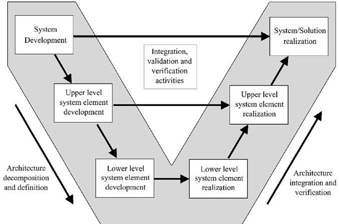
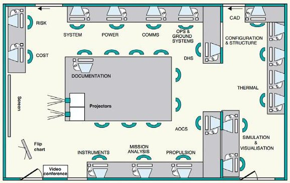
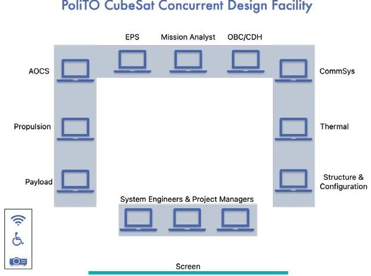
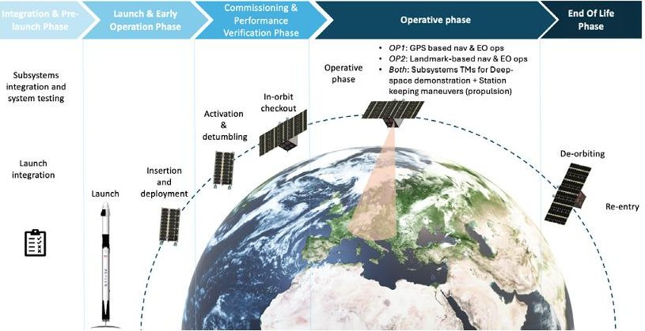
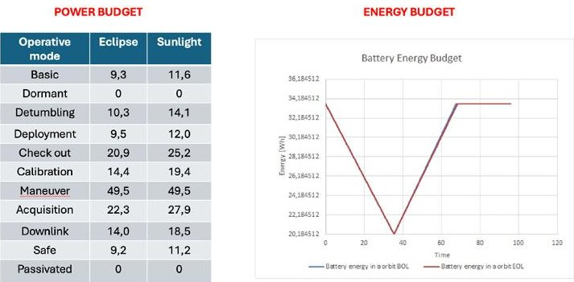
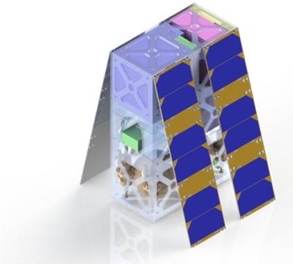

<!-- PDF_PAGE: 1 -->

# POLITECNICO DI TORINO Repository ISTITUZIONALE

# Concurrent Engineering to Enhance Autonomy for Deep-Space CubeSat Mission Design

Original

Concurrent Engineering to Enhance Autonomy for Deep-Space CubeSat Mission Design / Campioli, S., Stesina, F., La Bella, E., Corpino, S., Niero, L., My, C.. - ELETTRONICO. - 58 (16):(2024), pp. 163-168. (2nd IFAC Workshop on Aerospace Control Education - WACE 2024: Bertinoro (ITA) 22-24 July 2024) [10.1016/j.ifacol.2024.08.480].

Availability:

This version is available at: 11583/2992277 since: 2024-09-06T10:38:32Z

Publisher:

International Federation of Automatic Control - Elsevier

Published

DOI:10.1016/j.ifacol.2024.08.480

Terms of use:

This article is made available under terms and conditions as specified in the corresponding bibliographic description in the repository

Publisher copyright

(Article begins on next page)

<!-- PDF_PAGE: 2 -->

IFAC PapersOnLine 58-16 (2024) 163-168

# Concurrent Engineering to Enhance Autonomy for Deep-Space CubeSat Mission Design

Serena Campioli*. Fabrizio Stesina*, Emanuela La Bella*, Sabrina Corpino*, Luca Niero*, Chiara My *

* Politecnico di Torino, Italy (e-mail: serena.campioli@polito.it, fabrizio.stesina@polito.it, emanuela.labella@polito.it, sabrina.corpino@polito.it, luca.niero@studenti.polito.it, chiara.my@studenti.polito.it)

Abstract: Concurrent Design is a modern and innovative approach for space mission and system design, aligning with the "low cost and fast delivery" paradigm. The paper presents how, in an educational environment, the concurrent engineering approach has been applied in designing a CubeSat mission to emulate an interplanetary mission in Low Earth Orbit, with an earth observation secondary objective. This mission focuses on automating mission operations, system autonomy, and innovative control systems. The paper details the mission and system design, and the effectiveness of the concurrent design approach and proposed future improvements are assessed.

Copyright © 2024 The Authors. This is an open access article under the CC BY-NC-ND license (https://creativecommons.org/licenses/by-nc-nd/4.0/)

Keywords: Concurrent Engineering; CubeSats; Project-based education; Autonomous systems; Emerging methodologies in learning.

## 1. INTRODUCTION & BACKGROUND

System engineering can be defined as a "collaborative and multidisciplinary approach that derives, develops and verifies a system solution that is balanced over its life cycle to meet stakeholders' needs" (Loureiro G et al). Within the system engineering discipline, different approaches can be employed to design a spacecraft mission.

Firstly, the long-used traditional approach is the sequential one, which typically follows a V-model diagram (Walden D et al) as depicted in Figure 1. In this 'classical' methodology, as reported in ECSS-M-ST-10C Space project management, the process starts with phase 0/A where a system solution is identified, and its feasibility is assessed. Firstly, a mission concept is formulated based on a set of requirements, leading to the development of a conceptual design. Various design options are then evaluated through trade-off analyses, considering their performance, cost, and risks, and the preferred option is selected. This entire process requires multiple iterations, continuous validation with stakeholders, and the formulation of verification plans in line with the requirements development process.

Figure 1 V-model diagram (Walden D. et al)

The sequential approach is a consolidated and well-validated process with some advantages, including flexibility in manhours and manpower resource utilization. However, its application in space systems often demands significant time, interdependencies between subsystems/components could potentially cause conflict, and changes in one component can potentially impact others, producing a chain of changes propagating at the system level.

In the past decades, a new approach has been employed to address the sequential approach criticalities: the Concurrent Engineering (CE), a product development approach where the design is highly integrated with other tasks such as manufacturing, planning, quality assurance, marketing, etc. The tasks are performed simultaneously and, by using modern design tools, the time-to-market is reduced at a lower cost with higher quality. In the space mission and systems design, CE is mainly applied for phase 0/A, and according to ESA definition is defined as "a systematic approach to integrated product development that emphasizes the response to customer expectations. It embodies team values of cooperation, trust, and sharing in such a manner that decision-making is by consensus, involving all perspectives in parallel, from the beginning of the product life-cycle" (Bandecchi M. et al).

At Politecnico di Torino, the STAR (Systems and Technologies for Aerospace Research) research group focuses among other space systems topics on the concurrent methodology applied to small satellite missions and system design (Ridolfi et al.). Hence, the PoliTO CubeSat Concurrent Design Facility has been developed, whose main objectives related to the design of space missions are focused on the performances within a typical phase 0/A study. Additionally, this facility and approach applied to an academic environment allow for a hands-on experience filling the gap between academia and the industry by teaching the ability to work

<!-- PDF_PAGE: 3 -->

together while facing incredible time and cost constraints aiming to the satisfaction of the stakeholder needs. Furthermore, the concurrent design approach goes well with exploring autonomy strategies as different architectural and algorithmic solutions can be investigated in parallel and more quickly. The use of dedicated spreadsheets allows the team to evaluate the impact of different FDIR (Fault detection, isolation, and recovery) and decision-making strategies and algorithms, considering throughputs, lines of code, and the size of the memories required at the software level. Other supporting tools allow the creation of complex architectures that highlight the redistribution of functionality in the event of hardware, software, and data failures and redundancies.

In this framework, a CubeSat mission and systems concurrent study was carried out with a team of students, a study with a particular focus in enhancing the autonomy of deep-space CubeSat. To present the method and the obtained results, the paper is organized as follows. In section 2, the usual CE process is described, and how the latter has been adapted for an educational environment and to enhance the autonomy aspect of the space mission, including the procedures and the developed/employed tools. The case study is then presented in Section 3, giving the context of the mission and the challenges to be addressed, together with the technical details of the design itself. Finally, the results of the CE application to the case study are presented and discussed respectively in sections 4 and 5.

## 2. METHODOLOGY

## 2.1 Concurrent Engineering approach to CubeSat mission and system design

The main characteristic of concurrent engineering is its team approach to product creation and/or improvement: different departments and disciplines participate in a group that develops the product by performing tasks in parallel rather than sequentially. In this framework, computer tools such as computer-aided design (CAD), shared databases, and standards are typically used to support and facilitate communication.

In general, it is possible to identify 5 key elements (Bandecchi M. et al) on which the concurrent approach is based: (i) a process, (ii) a multidisciplinary team, (iii) an integrated design model, (iv) a facility, (v) a software infrastructure. The CE design process begins with a few meetings between the customer(s), the team leader, and the system engineers, to refine and specify the mission requirements, set the constraints and the design drivers, together with an estimation of the required resources. Subsequently, the core study starts with a series of iterative sessions where all the specialists collaborate to address all aspects of system design, including costs, risks, and other case-dependent aspects. In these sessions, all specialists are involved from the start, allowing for concurrent design progression and early trend correction. Customers and other specialists actively participate, contributing to study assumptions and design evolution. This flexible and iterative approach enables the exploration of alternative paths and the use of estimates to prevent delays due to a lack of data or decisions.

The success of concurrent design relies on a multidisciplinary team that works on the design in real-time. To operate effectively, each team member must adopt this new working approach prioritizing collaboration, communication, real-time task completion, and active contribution to maintaining a positive team dynamic. In terms of expertise, the selection of disciplines to be involved depends on the expected level of detail and the expertise available. Additionally, an effective and skilled Team Leader is necessary to oversee the concurrent process, and this role is essential for the successful implementation of the approach.

The concurrent design approach can be described as model-driven, as it uses data and information from a variety of tools used by specialists in their respective domains. Specifically, the use of a parametric-model-based approach (Knoll D. et al) allows for the representation of generic models from different mission and technological scenarios, while facilitating swift modification and analysis of new scenarios. This parametric approach is essential for real-time processes and serves to establish and formalize the design ground rules, as well as formalize each domain's responsibility.

Finally, a facility is needed to carry out all the abovementioned activities for the design study. Usually, the concurrent design facility is equipped with the necessary hardware for visualization and communication of intermediate engineering results and face-to-face discussion. A dedicated 'position' is created for each discipline and assigned to the expert of reference. Each seat is supplied with the tools needed for design modeling, calculations, and data exchange. As an example, the ESA-ESTEC Concurrent Design Facility (CDF) layout is reported in Figure 2.

Figure 2 ESTEC Concurrent Design Facility (Bandecchi M. et al)

This methodology is particularly efficient and effective for small-satellite mission design, with a focus on CubeSat. For instance, in 2013 NASA Team X-c was created - 'c' for 'CubeSat' - (Austin A. et al.) which focuses on smallspacecraft mission concepts, from 1 kg CubeSat to 180 kg small-satellites. In particular, Team X-c is known for the MarCO CubeSat mission that flew with the Insight lander to Mars in 2018 (Austin A. et al.).

## 2.2 Adaptation of the Methodology to Enhance Mission Autonomy in an Educational Environment

The adaptation process to the concurrent methodology for the purpose of the study started from the typical ESTEC CDF process flow when designing a CubeSat mission, consisting of: (i) Pre-study phase - where the system engineering team

<!-- PDF_PAGE: 4 -->

coordinated by the team leader meets the customer to discuss the main drivers and constraints, together with the expectations and allocable resources; (ii) Session 1: Kick-off- where the mission is presented with all the relevant information and expectations (customer side), together with a first trajectory analysis (mission expert), a preliminary system analysis (system engineer), and the drafting of the programmatic aspects (team leader); (iii) Session 2/3/4- the first iteration(s) is performed, including the definition of the mission scenario, timeline, modes of operations, mission analysis refinement, budgets calculation, and costs and risks assessment; (iv) Session 5/6/7- more refinement, work dependent on the type of study and the customer requests; (v) Session 8-final check on the results by presenting to each other; (vi) Post-study activities-reports writing, possible re-work in case mistakes were found during the final check

The standard CDF process, with its multiple sessions spread over a longer duration, is not ideal for educational projects due to both the limited time available and the relative inexperience of students in specific mission design disciplines. Therefore, a lighter version is proposed, condensing the process into four, 4-hour sessions, spread over 1 month: (i) Session 1: Kick-off & Start of mission design; (ii) Session 2: Mission design; (iii) Session 3: System design; (iv) Session 4: Consolidation of baseline.

Concurrent sessions are carried out in a simplified version of CDF, implemented at Politecnico di Torino. This PoliTO CubeSat Concurrent Design Facility is outlined in Figure 3 PoliTO CubeSat Concurrent Design Facility, and it is currently hosted in an allocated conference room at DIMEAS (Department of Mechanical and Aerospace Engineering). Seats are assigned per discipline, but each expert is encouraged to use their personal laptop with their preferred tools. However, Excel calculation sheets are provided for most of the disciplines, except Structure&Configuration and Mission Analysis for which SolidWorks and STK licenses are provided. Additionally, a central repository for data/info exchange is shared among the participants for optimized collaboration and data share, constantly checked by the system engineers (even if visible to everyone).

PoliTO CubeSat Concurrent Design Facility

Figure 3 PoliTO CubeSat Concurrent Design Facility

## 2.3 Educational return

In this framework, it is important to highlight the importance of the educational return when performing concurrent studies with students, despite the additional challenges posed by an

academic environment, such as the need for projects to align with the academic schedule and the limited experience and knowledge in the field. In fact, through such experiences, students will learn to tackle challenges and work in a multidisciplinary team. This will involve dealing with real issues such as negotiation and group decision-making, which are important aspects of the design process. Lastly, an important aspect is to bridge the gap between academia and industry by teaching the ability to work together to meet incredible time and cost constraints while aiming to satisfy stakeholder needs.

## 3. CASE STUDY

A case study has been carried out to demonstrate the feasibility of deep-space CubeSat and the CE application to enhance the autonomy of the spacecraft. It consists of the phase 0/A study of a 6U CubeSat to monitor the urban growth of the Piedmont area while acting as a technology demonstrator for the future deep-space CubeSat mission in terms of communication, navigation, and operations.

## 3.1 Challenges & Mission objectives

At the basis of the study, two main challenges were identified and addressed. The first focuses on the deep-space capability of the CubeSat platform. CubeSats traditionally operated in low-Earth orbit (LEO), but there is a growing trend to expand CubeSat operations in deep space (Burkhard C et al). However, it is crucial to assess CubeSats capabilities and test critical technologies before embarking on a long voyage to deep space: a preliminary in-orbit demonstration can be performed in LEO in a relevant simulated environment for what concerns the communication (e.g. deep space network), navigation (e.g. landmarks), and operation (e.g. autonomy) of a deep space mission. The autonomy of the mission is crucial for interplanetary missions because the limited link availability and bandwidth reduce the communication time and the amount of data exchanges. Moreover, the delay in communication enforces the need for FDIR strategies without humans in the loop, as commands from the ground are not feasible when major events happen. Therefore, high autonomy should be achieved on the mission operations plan, on the activation of onboard hardware units and software tasks, payload management, and contingencies management. In Table 1, the main challenges for small satellite missions are reported, together with the main aspects to be addressed during the design, and the solutions to emulate and verify/ validate in LEO the design solutions.

A second challenge has been identified for a LEO mission: the urban growth monitoring, land usage and coverage changes mapping and analysis. Cities play an important role in international development and environmental policy agreements (New Urban Agenda (NUA), Sendai Framework, Paris Agreement, Sustainable Development Goals (SDGs)) with a significant impact on the global population. According to the United Nations (UN) in the World Urbanization Prospects: The 2018 Revision, it is projected that nearly 70% of the world's population will reside in cities by 2050. This underlines the importance of cities in delivering services and also addresses the challenges posed by climate change through mitigation and adaptation measures. Hence Earth Observation

<!-- PDF_PAGE: 5 -->

(EO) satellites can support the sustainable growth of urban areas, by monitoring the transformation of natural landscapes into developed areas for human activities.

Table 1 Main challenges for deep-space small satellites

<table border="1"><tr><td>Challenges</td><td>Design drivers</td><td>Emulation in LEO</td></tr><tr><td>Low link availability and delay of signal propagation</td><td>1) Image selection and compression2) No cmds on critical functions</td><td>1) Low num and time of GS/SC communication2) Autonomous decision making</td></tr><tr><td>Low bandwidth</td><td>Maximise data rate t</td><td>Reduce the GS capability</td></tr><tr><td>Low knowledge of the target</td><td>In situ mapping</td><td>Use Earth references for testing the mapping strategy</td></tr><tr><td>Independency on mission/payload ops</td><td>Change ops mode without command from ground</td><td>Avoid commands for some payload and mission operations</td></tr><tr><td>High variability of the operation</td><td>1) Automatise onboard operation2) Select FDIR strategies.3) Redundancy</td><td>Reduce the satellite operations, but monitor the FDIR solutions effectiveness</td></tr><tr><td>High Spacecraft vulnerability</td><td>1) Redundancy2) Functions redistribution</td><td>Assess the system capability</td></tr><tr><td>Trajectory control and determination</td><td>In-situ mapping, autonomous RF/visual navigation</td><td>Use Earth features as landmarks, GPS only for validation</td></tr><tr><td>High variability of the thermal environment</td><td>Protect critical elements</td><td>Assess the system capability</td></tr><tr><td>Low electrical power</td><td>Maximise the power generation and energy storage</td><td>Reduce by design the energy generation and storage</td></tr></table>

In this framework, CubeSats can reply to the challenge thanks to their nature in terms of low cost, low time-to-market, and design flexibility/adaptability. Hence, a CubeSat mission monitoring a specific area can complement data from other living missions such as the Copernicus program with its Sentinel missions.

Hence, the Geo-Profundo mission was developed in its phase 0-A, whose mission statement is "The mission should act as a technology demonstrator for the future deep-space CubeSat mission in terms of communication, navigation, and operations. The mission should additionally monitor the urban growth of the Piedmont area." Two main mission objectives have been identified, as follows: (1) To assess CubeSat capabilities for deep space in terms of (i) technology in relevant simulated environments, such as communication, navigation, propulsion, avionics architecture, power management, and thermal; (ii) Operations to enhance the spacecraft autonomy; (2) To monitor urban growth in the Piedmont area and to monitor light pollution

## 3.2 Concurrent sessions with a team of bachelor and master students

As already mentioned, the team was composed of 12 members mainly students, with different levels of studies and experience: 5 bachelor students, 4 master students, 1 PhD candidate, 1 researcher, and 1 assistant professor. Each member has been assigned a specific role and tasks to be

carried out during the different concurrent sessions. The following roles have been identified: 2 Project managers, 1 System Engineer, 1 Mission Analyst, 1 AOCS Engineer, 1 Propulsion Engineer, 1 EPS Engineer, 1 Payload engineer, 1 TT&C Engineer, 1 Structure&Configuration Engineer, 1 Thermal Engineer, and 1 OBC/CDH Engineer. The PhD candidate and the researcher oversaw the coordination of the sessions, supported by the more experienced assistant professor and by the System Engineer master's student.

Focusing on enhancing the autonomy characteristic of the CubeSat, in this section an overview of the 4 concurrent sessions content is displayed. In general, rather than dedicating a single session to it, autonomy considerations have been waved throughout all four concurrent sessions. This encouraged students to constantly think about how their design choices impact the ability of their CubeSat to operate autonomously.

## 3.2.1 Session 1: Kick-off & Start of Mission Design

The mission drivers and constraints during the first session have been presented. Subsequently, a brainstorming activity was performed to identify the main challenges in the mission and systems design and the potential stakeholders leading to the definition of the mission statement and mission objectives. Finally, the Concepts of Operations (ConOps) and Mission Architecture have been drafted representing a starting point for the design, together with a preliminary mission analysis in STK software.

## 3.2.2 Session 2 & 3: Mission Design & System Design

At the beginning of the second session, the autonomy aspect for the specific areas was stressed to define system and subsystem design drivers. A final ConOps was outlined, and the mission timeline, mission architecture, and operative modes were defined and further iterated, leading to a preliminary mission operations plan, where each operative modes were triggered automatically, keeping specific thresholds where emergency commands from the ground could recover the satellite in specific situations. Furthermore, each subsystem presented its architecture and open point to be further addressed in terms of autonomy and deep-space simulation, such as integrating communication delays into the mission and prioritizing data collection/instrument operations on factors like power availability or navigation inputs.

During the third session, the core of the design was addressed by subsystem sizing and preliminary component selection through a trade-off. Throughout these two concurrent sessions, both the system engineer and mission analysis tasks were constantly performed and iterated in parallel with the subsystem design.

## 3.2.3 Session 4: Consolidation of Baseline

Finally, the last concurrent session acted as a consolidation of the baseline, with the final system and subsystem budgets. A risk assessment has been carried out, together with a preliminary cost budget. To conclude the concurrent study, a final check on the results was performed through an internal detailed presentation leading to the definition of Post-study

<!-- PDF_PAGE: 6 -->

activities. Lastly, lessons learned have been drawn helping draft a way forward for the next iteration of the concurrent approach and concurrent facility.

## 4. RESULTS

## 4.1. Mission description

4. 1.1. Concept of Operations and Mission Architecture In the selected baseline, the 6U Geo-Profundo CubeSat is launched with SpaceX Falcon 9 and deployed from the CubeSat Dispenser once in orbit. Once deployed and commissioned, the Operative Phase (OP) starts with an OP1 where GPS-based navigation is used for the EO scientific purpose while landmarks are collected and mapped.

Figure 4 Design Reference Mission

Subsequently, the OP2 starts where deep-space navigation based on landmarks is employed to perform the EO scientific operations. In both phases, other deep-space demonstrations are performed, including simulated deep-space communication and solar panel concentrator technology demonstration (detail in 4.3.2). At the end of the operative phase, the CubeSat is passivated to be de-orbited and burnt in the atmosphere.

## 4.1.2. Mission Analysis

After a preliminary mission and trajectory analysis, a Repeating Ground Track was selected with the following parameters: (i) inclination: $ 9 8^{\circ} $; (ii) eccentricity: 0; (iii) altitude: 558 km. This results in 180 encounters expected yearly in the target area. A weekly Hohmann Transfer is foreseen for station-keeping, resulting in a total DeltaV of 95 m/s. Finally, a trade-off for launcher selection was performed and SpaceX Falcon 9 resulted in the preferred launcher.

## 4.2. System design

The main relevant results are reported in the following subsections. It is important to highlight that both the system and subsystem design have been performed according to the requirements, for whose management Valispace tool has been used.

## 4.2.1. Operative modes-enhanced autonomy

Operative modes and their triggers have been defined to enhance the autonomy of the mission, with the purpose of a deep-space demonstration for the operations. Commands from the ground station will be used only in case of a fault detection triggering the 'Safe' mode, otherwise, everything will be automatic.

## 4.2.2 Subsystems design

Payload-2 VIS cameras have been selected for redundancy increased operational efficiency and data quality: one operating in the visible (Micro Camera System by Crystalspace) and one operating in the near-infrared (HyperScout $ ^{\circ} $ M by Cosine Remote Sensing BV).

Propulsion System-A non-toxic green propellant, ammonium dinitramide LMP-103S, has been selected, with an estimated propellant mass of 0.684 kg. 4 thrusters have been sized for attitude control and orbit raising, as well as 2 spherical tanks in 6AI-4V titanium alloy (internal radius of 40.3 mm thickness of 1.3 mm), for a total system wet mass of 1.04 kg.

Attitude and Orbit Control System - The maximum torque in orbit of $ 1. 3 8 \mathrm{e}^{-5} $ Nm, and the angular momentum of 41,6 mNms have been calculated. Hence, the system defined was composed of 4 reaction wheels (NanoTorque GSW-600 in a 4-wheel $ 4 5^{\circ} $ pyramid setup), 2 sun sensors (nanoSSOC-D60), a star tracker (TWINKLE) combined with the employment of the 4 thrusters (propulsion).

Guidance Navigation and Control System - Two mission subphases where to use different GNC strategies have been identified: (1) GPS-based navigation with GPS receiver: 2m Circular Error Probable (CEP) accuracy with preliminary orienting and mapping for at least 4 days; (2) Landmark-based navigation: optical information on the geographical features of the Earth, detected during the mapping of the Earth in (1). This navigation requires at least four images of the area to have a correct identification.

Communication System - Communication Network is based on a Store&Forward architecture. During the Earth observation, the housekeeping and mission data are downloaded over the main station and a high link available is considered. During the emulation of a deep space mission takes inspiration by (Corpino S. Stesina F., 2020), the ground station only receives the data, but reduced commands windows are enabled. Moreover, to emulate the reduced capability of an interplanetary mothercraft versus an Earth ground station, signal attenuators are installed on the ground station to reproduce the expected EIRP and G/T.

Thermal Control System- The system is passive, as no heaters are required. The following surface finishes have been selected: Aluminized Kapton 2 mil (0.508 mm) on Zenith, Nadir, Y (under solar panels) surfaces; White Paint (S13GLO) on X faces to act as a radiator $ (0.06 \mathrm{m}^{2}) $ . Additionally, temperature sensors are required to monitor the most critical components.

Electrical Power System - Preliminary power and energy budgets have been carried out as reported in Figure 5. The main components are: 1) solar panels based on 30% Triple Junction GaAs cells with a total area of 0.18 m $ ^{2} $ and an End of Life (EOL) capability of 282 W/m $ ^{2} $ 2) A secondary battery a Lithium-Ion battery pack with a capacity of 33 Whr, and a DOD of 40%. 3) Additionally, a deep-space EPS technology is planned to be tested on-board: solar concentrators, self-deployable mirrors, that have a size similar to the solar cells, and they are made of titanium alloy foils (Ruelle V. et al).

<!-- PDF_PAGE: 7 -->

Figure 5 Power and Energy budgets

Structure & Configuration - The structure has an overall thickness of 2.5 mm as a first assumption of trade-off between strength and mass/volume savings. The structure mass is estimated to be around 1,1 kg, assuming Aluminum 60xx for mass properties. The main challenge of the configuration was the placement of the AODC subsystem, whose size requires at least 3U (considering thrusters, tanks, reaction wheels, and sensors). Figure 6 shows the satellite layout.

Figure 6 CAD model

## 5. DISCUSSION & CONCLUSION

## 5.1 Lessons Learned & Way Forward

This paper shows how the Concurrent Engineering can support the education of future engineers by training them through an effective design process that allows them to learn by doing.

After a thoughtful analysis of the concurrent study results combined with a feedback analysis, both oral and anonymously written feedback from the students, the following lessons learned, and possible improvements have been outlined.

Data share: A more effective way to share data/info should be implemented by investigating the use of the COMET tool instead of the central repository in Excel.

Number of Concurrent Sessions: 4 sessions of 4 hours seemed to be too dense of tasks leading to some anxiety among the students. Hence at least 1 more session should be added to relax the workload.

Students are students: More support should be provided to the students acting as experts by foreseeing pre-study activities involving directly the students, and by providing them with materials in advance, especially the Calculation sheet.

In the future, the updated version of the CDF at Politecnico di Torino will be integrated with another tool available at STAR

Lab (Stesina F., Corpino S., 2021), namely the Simulator, already developed by students, providing an easier way for verification in the different phases of a product life cycle (Stesina, F., Corpino S., Feruglio L., 2017).

## REFERENCES

Austin A. et al. (2020). Rapid SmallSat Mission Formulation: Integrated and Concurrent Modeling in JPL's Team Xc. IEEE Aerospace Conference, Big Sky, MT, USA, 2020, pp. 1-11, doi: 10.1109/AERO47225.2020.9172523.

Bandecchi M, Melton B, Ongaro F (1999). Concurrent Engineering Applied to Space Mission Assessment and Design. ESA bulletin 99.

Burkhard C., Weston S. (2021, October). The Evolution of CubeSat Spacecraft Platforms. In AVT-336 Specialist Meeting.

Corpino S., Stesina F. (2020). Inspection of the cis-lunar station using multi-purpose autonomous Cubesats. Acta Astronautica, Volume 175, 10.1016/j.actaastro.2020.05.053.

ESA/ESTEC Requirements and Standards Division (2017). ECSS-M-ST-10C Space project management. In: Project planning and implementation, Noordwijk, The Netherlands.

Knoll D, Fortin C, Golkar C (2018). Review of Concurrent Engineering Design practice in the space sector: state of the art and future perspectives. In: IEEE International Systems Engineering Symposium (ISSE), pp. 1-6.

Loureiro G, Panades W, Silva A (2018). Lessons learned in 20 years of application of Systems Concurrent Engineering to space products. Acta Astronaut 151:44.

Ridolfi G. et al. (2012). A methodology for system-of-systems design in support of the engineering team. In Acta Astronautica, Volume 73, pp 88-99, 10.1016/j.actaastro.2011.11.016.

Ruelle V. et al. (2008). Low concentration solar array experiment on-board PROBA-2. 8th European Space Power Conference.

Stesina F., Corpino S., Feruglio L. (2017). An in-the-loop simulator for the verification of small space platforms. International Review of Aerospace Engineering. Vol. 10: 2, DOI: 10.15866/irease.v10i2.10593.

Stesina F. Corpino S. (2021). STAR laboratory at Politecnico di Torino: A facility to develop educational space projects. IFAC WACE Volume 54, Issue 12, Pages 80- 87, DOI: 10.1016/j.ifacol.2021.11.013.

United Nations, Department of Economic and Social Affairs Population Division (2019). World Urbanization Prospects: The 2018 Revision (ST/ESA/SER.A/420).

Walden D, Roedler G, Forsberg K, Hamelin R, Shortell TM (2015). Systems engineering handbook: a guide for system life cycle processes and activities. Wiley, New York.