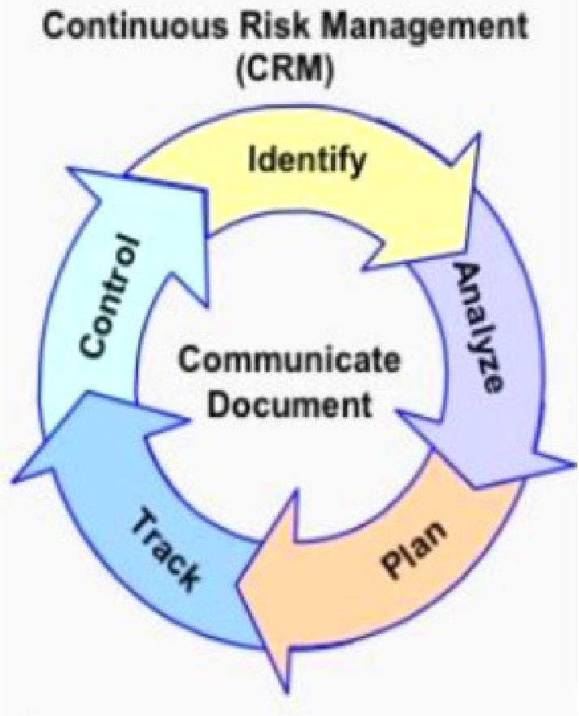
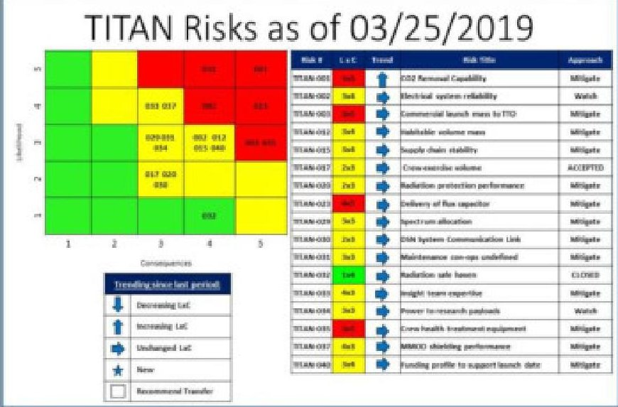
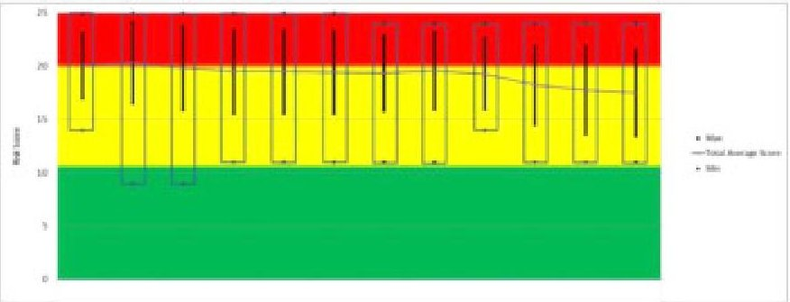
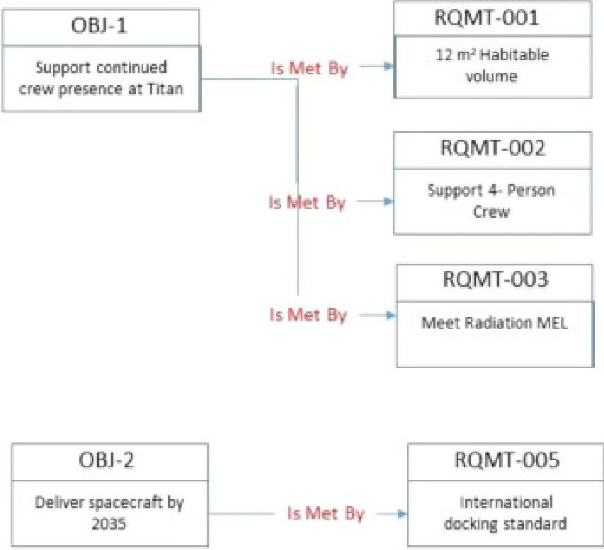
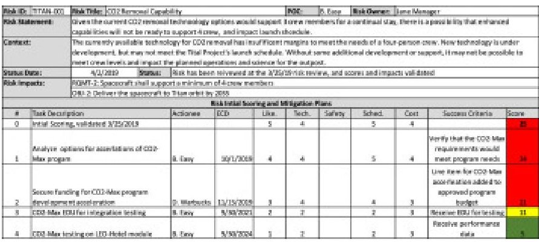
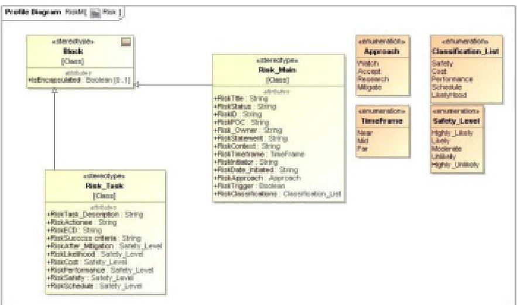
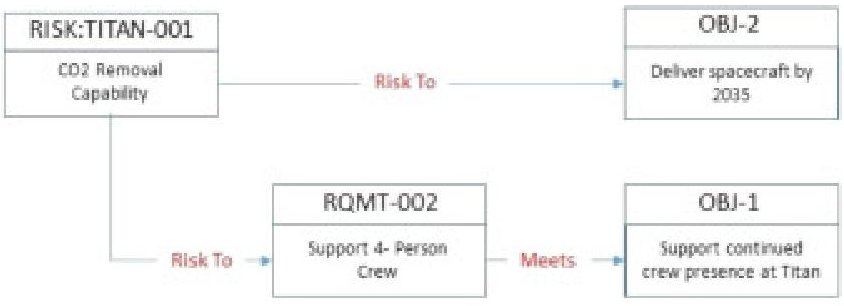

<!-- PDF_PAGE: 1 -->

# Method for tracking and communicating aggregate risk through the use of model-based systems engineering (MBSE) tools

Scott Darpel, Sean Beckman, Tim Ferlin, Maria Havenhill, Edith Parrott, and Kathy Harcula Journal of Space Safety Engineering 7(1), 11-17 (2020) DOI: 10.1016/j.jsse.2020.01.001

## Abstract

Large, complex projects can identify a significant number and variety of risks, throughout the project life cycle. These risks are analyzed, mitigated, closed or accepted as independent uncertainties. Once closed or accepted, it is easy for projects to lose awareness of their impact. In reality, each of these risks contributes some amount to the overall risk posture of the project. The ability to track and effectively communicate this aggregate risk has represented a challenge to project management.

There have been previous attempts to create a schema to communicate the aggregate effect of risks, without notable success. Most of these attempts have centered on some additive metric derived from the scoring of likelihood and consequence values. This, in and of itself, is a logical approach, but all too often the scores were then aggregated to a level where all context was lost. One weakness has been a lack of attempt to create linkages or logical groups of the risks upon which useful aggregation could then occur.

The overall move to model-based (systems) engineering (MBSE) has opened up a vast frontier of opportunities to better integrate all project data. MBSE provides an underlying layer that links data items to each other. Objectives link to requirements, which then link to functions, functions to physical architecture items, and so on, as far down as projects want to model. While it started with a focus on modeling requirements based on things like use cases, efforts are now underway to integrate safety and mission assurance (S&MA) information and analyses, such as risks. This effort, called Model Based Mission Assurance (MBMA), is yielding models that are more useful and are a more accurate representations of the systems.

MBSE models, with this ability to link related items, provide a new means of tracking and communicating aggregate risks. In the proposed method, risks are added into the models as distinct items, having attributes that communicate a scoring derived from the likelihood and consequence values as charted on the standard NASA 5x5 risk matrix. Like earlier efforts, each box in the 5x5 has an associated scoring, which may include both a current score and potential postmitigation/control score. The risk items are then linked to elements of the model, such as system objectives/goals, requirements, functions, or physical architecture items, with "Risk to" relationships. These risks will then be communicated by use of reports generated from the model, detailing all risks and/or hazards linked to model elements. These reports can include aggregate impacts, including a current scoring and potential future state scoring based on the planned mitigations and/or controls. These reports will show all risks, open, accepted, and closed, linked to project objectives or requirements. When run as part of an upcoming risk acceptance discussion, these reports will serve to remind the team of all previous risks that relate to the effected portion of the system. When included as part of periodic program or project reviews, risk reviews, and safety reviews, this method can improve the overall understanding of the system's true risk posture. This proposed method takes full advantage of the advances that modern modeling techniques provide, with a minimal investment of additional time. Utilizing the model environment also enables a near constant access to current state of aggregate risks.

<!-- PDF_PAGE: 2 -->

## 1. Projects and risk

All projects include some amount of uncertainty. That uncertainty can come as a benefit, as an opportunity to increase performance or safety, or reduce cost or schedule needs. Uncertainty can also come as a threat or risk. Risks can impact a project's schedule, budget, performance, and safety. Despite all best efforts at planning and foresight, no project can predict at the outset all of the risks they may encounter throughout the entire lifecycle. It is for this reason that NASA, like many other engineering organizations, employs risk management techniques to identify, track, communicate, and mitigate these items as they are uncovered (Fig.1).

Download: Download full-size image

Fig. 1. NASA's Continuous risk management cycle from NPR 8000.4B.

## 1.1. Typical NASA risk management

NASA's standard process for Risk Management is described in NPR 8000.4B, "Agency Risk Management Procedural Requirements". It includes both the high-level concept of Risk-Informed Decision Making (RIDM), and the Continuous Risk Management (CRM) process used to populate the data required for RIDM. RIDM itself involves the Identification, Analysis, and Risk-Informed Selection of Alternatives. The CRM process is a structured approach to Identify, Analyze, Plan, Track, and Control risks.

NASA Programs and Projects are required to draft and follow a Risk Management Plan (RMP) that details their specific implementation of the NPR 8000.4B requirements, including the roles and responsibilities, how the risk data is to be managed, and such details as how often risk meetings or boards will be held.

In a typical project environment, risks can be identified by any team member or stakeholder. The project's RMP will describe the process by which these risks are researched, vetted, and approved for inclusion into the project's tracking system. This process includes an initial scoring of the likelihood, L, and consequence of occurrence, C. During the ensuing reviews, teams may identify potential mitigation steps and what impact completing those mitigations steps may have on the $ L\times C $ scoring. The project's RMP will also include a set of criteria used to determine when a risk can be closed. This

<!-- PDF_PAGE: 3 -->

typically occurs when a project determines that the resulting risk likelihood or consequence of occurrence is below a level of concern. As an example, a project may define its closure level to be once any risk's $ L\times C $ scoring drops below a $ 2\times 3. $

There are times when it is not feasible to mitigate a risk to the defined closure levels, either due to technical capability, cost, or schedule. In these cases, if NASA and the project wish to proceed, they will consider accepting the risk as it is. Hence, the difference between closing a risk and accepting a risk is a vital concept. Closing occurs when a project no longer considers the risk to be of concern, while accepting means that there is some negative uncertainty associated with the project choosing to go forward with the risk as is.

Projects review their open risks at some defined interval, usually every two to four weeks. Fig.2 shows one format of risk report projects use to communicate their risks to the team, including current scoring (LxC), and trending. As a rule, projects only review open risks on a frequent basis, not those closed or accepted.

Download: Download full-size image

Fig. 2. Typical regular risk review report.

In addition to these regular risk reviews, NPR 8000.4B [1] requires periodic review of accepted risks. In most cases, this becomes an annual review where team members and stakeholders determine if there have been any changes that might either impact the risk scoring, or its circumstances. For example, if there has been a major architecture change on the project that eliminates the consequence of the risk, they may choose to reopen and address. A change may call into question the logic of accepting the remaining risk. In practice, these reviews tend to be a cursory flip-through of the accepted risks, lacking detail about potential linked concerns.

One limitation of the current state of risk reviews is that risks are often viewed as distinct and individual items. Which risks are reviewed on any particular occasion may be based upon which ones have had recent updates. When reviewed individually like this, it can be difficult to understand what the additive impact of the risk is on the project as a whole. This incremental impact to the project is even more important to understand when making the decision whether it is reasonable to accept the risk, or pursue more mitigation.

## 1.2. Growing importance of risk management amid the shift away from requirements

Through the many decades of NASA projects, teams began to identify common, or repeating risks. This often led to the creation of a requirement, or set of requirements, intended to mitigate future occurrences of these risks on succeeding projects. Many of these requirements made their way into Agency documents, including design and construction (D&C)

<!-- PDF_PAGE: 4 -->

standards, or spacecraft or payload safety requirements. NASA began to depend upon the levying of these documents, as well as industry standards, as a means to mitigate these past risks. While this did not prevent all recurrence of risk, it did provide a repeatable method of preventing most. Over the succeeding years, many of the documents evolved to include not just requirements, but also guides on best practices that instructed projects not only on what to address, but also how to address. That is, they not only had to add a requirement, but also how that requirement should be met.

Eventually, this reliance on requirements compliance equated to a heavy burden upon projects, potentially increasing the resources required to execute. In the current budgetary climate, projects are now being asked to reduce the overall requirements burden on contracts to improve or reduce costs and schedule, or take advantage of established industry reliability. At the same time, the Agency still needs to hold projects to a high expectation for safety and performance. Therefore, as reliance upon requirements compliance decreases, projects must more effectively and actively use their risk management processes as a means of understanding their uncertainties. As there is an increase in the number and complexity of the risks identified and eventually accepted by the projects, maintaining an overall awareness of their total sum impact on the project becomes more and more difficult.

## 2. Addressing aggregate risk

Every risk accepted by a project adds to its overall, or aggregate risk posture. Given the length and complexity of larger projects, such as the development of new spacecraft, it is difficult to maintain a level of awareness of what this aggregate risk impact is. Risks accepted early in the project, even if reviewed periodically, can fall under a "out of sight, out of mind" status. Additionally, risks associated with some project objective, requirement, or function are not often appreciated when another risk related to the same item it is considered.

Many attempts have been made to keep track of and communicate a project's aggregate risk, but with little long term implementation success.

## 2.1. Attempts to track and communicate aggregate risk within NASA

The effort to track and communicate the aggregate risk within a project is often associated with the creation of some metric. One common metric previously used on many projects is a count of risks. The concept behind this method is simple - the more risks a project has the greater the risk posture to NASA, and often, the more "attention" a project might receive from management. As simple as this metric for aggregate risk is, it is also highly inaccurate. In line with the old adage of "you get what you measure", it was often in a project manager's interest to under report risks. Even with the best of intentions, making the simple statement that one project has less aggregate risk than another just because it has fewer risks may be far off the mark. Having a large number of risks may indicate that one project has done a more extensive effort of researching their uncertainty. The total number of risks a project has also does not tell the project which risks are the more important. For this reason, this simple method is seldom used.

Another common metric used within NASA involves the use of an augmented $ 5 \times 5 $ , or $ L \times C $ matrix that has coded values for each cell. Fig.3, below, is one example of such an augmented matrix used to create a combined score for a risk.

<!-- PDF_PAGE: 5 -->

<table border="1"><tr><td rowspan="5">Liklihood</td><td>5</td><td>10</td><td>16</td><td>20</td><td>23</td><td>25</td></tr><tr><td>4</td><td>7</td><td>13</td><td>18</td><td>22</td><td>24</td></tr><tr><td>3</td><td>4</td><td>9</td><td>15</td><td>19</td><td>21</td></tr><tr><td>2</td><td>2</td><td>6</td><td>11</td><td>14</td><td>17</td></tr><tr><td>1</td><td>1</td><td>3</td><td>5</td><td>8</td><td>12</td></tr><tr><td></td><td></td><td>1</td><td>2</td><td>3</td><td>4</td><td>5</td></tr><tr><td></td><td></td><td colspan="5">Consequence</td></tr></table>

Download: Download full-size image

Fig. 3. $ 5 \times5 L \times C $ Chart with total impact values.

For example, a risk with a $ L\times C $ ranking of a $ 2\times 4 $ would have a risk score of 14, while a $ 4\times 5 $ would be 24. The higher the number, the higher the risk. These scores have been used in a number of ways.

The first way this combined scoring has been used is to simply keep a running total for the project. This method relies upon the idea that a project with a high number of low scoring risks could have the same risk posture as one with a few number of high scoring risks. Unfortunately, this concept relies upon similar logic as the total number of risks: higher total risk score is equal to higher risk posture. And, as like the pervious metric, this paradigm also leads to under reporting of risk.

One attempt to create a normalized metric that did not depend on the absolute score or number of risks was to track the average combined score of all open risks. This was based on a concept that it was best to track how well a project was working to mitigate their risks. The higher average combined score related that a significant portion of a project's risks had yet to be mitigated, and therefore, there was a higher aggregate risk. The lower the average combined score, the higher the proportion of a project's risks had been mitigated. Fig.4 below displays an actual trending chart used to communicate average combined risk scores over a period of time. This particular example implies that the project's risks are being mitigate and trending toward lower scores. This, in turn, could indicate that the project's aggregate risk has dropped.

Download: Download full-size image

Fig. 4. Example risk score trending report.

This method did communicate a rough understanding of the average scoring of the risks, and whether or not the average scores were increasing or decreasing, but did not effectively detail an overall risk posture. For example, risks that were closed or accepted were dropped from the reporting. This method also does not account for the impact of adding new risks. That is, if a project added several new risks, all with moderate or lower combined scores, it would pull the average score down, falsely implying that the aggregate risk has also dropped.

<!-- PDF_PAGE: 6 -->

In hindsight, methods that rely upon absolute counts, or even averages, may not present an accurate estimate of aggregate risk. They also have the effect of discouraging full disclosure or inclusion of risks. What is needed is both a rethinking of how aggregate risk is considered, and how it might be tracked and communicated. Before considering how aggregate risk is considered, we will first explore some enabling methodology that may make its tracking and communication easier.

An additional method related to aggregate risk that is often mentioned is Probabilistic Risk Assessment, or PRA. Per NASA/SP-2011-3421 [2], PRA "is a comprehensive, structured, and logical analysis method aimed at identifying and assessing risks in complex technological systems for the purpose of cost-effectively improving their safety and performance."(4). In use at NASA, it effectively provides an quantitative method of incorporating failure or reliability data of a system to compute contributions to overall Loss of Crew/Loss of Mission (LOC/LOM) values. The term risk in the context of a PRA is to mean the relative likelihood that a component, subsystem, or system will perform or not perform as needed. A bottoms-up approach, a PRA is typically built upon a system architecture module that includes items down to an appropriate component, or "box" level. It can be viewed as a companion of a fault tree analysis that starts as a top-down failure analysis. The failure or reliability values in a PRA are rolled-up to the system level to provide the LOC/LOM estimates. The PRA can then be used to understand the key contributing factors to the LOC/LOM, providing a means of prioritizing risk reduction efforts.

While PRA is an excellent tool for understanding the LOC/LOM contributors, it does not easily allow for the inclusion of schedule or budget risks, nor does it easily allow for inclusion of risks that are harder to quantify with actual performance data. Given that many risks are unique, it is difficult to calculate the type of occurrence rates possible in reliability-based PRA models. For example, should a project identify the risk associated with the maturation of a technology, an item often found in NASA spaceflight projects, it is difficult to calculate an absolute occurrence rate that would be needed in an PRA. While there are similarities in challenges for technology development, there can be wide differences in details. From a reliability or failure space, PRA absolutely can be viewed as an important aggregating tool, but it does not allow for aggregation of all project risks.

## 3. Evolution of MBSE and MBMA

Over the last couple of decades, there has been a concerted effort to improve the overall effectiveness of systems engineering within projects. There is little debate on the impact of implementing system engineering on a project, with researchers such as Eric Honour citing potential payback of 7 to 1 [1], [3]. Systems engineers act as means of tying all the disparate pieces of the project into a coherent system. At the outset, they lead the development of concepts and requirements. As projects progress, they ensure the various systems and subsystems, components and testing continue to satisfy and fulfill the project's objectives and requirements. In essence, systems engineering acts as the gatekeeper of the design, controlling interfaces and functions to meet those objectives and requirements.

One of the biggest challenges to systems engineering is complexity. Large projects, such as the development of a new spacecraft, involve numerous requirements and interfaces. This is one measure of complexity. The net result is that it is more difficult for the systems engineering teams to be aware of everything going on within the system and its subsystems, and ensure good communication between them. New tools were needed to help facilitate the systems engineering role.

As computing power and information infrastructure has improved, so to have the opportunities for better engineering tools. Model-Based Systems Engineering (MBSE) has emerged as the paradigm shift that was needed to better perform the role of systems engineering within a project. MBSE provides a means of creating links between all the various forms

<!-- PDF_PAGE: 7 -->

of engineering and management data within a project. It is not one specific tool, but a set of standards and practices that facilitate links between tools based upon the Systems Modeling Language, SysML. The various MBSE software packages can be used to create links between requirements management databases, CAD models, and analysis tools. This, then, creates ready access to updated information that systems engineering can use to identify issues such as requirements gaps or non-compliance. They can communicate in almost-real time with the various subsystems as the engineering work proceeds.

At the heart of MBSE are relationships built between project elements, such as objectives, requirements, functions, and subsystems. Systems engineers utilized a number of model views to create and display these relationships. Figs. 5 and 6 show project items that may be modelled into a system. Fig.7 then shows a model view showing relationships.

<table border="1"><tr><td colspan="2">Project Objectives</td></tr><tr><td>OBJ-1</td><td>Develop a spacecraft that can support a continued crew presence in orbit about Titan</td></tr><tr><td>OBJ-2</td><td>Deliver the spacecraft to Titan orbit by 2035</td></tr><tr><td>OBJ-3</td><td>Ensure capability with current and future visiting vehicles</td></tr><tr><td>...</td><td></td></tr><tr><td>OBJ-N</td><td>The spacecraft should be delivered for $258 or less</td></tr></table>

Download: Download full-size image

Fig. 5. Sample project objectives.

<table border="1"><tr><td rowspan="2" colspan="2">Project Requirements</td><td colspan="5">Meets</td></tr><tr><td>OBJ-1</td><td>OBJ-2</td><td>OBJ-3</td><td>...</td><td>OBJ-N</td></tr><tr><td>RQMT-1</td><td>Spacecraft shall include no less than 12.0 cubic meters of habitat volume</td><td>X</td><td></td><td></td><td></td><td></td></tr><tr><td>RQMT-2</td><td>Spacecraft shall support a minimum of 4 crew members</td><td>X</td><td></td><td></td><td></td><td></td></tr><tr><td>RQMT-3</td><td>Spacecraft shall provide radiation shielding sufficient to limit crew exposure to the Maximum Exposure Limit (MEL) defined in the Tital Program Human Systems Integration Requirements</td><td>X</td><td></td><td></td><td></td><td></td></tr><tr><td>RQMT-4</td><td>Spacecraft shall be compatible with the International Docking Standard</td><td></td><td></td><td>X</td><td></td><td></td></tr><tr><td>RQMT-5</td><td>Spacecraft shall be compatible with existing commercial and NASA launch vehicles</td><td></td><td>X</td><td></td><td></td><td>X</td></tr></table>

Download: Download full-size image

Fig. 6. Sample project requirements and trace to project objectives.

<!-- PDF_PAGE: 8 -->

Download: Download full-size image

Fig. 7. A sample of model view of project object relationships.

## 3.1. Model-Based Mission Assurance (MBMA)

As the MBSE paradigm has increasingly been implemented across NASA and industry, Safety & Mission Assurance (S&MA) professionals have identified ways to integrate S&MA expertise into the models. The linkage between various collections of engineering data facilitated by MBSE models can enrich or improve the way S&MA analyses are developed. Data required for such S&MA analyses as Failure Modes and Effects Analysis (FMEA) can be pulled from, and linked to, data in other sources. There are now add-ins for some MBSE packages that allow for the creation of FMEAs directly from the models. The modeling paradigm has also facilitated opportunities for S&MA professionals to engage with project teams in new and more effective ways. One such approach was detailed in a previous paper, "Early Engagement of Safety & Mission Assurance Expertise Using Systems Engineering Tools: A Risk-Based Approach to Early Identification of Safety and Mission Assurance Requirements", by Darpel and Beckman [3], [4]. This overall effort has been termed Model-Based Mission Assurance (MBMA).

Along with improving the accuracy and cycle time of creating S&MA analyses, adding data from these analyses back in creates a more accurate and rich model. Engineering analysis can now be more informed based upon the S&MA data added. This concept can be applied to a more informed and effective risk management methodology.

## 4. Aggregate risk and model-based system engineering

As NASA moves to new and novel procurement strategies that rely more on risk assessment than on requirements compliance, a new approach for tracking and communicating aggregate risk is needed. A combined group of S&MA, risk management, and systems engineering professionals began exploring options for new approaches. The approach described within this section is the result of this effort, and will be piloted on one of NASA's newest development projects.

The methodology involves utilizing the data linkage capabilities of the MBSE model to tie risks to project items. This will create a way to have meaningful aggregation of risk that can better inform the project when making decisions about risk

<!-- PDF_PAGE: 9 -->

acceptance, prioritization of mitigation activities, or engineering trade studies.

## 4.1. Methodology goals

The effort to develop a new approach for tracking and communicating aggregate risk had the following goals:

- Have a means of tracking the impact of all risks, open, closed, and especially accepted

- To the greatest extent possible, make use of existing data sources, software, and processes, with a minimum of additional work or steps

- Provide meaningful aggregation of risks that provides appropriate context

## 4.2. Revisiting aggregate risk

Earlier attempts at tracking and communicating aggregate risk relied on a concept of some unified metric that gives the total impact of all risk. As seen in the description of these methods, that ultimately led to an ineffective or faulty understanding of this aggregate risk. Aggregating at too high a level can be as meaningless as no aggregation at all.

Risks are always discussed in terms of a context. Why is a risk important? What does it mean? Context provided with a risk helps teams understand all of this. Context is also what has been missing from the attempts to aggregate risk. In this usage, context provides meaningful grouping of risk that creates a more accurate picture of risk posture. Old metrics used with logical grouping can provide this meaningful context. What, then, is this logical grouping?

Projects are concerned with meeting objectives and requirements. All risks represent an uncertainty about meeting these objectives and requirements. This simple statement provides the meaningful grouping being sought. The data linkages enabled by MBSE provides the means to create ties between risks and the item at risk. Once these links are there, it becomes possible for projects to consider all the risks associated with any item, objectives, requirements, functions, or subsystems. The is a more meaningful risk aggregation as it allows teams to make more informed decisions about a risk, as they understand all factors putting that item at risk.

In short, projects must consider aggregate risk not as some sum total of all risks to the project, but as total impacts to some project object. The question should not be what is the total risk the project, but what is the total risk to meeting each project objective or requirement. That is a question that is actionable.

## 4.3. Use of existing risk management process

The proposed method makes use of the project's existing risk management process with minor additions. The project periodically holds workshops to identify risks, although they can be identified at any time. These risks are researched, validated, and discussed at bi-weekly risk reviews. Part of the research and validation process includes trying to assign the likelihood and consequence scores. There are four consequence scores, Cost, Schedule, Technical, and Safety. Any given risk may have one or more consequence. That portion of the process remains, including the use of a legacy database to house and manage the risk data.

For this new method, project teams are asked to identify not only what the consequences are, but also what project item it is a consequence to. That is, detail which item is at risk of not being met should the risk be realized. Again, these are items in the MBSE model, such as project objectives, requirements, functions, or subsystems, in the hierarchy described

<!-- PDF_PAGE: 10 -->

in Section3. Where possible, risks should be assigned to the lowest level of this hierarchy. This allows the greatest amount of aggregation options that also provides a meaning context.

Further actions should also be per the typical risk management process, including potential mitigation steps as well as their assumed impact on the $ L\times C $ scoring (Figs. Fig. 8, Fig. 9).

Download: Download full-size image

Fig. 8. Example project risk with risk impacts added.

Download: Download full-size image

Fig. 9. Example risk profile from a MagicDraw MBSE model.

## 4.4. Adding risk to the MBSE model

Once a project risk has been identified and vetted, a risk item is added to the MBSE model that includes, at a minimum, the following information:

- Risk ID (unique ID from risk database)

- Risk Title

- Status (Open, Closed, Accepted)

- Current Likelihood Score

- Current Consequence Score

Budget

<!-- PDF_PAGE: 11 -->

Schedule

Technical

Safety

- Current Risk Matrix Score (1-25)

- Assumed Ending Likelihood Score (after mitigation complete)

- Assumed Ending Consequence Scores (after mitigation complete)

Budget

Schedule

Technical

Safety

- Assumed Ending Risk Matrix Score (1-25)

- Link to risk record in database

Once added into the model, a "Risk To" relationship is created between it and any project object that it is related to. Any given risk may impact more than one project object, so multiple "Risk To" relationships are allowed.

Fig.10 shows a notional model view with links between a project risk, TITAN-001, a project objective, OBJ-2, and project requirement, RQMT-002. If a user requests a list of all risks impacting either OBJ-2 or RQMT-002, TITAN-001 will be included. In addition, because there is already a link between RQMT-002 and project objective, OBJ-1, any like search for risks against OBJ-1 will also include TITAN-001. That is to say that as TITAN-001 is a risk to meeting RQMT-002, and RQMT-002 is a means of meeting OBJ-1, by extension it means that TITAN-001 is a risk to meeting OBJ-1.

Download: Download full-size image

Fig. 10. Example risk relationships with other project objects.

Whenever risks are updated, and there are score or status changes, these attributes are updated within the model to reflect the current states.

<!-- PDF_PAGE: 12 -->

## 4.5. Risk reports from MBSE model informing decisions

Risk discussions with resulting decisions occur at many times throughout the project lifecycle. With the risks being added to the MBSE model and linked to other project objects, reports can be run that will better inform these decisions. These reports can detail all the risks associated with a given project object and provide roll up scores based upon current and assumed ending values for likelihood, consequence, and risk matrix scoring.

At some point in the project's life cycle, a team may be considering whether or not to accept a risk, or continue to work towards mitigation. This risk in question is related to a project requirement, $ R_{1} $ . This requirement, in turn, is related to meeting the project objective, $ O_{1} $ . A report is run that lists all the risks associated with $ R_{1} $ , including their associated scores, along with an aggregate set of roll up scores. The same is done for $ O_{1} $ . The team can then see the incremental impact of accepting the risk as is, and if that impact warrants further investment into mitigation attempts.

At project milestone reviews, teams often evaluate the status of project objects, such as objectives and requirements. These evaluations can be further enhanced with the linked risk information provided by the model reports.

In an attempt to prevent missteps of previous methods, projects should be cautious in the use of the combined scores. They are useful only in that they provide the project a means to compare risk areas to each other, not as an absolute judgement of aggregate risk. The real value in this method is that it facilitates the team's ability to see all the risks impacting an object. It is not the score, but the knowledge of how other risks have impacted an item that is valuable.

As an example, in Fig.11, the example report of all risks related to a requirement show a total current score of 63, and potential ending score of 30. It is not the absolute numbers that may be the most helpful, but the progress that is possible with the planned mitigations. Or, if more resources towards any of the risks is warranted if there is not enough progress.

<table border="1"><tr><td colspan="6">Titan Program Linked Risk Report</td></tr><tr><td colspan="2">Project Object:</td><td colspan="4">RQMT-002: Spacecraft shall support aminimum of 4 crew members</td></tr><tr><td colspan="2">Current Score</td><td>63</td><td></td><td colspan="2">Expected Ending Score</td><td>30</td></tr><tr><td>ID</td><td colspan="3">Title</td><td>Current Score</td><td>End Score</td><td>Status</td></tr><tr><td>TITAN-001</td><td colspan="3">CO-2 Removal Capability</td><td>25</td><td>5</td><td>Open</td></tr><tr><td>TITAN-012</td><td colspan="3">Habitable volume mass</td><td>19</td><td>6</td><td>Open</td></tr><tr><td>TITAN-017</td><td colspan="3">Crew exercise volume</td><td>11</td><td>11</td><td>Accepted</td></tr><tr><td>TITAN-032</td><td colspan="3">Radiation safe haven</td><td>8</td><td>8</td><td>Closed</td></tr></table>

Download: Download full-size image

## Fig. 11. Example risk report for a project object.

Another way to utilize these reports is by running a list of all objectives or requirements and their associated scores to use when considering prioritization of efforts. Fig.12 shows a notional report of risks linked to a project's requirements. The report includes a count of the linked risks and their resulting current and planned ending combined scores. A team could look at RQMT-004 and see that only a minor score reduction is currently planned. It could be in the project's interest to investigate further mitigations for the risks linked to that requirement to bring about more reduction in the aggregate risk.

<!-- PDF_PAGE: 13 -->

<table border="1"><tr><td colspan="4">Project Requirements Risk Report</td></tr><tr><td>Requirement</td><td>Linked Risks</td><td>Current Score</td><td>Planned End Score</td></tr><tr><td>RQMT-001</td><td>4</td><td>75</td><td>25</td></tr><tr><td>RQMT-002</td><td>4</td><td>63</td><td>30</td></tr><tr><td>RQMT-003</td><td>1</td><td>15</td><td>5</td></tr><tr><td>RQMT-004</td><td>8</td><td>140</td><td>100</td></tr><tr><td>RQMT-005</td><td>3</td><td>45</td><td>30</td></tr><tr><td>RQMT-006</td><td>7</td><td>105</td><td>40</td></tr></table>

Download: Download full-size image

Fig. 12. Risks by project requirements summary.

## 5. Future work

The paper team is currently exploring the implementation specifics involved with this new methodology for use on a NASA development project. Efforts will begin with mostly manual efforts to replicate risk data in the MBSE model. The focus will be on the process itself, and how well it informs the project team. As the opportunities arise to create transfers of data between the MBSE package in use, and the current risk database, those links will be tried and tested.

Second, the work to link risk into the MBSE model can be extended to provide a similar situational awareness for hazards. In fact, the potential for including hazards into the MBSE models surpasses even that of the risks, including such information as fault trees and failure modes. The team will be exploring ways to include hazards into the models and their utility in assisting projects in making more informed decisions.

## 5.1. Implementation update

In the months following the submission of this paper, efforts to implement he proposed process has been underway on a major NASA project. Due to the proprietary nature of the data on the project, specific details cannot be shared. Implementation challenges have included obtaining the necessary resources to include the risk objects in the model, and identifying the correct model object to link each risk to. These challenges have been relatively minor, and eventually overcome. For the project in question, the proposed process was implemented by first linking each risk to a project objectives. This was chosen as the project was yet to have a baselined set of requirements. As the project heads toward completion of its preliminary design, and with each of these objectives already decomposed into requirements, an effort to update the links directly to those requirements will be made. Overall, the proposed process has provided the project with additional data for making prioritization decisions.

An effort will be made to "sanitize" and publish actual implementation details and results.

## 6. Summary

A new method for understanding and communicating aggregate risk, based upon relationships between the risk and the item it impacts, facilitated by the advent of the MBSE modeling tools, will yield more informed decisions. Project teams that consider the total impact of all risks against an item, such as an objective or requirement, when evaluating a risk will have a better understanding of the aggregate risk. Risks added to the MBSE model, with relationships between them and the items they impact, allow for this reporting to be done at any time.

<!-- PDF_PAGE: 14 -->

## Author contributions

Scott Darpel: Scott acted as the lead author and conference presenter. As S&MA Manager on a key exploration project, he was responsible for the base concept, as well as for the eventual implementation of the proposed method. He developed the text and graphics presented in the paper based upon expertise provided by the rest of the collaboration team.

Sean Beckman: Sean, having a background in both model-based systems engineering (MBSE) and S&MA, provided tool implementation assistance, as well as guidance on the SysML modeling language use. The graphics were vetted by Sean, and details of the modeling tool use verified by him.

Tim Ferlin: Tim, as the S&MA technical authority (TA) for the project, provided key customer insight into the presentation of the data needed to make recommendations to project leadership. He reviews the process and text to ensure that it provides value to the management team and TAs.

Maria Havenhill: Maria provided text review and updates as a future user of the process, as the project's system safety lead. Maria also provided insight into concurrent efforts to represent hazards within MBSE, to ensure compatibility of approaches.

Edith Parrot: As the owner and lead for the project's MBSE model, Edie provided guidance on implementation specifics that will ensure ease of use. Edie's background in Systems Engineering and MBSE also provided needed guidance in terminology and model taxonomy.

Kathy Harcula: As the project's risk manager, Kathy ultimately owns the implementation of the proposed methods. Her vast experience in risk management methods, terminology, and practices ensure compatibility with current processes. Kathy provided insight into the use of RM data fields and recommendations for the use of report formats.

## References

[1] NPR 8000.4B, Agency risk management procedural requirements, section 3.4.2 i (1), pg. 21. Google Scholar

[2] NASA/SP-2011-3421, Probabilistic risk assessment procedures guide for NASA managers and practitioners. Google Scholar

[3] E. Honour, 2013, Systems engineering return on investment, PhD Thesis, University of South Australia. 12 p. Google Scholar

[4] S. Darpel & S. Beckman, Early engagement of safety & mission assurance expertise using systems engineering tools: a risk-based approach to early identification of safety and assurance requirements, Proceedings of the Ninth IAASS Conference. Google Scholar