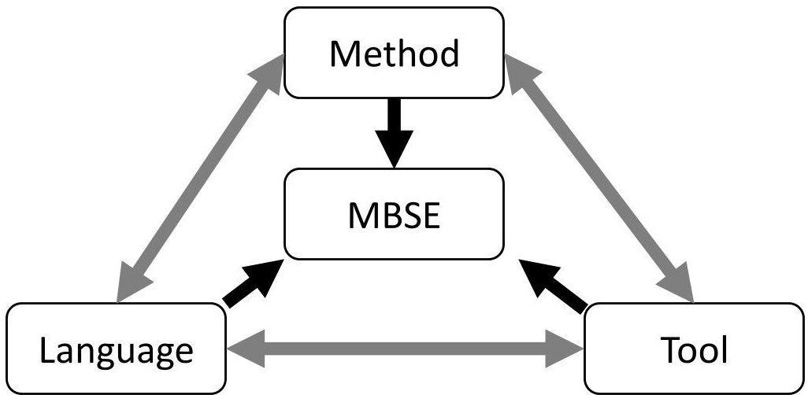
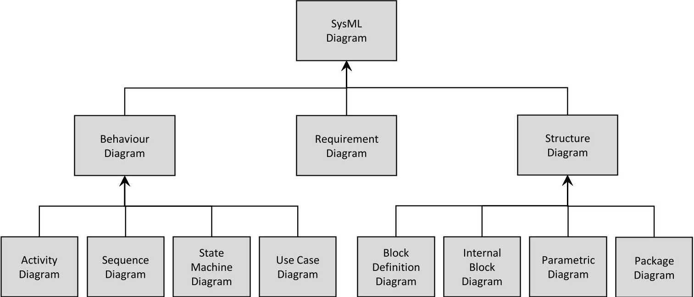
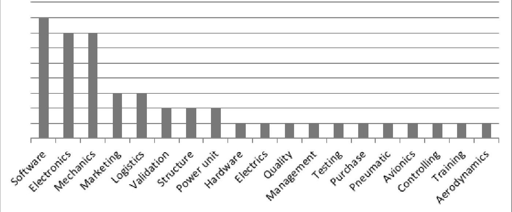
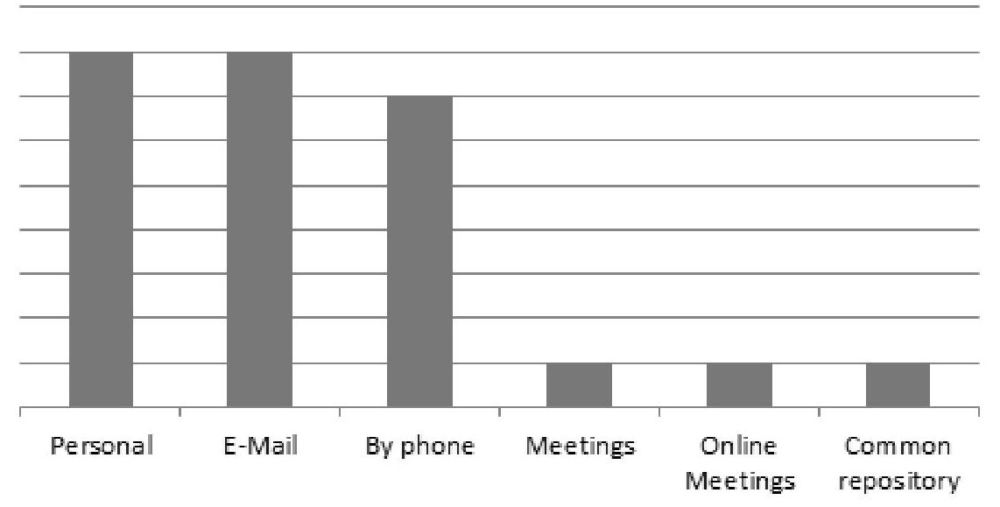
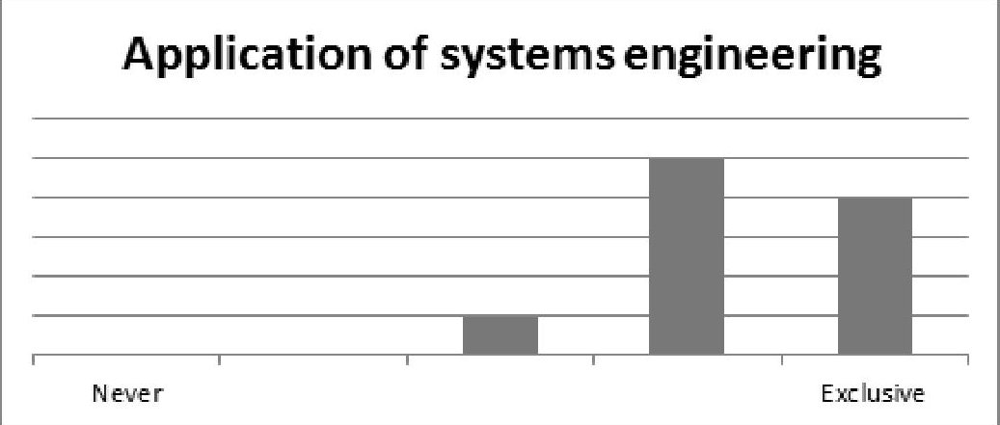
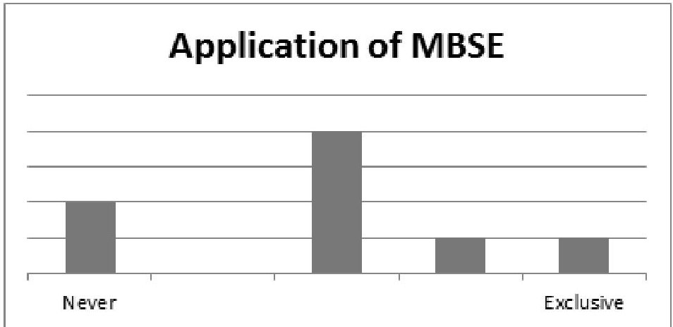
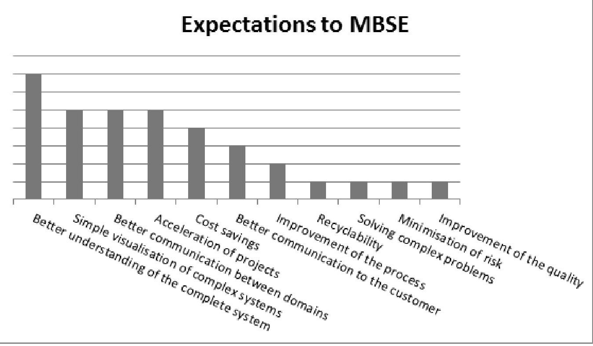
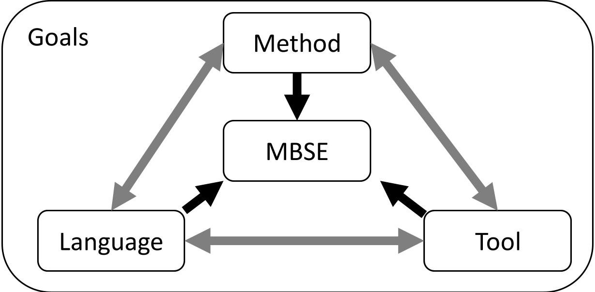

<!-- PDF_PAGE: 1 -->

# INTEGRATION OF MBSE INTO EXISTING DEVELOPMENT PROCESSES - EXPECTATIONS AND CHALLENGES

Kößler, Johannes; Paetzold, Kristin

Universität der Bundeswehr München, Germany

## Abstract

The development of technical products is faced with an increasing amount of data of different domains. The communication between them is becoming more difficult. Additionally the dependencies between this data is getting more and more unclear. MBSE is an approach trying to improve this situation with the use of system models. The use of this models instead of a document-based storage allows a better consistency of the data and supports the visualization and understanding of the complete system. But the application of MBSE and its integration into existing environments is a difficult task. The integration of domain specific data causes a high effort while the benefit is often unclear or arises later on. Based on selected data from the industry the application is often started within a wide field of the company and often focusing on SysML trying to find a method to adapt it to the needs. This paper suggests to clearly define goals that have to be achieved with the use of MBSE. The goals serve as measurable criteria to evaluate the success of MBSE. Additionally they define the content that has to be integrated into the system model of MBSE as well as the addressees and operators.

Keywords: Systems Engineering (SE), Design process, Organisation of product development, Evaluation

Contact:

Johannes Kößler

Universität der Bundeswehr München

Institut für Technische Produktentwicklung

Germany

johannes.koessler@unibw.de

<!-- PDF_PAGE: 2 -->

## 1 INTRODUCTION

The product development of technical products is faced with an increasing complexity of the systems that have to be developed. Beside other reasons, the increasing number of domains involved during the development process have to be mentioned. This results in a more and more complex organisation of the development process. One of the main challenges is the coordination of the different domains along the development process within the company but also the different interests of external stakeholders.

## 1.1 Problem description

The development of new methods in support of the new challenges of the development of technical products is not absolutely necessary. Rather it is necessary to integrate existing methods and approaches in the current development processes used in the industry. This development process is currently faced with an increasing number of domains that have to be coordinated. Additionally each domain needs different methods and tools to fulfil their specific development tasks. As a result not only the amount of data is increasing but also the different types of data which have to be communicated between domains and other external stakeholders. Model-based Systems Engineering (MBSE) is an approach that offers the possibility to support this communication and organisation. It is based on the approach of Systems Engineering (SE) and tries to support the development with the use of system models during the entire life cycle of a product.

## 1.2 Objective

Although MBSE is a promising approach to support the current challenges of the product development it is still not widely spread. This paper tries to identify reasons which are restraining the use of and the introduction of MBSE within the development process. Additionally this paper tries to identity expectations connected to the application of MBSE. Based on a survey the current use or the planned introduction of MBSE is collected. Some participants of the survey were additionally invited to a workshop to discuss their experience and answer the questions: How can MBSE be integrated into existing development processes? Which reasons prevent a successful integration of MBSE and how can the integration be supported?

## 2 STATE OF THE ART AND RELATED WORK

This section describes the topics which serve as a basis for this paper. First of all the approach of Modelbased Systems Engineering and its advantages are described. Beside the approach of MBSE the Systems modelling language (SysML) is described. Although this language is only one example of a language used for MBSE, it turns out to be the default language within the considered group of participants of the survey and the workshop.

## 2.1 Model-based systems engineering (MBSE)

As a result of the increasing amount of domains the product development is faced with a very heterogeneous environment in terms of tools and methods. Each domain is currently using different tools to fulfil its tasks and produces different types of data. For example there are different types of simulation models like FEM or CFD. The management of this different models and data is addressed by the approach of MBSE. This approach is supporting the entire life cycle of a product with the formalized use of models (INCOSE 2007). It is not only considering the different needs of different stakeholders (Anderl et al. 2012) but also supporting the entire development process (Weilkins 2008). One of the core advantages of MBSE is the storage of data within system models. By transferring the document-based storage of data into a model-based storage the data can be accessed easier and the dependencies between data is more transparent. Thereby the system model of MBSE is not replacing the existing domain specific models, but it is complementing those (Alt 2012). This causes an additional effort for the model generation. The challenge is to identify the data needed within a system model to make this effort manageable. The application of MBSE is based on three pillars that have to be considered. They are a language, a method and a tool (Delligatti 2014). These topics and there relations are shown in the following Figure.

<!-- PDF_PAGE: 3 -->

Figure 1. Pillars of MBSE (Delligatti 2014)

As shown in Figure ,1 the method, language and tool serve as a fundament of MBSE. Although each pillar can be independently chosen they influence each other a lot. Until now there is a big variety of possibilities.

The language defines the grammar and thereby which elements and relationships can be defined within a model. Some examples are:

- UML

- SysML

- IDEF

- BPMN

- Modelica

- The method describes how the language has to be used to generate the actual system model. For example:

- INCOSE Object-Oriented Systems Engineering Method

- Weilkins System Modeling method

- IBM telelogic Harmony-SE

- The tool is necessary to support the generation of a system model. Basically it provides a user interface to facilitate the generation of the model. Some example for tools are:

- Agilian

- Enterprise Architect

- Rhapsody

- Modelio

A lot of research currently is focussing the topic method. The goal thereby is to develop methods to apply MBSE for certain tasks. The variety of these research is very high. On the one hand the use of SysML is demonstrated to generate an executable simulation based on a SysML diagram in early phases of the development process (Koßler and Paetzold 2015). On the other hand MBSE is used to improve the complete development of cybertronic systems (Cadet et al. 2015). This approach is focussing on the integration of data and information of different domains during the development process of cybertronic systems. This are only two examples of the research currently undertaken. Until now there is no standardized language, tool or method the apply MBSE. But SysML is turning out to be the most popular language for MBSE (Delligatti 2014).

## 2.2 System modelling language (SysML)

As mentioned in 2.1 the application of MBSE requires a method, a language and a tool. There are different possibilities for each of these three topics. The System modelling language (SysML) is one possibility of a language that can be chosen for the use within MBSE. The origin of SysML is the modelling language Unified Modelling Language (UML) which is mainly used for modelling of software in the IT industry (Zuser et al. 2004). The language UML was adapted by the Object Management Group Inc. to support the modelling of complete technical systems and integrating the needs of different domains. The concept of SysML consists of a central system model which can be displayed via different types of diagrams. Each of these diagrams offers a different view to the same system model und thereby supports different requirements to the view. SysML contains of three main

<!-- PDF_PAGE: 4 -->

types of diagrams. These are behaviour diagrams, structure diagrams and a requirement diagram. The complete taxonomy base on Friedenthal (Friedenthal et al. 2009) is shown in the following Figure.

Figure 2. SysML diagram taxonomy (Friedenthal et al. 2009)

Most of these diagram types were defined within UML. But the diagram types Block Definition Diagram, Internal Block Diagram and Activity Diagram were modified from UML 2 and the diagram types Requirement Diagram and Parametric Diagram were newly added. With this changes of the specification of UML the modelling of technical systems was improved. Although each diagram offers a different view including different data each diagram is using the same system model. This requires a higher effort to actually generate the system model but at the same time it offers the possibility to use each diagram for its desired purpose. As SysML is designed to support a generation of a complete system model it can be applied and adapted by different domains. But based on its origin of UML it takes more training for some domains like mechanical engineering. Besides SysML is not designed to support a specific development task but to support the generation of a common fundament.

## 3 USE OF MBSE WITHIN THE INDUSTRY

As already mentioned in section 2 MBSE offers possibilities to support the handling of the current challenges within the development of technical products. But the integration of MBSE into existing development processes is still an open task. This paper analyses the current use of MBSE, challenges during the integration of MBSE into development processes and tries to find possible solutions to support the use of MBSE. To achieve this a survey has been started to collect data which represents the current state of the use of MBSE. Additionally workshops have been initiated to discuss problems and possible solutions of the integration of MBSE.

## 3.1 Survey about the use of MBSE within companies

The questionnaire generated for the survey covers three general topics. First of all the general use of Systems Engineering and its integration into the development process is requested. This is followed by a topic of the use of MBSE and finally the use of Systems Modelling Language is requested. To generate comparable results we focused mainly on the automotive and the aerospace industry. Those industries are dealing with complex products and have to include a lot of different domains. Thereby MBSE should offer a good support. The survey addresses developers and system engineers that are currently working with MBSE or are planning to introduce MBSE. The survey tries to find out what are the needs and expectations of the people that have to deal with MBSE during their daily work. The results reflect the outcome of ten interviews. The statistical relevance of the survey will be proved when the interview process will be finalized. Preliminary results are presented in the following. The methodology used for generating the group of addresses for the survey is based on the focus group methodology which is a qualitative study.

<!-- PDF_PAGE: 5 -->

## 3.1.1 Results

The first part of the survey covers the use of systems engineering and MBSE as well as the domains involved during the development. Based on the goal of MBSE to support the interests of different stakeholders the participants were asked which domains are actually included during the development process. The result is shown in Figure 3.

Domains included in the development

Figure 3. Domains included in the product development process

Figure 3 shows a high number of different domains included into the development process. The main domains are the software development, the electronical engineering and mechanical engineering. Although we are focusing on the automotive and aerospace industry the domain software is the most important domain.

Based on the additional goal of MBSE to transfer the document-based storage of data to a model-based storage the participants were asked how they typically exchange the data with different domains. This is shown in Figure 4.

Exchange of data between domains

Figure 4. Exchange of data between domains

Most of the data is exchanged during a direct contact between different individuals. Almost no structured way was named. Mainly personal contact, phone calls and emails are used.

The next topics of interest are the application of systems engineering and the application of Model-based systems engineering.

<!-- PDF_PAGE: 6 -->

Figure 5 is showing how systems engineering is integrated into the current development process.

Figure 5. Application of systems engineering

As Figure 5 shows systems engineering is quite common within the group of the participants of the survey. As MBSE is based on Systems Engineering Figure 6 is showing the application of MBSE.

Figure 6. Application of MBSE

Figure 6 shows that MBSE is not yet widely-used. But it is currently evaluated or at least planned to start a project for evaluation. The next question considers the expectations to the application of MBSE to identify the main reasons for trying to integrate MBSE into existing development processes or spending effort to evaluate its benefit. The results are shown in the next Figure.

Figure 7. Expectations to MBSE

<!-- PDF_PAGE: 7 -->

There are three main reasons for applying MBSE. First of all MBSE is expected to support the understanding of the complete system. This includes the visualisation of the system. The second expectation is the improvement of the communication between domains as well as the communication to the customer. A third expectation is the reduction of costs by increasing the speed of the development process, improving the quality of the result or generally reducing costs.

## 3.1.2 Interpretation

The survey shows a high diversity of domains included in the development process. Although there are some main domains (e.g. software development, mechanical engineering) many other domains with specific tasks have to be considered (e.g. avionics). Based on this diversity the exchange of data is not yet well structured. The document-based storage of data causes a high effort during the communication between different domains. This seems to be solved by the direct communication between individuals. The use of MBSE could potentially improve this communication process by offering a central system model for storing data.

Systems engineering seems to be mostly implemented and part of the daily work. But model-based systems engineering is not that much implemented. Many participants are using it just partly. Nevertheless the application of MBSE is an ongoing task within each company. The reasons and expectations of these projects are shown in Figure 7. As this Figure shows there are two main reasons for the application of MBSE. First of all MBSE should improve the handling of the complexity of the development process by visualising and understanding the developed systems. The second main reason is the support of the communication within the development process. Thereby the communication between different domains as well as to the customer are considered. These two main reasons also lead to further expectations like decreasing the project time and lowering the costs during the development.

## 3.2 Challenges and expectations to MBSE

Based on the preliminary results of the survey a first workshop was undertaken. Some participants of the survey were asked to present their experience with MBSE and how they are trying to use MBSE. After that questions concerning the problems with the use of MBSE as well as possible solutions were discussed.

## 3.2.1 Results of the workshop

The first application of MBSE was its integration into the very early phase of the development process namely the generation of a proposal. The reasons for focusing on this early and single phase was the possibility to compare the results leading to a proposal with and without the use of MBSE. Additionally this early phase does not include too many domains and does not need to deal with a lot of data. This approach uses SysML and a commercial tool to describe a system and the dependencies of the requirements to the system. By combining different solutions to a complete system the fulfilment of the requirements can be calculated as well as the critical requirements of each solution. This use of MBSE can be done by a single person (engineer) and does not cause a higher effort (Omiciuolo et al. 2016). This application does not accelerate the generation of a proposal. Instead of the transparency and traceability of the proposal should be improved.

The second application of MBSE is trying to integrate a wide range of different data of different domains and phases into a system model. This application is also using SysML to model the system. The used tool is again a commercial tool and has been expanded with more functionality and interfaces to different existing IT-tools. The goal of this application is to get to know the dependencies of data between different domains and to use a system model to represent this data. As this application is integrating a lot of data a high effort was spent for developing interfaces to existing tools to make existing data accessible for the system modelling. Additionally a lot of effort was spent to keep the data within the system model and the connected IT tools consistent. Until now this application has not proven its benefit. Currently a different language and method is evaluated.

After the presentation of the different approaches two questions have been discussed.

- What are the problems of using MBSE?

- Which challenges occur during the application of MBSE and how to solve them?

The mainly named problems of using MBSE are:

<!-- PDF_PAGE: 8 -->

- The system models of MBSE are not useful for supporting the simulation processes. They are used for coordinating different domains and the exchange of data between these domains. Therefore different domains often do not realise the benefit of this models for their development tasks.

- As the benefit of a system model is not obviously for a single domain at the beginning the effort necessary for its generation is not always accepted.

- Some domains like mechanical engineers are not able to understand SysML behaviour diagrams. These domains additionally do not have time to improve their knowledge about SysML. This reduces the acceptance of the system model. Other domains like software developers are familiar with UML and can easily apply SysML.

- A system model cannot be used for a communication between domains in particular for the communication with external stakeholders. Legal requirements to the documentation of a technical product require documents. Therefore a high effort is necessary to include the required data into a system model to generate this documents.

- The benefit of the use of MBSE is not known. Therefore its application is often tested within smaller projects without a customer request. But this projects often do not have enough budget to become successful.

- Currently a lot of IT-tools are used within the development process. So the application of MBSE requires the development of a lot of interfaces to these tools. To keep the consistency of the data additionally a high effort is necessary during the entire development process.

- Same named challenges occurring during the application of MBSE:

- The application of MBSE should focus on smaller projects or partitions of a company. The application within bigger projects or complete companies causes too much effort and the benefit can be seen after a long time.

- The use of MBSE should be demonstrated in different phases and smaller activities during the development process. This shows the benefit of MBSE and generates acceptance for MBSE. After that MBSE can be integrated to support wider areas within a company.

- The approach of MBSE can also be demonstrated without using SysML. Instead of existing modelling tools and languages can be used. The application of MBSE is often equalised with the application of SysML.

## 3.2.2 Interpretation

The application of MBSE is an ongoing task within the industry. The expectations to its improvements in terms of the development process are high. Therefore the industry is willing to spend some effort. But the integration of the wide field of a company's domains produces a very high effort while the improvements for the process arise comparatively late.

Based on the workshop there are some different reasons. First of all the integration of MBSE is done with a lot of domains. But it takes a lot of time to improve the situation. Additionally the improvements of the use of MBSE are not clearly defined.

A second reason is based on the selection of a language, a tool and the method. It seems that the application of MBSE is often defined as the use of SysML. Based on this language a certain tool is selected. However with this selections the application of MBSE is started. The definition of the desired improvements is done after that.

Another challenge of the application of MBSE is the modelling language e.g. SysML. Based on the experience of the user the diagrams of SysML are comparatively good (software development) or hardly (mechanical engineering) understandable. This influences the use of SysML and the acceptance of MBSE as the user does not realize its benefit but has to handle additional tasks. Of course similar problems occur with every modelling language.

## 4 DISCUSSION & RESULTS

As a result of the requirements to technical products the amount of different domains involved in the development is increasing. This leads to a very heterogeneous structure of the data generated during the development. Therefore the communication between the domains is one of the main challenges that have to be solved. Currently this is handled with a direct communication between individuals requesting the required data.

<!-- PDF_PAGE: 9 -->

In this situation MBSE is supposed to improve this situation with the introduction of system models that can be used by different domains. But the generation of this system models requires a high effort and additionally an integration of many IT-tools that are currently used within different domains. Without the IT-tool interfaces the maintenance of the models causes additional effort during the entire development process. This can lead to critical data inconsistencies.

A high impact of the success of MBSE is due to the selected language. This language influences the possible tools for its application and the method used. Currently a lot of attention is paid to SysML as it offers a wide range of application. But this language must not be the best choice for every application. Based on the different domains working with a system model a SysML model can be understandable very easily e.g. software development domain or hardly understandable e.g. mechanical domain. This influences the acceptance of the system model as well as the acceptance of complete MBSE application. Unlike MBSE the domain specific development is applying different tools and methods to support specific tasks. MBSE is not supporting specific tasks but is generally supporting the development of systems. Therefore a possible support for the integration of MBSE into existing development processes is a clear definition of the goals that have to be achieved with the application of MBSE. These goals serve as a fundament for the selection of a method, tool and language for MBSE (Figure 8). This can be achieved for example with a limitation of domains using MBSE. Additionally the data and information can be defined which is necessary to create a system model useful for the defined domains. Moreover the operators of the system model have to be defined.

Figure 8. Application of MBSE

With the description of MBSE goals the application of MBSE should be supported with rateable requirements. The goals describe what is necessary to successfully apply MBSE. They will also support the evaluation of different choices that have to be done during the introduction of MBSE e.g. SysML or another modelling language.

To support the definition of goals a guide line is currently being developed based on the ongoing survey and the experiences of the application of MBSE within the industry. Some topics included within the definition of goals are

- Definition of areas addressed with MBSE (domains)

- Definition of data needed within a system model (data exchange)

- The expected results and improvements of the use of MBSE (measurable criteria)

- Addresses of the system model (user and operator)

## 5 CONCLUSION

The development of technical products is faced with an increasing amount of data produced with different domains. As every domain is using specific tools and methods the communication between them is becoming more and more difficult. Additionally the dependencies between the different requirements and the technical solutions to fulfil them are getting more and more unclear.

MBSE is an approach trying to improve this situation with the use of system models accessible for different domains. With the use of this system models instead of a document-based storage of data a

<!-- PDF_PAGE: 10 -->

better consistency of the data and a better support of the visualization and understanding of the complete system can be achieved. This visualization is based on a system model which offers different types of views on it.

But the application of MBSE and its integration into existing environments is a difficult task. The different domains require and produce a huge amount of data. Its integration into a system model causes a high effort while the benefit is often unclear or arises later in the development process.

Based on selected data within the industry the application is often started within a wide field of the company. Additionally a high attention is paid to the use of SysML while trying to find a method to adapt it to the needs. This paper suggests to clearly define goals that have to be achieved with the use of MBSE. The goals on the one hand serve as measurable criteria to evaluate the success of MBSE. On the other hand they define the content that has to be integrated into the system model of MBSE as well as the addressees and operators. The development of the goals is an open task. Currently a guideline is being developed to support their definition.

## REFERENCES

Alt, O. (2012), "Modellbasierte Systemwicklung mit SysML", Carl Hanser Verlag, München, Germany.

Anderl, R., Eigner, M., Sendler, U., Stark, R. (2012), Smart Engineering - Interdisziplinäre Produktentstehung acatech DISKUSSION.

Cadet, M.; Meissner, H.; Hornberg, O.; Schulte, T.; Stephan, N.; Schindler, C.; Aurich, J. (2015),

Cadet, M., Meissner, H., Hornberg, O., Schulte, T., Stephan, N., Schindler, C., Aulich, J. (2015) "Modellbasierter Entwicklungsprozess cybertronischer Produkte und Produktionssysteme - Grundlagen", erste Ansätze und weiteres Vorgehen, Stuttgarter Symposium für Produktentwicklung (SSP2015), Stuttgart, 19.06.2015, Fraunhofer IAO Stuttgart.

Delligatti, L. (2014), "SysML Distilled - A Brief Guide To The Systems Modelling Language, Addison-Wesley", Upper Saddle River, New Jersey.

Friedenthal, S., Moore, A., Steiner, R. (2009), "A Practical Guide to SysML: The Systems Modeling Language", Morgan Kaufmann Omg Press.

INCOSE, "Systems Engineering Vision 2020", Technical Operations International Council on Systems Engineering (INCOSE).

Koßler, J., Paetzold, K. (2015), "Support of the system integration with automatically generated behaviour models", International Conference on Engineering Design 2015, Milan, July 27-30, 2015, Proceedings of the 20th International Conference on Engineering Design (ICED 15) Vol 11:Human Behaviour in Design, Design Education, Milan, pp. 21-30

Omiciuolo, M., Paetzold, K., Baader, M., Thiel, M., Förster, K.-P., (2016), "Trade-Off for Space Mechanisms Actuator Technology via a General Purpose Language and Domain Specific Simulations Framework", In: Wener, P., Flores, P., New Trends in Mechanism and Machine Science, Spinger International Publishing, pp. 21-28

Weilkins, T. (2008), Systems Engineering mit SysML/UML: Modellierung, Analyse, Design, dpunkt Verlag, 2nd Edition, Heidelberg, Germany.

Zuser, W., Grechenig,, T., Köhle, M. (2004), Software Engineering mit UML und dem Unified Process Pearson Studium, Germany.