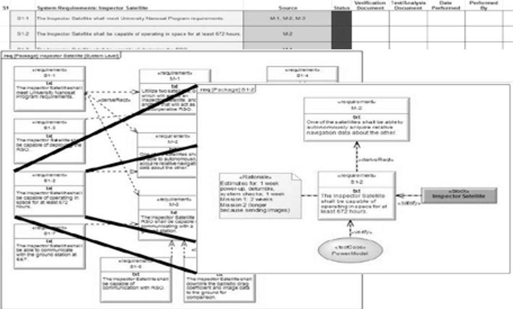
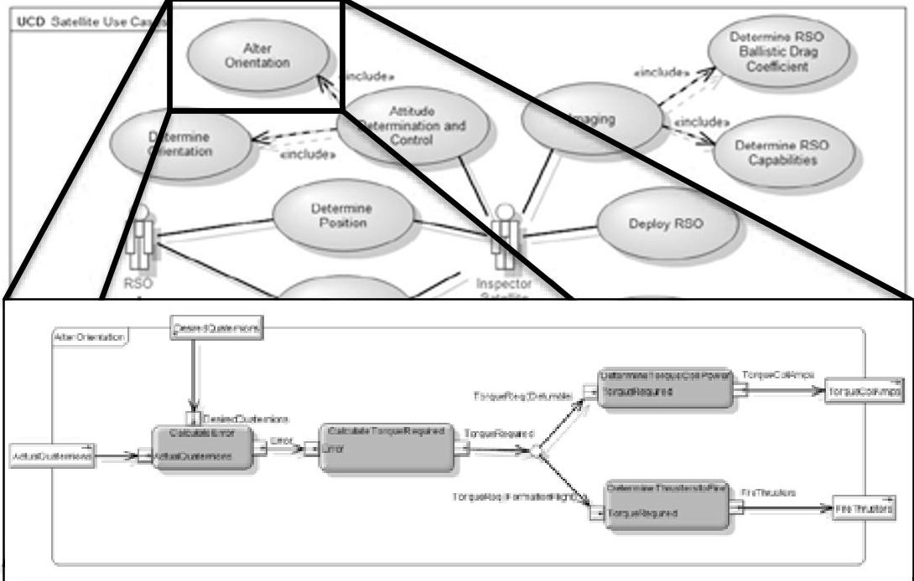
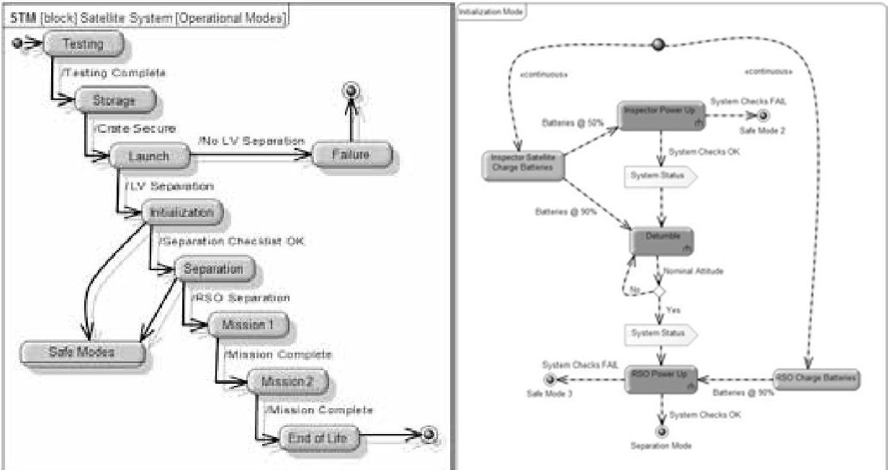
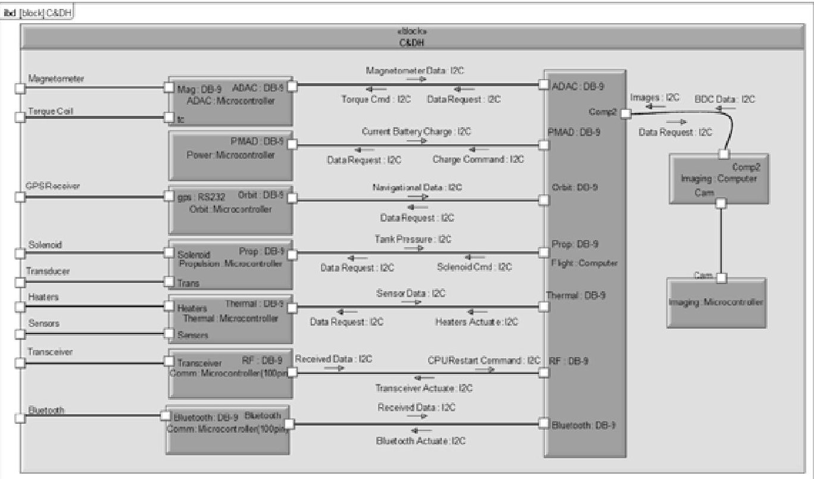

<!-- PDF_PAGE: 1 -->

Engineering Management and Systems Engineering Faculty Research & Creative Works

01 Jan 2012

# Application of Model-Based Systems Engineering on a University Satellite Design Team

Steven Corns

Dustin Nottage

Missouri University of Science and Technology, cornss@mst.edu

Follow this and additional works at: https://scholarsmine.mst.edu/engman_syseng_facwork

Part of the Operations Research, Systems Engineering and Industrial Engineering Commons

If you have a disability and have trouble accessing this content, please submit an accessibility request form.

## Recommended Citation

D. Nottage and S. Corns, "Application of Model-Based Systems Engineering on a University Satellite Design Team," Procedia Computer Science, vol. 8, pp. 207 - 213, Elsevier, Jan 2012. The definitive version is available at https://doi.org/10.1016/j.procs.2012.01.044

This work is licensed under a Creative Commons Attribution-Noncommercial-No Derivative Works 4.0 License.

This Article - Conference proceedings is brought to you for free and open access by Scholars' Mine. It has been accepted for inclusion in Engineering Management and Systems Engineering Faculty Research & Creative Works by an authorized administrator of Scholars' Mine. This work is protected by U. S. Copyright Law. Unauthorized use including reproduction for redistribution requires the permission of the copyright holder. For more information, please contact scholarsmine@mst.edu.

<!-- PDF_PAGE: 2 -->

New Challenges in Systems Engineering and Architecting Conference on Systems Engineering Research (CSER) 2012- St. Louis, MO Cihan H. Dagli, Editor in Chief Organized by Missouri University of Science and Technology

# Application of model-based systems engineering on a university satellite design team

Dustin Nottage $ ^{a} $ , Steve Corns $ ^{b} $

Missouri University of Science & Technology, 205 EGMT, 600 W. $ 14^{th} $ St, Rolla, MO 65401

## Abstract

System Engineering is a foundation of the Missouri S&T's Satellite Design Team, although it is not explicitly stated at all times. However, implementation of the systems engineering process within a student design team presents unique challenges. Student design teams have a high personnel turnover, a limited time commitment due to classes, some new members have little to no experience, and a sometimes lack of motivation to participate since it is volunteered time. The largest problem on the team is getting the new members knowledgeable about the system so they can start contributing as fast as possible. The other big problem is keeping documentation about the system design consistent and up-to-date. With a model-based approach, system specifications are updated all at once, and kept consistent throughout the design. The model also allows the team leadership to "walkthrough" the design and design process with the newer members. Diagrams sometimes help better explain design than word documents, especially to visual learners. The model will not completely replace documentation, it is used to help augment the learning process for new members, and keep better control of traceability.

$ \textcircled{c} $ 2012 Published by Elsevier Ltd. Selection Open access under CC BY-NC-ND license. "Keywords: Model-based Systems Engineering; Satellite; SysML; University Team;"

## 1. Introduction

University design teams typically suffer from a few problems including high personnel turnover, a limited time commitment due to classes, lack of experience and knowledge, and keeping consistency across all subsystems [8]. One of the current methods used on the satellite team is documentation of

<!-- PDF_PAGE: 3 -->

designs, tests, procedures, programming code, etc. Documents include a revisions section to track changes and who made the changes. With this large amount of documentation, a document tree is employed to organize the documents across all subsystems. Even with review checks, there are sometimes errors in these documents. Design changes are overlooked, or understanding of the system is lost with a group of new team member. A model-based systems engineering (MBSE) approach can address the consistency and knowledge problems. A specification that is altered in one subsystem will be updated across the whole system. Traceability can be enhanced by connecting a subsystem design or activity to requirements. Subsystems will understand better which requirements they need to meet, and management will know how the requirements are met. With the model, interactions between the subsystems can become clearer, and have an easy to access repository of hardware specifications. A member of one subsystem will be able to find out what material the structure is made of without having to read through many documents. The purpose of this paper is to start setting up a model of the satellite to highlight the interconnections, and later be introduced onto a university design team. This is a limited trial run, and only one of many possible methods for helping improve overall design consistency.

## 2. Background

## 2.1. Model-based systems engineering

MBSE takes a document-intensive system and moves the information into a single model. Advantages of this method are better communication between people working on different subsystems, enhanced design integration and the ability to easily reuse designs. MBSE supports the analysis, specification, design, verification, and validation of complex systems. These complex systems could include hardware, software, personnel, procedures, and facilities [3]. MBSE utilizes the Systems Modeling Language (SysML), developed by the Object Management Group (OMG), to display the system's information. SysML is an extension of UML, which is an accepted standard commonly used in software systems modeling. The model is represented through four main areas: requirements, behavior, structures, and parametrics. The requirement and parametric diagrams are new concepts implemented with SysML. The other two diagram types are expanded, or modified, from UML.

Model-based approaches have been implemented on other projects as well [2], [4], [6], [7]. Ramos, et al [6] discuss the role MBSE will have on future large, complex systems. Karban, et al [4] and Soyler, et al [7] explore applying MBSE to large telescopes and disaster management systems, respectively. Finally, Cole, et al [2] lay out techniques for using MBSE in early formulation of spacecraft concepts, from large projects to small satellites. A long term goal of this paper's project is to have a similar "virtual satellite" where simulations can be run before hardware is procured. These simulations would include orbital, thermal, structural, and operational analysis. Many of these projects apply MBSE to large scale systems, or projects performed by experienced professionals. The satellite project differs in size and type of personnel. Most the members are hearing about systems engineering for the first time.

## 2.2. M-SAT Satellite Project

The M-SAT Design Team from Missouri University of Science & Technology is currently participating in the Nanosat 7 program which is a joint program between the Air Force Research Laboratory's Space Vehicles Directorate, the Air Force Office of Scientific Research and the American Institute of Aeronautics and Astronautics. The purpose is to "educate and train the future workforce through a national student satellite design and fabrication competition and to enable small satellite R&D, payload development, integration and flight test, Air Force related technologies" [1]. The competition lasts two years to design and fabricate a prototype satellite. There are multiple design reviews throughout

<!-- PDF_PAGE: 4 -->

the two years where documentation is submitted and reviewed, and presentations given. The winning team will get the chance to launch their satellite as a secondary payload on a launch vehicle.

The primary objective of the satellite team is to fly two satellites that will operate in close proximity. One satellite will act a Resident Space Object (RSO), and the other as an Inspector satellite. The Inspector satellite will attempt to calculate the Ballistic Drag Coefficient of the RSO. The secondary objective is to circumnavigate the RSO and create a 3D model from images to ascertain the RSO's capabilities. Much of the design is heritage from previous competitions to reduce the design time required, helping the satellite be completed on time. The team does not exactly follow the systems engineering process, however, each of the design choices have been researched thoroughly and made sure they still meet the requirements and mission. At the time of this writing, many of the designs have been selected, and details about those designs documented. However, some of the high level information is still limited, or undocumented.

Previous members of the satellite team have laid some ground work for establishing systems engineering on the project [8], and methods of management for developing subsystems [5]. Stewart talks about creating the role of the Chief Engineer, which is a lead Systems Engineer position, and using standard practices for setting up the mission, requirements, and functions. The Chief Engineer position is tasked with verifying that requirements are met and facilitating communication between subsystems.

## 3. Modeling the Satellite System

## 3.1. Requirements

Since the NS-7 program started seven months prior to starting the model, some of the information had already been developed and documented. First, the requirements are put into the model. These are already in a worksheet format that includes id#, requirement, source, verification and testing documentation. This is a straight-forward transfer of information from document to model. Although, it does allow for review of the requirements, and modifications were made. One area that is missing in the document is a rationale for the requirements. In the MBSE tool, adding rationales is incorporated in nearly all aspects of the model. The benefit of adding the rationales is added details about where the requirement is developed from aside from the source requirement. For example, many of the structures requirements come from University Nanosat Program requirements provided in the User's Guide. The rationale can point any reader to the specific section of the User's Guide where they talk about the requirement. Another example is the minimum time required to operate in orbit in order to complete the mission. There was a specific value, but no information as to where the value came from. In the rationale, estimates are added to include time required for detumble and status checks, mission 1, and mission 2. Adding a rationale is not specific to a MBSE approach. A rationale column is now part of the original requirements document. However, without using the MBSE tool, the rationale may still be an overlooked aspect of requirements.

In the model, it is also easy to separate and display information for anyone who wants extra information about a particular area. A diagram is created that shows all system level requirements of the Inspector satellite and which mission requirement they are derived from. If someone wants more information about system requirement 2 about operational period in orbit, they can double click on that requirement to open the S1-2 requirement diagram. That is, if the modeler creates that particular diagram and links it. The diagram (Fig. 1) displays the rationale, 'satisfied by', and 'verified by' information. Depending on the depth of the model, either the 'satisfied by' or 'verified by' could have linked diagrams that contain even more information.

<!-- PDF_PAGE: 5 -->

Figure 1. Transistion from documented requirements to high-level model to lower-level model.

## 3.2. Capabilities and Functions

Next, the high level capabilities and functions of the system are created, which was not in any updated documentation. A use case diagram (Fig. 2) is created and functions added that each satellite will have to perform. There is some overlap between the two satellites, such as 'Provide Power' and 'Determine Position'. The majority of capabilities belong to the Inspector satellite since the RSO will just be a beacon that transmits its position. As the depth of the model increases, activities and sequence diagrams will be linked to these capabilities, and satisfied by physical system components.

Figure 2. Satellite Use Case diagram showing a Use Case linked with an Activity Diagram.

The states, or operational modes, of the system are based off the previous competition's operational modes. They are then modified, deleted, or added to as required to fulfill the new mission. The previous

<!-- PDF_PAGE: 6 -->

modes were simple flowcharts in a document, with no overarching diagram showing transitions between the states. So the first step was to create a state diagram that included all states, and why, or when, the system will move from one state to another. Each state is then linked to an activity diagram that walks through the general activities performed during that state (Fig. 3). Eventually, many of these activities will link to diagrams that contain more activities required to perform that higher level activity. This is already a defined process within systems engineering. Where the model benefits in this project is providing an easier method to walk through the lifecycle of the system. Each of the high level activities terminates at the start of another state, and by double clicking the termination point the next state's activity diagram opens. A person looking through the model would be able to navigate through the functional flow like they would navigate through a website.

Figure 3. (a) Operational Modes of the satellite. (b) Initialization mode activities.

## 3.3. Physical System

The next major step is to start adding the physical hardware into the model, by first making a block definition diagram with the different subsystems on each satellite. Each subsystem block opens up to another block definition diagram containing the hardware for the particular subsystem. Some are more detailed than others, as not all designs are finalized. However, sometimes the lack of design information was due to lack of documentation. Many documents will contain design choices but lack specifications about the hardware, so some of the information is obtained from talking directly with leads of subsystems. With the model, all hardware information should be in one place and easy to find.

One issue that is noticed right away is determining what should be a block and what should be a part. A part is based off of a block. For example, in the attitude determination and control subsystem, there are three magnetic toque coils used for controlling orientation. Typically they are thought of as all being the same and would be modeled using one block with a part multiplicity of three (3). However, each torque coil has different dimensions, leading to different mass and power properties. This means each torque coil has to be its own block, which feels like added complexity. One area this works nicely is on the command and data handling section. The computers and microcontrollers are all the same type and model, respectively. So just one computer and one microcontroller block is required. The parts can then be designated further, like flight computer and imaging computer.

A benefit of the model is incorporating the mass and power budgets through parametric diagrams. Every piece of hardware will include mass, power, dimensions, and another information that may be

<!-- PDF_PAGE: 7 -->

useful. On the parametric diagrams, those values will be used to create the budgets. Now, any property changes in the system are updated in the parametric diagrams. Previously the budgets are generated in a worksheet format. It relies on power being informed of hardware changes or power seeking out information from other subsystems at intervals. This leaves room for error, especially on a student design team. Theoretically, with the model, leads would go into the model, change the values, and power will be automatically updated.

Finally, the part of the model where it could substantially help with understanding among team members is modeling the interactions between subsystems. These interface diagrams would represent the interface control document and data flow diagram already documented. The diagram is created under the command and data handling subsystem since the computers and microcontrollers are the common interface of any subsystem with hardware. The previous documentation was either hard to visualize on the interface control document, or hard to decipher on the data flow diagram. In the model, the data being transferred, the data protocol being used, and the interface types are included (Fig. 4).

Figure 4. Diagram displaying interaction between systems from the command and data handling subsystem viewpoint.

## 4. Conclusions

The purpose of creating this model is to help with system understanding among team members, make a central repository of information about the system that can be easily located, and create more easily understand presentation documentation for reviews. The model was started as the team was preparing for a preliminary design review. Many of the preparers did find the model to be useful as far as displaying information. As the model was being generated, information not previously known or understood was learned.

One observation was that there was always plenty of detailed information, but lacking with respect to the very high level information. Sometimes the members preferred jumping into the details of the subsystem since that means playing with hardware, and forgetting to think about the 'why.' With a diagram hierarchy like in MBSE, it forces you to create that very high level information to start the

<!-- PDF_PAGE: 8 -->

process of digging down deeper. During a general meeting, the modes of operations and their respective activities were presented. It allowed an open discussion among all members of the team, and resulted in activity flow changes. A similar approach could be done for all aspects of the satellite: physical, behavior, requirements, and parametrics. This would help inform all members about other systems they work with, but don't know many details about.

A problem discovered when creating the model was to organize it in a document-tree structure. This is counterproductive in some respects. The idea is to start off at one top level diagram, and be able to get any and all information you want by simply clicking through the linked diagrams. When sections are separated too much, you end up with some duplication and information again lost in a large folder hierarchy.

## 5. Future Work

The future work will entail introducing the completed, or near-completed, model to the rest of the team. Some of the leads have already been introduced to aspects of the model as it was being developed. The first step is determining an introduction approach that would be beneficial. The hypothesis is that the model will help some of the younger, less experienced members understand the system as a whole and understand how their system influences other systems. This will hopefully increase interactions between subsystems. If the model proves to be beneficial, then the next step will be determining how to keep the model working and up to date. There is also work that can be done integrating the SysML model with analysis software. This would allow the model to be simulated for structural, orbit, or thermal analysis. That information would also be part of the model, further improving the model's role as a central repository of information.

## References

[1] UN7-0001, Nanosat-7 User's Guide: University Nanosat-7 Program. Air Force Research Laboratory, February 2011.

[2] Cole, Bjorn, Chris Delp, and Kenny Donahue. "Piloting Model Based Engineering Techniques for Spacecraft Concepts in Early Formation." INCOSE IS 2010. June, 2010.

[3] Friedenthal, Sandford, Alan Moore, and Rick Steiner. A Practical Guide to SysML: Systems Model Language. Burlington, MA: Elsevier/Morgan Kaufmann, 2008.

[4] Karban, R., et al. "Exploring Model Based Engineering for Large Telescopes - Getting Started with Descriptive Models." Proceedings of SPIE - the International Society for Optical Engineering. 2008

[5] Miller, Shawn. "Management of a University Satellite Program with Focus on a Refrigerant-Based Propulsion System." Master's Thesis, Missouri University of Science and Technology, May 2010.

[6] Ramos, A. L., J. V. Ferreira, and J. Barcelo. "Model-Based Systems Engineering: An Emerging Approach for Modern Systems." IEEE Transactions on Systems, Man and Cybernetics Part C: Applications and Reviews. 2011

[7] Soyler, A., and S. Sala-Diakanda. "A Model-Based Systems Engineering Approach to Capturing Disaster Management Systems." 2010 IEEE International Systems Conference Proceedings, SysCon 2010.

[8] Stewart, Abbie. "A Guide to the Establishment of a University Satellite Program." Master's Thesis, Missouri University of Science and Technology, May 2007.