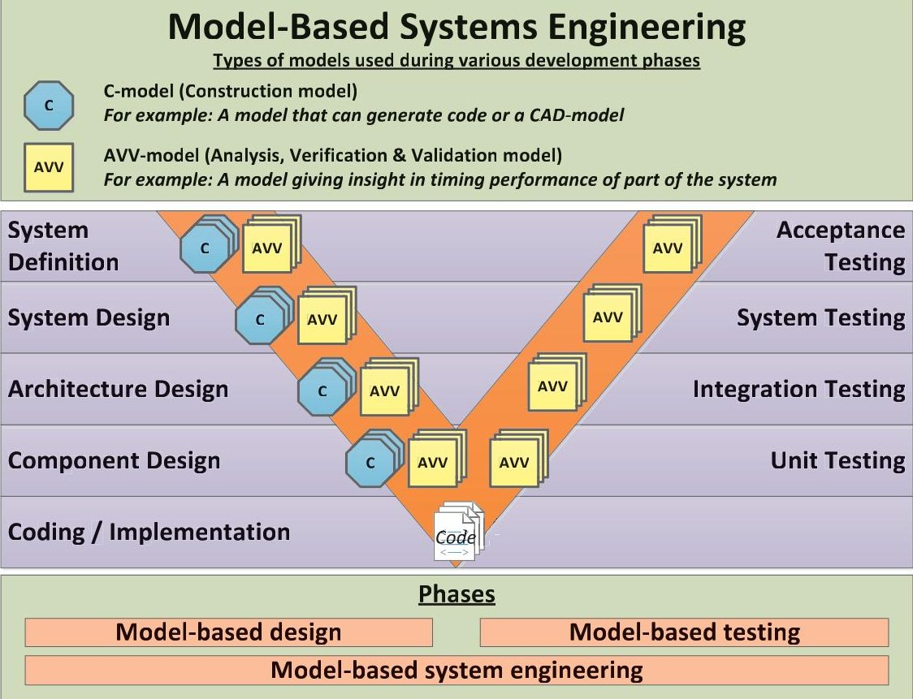
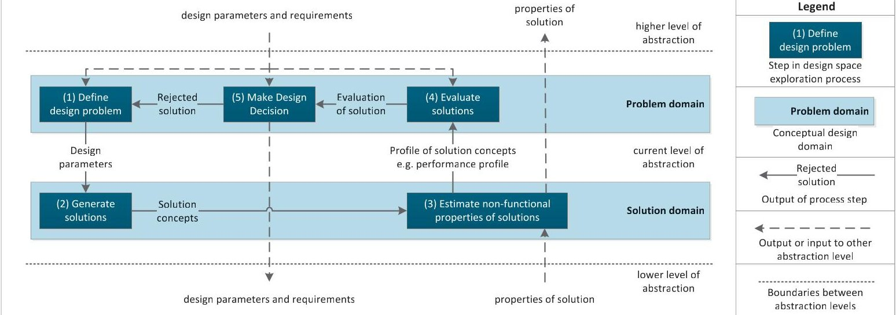
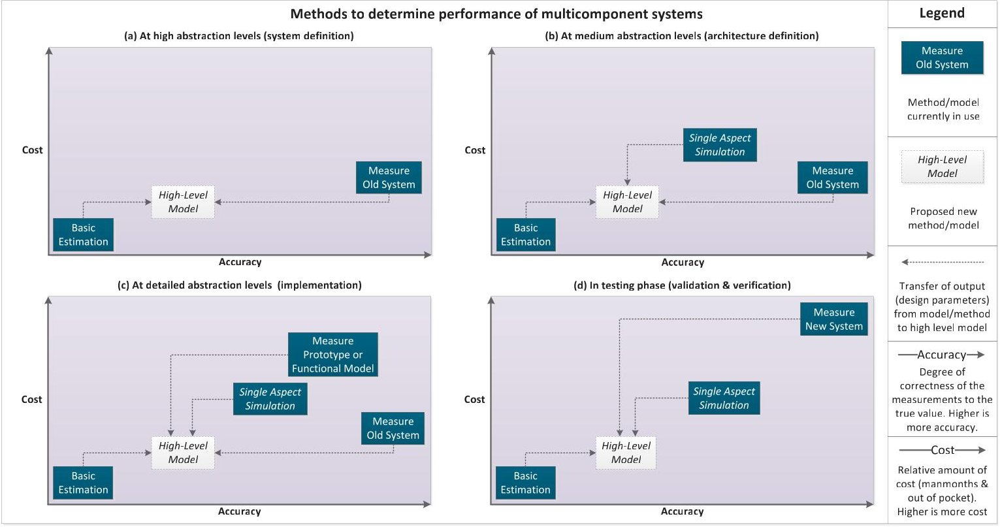

<!-- PDF_PAGE: 1 -->

Conference on Systems Engineering Research (CSER'13) Eds.: C.J.J. Paredis, C. Bishop, D. Bodner, Georgia Institute of Technology, Atlanta, GA, March 19-22, 2013.

# Requirements for high level models supporting design space exploration in model-based systems engineering

Steven P. Haveman $ ^{a^{*}}, $ G. Maarten Bonnema $ ^{a} $

$ ^{a} $Laboratory of Design, Production and Management, Department of Engineering Technology, University of Twente, P.O. Box 217, 7500 AE Enschede, The Netherlands

## Abstract

Most formal models are used in detailed design and focus on a single domain. Few effective approaches exist that can effectively tie these lower level models to a high level system model during design space exploration. This complicates the validation of high level system requirements during detailed design. In this paper, we define requirements for a high level model that is firstly driven by key systems engineering challenges present in industry and secondly connects to several formal and domain specific models used in model-based design. We analysed part of the systems engineering process at a company developing complex systems, by observing the design process and by analysing design documentation and development databases. By generalizing these observations, we identified several high level systems engineering challenges. They are compared to literature, focusing on reported systems engineering challenges and on existing approaches that incorporate high level models in model-based systems engineering. Finally, we argue that high level system models supporting design space exploration should be able to communicate information regarding design trade-offs (e.g. safety versus ease of use) effectively in a multidisciplinary setting. In our outlook, we propose how to continue our research, by recommending further research and defining a research question.

$ \textcircled{c} $ 2013 The Authors. Published by Elsevier B.V. Selection and/or peer-review under responsibility of Georgia Institute of Technology

Keywords: Model-based systems engineering; systems engineering challenges; high level models; communication; design space exploration; design trade-offs

## 1. Introduction

Successful development of complex systems is by no means an easy task, and is getting ever more complicated. Over the past decades, systems have grown larger, fulfil an ever increasing amount of functionality and have become more multidisciplinary in nature. In our view, the key factor in complex system development is multi-

<!-- PDF_PAGE: 2 -->

disciplinary communication [1]. This is deemed especially important when dealing with the transition from end-user and customer needs to technical requirements and vice versa, as this phase involves the highest number of different disciplines. The common solution to the increasing number of disciplines and components in systems engineering has been one of modularization. By gradually decomposing the system into more detailed blocks and defining interfaces between them, companies still manage to develop successful systems. This approach relies heavily on a well-managed integration process to deliver a system that satisfies the demands of customer and end-user. Unfortunately, Adamsson concludes in [2] that there are still plenty of examples of inadequate integration. As a result, the test and integration phase is often too long and unpredictable. This makes it challenging to stay ahead of the competition and to meet continually changing customer demands swiftly. In our research, we aim to employ model-based systems engineering techniques that rely on investing more effort in the design space exploration (DSE) phase by rigorously simulating and testing proposed designs prior to implementation [3]. The expectation is that this will lead to significant decrease in test and integration time, resulting in a shorter total development time.

An important aim for using model-based systems engineering is that requirements can be validated more easily throughout the development process and design decisions can be related directly to requirements in more detailed stages of development. The results of these validations have to be shared in effective ways between all relevant stakeholders. We focus on facilitating this validation and sharing process such that each stakeholder can meet their goals effectively, especially in regard to high level system requirements.

This paper is structured as follows. In section 2, the research is introduced, consisting of a problem description and the research process. After that, the paper discusses model-based systems engineering in section 3 and systems engineering challenges in section 4. These sections contain both literature reviews as well as industrial observations. In section 5, we discuss our findings and give an overview of the requirements for high level models supporting design space exploration. Finally, in section 6, an outlook on further research is given.

## 2. Research Approach

In this section we describe our research approach. First, we specify the research problem and research question for this paper and then we elaborate on which approach we employed to answer this research question. Our research methods ranged from a literature review to several activities at a company developing safety-critical complex systems. These activities are described in more detail in section 4.2.

Presently, most companies have good insight in the performance of their existing products. However, when developing new products or improving products, it is difficult to attain the same level of insight until the product is fully developed and tested. For example, in [4], Maier and Rechtin argue that one of the main problems in systems architecting is that applying a decision analysis is very hard due to the scale of a system.

In order to have an optimal design process, it is important to give designers as much insight as possible in consequences of design decisions during the DSE process. Specifically, in our initial industrial observations opportunities have been identified to further support DSE regarding various performance aspects, for example average performance and variation in performance. Currently, companies employ various methods and approaches that model system performance of single design aspects of the system very well. What could be improved on however, are methods that can model the complete system, including the influence of design aspects on one another.

As stated in the introduction, we intend to employ model-based design techniques to meet these opportunities. It has been shown that model-based design approaches are capable of supporting high level DSE [5]. The research question that we set out to answer in this paper is the following: What are requirements for high level models supporting design space exploration?

Our research has two distinct components; (1) to identify important characteristics of model-based systems engineering and (2) to identify important systems engineering challenges. Our aim is to derive requirements for high level models supporting DSE from both of these components. Our approach will be two-fold also. First, we review literature to create an overview of the two components mentioned above. Second, we observe the systems engineering process in industry to identify areas in the systems engineering process which show room for improvement and to ensure that our results will be applicable in industry. Results from these two areas are presented together per component. In this manner we can compare state of the art and state of practice directly.

<!-- PDF_PAGE: 3 -->

## 3. Model-based systems engineering

There are various well-known descriptions of the systems engineering process. Prime examples are the books of Blanchard and Fabrycky [6] and Maier and Rechtin [4] and the INCOSE Systems Engineering Handbook [7]. Historically, systems engineering has had a focus on documents to make requirements and design decisions explicit and record design information. Further design steps, test plans and new designs are based on these documents. The use of intrinsically ambiguous natural language in documents has prompted a lot of research to reduce the ambiguity of captured design information.

One of these approaches has been to explore a more formal definition of design information. Instead of capturing design information in documents, models are used to both define and link this information. The INCOSE ModelBased Systems Engineering Initiative has defined this in [8] as: "In a nutshell, model-based engineering is about elevating models in the engineering process to a central and governing role in the specification, design, integration, validation, and operation of a system". Generally, models are used in systems engineering to a greater or lesser extent. We consider all systems engineering processes in which models have a key role in one or more of the development phases to be part of model based systems engineering (MBSE).

In the remainder of this section, we discuss the role of MBSE in the development process of complex systems. After that, we go into more detail regarding DSE. Finally, we detail the relation between high and low level models.

## 3.1. Overview of Model-Based Systems Engineering

In the above introduction to MBSE, we shortly highlighted its philosophy. In this subsection, we will give an overview of how and when models are used in MBSE. When talking about complex system development, various development models come to mind. These are the waterfall model, the spiral model and the Vee-model [8]. The Vee-model puts more emphasis on the relation between design and testing [9], which is an important issue in MBSE. For this reason, it has been chosen as the development model of reference in the Allegio project [10], in which our research is positioned.

Figure 1 - Models used in model-based systems engineering, mapped onto the Vee-model. The two examples are discussed in the paper text.

<!-- PDF_PAGE: 4 -->

In Figure 1, we give an overview of MBSE based on a mapping on the Vee-model. In this overview, we show two types of models, namely construction models (C-models) and analysis, verification and validation models (AVV-models). C-models contribute directly to the construction of the system, while AVV-models are used to support development choices and to reduce risks in development [11]. An example of a C-model is a domain specific language (DSL) model that, based on a set of rules, is able to generate code that can be used in the actual system. An example of an AVV-model is a POOSL-model (the Parallel Object-Oriented Specification Language [12]) that is used to analyse the timing performance of a certain part of the architecture. We also consider for example requirements specification models to be C-models, as they are not part of the analysis of a system.

In [13], Baer and Azoff argue that in order to execute MBSE effectively, an integrated approach is necessary. This means that ideally, all models must be able to interact. However, linking models is by no means an easy task especially in system development processes, where multiple fields of engineering have to exchange information. Over the last years various standards have emerged, such as for example AUTOSAR [14], which finds its application in automotive design. Another approach has been to abstract from engineering domains. For example, 20-sim [15] uses a port based approach and is able to model mechanical and electrical processes similarly. In [16], an approach is presented that allows capturing of design information during complex systems development.

Currently, there are few approaches that effectively integrate high level models in MBSE. In these high level models, not only classical engineering domains play a role, but also business, customer and user needs have to be represented. In [17], Moneva et al. introduce the Design Framework, which is an approach that adds a meta-layer, called a design flow, that integrates models and viewpoints and also explicitly documents design decisions.

## 3.2. Design Space Exploration

As stated in our research approach, opportunities to improve design space exploration have been identified, mainly regarding improving the level of insight in design alternatives. In this subsection, we discuss this part of the design process. In [18], Kang defines DSE as "the activity of exploring design alternatives prior to implementation". DSE takes place many times during development, mainly in the left side of the Vee-model in Figure 1. We also argue that DSE is an iterative and creative process, using different abstraction levels in a single design phase. This is supported by for example Muller [19], who refers to this process as 'threads of reasoning' and by [20], where this is emphasized by using various types of thinking tracks.

In Figure 2 we illustrate a standardized DSE process consisting of five general steps. This overview is an adaptation of [21] and has been expanded with the distinction between problem domain and solution domain of [22]. The DSE process consists of the following five steps. (1) Define design problem; the first step in DSE is to define the design problem in such a way that DSE can be conducted. (2) Generate solutions; the second step is the generation of solutions. This means for example the mapping of various configurations of applications and platforms. (3) Estimate non-functional properties of solutions; in the previous step, mappings have been generated.

Figure 2 - Design space exploration for a certain component, adapted from [21] and [22]

<!-- PDF_PAGE: 5 -->

However, it is not yet known how this mapping affects for example the performance of the system. In this step, nonfunctional properties of solutions, such as performance, are estimated. (4) Evaluate solutions; after solutions have been generated and their non-functional properties are estimated, the solutions have to be compared to the requirements captured in the first step. (5) Make design decision; the final step is to make a design decision. After evaluating all generated solutions, a decision should be made whether a solution suffices, or further work is needed.

Especially the way solutions are generated and handled during DSE can differ greatly. Many companies use a so-called point-based process, which relies on defining a fixed solution, and altering this solution until it fits the problem. However, a successful other approach is set-based design, which has its origins at Toyota [23]. It relies on defining a design space that satisfies requirements and iteratively narrowing this design space until a final design is reached. This approach, if applied correctly with the mind-set that comes with it, will greatly reduce necessary redesigns of the system in later stages of the development process. Both approaches rely on various methods to estimate non-functional properties (step 3 in Figure 2). In our industrial observations, we identified various approaches used to determine the performance, a key non-functional property, of these safety-critical multicomponent systems. In Figure 3, we generalized and mapped these methods based on cost and accuracy and created four overviews, each for a different phase in the development process. Also, Figure 3 illustrates our view, which is that a high level model should integrate these results.

We will now shortly discuss each of the four current approaches shown in Figure 3. (1) The basic estimation is (usually) the initial assessment of a problem. It could even be a small sketch on the back of an envelope. It is useful to define the problem and identify areas that could become bottlenecks in the system under design. (2) Single aspect simulation only determines the performance of a single aspect. However, these results can contribute to insight in the overall performance of a system under design. (3) A commonly used practice is to create a prototype or functional model and measure its performance. This gives a decent indication of the performance of the actual system. (4) Finally, performance can be determined by measuring the actual system. In initial phases, only input can be used from measurements of an old system (if available). At the end of the development process, the new system can be measured. These measurements are used for validation, but can also be used in redesigns of the system if it is discovered that they are necessary.

There are few examples of high level models that support DSE. The Octopus toolset ([5] and [24]) encompasses several high level aspects, It contains for example an intermediate representation language, called DSEIR, which allows domain specific tools to be coupled to a range of analysis tools.

Figure 3 - Methods that can be used in design space exploration to determine performance of multicomponent systems

<!-- PDF_PAGE: 6 -->

## 3.3. High and low level models

So far, we have used the term high level model various times. In this subsection we would like to highlight the relation between high and low level models. When we consider models, higher and lower refers first and foremost to the left side of the Vee-model (see Figure 1). Here, higher level models are actually higher up in the Vee-model, in the earlier design phases. However, as was argued before, in one design phase, different levels of abstraction can be present as well. In this case, we speak of high and low level models as well.

A high level model building upon lower level models should be created in the same way an author creates a summary (high level model) for a book (a collection of lower level models). The author does not simply pick a few sentences and paste them after one another in the summary. If the author were to do this, the summary would probably not be very good. Instead, an author selects the most important pieces of information and creates a well written and instantly understandable summary. This is how we feel high level models should interact with lower level models; show the important information of those lower level models, make it easily accessible for all readers and show the relation and cohesion between the pieces of information from lower level models.

## 4. Systems engineering challenges

In this section, we answer the second part of our research problem; which systems engineering challenges should be addressed when developing a high level model for DSE. We first review several systems engineering challenges reported in scientific literature. After that, we report on our observations in industry.

## 4.1. Systems engineering challenges in literature

Numerous challenges are reported in scientific literature regarding the development of complex systems. An extensive review of major challenges has been given by Torry-Smith et al. [25]. The three challenges that they deemed as most important are discussed here briefly.

Difficulty in assessing the consequences of choosing between two alternatives; this, also in our view, key challenge has to do with the inherent complexity of these systems. Tomiyama et al. showed in [26] that experts can identify important relations between design parameters but do not fully understand their interaction. Fundamental work in this respect has been done by Suh, who argues that design should be uncoupled as much as possible using axiomatic design [27]. A practical approach is given in [28], where Sierla et al. introduce a framework to incorporate safety very early in the design process, which ensures that consequences regarding safety due to design decisions are more clear in the early stages of design.

Lack of a common language to represent a concept; while there are widely accepted modelling languages such as SysML [29], we feel that this challenge is still present due to the fact that many stakeholders involved in systems engineering do not have time or capabilities to master such languages. A3 models [30] have proven to be easily accessible for users of multiple disciplines, due to the combination of natural languages and easily accessible system views. However, this method currently only focuses on documenting and communicating information.

Transfer of models and information between domains (expert groups); this challenge is about the capability of engineers to employ system thinking skills, instead of mono-disciplinary thinking. In [31] a plethora of these cognitive characteristics, abilities and behavioural competences were identified. Also in [32], the need for multidimensional thinking skills is stressed. In [20], it is shown that these system thinking skills can be regarded as methods, which can greatly help the analysis and design of complex systems.

## 4.2. Observations

In order to get a good sense of the development process of complex systems, we carried out three distinct activities at a company developing safety-critical complex systems. We only briefly report about these activities, but will support our findings with some examples. The first activity was to carry various in-depth analyses, mainly based on design documentation. These analyses all had a twofold aim; (1) to provide insight into the domain of safety-critical systems and (2) to research ways of representing systems engineering information in this particular domain. For example, key drivers of the overall system were identified and using a key driver map [33] they were

<!-- PDF_PAGE: 7 -->

linked to requirements of a subsystem, that controls the movements of the system. The second activity consisted of participation in a design case. This case concerned a feasibility study of a new design of a sensor system preventing collisions. This participation in design activities proved to be an excellent opportunity to closely observe the systems engineering process. The third activity comprised of several interviews with system architects, engineers and a value engineer. These were free format interviews concerning the current way of working, for example regarding capturing requirements or the incorporation of customer and business wishes into the system development process. During these activities, various notable system development practices were identified. We use these to support the definition of three industrial systems engineering challenges and discuss them below.

## 4.2.1. More insight when making design trade-offs, for example between safety and ease of use

For customers, end-users and manufacturers of safety-critical systems both safety and ease of use are important key drivers of the system. Safety, due to the fact that the system is used in critical procedures, that can possibly affect public or personal health and safety. Ease of use is also very important, as the operations or an optimal execution of the workflow of such a system can also be of critical importance with regard to public or personal health and safety.

Designing for safety is a complex matter, as has also been reported in [28]. In systems it can be seen that ease of use functionalities and safety functionalities influence one another. A typical example we observed in this case is that regular system operation can be interrupted by safety mechanisms. Generally speaking, this type of behaviour could affect the usability of the system and could even lead to less use of certain functionality. The tension between these key drivers is very interesting, as manufacturers of safety-critical systems will always ensure safety of their systems, but want to offer as much functionality and ease of use as possible at the same time. Quality Function Deployment (QFD, described extensively in [6]) is an example of a method that gives insight into customer and user needs during development. It has been applied in development of safety-critical systems; however, it allegedly proved to scale poorly when applied to a full system design. A similar, but perhaps more flexible approach is FunKey architecting [34], which relates key drivers to functions of a system.

## 4.2.2. Focus in design as well as in redesign should be on the problem, not only on the solution

In our observations, we have seen that designers sometimes tend to focus on the solution domain. For example, in a design discussion concerning end users who were having difficulties in interpreting feedback messages, the design process immediately focused on adding visual cues that would give additional explanation. This type of design approach is common and has been described in [22], where Bonnema et al. state the following: "Many engineers think in solutions. They even investigate the problem using a solution".

While a satisfying solution can be reached using this approach, other approaches, that for example focus more on the problem, might have a lesser impact on the resulting complexity of a system. In the previous example, this could have been done by analysing the cause of the problem, and adjusting the user messages. A question that brings the design to the problem domain could have been: "what was the original intent of the user message and why are we not meeting this goal?". In [19], Muller discusses these type of questions. In [22] also the following is stated: "when the distinction between problem domain and solution domain is not made, jumping to conclusions, and picking the first solution that comes to mind become real dangers". Another approach that could be applied in this regard is Goal Oriented Requirements Engineering [35].

## 4.2.3. Better overview and management of requirements

At every company developing complex systems, an almost insurmountable amount of requirements are captured. However, these companies, as we also have observed, are still successful in delivering robust and reliable products to the market that meet the requirements. Generally, the quality of the requirements management process does not give much room for improvement, though it could be more efficient. While requirements traceability to even the lowest level is ensured, it can for example be difficult to quickly get a useful overview of relevant requirements during design. In [36], Sikora et al. found similar results in an industry survey and argue that requirements capturing should be supported across multiple abstraction levels.

<!-- PDF_PAGE: 8 -->

Table 1- Requirements for high level models supporting design space exploration

<table border="1"><tr><td>DSE process step</td><td>Requirements relating to step and rationale for the requirement(in italic)</td></tr><tr><td rowspan="2">Define design problem</td><td>Support collecting of relevant parameters and requirements;needed to provide context design problem</td></tr><tr><td>Capture relevant parameters and requirements in an approachable overview;necessary to define the problem clearly for all stakeholders,in order to create a shared view on the problem</td></tr><tr><td>Generate solutions</td><td>Enable definition of separate application and platform configurations and support mappings of applications on platforms;solutions most often consist of a combination of a certain application and platform and their respective mapping,so all these elements should be supported</td></tr><tr><td rowspan="4">Estimate non-functional properties of solutions</td><td>Allow estimations to be calculated directly or connect to lower level models that can produce an estimation;a high level model should support access to relevant parameters of design aspects</td></tr><tr><td>Offer indication of accuracy of estimations;this can differ greatly based on the method used and during the various design phases as shown in Figure 3,so it is important to quantify this aspect</td></tr><tr><td>Add cohesion and make sense of the data produced by lower level models;a good high level model does not simply collect data from lower level models,but uses the information to provide an overview</td></tr><tr><td>Give overview of generated solutions linked to estimations of non-functional properties and offer decision mechanism;in order to support decision making,one or more decision mechanisms should be supported.Examples are a sorting algorithm or a weighted criteria analysis</td></tr><tr><td rowspan="2">Evaluate solutions</td><td>Connect to captured requirements in definition steps;solutions are evaluated based on their ability to meet the requirements.This means that the model should support a comparison of the two</td></tr><tr><td>Support communication of information across multiple disciplines;design decisions are more often than not taken by a group of stakeholders origination from multiple disciplines.It is thus critical that a model allows and supports communication of information across multiple disciplines</td></tr><tr><td rowspan="2">Make design decision</td><td>Support sense making of information by ensuring a high coupling of data;to makes sense of the data presented,a high coupling between various data elements must be supported,as is discussed in[37]</td></tr><tr><td>Requirements relating to challenge and rationale for the requirement(in italic)</td></tr><tr><td rowspan="2">Giving insight in tradeoffs and in consequence of design decisions</td><td>Ensure a prominent place in model for relevant key drivers and more detailed requirements;giving these a prominent place in a high-level model will support engineers to reason about these aspects explicit</td></tr><tr><td>Support insight in the operational workflow;this overview is important,especially regarding aspects such as safety and ease of use,as different use cases can be made explicit in this manner</td></tr><tr><td>Transfer models and information between domains</td><td>Support communication across multiple disciplines by supporting systems engineering thinking tracks;this will result in multiple system views,which allow stakeholders to discuss the system more easily</td></tr><tr><td>Iteration between problem domain and solution domain</td><td>Give model users insight in problem domain,by supporting the exploration of multiple abstraction levels;this exploration allows engineers to identify a broader scope of a problem,as shown using why-questions in[19]</td></tr><tr><td>Overview and managing of requirements</td><td>Support a clear overview of relevant requirements,even from different abstraction levels;as requirements are used to define problems,evaluate solutions and make design decisions,their use should be supported</td></tr></table>

## 5. Discussion and conclusions

In the previous two sections, model-based systems engineering, including design space exploration and systems engineering challenges were discussed. In this section, we intend to combine these two aspects by discussing requirements for high level models supporting design space exploration (DSE) and giving our conclusions.

When comparing the challenges reported in literature with those observed, the challenge present in both analyses is "more insight when making design trade-offs, for example between safety and ease of use". The fact that this challenge is deemed a key issue in literature [25] and it is prominently visible in our in-industry observations, makes this in our view the most important challenge. At a first glance, when considering the various steps in DSE of Figure 2, this challenge only affects steps in the solution domain, as the impact of trade-offs should be estimated for a given solution. However, if the problem, for which a solution is sought, is defined or made explicit with the trade-off in mind, many unfeasible solutions will be avoided, like in set-based design [23]. In section 3.2, we stated that an ideal high level model should support all five steps of the DSE process shown in Figure 2. We now also argue that during the support of these steps, the various system engineering challenges should be addressed as well. In Table 1, we

<!-- PDF_PAGE: 9 -->

show and discuss the requirements for each DSE step and for each identified system engineering challenge on the model. In Table 1, we integrate our findings regarding high level models supporting design exploration.

In this paper, we discussed model-based systems engineering including design space exploration. We have also compared challenges reported in literature to challenges identified via our observations. These showed similarities, but also some more detailed systems engineering challenges were identified. We answered our research question, as we identified the requirements for high level models supporting DSE.

## 6. Outlook

The research in this paper has focused on identifying requirements for high level models supporting design space exploration. In the future, we intend to develop such a model and apply the findings presented in this paper. With this model, we aim to make Design Space Exploration possible regarding various design aspects. To do so, we will continue to utilize case studies in industry to develop our model and approach. Important achievements in the rest of our research project will be:

- Determining design aspects that need to be included in a high level model, in general and for various specific case studies

- Developing a high level model that can communicate these design aspects appropriately to relevant stakeholders and that satisfies the requirements presented in this paper

- Developing an approach that allows engineers and system architects themselves to easily create these high level models, appropriate for their design problem

- Determining whether the model and the approach to create such a model is effective

Our research question for this research project is the following: How does a high level model that builds upon, connects to and gives input for a collection of lower level models, communicate design aspects appropriately in early stages of design space exploration in complex systems engineering?

Verification and validation of systems engineering tools and methods has always been difficult. Verification of the high level model and approach will be done using a case study approach, much like the development of the model. In this process, guidelines and recommendations of Martin et al. [38] and Muller [39] are followed. We intend to use case studies in various industries for this validation process.

## Acknowledgements

This publication was supported by the Dutch national program COMMIT, as part of the Allegio project. To the Embedded Systems Institute, as lead partner and to other partners, we would like to express our thanks for their support in making this research possible. We would also like to thank the reviewers for their feedback. Finally, we thank our colleagues in the Allegio project and at the University of Twente for their feedback and the valuable discussions we had.

## References

[1] G. M. Bonnema, P. D. Borches, R. G. Kauw-A-Tjoe, and F. J. A. M. Van Houten, "Communication: Key Factor in Multidisciplinary System Design," in 8th Conference on Systems Engineering Research, Hoboken, NJ, 2010.

[2] N. Adamsson, "Mechatronics engineering: New requirements on cross-functional integration," Department of Machine Design Royal Institute of Technology, Stockholm, 2005.

[3] J. Hooman, A. J. Mooij, and H. Wezep, "Early Fault Detection in Industry Using Models at Various Abstraction Levels," vol. 7321, pp. 2682, 2012.

[4] M. Maier, and E. Rechtin, The Art of Systems Architecting, 2nd ed.: CRC Press, 2000.

[5] T. Basten, E. Benthum, M. Geilen, M. Hendriks, F. Houben, G. Igna et al., "Model-Driven Design-Space Exploration for Embedded Systems: The Octopus Toolset," vol. 6415, pp. 90-105, 2010.

[6] B. Blanchard, and W. Fabrycky, Systems Engineering and Analysis, 5th ed., 2010.

[7] INCOSE SEH Working Group, "Incose Systems Engineering Handbook," INCOSE, 2011.

[8] INCOSE MBSE Initiative, "Survey of Model-Based Systems Engineering (MBSE) Methodologies," INCOSE, 2008, p. 80.

[9] D. Bradley, "Mechatronics - More questions than answers," Mechatronics, vol. 20, no. 8, pp. 827-841, 2010.

<!-- PDF_PAGE: 10 -->

[10] Embedded Systems Institute. "Allegio project," 11th September, 2012; http://www.esi.nl/allegio/.

[11] "ASML proeft aan modelgebaseerd ontwikkelen (in Dutch)," 07-05-2012, 2012; http://www.bits-chips.nl/nieuws/bekijk/artikel/asml-proeftaan-modelgebaseerd-ontwikkelen.html.

[12] P. H. A. Van der Putten, and J. P. M. Voeten, "Specification of Reactive Hardware/Software Systems - The method Software/Hardware Engineering (SHE)," Technical University of Eindhoven, Eindhoven, 1997.

[13] T. Baer, and M. Azoff, Model-based-systems-engineering: An integrated approach. An Ovum white paper for Dassault Systems, 2012.

[14] F. Kirschke-Biller, S. Fürst, S. Lupp, S. Bunzel, S. Schmerler, R. Rimkus et al., "AUTOSAR - A worldwide standard, current developments, roll-out and outlook," in 15th International VDI Congress Electronic Systems for Vehicles, Baden-Baden, Germany, 2011.

[15] Controllab Products B.V. "Welcome to 20-sim, the software for modeling dynamic systems," 11th September, 2011; http://www.20sim.com/index.html.

[16] A. A. Alvarez Cabrera, K. Woestenenk, and T. Tomiyama, "An architecture model to support cooperative design for mechatronic products: A control design case," Mechatronics, vol. 21, no. 3, pp. 534-547, 2011.

[17] H. Moneva, R. Hamberg, and T. Punter, "A Design Framework for Model-based Development of Complex Systems," in 32nd IEEE Real-Time Systems Symposium 2nd Analytical Virtual Integration of Cyber-Physical Systems Workshop, Vienna, 2011.

[18] E. Kang, E. Jackson, and W. Schulte, "An Approach for Effective Design Space Exploration," 16th Monterey Workshop 2010, Redmond, WA, USA, March 31- April 2, 2010, Revised Selected Papers, Lecture Notes in Computer Science: Springer Berlin Heidelberg, 2010.

[19] G. Muller, "CAFCR: A Multi-view Method for Embedded Systems Architecting; Balancing Genericity and Specificity," Technical University of Delft, Delft, 2011.

[20] G. M. Bonnema, "Thinking Tracks for Integrated Systems Design," in 1st Joint International Symposium on System-Integrated Intelligence 2012: New Challenges for Product and Production Engineering, Hannover, Germany, 2012.

[21] S. Kunzli, L. Thiele, and E. Zitzler, "Modular design space exploration framework for embedded systems," IEE Proceedings - Computers and Digital Techniques, vol. 152, no. 2, pp. 183, 2005.

[22] G. M. Bonnema, K. T. Veenvliet, and J. F. Broenink, Systems Design and Engineering - Lubricating Multidisciplinary Development Projects, Enschede: University of Twente, 2012.

[23] D. K. Sobek, A. C. Ward, and J. K. Liker, "Toyota's principles of set-based concurrent engineering," Sloan Management Review, 1999.

[24] N. Trcka, M. Hendriks, T. Basten, M. C. W. Geilen, and L. J. Somers, "Integrated Model-Driven Design-Space Exploration for Embedded Systems," 2011.

[25] J. M. Torry-Smith, A. Qamar, S. Achiche, J. Wikander, N. H. Mortensen, and C. During, "Mechatronic Design: Still A Considerable Challenge," in 23rd International Conference on Design Theory and Methodology (DTM), 2011.

[26] T. Tomiyama, V. D'Amelio, J. Urbanic, and W. ElMaraghy, "Complexity of Multi-Disciplinary Design," CIRP Annals - Manufacturing Technology, vol. 56, no. 1, pp. 185-188, 2007.

[27] N. P. Suh, The Principles of Design: Oxford University Press, 1990.

[28] S. Sierla, I. Tumer, N. Papakonstantinou, K. Koskinen, and D. Jensen, "Early integration of safety to the mechatronic system design process by the functional failure identification and propagation framework," Mechatronics, vol. 22, no. 2, pp. 137-151, 2012.

[29] Object Management Group Inc. "OMG SysML," 10th of September, 2012; http://www.omgsysml.org/#What-Is_SysML.

[30] P. D. Borches, "A3 Architecture overviews," PhD Thesis, University of Twente, Enschede, 2010.

[31] M. Frank, "Knowledge, abilities, cognitive characteristics and behavioral competences of engineers with high capacity for engineering systems thinking (CEST)," Systems Engineering, vol. 9, no. 2, pp. 91-103, 2006.

[32] B. Richmond, "Systems thinking: critical thinking skills for the 1990s and beyond," System Dynamics Review, vol. Vol. 9, no. no. 2, pp. 21, 1993.

[33] W. P. M. H. Heemels, L. J. Somers, P. van den Bosch, Z. Yuan, B. van der Wijst, A. van den Brand et al., "The Use of the Key Driver Technique in the Design of Copiers," in ICSSEA 2006, Paris, 2006.

[34] G. M. Bonnema, "Funkey architecting: an integrated approach to system architecting using functions, key drivers and system budgets," PhD Thesis, University Of Twente, Enschede, 2008.

[35] A. Lapouchnian, Goal-Oriented Requirements Engineering: An Overview of the Current Research, Report, Department of Computer Science, University of Toronto, Toronto, 2005.

[36] E. Sikora, B. Tenbergen, and K. Pohl, "Requirements Engineering for Embedded Systems - An Investigation of Industry Needs," Requirements Engineering: Foundation for software quality, Lecture notes in Computer Science D. Berry and X. Franch, eds., 2011

[37] J. Heer, and M. Agrawala, "Design Considerations for Collaborative Visual Analytics," in Visual Analytics Science and Technology, 2007, pp. 171-178.

[38] J. N. Martin, and H. L. Davidz, "Systems Engineering Case Study Development," in CSER, Hoboken, NJ, USA, 2007.

[39] G. Muller, "Systems Engineering Research Validation," in Research Day Stevens Institute, Hoboken, NJ, USA, 2008.