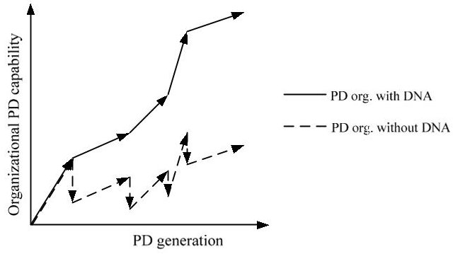
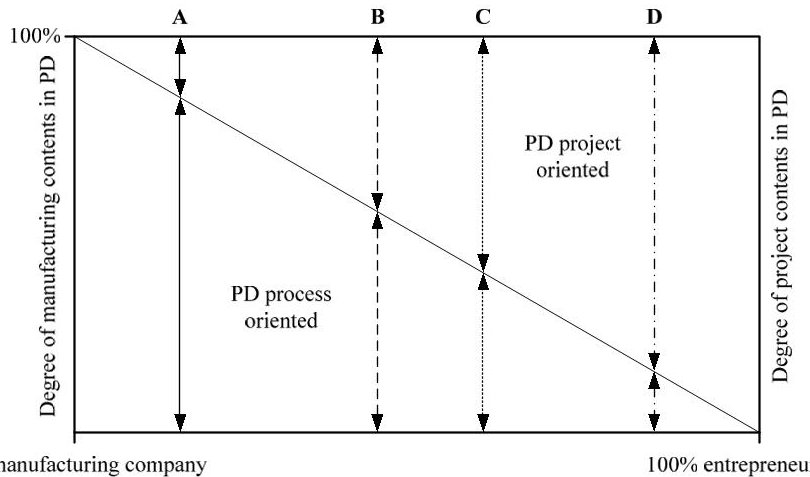
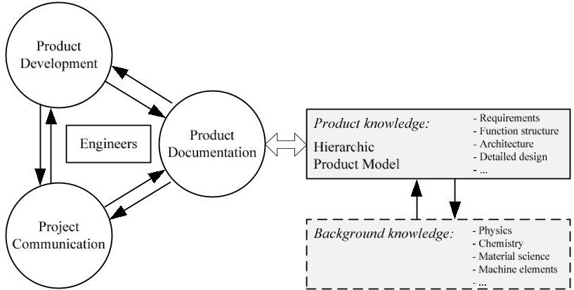
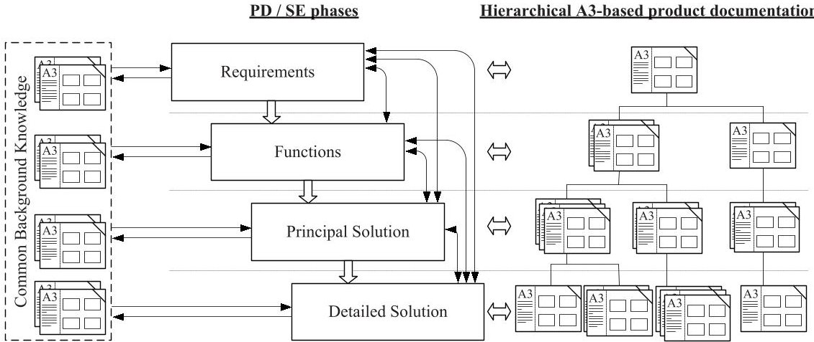

<!-- PDF_PAGE: 1 -->

Conference on Systems Engineering Research (CSER'13) Eds.: C.J.J. Paredis, C. Bishop, D. Bodner, Georgia Institute of Technology, Atlanta, GA, March 19-22, 2013.

# Need Finding for the Development of a Conceptional, Engineering Driven Framework for Improved Product Documentation

Sören Ulonska $ ^{a} $ , Torgeir Welo $ ^{a*} $

$ ^{a} $NTNU, Department for Engineering Design and Materials, Trondheim, Norway

## Abstract

Engineering companies that develop advanced products in multi-disciplinary new product development (NPD) teams, have difficulties in managing, communicating, and (re)using knowledge in and between NPD projects. Information is lost due to team dynamics, inappropriate documentation and methods, resulting in unnecessary design iterations, repeated problem-solving, lack of effectiveness and value, and low financial performance. It is, therefore, desirable to develop a documentation model that can be integrated into different engineering processes and used to effectively communicate product information within a single project and between projects, combining strategies from product design methodology, model-based systems engineering, and lean development. It is necessary to combine the most recent product (systems) engineering methods with the understanding of problems and needs in industrial environments where they shall be applied. This paper presents results of need finding in four companies using a semi-structured interview approach to gain insight into problems associated with product documentation. The findings are turned into a conceptual engineering-driven product documentation framework, which links documentation to the product architecture using knowledge-brief (A3) type documentation strategies from lean execution environments.

$ \textcircled{c} $ 2013 The Authors. Published by Elsevier B.V. Open access under CC BY-NC-ND license. Selection and/or peer-review under responsibility of Georgia Institute of Technology

Keywords: Model-Based Systems Engineering; Lean; Knowledge Capture and Re-use; Industry Study; Project Communication

## 1. Introduction

Nowadays, engineering companies operate more and more globally in increasingly competitive markets. Outsourcing of production and algorithmic engineering tasks [1] to so-called low-cost countries is an obvious countermeasure to increase company benefits in terms of cost reduction; however, this does not guarantee long-term competitiveness. The only permanent solution is to improve a firm's capability in inventing, developing, and producing innovative new products that provide high value to customers. Companies need to launch new products earlier than their competitors—before new technology emerges or the market changes. Increasing complexity and multi-disciplinarity of products, in combination with increasing need for effective, fast, and lean development, make it necessary to establish a broad knowledge-base for engineers [2]. A knowledge-base is essential for (lean)

<!-- PDF_PAGE: 2 -->

development and continuous improvement, decision support, and risk mitigation. It reduces dependencies of knowledge and experiences of individuals, making knowledge an asset within the company. Tools for knowledge creation, storage, transfer, and application will aid the analysis, optimization, and combination of solutions, requiring engineers to coordinate the inputs from many specialists in advanced, multi-disciplinary projects.

Experiences from industry companies (as to be seen in a case study in this paper) show that engineers have difficulties to manage, communicate, and (re)use knowledge in and within new product development (NPD) projects. Apparently, PDM/PLM tools do not support the process of knowledge capturing, reuse well enough. Much knowledge is generated in product development (PD), but it is challenging to capture and reuse this knowledge, leading to increased costs, lead time, and resources for repeated problem solving due to a lack of organizational learning as illustrated in Fig.1. Each segment symbolizes one development project or PD generation. With a new segment a new project generation begins. Although teams in both organizations work with same efficiency (same gradient of the segment), the one without capability to transfer knowledge between generations ('DNA') achieves a significantly lower level of capability over time. Knowledge serves as a source for competitive advantage when it can be used in a way that increases effectiveness [3].

Fig. 1. The role of documentation as DNA in Product Development

PD, Systems Engineering (SE) and Lean Product Development (LPD) are different approaches that provide engineers with methodologies and guidelines to help develop products (considering organizational challenges). To address challenges of modern, competitive product engineering, a combination of all three disciplines is necessary to develop advanced high-technology products, including creativity, lean practices, and systematic risk mitigation on component and system level. Thus, all of them need to be considered for providing an effective approach for knowledge-based development (KBD). It is assumed that today's systems and routines to document and reuse knowledge are not satisfactory for many organizations. Knowledge stays with individuals (tacit knowledge [4]) and not within the company as such, leading to repeated problem-solving and lack of organizational effectiveness.

In the present paper, a conceptual framework for a KBD documentation model for making knowledge re-use in engineering easier—in and within NPD projects—will be proposed. Although PLM/PDM systems are used and organizational routines are defined, important knowledge is not transferred in an adequate way. Knowledge is often kept 'tacit' by individuals or stored in reports that are project specific. The framework shall build a base to solve this challenge, by making product and knowledge structuring more engineering-friendly. To relate the findings in the literature to experiences from industrial practice, semi-structured interviews have been conducted with 21 engineering experts from four high-technology companies in the industrial cluster Kongsberg, Norway, combining two sources of knowledge on today's documentation and communication practices and identifying possibilities for improvements. More specifically, a brief review of PD, LPD and SE literature, combined with results from semi-structured interviews, build a basis for developing a framework enabling better knowledge transfer. The documentation framework proposed is an engineering-focused way of documenting product information, ensuring continuous capture and reuse of knowledge and easily accessible, structured documentation. The focus is on the technical aspects (product engineering) of the three methodologies. The goal of this paper is to explore needs for such a knowledge-based framework for PD, one that would possibly enable 'genes' to be transmitted and evolved between 'project generations'. As a starting point, it was decided to establish a set of research questions in order to understand today's situation as a basis for development of a suitable approach:

- How, and to what extent, do engineers and engineering companies capture, store and reuse (individual and organizational) knowledge in and within product development projects?

<!-- PDF_PAGE: 3 -->

- How, and to what extent, do engineering companies structure their product development ideas and what is the basis for decisions undertaken?

- How can knowledge be documented to make it more traceable and understandable as well as accessible for engineers working in multi-disciplinary product development projects?

## 2. The Nature of Knowledge and Knowledge Management

Before the framework for a knowledge base is introduced, a short discussion around the nature of 'knowledge' and 'knowledge management' (KM) will be made. These topics are important to keep in mind when aiming to create a framework for KBD. When defining knowledge, one has to distinguish between data, information, and knowledge. Data is raw numbers and facts, information is processed data, and knowledge is authenticated information [5]. Another definition describes knowledge as 'understanding gained through experience' and is the sum of what has been perceived, discovered, or learnt [6]. Other references have other definitions of knowledge or knowledge perspectives, such as knowledge as a state of mind, object, process, capability, etc. However, all definitions have in common the fact that knowledge is individual and must be expressed in such a manner that it is interpretable by the receivers. Only information that can be actively processed in the mind of an individual-through a process of reflection, enlightment, and learning-can be useful [4]. Knowledge is not just content or structure of information, but it is possessed in the mind of individuals-the product engineers in the case of this paper. Thus, engineering team members should share a certain knowledge base to have the same view and same understanding of a problem [4].

One challenge associated with knowledge capture, storage, retrieval, and transfer is that knowledge is explicated in two dimensions: tacit and explicit [7]. Tacit knowledge includes an individual's belief, viewpoint, paradigm, or concrete know-how, craft, and skill. Explicit knowledge, on the other hand is, articulated and communicated between individuals. One could assume that tacit knowledge is more valuable than explicit knowledge due to the fact that not all tacit knowledge can be transferred into explicit knowledge in an adequate way, meaning that the probability of having knowledge gaps and losses is high. Nevertheless, explicit knowledge is important, too, since it can extend an individual's tacit knowledge. Only explicit knowledge can be transferred and retrieved, such that both dimensions are essential [4] for true knowledge exchange.

Considering a knowledge system, it should be kept in mind that there are challenges regarding the possibility to renew products. When the context of knowledge changes (e.g. new product requirements or technological progress) the usefulness of the captured knowledge decreases [8]. Knowledge is always a reflection of the past whereas products are developed for the future. Failing to adapt the dynamics of knowledge might end up harmful for an organization, and too much reuse of knowledge might even be a barrier for change and innovation. The amount of novelty introduced between knowledge storage and retrieval is therefore a core integration challenge [6]. Furthermore, companies that seek high novelty in NPD, where the potential for reuse is limited, might not gain significant benefits from knowledge capture and waste resources on capturing knowledge that they do not need anymore. A high amount of specialists and dependencies could also be a barrier, since every specialization field uses its own terminology. A common understanding of knowledge, including both generic and specialist knowledge, is therefore necessary for the success of a common knowledge-base. Finally, too much reuse of knowledge can result in dependence of old/traditional solutions, making engineers thinking 'inside the box' with a strong tendency to solve engineering problems the same way it has always been done.

According to Davenport and Prusak [10] the majority of KM projects have the aims (1) to make the knowledge visible and show its role in the organization, (2) to develop a knowledge-intensive culture (e.g. encourage knowledge sharing) and (3) to build a knowledge infrastructure. This paper focuses on the latter topic and will propose a structure for knowledge capturing that is related to engineering design methodologies which are known to most engineers. Knowledge is going to be linked to the product architecture, aiming to make it visible, and easily accessible, using the same structure as the product architecture. In summary, four basic processes are essential for a KM system [4]: Knowledge creation (requiring an organizational culture), knowledge storage/retrieval (requiring dynamic and updated systems), knowledge transfer (requiring adequate searching functions), and knowledge application (requiring the ability to turn knowledge into effective action).

<!-- PDF_PAGE: 4 -->

## 3. Some Definitions of Product Development (PD), Lean PD and Systems Engineering

The goal of a PD methodology is to provide guidance to engineers for how to develop, engineer and design a high-quality technical product. The methodology supports the engineering design process, while allowing for flexibility, creativity and variety at the same time [2]. Many different systematic engineering design and development approaches exist, such as Pahl and Beitz [2], Roth [11], Hubka [12], Ehrlenspiel [13], and many more. Despite the fact that many methods are influenced by their engineering field of consideration, there is a common ground beyond all. A guideline that includes the commonalities for a systematic design approach of technical products and systems is VDI 2221 [14]. It recommends a number of working steps to design a successful product. PD begins with a clear definition of the task and continues with abstracting the problem by establishing functional structures, diverging in the number of solution possibilities as principal solutions. After a number of evaluations, the process converges and a product is designed in details and developed. Important outcomes are the specification list, function structure, principal solution, product structure and architecture, and the detailed solution.

SE is an approach that solves problems of increasing product complexity and multi-disciplinarity with the goal to meet the user needs and mitigate risks by supporting all product life cycle processes, considering problems on system level [15]. ISO/IEC 15288 [16] defines the system life cycle processes, related activities, and outcomes for the complete life cycle, including development, realization, utilization, support and retirement. SE activities can be applied in a visual manner using model-based SE (MBSE) [17]. MBSE is an attempt to standardize the SE effort by developing a technique for documenting it through models, diagrams and hierarchies that follow strict rules. Requirements, functions, system architecture, and verification and validation activities all are mapped graphically, for instance by using a general system modeling language (SysML).

The primary objectives of LPD are to minimize waste, improve quality, reduce time-to-market and cost, all driven by the desire to create value to the customer. Here value may be characterized as any activity that transforms a new product design in a way that the customer is both aware of it and willing to pay for [18]. In general, waste can be divided into two categories. Type 1 waste includes activities that do not create value that the customer is aware of, but is still necessary to enable value generation (e.g. administration, coordination, testing, validation, checks, etc.). Type 2 waste is pure waste that does not create any value (e.g. defects, waiting, underutilization of people, etc.). An important part of the lean philosophy is learning and continuous improvement (LAMDA cycle [19]) in small steps. Although these learning iterations could be considered waste (type 1: necessary waste like organizational learning, organization, etc.) at micro-process level, they are necessary to maximize the value of the overall outcome seen in a system perspective. In addition, by capturing knowledge for later reuse the learning cycle is a source for organizational learning, providing strategic value for the company [19]. In the LPD philosophy, knowledge is effectively captured and communicated using 'knowledge-briefs' [20], or so-called A3 reports [21] named by the paper size format used, aiming to visualize the problem, goal, process, and solution, and risk elements in a standardized form, depending on the application and problem formulation.

In summary, PD methods offer possibilities to systematically develop and design new products, providing engineering tools for developing high-quality products at micro-process level. SE methods enable the possibility to maintain overview, to realize complex products, and systematically mitigate risks in PD and product management (PM). Rather than providing guidance for solving engineering problems in PD, it helps manage a large variety of complex products at system level, creating a better overview of the product and its surroundings. Risks become more apparent and a broader view of all life cycle processes reduces uncertainty in decision-making. LPD introduces a way to make (engineering) processes more effective to improve the outcome for a company with customer value being the driver. It describes, in more philosophical terms [22], how processes at different levels can be performed to make a company more competitive by pulling 'value' from the end customer up the value chain.

PD, SE, and LPD have different goals, but they can be applied to the same problem at the same time, and are hence complementary to each other. PD and SE can be applied on top of a 'lean' philosophy as a fundament in the value hierarchy to increase effectiveness and reduce waste in PD (e.g., lean principles introduced by Morgan and Liker [23]) and SE (e.g., 'lean enablers for systems engineering' (LEfSE) introduced by Oppenheim [24, 25]). A combination of all approaches can become a powerful engineering tool for industry companies producing complex, high-technology products. The knowledge base proposed later in this paper uses elements of these disciplines. The review of the literature in this chapter together with the semi-structured interviews, to be introduced in the next chapter, build the base for a model-based documentation, including both theoretical and practical aspects.

<!-- PDF_PAGE: 5 -->

## 4. Case study at industry companies in Norway

In the above sections a literature review of knowledge associated with PD, SE, and LPD has been conducted. This will now be supplemented with experiences from industry practices through a case study done with a set of companies that develop advanced, technical products in multi-disciplinary teams. In general terms, engineers have discovered that they spend much time on (re)solving engineering problems and feel that knowledge transfer and reuse are poor. The storage of knowledge in project specific structures makes it difficult to find product knowledge in existing company systems and knowledge is often kept 'tacit'. Product engineers, trying to apply lean and SE principles, suggest that the companies' PD capability could be more effective if adequate tools to capture and (re)use knowledge had existed.

Table 1. Overview over interviewed companies

<table border="1"><tr><td></td><td>Products</td><td>Scope</td><td>Products per year</td><td>Employees</td><td>Interviewee roles/Positions</td></tr><tr><td>A</td><td>Automotive parts,e.g. driveline systems,seat comfort systems,driver and motion control systems,fluid assemblies</td><td>Global production and development locations</td><td>50,000 to several millions</td><td>10,000</td><td>Research and Design Manager
Designer
Program Manager</td></tr><tr><td>B</td><td>Defense,space and aerospace products,e.g. missiles</td><td>National locations,global customers</td><td>100</td><td>450</td><td>Lean Manager,
Senior project engineer(2x)
PA/QA chief engineer
Department Manager Elect. &amp; Mech.
Department Manager, Flight structures
Safety Leader
Project leader
Production chief engineer
Clean room leader</td></tr><tr><td>C</td><td>Subsea products for petroleum industry</td><td>Global production and development locations</td><td>2-6 of one kind(ca 100 a year)</td><td>11,500</td><td>Specialist engineer,Design
Lead engineer
Work Package Product Manager
Senior Product engineer Design
Senior Quality manager</td></tr><tr><td>D</td><td>Development of advanced multi-disciplinary products</td><td>National locations,global customers</td><td>1 to several millions(project dependent)</td><td>100</td><td>Deputy Mechanical Systems Development
Senior engineer,Electronics
Project Manager
Production&amp;Test Manager
Group leader,Systems</td></tr></table>

To explore the root causes of these problems and to determine current practices with regard to knowledge processes, a case study among four Norwegian companies has been conducted, interviewing 21 engineers. The companies represent different industry sectors (offshore, automotive, defense and aerospace, and consultancy and system development). Table 1 shows an overview of the four companies, including products, number of employees, production numbers, and interviewee roles. Although all four companies develop advanced products, there are major differences between the companies, as illustrated in Fig. 2. The principal diagram arranges the companies according to their relative project (value related to uniqueness of outcome) and process (value related to consistency of outcome) focus. The companies represent a variety of organizational focus that cover a wide spectrum from process and mass-production-orientated firms to entrepreneurial focused firms, and firms developing 'one-of-a-kind' products. Company A is an automotive Tier 1 supplier, producing parts at high volumes and a PD process of repetitive nature, resembling somewhat manufacturing. Towards the right side of the diagram, the PD process orientation is decreasing, while focusing more on uniqueness (project type activities). Company B develops and produces high-technology defense, space and aerospace products (e.g. missiles). Company C is a supplier for the offshore industries with special expertise in subsea installations. The PD strategy in company A is in big contrast to that of company D, which has its focus on uniqueness and performing PD projects for customers. Company D

<!-- PDF_PAGE: 6 -->

designs advanced products of different kinds, whereas manufacturing is done by other companies. Its main competence is project and engineering management. The strategy is to avoid product ownership, and products can be designed for mass, medium or single production. All four companies operate globally; some with different locations for development and production, and some with national locations, and international customers.

Fig. 2. Arrangement of engineering companies according to their degree of manufacturing content vs. entrepreneurial content DNA in PD

Table 1 and Fig. 2 illustrate that there are significant differences in product types, production number, and company strategies between the four companies. Hence, it is difficult to establish a common methodology to improve documentation in all four companies. Due to various fields of specialization, experience, working area, and low number of interviewees, it was essential to use semi-structured interviews [26] rather than standardized interview schedules. This gives the opportunity to better explore the respondents' opinions and clarify interesting and relevant issues for establishing more complete information.

At each company, engineers with different functional roles have been interviewed, including PM, PD, CAD design, manufacturing, and departments, as listed in Table 1. One challenge was that the number and roles of the interviewee were somewhat different, both in terms of availability and role definitions in the different companies. Nevertheless, altogether 21 engineers with different viewpoints have been interviewed, and different needs on products and projects, PD, and product production were ultimately collected. All interviewees were asked the same set of questions (referring to the general research questions above):

- How are projects organized and executed?

- How is product related knowledge documented and stored and to what extent is product knowledge reused?

- How is communication organized and done within and between projects?

- What are your personal experiences in reusing documentation created by others?

- How well do (stipulated) documentation and communication strategies work in your company?

- What would you improve according the items identified above, and how?

## 5. Findings and propositions

The results of the semi-structured interviews and literature review will be summarized in a set of propositions. There are three key aspects related to KBD, including PD, Project Communication, and Product Documentation.

## 5.1. Product Development Propositions

- The traceability of product development history makes it easy to understand the product:

The interviewees pointed out that it is difficult to find out why products have been designed the way they have. For example, company B's products have a service time of up to 40 years. Decisions in development, which have been taken in the past, were taken from the past's point of view and state-of-the-art at that time. For today's engineers, this is difficult to understand. Hence, sometimes they have to solve problems, which already have been solved in the past. A knowledge-based product model would provide them with a tool to identify

<!-- PDF_PAGE: 7 -->

decisions points, documenting why the product was developed the way it is, seeing dependencies and being able to adapt those decisions to today's circumstances. Technological progress is continuous, governmental regulations change and customer needs change, too. By providing improved possibilities to adapt former product design decisions to conditions of the present, the development would be more sustainable in itself. In addition, the change of sub-systems would be easier, since dependencies are clearly defined, visible and understood.

## Adequate product documentation in a knowledge-based product model can improve PD and make it easier to meet the project schedule:

In a knowledge-based product model, decisions are traceable to the solutions applied in the final product or to those that were considered but did not make it all the way to implementation, meaning that the knowledge around the product grows steadily. This will have a positive impact on PD, since risks are reduced and the whole product life cycle becomes more predictable. For instance, company C uses much time (more than spent on PD) on documenting products due to rigid customer requirements. Notwithstanding, their products are in many cases similar to a great extend, and a better reuse of documentation would considerably reduce work-load. As an alternative, resources could have been used for creating new values by improving the product or new innovations.

- Companies with repeated, incremental PD processes can gain more from a knowledge-based product model,

## than do companies conducting more independent projects:

Comparing the companies, obviously, there are differences in the way the companies could gain from KBD. Company D develops many different products on order and does not have own physical products that they manufacture or own; their 'product' is the information output from the product development process . Hence, it will be difficult to reuse specific knowledge between projects, since products are very different. They have thus to establish a reuse-strategy at a different level; for example, process and/or disciplinary/function levels). The other three companies, which mainly improve product platforms or develop new products within the same field, have ability to reuse more knowledge at product level that could be linked up to a hierarchical product model.

- Product documentation should have a hierarchical structure, which is equivalent to the structures used in PD:

There are four levels of information, which are necessary for product information and documentation [27]. The level of product information, the requirement structure, defines why the product is developed, captures the customer needs and enterprise's objectives. Second, the functional structure, describes what the solution is going to do, followed by the principal structure, which defines how functions are accomplished. Last, the physical parts build a physical structure, which represents the product with detailed descriptions, so that the product can be manufactured, distributed and made available for the user. A knowledge documentation linked to these PD levels and close to the product architecture [28] would bring the documentation closer to engineering practices.

- Background knowledge is necessary to supply product development with necessary information:

A common base to which a product is developed is necessary. Design iterations in development are done due to lack of knowledge [23]. More detailed information about the task, constraints, potential and known principal solution for similar type or former problems, reduces the uncertainties and confrontation to the unknown and risks [2,11], and might increase confidence in the chosen solution. The knowledge, which is gained by iteration steps, may have value for later developments. Therefore, a fifth information level, the background information, should be introduced. It supports the other four levels. That may for instance be physical dependencies or constraints of production methods, and also literature, standards or governmental regulations.

## 5.2. Project Communication Propositions

- When product information is linked to the product model, it will be easier to make engineers follow a certain discipline in PD and documentation:

Multi-disciplinary engineering projects can last over many years and involve many people (company B). To keep the documentation and communication at the same level of understanding, everyone in the projects should use the same method and discipline for documenting knowledge (company D). Due to the different background of individuals, this is not always the case as different people use different ways to document their work. Linking knowledge to the product model, the documentation structure would be dictated by the product, and not by the person who created the documentation.

<!-- PDF_PAGE: 8 -->

- Restrictions constrain knowledge transfer:

Due to restrictions from stakeholders or government, it is not allowed to share all knowledge (company B). Here, some product knowledge cannot be reused in other projects. Knowledge, which has been developed here, will be challenging to make accessible for NPDs.

## 5.3. Product Documentation Propositions

- Clear documentation of product knowledge in a hierarchical product model can replace the confusing variety of documentation between projects to a great extent:

Today different types of documentation are used in different projects on the same product, which sometimes makes it difficult to find specific information. If all the knowledge instead would be collected at one single platform and linked to the product architecture, less variants of documentation would be necessary. In this connection it should be noted, however, that there will still be need for other types of documentation, e.g. customer specific reports.

- The use of A3 documentation makes knowledge clear, fast and easy understandable:

Company A uses an 'A3-knowledge brief', based on the lean principle 'A3 thinking' [21]. The documentation in A3 format is short, precise and describes just one problem and its solution on a single sheet of paper. This makes it fast and easy to read and capture. A3 sheets that are linked to each other in a hierarchical structure can make it possible to quickly understand a product, complex problems and interrelations. Nevertheless, A3 documentation cannot fully replace full reports; however, what is important in PD is to identify and understand in a rapid fashion). Thus, A3-thinking seems to be a proper approach also for documentation practices.

- Storage of knowledge at just one central place makes it easier to find and store:

Knowledge is usually not directed to the product, but to the project such that engineers have to know the project in which the product has been developed. Consequently, it will be difficult and time-consuming to find the desired knowledge. In addition, there are several formats of documentation, such as product models in CAx software, reports, A3s, quality assurance reports, etc., which makes it even more difficult to find specific information. Hence, engineers often prefer to solve problems at their own instead of spending time on finding solutions that have already been developed by others. A single central place, or less places, for storage and a search engine that finds documentation from different projects would improve the possibility to find knowledge in a multi-project environment. One possibility could be an internal wiki, providing that there are procedures in place for quality assurance of information that is shared with others.

## 5.4. Summary

Fig. 3: Conceptual framework for technical view of knowledge-based product development

As a result of the propositions introduced above, Fig. 3 shows a conceptual framework for KBD as an engineering-friendly way for product documentation and communication. In the centre of all actions are the engineers (since this paper concentrated mainly on the technical aspects associated with the PD process), who develop solutions, communicate, document results, and reuse knowledge from former documentation. From the analysis of product development methodology, four central levels [27] (requirements, functions, principal solution,

<!-- PDF_PAGE: 9 -->

and details) of documentation are identified to be important. The documentation is A3-based, hierarchically structured, and linked to the product architecture. A3-based documentation is a structured, 'lean' method to capture knowledge and documenting learning, decisions, and planning, associated with problem-solving. In the documentation framework, all levels are hierarchical and linked to each other as well as supported by background information. The three activities product development, project communication and product documentation are not independent of each other, but need to be done concurrently to achieve a successful KBD.

## 6. Conclusions

Based on the results in this paper, which were obtained by combining a literature review with findings of semistructured interviews, it is concluded that product information should be linked to the product architecture to make it become a proper fundament for KBD. The product architecture should be structured according to the steps of systematic engineering design processes, including the levels of requirements, functions, principal solution and detailed solution and their linkages (Fig. 4). All aspects of the life cycle need to be included in the development, by providing detailed knowledge collected from former projects, experiences, literature, and other internal and external sources. The model structure needs to be flexible to facilitate adaption to constraint dynamics imposed from the surrounding. In conclusion, the product model should describe a holistic system, integrating all life cycle phases, showing dependencies between sub-systems, hence making it possible to quickly understand a product from different perspectives.

Fig. 4: A3-based, hierarchic product model

Many of these functions are provided by PLM systems, but just copying existing products into PLM systems does neither improve their structure nor support KBD. For many companies, product structures in PLM systems need to be reconfigured to clean up variants that have been developed over many years and been copied into the PLM system without systematic approach. Thus, a clear product portfolio that evolves out of a robust product and knowledge architecture needs to be established, e.g. by re-engineering/re-structuring exiting products. Leveraging visualization and A3-based documentation structured like the product architecture shown to the right side of Fig. 4, will make it easier to both identify and capture information as well as understand it. The use of visualization on physical planning and development boards adds an additional dimension of communication, which can support more abstract PLM systems and provide a base for KBD.

The propositions established herein form the basis for further research in developing methodologies for appropriate documentation that describes a product including its variants, its dependencies of the system, its design history and decisions made during the course of development, along with its technical attributes in an easy, clear, traceable, extendable, and changeable way. A further challenge will be to develop a strategy for integration of an existing product portfolio and a product architecture. When developing a product architecture, with the knowledge aspect linked to it, it should be kept in mind that the architecture will last longer than the product. Therefore, it should be flexible enough to allow the product to evolve to changes in its surrounding [28].

<!-- PDF_PAGE: 10 -->

## References

1. Martin, R.: The Design of Business: Why Design Thinking is the Next Competitive Advantage. HBS Press, Boston, USA, 2009

2. Pahl, G., Beitz W., Feldhusen, J. and Grote, K.-H.: Engineering Design - A Systematic Approach. Springer-Verlag, London, UK, 2007

3. Carlile, P.R., Rebentisch, E.S.: Into the Black Box: The Knowledge Transformation Cycle. Mgm. Sci., Vol.49, No.9, pp.1180-1195 (2003)

4. Alavi, M., Leidner, E., Review: Knowledge Management and Knowledge Management Systems: Conceptual Foundations and Research Issues. MIS Quarterly, Vol.25, No.1, pp.107-136 (2001)

5. Dretske, F.: Knowledge and the Flow of Information. MIT Press, Cambridge, USA, 1981

6. Schubert, P., Lincke, D., Schmid, B.: A Global Knowledge Medium as a Virtual Community. 4th Conference on Information Systems, pp.618-620, Baltimore, USA, 1998

7. Nonaka, I.: A dynamic theory of organizational knowledge creation. Organazational Science, No.5, pp.14-37 (1994)

8. March, J.: Model bias in social action. Rev. Ed. Res. No.44, pp. 413-429 (1972)

9. Carlile, P.R.: Transferring, Translating, and Transforming: An Integrative Framework for Managing Knowledge across Boundaries. Organization Science, Vol.15, No.5, pp.555-568 (2004)

10. Davenport, T. and Prusak, L.: Working Knowledge. Havard Business School Press, Boston, USA, 1998

11. Roth, K.: Konstruieren mit Konstruktionskatalogen. Springer Verlag, Berlin, Germany, 2007

12. Hubka, V., Andreasen, M. and Eder, E.: Practical Studies in Systematic Design. Butterworth&Co, London, UK, 1988

13. Ehrlenspiel, K.: Kostengünstig Konstruieren.: Springer Verlag, Berlin/Heidelberg, Germany, 1985

14. VDI 2221: Methodik zum Entwickeln und Konstruieren technischer Systeme und Produkte. VDI-Verlag, Düsseldorf, Germany, 1993

16. ISO/IEC 15288: Systems and software engineering - System life cycle processes. Geneva, Switzerland, 2008

17. Friedenthal, S., Moore, A., Steiner, R.: A practical Guide to SysML. Morgan Kaufman Waltham, USA, 2012

18. Mascitelli, R.: The Lean Product Development Guidebook. Technology Perspectives, Northridge, USA, 2007

19. Ward, A.C.: Lean Product and Process Development. Lean Enterprise Institute Inc., Cambridge, USA, 2007

20. Kennedy, M.: Product Development for the Lean Enterprise: Why Toyota's System is Four Times More Productive and How You Can Implement it. The Oklea Press, Richmond, USA, 2010

21. Sobek, D. and Smalley, A.: Understanding A3 Thinking - A critical Component of Toyota's PDCA Management System. Productivity Press, New York, USA, 2008

22. Welo, T., On the application of lean principles in Product Development: a commentary on models and practices, Int. J. Product Development, Vol. 13, No. 4 (2011)

23. Morgan, M. and Liker, J.: The Toyota Product Development System. Productivity Press, New York, USA, 2006

24. Oppenheim, B.W.,Lean enablers for systems engineering, Loyola Marymount University, Los Angeles, USA, 2009

25. Oppenheim, B.W.: Lean for Systems Engineering with Lean Enablers for System Engineering. Wiley & Sons Inc., Hoboken, USA, 2011

26. Barribal, K, L. and While, A.: Collecting data using a semi-structured interview. J. of advanced nursing No.19, pp.328-335 (1994)

27. Baughey, K.: Functional and Logical Structures: A systems Engineering Approach. SAE international, 2011

28. Harlou, U.: Developing product families based on architectures. Doctoral thesis, Dep. of Mech. Eng., DTU, Lyngby, Denmark, 2006

29. Carlile, P.R.: A Pragmatic View of Knowledge and Boundaries: Boundary Objects in New Product Development. Organization Science, Vol.13, No.4, pp.442-455 (2002)

30. Company A: expert comments. Hansen, E.; Klovstad, M.; Skiaker, S., Norway, 2012

31. Company B: expert comments. Andersen, R.; Bergersen, S.; Dale, A.G.; Engebretsen, D.; Gjestvang, J.A.; Heieren, P.E.; Karlsen, R.; Nordgård, K.; Tegdal, D.E.; Tobiassen, T; Norway, 2012

32. Company C: expert comments. Lead Engineer; Senior Product Engineer, Design; Senior Quality Manager; Specialist Engineer, Design; Systems Engineer; Work Package Product Manager; Norway, 2012

33. Company D: expert comments. Bergan, F.I.; Dugstad, T.A.; Halden, J.E.; Slåttsveen, B.; Øyen, J., Norway, 2012

34. Easterby-Smith, M., Lyles, M.A.: Organizational Learning & Knowledge Management. John Wiley & Sons, West-Sussex, UK, 2011

35. Haskins, C.: Systems Engineering Handbook - A guide for systems life cycle processes and activities. Version 3.2.1, Revised by M. Krueger, D. Walden, and R. D. Hamelin; San Diego, USA, 2011

36. Tjalve, E.: Systematic Design of Industrial Products. Lykkegaard Aps, Herman & Fischer A/S. Institute for Product Development. Technical University of Denmark, Copenhagen, Denmark, 2003

37. Ulrich, K.T. and Eppinger, S.D.: Product Design and Development. McGraw-Hill, New York, USA, 1995