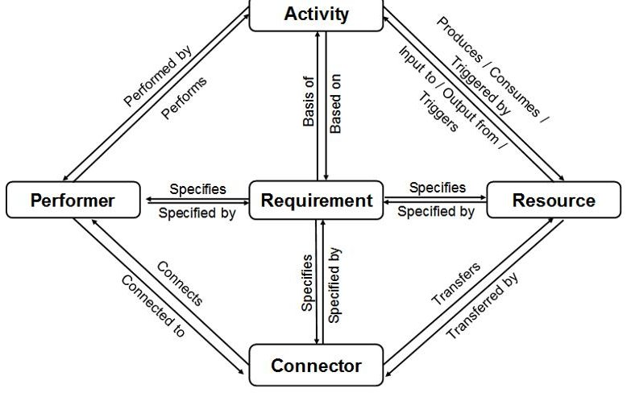
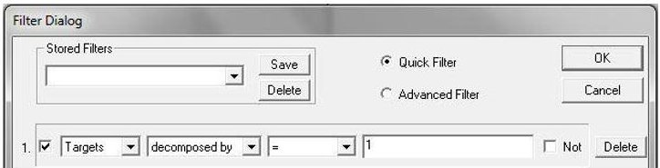
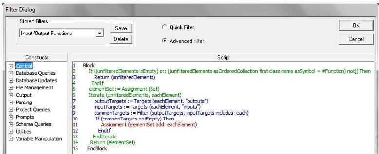
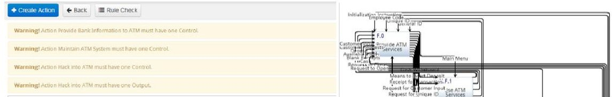

<!-- PDF_PAGE: 1 -->

Complex Adaptive Systems, Publication 3 Cihan H. Dagli, Editor in Chief Conference Organized by Missouri University of Science and Technology 2013- Baltimore, MD

# A Formal Method for Evaluation of a Modeled System Architecture

Matthew Rodano $ ^{a} $ , Kristin Giammarco $ ^{b} $

$ ^{a,b} $ Stevens Institute of Technology, Castle Point on Hudson, Hoboken NJ 07030, USA

## Abstract

Modeling is a powerful way to represent the desired organization and performance of a particular system and how it will meet the desired system objectives. There is a multitude of modeling methods, but determining whether the completed model effectively represents the desired system organization can be a challenge. System engineers can inspect the modeled system architecture to determine whether it is acceptable, but few formal methods exist to aid in the performance of this task. In practice, engineers apply heuristics and their experience to identify the characteristics of a "good" architecture. By formalizing these characteristics using logical notation, the quality attributes that constitute a "good" system architecture can be quantified and applied to determine the quality of an architectural model. Because these attributes are defined using a general notation, they can be instantiated using many system architecture tools and can be adapted to meet the needs of a specific architectural framework or particular project.

$ \textcircled{c} $ 2013 The Authors. Published by Elsevier B.V. Open access under CC BY-NC-ND license. Selection and peer-review under responsibility of Missouri University of Science and Technology Keywords: systems engineering; formal method; system architecture; architecture evaluation; system model

## 1. Introduction

The purpose of this paper is to present examples of formal representations of a well-defined system architecture and how these representations can be used to evaluate an instantiated system architecture to determine whether it is well formed. The exact definition of "well formed" is based on existing principles or other criteria established by the architect. Typically, this determination is made by a human engineer (or group of engineers) inspecting a set of architectural representations and using heuristics to judge whether they will result in a viable system that, when built, will meet the system requirements. Defining these heuristics in a formal way allows for automated and objective analysis of system architectures; like type correctness checking for software code, these checks can "provide certain guarantees that the system is well formed" [1].

The formal model is created by first determining the characteristics of a well formed architecture and the heuristics used to evaluate them, and expressing these as natural language axioms. Then, these axioms are translated into a formal logical notation that is independent of any domain or tool-specific elements. This ensures that the formal model can be used in any situation and can apply to the widest variety of systems engineering problems. In

<!-- PDF_PAGE: 2 -->

order to demonstrate the applicability of the formal method, the axioms will be expressed using two different systems engineering tools: Vitech's CORE $ ^{\circledR} $ , and Innoslate from SPEC Innovations. CORE and Innoslate are two examples of Model-Based Systems Engineering (MBSE) tools that allow the user to construct system models, perform behavioral analyses, and manage requirements. These tools were selected because they reflect a subset of available tools and are used by Stevens Institute of Technology students.

## 1.1. Problem Statement

Systems engineering problems are inherently complex, and it is therefore difficult to create a rational way to assess their solutions because intuitive methods are typically used to develop them [22]. No two problems can be solved in exactly the same way, and for non-trivial systems it is likely that each engineer or team will produce a unique solution given the same problem [13]. Similarly, the results of a heuristic-based assessment may differ depending on the engineer's experience and the specific rules he or she decides to use. However, these differing perspectives may uncover potential problems that may otherwise have gone undetected.

So, while formal methods cannot completely replace traditional design methods [4], they can be useful as a fast way to identify possible issues in an architectural design. The potential "weakness" of blind spots in the formal model can be turned into a strength by tailoring the axioms to the needs of the project, operational environment, or business sector. Luqi and Goguen [10] assert that formal methods may not be adequate for large and complex systems. However, in the context of a formal method for the structural evaluation of a system model, the axioms are equally valid for systems of any size because they are focused on the structure of the model itself and not its behavior, which requires other methods, e.g., [2] to formalize. Because it is the relationships among system elements that define the system's value, ensuring these relationships are completed correctly maximizes the effectiveness of the system [15].

## 1.2. Related Work

The use of formal methods as an alternative to natural language specification, including the use of first-order predicate logical notation, is a longstanding concept in software engineering [16]. These formal specifications are intended to complement the natural language requirements that are created as part of the architecture process. Because of the similarities between the software and systems engineering lifecycles, the benefits of using a formal specification are transferable to systems engineering problems as well.

Most formal models in systems engineering applications are used to specify behavior as opposed to relationships. Architecture theory is specifically defined by Penix et al. [19] as a set of constraints on "the behavior of a system in terms of the behavior of its subcomponents via a collection of axioms." The axioms represent syntactic checks that can apply to refined architectures that use the same architectural style [18]. So, once a certain pattern has been proven "correct" with respect to the axioms, the pattern can then be applied to a refined or lower-level implementation. Model checking can also be used to ensure consistency when a model is updated [11]. Architecture optimization frameworks typically focus on determining the best solution given the design space as well as any design constraints [25]; the formal method described herein could serve as a partial set of constraints.

Formal methods can be used for verification at various stages of the architecture and design process, checking the realization of the entire system against its specification [3]. Alternatively, formal methods can be more specific in purpose, such as checking the connections between components [20], as might be done in assessing interoperability [8]. The International Organization for Standardization (ISO) and the International Electrotechnical Commission (IEC) are currently in the process of developing a formal standard for architecture evaluation, known as ISO/IEC 42030 [7].

## 2. Model Development Methodology

Development of the formal specification begins by determining the characteristics of a "well formed" system model in natural language by examining existing standards as well as commonly used design heuristics and guidelines. Two of the key standards that govern system architecture modeling are the Department of Defense Architecture Framework (DoDAF) v2.02 [24] and the Integrated Definition Function Modeling Method, known as IDEF0 [21]. Both of these standards contain rules and techniques for developing architectural models. In addition to standards, common design techniques and heuristics (e.g., [6], [15]) can be codified into natural language axioms.

<!-- PDF_PAGE: 3 -->

The axioms themselves are either explicitly stated in the reference from which they are derived, or implicitly created from that reference or a heuristic that can be stated in a formal manner.

Once the natural language axioms are complete, they can be expressed using formal notation. This step assures that the axioms are unambiguous, and language or tool independent. Axioms, stated using first-order predicate logical statements, can then be adapted to the specific tool that will be used for the assessment. As an example, in Section 3.1 the axioms will be expressed using the Filters function in CORE to provide a practical application of the axioms to a system modeled using the CORE tool.

## 2.1. System Model Terminology

The system model that is assessed using these axioms is derived primarily from the DoDAF Meta-Model (DM2) Conceptual Data Model [24]. This model consists of five classes: requirements, activities, connectors, performers, and resources. Resources are data or information that is produced and/or consumed by the system. An activity is an element that transforms inputs into outputs (inputs and outputs are both resources). Performers carry out activities, and physical or logical relationships between performers are known as connectors. Although the connector class is not explicitly specified by the DoDAF model, it is part of the Unified Profile for DoDAF/ Ministry of Defence Architectural Framework (MODAF) (UPDM) standard. Requirements are written specifications for the system. The classes and relationships of the system model are shown in Figure 1.

Fig. 1: Class/Relationship diagram of system model (after [8]).

This terminology may not be common to all tools or system architecture frameworks. For example, the base schema of CORE refers to elements that transform inputs into outputs as functions; the DoDAF schema uses the term Operational Activities. However, they have the same semantic meaning in the context of this system model.

## 3. Axioms for System Model Evaluation

The axioms for evaluating a modeled system architecture are categorized into five groups: Decomposition, Requirements Traceability, Activity Performance, Input/Output, and Connection. The axioms are summarized in Table 1. In order to clarify and/or simplify certain axioms, additional predicates are required. The predicate context $ a_{1} $ is used to represent $ a_{1} $ as a context activity, or the top-level activity in the system context [21]. The exchanges predicate is defined as follows: $ "p_{1}$ performs an activity that: outputs a resource $ r $ to some activity of $ p_{2} $ or: inputs or is triggered by resource $ r $ from some activity of $ p_{2} $." This predicate is written as exchanges $ (p_{1}, p_{2}, r) $ [9].

Axiom 4.1 is an example of an axiom that is explicitly contained in the reference used (in this case, the IDEF0 standard). Axiom 4.6 is derived from a heuristic and serves to prevent a "resource deadlock" between two triggered activities, which occurs when both activities are waiting for a resource that is needed to trigger them [6]. The detailed rationale associated with each of these particular axioms is omitted for brevity, though the references are provided in the table to indicate the sources used in formulating them. The provided axioms are examples; architects may tailor their own collections of axioms and corresponding rationale and apply them as they see fit at appropriate stages of the architecture model maturity.

<!-- PDF_PAGE: 4 -->

<table border="1"><tr><td colspan="2">1. Decomposition Axioms</td><td>Reference</td></tr><tr><td>1.1</td><td>Every activity not designated as a context activity shall have at least one parent. $(\forall a_{1}\in A)[\neg context(a_{1})\rightarrow(\exists a_{2}\in A)decomposes(a_{1},a_{2})]$</td><td>[21]</td></tr><tr><td>1.2</td><td>No activity shall have exactly one child. $(\forall a_{1}\in A)(\forall a_{2}\in A)[decomposedby(a_{1},a_{2})\rightarrow(\exists a_{3}\in A)(decomposedby(a_{1},a_{3})\wedge(a_{2}\neq a_{3}))]$</td><td>[21]</td></tr><tr><td>1.3</td><td>No activity shall be decomposed by itself. $(\forall a\in A)[\neg decomposedby(a,a)]$</td><td>[21]</td></tr><tr><td>1.4</td><td>No activity shall have more than seven children. $(\forall a_{1}\in A)[(\forall a_{2}\in A)|decomposedby(a_{1},a_{2})|\leq 7]$</td><td>[17],[21]</td></tr><tr><td>1.5</td><td>Every performer not designated as a context performer shall have at least one parent. $(\forall p_{1}\in P)[\neg context(p_{1})\rightarrow(\exists p_{2}\in P)decomposes(p_{1},p_{2})]$</td><td>[6]</td></tr><tr><td>1.6</td><td>No performer shall have exactly one child. $(\forall p_{1}\in P)(\forall p_{2}\in P)[decomposedby(p_{1},p_{2})\rightarrow(\exists p_{3}\in P)(decomposedby(p_{1},p_{3})\wedge(p_{2}\neq p_{3}))]$</td><td>[21]</td></tr><tr><td>1.7</td><td>No performer shall be decomposed by itself. $(\forall p\in P)[\neg decomposedby(p,p)]$</td><td>[21]</td></tr><tr><td>1.8</td><td>No performer shall have more than seven children. $(\forall p_{1}\in P)[(\forall p_{2}\in P)|decomposedby(p_{1},p_{2})|\leq 7]$</td><td>[17],[21]</td></tr><tr><td colspan="2">2. Requirements Traceability Axioms</td><td>Reference</td></tr><tr><td>2.1</td><td>Every activity shall be based on some requirement. $(\forall a\in A)(\exists q\in Q)[basedon(a,q)]$</td><td>[6]</td></tr><tr><td>2.2</td><td>Every resource shall be specified by some requirement. $(\forall r\in R)(\exists q\in Q)[specifies(q,r)]$</td><td>[6]</td></tr><tr><td>2.3</td><td>No requirement shall specify more than one resource. $(\forall r_{1}\in R)(\forall r_{2}\in R)(\dot{o}q\in Q)[specifies(q,r_{1})\wedge specifies(q,r_{2})\wedge(r_{1}\neq r_{2})]$</td><td>[12]</td></tr><tr><td>2.4</td><td>All leaf-level requirements shall be specified by at least one element in the Activity, Connector, Performer, or Resource class. $(\forall q_{1}\in Q)[(\dot{o}q_{2}\in Q)decomposedby(q_{1},q_{2})\rightarrow\left(\begin{array}{l}(\exists a\in A)basedon(a,q_{1})\vee(\exists r\in R)specifiedby(r,q_{1})\vee(\exists p\in P)specifiedby(p,q_{1})\vee(\exists c\in C)specifiedby(c,q_{1})\end{array}\right)]$</td><td>[6]</td></tr><tr><td colspan="2">3. Activity Performance Axioms</td><td>Reference</td></tr><tr><td>3.1</td><td>Every activity shall be allocated to some performer. $(\forall a\in A)(\exists p\in P)[performs(p,a)]$</td><td>[24],[9]</td></tr><tr><td>3.2</td><td>Every performer shall perform at least one activity. $(\forall p\in P)(\exists a\in A)[performed(a,p)]$</td><td>[24],[9]</td></tr><tr><td colspan="2">4. Input/Output Axioms</td><td>Reference</td></tr><tr><td>4.1</td><td>Every activity shall output at least one resource. $(\forall a\in A)(\exists r\in R)[outputs(a,r)]$</td><td>[21],[24]</td></tr><tr><td>4.2</td><td>Every activity shall have at least one input or trigger. $(\forall a\in A)(\exists r\in R)[inputto(r,a)\vee triggers(r,a)]$</td><td>[21]</td></tr><tr><td>4.3</td><td>Every resource shall be allocated to some activity. $(\forall r\in R)(\exists a\in A)[inputto(r,a)\vee triggers(r,a)\veeoutputfrom(r,a)]$</td><td>[6],[9]</td></tr><tr><td>4.4</td><td>No resource shall be output from the same activity it is input to. $(\forall r\in R)(\forall a\in A)[inputto(r,a)\vee triggers(r,a)\rightarrow\negoutputfrom(r,a)]$</td><td>[21],[9]</td></tr><tr><td>4.5</td><td>No resource shall be both input to and triggering the same activity. $(\forall r\in R)(\forall a\in A)[\neg(inputto(r,a)\wedge triggers(r,a))]$</td><td>[21]</td></tr><tr><td>4.6</td><td>No activity $(a_{1})$ may itself be triggered by any resource that is output by any other activity that is triggered by $a_{1}$’s own outputs. $(\forall a_{1}\in A)(\forall a_{2}\in A)(\forall r_{1}\in R)\left[\begin{array}{l}(\text{outputfrom}(r_{1},a_{1})\wedge\text{triggers}(r_{1},a_{2})\wedge(a_{1}\neq a_{2}))\rightarrow\\(\forall r_{2}\in R)(\neg(\text{outputfrom}(r_{2},a_{2})\wedge\text{triggers}(r_{2},a_{1}))\wedge(r_{1}\neq r_{2}))\end{array}\right]$</td><td>[6]</td></tr><tr><td colspan="2">5. Connection Axioms</td><td>Reference</td></tr><tr><td>5.1</td><td>All connectors shall connect to at most two distinct performers. $(\forall p_{1}\in P)(\forall p_{2}\in P)(\forall c\in C)\left[\begin{array}{l}(\text{connectedto}(p_{1},c)\wedge\text{connectedto}(p_{2},c)\wedge(p_{1}\neq p_{2}))\rightarrow\\(\dot{o}p_{3}\in P)(\text{connectedto}(p_{3},c)\wedge(p_{1}\neq p_{3})\wedge(p_{2}\neq p_{3}))\end{array}\right]$</td><td>[6],[9]</td></tr><tr><td>5.2</td><td>All connectors shall transfer at least one resource. $(\forall c\in C)(\exists r\in R)[transfers(c,r)]$</td><td>[24]</td></tr><tr><td>5.3</td><td>If the performers are not related to each other via connectors, they cannot transfer resources. $(\forall p_{1}\in P)(\forall p_{2}\in P)[(\dot{o}c\in C)\text{connects}(c,p_{1})\wedge\text{connects}(c,p_{2})\wedge(p_{1}\neq p_{2})\rightarrow(\dot{o}r\in R)\text{exchanges}(p_{1},p_{2},r)]$</td><td>[6]</td></tr></table>

<!-- PDF_PAGE: 5 -->

## 3.1. Practical Application Example - CORE

Applying these axioms in the CORE tool is accomplished through use of the Filters function. Filters allow the user to display elements according to specified criteria, which makes them ideal for implementing axioms as they will quickly identify any elements that do not match the given criteria. Basic filters can have up to three criteria (evaluated together via AND or OR). For example, the CORE filter for Axiom 1.2 would be written "Targets decomposedby = 1" and is depicted as implemented in Figure 2. The filter statements are constructed inverse of the natural language, so the filters will display only those items that do not meet the criteria in the given axiom.

Fig. 2: Axiom 1.2 as implemented in CORE using the Filter Dialog.

Some axioms are too complex to be expressed using the basic filters; these filters are instead written in the native scripting language of CORE, known as COREScript. In general, these axioms involve relating specific elements to each other as opposed to checking an element's individual targets or attributes. For example, Axiom 4.4 (Figure 3) requires generating a list of activities that an item is input to, then a list that the item is output from, and then examining both lists to determine if the same function appears in both.

Fig. 3: Axiom 4.4 as implemented in CORE as an advanced filter written in COREScript.

## 3.2. Practical Application Example - Innoslate

Innoslate is a web-based system modeling tool that is based on the Lifecycle Modeling Language (LML) [14]. The tool includes a "Rule Check" function that verifies the properties of an IDEF0 diagram against the parameters identified in the IDEF0 standard. These checks correspond to the following axioms: 1.2, 1.3, 1.4 (for 3-6 subfunctions, as identified in the standard), 4.1, 4.2, 4.5. Figure 4 depicts a partial IDEF0 diagram of a notional Automated Teller Machine (ATM) system, with the "Rule Check" function in use identifying issues ("Warnings") with Axioms 4.1 and 4.2. Support for additional rule checking is currently a planned product improvement; an Application Programmer Interface (API) that allows user-defined filters and reports is also under development.

Fig. 4: Innoslate's Rule Check function, identifying issues with Axioms 4.1 and 4.2 in an IDEF0 diagram.

## 4. Conclusion

By expressing the characteristics of a good system architecture in a formal manner, a modeled system architecture can be automatically analyzed quickly and efficiently to determine whether there are possible issues that would make the system difficult, or even impossible, to realize. As these characteristics are defined using a general logical notation, they can be implemented as part of any architecture design process regardless of the methods or

<!-- PDF_PAGE: 6 -->

specific tools used. The method can be used by architects to formulate axioms relevant to their particular concerns. The flexibility of this method is demonstrated by successfully implementing the axioms using two different systems engineering tools. This formal method can be used in addition to traditional assessment and evaluation techniques during architecture development to capture, transfer, and implement good design practices.

## 4.1. Future Work

Future work will consist of extending the formal model to incorporate additional heuristics of architecture evaluation, and potentially implementing more complex axioms that go beyond first-order predicate logic. A complete instantiation of such axioms in tools like CORE and Innoslate could also be created, using the forthcoming added analytical tools or API. Additionally, domain-specific axioms based on the application of the model or specific capabilities of the tools being used could be added. For verification and validation, the example axioms will be analyzed in a tool like MIT's Alloy Analyzer. These and other axioms have been presented to the LML steering committee for incorporation into an appendix of the LML specification [14] to provide an implementation-neutral superset of potential constraints that users can choose from, extend, and supplement with their own best practices.

## Acknowledgments

Special thanks to Bethany Maddox and Donna Long at the Vitech Corporation for their assistance with advanced filters for the CORE tool, as well as Dr. Steven Dam and Christopher Ritter at SPEC Innovations for their assistance with the Innoslate tool.

## References

1. Allen, R., and D. Garlan. "A Formal Basis for Architectural Connection." ACM Transactions on Software Engineering and Methodology (TOSEM) 6.3 (1997): pp. 213-49.

2. Auguston, M., Whitcomb, C., "Behavior Models and Composition for Software and Systems Architecture," Proceedings of the 24th ICSSEA Conference, Paris, France, (2012).

3. Berry, D. M. "Formal Methods: The very Idea: Some Thoughts about Why they Work when they Work." Science of Computer Programming 42.1 (2002): pp. 11-27.

4. Bowen, J. P., and M. G. Hinchey. "Seven More Myths of Formal Methods." IEEE Software 12.4 (1995): pp. 34-41.

5. Brooks, F. P. "No Silver Bullet: Essence and Accidents of Software Engineering." IEEE Computer 20.4 (1987): 10-9.

6. Buede, D. M. The Engineering Design of Systems: Models and Methods. Wiley, 2011.

7. Emes, M.R., et al. "Interpreting "Systems Architecting"." Systems Engineering (2012).

8. Giammarco, K., G. Xie, and C. A. Whitcomb. "A Formal Method for Assessing Interoperability using Architecture Model Elements and Relationships." (2012)

9. Giammarco, K. "Formal Methods for Architecture Model Assessment in Systems Engineering." Doctoral Thesis, Naval Postgraduate School. (2012)

10. Goguen, J. A. "Formal Methods: Promises and Problems." IEEE Software 14.1 (1997): pp. 73-85.

11. Huth, M. "Some Current Topics in Model Checking." International Journal on Software Tools for Technology Transfer (STTT) 9.1 (2007): pp. 25-36.

12. IEEE Recommended Practice for Software Requirements Specifications., 1998.

13. Lamsweerde, Axel van. "Formal Specification: A Roadmap". Proceedings of the Conference on the Future of Software Engineering. ACM, 2000. pp. 147-159.

14. Lifecycle Modeling Language (LML) Specification, http://www.lifecyclemodeling.org/specification/, accessed Aug. 2013.

15. Maier, M. W., and E. Rechtin. The Art of Systems Architecting. CRC, 2000.

16. Meyer, B. "On Formalism in Specifications." IEEE Software 2.1 (1985): pp. 6-26.

17. Miller, George A. "The Magical Number Seven, Plus Or Minus Two: Some Limits on our Capacity for Processing Information." Psychological Review 63.2 (1956): p. 81.

18. Moriconi, M., X. Qian, and R. A. Riemenschneider. "Correct Architecture Refinement." IEEE Transactions on Software Engineering 21.4 (1995): pp. 356-72.

19. Penix, J., P. Alexander, and K. Havelund. "Declarative Specification of Software Architectures". Automated Software Engineering, 1997. Proceedings., 12th IEEE International Conference. IEEE, 1997. pp. 201-208.

20. Penix, J. "Compositional Specification of Software Architecture". Proceedings of the Third International Workshop on Software Architecture. ACM, 1998. pp. 113-116.

21. Integration Definition for Function Modeling (IDEF0). Software Standard Modeling Techniques.FIPS Pub 183 (1993).

22. Rechtin, E. "The Art of Systems Architecting." IEEE Spectrum 29.10 (1992): pp. 66-69.

23. Wing, J. M. "A Specifier's Introduction to Formal Methods." Computer 23.9 (1990): pp. 8-22.

24. DoDAF v2.02, DoD Architecture Framework, version 2.02, Aug. 2010.

25. Helle, P., Masin, M., and Greenberg, L. "Approximate Reliability Algebra for Architecture Optimization." Lecture Notes in Computer Science 7612 (2012): pp. 279-290.