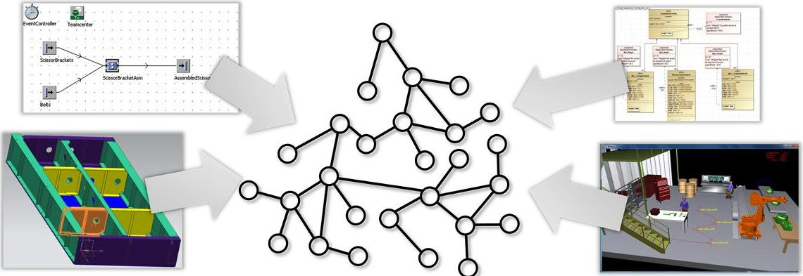
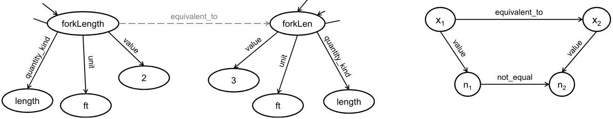
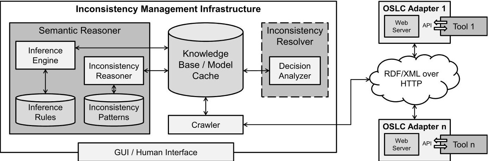
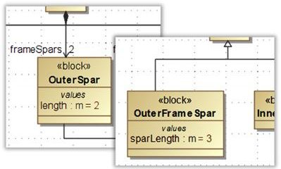
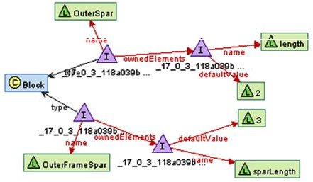
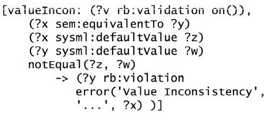

<!-- PDF_PAGE: 1 -->

# Conference on Systems Engineering Research (CSER 2014)

Eds.: Azad M. Madni, University of Southern California; Barry Boehm, University of Southern California; Michael Sievers, Jet Propulsion Laboratory; Marilee Wheaton, The Aerospace Corporation Redondo Beach, CA, March 21-22, 2014

# An approach to Identifying Inconsistencies in Model-Based Systems Engineering

Sebastian J. I. Herzig*, Ahsan Qamar, Christiaan J. J. Paredis

Model-Based Systems Engineering Center, Georgia Institute of Technology, Atlanta, Georgia, United States of America

## Abstract

A typical way of managing the inherent complexity of contemporary technical systems is to study them from different viewpoints. Such viewpoints are defined by a variety of factors, including the concerns of interest, level of abstraction, observers and context. Views conforming to these viewpoints are typically highly interrelated since the concerns addressed in the different viewpoints overlap semantically. Such overlaps can lead to inconsistencies. The challenge is to identify and resolve that is, manage - such inconsistencies. This paper introduces an approach to identifying inconsistencies within the context of ModelBased Systems Engineering (MBSE). In current practice, inconsistencies are typically only discovered after long time intervals, e.g., during reviews. This can result in costly rework or even mission failure. Therefore, actively checking for inconsistencies, and doing so in a continuous fashion, can be valuable. We investigate the hypothesis that all models can be represented by graphs and that inconsistencies can be identified by means of pattern matching. We show that this process is equivalent to inferring inconsistencies by means of deductive reasoning. Finally, we present the results of a proof-of-concept implementation.

$ \textcircled{c} $ 2014 The Authors. Published by Elsevier B.V. Selection and peer-review under responsibility of the University of Southern California.

Keywords: inconsistency management; model-based systems engineering; model composition; model integration

<!-- PDF_PAGE: 2 -->

## 1. Introduction

When designing and developing complex engineering systems, one common practice of managing the often overwhelming complexity is to study the system from different viewpoints. Such viewpoints are defined by a variety of factors, including the concerns of interest, level of abstraction and context. Different stakeholders study the system from different viewpoints. However, each stakeholder relies on, or is influenced by the work and concerns addressed by other stakeholders. For example: a project manager, manufacturing engineer and design engineer each address different concerns and have differing interests. Manufacturing engineers require input from designers to assess the manufacturability of a part or assembly. At the same time, concerns that are part of the project manager's viewpoint (e.g., requirements such as regulatory constraints or cost objectives) need to be taken into account by both the design and the manufacturing engineer. Clearly, there are numerous interrelations between these different views. The presence of such interrelations introduces the potential for inconsistencies $ ^{1} $

In previous work, we concluded that it is impossible to identify all inconsistencies $ ^{2} $ that is, it is impossible to prove (or maintain) consistency within the context of designing & developing complex systems with physical characteristics. Therefore, the focus must be on managing that is, identifying and resolving inconsistencies. In systems engineering, inconsistencies manifest in a variety of forms: violation of well-formedness rules, inconsistencies in redundant information, mismatches between model and test data, and not following heuristics or guidelines. In current practice, most of these inconsistencies are only identified during reviews that are part of the verification & validation activities. In between these reviews there is a possibility of decisions being made based on inconsistent information and knowledge, which can lead to poor outcomes and costly rework. Typically, the earlier an inconsistency is identified, the cheaper it is to resolve. A recent paradigm shift in systems engineering known as Model-Based Systems Engineering (MBSE) has the potential for the process of identifying inconsistencies to be performed in an automated fashion. This is made possible by the key principle of MBSE: the use of only formal, i.e., computer-interpretable models. Automated and computer-assisted methods are important enablers for more frequent inconsistency checks and therefore towards continuously verifying & validating systems.

Identifying inconsistencies is an essential and non-trivial part of inconsistency management. Therefore, this paper focuses on and provides an approach for identifying inconsistencies, and frames the work within the context of Model-Based Systems Engineering. The presented work is motivated by the research question: how can we identify inconsistencies in a set of disparate, distributed, heterogeneous models? The underlying hypothesis of the presented approach is that inconsistencies can be identified using pattern matching.

The remainder of this paper is structured as follows: section 2 provides a brief overview of the related literature and identifies the gaps in the current state of the art. Our conceptual approach to identifying inconsistencies is outlined in section 3. Results and insights gained from developing a proof-of-concept implementation are discussed in section 4. The paper closes with directions for future research.

## 2. Related Work

Most related work stems from model-driven software engineering research. Finkelstein is often credited with being the first person to introduce the notion of inconsistency management $ ^{3} $ In early work, Finkelstein et al., discuss the use of first-order predicate logic (FOL) as a common representational formalism and the use of logical reasoning to identify logical contradictions $ ^{3} $ A similar approach using propositional logic is followed by Schaetz et al. $ ^{4} $ An inherent limitation of both approaches is the insufficient expressiveness of both propositional and first-order logic as well as the complexity associated with expressing (and translating) software models in a logical formalism. Van der Straeten et al. $ ^{5,6} $ explore the use of a description logic to attempt to not only identify inconsistencies, but maintain consistency through logical inference. In their work, the authors use (domain-specific) rules to both identify and resolve inconsistencies. Later work by Mens et al. $ ^{7} $ describe capturing dependencies between inconsistencies and possible resolution actions (in the form of model transformations), as well as sequential dependencies between resolution rules. This work is complimented by earlier work, in which Mens et al. $ ^{8} $ argue that existing formal modeling languages such as UML should be extended to directly incorporate support for inconsistency management.

In systems engineering research and, more generally, the field of model-based design and development of (cyber)physical (as opposed to purely software) systems, particularly fundamental work is lacking. This is often justified

<!-- PDF_PAGE: 3 -->

by the premise that the fundamental concepts developed in model-driven software engineering research can directly be applied. This is somewhat surprising in that most researchers agree that there are key differences between the design and development of physical systems and of software systems - for example, the broader knowledge required due to the multi-disciplinary nature of most technical systems and the heterogeneity of the multitude of disparate models being used. This resulted in Herzig et al. $ ^{2} $ investigating fundamental aspects of managing the consistency of models of complex systems. Qamar and Paredis $ ^{9} $ later propose a conceptual approach to explicitly capturing dependencies across a set of models to aid in identifying and sequentially resolving inconsistencies. An approach to identifying inconsistencies using rules is proposed by Hehenberger et al. $ ^{10} $ . The authors also explore the use of domain-spanning ontologies as a possibility to identify overlaps. However, how these concepts can be practically implemented in a scenario where a set of heterogeneous and disparate models exists is not outlined further. Gausemeier et al. $ ^{11} $ introduce an approach aimed at maintaining consistency between disparate models and a principle solution (an abstract model of the system) by defining correspondences to domain-specific models using a triple graph grammar. These correspondences are then used to propagate changes from the principle solution to the domain-specific models. However, this approach is limited in the sense that correspondences cannot be defined across domain-specific models. Simko et al. $ ^{12} $ investigate a similar approach, but use a model integration language to compose a set of domain-specific meta-models, claiming to thereby preserve model consistency by construction. However, the approach is limited by the fact that a specific, fixed set of tools must be utilized.

## 3. Conceptual Approach

In previous work we have shown that, at least within the realm of complex, physical systems, it is impossible to identify all inconsistencies $ ^{2} $ . Hence, it is impossible to prove or maintain consistency and the focus must be on managing inconsistencies. In systems engineering, a variety of disparate, heterogeneous models is typically used. To automatically - that is, algorithmically - reason about the existence of inconsistencies, a common, unifying representational formalism for models must first be identified.

## 3.1. Directed, Labeled Multigraphs as a Common Representational Formalism for Models

Models are, by definition, abstractions of reality $ ^{13} $ and represent knowledge. Knowledge defines how different pieces of information are related to one another. Information is expressed in the form of propositions (statements) that are known to be either true or false. Facts are propositions that are assumed to be true until they are disproven. It is this information and knowledge that is useful in reasoning about inconsistencies in models. Therefore, a common formalism must be able to encode and represent propositions.

In the artificial intelligence community, automated reasoning is a well-researched problem and many forms of representing knowledge and propositions exist. Atomic propositions - that is, propositions that cannot be further decomposed - are typically broken down into three parts: subject, predicate and object (sometimes also object,

Fig.1. Graphs as a common representational formalism for models; in the graph, each triple consisting of two vertices and an edge represents one particular fact contained in a model

<!-- PDF_PAGE: 4 -->

attribute and value) $ ^{14} $ . Hence, such atomic propositions are sometimes also referred to as triples. An example of such a triple is: The aircraft (subject) has a (predicate) landing gear (object). In this form, propositions represent information and knowledge, because a basic structure for organizing the relationships (using predicates) between different things exists $ ^{14} $ . If we represent each triple by two vertices (one each for the subject and object) that are connected by a directed edge (to indicate the predicate and differentiate between subject and object), it is only natural to think of the set of all triples as a graph. This is illustrated in Fig. 1. Attributes such as labels are required to encode the knowledge to be represented. Therefore, we argue that the information and knowledge contained in models can best be represented by a labeled (attributed), directed multigraph $ ^{15} $ , where we use the term multigraph to indicate that the graph may contain cycles. This is similar in spirit to semantic (or propositional) nets $ ^{14,16} $ .

## 3.2. Inferring Inconsistencies Using Logical Deduction

An inconsistency is, by definition, a logical contradiction $ ^{17} $ . Such contradictions are characterized by the existence of two sets of propositions - both assumed to hold true - that are, when compounded, always false $ ^{14} $ . More generally, the truth value of a statement that was assumed to be certainly true is, given new evidence, put in question. For example, consider the statements The aircraft has 3 landing gears and The aircraft has 5 landing gears. Clearly, the compound statement The aircraft has 3 and 5 landing gears is a logical contradiction - a result that is said to be inferable through application of our knowledge about the physical world to the two given propositions that we assumed to be true. Therefore, one of the statements cannot be true and an inconsistency exists.

Formally, the process of arriving at a conclusion by starting from a set of propositions is known as deductive inference or deductive reasoning $ ^{18,14} $ . Deductive inference is based on the principle of applying a number of inference rules to a set of premises (propositions or compound propositions), possibly in a chain of applications. These chains are a result of opening new paths for inquiry: each conclusion reached can be used in further inference. Such a chained inference is also known as the construction of an argument $ ^{16} $ .

Constructing logical arguments is part of the simplest and oldest type of formal logic: the syllogism. The syllogism is a logic for manipulating propositions and provides means to reason about the validity of a mathematical entailment, i.e., is used to prove whether a particular proposition is inferable. The application of inference rules is therefore equivalent to the construction of a mathematical proof $ ^{16,18} $ . Automating this process requires that conclusions can be reached through symbol manipulation $ ^{14} $ . This symbol manipulation can be automated if the propositions and rules of inference can be interpreted algorithmically - i.e., if their semantics are well defined. One way of achieving this is to map propositions to symbols used in statements that are part of a formal system such as propositional or first-order predicate logic. For example, a (compound) statement valid in both of these logics is $ P \wedge Q $ , where P and Q are propositions and $ \land $ is a symbol representing logical conjunction (or and). Given the truth values for P and Q, it is possible to automatically reason about the truth value of the compound statement since a universally accepted truth table exists for conjunction operator, and therefore for the compound proposition $ P \wedge Q $ .

A number of rules of inference exist in classical logic. To identify contradictions, the law of non-contradiction $ ^{19} $ is typically employed. This law states that contradictory statements cannot both be true - i.e., P is equivalent to Q and P is not equivalent to Q or, in symbolic form $ (P\equiv Q)\wedge(\neg(P\equiv Q)) $ . This rule is a convenient form of a derivative of a more general rule of inference: the modus ponens $ ^{14,16} $ (modus: "way", ponere: "assert"): given a rule in the form of an implication $ P\to Q $ and a premise P, a conclusion Q can be deduced $ ^{14} $ . In other words, if one proposition (P) implies a second (Q), and a premise is given that the first proposition (P) is true, then the second (Q) must also be true (i.e., if P then Q and given P, deduce Q). By assuming that the result of the implication (Q) is the proposition that An inconsistency is present, the modus ponens rule can be used reason about the presence of inconsistencies whenever a certain condition (or compounded set of propositions) P is known to exist.

## 3.3. Querying Graph Patterns to Identify Inconsistencies

While the modus ponens can serve as an adequate tool to formally reason about inconsistencies, the question still remains how the aforementioned premise P can best be captured, and in a way so that P may also be the result of a preceding chain of inferences. Similar to what has been investigated in previous work, all relevant knowledge and

<!-- PDF_PAGE: 5 -->

Fig. 2. (a) Redundantly defined properties (b) Possible pattern to identify inconsistent values of redundant properties

information could be represented in a logic such as first-order predicate logic $ ^{3,4,6,5} $ . However, this has the disadvantage of being highly complex, and may limit the kind of knowledge that can be expressed.

Clearly, the truth value of the condition P is determined based on reasoning about the explicit or implicit presence of a set of propositions that can, as indicated in section 3.1, be represented by a graph. Given such a graphbased representation of a model, we can then argue that any inconsistency that is deductively inferable from the contained propositions must also be contained in said graph. In other words, the compound statement indicating the presence of an inconsistency must either be explicitly contained in or be logically inferable from the propositions in the graph. Therefore, we argue that determining whether or not an inconsistency is present can be mapped to the problem of searching for the existence of a particular subgraph, i.e., the subgraph isomorphism problem $ ^{20} $

Finding subgraphs is an exact pattern matching problem $ ^{21} $ . In general, graph patterns - i.e., partially defined graph data are used to query a target graph - e.g., for the purpose of determining whether or not a particular subgraph exists. The class of patterns and pattern matching problems that allow for vertex and edge variables as well as substitution rules is known as inexact pattern matching $ ^{21,22} $ . Substitution rules are typically composed of a combination of variables and production rules. Such features make patterns logically adequate $ ^{14} $ . Consider the example illustrated in Fig. 2: an inconsistency in the values of two semantically equivalent properties. Note that we assume that the semantic equivalence (indicated by the equivalent_to predicate) was either defined by a human or was inferred automatically from the context by inference $ ^{1} $ . To identify the inconsistency, the graph pattern shown in Fig. 2b can be used, where $ x_{1}, x_{2}, n_{1} $ and $ n_{2} $ are vertex variables. In a logical entailment, where the previously introduced modus ponens is used, P is mapped to this graph pattern. P has a truth value of true if the pattern matches and false otherwise, thereby either proving or disproving the existence of the inconsistency.

In light of this, we argue that inconsistencies can be represented by graph patterns. We refer to such patterns as inconsistency patterns. We say that the process of logically inferring inconsistencies is equivalent to querying patterns. Querying inconsistency patterns is therefore equivalent to applying one or more inference rules that lead to the condition P that results in the identification of an inconsistency through logical implication.

## 3.4. Resolving Inconsistencies: not a Simple Inference Problem

As discussed in section 3.2, inference is a process of reaching conclusions. This conclusion does not necessarily have to be a particular fact (such as An inconsistency is present), but can also be a derived premise. The careful reader may now argue that inference is the logical choice to automatically resolve inconsistencies: that is, given a particular condition P for an inconsistency, infer a set of propositions that, when added to the graph, resolve the inconsistency. While this may be possible in some very trivial cases, the problem is generally non-trivial. For example, if an inconsistency exists in redundant information (such as is illustrated in Fig. 2a), which of the two values is the "correct" one? Answering this question requires that the true value - the accepted truth - is first identified. In addition, this may require the identification of the source of authority, the stakeholder that is responsible for a particular part of a model. In other cases, further analysis is required to calculate the impact of a resolution action. This, in turn, may involve analyzing whether a particular way of resolving leads to further inconsistencies. In some cases it may even be worth ignoring an inconsistency: for example, in cases where an inconsistency is the result of not following a heuristic and sufficient rationale exists to ignore it.

In what way a particular inconsistency should be resolved is a decision making problem. Multiple alternative ways of resolving an inconsistency typically exist and each one must be carefully evaluated before making a

<!-- PDF_PAGE: 6 -->

decision. Clearly, automating, or at least assisting humans in making such decisions requires additional information, and approaches such as dependency modeling $ ^{9} $ may prove to be useful in such cases. Therefore, we argue that resolving inconsistencies is a non-trivial problem and is considered outside the scope of this paper.

## 4. Proof-of-Concept Implementation

As part of the work, a proof-of-concept implementation was developed to demonstrate the practicality and technical viability of the conceptual approach to identifying inconsistencies outlined in section 3. The conceptual architecture, implementation specific details and results from a case study are discussed in the following.

## 4.1. Conceptual Architecture

In any practical scenario in which a variety of models relevant to the systems engineering effort are integrated, a number of key considerations need to be made. Most importantly, the different models will not only be disparate, but also distributed physically, possibly stored in a variety of different repositories and exist in multiple versions.

A linked data $ ^{23} $ approach was selected as a basis for the implementation. A linked data approach is advantageous in that an environment is used that was designed - from the start - to store information and knowledge in a distributed fashion. The W3C recommends the use of the Resource Description Framework (RDF) as a knowledge representation method. RDF is compatible with our conceptual approach in that it allows individual propositions to be expressed as subject-predicate-object triples. In addition, RDF allows for concept schemas to be defined, thereby allowing for more powerful reasoning by allowing for a deep, rather than a shallow graph-based knowledge representation structure $ ^{14} $ . RDF also allows for triples (through reification) and parts thereof - i.e., vertices and edges in the graph or subgraphs - to be identified by unique Uniform Resource Identifiers (URIs), which serve as strong keys and allow for distributed resources to be identified easily.

Fig. 3 illustrates the conceptual architecture of the proof-of-concept implementation of our inconsistency management infrastructure that we have named CONSYSTENT. RDF representations of models are generated by tool adapters and are serialized as RDF/XML. The structure of the generated RDF representations and the functionality of the tool adapters follow the guidelines proposed by the Open Services for Lifecycle Collaboration (OSLC) $ ^{24} $ consortium. OSLC is a promising and open set of guidelines initiated by IBM that defines various domain-specific concept schemas and integrity constraints (in the form of SPARQL ASK queries) to RDF documents, thereby enabling the equivalent of meta-modeling $ ^{25} $ . A crawler collects the information exposed by the tool adapters and stores it in a knowledge repository. This crawler has a similar functionality to that of a search engine in that it retrieves a complete snapshot of the knowledge to be reasoned over by following all discovered URIs. An inference engine and a repository containing graph inference rules accesses the knowledge base and enhances the knowledge base with additional, inferred statements (e.g., to infer semantic equivalences as discussed

Fig. 3. Architecture of the semantic web enabled inconsistency management infrastructure

<!-- PDF_PAGE: 7 -->

in section 3.3). A separate entity - the inconsistency reasoner - queries the knowledge base using graph patterns that are stored in another repository. A user interface enables humans to interact with the inconsistency management infrastructure so that additional inference rules and inconsistency patterns may be added. From a process perspective, the collection of data should precede the inference and inconsistency reasoning.

Once the inconsistency reasoner has identified an inconsistency, knowledge of this inconsistency is stored in the knowledge repository and will be accessed by the inconsistency resolver. This component is included in the conceptual architecture for completeness, but is, as indicated previously, outside the scope of this paper.

## 4.2. Implementation

A linked data approach and the use of RDF as a knowledge representation language have several key advantages. Most prominently, their roots in the semantic web enable the re-use of a rich set of existing semantic web technologies and tools. For the proof-of-concept implementation, Apache Jena was used as the RDF handling framework. As a basis for the knowledge repository a Fuseki server backed by a Tuple Data Base (TDB) datastore was chosen. Both the inference engine and the inconsistency reasoner components shown in Fig. 3 are based on the generic rule reasoning framework provided by Jena. Using this framework, a set of graph patterns is defined in a Datalog-like language (see Fig. 4c for an example). The semantics of these rules map to a description logic, which also defines the expressiveness of the patterns.

To verify the technical viability of the conceptual approach and to test the implementation, two semantically overlapping SysML models containing the engineering bill of materials (EBOM) and manufacturing bill of materials (MBOM) of a particular component-a torque box-of a fictitious airplane were created. The semantic overlap is characterized by the redundant specification of a particular structural element (see OuterSpar and OuterFrameSpar in Fig. 4a). Similar to the example in Fig. 2, which was used to illustrate the conceptual approach, both elements define semantically equivalent value properties. The inconsistency between the assigned default values is to be inferred automatically using the infrastructure. In addition to implementing the different components of the infrastructure, a tool adapter for the SysML modeling tool NoMagic MagicDraw was developed.

## 4.3. Testing of the Infrastructure

The crawler described in section 4.1 first collects the RDF/XML data served by the OSLC tool adapter instances and stores it in the knowledge repository. The part of the stored graph relevant for the case study is illustrated in Fig. 4b. The required equivalence relationship between the value properties is, for reasons of simplicity, supplied a-priori by a human. The inconsistency pattern illustrated in Fig. 4c matches any two vertices that are identified as semantically equivalent by a connecting edge labeled sem:equivalentTo, where each vertex has an outgoing edge labeled sysml:defaultValue that leads to literal values that are not equal. Both sem and sysml are prefixes for namespaces in which the definitions of the predicates equivalentTo and defaultValue are further refined. These definitions define the general properties of the concepts of SysML blocks and semantic equivalences.

Using the inconsistency pattern shown in Fig. 4c, the inconsistency reasoner was able to query the knowledge repository and, through implication, infer the presence of the inconsistency in the values of the properties.

(a)

(b)

(c)

Fig. 4. (a) Two disparate SysML models with redundant definitions of semantically equivalent parts (b) RDF representation of part of knowledge base (visualized using RDF Gravity $ ^{26} $ ）(c) Rule used to identify the inconsistency between length and sparLength

<!-- PDF_PAGE: 8 -->

## 5. Discussion

Section 4 demonstrates the technical viability and practicality of the conceptual approach introduced in section 3. Using the simple example of two semantically overlapping SysML models, we were able to show that models can be represented by graphs and that inconsistencies can be identified using graph pattern matching. However, we have only investigated the case where one particular pattern is defined. Since the set of all possible inconsistency patterns is likely to be infinitely large $ ^{2} $ and since graph pattern matching is an NP-complete problem $ ^{20} $ , both the topic of maintainability and complexity of the approach are discussed briefly in the following.

Careful crafting of inconsistency rules is required to minimize the number of false positives. A consequence of this is that patterns may become very complex. In addition, one may need to define several variations of semantically very similar patterns to more precisely control the context in which the patterns are matched. Therefore, it is conceivable that, in any realistic scenario, maintaining a set of inconsistency patterns can be very costly. Clearly, this cost is proportional to the number of patterns that are defined, but is offset by their benefit. Therefore, defining the set of inconsistency patterns that balances cost and benefit optimally is a risk management problem, and hence also a decision making problem. Patterns that require little context to be specified (see e.g., the example related to inconsistencies of value properties in Fig. 4c) and are therefore not very complex, but have the potential to identify a large number of inconsistencies (e.g., because of value properties being very common) are likely to be very valuable. However, inconsistencies that are easily spotted by a human and require complex patterns to be defined may not always be sufficiently valuable to justify the cost involved in defining and querying for the particular pattern. Not including all conceivable inconsistency patterns is not inconsistent with our conceptual approach, which acknowledges the fact that it is impossible to maintain consistency $ ^{2} $

Graph pattern matching and hence inconsistency identification is an NP-complete problem $ ^{20} $ . However, due to the labeled nature of the graphs, known heuristics can be employed to increase the performance of pattern matching to less than polynomial time (at least for most practical cases) $ ^{27,28,21} $ . Additionally, for very large graphs, performance can possibly be increased by making use of distributed computing. A third possibility to overcome the complexity of the approach is to enforce an artificial upper bound on the computation time. This is a strategy similar to that employed by some theorem provers $ ^{18} $ .

## 6. Summary & Conclusions

In this paper, an approach to identifying inconsistencies is presented. Identifying inconsistencies is an essential part of inconsistency management and a prerequisite for any attempt at resolving inconsistencies. In systems engineering, inconsistencies manifest in a variety of forms: violation of well-formedness rules, inconsistencies in redundant information, mismatches between model and test data, and not following heuristics or guidelines. Since an inconsistency is, by definition, a logical contradiction, we hypothesize that, similar to constructing a mathematical proof, inference can be utilized to identify inconsistencies. More specifically, we say that if a model (or collection of models) can be represented by a graph, any inconsistency must also be contained in this graph, i.e., inconsistencies manifest as subgraphs. Therefore, we argue that inconsistencies can be represented by graph patterns and that using graph pattern matching to check for the existence of a particular subgraph can be used as a formal means of identifying inconsistencies.

Identifying inconsistencies in a continuous and automated fashion can significantly support system verification and validation. The technical viability and practicality of the presented conceptual approach of using pattern matching was shown using a proof-of-concept implementation. However, in order to be able to fully specify the context in which inconsistency patterns are applicable (e.g., to minimize the number of false positives), these patterns may become very complex. This is a result of a particular limitation of the presented approach: patterns require exact matches in all cases. However, it is conceivable that, in some cases, a pattern is not matched (e.g., due to a missing relationship) even though a human would reason that enough evidence is present to suggest an inconsistency. We believe that this is a common case. To mitigate the effects of this identified limitation, the authors are currently investigating the use of abductive rather than deductive reasoning. More specifically, stochastic machine learning (Bayesian learning) is used to expand the conceptual model presented in this paper.

<!-- PDF_PAGE: 9 -->

## Acknowledgements

This work was supported by Boeing Research & Technology. The authors would like to thank Michael Christian (The Boeing Company, St. Louis) and Axel Reichwein (Koneksys LLC) for the many valuable discussions.

## References

1. Spanoudakis G, Zisman A. Inconsistency Management in Software Engineering: Survey and Open Research Issues. Handbook of Software Engineering and Knowledge Engineering. 2001;1.

2. Herzig S, Qamar A, Reichwein A, Paredis CJ. A Conceptual Framework for Consistency Management in Model-Based Systems Engineering. In: Proceedings of the ASME 2011 International Design Engineering Technical Conferences & Computers and Information in Engineering Conference; 2011..

3. Finkelstein AC, Gabbay D, Hunter A, Kramer J, Nuseibeh B. Inconsistency Handling in Multiperspective Specifications. IEEE Transactions on Software Engineering. 1994;20(8).

4. Schatz B, Braun P, Huber F, Wisspeintner A. Consistency in Model-Based Development. In: Engineering of Computer-Based Systems. IEEE; 2003. .

5. Van Der Straeten R, Mens T, Simmonds J, Jonckers V. Using Description Logic to Maintain Consistency between UML Models. In: UML 2003 - The Unified Modeling Language. Modeling Languages and Applications. Springer; 2003. .

6. Van Der Straeten R, D'Hondt M. Model Refactorings through Rule-Based Inconsistency Resolution. In: Proceedings of the 2006 ACM Symposium on Applied Computing. ACM; 2006. .

7. Mens T, Van Der Straeten R, D'Hondt M. Detecting and Resolving Model Inconsistencies using Transformation Dependency Analysis. In: Model Driven Engineering Languages and Systems. Springer; 2006. .

8. Mens T, Van Der Straeten R, Simmonds J. A Framework for Managing Consistency of Evolving UML Models. Software Evolution with UML and XML. 2005;.

9. Qamar A, Paredis C. Dependency Modeling and Model Management in Mechatronic Design. In: ASME 2012 Design Engineering Technical Conferences & Computers and Information in Engineering Conference; 2012. .

10. Hehenberger P, Egyed A, Zeman K. Consistency Checking of Mechatronic Design Models. In: Proceedings of IDETC/CIE; 2010. .

11. Gausemeier J, Schafer W, Greenyer J, Kahl S, Pook S, Rieke J. Management of Cross-Domain Model Consistency During the Development of Advanced Mechatronic Systems. In: Proceedings of the 17th International Conference on Engineering Design (ICED'09). vol. 6; 2009. .

12. Simko G, Levendovszky T, Neema S, Jackson E, Bapty T, Porter J, et al. Foundation for Model Integration: Semantic Backplane. In: Proceedings of the ASME 2012 International Design Engineering Technical Conferences & Computers and Information in Engineering Conference IDETC/CIE; 2012. .

13. Giese H, Levendovszky T, Vangheluwe H. Summary of the Workshop on Multi-Paradigm Modeling: Concepts and Tools. In: Models in Software Engineering. Springer; 2007. .

14. Giarratano JC, Riley G. Expert Systems. PWS Publishing Co.; 1998.

15. West DB, et al. Introduction to Graph Theory. vol. 2. Prentice Hall Englewood Cliffs; 2001.

16. Stefik M. Introduction to Knowledge Systems. Morgan Kaufmann Publishers Inc.; 1995.

17. Finkelstein A. A Foolish Consistency: Technical Challenges in Consistency Management. In: DEXA. Springer; 2000. .

18. Levesque HJ, Brachman RJ. Expressiveness and Tractability in Knowledge Representation and Reasoning. Computational Intelligence. 1987;3(1):78-93.

19. Whitehead AN, Russell B. Principia Mathematica. vol. 2. University Press; 1912.

20. Eppstein D. Subgraph Isomorphism in Planar Graphs and Related Problems. In: Proceedings of the Sixth Annual ACM-SIAM Symposium on Discrete Algorithms. Society for Industrial and Applied Mathematics; 1995. .

21. Gallagher B. Matching Structure and Semantics: A Survey on Graph-Based Pattern Matching. AAAI FS. 2006;6.

22. Barcelo P, Libkin L, Reutter JL. Querying Graph Patterns. In: Proceedings of the Thirtieth ACM SIGMOD-SIGACT-SIGART Symposium on Principles of Database Systems. ACM; 2011. .

23. W3C. Linked Data Platform;. Available from: http://www.w3.org/2012/ldp.

24. OSLC Consortium. Open Services for Lifecycle Collaboration (OSLC); http://open-services.net/.

25. Ryman AG, Le Hors AJ, Speicher S. OSLC Resource Shape: A Language for Defining Constraints on Linked Data. In: Linked Data on the Web (LDOW2013) Workshop. Rio de Janeiro, Brazil; 2013. .

26. Goyal S, Westenthaler R. RDF Gravity (RDF Graph Visualization Tool). Salzburg Research, Austria;.

27. Fu J. Pattern Matching in Directed Graphs. In: Combinatorial Pattern Matching. Springer; 1995. .

28. Lingas A. Subgraph isomorphism for biconnected outerplanar graphs in cubic time. Theoretical Computer Science. 1989;63(3).