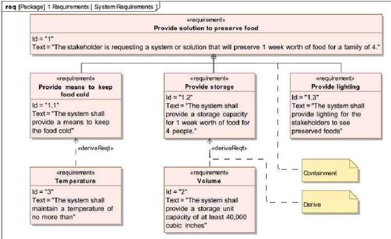
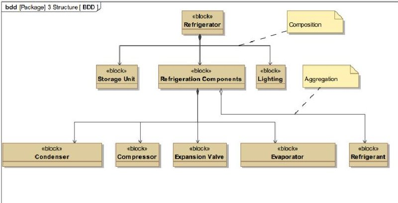
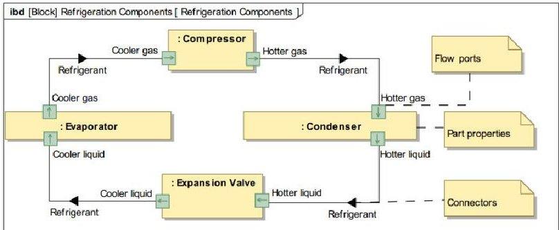
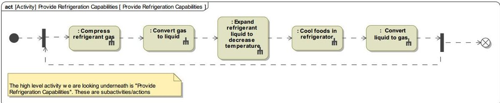
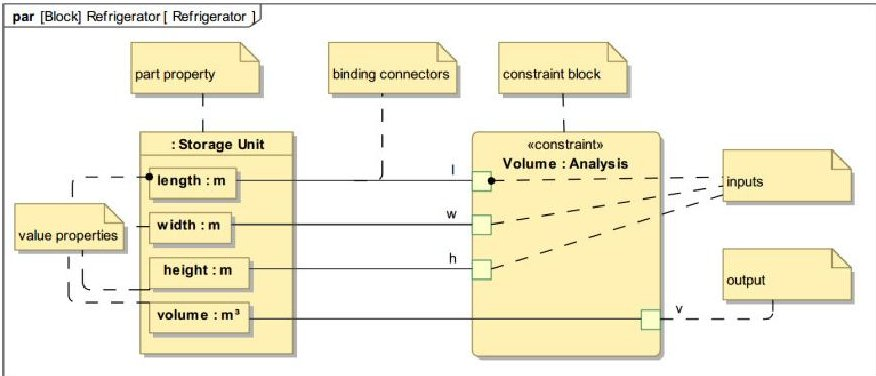
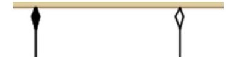

<!-- PDF_PAGE: 1 -->

# 2015 Conference on Systems Engineering Research

# Technical evaluation of the Systems Modeling Language (SysML)

Kyle Hampson*

## Abstract

The intent of this paper is to provide a brief description and critique on each of the 4 pillars of SysML. The description will cover in detail the type of modeling elements used in each pillar, the relationships between these elements, and the views used to represent the model data. The analysis and critique offered will follow the description for each pillar and is primarily from a functional perspective, covering the strengths, weaknesses and identified gaps in the language. In some cases, a recommendation for potential improvement will be provided. Additional modeling gaps that apply across all pillars will also be identified and discussed. Addressing current gaps in SysML would improve our capabilities to accurately represent a system in a modeling format and help better communicate the model to customers in support of a life cycle systems engineering process.

$ \textcircled{c} $ 2015 Published by Elsevier B.V. This is an open access article under the CC BY-NC-ND license (http://creativecommons.org/licenses/by-nc-nd/4.0/). Peer-review under responsibility of the Stevens Institute of Technology.

Keywords: MBSE ; SysML ; Systems Model ; Architecture

## 1. Introduction: What is SysML

The Systems Modeling Language (SysML) is a general-purpose graphical modeling language for specifying, analyzing, designing, and verifying complex systems that may include hardware, software, information, personnel, procedures, and facilities $ ^{1} $ . The language offers a pictorial illustration of semantics for describing a model representative of a given system. SysML is primarily used to convey 4 different aspects of a system including its requirements, behavior, structure and parametrics.

SysML obtains its roots from the Unified Modeling Language (UML). One of the objectives with SysML was to develop a modeling language that could be applied to a wide range of systems. This differs from its UML predecessor, which is more commonly used for software modeling. SysML represents a subset of UML with new features to specifically support systems engineering, including the addition of requirements modeling and enhancements to the

<!-- PDF_PAGE: 2 -->

structural representation of the system, among others. At the time of this writing, SysML 1.3 is the formally released version. SysML 1.3 is the version described and evaluated in this paper. It is noted that a newer version of SysML, 1.4, is currently in progress for release.

## 2. The 4 Pillars of SysML

## 2.1. Requirements

One of the major improvements SysML expands on from UML is support for representing requirements and relating them to the model of a system, the actual design and test procedures $ ^{2} $ SysML strives to allow users to characterize requirements for the system of any kind, including user, technical, or other. A modeler can then define relationships between the requirements specified, allowing the opportunity to create traceability amongst requirements. It also provides an opening to create traceability from the logical and structural architecture design to its requirements, one of the most critical activities in systems engineering $ ^{2} $

SysML allows modelers to define and specify the requirements for a system. SysML supports and can adapt requirements specification regardless of the level of detail needed for the given system, which strengthens its applicability across a range wide of systems. It allows users to refine and model to as low a level of detail as they need to for their system of interest's requirements. For example, SysML can be used to model even the individual design level components and test cases for a system $ ^{2} $

The core element and stereotype defined in this pillar of SysML is the requirement. The properties identified for the requirement stereotype that are typically shown on diagrams include name, ID and a description. It is unclear whether the ID property was intended to act as an object-orient type "identity" $ ^{10} $ , or was intended to show hierarchy amongst the requirements, more commonly referred to as "object numbering" in object oriented modeling. Interesting to note is that both could be beneficial for modeling. Clarifying the intent of this property would be a benefit to modelers.

The principal view used to display and communicate the requirements of a system is the Requirements Diagram. This diagram is used to visually represent the requirements of the system and also show explicitly the various relationship types between requirements. It can be used to build traceability between requirements in the model. Traceability assures the business stakeholders that the developed system supports their original requirements $ ^{11} $ Developing traceability between requirements is considered one of the most important activities during requirements engineering. An example requirements diagram is below for a Refrigerator as the system of interest.

Figure 1. Refrigerator Requirements Diagram Example

Relationship types between requirements and other system elements include containment, derive, satisfy, verify, refine, trace and copy. What these relation types generally do well is give the user specific purpose and meaning to the traceability of requirements in their model. As an example, using the derive relationship allows a connection between any high-level (e.g. user oriented) and low-level (e.g. system oriented) requirements $ ^{3} $ . This is beneficial

<!-- PDF_PAGE: 3 -->

information to capture when working through a requirements specification or requirements analysis process. A similar benefit can be shown for satisfy, verify, refine and copy relation types.

The trace relationship is an exception. It is an ambiguous relation with no real constraints and is not well defined $ ^{3} $ . This can cause some confusion when used, as a modeler generally wants to be explicit when they use a certain relation in the model. If a modeler plans to use this relation type, implications mentioned above should be understood and the modeler should make their intent clear. Having multiple trace relations on a Requirements Diagram with different intent behind them is where an issue can arise as the view now becomes unclear. In order to provide clarity, it is recommended that the trace relationship documentation in the SysML specification be updated to include intended uses.

There are also several extension stereotypes relative to the requirement element defined in the SysML metamodel. This feature allows a modeler to further specify an element, while still inheriting the attributes/properties of the parent stereotype. Examples include: functionalRequirement, extendedRequirement and interfaceRequirement stereotypes. While the extension concept of further specifying the requirements is useful, the SysML specification keeps the extended stereotypes too generic which hinder their usability due to the fact that they are meant to further specify a requirement. The only difference between them in a model is the ability to constrain how the requirements are satisfied. As an example, a functionalRequirement element can only be satisfied via an operation or behavior. However, the other properties associated with a functionalRequirement versus an interfaceRequirement are identical. The SysML specification does make a note to this effect, but these stereotypes would provide more value if they defined additional properties that made them unique beyond satisfy relationship constraints. The extendedRequirement stereotype does offer several unique properties that the base requirement stereotype does not, such as, source and risk. In this case however, it is unclear why these properties are on their own unique stereotype, rather than as properties on the generic requirement stereotype. Given that the SysML 1.3 specification describes the extendedRequirement stereotype as "A mix-in stereotype that contains generally useful attributes for requirements", it would be practical to simplify in this case by adding the properties to the base requirement stereotype. Even if modelers do not always define values for these properties in their requirements, this would highlight them to a modeler during requirements development efforts. In the case of verification method, another more intuitive alternative would be to define a unique "verificationRequirement" stereotype and include the verification method as property on this stereotype. This would be a more effective use of the extension concept.

## 2.2. Structure

## 2.2.1. System Hierarchy

The structure pillar of SysML is focused around the Block element and using them to describe a generic or physical structure layout of the system. Structural elements within the domain context of the system can be defined and used to describe any level of the system hierarchy with the appropriate detail needed. Due to the physical nature of the structure pillar, modeling work often begins here. The focal point of a model is around the system of interest, which is typically defined as a block element in a SysML model.

There are three types of diagrams for depicting the structural architecture including the Block Definition Diagram, Internal Block Diagram, and Package Diagram. This paper will only look at the first two, where block elements are the focal point. A Block Definition Diagram typically describes the relationships among blocks, such as associations, dependencies, and generalizations. It specifies system hierarchy and classifications $ ^{4} $ . The view is powerful for communicating domain, system and component structural hierarchy to a wide range of audiences. A BDD is easy to understand for nontechnical personnel but maintains well defined semantics to ensure the system's physical or logical architecture is described in sufficient detail, making it one of the most effective views for this reason. An example BDD for the Refrigerator system is below.

<!-- PDF_PAGE: 4 -->

Figure 2. Refrigerator Block Definition Diagram Example

Two of the most common relationships used on BDDs are closely related subtypes of association: composition and aggregation. A composition relationship is used to describe ownership between two blocks where the owned block cannot exist without the owner (if the owner is removed, the owned element is as well). The aggregation relationship is used to specify reference hierarchy attributes between elements, but differs from composition in that the elements remain independent of one another from an ownership perspective (an element can exist and has purpose without its aggregate) $ ^{5} $ . Using a combination of composition, aggregation and generalization (inheritance) relationships as needed allows users to define the hierarchical decomposition of a system. However there are some graphical concerns regarding composition and aggregation, further expanded upon in Section 4.1

On blocks, a modeler can also include several types of property attributes defined by SysML that are useful features for describing the nature of a given block. The different property types include part, value, shared and reference. Part properties are created automatically when a modeler constrains blocks using the composition relationship. As one block takes ownership of another, it becomes a part. Value properties give blocks mathematical characteristics. For instance, the Storage Unit could be given a value property of "volume". This becomes important when discussing parametric data in the model.

## 2.2.2. Internal Structure

Having the capability to display and communicate the internal connections between elements in a structural architecture is critical for systems engineers. SysML tackles this challenge by defining the white box or internal view of a block with the Internal Block Diagram $ ^{6} $ . An IBD represents the internal structure of a block using block properties and connectors between properties $ ^{4} $ . An example of an IBD is below, showing the four refrigeration cycle components of the system defined and the interfaces between them.

Figure 3. Refrigeration Components Internal Block Diagram Example

The strength of the IBD lies in the fact that it is a graphical way to represent interfaces for a system. Unlike interface control documents and N2 diagrams, an IBD lays out all the parts of a Block in a visual manner, which makes for an effective way to display the internal parts of the Block and any connections or interfaces between them. An IBD draws heavily on connections and data that were previously defined in a BDD for a given Block, making it straightforward

<!-- PDF_PAGE: 5 -->

for the modeler to verify they are displaying the appropriate parts of a Block on the IBD. This shows how data captured in separate areas of the model relate to one another and how certain features build off of each other, which is one of the largest benefits of modeling with SysML.

There are several aspects of the IBD that could be improved. Beyond the initial notion of parts and their connections, IBDs quickly become overly complex and puzzling for viewers to understand. Understanding parts, ports and connections, each with a varying number of possible types all on one view becomes an overwhelming experience for most viewers and can be a significant challenge for modelers to communicate effectively. It is necessary to describe the internal connections for a block in a detailed and sufficient way for the model, and for the most part the semantics for doing so are well defined. However, due to the critical nature of interfaces and the need to communicate them effectively to others, IBDs should be simple enough for those without proficiency in SysML to understand. Technical language concepts such as "item flows" and "ports" often get lost when discussing the system with stakeholders and decision makers that are not strongly acquainted with SysML (most are not). In particular, the graphical syntax of IBDs becomes a burden and could be improved. This is further discussed in the graphical representation section (4.1) of this paper.

## 2.3. Behavior

Behavioral modeling emphasizes the behavior of the system or an element in its domain to include the inputs and outputs, sequence and conditions for coordinating other behavior $ ^{5} $ . There are 4 diagrams that SysML defines to describe system behavior including the Use Case, State Machine, Activity and Sequence Diagrams. Of these, only the activity diagram has modification from its UML counterpart. This paper will cover the Use Case, State Machine and Activity Diagrams.

## 2.3.1. Use Cases

The Use Case diagram, as the name implies, specifies a description of a mission or stakeholder that the system will address. It provides the means for describing basic functionality in terms of usages/goals of the system by actors $ ^{7} $ Even though it is a simple diagram, it has specific syntax and semantics that complicate the diagram. The difference between include and extend relationships, for example, and when to use each can be confusing to understand as well as the concept of inheritance, which is not simple for non-technical persons to understand $ ^{3} $ The value of association links is also uncertain. They are described in the SysML 1.3 specification as communication paths between actors and use cases $ ^{13} $ . However no additional details can be defined beyond the link itself, such as communication type or direction. Associations in this case end up as simple generic connections between two elements with little effect on the rest of a SysML model. This also raises the need for use cases to connect more with the rest of the model, as SysML does not currently specify any necessary relationships from the remainder of the system architecture back to use case (requirements, structure, etc.). While Use Case diagrams are primarily brainstorming tools and generally are meant to stay high level, clarifying the intent of extend, include and association links, and providing some clear relations to other aspects of the system architecture (such as the system structure and activities) would help address these issues and provide additional value.

## 2.3.2. Activity Diagrams

Activity diagrams lay the foundation for system behavioral modeling. They focus around the use of Activity elements and Actions to define and describe the functional flow behavior of a system. Speaking in terms of system functionality is still considered the most natural way of expressing a design by most of the domain experts involved in the early phases of system development (electrical engineers, mechanical engineers, test engineers, marketing and, of course, customers) $ ^{12} $ and is therefore a critical aspect of modeling a system architecture. An Activity Diagram specifies transformation of inputs to outputs through a controlled sequence of actions $ ^{7} $ . They can be developed in such a way to perform an execution or simulation of the system functional flow. An example of a simple activity diagram for a top level function "Provide Refrigeration Capabilities" is below, which shows the 5 sub functions at a level below beneath the top function.

<!-- PDF_PAGE: 6 -->

Figure 4. Provide Refrigeration Capabilities Activity Diagram Example

Activity diagrams share similar strengths and weaknesses to the IBD. They are exceptional at defining a simple flow between two functions of a system. They can be used to describe a flow of activities anywhere within a mission thread for a system. The interaction between the activities, including the sequence of actions, input and outputs can be shown clearly. Activity diagrams can also be decomposed fluently as shown in the "Provide Refrigeration Capabilities" example if a specific activity should be broken out into a further level of detail (into its sub functions).

The primary challenge with activity diagrams is with their syntax and semantics. If an activity diagrams simply needs to show a flow of functions from one to the next, in most cases this can be accomplished in a reasonable amount of time and is straightforward to communicate. However, if an activity diagram is planned for simulation or execution of system behavior, the semantics become place a huge burden on the modeler. The large number of action types that can be used on activity diagrams can be overwhelming for modelers to understand and creates an unwelcome challenge, especially for unseasoned SysML users. Even those with experience can have problems, as simulation built models require significant detail and need to be built fully accurate from a syntax perspective in order to properly execute, which becomes detailed and frequently results in the need for model "debugging". The task becomes similar to writing code, only more challenging, as generally a modeler will need to look through a large number of element specifications and views in order to determine errors, rather than a more common text file in the case of a software coding. The required time investment is rarely worth the value and makes this method inferior to using a scripting language for executing a similar simulation. In order for a SysML model to become more effectively used in support of behavioral simulation for systems engineering, as opposed to software engineering, the action element types need to be modified, reduced in number and simplified where possible. It would also improve modeling efficiency if the need to look through diagrams and element specifications when debugging a model was removed.

## 2.3.3. State Machine Diagrams

State Machine Diagrams are typically used to represent the life cycle of a block and support event-based behavior of the system $ ^{7} $ . The main elements defined are states, which are used to describe the relative condition of the system during a mission scenario. They can be used to transition a system during a behavioral simulation from one state to another, where the invoked behavior changes. Systems can change states via a transition. State Machine Diagrams effectively convey the different states a system can undergo and how the system moves from ones state to another. The semantics for state machine diagrams allow modelers to capture a necessary description of system states while maintain a level of simplicity that makes them valuable for communication.

## 2.4. Parametrics

Parametrics is the aspect of modeling that deals with defining constraints to give system parameters or value properties additional meaning in the model. The Parametric Diagram was introduced to support this need in SysML. By providing the ability to express constraints between properties, a Parametric Diagram enables integration of engineering analysis, such as performance and reliability models with SysML design models $ ^{4} $

ConstraintBlock elements are the foundational element for defining parametrics in a SysML model. These constraint blocks typically come in the form of mathematical equations with defined parameters. Parametric Diagrams contain usage of constraint blocks to "constrain" the value properties of other blocks $ ^{4} $ . This is done by creating binding connectors on parametric diagrams between constraint parameters of the constraint block to value properties from

<!-- PDF_PAGE: 7 -->

other blocks (such as the mass of a system and its two subsystems). Parametrics by nature have a close tie with the structural pillar of SysML.

Parametric Diagrams can be used as a gateway for linking analysis tools with the architecture model. When a system engineer works in combination with other engineering domain disciplines, parametric diagrams can be effectively used to integrate disparate analyses from the separate domain competency areas. Analyses can be linked into a SysML model via a ConstraintBlock and can be used to perform analysis in conjunction with the architecture. It is also possible to link multiple analyses together using the Parametric Diagram. Linking together multiple analyses through the use of a Parametric Diagram is a powerful ways to mature a system architecture, and lays a foundation for building an integrated "system model". It allows users to perform integrated analyses and receive more holistic results. Bringing together these originally separated analyses into the system architecture model, will provide the team a full system perspective of how the system model reacts to certain changes. This is perhaps the single greatest benefit from developing a parametric model. A simple Parametric Diagram displaying the Storage Unit and the necessary value properties linked to an analysis to calculate the volume is below.

Figure 5. Volume of the Refrigerator Parametric Diagram Example

Beyond linking to external analyses, the effectiveness of the Parametric Diagram comes into question. Parametric Diagrams are capable of being executed, similar in fashion to activity or state machine diagrams. Modeling system constraints effectively and efficiently can become an issue due to a significant amount of time investment needed, similar to what was discussed with activity diagrams. The type of analysis that can be completed is also limited compared to that of external analysis capabilities. Given that in general other software or tools are used to perform system analysis, and a detailed parametric modeling effort will result in more limited capabilities, the return on investment for using the parametric diagram for this type of modeling purpose is uncertain.

## 3. Relational Interactions between the 4 Pillars

One of the benefits modeling delivers to systems engineering is the capability to define and visually see the interactions from one aspect or view of the system to another. If we are looking at a BDD, for instance, intuitively we know there should be some kind of connection from the physical blocks defined (physical architecture) back to the requirements. We should be able to answer "Does the design meet the mission needs for the system?" Answering this question requires an understanding of how the structural aspect and requirements aspect of the model connect with one another. Similar questions can be asked regarding the 4 pillars of SysML and their relations to one another. We would like to be able to know how well SysML allows us to answer these questions.

## 3.1. Connecting back to Requirements

Creating traceability back to requirements for a system has always been a difficult but important task for systems engineers. In terms of relating the systems structure back to requirements, this is done via the Satisfy relationship between Blocks and Requirements elements. This is an important exercise to model for systems engineers as it creates a basic traceability from the system design to its requirements. A powerful aspect of this is the ability to relate value properties (say the volume of the storage unit) back to an individual tag on a requirement (the value

<!-- PDF_PAGE: 8 -->

measured in cubic feet of the required storage volume). In combination with a parametric diagram, it is possible to perform an analysis, and then use the system model to perform verification of its value properties post-analysis against the requirements. This gives the systems engineer an opportunity to see where requirements were met, or potentially where they failed. From here we can see there is a strong connection between our structural and parametric features to our system's requirements. It is not as clear how the requirements and behavioral models relate, and what connection exists between these. This is an aspect of SysML that should be more clearly laid out.

## 3.2. Structural and Behavioral Relations

The connection between structure and behavior is an area that requires further exploration, definition and clarity. Intuitively, we know there should be connections between what the system does, and what parts are doing it. SysML currently addresses this by defining allocation relationships from activities to blocks. However, this only gives a basic and general understanding of physical to functional traceability (functions that a component performs). It is not clearly defined how specific value properties, which are attributes of Blocks, relate back to system functions. There should be some form of a relationship for this, as certain properties may need a specific value in order for that system's function or activity to properly execute. In essence, it leaves out the mathematics behind system functions and their connection to the physical architecture.

## 4. Additional Areas for Model Improvement

In this section of this paper, several miscellaneous topics will be touched on as considerations for future iterations to SysML that apply in some fashion across all 4 pillars.

## 4.1. Graphical Representation

One of the challenges faced with a graphical modeling language is utilizing appropriate symbols to represent the language. There two primary ways elements in SysML are represented: shapes and arrows.

When represented on views, the majority of SysML elements have a square/rectangular shape. For reviewers who aren't familiar with the language or the tool used for representation, this can sometimes cause issues and be confusing. Issues arise in the fact that it can be hard to distinguish one element type from another. The Parametric Diagram example (Figure 5) is a prime example of this. There are 4 different element types displayed on this view: part properties, value properties, a constraint block property, and constraints (inputs/outputs). However, to a reviewer not familiar with SysML, these different element types will look too similar to distinguish between with their default symbol properties as shown without significant explanation from the modeler. There are some elements which have clearly different graphical representation, such as the use case which is an oval shape. It makes one consider asking why the majority of elements are of a square/rectangular shape and have similar color schemes while a select few are different? The importance of the actual graphic representation of information on views should not be overlooked given the nature of SysML as a graphical modeling language. It is recommended that different default symbol types be implemented for the core stereotypes of SysML at minimum including requirements, activities, blocks and value properties.

When looking at the arrow types SysML uses to represent its different relationships, it is important to make sure each type is different enough so that it clearly differentiates itself from another relation. One example from a visual perspective where this causes trouble is with the Composition and Aggregation relation types. An image showing the two relation types side by side is below.

Figure 6. Composition Vs. Aggregation

<!-- PDF_PAGE: 9 -->

When displayed on the same view (which they often are) it may become confusing for those not familiar with SysML to interpret. In particular, many stakeholders that examine a view with both may not even notice that they are two different relation types, unless pointed out by a SysML expert. Considering there is a clear difference in semantics between the two relation types, it would be beneficial to make their graphical representation more distinct from one another. Most relation types that SysML added display the stereotype terminology directly on the relation. At minimum, including these would improve reviewers understanding.

Internal Block Diagrams are one instance where the aesthetics overcomplicate the intent of the view. While the semantics are defined for different types of interfaces, such as for physical connections and flow items, aesthetically their similarities make it difficult to understand, communicate and differentiate between them on an IBD. Ports are also often a struggle point for modelers to use and communicate properly. Different port concepts such as FullPorts, ProxyPorts, and nested ports look similar when represented symbolically and can confuse stakeholders when used on the same view, as viewers will often think they all have the same meaning. The symbol representation for IBD elements should be modified and improved to make the differences clear while staying easy to understand for nontechnical personnel.

## 4.2. The Containment Relationship

The containment relationship is one of the most critical aspects of any model that is generally overlooked. The containment relationship by nature determines the actual tree structure of elements in your model. The implications from structuring the tree one way or another can be significant and have a critical impact on your model. Effects can range from the level of ease to navigate through a model, to having actual effects on the layout and data captured in certain matrix views. Currently there is minimal guidance on the implications for structuring the containment tree in a particular way. It is recommended that such considerations be provided in the SysML Specification, likely in the Overview portion of the Structural Constructs section (Section 7.1 in SysML 1.3).

## 5. Conclusion

Overall, SysML has many compelling features to use that make it an excellent choice as a language for modeling a system. Even just using a small portion of what SysML has to offer can improve communications of a design to both technical and nontechnical stakeholders alike. However, there are opportunities to improve SysML which would make it an even stronger language and improve its effectiveness for system modelers. There were gaps in SysML identified in this paper that reflect these potential opportunity areas for improvement. The table below highlights and summarizes all of the gaps that were discussed in this paper.

Table 1 - Summary of SysML Gaps Identified (in order as presented in this paper)

<table border="1"><tr><td>Relative Severity[Low-Med-High]</td><td>Category</td><td>Gaps Identified</td><td>Recommendation to Address</td></tr><tr><td>Low</td><td>Semantics</td><td>Intent of existing requirements attribute“ID”is unclear</td><td>Clarify“ID”as a unique,software/language imposed identifier.Add“object number”equivalent attribute</td></tr><tr><td>Medium</td><td>Semantics</td><td>The trace relation is ambiguous with no real constraints and is not well defined</td><td>Trace relationship documentation update to SysML specification(intended uses)</td></tr><tr><td>Medium</td><td>Usability</td><td>Extended stereotypes for requirements are too generic</td><td>Define additional properties that make them unique beyond satisfy relationship constraints</td></tr><tr><td>Low</td><td>Usability</td><td>Unclear why properties on“extendedRequirement” stereotype are on their own unique stereotype,rather than as properties of the“requirement” stereotype</td><td>Simplify in this case by adding the properties to the base requirement stereotype(also increases their exposure)</td></tr><tr><td>Medium</td><td>Semantics</td><td>IBDs can be overly complex and puzzling for viewers to understand</td><td>Semantics for IBDs should be simplified so that those unfamiliar with SysML can easily understand them</td></tr><tr><td>Low</td><td>Semantics</td><td>Include/Extend relationship usages are unclear and overcomplicate use case diagrams,which are primarily a communication tool</td><td>Clarify use for these relationships or eliminate them</td></tr><tr><td>Medium</td><td>Usability</td><td>Association links from actors to use cases are generic</td><td>Provide additional details such as communication</td></tr></table>

<!-- PDF_PAGE: 10 -->

<table border="1"><tr><td></td><td></td><td>and have little effect on the rest of the system model</td><td>type or direction. Determine where Use Cases relate to the rest of the system model</td></tr><tr><td>High</td><td>Model Execution</td><td>For executable activity diagrams, syntax becomes extremely complex and places a huge burden on the modeler</td><td>Action element types need to be modified, reduced in number and simplified where possible.</td></tr><tr><td>High</td><td>Model Execution</td><td>Executable activity diagrams require a significant amount of detailed modeling to make even a simple model simulation. Level of detailed modeling needed is impractical</td><td>It would improve modeling efficiency if the need to look through diagrams and element specifications when debugging a model was removed.</td></tr><tr><td>High</td><td>Model Execution</td><td>Parametric diagrams built for parametric analysis are generally low fidelity compared to external system analysis</td><td>Modelers should focus on fully specifying the system and using parametric diagrams to link the architecture model w/ external analyses</td></tr><tr><td>High</td><td>Specification</td><td>It is not clear how requirements and behavioral aspects of a model relate to one another</td><td>Further meaning behind behavior/requirements relations need to be defined. What these relationships tell the systems modeler should be documented</td></tr><tr><td>Medium</td><td>Specification</td><td>Structural/Behavioral relations are only laid out at a top level and could be specified further</td><td>Define clear mathematical based connections from physical to behavioral architecture</td></tr><tr><td>High</td><td>Graphical</td><td>Majority of elements have similar symbol representation which can confuse reviewers</td><td>New and different default symbol types implemented for the core stereotypes of SysML at minimum including requirements, activities, blocks and value properties</td></tr><tr><td>Low</td><td>Graphical</td><td>Visual representation of some links are similar and difference in semantics is often missed by the audience (ex: composition vs. aggregation)</td><td>Display stereotype terminology on all relation types</td></tr><tr><td>Medium</td><td>Graphical</td><td>For physical connections and flow items on IBDs, aesthetically their similarities make it difficult to understand, communicate and differentiate between them. Port concepts such as FullPorts, ProxyPorts, and nested ports look similar when represented symbolically on IBDs and can confuse stakeholders</td><td>Symbol representation for IBD elements should be improved to make differences clear while easy to understand for non-technical personnel</td></tr><tr><td>Medium</td><td>Specification</td><td>The containment relationship and its implications are often overlooked and not well understood</td><td>Considerations/implications of the containment tree/relationship provided in the SysML Specification, (Equivalent of Section 7.1 in SysML 1.3)</td></tr></table>

## References

[1] "OMG Systems Modeling Language." The Official OMG SysML Site. Web. 2014. http://www.omgsysml.org/

[2] Vanderperren, Yves and Wim Dehaene. SysML and Systems Engineering Applied to UML-Based SoC Design. Katholieke Universiteit Leuven, EE Department. 2005.

[3] Dos Santos Soares, Michel and Jos Vrancken. Requirements Specification and Modeling through SysML.16 March 2007.

[4] Grobshtein, Yariv and Dov Dori. Evaluating Aspects of System Modeling Languages by Example: SysML and OPM. Israel Institute of Technology. 2008.

[5] "Composition relationships." Introduction to Rational Systems Developer. IBM Rational Systems Developer Info Center. 2005. http://publib.boulder.ibm.com/infocenter/rsdvhelp/v6r0m1/index.jsp?topic=%2Fcom.ibm.xtools.modeler.doc%2Ftopics%2Fccompasn .html

[6] Guillaume FINANCE, Object Direct Analyst & Consultant. SysML Modelling Language explained. 7 Oct 2010. http://www.omgsysml.org/SysML_Modelling_Language_explained-finance.pdf

[7] Friedenthal, Sanford, Alan Moore and Rick Steiner. OMG Systems Modeling Language (OMG SysML) Tutorial. Object Management Group. Sept 2009. http://www.omgsysml.org/INCOSE-OMGSysML-Tutorial-Final-090901.pdf

[8] Huang, Edward, Randeep Ramamurthy and Leon F. McGinnis. System and Simulation Modeling using SysML. Georgia Institute of Technology. 2007.

[9] SysML Plug-in 18.0 User Guide. No Magic, Inc. 2014. http://www.nomagic.com/files/manuals/SysML%20Plugin%20UserGuide.pdf

[10] "Introduction to Object-Oriented Programming." SAS (R) Component Language 9.2: Reference. 2014. http://support.sas.com/documentation/cdl/en/sclref/59578/HTML/default/viewer.htm#a001089800.htm

[11] McDonald, Duncan. "The Importance of Requirements Traceability." Business Analyst Times. 20 Jan 2009. http://support.sas.com/documentation/cdl/en/sclref/59578/HTML/default/viewer.htm#a001089800.htm

[12] Hoffman, Hans-Peter, PhD. SysML-based systems engineering using a model-driven development approach. IBM. Oct 2008. http://www.rose-hulman.edu/Users/faculty/young/CS-Classes/csse490-mbse/Readings/SysML_based_systems_engineering-08

http://www.rose-hulman.edu/Users/faculty/young/CS-Classes/csse490-mbse/Readings/SysML_based_systems_engineering-08.pdf [13] OMC Systems Modeling Language Version 1.2 Specification

[13] OMG Systems Modeling Language Version 1.3 Specification