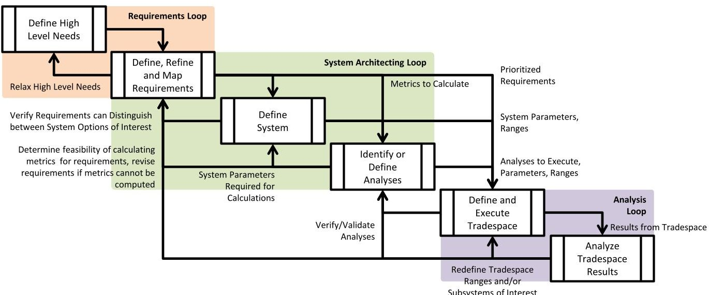
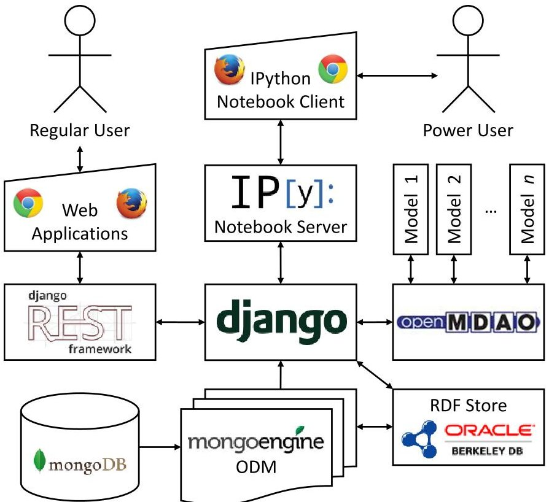
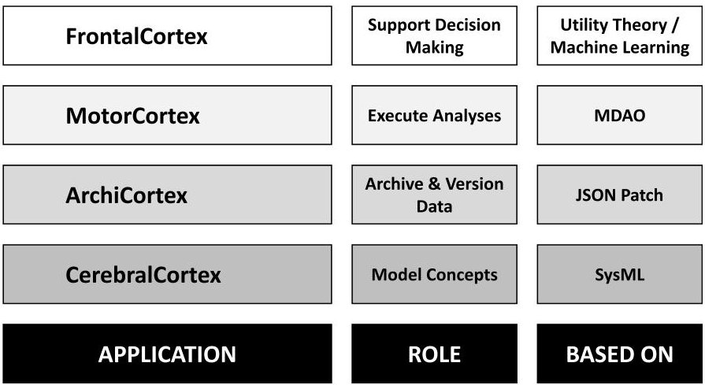
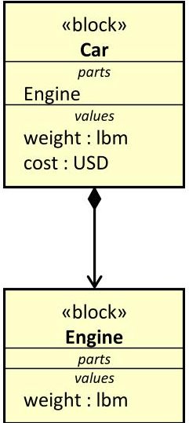

<!-- PDF_PAGE: 1 -->


<div align="center">

# 2015 Conference on Systems Engineering Research

</div>

<div align="center">

# An object-oriented and executable SysML framework for rapid model development

</div>

Santiago Balestrini-Robinson $ ^{*} $ , Dane F. Freeman, Daniel C. Browne

Electronic Systems Laboratory, Georgia Tech Research Institute, 400 10 $ ^{th} $ St NW, Atlanta, Georgia, 30318, USA

## Abstract

This paper introduces Cortex, a new framework to develop object-oriented and executable SysML models using the IPython Notebook $ ^{4} $ . The framework strives to create a succinct and intuitive Python programming interface for SysML models, and integrate it with OpenMDAO (a Multi-disciplinary Design, Analysis and Optimization framework being developed by NASA Glenn Research Center). Data persists in MongoDB, with a Resource Description Framework (RDF) cache for semantic querying. The models can be exposed to custom web-based applications through a Representational State Transfer (REST) interface. The authors strive to create a foundational framework on which to be able to build more advanced system engineering and decision support tools. All the tools and libraries leveraged in this effort are open source software (OSS), and whenever possible, the authors selected technologies with the most permissive licenses.

$ \textcircled{c} $ 2015 The Authors. Published by Elsevier B.V. Peer-review under responsibility of the scientific committee of Stevens Institute of Technology.

Keywords: object-oriented, open-source, SysML, MBSE, framework, MDAO

## 1. Introduction

The goal of this work is to develop a web-based collaborative Systems Modeling Language (SysML) compliant and extensible Model-based Systems Engineering $ ^{6} $ (MBSE) analysis framework that leverages Open-Source Software (OSS). Additionally, the analysis framework is to provide a new means to create and interface with SysML models to complement the existing diagraming language, geared towards more rapid prototyping and built-in analysis capabilities. The framework described in this paper leverages lessons learned from other efforts conducted at the

<!-- PDF_PAGE: 2 -->

<table border="1"><tr><td colspan="2">Nomenclature</td></tr><tr><td>API</td><td>Application Program Interface</td></tr><tr><td>COTS</td><td>Commercial Off-The-Shelf</td></tr><tr><td>CRUD</td><td>Create, Read, Update and Delete</td></tr><tr><td>DRY</td><td>Don’t Repeat Yourself</td></tr><tr><td>EW</td><td>Electronic Warfare</td></tr><tr><td>FACT</td><td>Framework for Assessing Cost and Technology</td></tr><tr><td>DSEF</td><td>Dynamic Systems Engineering Framework</td></tr><tr><td>FAEWSET</td><td>Future Army Electronic Warfare Systems Engineering Toolset</td></tr><tr><td>GOTS</td><td>Government Off-The-Shelf</td></tr><tr><td>GRC</td><td>Glenn Research Center</td></tr><tr><td>JSON</td><td>JavaScript Object Notation</td></tr><tr><td>JSON-LD</td><td>JSON for Linked Data</td></tr><tr><td>MBSE</td><td>Model-based Systems Engineering</td></tr><tr><td>MDAO</td><td>Multi-disciplinary Design, Analysis and Optimization</td></tr><tr><td>NASA</td><td>National Aeronautical and Space Agency</td></tr><tr><td>ODM</td><td>Object Document Mapper</td></tr><tr><td>ORM</td><td>Object-Relational Mapping</td></tr><tr><td>OSS</td><td>Open-Source Software</td></tr><tr><td>QFD</td><td>Quality Function Deployment</td></tr><tr><td>RDF</td><td>Resource Description Framework</td></tr><tr><td>REST</td><td>Representational State Transfer</td></tr><tr><td>SQL</td><td>Structured Query Language</td></tr><tr><td>SysML</td><td>Systems Modeling Language</td></tr></table>

Georgia Tech Research Institute (GTRI) in the past 5 years. Of primary interest are the (1) Framework for Assessing Cost and Technology (FACT), the (2) Engineered Resilient Systems (ERS) Tradespace, the (3) Dynamic Systems Engineering Framework (DSEF), and the (4) Future Army Electronic Warfare Systems Engineering Toolset (FAEWSET). FACT offers a collaborative SysML authoring capability for Block Definition Diagrams (BDD) and Parametric Diagrams (PAR), integration of executable models, and tradespace exploration and analysis capabilities. FAEWSET was developed to assist the Army's Program Manager Electronic Warfare (PM-EW) to identify and evaluate context-specific gaps in existing technology against current and future threats. The analytical framework utilized a cascading Quality Function Deployment (QFD) approach to tie existing GOTS and COTS systems to context-specific threats. Whereas the analytical framework within FAEWSET was static once developed (without database migrations and/or code changes), DSEF looked to expand the capability to allow engineers to define their analytical framework in addition to populating the data and conducting analysis. All these frameworks were developed for specific purposes with highly customized interfaces that take person-years to develop and perfect in order to address the specific needs of a project or organization.

Despite the effectiveness of these tools, the authors recognized that oftentimes it is valuable to have a rapid prototype framework that expedites the process for creating models, extending the analysis framework, and integrating with other tools. This has been the primary inspiration for this work, and serves as the central tenet for the development team. The remainder of the ideology is listed below.

- Build on solid, well-defined and accepted foundations

- Abide by the DRY principle

- Integrate with suitable and properly maintained tools whenever possible

- Lower all barriers of entry, especially technical, legal, and financial

- Facilitate collaboration, integration of knowledge, and sharing of ideas

<!-- PDF_PAGE: 3 -->

- Guide the novice users and empower the experienced ones

- Do not force users to follow a rigid process

The workflow for solving complex systems engineer problems is inherently complex because no two systems engineering problems are identical. There are common stages and elements, but depending on the organization, the resources and the needs, some elements are emphasized and revisited more often than others. In general terms, all projects require the definition and understanding of requirements, generation of alternatives, and analysis to prioritize these. A more comprehensive way to understand the systems engineering workflow the authors are attempting to support is illustrated in Figure 1. A particular workflow for a systems engineering problem is the walk one takes through the networked workflow. Considering the generalized workflow helps ensure the requirements of future system engineering workflows can be supported.

The idea of building on solid, well-defined and accepted foundations led the team to use SysML as the guiding standard for structuring the data. Since the tool is intended to assist systems engineers collaborating on large-scale and potentially complex projects, it is important to choose a basis, in this case a language, on which to build the necessary artifacts. These artifacts should not have to be rebuilt when a different phase of the project is initiated, e.g., when transitioning from problem definition to solution analysis. Whenever possible the data generated by one phase should be seamlessly integrated and be expanded on, and this additional information should be allowed to flow back to inform the prior phases. In an ideal world, new projects could leverage data from prior ones whenever possible.

SysML models are intended to capture sufficient system behavior to represent interactions and performance of the system modeled. Nonetheless, there is little guidance as to what constitutes an executable SysML model. Executable UML (xUML) offers a strict definition on what constitutes an executable model, but it does not fully capture the complexities of engineering executable models as it focuses on the generation of executable code from an UML model. What is of interest is the definition and execution of engineering models, some of which may simply be represented as black boxes through the use of SysML constraint blocks. Multidisciplinary Design Analysis and Optimization (MDAO) is a field of study concerned with the integration of multiple models, which may be represented as blackboxes (i.e., the internals are opaque to the users) and coherently and intelligently executing them to identify suitable combinations of parameters in order to satisfy some numerically defined requirements. For this reason, the team decided to explore the options available for integrating MDAO frameworks with SysML concepts. The most suitable alternative proved to be OpenMDAO $ ^{2} $ , an excellent open-source MDAO framework being developed by NASA Glenn Research Center.





<div align="center">

Figure 1. System Engineering Networked Workflow

</div>

<!-- PDF_PAGE: 4 -->

These tools are notorious in their complexity and steep learning curves. They do not only require extensive programming knowledge, but they rely on an extensive and complex theoretical framework. Nonetheless, the concepts employed are not so complex that they cannot be grasped by most engineers with knowledge of statistics and basic programming experience. The question then becomes, how can these frameworks be wrapped, or encapsulated, so as to enable the users to employ them without the need for understanding all the intricacies associated with them?

Once this goal is achieved, these powerful tools will be accessible to the masses, which leads to the problem of how do we allow these groups of engineers to collaborate? This is not a trivial task because the data being manipulated is not as flat as a text document or a spreadsheet. There is not only a technical barrier to enable collaboration, but a cultural one as well. Most analysis teams the authors have encountered are stove-piped into various disciplines, with a well-defined series of boundaries between each of the teams in the project. In order to abide by the DRY philosophy, one should not require teams to have to regenerate data, but share freely and allow it to transpire through these arbitrary boundaries. Convincing engineers who have been following certain practices for decades to change and collaborate differently is a monumental task in itself, but one that falls beyond the scope of this paper.

Nonetheless there is hope for the future of collaboration in these engineering teams as new engineers graduate from college and find themselves working in these groups. The frameworks developed by GTRI have seen some of their biggest successes with young engineers, especially with those that learn to use the tools quickly, avoiding the pitfalls of a prolonged and tedious learning curve. This illustrates the need to help users surpass this barrier of entry by providing them with a consistent and as-intuitive-as-possible interface to work on. Intuitiveness when dealing with these analysis tools is no easy feat, but at the very least, the users should have a consistent experience so as to learn the patterns of the tools and frameworks. Once they become proficient in their use, the tools should enable users to gradually transition to more efficient means of operation. Hot-keys represent a good example of how users that rely on the graphical user interface can gradually expedite their use of a tool by learning the hot-keys for the actions they perform most often, gradually learning more hot-keys and monotonically improving their efficiency in using a tool.





<div align="center">

Figure 2. Architecture of the web-based SysML analysis framework.

</div>

<!-- PDF_PAGE: 5 -->

## 2. The software architecture

The framework must leverage Open-Source Software (OSS) in order to lower the financial barriers for distributing the software. Whenever possible permissive licenses were preferred in order to reduce the legal burden that can sometimes accompany the use of OSS. The current framework is represented graphically in Figure 2 and makes use of the following open-source software:

- Python: a scripting language widely adopted and with extensive community support.

- MongoDB: a document Non-SQL database

- Django: is a high-level Web framework that encourages rapid development and clean, pragmatic design

- MongoEngine: a python object data mapper for MongoDB that provides structure and facilitates CRUD

- OpenMDAO: an MDAO framework to develop integrated analysis and design environments

- Django Rest Framework: a toolkit for building Web APIs

- RDFLib: a library for working with RDF, a simple yet powerful language for representing information

- BerkeleyDB: a database that is readily integrated with RDFLib to serve as a triple store

Python is a diverse language with a large scientific computing community with numerous computational libraries that can be used in concert to provide a robust ecosystem for additional analysis tool development. By using a low-barrier-of-entry language like Python and employing its well-established libraries we can focus on the more pertinent questions, without having to spend effort in technical and implementation concerns.

The standard SysML exchange format is the XML Metadata Interchange (XMI) which is not a convenient and efficient form for database storage due to its verbosity and difficulty to interpret. The team chose to store the authoritative data for the models in MongoDB, a NoSQL document based database that stores JSON objects in binary form to maximize efficiency. SysML concepts lend themselves well to being stored as cohesive objects. For example, the definition of a block can be represented as one atomic object, including the basic block information plus its value properties and references to part properties. It is also convenient to retrieve elements of the model as JSON as they are well suited for web-based applications. Nonetheless, some liberties had to be taken with the SysML schema in order to make the persistent storage aspect of the backend more performant for MongoDB. In particular, some of the data model has been denormalized, i.e., unlike a relational database which stores relations between elements. For instance Relationships and Attributes are saved on the Node they are attached instead of as separate documents. The team was cognizant of this decision and its implications, yet it was decided that this was a good compromise in order to obtain the flexibility, extensibility and performance that would be required of a system such as this one.

The ability to query relations between objects was jeopardized as MongoDB is not optimal when performing joins between elements. A relational database management system (RDBMS) appears to be a more obvious choice, but it does not provide a reasonable solution because the amount of joins needed would be extreme. For this reason the team created a cached version of the data in a form that would be more amenable to quering for relationships between objects. When documents are saved into MongoDB it is also encoded as a set of triples that are saved into an RDF store. RDF is the technology behind the now popular "Semantic Web." At a basic level, RDF is a directed graph where nodes represent resources or objects and the directed edges indicate relationships. The graph is stored in a triple store, containing the (1) subject, the (2) object, and the (3) predicate (relationship). Error! Reference source not found. provides an example of a simple triple. By storing the RDF and writing SPARQL queries it is possible to more easily extract complex related documents.

## 3. The elements of the application

The application is currently composed of 4 primary elements (represented in Figure 3), or applications, which can be extended in the future to accommodate additional functionalities. The functions of the elements have been mapped to areas of the human brain associated with the applications' functionalities. The central application is CerebralCortex, which is the area of the brain understood to process and understand concepts, ergo, this application contains the

<!-- PDF_PAGE: 6 -->





<div align="center">

Figure 3. The cortices, their roles and foundations.

</div>

definition of the meta-models (i.e., models of concepts) and defines the basis for all other applications. MotorCortex is the application execution engine for models, i.e., the application that 'runs' the models and simulations, this area of the brain is associated control and coordination of movement. MotorCortex relies heavily on OpenMDAO but builds interfaces between CerebralCortex and OpenMDAO, such as discovery functions to generate SysML constraint blocks (which reside in CerebralCortex) from OpenMDAO components or assemblies. The frontal cortex is associated with decision making and is therefore a suitable metaphor to use for a visualization and decision support application. This application extends the SysML requirement concept in CerebralCortex and allows for the quantitative assessment of various alternatives. The final application developed at this stage is ArchiCortex, an archiving and versioning application to maintain a history of the evolution of the products generated by the other three applications. The Archicortex forms the hippocampus, which is responsible for long-term or "declarative" memory.

## 3.1. CerebralCortex

The data model currently supports «packageable element», «block», «constraint block», «requirement» and instances. All elements live in a single tree to allow for faster querying. Data is stored in MongoDB using models developed with MongoEngine. These models not only define the fields in the documents, but also add behaviors. In addition, JSON-LD is used to provide context to the documents and the linked data generated is used to create an RDF cache of the model for semantic querying. Future work will focus on adding semantic reasoning to provide more insight into the data contained in the model. RDFLib provides all the functionality for storing, updating and querying the RDF store, and BerkleyDB is used to keep a persistent cache.

As previously stated, CerebralCortex is the core application that contains the basis for the data model. All other elements of the framework build on it by extending the models, or adding models that inherit from a model in CerebralCortex. The main schema elements for CerebralCortex are described below. The main element, analogous to PackageableElement in SysML is Node. All other elements in CerebralCortex inherit from Node. Node has the following attributes:

## Node

- name :: string

- description :: string

- parent :: Node

- relationships :: [Relationship]

- type :: Node

SysML Blocks are modeled using Block, which has the same attributes as Node plus the following ones:

<!-- PDF_PAGE: 7 -->

Block

- properties

- value_properties :: {ValueProperty}

- part_properties :: [Relationship]

- ref_properties :: [Relationship]

Where value properties has been extended to accommodate some of the optional parameters used by OpenMDAO, in order to capture additional relevant and necessary information about a given parameter.

## ValueProperty

- name :: string

- description :: string

- low :: Quantity | The minimum value allowed for the value property

- high :: Quantity

- default :: Quantity

- value :: Quantity

- value_type :: string :: options: 'float', 'int', 'enum', 'complex', 'boolean', 'string'

- iotype :: string | options: 'in', 'out' | OPTIONAL

- units :: Unit

A Quantity is a field that can have a numerical value and an optional unit associated with it, or it can be simply a string. The true power of a quantity is that it is not simply a value, but a quantity, therefore it can do things like convert between units and validate itself. The ValueProperty document allows for conversion between these quantities to ensure that all quantities are consistent.

Car = Block(name='Car', description='A four wheeled vehicle')

Or we could assign value properties to this Car by typing:

Car.weight = ValueProperty(low='0', units='lbm')

Car.cost = ValueProperty(low='0 USD')

If we wanted to add a part property to car, e.g., Engine, we can simply type:

Car.Engine = Block()

We can add a description to Engine, after creating it (or could have added it in the prior step as an argument to Block, e.g.:

Car.Engine.description = "The prime mover for a vehicle"

And we can then add properties to it:

Car.Engine.weight = ValueProperty(low='0 1bm', default='550 1bm')

<!-- PDF_PAGE: 8 -->

The result of this is represented as a SysML diagram in Figure 4. It is important to recognize that this is not the only information contained in your model though.





<div align="center">

Figure 4. Example result in SysML diagram form.

</div>

## 3.2. MotorCortex

MotorCortex is the execution engine for the framework. Its primary purpose is to orchestrate the execution of the various constraint blocks. Additional capabilities include solving algebraic dependency loops for interdependent analyses, maximizing efficiency of the execution through the use of surrogate modeling, and the identification of suitable parameter settings through numerical optimization. These activities are encompassed by Multidisciplinary Design Analysis and Optimization (MDAO), a field of study that focuses on integrating analyses from various engineering disciplines in order to identify the most suitable design parameters for a particular need or set of needs. OpenMDAO $ ^{2} $ is an excellent open-source framework developed by NASA Glenn Research Center that incorporates many of the MDAO methods and techniques. A simple example of an OpenMDAO component is shown below.

```python

class Paraboloid(Component):

    """ Evaluates the equation f(x,y) = 1/34.2 * [(x-3)^2 + xy + (y+4)^2 - 3] """

    

    x = Float(0.0, low=-10, high=10, iotype='in', desc='The variable x')

    y = Float(1.0, low=-10, high=10, iotype='in', desc='The variable y')

    

    f_xy = Float(iotype='out', desc='F(x,y)')

    

    def execute(self):

        x = self.x

        y = self.y

    

        self.f_xy = ((x - 3.0) ** 2 + x * y + (y + 4.0) ** 2 - 3.0)/34.2

```

<!-- PDF_PAGE: 9 -->

This example shows how to create a component for a function with two inputs and one output, where the output is calculated by the function on the last line. MotorCortex can directly parse the .py file containing OpenMDAO models such as these and generate SysML constraints that are stored in CerebralCortex. Furthermore, it can automatically generate OpenMDAO assemblies of all these constraints based on how they are connected to value properties on blocks and execute these.

In order to create SysML constraint from OpenMDAO components (such as the one defined previously) or assemblies (such as the vehicle assembly in the engine design OpenMDAO example), one can simply execute the following commands:

from openmdao.examples.enginedesign import vehicle constraints = discover_components(vehicle)

This will generate a list of constraints which can then be saved to MongoDB. If we were to query one of these constraint objects for their properties, we would obtain all the information associated with a block's value properties, including units and limits:

```json

{u'D_v': <Attribute: Float(D_v, default_value=41.2, iotype='in', units='mm')>,

  u'IVC': <Attribute: Float(IVC, default_value=53.0, iotype='in', units='deg')>,

  u'IVO': <Attribute: Float(IVO, default_value=11.0, iotype='in', units='deg')>,

  ...

  u'underspeed': <Attribute: Float(underspeed, default_value=False, iotype='out')>}

```

## 3.3. FrontalCortex

FrontalCortex is the tool that support decision making. After executing an analysis, data on each combination of design factors is generated. These data can include design parameters (things under the control of the designer), noise parameters (things that impact the performance/effectiveness of the system but are beyond the control of the designer) and measures of performance or effectiveness. Understanding these data in order to identify viable and feasible solutions, or the optimal solution, or understand tradeoffs between requirements is not an easy task. The FrontalCortex app facilitates this by helping users prioritize requirements, aggregate them, and display the data in an interactive manner.

As of the time of this writing, the functionality of FrontalCortex has been restricted to be an aggregation framework for requirements through the use of utility functions. Future extensions to FrontalCortex will help users identify the most meaningful tradeoffs between parameters and visualize large amount of data generated by MotorCortex.

## 3.4. ArchiCortex

ArchiCortex is the archiving and versioning application that builds atop CerebralCortex. Other elements can be archived using ArchiCortex, but for the purposes of this current implementation of the framework, only the CerebralCortex documents are being archived as they represent the more cognitive intensive and evolving documents in the framework.

The underlying technology powering ArchiCortex is JSON Patch, an Internet Standard (RFC 6902) $ ^{7} $ for describing operations that must be perform to make one JSON document match another JSON document. ArchiCortex creates a JSON Patch based on the difference between the JSON document before it is saved and after it is saved. Since a patch is not a reversible operation, the application stores two patches, a forward difference and a backwards difference. In addition, each change contains a timestamp and the user that made the change. This allows for not only obtaining any

<!-- PDF_PAGE: 10 -->

version by time or time and date, but to also obtain the difference between any two versions of a document. A set of documents can also be set to their appropriate versions on a given time and date, enabling users to explore the evolution of a project and have traceability as to who made which changes when.

This component also exemplifies one of the underlying principles for developing this framework, in that functionality remains encapsulated as much as possible in order to maximize modularity and extensibility. For example, a chat application could be integrated into the framework, or ArchiCortex could be removed, and the other tools could still function without reducing their individual capabilities.

## 4. Future Work

The authors recognize that SysML contains an undeniably graphical element. For this reason one of the first applications that will be built atop this framework will be a new version of the SysML in-the-browser editor $ ^{1} $ . The SysML in-the-browser development team has already begun development of a new version of their application that will integrate with this new framework.

Due to the comprehensive nature of SysML many features remain to be implemented. The OMG SysML specification lists three levels of SysML Compliance which requires a SysML implementation to adhere to the syntax, both abstract (metaclasses, stereotypes, structural relationships and the ability to import and export models based on the XMI schema corresponding) and concrete (the notation defined in the "Diagram Elements" tables and diagrams). The tool has been developed in order to abide by the SysML syntax whenever possible, but it is currently only able to model part of the elements in compliance level 1 and 2. The goal is to progressively complete the compliance requirements in order to attain the maximum compliance level 3.

As mentioned previously, the framework integrates an RDF store to facilitate the querying of relationships between elements. Future efforts will explore the use of more advanced semantic reasoning engines, such as Fuxi, to aid modelers and users in understanding the implications of the MBSE models created. These more complex queries could provide insights from multiple non-immediate relationships, for example the value of various blocks to the satisfaction of the overall requirements by tracing through satisfies, trace and refines relationships.

## Acknowledgements

Portions of this material are based upon work supported, in whole or in part, by the United States DoD through the Systems Engineering Research Center (SERC) under Contract HQ0034-13-D-0004. SERC is a federally funded University Affiliated Research Center managed by Stevens Institute of Technology. The views and conclusions are those of the individual authors and participants, and should not be interpreted as necessarily representing official policies, either expressed or implied, of the DoD, any specific US Government agency, or the US Government in general.

## References

1. Browne D, Kempf R, Hansen A, O'Neal M, Yates W. Enabling Systems Modeling Language Authoring in a Collaborative Web-based Decision Support Tool. Procedia Computer Science 2013; 16 p. 373-382.

2. Gray J, Moore KT, Naylor A. OPENMDAO: An Open Source Framework for Multidisciplinary Analysis and Optimization. 13th AIAA/ISSMO Multidisciplinary Analysis and Optimization Conference 2010, Fort Worth, TX, AIAA, AIAA-2010-9101.

3. Delligatti, L. SysML Distilled: A Brief Guide to the Systems Modeling Language. Pearson Education, 2013.

4. Fernando Pérez, Brian E. Granger. IPython: A System for Interactive Scientific Computing. Computing in Science and Engineering 2007;9-3. pp. 21-29. doi:10.1109/MCSE.2007.53. URL: http://ipython.org.

5. OMG Systems Modeling Language (OMG SysML $ ^{\mathrm{TM}} $ ). Version 1.3. June 2012.

6. Survey of Model-Based Systems Engineering (MBSE) Methodologies. INCOSE-TD-2007-003-01. 10 June 2008. ModelBased Systems Engineering (MBSE) Initiative International Council on Systems Engineering (INCOSE).

7. Bryan, P., Nottingham, M. JavaScript Object Notation (JSON) Patch. RFC 6902. April 2013.