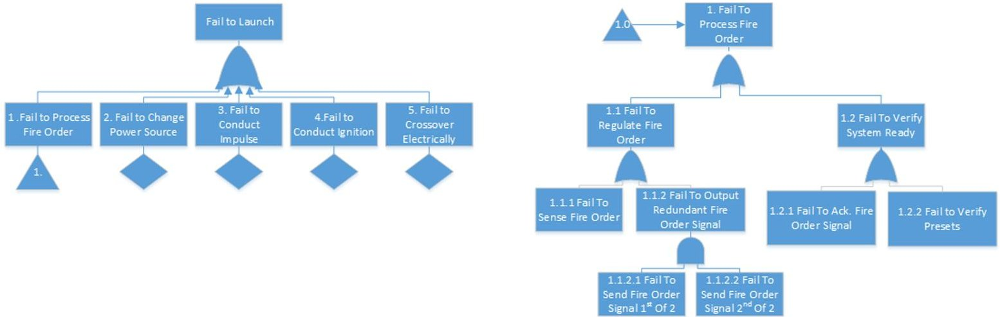
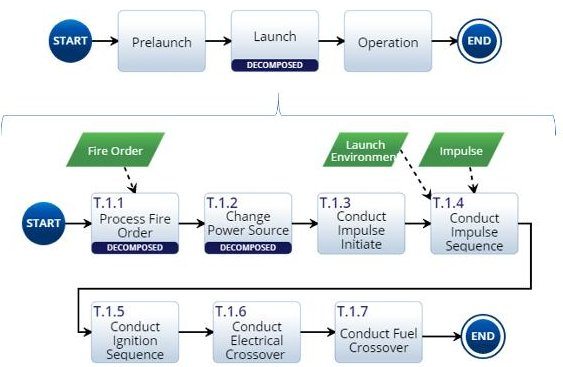
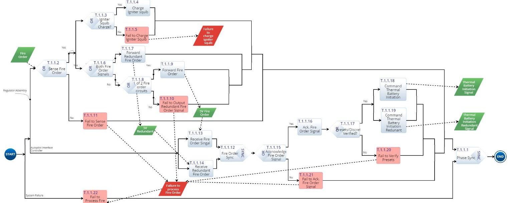
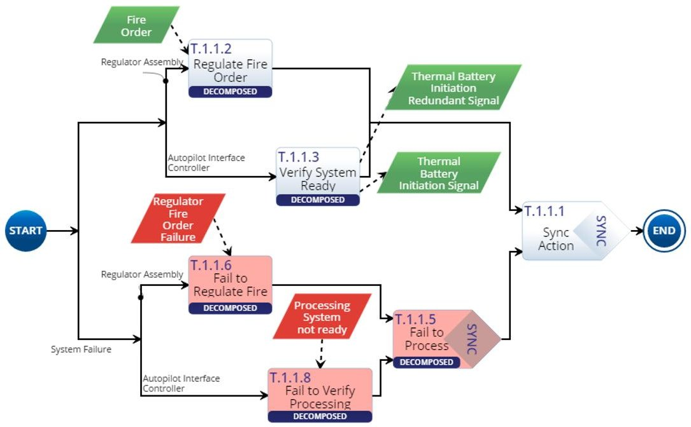
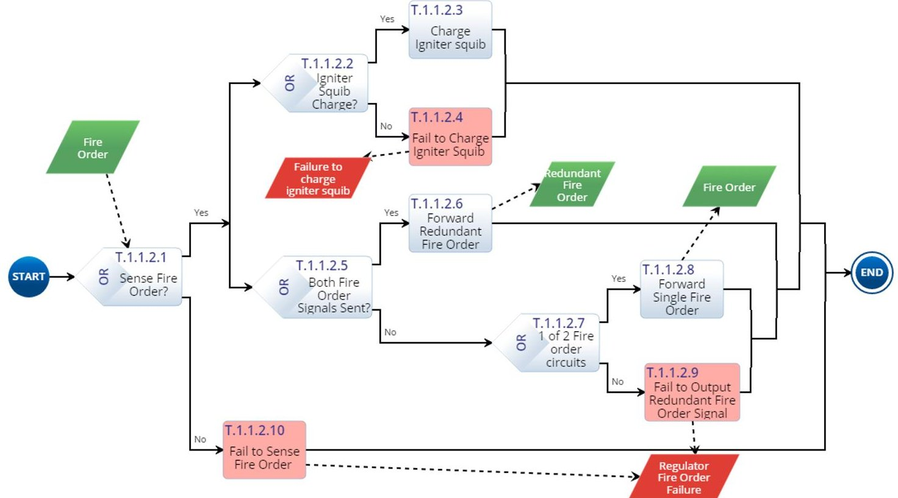
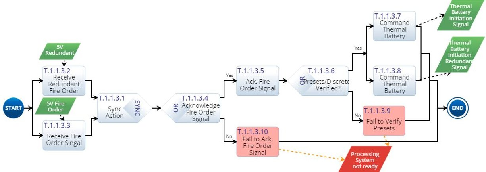
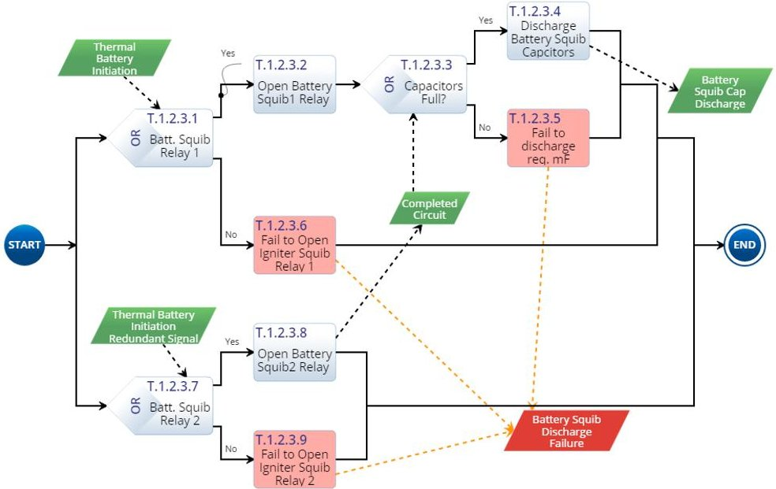

<!-- PDF_PAGE: 1 -->

Complex Adaptive Systems, Publication 6 Cihan H. Dagli, Editor in Chief Conference Organized by Missouri University of Science and Technology 2017-Chicago, IL (USA)

Increasing System Failure Analysis Effectiveness Through Architecture Modeling S. Alex Rambikur, Kristin Giammarco, Bryan O'Halloran

Naval Postgraduate School, Monterey, CA, USA

## Abstract

This research demonstrated that the quality of the classic Fault Tree Analysis (FTA) method could be improved through the use of system architecture models. While existing work demonstrates use of simplified system models in FTA using methods that combine existing tools, this research uniquely addresses the value of using a single tool to generate stochastic behavior models of more complex systems, together with their normal and failure mode events, from existing system specification documents. Use of a single tool is desirable for organizations wishing to limit investment and simplify management of architecture data and analysis. The Innoslate tool is used show how classic failure analysis methods such as FTA can be emulated in the Model Based System Engineering (MBSE) design process. For a simple demonstration example, a fault tree is distilled from behavior models captured in action diagrams. A comparison of the classic FTA approach with the model based approach shows potential for increase in failure analysis accuracy and efficiency.

$ \textcircled{c} $ 2017 The Authors. Published by Elsevier B.V. Peer-review under responsibility of scientific committee of Missouri University of Science and Technology.

Keywords: FTA; MBSE; Innoslate; Failure Analysis, Behavior Models

## 1. Introduction

Failure investigations of complex systems require that practitioners understand both the failure analysis methods being employed and the failing system itself. Formal methods of failure analysis such as FTA are often to support the Failure Reporting and Corrective Action System (FRACAS) component of reliability improvement programs for these complex systems. This diagnostic use of such formal methods reduces the amount of no-fault-found analysis results, allowing corrective actions to be implemented that could improve reliability and reduce cost $ ^{2} $ . Despite the formality of the FTA methods, results vary greatly in their accuracy and efficiency based on the system knowledge available to the practitioner and their discipline with the method. The system knowledge required for these tasks is not limited to the failing system alone, but to its environment and systems with which it interacts.

A recent review of common failure analysis methods such as FTA and Failure Modes Effects Analysis (FMEA) has revealed that they share many common elements with system architecture, such as; system elements, logical connections between elements, system redundancies, system context, inputs and outputs of system and its components, system structure through different operation modes, boundary definitions, interface definitions, and triggers $ ^{1} $ . As a result, their integration should present benefit to the accuracy and efficiency of failure analysis for complex systems. Related research in this area spans four different architecture modeling languages and several

<!-- PDF_PAGE: 2 -->

system architecture types, and demonstrate that fault trees can be generated by and/or extracted from architecture models for direct analysis in reliability tools $ ^{1} $ .

This research builds on that previous work by focusing on complex in-service systems where development did not include architecture modeling, conducting integrated analysis in a single tool, and applying the methodology to a real-world system failure investigation. Only failures experienced within normal operating conditions, known as primary failures, are considered within the scope of this research.

## 1.1. Addressing challenges encountered with classic FTA using behavior modeling

Incorporation of failure modeling into system architecture models seeks to address current challenges with classic FTA and to improve its accuracy and efficiency. Specifically, behavior models will address those challenges presented by availability of system information and FTA method execution.

Failures of in-service complex systems are often difficult to replicate and observe directly. Failure modes based on system interactions are particularly difficult to identify forensically. Often failures not immediately isolated to a particular sub-system or component require the top event (failure) on the fault tree be identified at a high level in the system. Identification of the immediate, necessary, and sufficient events required for the top event to occur requires a detailed understanding of the expected system behavior $ ^{3} $ . Where the expected system behavior is not apparent, or the appropriate system experts are not available, analysts have few options available but to refer to system specification documents or historical data.

Documentation and historical data for in-service systems are often inadequate in presenting the system information in a way that lends itself to FTA of those systems. In the example used in this study, a hierarchy of system specifications was not available. This makes decomposition of system behavior more difficult. In many cases, interface definitions are lacking completeness, not updated during incremental system developments, or totally missing. Without adequate detail available, failures occurring at system interfaces will not be captured completely. Descriptions in the form of diagrams and figures vary greatly in availability and quality from system to system, and even within systems. This variability is possibly a result of differences in frameworks over times and across industries. The authors have also noticed that document-based system specification can lack an integrated perspective, leaving ambiguity in interactions between subsystems or components.

FTA method rules and logic are somewhat conceptual, and sometimes difficult to implement consistently. Common difficulties from the authors' own experience include the following:

- Substitution of the required failure events (verbs) for systems/components (nouns)

- Failure to capture redundancy and cut sets (ANDs/ORs)

- Ignoring quantitative aspect of fault tree for determining probability,

- Failure to consider primary vs secondary vs command failures,

- Failure to capture true immediate cause,

- Failure to capture system state context, as in: what happened and when did it happen?

## 1.2. Related Research

The methodology applied for the proposed methodology draws on previous work by William Schindel and Rafael Perez $ ^{4,5} $ . Schindel's conceptual approach posits that a systems functional hierarchy implies a complementary failure hierarchy. For each successful system function, there exists the possibility for that function to be unsuccessful $ ^{4} $ . The concept can be applied to physical architecture as well, wherein each physical element provides functionality to the larger system. While Schindel does not explicitly mention behavior models or discuss their application, the concept forms the basis of this approach $ ^{4} $ . Perez demonstrated the ability to capture system failure taxonomy as well as create executable versions of fault trees in Innoslate, allowing integration of architecture and failure analysis within one tool $ ^{5} $ .

Perez constructed executable behavior diagrams by considering the system's physical architecture and modeling single or redundant failures in layers for each System, subsystem, and component, similar to Reliability Block Diagrams $ ^{5} $ . This approach was successful at identifying possible failure modes in the system, in a similar fashion to FMEA, but was limited by its inability to capture system level interactions. As a result, the failure taxonomy created did not provide the required context to determine whether the cause was immediate and what the state of the system was $ ^{3} $ .

<!-- PDF_PAGE: 3 -->

Perez' work also focused on the quantitative aspect of FTA for informing risk decisions, utilizing the executability of the models $ ^{5} $ . This focus required that the scope of system modeling of fault tree concepts be limited to basic demonstration.

The methodologies presented in this research differ from the previous work in a few fundamental ways. Perez' work modeled single failure events at varying levels of system hierarchy, without showing failures in the context of normal system behavior. In contrast to Perez' approach, both successful and unsuccessful system behavior, including interaction and dependencies, are incorporated into the executable behavior models and resultant taxonomies. The behavior description also communicates the sequence of functions over time, improving the accuracy of the analysis.

Though the models are similarly executable, this work demonstrates more comprehensive commonality with classic FTA. Areas of commonality include but are not limited to: sequence based cause deduction, AND/OR logic relationships, and verb-based description language.

## 2. Architecture Modeling for Improved FTA

As stated earlier, this research applies the concept of architectural model use in conduct of FTA to a real-world system failure investigation. This is done to study how that application improves accuracy and efficiency by overcoming the challenges of system information availability and poor FTA method execution. An example fault tree (FT) created using the classic method is presented, followed by the FTA conducted using the architectural model in Innoslate. A discussion of the methods is presented in the following section.

## 2.1. Classic FTA example for comparison

This case study entails identifying the root cause of a system failure to launch. Fail to Launch is considered the top-level failure event for the subsequent analysis. The fault tree depicted in Figure 1 is a simplified excerpt from the full scale one generated by the investigation team, prepared for this paper to provide a basis of comparison relative to those created using architecture models. Steps and rules from the NASA Fault Tree Handbook were used to guide the analysis $ ^{2} $ . Fault trees are themselves behavior model diagrams that express failure sequences and relationships through their structure and the symbol elements used. Figure 1 demonstrates the use of an 'OR' symbol (chevron shape) in describing the 'any of these' logical relationship of possible inputs or immediate causes for the top failure event. For this fault tree example, Cause 1 has been further developed, and a triangular transfer symbol on the diagram to the left indicates the fault tree continues for that event on a separate diagram. The other causes are shown with a diamond symbol indicating they have not been further developed for this example.

Figure 1 Classic Fault Tree Approach Example - Fail to Process Fire Order Development

The diagram on the right side of Figure 1 shows the further fault tree development of Cause 1, and demonstrates how a fault tree captures system redundancy behavior, with the use of an AND symbol. In this case, both regulator output circuits must fail to result in a failure of the regulator to send the fire order signal to the CPU.

<!-- PDF_PAGE: 4 -->

## 2.2. Innoslate model representation of fault tree

FTA conducted using architecture models was conducted independently of the full scale existing FTA in order to evaluate the accuracy and efficiency of the resulting methodology in comparison to the classic method. Model elements were chosen based on FTA steps referenced from the NASA Fault Tree Handbook. Two different modeling methodologies resulted, and these are compared. The decision on which aspects of the system should be modeled included consideration of the "version of the system to be analyzed," "the modes of operation," the "component failures to be considered," and "the interfaces to system (e.g., support systems, actuation signals) that will be modeled for their failures or that will be assumed to not fail," as recommended in the NASA Fault Tree Handbook $ ^{3} $ . A system configuration baseline version was chosen based on correlations between specific configurations and failures in the historical data. System mode, or state, was defined based on the observed phase during which the top failure event historically occurs. Figure 2 shows the system states as time phases in context of overall operation. The Launch phase is decomposed for this paper.

Figure 2 System Launch Failure Context-T.1 Launch phase consists of multiple sub-phases beginning with T.1.1 Process Fire Order and ending with T.1.7 Conduct Fuel Crossover.

The system launch function was selected as the boundary for the analysis and is shown in Figure 2 in the context of its environment and the platform launching it. Additionally, assumptions were made regarding which systems, subsystems, and components were actively involved. The system configuration baseline was reviewed and system elements were identified for inclusion in the architecture model for the purposes of this paper. Sub-systems to be involved in the analysis were limited to the Guidance & Control system and the Propulsion System, of which the Autopilot Interface Controller (AIC), Regulator, and Crossover Battery are components.

In addition to identifying the physical elements of the system to be analyzed, the system configuration baseline was used to identify the system specifications at different system levels. These specifications included performance, interface control and production specifications. Reference to the correct and current source documentation is important to the accuracy of FTA and to system architecture modeling. Behavior diagrams were created using the specification documents for each subsystem and component. As these action diagrams were created describing specified system behavior, failure behavior was modeled as well, allowing for the creation of a failure taxonomy.

Two variants of integrated behavior diagrams resulted from the models generated. Figure 3 shows the action diagram describing the T.1.1 Process Fire Order phase in the T.1Launch phase for the first variant. System functions are represented on branches based on the subsystem/component to which they are allocated. An additional branch on the bottom has the overall system failure for that particular phase to which they are allocated. Variant 1 uses very little decomposition or layering, allowing the behavior in each launch sequence phase to be seen in its entirety.

Through the use of Lifecycle Modeling Language (LML) input/output entities as triggers for functions, the diagram not only communicates the immediate and necessary inputs for failures, but is executable via discrete event and Monte Carlo simulation. Color-coding of functions and triggers distinguishes failure events (light red actions with red triggers) from normal events (light blue actions with green triggers). Failure nomenclature is standardized by using 'Fail to' as the first two words for each failure event, and including the word 'failure' in all failure triggers. One trigger generated by multiple actions acts as an effective OR gate, requiring only one of the events to trigger the system failure event. OR entities on the diagram may represent either the potential for emergent system behavior or basic component failure events. Basic failure events of components are represented at the lowest level of fault tree decomposition $ ^{3} $ . The phase-level SYNC action enables the simulation to proceed through the branch that is

<!-- PDF_PAGE: 5 -->

completed first, by default. If behavior follows the 'yes' path at each OR, the dominant path of normal events will be taken, otherwise a trigger from a failure event on any 'no' path will cause deviation from the normal path. If a red trigger is received in the course of execution, the failure path will dominate the SYNC action, and green triggers necessary for the next phase to initiate (in this case, both thermal battery initiation signals) will not be sent.

Figure 3 T.1.1 Process Fire Order Phase Action Diagram - Failure Event Relationships Displayed via Input/Output Triggers

For this particular phase, it is evident that the system level failure event is 'T.1.1.22 Fail to Process Fire Order' with the immediate causes being 'T1.1.22.1 Fail to Output Redundant Fire Order Signal', 'T.1.1.22.2 Fail to sense Fire Order', 'T.1.1.22.3 Fail to Verify Presets', or 'T.1.1.17 Fail to Ack. Fire Order Signal'. The Igniter Squib Charge Failure trigger from action T.1.1.5 in Figure 3 is not connected to the main failure trigger for this sub-phase, representing a fault that occurs during this phase, but does not cause an immediate failure of the system during that phase.

System redundancy characteristics are also captured through the use of ORs, triggers, and SYNCs, as demonstrated in Figure 3. The portion of Figure 3 depicting Regulator Assembly behavior shows that only 1 of 2 fire order signals are required for successful operation of the regulator while the complementary behavior of the receiving system shown on the Autopilot Interface Controller (AIC) branch is captured through the use of a SYNC. This allows for successful operation regardless of the possibility of degraded performance from the regulator. In the case of the regulator failing to output a fire order signal, the basic failure event generates a failure trigger, which is received by the system level failure event, capturing its effect.

In contrast, system safety (failsafe) redundancy is expressed without the use of the SYNC entity, instead using a parallel branch construct requiring that both of the thermal battery initiation triggers output from T.1.1.19 and T.1.1.20 in Figure 3 are received and both relay functions are accomplished for successful system operation. The receiving side of this failsafe redundancy is demonstrated in Figure 7, where the T.1.2.3 Battery Squib Discharge function requires that both signals be received and both relays be functional for the capacitors to discharge into the battery squib. The Battery Squib Discharge function is allocated to the 'T.1.2 Change Power Source' phase, which is not depicted in this paper.

The second variant of action diagram created employs the principle of hierarchical layering in modeling and presentation of the system behavior, as depicted in Figure 4. The functions seen in Figure 3 can be grouped into higher-level function descriptions, such as 'Regulate Fire Order' or 'Verify Processing System Ready'. If these higher-level functions are not specified in the source documentation, this method requires that the lower level functions be described in a single diagram, then abstracted to a higher-level function to create the intermediate layer described. This layer of functional description results in an additional layer in the failure behavior description. Rather than representing the system failure in a particular phase as a single failure on its own branch, the failure behavior structurally mirrors the successful behavior.

<!-- PDF_PAGE: 6 -->

Figure 4 T.1.1 Process Fire Order Phase Action Diagram Variant 2 - Additional hierarchy layer to separate subsystem interaction and behavior showing primary events

Because this is an intermediate level, basic failure events are expressed on the decomposition diagrams associated with each system function (T.1.1.2 and T.1.1.3). Figures 5, 6 and 7 are examples of these decomposition diagrams, capturing basic events supporting the parent functions. A basic failure event describes a component level failure, such T.1.1.2.3 Fail to Charge Igniter Squib in figure 5.

Figure 5 Redundancy for Reliability - Fault Tree AND logic representation - Decomposed T.1.1.2 Regulate Fire Order subsystem function showing basic events

<!-- PDF_PAGE: 7 -->

Figure 6 Redundancy for Reliability - Fault Tree AND logic representation - Decomposed T.1.1.3 Verify System Ready subsystem function showing basic events.

Figure 7 Fail-Safe Redundancy - Fault Tree OR logic representation in the T.1.2.3 Battery Squib Discharge function which is allocated to the 'Change T.1.2. Power Source' Phase (not elaborated on in this paper)

## 2.3. Comparison of FTA methodologies

To confirm the effectiveness of these model variants for failure analysis they will be compared to each other and then to the classic FTA approach. The comparison is discussed in terms of model quality attributes; Completeness, Clarity, Reusability, and Consistency $ ^{6} $

In terms of completeness, each methodology successfully captures basic failure events and places them according to their corresponding system level failure. In the case of the second variant, an intermediate layer of abstraction allows the data to be presented in varying levels of detail. However, any impression of added detail is not intended, as both variants are equally complete.

While efforts to distinguish successful behavior from failure behavior, and to separate descriptions into digestible phases, were successful in making both variants readable, aspects of model structure contribute to their respective levels of clarity. Variant 1 allows the observer immediate insight into all functions and interactions belonging to that phase. However, the amount of information presented in one instance may actually impede a clear understanding of what is presented. In contrast, variant 2 makes the information in each diagram clearer by layering it using decomposition, but at the expense of losing the bigger picture of the larger information set.

The information in each model is described in standard LML and is reusable in other diagrams and future work without significant adjustment or adaptation. The further application of the layer hierarchy principle to variant 2 allows for separation of behavior from interaction. This modularization of subsystem and component behavior

<!-- PDF_PAGE: 8 -->

increases the visibility of patterns and better identifies opportunities for reuse of common subsystem and component functions for other purposes. Some examples are the safety redundancy patterns demonstrated in figures 5 and 6.

Both variants of the proposed methodology provided a formal structure that captured the classic fault tree elements with completeness. In requiring the use of the system specification as the source for the behavior model descriptions, architecture model-based fault trees may have the potential to achieve a higher level of completeness than ones created manually. However, failures additional to those identified using that classic method have not been discovered at this point in the modeling of the launch sequence.

The familiar tree structure and defined logic bring a clarity to the classic fault tree method that is hard to replicate in terms of readability. However, use of color, organization, nomenclature, and modeling patterns in the architecture-based approach present a recognizable failure taxonomy that communicates the information clearly.

While the classic fault tree has limited reusability because the information that populates it is limited in scope to that which contributes to a single failure event, the diagrams created for this research could be used or adapted for other kinds of analysis such as FMEA because of the comprehensive description of system relations and behaviors in the underlying information model. Instead of using the model information to identify possible causes of system level failures, FMEA can be conducted by beginning at a basic failure event and tracing its effect on the subsystem and system functions. Relationships and attributes such as decomposes, enables, and generates enable this traceability.

The presented modeling methodology is able to overcome challenges with poor execution of FTA through formality in modeling, which reinforces FTA method principles that, in the authors' experience, are not always consistently applied when creating a FT manually. The variants of fault trees represented in the architecture models are consistent with the ideal classic fault tree models in terms of basic logic, analysis methodology, and principles. As demonstrated in the model descriptions, the basic building blocks of fault tree logic have been captured through the use of triggers, ORs/SYNCs, and parallel branches. Variant 2 also organizes failure events in a structure similar to a fault tree. The models demonstrate the use of these fault tree logic elements in representations of two kinds of system redundancy. The analysis steps required for the architecture methodology share common first steps with regard to identification of the top event and determination of scope, but differ somewhat on the approach to construction of the fault tree. Where the classic method starts at the top event and deduces the necessary and immediate causes, the architecture-based methodology creates a complete description of system behavior based on the determined scope and makes immediate causes apparent through description of system failure behavior. Analysis proceeds in a similar method for both methods from that point on. Classic fault tree principles such as system/subsystem boundaries, basic failure events, what/when information, and necessary/immediate cause are also consistently applied in the subject methodology $ ^{3} $ . Subsystem boundaries are identified through allocation of functions to branches in phase level diagrams as well as decomposition of functions on separate diagrams. Basic failure events are indicated through use of OR elements in the models, and are at the lowest level of decomposition in variant 2. These events can be assigned probabilities for quantitative analysis of the failure event architecture in both methods.

## 3. Conclusion/Summary

## 3.1. Recommendation of architecture-based fault tree methodology - variant 2

Both variants of the architecture-based fault tree methodology address the challenges presented by failure analysis of complex systems. Variant 2 appears to better implement layer hierarchy principles found in system architecture modeling and in FTA. This research applied the use of abstraction and refinement, along with the separation of system interactions from system behavior, which are practices recommended for the study of unexpected behavior in complex systems $ ^{7} $ . The extra step of model refinement and partitioning in variant two makes behavior description patterns more visible and easier to read.

## 3.2. Summary of improvement realized

The process of creating action diagrams from system specifications is systematic and results in a level of fidelity in the subsequent failure description that would otherwise require a high level of discipline and experience to achieve using the classic FTA method. For systems where architecture models did not previously exist, the same challenges confronting those doing classic FTA must be overcome: availability and accessibility of system

<!-- PDF_PAGE: 9 -->

information in the source documentation. However, once created, system architecture models will contain the information required to develop fault trees, making subsequent FTA more efficient. Performing FTA directly on the architecture models may furthermore expose inadequacies in the system specification and interface control documents, which must be addressed to enforce technical standards and to accurately complete the system failure analysis.

The presented modeling methodology is able to overcome challenges with poor execution of FTA through formality in modeling, which reinforces FTA method principles that, in the authors' experience, are not always consistently applied when creating a FT manually. Some example principles aided by a model-based approach are: description of failure events using action language rather than listing components, identification of causes exactly as described from system behavior and are therefore truly immediate rather than shortcuts that miss other potential causes, logical flow of causes and effects, and capture of failure events context with regard to when or in what system state the failure event occurred. Formal method techniques and tools can be applied on these architecture models to further reinforce FTA principles in a way that is not available through the many of the manual implementations being practiced. For example, formal method techniques such as use of prescriptive and formalized model heuristics (Each failure Event description begins with the words 'Fail to') and model simulation were helpful in checking the completeness and consistency of the architecture method presented in this paper.

This methodology also introduces the benefit of providing the failures in context of successful operation, providing additional perspective for the analysis and for presentation to other stakeholders. Despite the benefits demonstrated herein, the current research leaves opportunity for further improvement.

## 3.3. Recommendations for future work

The executable structure of the action diagrams makes it possible to import them into the Naval Postgraduate School's Monterey Phoenix (MP) Analyzer tool $ ^{7} $ . MP is a behavior modeling framework that enables simulation of the behavior descriptions in a way that enables emergent behaviors that may have been obscured by the nature of its description in Innoslate to be identified $ ^{8,9} $ .

The executable nature of the model also lends itself to quantitative analysis. For example, probabilities may be assigned to events and each variant may be tested for consistent probability computations. A version of MP containing native probability assignments for events is under development that will support whole-scenario probability analysis leveraging the Small Scope Hypothesis $ ^{10} $ . Although it was not a focus of this research, quantitative analysis of a complex system like this could be investigated with little additional effort, and provide insight into critical system components and processes.

Finally, FMEA is a classic failure analysis method that, despite its differences from FTA both in purpose and method, shares much of the potential fulfillment from architecture models $ ^{1} $ . While behavior diagrams are model views may inform FMEA, additional work should also consider the value of other views such as IDEF0, which capture much of the necessary information succinctly.

## References

1. Rambikur S, Giammarco K, and O'Halloran B. 2017, 'Systems Architecture in Failure Analysis: Applications of Architecture Modeling to System Failure Analysis', Proceeding of the 12th Annual System of Systems Engineering Conference, Waikoloa, HI. June 18-21, 2017

2. Reliability Analysis Center. 2002, Failure Reporting, Analysis and Corrective Action System (FRACAS) Assessment - 231-0-6900-146-001, ITT Research Institute, 2002

3. [M. Stametelatos, W. Vesely, Fault Tree Handbook with Aerospace Applications, NASA, 2002, pp. 1-109

4. Schindel, W. D. 2010, 10.1.2 'Failure Analysis: Insights from Model-Based Systems Engineering' Proceedings of the INCOSE International Symposium, 20: 1227-1239.1.

5. Rafael M. Perez. 2014, 'Application of MBSE to Risk-Informed Design Methods for Space Mission Applications', Proceedings of the AIAA SPACE 2014 Conference and Exposition, AIAA SPACE Forum, AIAA 2014-4411

6. Giammarco, Kristin. 2010, 'Formal Methods for Architecture Model Assessment in Systems Engineering', Proceedings of the 8th Annual Conference on Systems Engineering Research, Hoboken, NJ. Mar. 2010.

7. Monterey Phoenix, [Online], Available: http://firebird.nps.edu/. Accessed April 1, 2017

8. Giammarco, Kristin. 2017, 'Practical Modeling Concepts for Engineering Emergence in Systems of Systems', Proceeding of the $ 1 2^{th} $ Annual System of Systems Engineering Conference, Waikoloa, HI. June 18-21, 2017.

9. Giammarco, Kristin and Katy Giles. 2017, 'Verification and validation of behavior models using lightweight formal methods,' Proceedings of the 15th Annual Conference on Systems Engineering Research. Redondo Beach, CA. March 23-25, 2017.

10. Jackson, D. 2006, Software Abstractions: Logic, Language and Analysis, Cambridge, Massachusetts: The MIT Press, 2006.