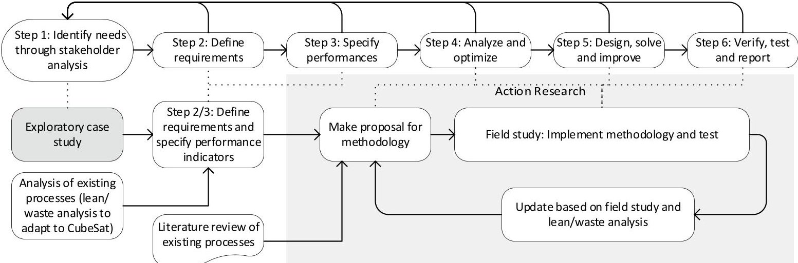
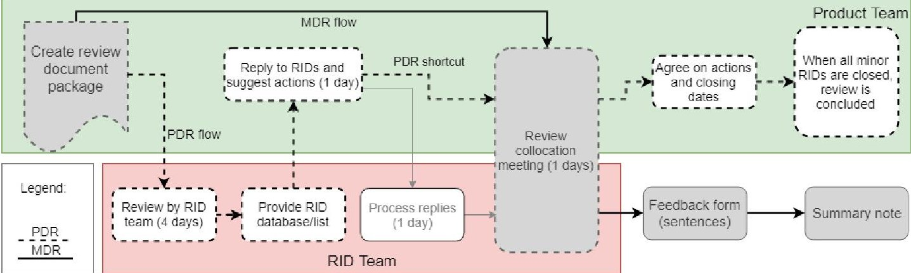
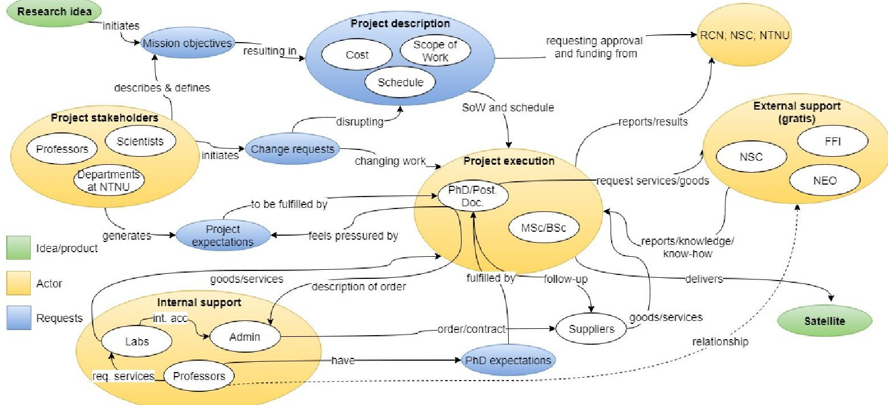

<!-- PDF_PAGE: 1 -->

# 17th Annual Conference on Systems Engineering Research (CSER)

# CubeSats in University: Using Systems Engineering Tools to Improve Reviews and Knowledge Management

Evelyn Honoré-Livermore $ ^{a,*} $

$ ^{a} $Department of Electronic Systems, Norwegian University of Science and Technology, Trondheim, Norway

## Abstract

Coordinating research objectives concurrently with product development and engineering is a challenge in student-run CubeSat projects. The literature review from several universities and the International Council of Systems Engineering (INCOSE) Space Systems Working Group (SSWG) all acknowledge the need for a better methodology. This paper describes findings from a university CubeSat exploratory case study related to team management, reviews and design. Introducing Systems Engineering (SE) tools such as formalized reviews, A3 reports, systemigrams and N2 dependency maps have aided the development process. This was evident through faster development iterations and fewer design confusions. Results show that relocation into a common space based on recommendations from Concurrent Engineering (CE) has improved overall communication and team work.

$ \textcircled{c} $ 2019 The Authors. Published by Elsevier B.V. This is an open access article under the CC BY-NC-ND license (https://creativecommons.org/licenses/by-nc-nd/4.0/) Peer-review under responsibility of the scientific committee of the 17th Annual Conference on Systems Engineering Research (CSER).

Keywords: CubeSat; knowledge management, systems engineering, concurrent engineering, systemigram, reviews

## 1. Introduction and Background

The CubeSat standard for small satellites has enabled faster implementation and engineering of satellites that can be used for both research activities and educational purposes. PhD-level candidates now find themselves a part of CubeSat design groups and are asked to contribute to engineering activities for designing and building the satellites.

<!-- PDF_PAGE: 2 -->

Fig. 1. The implementation of the Systems Engineering (SE) process [1] for the author's research project is based on the work by Sopha et. al [2] (top row). Dashed lines show the author's process' relationship to the original process. From the exploratory case study of HYPer-spectral Smallsat for ocean Observation (HYPSO) (left grey box) requirements and performance indicators are established (e.g. team engagement, schedule, cost). The literature review and analysis of existing processes relevant to CubeSats combined with a case study will result in a proposed methodology. This will be tested in future case study and updated to improve the performance indicators if necessary. E.g. lean analysis can be used to indicate how to improve.

Although this is exciting and motivating, the individual research goals they should pursue may suffer under the load of engineering activities. They then find themselves either demotivated to do research activities because they find engineering satellites more engaging, or they leave the CubeSat project team abruptly and the engineering project suffers.

Methods to ensure fulfillment of both activities, ensuring good research and good engineering, is important at universities where PhD candidates participate in satellite projects - or where the payload data of a satellite is relevant to the research. Furthermore, ensuring that proper research is carried out is difficult in a fast-developing field, where what was considered research last year is considered mass production and engineering today.

This exploratory case study presents some features of a CubeSat project at the Norwegian University of Science and Technology (NTNU), to be used as a basis for the overall research project aimed at improving the process shown in Fig. 1 for developing CubeSats in a university setting. This paper focuses on findings from the first year of case study, where challenges of team management have required the most effort.

## 1.1. CubeSats at Universities

CubeSats are the typical university-built satellites. The CubeSat is a standardized format and there is a multitude of resources available, including Commercial-Off-The-Shelf (COTS) components and several commercial suppliers of turnkey systems. The projects at universities range from fully in-house developed CubeSats; to payload development and integration to a standard purchased bus; combination of COTS CubeSat subsystems with in-house developed subsystems; to mission control and operations of other satellites. According to NanoSat, academia stands for ~30% of the CubeSats launched the past years, close to 150 in 2018 [3]. NTNU has a history of space and CubeSat related activities [4] where a combination of student-led activities and course subjects have led to the generation of several MSc theses and credits, but with no successful missions to date.

There are several challenges when conducting engineering projects at universities; project management and team structure [5], [6], [7], [8]; Birkeland et al. [9] discuss how one of the main issues are the ever-changing teams and short time for on-boarding new members; balancing coursework and satellite building [8]; ensuring momentum [6], [7]; and ensuring success of mission [5], [6]. In summary, the studies have recommended: (1) Ensure that funding is secured; (2) Interface control is key to make a multidisciplinary product team successful; (3) Give ownership to the students. Integrate them as a team and have continuous team building activities; (4) Schedule the project so that exam periods and holidays are respected; (5) Establish a process for knowledge transfer; and finally, (6) Manage expectations of stakeholders: students and supervisors and external players.

<!-- PDF_PAGE: 3 -->

## 1.2. Systems Engineering and Sociotechnical Research

Systems Engineering (SE) has been around since the beginning of the 1900s and is the basis of how we do complex product development and life cycle management in many industries today. Through taking a holistic view of product development, its tools and processes are relevant to university-managed projects. Sociotechnical systems is a soft SE area that considers how people and organizations behave and act in the project context [10].

The sociotechnical viewpoint is relevant in a university setting where there is a high turnover of people, because it is difficult to build a specific organization culture that everyone in the team adapts quickly. The organizational culture should be like the cultural setting these teams experience to make the transition and adaptation quicker.

Through the application of SE tools and processes and using models to depict and communicate the sociotechnical systems, we attempt to develop a methodology that will enable better fulfillment of both research goals and engineering goals in a university setting. This paper is based on the first year of experiences, where much effort has been spent to understand the needs of the project and the context. Some events have led to improvement of processes through tools from SE.

## 1.3. Method: Case Study Research

Case study research, defined by Bromley [11] as "...a systematic inquiry into an event or a set of related events which aims to describe and explain the phenomenon of interest", is utilized in this research through an exploratory case study [12]. This may be elaborated into explanatory or descriptive case studies once the research problem becomes further defined.

The exploratory case study's strength is the inherent characteristic of not knowing what to look for - enabling discovery of unexpected phenomena [13]. It is also recommended by Caillaud et al. [14] as a method for SE research. Both Yin [13] and Caillaud et al. [14] highlight how exploratory case studies have parallels to grounded theory work, where the goal is to "lead(ing) to a theory" [14] - which is the overall objective of the research project, as shown in Fig. 1. The criticism is based on the nature of exploratory case: "...lack of specific, theory-based prior assumptions are often not considered a strength but a weakness. There is, of course, always the risk that these characteristics could be an excuse for inadequate and unscientific studies." [14]

The background for choosing the method of case study research as opposed to other social science methods is that the NTNU CubeSat project is new, and there is no previous experience nor evidence for where the strengths or weaknesses lie. An exploratory case study approach offers a broad perspective to understand the project's characteristics and looking for methods to improve the success of both academic research and the engineering project.

## 2. Case Study: HYPer-spectral Smallsat for ocean Observation (HYPSO)

The purpose of the case study is to understand how research projects are conducted influences their success, and how engineering and academic research can be combined while achieving goals in both fields, and to extract some best practices or lessons learned. The project organization to help achieve the goals is the phenomenon of interest through modes of interaction and communication, and the results relevant to similar sociocultural contexts.

The following research questions are addressed:

- RQ-1: How can an engineering project ensure the fulfillment of academic research goals in a university setting?

- RQ-2: How can engineering goals and individual research goals be fulfilled simultaneously?

- RQ-3: What methods and modes of interactions in a university research project are present, work well, and why?

The author has a background from old-space, where one is required to follow a set of processes and standards, and the organization is built around this. With this perspective, the author will be biased and often notice the differences and may view the less organized new-space negatively when compared to the traditional methodology.

HYPer-spectral Smallsat for ocean Observation (HYPSO) is a satellite mission funded by Research Council of Norway (RCN), Centre of Autonomous Marine Operations and Systems (AMOS) and supported by the Departments

<!-- PDF_PAGE: 4 -->

of Electronic Systems and Engineering Cybernetics at NTNU. The HYPSO project team today consists of approximately 20 students and 10 PhD-level employees. Furthermore, there are about 10 professors closely or loosely associated with the project, which have different needs and expectations to the project and its execution. One of the challenges with the HYPSO project team is that few or none have experience in designing and building CubeSats, neither the professors nor the students. The goal of the satellite is to support oceanographic studies as funded by RCN; build competence in CubeSat design and manufacturing at NTNU and experience in team work for students.

Project history: Nov 2016: Pre-project deadline. At the pre-project deadline, an application was submitted to RCN fund the cost of defining and describing the MASSIVE (Mission-oriented autonomous systems with small satellites for maritime sensing, surveillance and communication) project. People involved: mainly professors interested in the outcome of the satellite data. Apr 2017: Pre-project start. The pre-project consisted of defining the project in detail, and describing the Scope of Work, Cost, and Schedule. Many trade-offs for system architecture performed using Technique for Order of Preference by Similarity to Ideal Solution (TOPSIS) and Analytic Hierarchy Process (AHP). People involved: professors, scientists, mission architect (PhD candidate), remote sensing PhD, third PhD working on holistic view with satellites. Nov 2017: Additions to team. Two PhD candidates were hired with the goal of supporting the MASSIVE project, but not funded by the project itself. Dec 2017: Mission Design Review (MDR). Review process and evaluation described in Section 4.1. Jan 2018: Project granted, and kick-off held. Full project was granted by RCN. A kick-off involving the five PhD candidates, and a MSc student associated with the project was held, trying to agree on how to work together and what to focus on. Mar 2018: Disruption in team. One of the five key members left the project on secondment: still available via email. August 2018: Project kick-off. After recruiting ~20 MSc/BSc students, the project team had a new kick-off with a total of almost 30 people.

## 3. Analysis and Discussion

This section covers first a description and analysis of the review process, secondly improvements in the design process and knowledge management are discussed.

In the brief history of the project, two formal reviews have been conducted. The first, MDR, was held in Dec. 2017, without a strict process. The second, Preliminary Design Review (PDR), was held in Oct. 2018, following the reduced European Cooperation for Space Standardization (ECSS) process of reviews. The reduced process has been tailored to CubeSats and other new-space applications. An overview of the two review processes, as well as the baseline ECSS process is given in Fig. 2.

## 3.1. Review Process

Mission Design Review: While the preparation to MDR did not follow a specific format, the relevant people were invited, and the agenda was clear from the invitation. Some participants of the review team had been a part of the project from the start while others joined the project 2 months prior to MDR. The data package was provided the day before the review, consisting of only a presentation covering the mission design. The late sharing of the review item gave the review team little time to prepare. During the meeting, the work was presented, and there were several discussions about the various topics. The form provided at the end of the meeting gave the review team an opportunity to give written feedback which impacted some design decisions. There was no clear traceability of these decisions to the requirements. Two trade-off analyses were conducted, on satellite size and camera size. An Orbit Analysis Report would have been helpful at this stage in the project, as well as the Mission Requirements Document, but these were not generated until later.

The feedback from the review team on the review itself highlighted the following issues: (1) little time to prepare for the meeting; (2) difficult to give feedback with so much information presented at the meeting; (3) no clear tracing of feedback being implemented. Furthermore, the project team itself felt that it did not gain ownership of the mission through the review or the subsequent work, which has become apparent at several occasions in the design process and daily work. It would also have been helpful to de-scope the mission at this stage, which had grown the past half year. In summary, it was more an academic-inspired review than a formal engineering review.

<!-- PDF_PAGE: 5 -->

Fig. 2. The Review Process based on ECSS, where "Feedback from (sentences) and "Summary note" boxes are not part of original ECSS. MDR flow: Grey boxes and solid flow lines. PDR flow: boxes with dashed frames and dashed flow lines. The box "Process replies" was not performed.

Preliminary Design Review: The participants were invited 3-4 months beforehand. A formal invitation with a procedure based on ECSS was sent to the review team 1-2 months prior to the collocation meeting, stating the process and objectives of the review. The data package was provided a week prior to the review, and the Review Item Discrepancies (RIDs) were recorded in a format that allowed for easier follow-up of comments. The review team provided feedback on time, and the project team responded to the RIDs. However, there was not enough time to let the review team look at the replies because the project team spent more time than expected providing sufficiently detailed responses. At the meeting, the RIDs were processed per document. Each RID was presented, and the feedback from the project team given. A disposition and an action were agreed on, with a deadline for completing the action.

The feedback from review and project team included: (1) the RID form helped in providing feedback; (2) too little time to review; (3) clearer description of mission/be invited to a mission review; (4) poor traceability of spacecraft requirements; (5) better structuring and overview of documentation would have helped when reviewing; (6) two day collocation (one day to go through RIDs and one day to work on technical discussions/workshops).

The project team felt that making the documentation and having a clear deadline helped moving forward with the design. The project team worked together on a set of documents on Google Drive which allowed for concurrent editing and writing, as well as simple interface to assign tasks and ask questions about design.

## 3.2. Knowledge Management and Design Process

Modern-day trends and lean theory support the use of non-serial processes such as agile methodology or SPADE [15]. Clegg and Boardman [16] compare three different philosophies aiming to cope with non-serial product development lifecycle: Business Process Reengineering (BPR), Soft Systems Methodology (SSM), and Concurrent Engineering (CE). In this paper, the argument for considering SSM is that "human nature can be erratic, illogical and unpredictable, (and) the system can become difficult to define" [17]. Humans are much more difficult to study than physical systems [18]. SSM recommends using modelling tools such as systemigrams to highlight the actors and thus the human nature in the system. The systemigram is useful because it can show how inputs and outputs are transformed at different interfaces, the purpose of the system, the role of each actor in the system ([16]-[18]), but at the same time it can contain a lot of information which may be confusing to the reader.

The project structure is represented by the systemigram in Fig. 3. Developing the systemigram for the HYPSO project has clarified some of the unknown interactions and patterns in the system and uncovering the complexity in managing the expectations of different stakeholders. The systemigram shows how the Mission Objectives have been developed by the Project stakeholders, while it is common in university CubeSat projects that this is a stronger collaborative effort together with the Project execution. This has been identified as one of the main reasons for PhD candidates losing interest. The mission requirements were updated to include "achieve research goals", but it was not followed up with actual requirements or actions with deadlines.

<!-- PDF_PAGE: 6 -->

Fig. 3. Project Systemigram. The Project stakeholders are looking for higher performance and faster product delivery, the Internal support are interested in seeing the Project execution team succeed with both the theses and the project goals (at the same time), and the funding bodies RCN, Norwegian Space Agency (NSC), and NTNU want everything to be completed and published on time and on cost. The Project execution wants both to fulfil the expectations for their theses to finish their formal tasks on time to finish their degrees, and to build a satellite that satisfies the Project stakeholders.

A secondary payload with a corresponding secondary mission has been included in the satellite since December 2018. For this mission, the objectives have been derived directly from the PhD research objectives. The payload itself is spaceflight proven, but the software and mission design are new. The future reporting of the case study will include analysis of this secondary mission and the effects on motivation and progress of research and engineering project.

Prior to August 2018 kick-off: The project team consisted of 5 PhDs, 1 Post.Doc. and 5-6 MSc loosely associated to the project. The MSc students were encouraged to sit together to work but were working on separate blocks of the project. The rest of the project team were in different offices spread over a building. The continuous project work consisted of having weekly project meetings and trying to agree on a way forward for the product development. However, because of other obligations (coursework, lack of time, duty work), not much progress was made. Some of the players made progress but did not have the time to share the knowledge in a way that made the project team understand and build on it well enough. Furthermore, the communication from the Project stakeholders was very strong and controlling, which may have made it difficult for the project team to feel ownership; resulting in a lack of motivation.

Another reason for lack of motivation was the distributed team structure. Relying on formal meetings for communication made the development iterations lengthy, and immediate issues might be forgotten between. The MSc team functioned much better in this aspect, maintaining a better line of communication and daily interactions.

Post August 2018 kick-off: The greatest change from pre/post August kick-off was the moving of team into the same working space. This is based on the CE principles, where collocation of project team has shown to have improved efficiency and increased both formal and informal communication [19]. The team now has set working times (3 times of 4-5 hours per week) and are always encouraged to be in the same office space.

The results so far have been promising, and this is evident through the continuous discussions and faster implementation of design choices. There are more informal interactions, laughter and open body language than previously observed. This can indicate that there is a higher degree of trust, and people who trust each other can

<!-- PDF_PAGE: 7 -->

make better design choices because they share information more readily. Additionally, being in the same room lowers the threshold for seeking information or for clarifying uncertainties and unknowns.

Some of the design confusions happened because disciplines made decisions that influenced other disciplines but did not know to inform each other. Most of the team members had no previous experience with working in multidisciplinary teams. To combat this, an exercise of jointly creating an N2 dependency map was conducted, bringing awareness of dependencies between the disciplines, and understanding of who to contact and inform if changes were made.

In the kick-off, it was decided that all documentation and working files should be on Google Drive, to allow for transparency and easy flow of information. After a month, it became clear that this was not enough. A3 reports [20] were introduced in the form of post-its on A3 sized paper on the wall.

Lastly, there have been several internal workshops on how to achieve individual research goals concurrently with engineering goals, and the inclusion of research goals in the mission requirements have aided in maintaining this dual focus. Joint efforts on paper brainstorming and scheduling the engineering goals so that individual research goals may be achieved has also been performed. To this date, it is not known whether these measures have been successful.

## 4. Conclusion

The case study has uncovered some benefits from usage of SE tools and methods, namely: formalized review process, concurrent engineering, A3 reports, N2 dependency mapping, and systemigram. The development of systemigram in Fig. 3 uncovered the mechanisms in how the project and mission had been established and clarified some reasons to lack of motivation and poor alignment between engineering goals and PhD research objectives. The systemigram has then aided the understanding of the project itself, which in turn can help in improving the project to answer the research questions.

RQ-1/2: Workshops and inclusion of more detailed research mission requirements were introduced to facilitate the focus on the duality of engineering and research. Because the project needs the PhDs for execution, there is still a potential for conflict. However, removing the PhDs from Project execution and allowing them to only focus on their research objectives is not a practical solution at the university because there are not enough faculty resources to support the satellite mission itself. The improved review process through concurrent documentation work increased the team's understanding of the whole mission simultaneously fulfilling needs for engineering and research, and the review team gained a better understanding of the work.

RQ-3: There was a lack of communication in the decentralized team, limited to weekly meeting or other arranged interactions. Changing to a common working space increased informal communication, and the team is more cohesive. The N2 diagram facilitated communicating understanding of dependencies to the team that was unfamiliar with interdisciplinary projects and described the areas of communication. It is not clear if the introduction of SE tools would have been as successful if the team had not relocated to a common working space. The systemigram has uncovered many of the higher-level modes of interaction in this type of project.

The findings reported in this study has shown the importance of team cohesiveness towards common goals, concurrent with the recommendations from [4]-[9]. Moving into a common working space and having common workshops and informal discussions has facilitated better teamwork and design decisions. The work was naturally scheduled to accommodate exam periods, but the team has not yet experienced the challenge of a long summer holiday break. The process of knowledge transfer from this year's team to next year's will be interesting to study and most likely a challenge. Management of stakeholder expectations has not been addressed in this paper and will be a part of future work. Human interface control was facilitated through the N2 dependency map, and the physical interface control will be further addressed in future work by e.g. Model-Based Systems Engineering (MBSE).

A secondary mission has been introduced that has mission objectives directly derived from some of the PhDs' research objectives. Future work will compare the approach presented in Fig. 3 with directly including mission objectives from the start, to understand how they compare in achieving the research goals and engineering goals concurrently. The latter approach is common for CubeSats and intuitively seems more motivational. Future work will include a continuation of the tools and methods that have been introduced so far, such as the improved research process, A3 walls, collocation of team to facilitate concurrent engineering and N2 mapping. Furthermore, there will

<!-- PDF_PAGE: 8 -->

be introduction to additional SE tools, especially requirement management, configuration management, and MBSE. MBSE is interesting because it may reduce some of the dependency issues when developing and changing design if the whole team can work on shared model with common attributes. It is expected that the work from Space Systems Working Group (SSWG) [21] will be utilized, as this working group targets academia and CubeSats especially.

## Acknowledgements

This work is supported by the Norwegian Research Council (Grant No. 270959), the Norwegian Space Center, and the Centre of Autonomous Marine Operations and Systems (NTNU AMOS). It has been approved by the Norwegian Centre for Research Data. The HYPSO project team is acknowledged for their willingness to participate in this research. The author wants to thank Cecilia Haskins at NTNU for support in developing the systemigrams.

## References

[1] Fet, A.M. (1997) "Systems engineering methods and environmental life cycle performance within ship industry." PhD Thesis. Trondheim, Norway.

[2] Sopha, B.M., Fet, A.M., Keitsch, M.M., and Haskins, C. (2010) "Using systems engineering to create a framework for evaluating industrial symbiosis options." Systems Engineering 13 (2): 149-160.

[3] Kala, E. "Nanosatellite & cubesat database | missions, constellations, companies, technologies and more." Retrieved from https://www.nanosats.eu/. (Accessed on 11/08/2018).

[4] Grande, J., Birkeland, R., Gjersvik A., Mathiesen, S.V., and Stausland, C. (2017) "Norwegian student satellite program lessons learned." 68th International Astronautical Congress (IAC). Adelaide, Australia.

[5] Mengu, C., and Masui, H. (2016) "Best practices for successful lean satellite projects." 4th UNISEC Global Meeting. Varna, Bulgaria.

[6] Alminde, L., Bisgaard, M., Nielsen, J.D., and Bhanderi, D.D.V. (2005) "Experience and methodology gained from 4 years of student satellite projects." Proceedings of 2nd International Conference on Recent Advances in Space Technologies 1: 94-99.

[7] Bouwmeester, J., Aalbers, G.T., and Ubbels, W.J. (2008) "Preliminary Mission Results and Project Evaluation of the Delfi-C3 Nanosatellite." 4S Symposium. Rhodes, Greece.

[8] Abadi, C.D. "Product and process: an innovative approach for a student satellite program from the systems engineering point of view." 15th Annual/USU Conference on Small Satellites.

[9] Birkeland, R., and Gutteberg, O. (2013) "Educational aspects of a cubesat project." 2nd IAA Conference on University Satellite Missions and CubeSat Workshop. Rome, Italy.

[10] Rouse, W.B, Pennock, M.J., and Cardoso, J. (2016) "Advances in sociotechnical systems," in J. Hsu and R. Curran (eds)n Advances in Systems Engineering, Reston, VA, USA.

[11] Bromley, D.B. (1990) "Academic contributions to psychological counselling. 1. a philosophy of science for the study of individual cases." Couns Psychol Q, 3 (3): 299-307.

[12] Yin, R.K. (2018) "Case Study Research and Applications: Design and methods" SAGE, Los Angeles, CA, USA, 6th ed.

[13] Mills, A.J., Durepos, G., and Wiebe, E. (2010) "Encyclopedia of case study research (Vols. 1-0)", SAGE, Thousand Oaks, CA, USA.

[14] Caillaud, E., Rose, B., and Goepp, V. (2016) "Research methodology for systems engineering: some recommendations." IFAC Conference on Manufacturing Modelling, Management and Control MIM. Troyes, France.

[15] Haskins, C. (2008) "Systems engineering analyzed, synthesized, and applied to sustainable industrial park development." PhD thesis. Trondheim, Norway.

[16] Clegg, B.T., and Boardman, J.T. (1997) "Systemic analysis of concurrent engineering practice" Factory 2000-The Technology Exploitation Process, Fifth International Conference on (Conf. Publ. No. 435), 464-471.

[17] Boardman, J.T. (1995) "Wholes and parts-a systems approach" IEEE Transactions on Systems, Man, and Cybernetics 25: 1150-1161.

[18] Mussante, J., Frittman, J., and Edson, R. "The use of systemigrams in system template development: An example in disaster management". Retrieved from http://anser.org/docs/asyst-doc/Systemigrams-and-Disaster-Management.pdf. (Accessed on 01/31/2019).

[19] Findlay, R., Braukhane, A., Schubert, D., Pedersen, J.F., Muller, H., and Emann, O. (2011) "Implementation of concurrent engineering to phase b space system design" CEAS Space Journal 2.

[20] Viken, A., and Muller, G. (2018) "Creating and applying a3 architecture overviews: A case study in software development." INCOSE International Symposium.

[21] "INCOSE - Space Systems Working Group." Retrieved from https://www.incose.org/incose-member-resources/workinggroups/Application/space-systems. (Accessed on 11/08/2018).