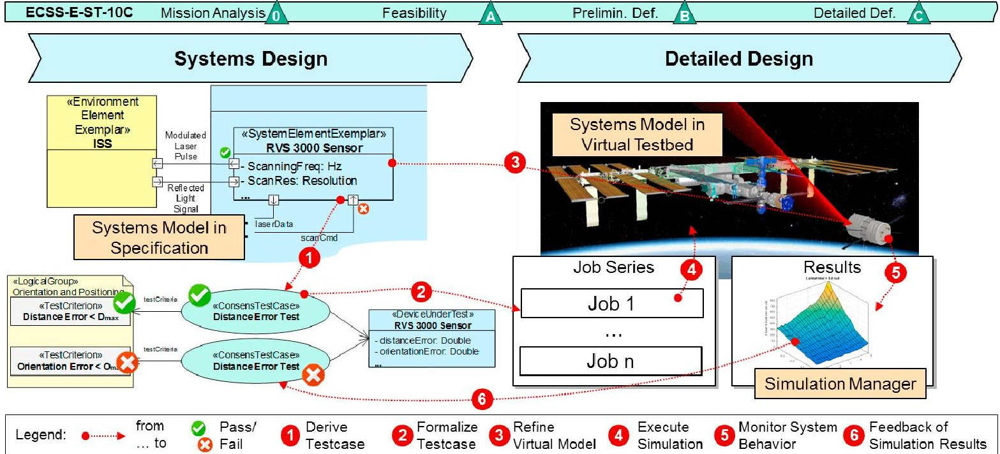
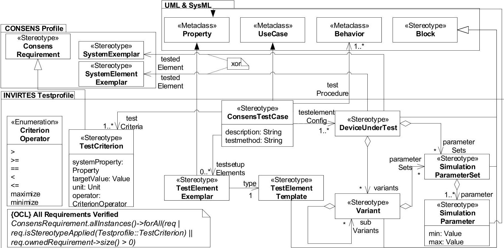
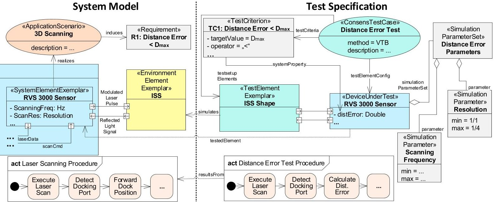

<!-- PDF_PAGE: 1 -->

# 4th International Conference on System-Integrated Intelligence

# "Specification Technique for Virtual Testbeds in Space Robotics"

Ruslan Bernijazov*, Michael Hillebrand, Christian Bremer, Lydia Kaiser, Roman Dumitrescu

$ ^{a} $Fraunhofer IEM, Zukunftsmeile 1, 33102 Paderborn, Germany

## Abstract

Systems Development for Space Missions is an engineering challenge that requires a highly integrated systems design approach. Multidisciplinary dependencies, project size, technology novelty, and diverse operational environment conditions increase overall systems complexity. Therefore, systematic validation and verification techniques that consider environmental and operational conditions are crucial for mission success. However, verification and validation of system requirements is hard to achieve under real conditions since physical prototyping tests in space environment are hardly possible. Virtual Testbeds are a promising approach for the early identification of technical risks by simulating the overall system with approximate real conditions, and thus, increase the overall engineering efficiency. They enable early feasibility studies and virtual commissioning of the system during integration phase. The application of virtual testbeds requires not only a formal specification of the System Under Development (SUD) but also a formal Specification Technique for Validation and Verification (V&V). However, existing MBSE approaches provide only poor concepts for a holistic specification of system Test Cases and Virtual Testbeds. In this paper, we propose an integrated ModelBased Specification Technique that facilitates an integrated specification of the system and relevant V&V aspects. We first analyze existing norms like VDI 2206 and ECSS-Std. in order to identify relevant V&V aspects. Second, we describe a specification approach for Virtual Testbeds. Third, we present a modeling language for the specification of those aspects. Finally, we apply the presented technique on an example from the space robotics domain. Our findings show that the presented technique helps to capture relevant V&V aspects according to the existing norms in the space robotics domain. However it is not limited to space and can easily be used for industrial and other complex mechatronic systems.

## $ \textcircled{c} $ 2018 The Authors. Published by Elsevier B.V.

$ \textcircled{c} $ 2018 The Authors. Published by Elsevier B.V. This is an open access article under the CC BY-NC-ND license (https://creativecommons.org/licenses/by-nc-nd/4.0/) Peer-review under responsibility of the scientific committee of the 4th International Conference on System-Integrated Intelligence.

Keywords: "Model-Based Systems Engineering; Test Specification"

<!-- PDF_PAGE: 2 -->

## 1. Introduction and Motivation

Systems development for space missions is an engineering challenge that requires a highly integrated systems design approach. Multidisciplinary dependencies, project size, technology novelty and diverse operational environment conditions increase overall systems complexity. Moreover, the possibilities for testing of and experimenting with prototypes under real operational conditions are poor - the mission flies only once. A comprehensive validation and verification of these systems is therefore, crucial and associated with high effort. The usage of Virtual Testbeds (VTBs) is a promising approach to tackle these challenges. VTBs are used to co-simulate the system environment and the system under development (SUD) in order to analyze and study its behavior. This enables the simulative validation and verification of the SUD and its components under different environmental conditions and system configurations in reproducible simulation scenarios. Developers can also integrate sub-modules or domain-specific models into the (virtual) system. Moreover, they can evaluate different concepts or variants during development. To gain these benefits, an integration of the product specification, the development artifacts, and the VTB is inevitable. The project INVIRTES provides an exemplary implementation of this integrated development environment [1]. The underlying concept is to use a model-based approach that enables a holistic and consistent description of the system along the entire development process. In this paper, we focus on the early system design phase of a development project. In this phase, a discipline-spanning system model is developed together with an implementation-independent test specification model. The system model captures the requirements, the architecture as well as the behavior of the SUD. The test specification model defines the test cases, the VTBs, and verification criteria. These models are linked to each other by trace links and serve as input for the detailed system design and the validation and verification of the system in VTBs, respectively [1].

## 2. Development Process for Space Robotics Systems

During system development, a rigorous assurance of the system requirements is inevitable. This assurance subsumes the two terms verification and validation, which describe different stages of ensuring the required properties, functionality, safety, and reliability of the system [2]. In the field of space robotics, the ECSS standards define a normative frame for systems engineering, requirements analysis, verification, and testing. For the formalization of assurance objectives, a Model-Based Test Specification is established in early development phases via an analysis of

Fig. 1. INVIRTES Modeling Framework for modeling and simulation of complex systems [6], [1]

<!-- PDF_PAGE: 3 -->

requirements and configurations to be verified [3]. The analysis and assurance of system properties and requirements is carried out continuously by means of virtual experiments (i.e. simulations), physical experiments, or combinations of these. Figure 1 depicts the INVIRTES framework for integrated modeling and simulation of complex systems, like space robotics. The framework focuses on the two phases systems design and detailed design.

During systems design we develop the system model and the test specification model. The system model serves as the basis for communication and cooperation among the involved engineering disciplines in the course of detailed design and development [4], whereas the test specification model builds the foundation for continuous validation and verification of the system through all development phases [1]. It defines the test cases for the system, links them to the system specification, and specifies how and when tests are executed. During detailed design, the Simulation Manager implements these test cases, executes them in a VTB, and collects the simulation results. The simulation results are traced to the systems design in order to enable the identification of passed/failed test cases, satisfied/unsatisfied system requirements, and (mal-) functioning system elements. Since the test specification is used for documentation, communication and cooperation among systems engineers, domain experts, and quality assurance engineers, it must be aligned with existing standards like ECSS-E-ST-02 Verification [3] and ECSS-E-ST-10-03 Testing [5]. INVIRTES achieves this by a modeling language for test specification, a systematic method for the application of this language, and automated consistency checks (cf. Section 4 and Section 5).

## 3. State of the art

The concept of Systems Engineering encompasses a holistic consideration of the SUD in order to strengthen the understanding of the system and to solve complex development tasks efficiently. Model-Based Systems Engineering (MBSE) utilizes models for a holistic description and analysis of the SUD, beginning in the early phases of the product development throughout the whole product lifecycle. Thus, MBSE constitutes the evolution of the mechatronic systems design process that is changing from a document-based process to a model-based one [7]. It encompasses the application of formalized modeling languages for the support of requirements engineering, system design, system analysis, and V&V. A particularly important artifact of MBSE is the system model. It provides a holistic perspective on the system by describing its requirements, structure, and behavior in a discipline-spanning way. Its purpose is to provide a basis for communication and cooperation in a multidisciplinary project environment, and in this way, to control overall systems complexity [8], [9]. Examples for MBSE methods are CONSENS [4], OOSEM [10], and SysMOD [11]. However, these methods concentrate on the systems design and do not provide support for the specification of test cases and VTBs. Likewise, existing approaches for the specification of test cases in the scope of MBSE are not entirely suited for our needs, since they largely focus on software systems and provide no means for the specification of VTBs. For example, Alt presents in [12] an approach for the model-based derivation and refinement of test cases for car multimedia systems. To this end, he derives abstract software test cases from the systems model, refines them with platform-specific information in later development stages, and uses them for the verification of real prototypes and the final system. Another approach is the so-called UML Testing Profil (UTP) that is being developed and maintained by a working group of the OMG since 2001. UTP is based on UML and is the standard language for various testing approaches on software-intensive systems [13], [14]. OMG released the UTP 2.0 Beta Version in September 2017. Major changes to the previous versions are for example the integration of UTP 2.0 with SysML for requirements traceability, the introduction of different test levels, and the introduction of tests for non-functional requirements. However, UTP 2.0 still focus on software systems and is only partially applicable for complex mechatronic systems. Moreover, there is no standard guideline or known method on how to apply UTP 2.0 during systems design and how to integrate the test specification with the system design.

## 4. Integrated Test Specification Technique

In previous work, we already presented our concept for an integrated system and test specification [15], [16]. In the following, we focus on the modeling language that is necessary for the realization of this concept. This language is defined by means of an UML profile [17], the INVIRTES Testprofile (Figure 2). It extends the CONSENS UML

<!-- PDF_PAGE: 4 -->

Profile and enables the definition of system test cases and VTBs as well as the formalization of system requirements. We use the UML profile mechanism because it enables the utilization of any UML-conform modeling tool for the definition of the test specification. In the scope of Invirtes, we utilize the open-source modeling tool Eclipse - Papyrus.

Fig. 2. INVIRTES Testprofile.

A Consens Test Case defines a single test or simulation run that is executed in order to analyze or assure a set of system requirement. It contains links to the other elements in the test specification and serves as the starting point for the implementation of simulations and VTBs during detailed design (see [1] for more information on the detailed design phase). In order to link the test specification to the system model it is necessary to establish a connection between the test cases and the system elements. To this end, each Consens Test Case is linked to a non-empty set of test element configurations, which are modeled via the stereotype Device Under Test. The Device Under Test is a representation of the actually tested or simulated system or system component, which are modeled by means of the CONSENS stereotypes System Exemplar and System Element Exemplar [18]. Thereby, each Device Under Test references exactly one System Exemplar or exactly one System Element Exemplar, as indicated by the xor constraint in Figure 2. Furthermore, it leverages the definition of different configurations of the referenced element by means of Simulation Parameters and Variants. Simulation Parameters specify the value ranges for specific parameters and attributes (cf. Section 4). This particularly allows to distinguish between static and dynamic parameters and provides ranges and increments that are used to generate a series of simulation jobs using parameters sweeps, as describes in [16]. Simulation Parameter Sets are used to structure Simulation Parameters. All parameter of a Simulation Parameter Set are valid for a specific simulation run. In turn, Variants define exclusive simulation configurations.

The testbed structure is modeled by means of Test Element Exemplars, which are typed by Test Element Templates. These stereotypes are used to capture the individual elements within the testbed and their interactions with the SUD. Since these stereotypes extend the UML metaclass Property and the SysML stereotype Block, the system engineer can also use native UML and SysML constructs, like attributes, in order to capture relevant characteristics of these elements. Furthermore, UML behavior models are used in order to formalize the interactions between these elements during the test case (i.e. the test procedure), as shown in Figure 2.

The stereotype Test Criterion extends the stereotype Consens Requirement, which is used to capture textual requirements in the system model and enables the formalization of verification criteria. Its tag values enable the definition of more formal criteria of the form systemProperty op targetValue unit, where systemProperty is a reference

<!-- PDF_PAGE: 5 -->

to an attribute of the Device Under Test, op is an operator that is provided by the enumeration Test Criterion, targetValue is the desired value of systemProperty, and unit is the unit of targetValue.

In order to assure plausible, complete, and comparable specifications, we define a set of rules via the Object Constrain Language (OCL). For instance, we check whether each requirement is considered in at least one test case and whether every test case is complete, i.e., has trace links to the other partial models of the test specification. Figure 2 exemplary visualizes the OCL constraint that assures that every system requirement on the lowest hierarchy level serves as a test criterion for at least one system test case. That is, we require that the requirements are gradually refined until the all requirements on the lowest hierarchy level result in a test criteria in the test specification.

## 5. Application of the Test Specification Technique

This chapter gives an example for the application of our Test Specification Technique. The SUD is specified by means of a CONSENS system model that defines its requirements, its active structure, and its dynamic behavior. The left side of Figure 3 shows an excerpt of the system model of a Rendezvous and Docking (RuD) System. The task of this system is to perform an autonomous docking procedure with the International Space Station (ISS). One particular application scenario of this system is the 3D Scanning of its environment. This application scenario is realized by the system element RVS 3000 Sensor. It sends out laser beams towards the ISS (represented by the eponymous environment element), collects its reflection, and uses this information in order to identify the docking port. Moreover, it receives commands and provides information to other system elements. The activity diagram Laser Scanning Procedure captures the behavior of this element during the detection of the docking port.

Fig. 3. Application of the Test Specification Technique.

As indicated by the requirement R1 in Figure 3, the distance error must always stay below a pre-defined threshold Dmax. According to the before-mentioned standards (cf. Section 2), the tests for the verification of this requirement must be captured in a test specification. The left side of Figure 3 shows an excerpt of this specification for the RuD System. The Test Criterion TC1 formalizes the before-mentioned requirement and serves as the criteria for the Test Case Distance Error Test. The Device Under Test of this test case is the RVS 3000 Sensor, which represents the eponymous system element. Its properties capture relevant information for the test, like the distance error.

Moreover, it contains a set of simulation parameters that define the value ranges for the properties of the tested system element, like the scan resolution and the scanning frequency. The test setup for the shown the shown Consens Test Case consists of one Test Element Exemplar, namely the ISS Shape. It captures the relevant aspects of the environment element ISS, namely its shape. Finally, the test procedure is specified by means of an activity

<!-- PDF_PAGE: 6 -->

diagram, is derived from the activity Laser Scanning Procedure in the system model. This example shows that our specification technique enables an early definition of a model-based test specification that fulfils the standards for verification and validation that are described in Section 2.

## 6. Conclusion

This paper presents a new specification technique for a holistic and integrative specification of test cases and virtual testbeds in Space Robotics. This technique provides a modeling language and methodical guidance that fulfill the requirements of existing and extensively used standards for test specifications in the space domain. The language is defined by means of an UML profile. We validated our approach on different space scenarios, like Mars Exploration, Rendezvous and Docking, and In-Orbit Servicing. The results show that it helps to fulfill the requirements that are stated by the common standards for validation and verification (cf. Section 2). One crucial aspect of our approach is its seamless integration with the specification technique CONSENS for the design of complex technical systems. This enables a seamless specification of system requirements, system architecture, test cases, and (virtual) testbeds while maintaining traceability between these artifacts. This traceability enables the utilization of automated test coverage, blame, and impact analyses. For example, we can employ impact analyses in order to identify simulations that must be repeated upon a particular change of the system design. Future work focus on automated feedback of simulation results into system specification (e.g., in order to enable an on-the-fly evaluation of system design changes). This requires a seamless real-time data integration between Specification, Virtual Testbed, and Simulation Manager. Furthermore, we are elaborating a MBSE-Framework for assurance strategies on complex mechatronic systems.

## 7. Acknowledgement

This work is part of the project "INVIRTES", supported by the German Aerospace Center (DLR) with funds of the German Federal Ministry of Economics and Technology (BMWi), support codes 50 RA 1306-50 RA 1309.

## References

[1] J. Rossmann, M. Schluse, M. Rast, M. Hoppen, R. Dumitrescu, C. Bremer, M. Hillebrand, O. Stern, F. Bluemel, C. Averdung, Architecture for integrated development of complex systems with Model-Based System Specification and Simulation, Proceedings of ASME, International Design Engineering Technical Conferences & Computers and Information in Engineering Conferences, (2015).

[2] Verein Deutscher Ingenieur e.V. (VDI), Design methodology for mechatronic systems, VDI guideline 2206, Beuth Verlag, (2004).

[3] European Cooperation for Space Standardization (ECSS), Space engineering, Verification, ECSS-E-ST-10-02C, (2009)

[4] J. Gausemeier, F.-J. Rammig, W. Schaefer (Eds.), Design Methodology for Intelligent Technical Systems, Springer (2014).

[5] European Cooperation for Space Standardization (ECSS), Space engineering, Testing, ECSS-E-ST-10-03C, (2012)

[6] B. Sondermann, L. Atorf, G. Grinshpun, M. Priggemeyer, J. Thieling, M. Rast, J. Rossmann, A Virtual Testbed for Optical Sensors in Robotic Space Systems - VITOS, Proceedings of the 14th Symposium on Advanced Space Technologies in Robotics and Automation, (2017), 1-8

[7] J. Gausemeier, R. Dumitrescu, D. Steffen, A. Czaja, C. Tschirner, O. Wiederkehr, Systems Engineering in der industriellen Praxis, Paderborn, (2013).

[8] R. Cloutier, C. Baldwin, M.A. Bone, Systems Engineering simplified. CRC Press, Boca Raton, USA, (2015).

[9] R. Haberfellner, O. de Weck, O., E. Fricke, S. Voessner, (Eds.), Systems Engineering - Grundlagen und Anwendung, Orell fuessli Verlag, Zuerich, 12. Auflage, (2012).

[10] S. Friedenthal, A. Moore, R. Steiner, A Practical Guide to SysML - The Systems Modeling Language, Elsevier, Amsterdam, (2008).

[11] T. Weilkiens, Systems Engineering mit SysML/UML, Modellierung, Analyse, Design, dpunkt Verlag, Heidelberg, (2006).

[12] O. Alt, Car Multimedia Systeme Modell-basiert testen mit SysML, Vieweg+Teubner Verlag | GWV Fachverlage GmbH, Wiesbaden, (2009). [13] Object Management Group (OMG), UML Testing Profile (UTP), Version 2.0 Beta, (2017).

[14] P. Baker, R.-D. Zhen, J. Grabowski, O. Haugern, I. Schieferdecker, C. Williams, Model-Driving Testing, Using the UML Testing Profile, Springer, (2008).

[15] C. Bremer, M. Hillebrand, B. Hassan, R. Dumitrescu, Konzept für das ganzheitliche Testen komplexer mechatronischer Systeme, IFF Wissenschaftstage (2015) P. 153-160.

[16] J. Rossmann, M. Schluse, M. Rast, M. Hoppen, L. Atorf, R. Dumitrescu, C. Bremer, M. Hillebrand, O. Stern, P. Schmitter, Integrated modelbased System Specification and Simulation: Case Study on Sensor Design for extraterrestrial Applications, Wissenschafts- und Industrieforum Intelligente Technische Systeme, (2017).

<!-- PDF_PAGE: 7 -->

[17] Object Management Group (OMG), UML 2 (2017).

[18] P. Iwanek, L. Kaiser, R. Dumitrescu, A. Nyßen, Fachdisziplinübergreifende Systemmodellierung mechatronischer Systeme mit SysML und CONSENS, Tag des Systems Engineering, Stuttgart, (2013).