<!-- PDF_PAGE: 1 -->

# STATISTICAL RELIABILITY ANALYSIS OF SATELLITES BY MASS CATEGORY: DOES SPACECRAFT SIZE MATTER?

Gregory F. Dubos Georgia Institute of Technology, United States greg.dubos@gatech.edu

Jean-Francois Castet Georgia Institute of Technology, United States jcastet3@gatech.edu

Joseph H. Saleh Georgia Institute of Technology, United States jsaleh@gatech.edu

## ABSTRACT

Reliability has long been recognized as a crit attribute for space systems, and potential causes orbit failures are carefully sought for identification and elimination through various types of testing prior to launch From a statistical or actuarial perspective, several parameters of spacecraft, such as mission type, orbit, or space complexity, can potentially affect the probability of failure of satellites. In this paper, we explore the correlation between satellite mass, considered here as a proxy for size, and satelliteability, and we investigate whether different masses of satellite, defined in terms of mass, exhibit different reliability profiles. To this end, we first conduct nonparametric analysis of satellite reliability based on a sample of 1,444 satellites. The satellites are organized in three categories defined by satellite mass (Small - Medium - Large). Three nonparametric reliability curves are thus derived. When provide parametric fits of the reliability curves to facilitate the identification of failure trends. We predeto the comparative analysis of failure profiles over time and clearly identify different reliability behaviors for the various satellite mass categories. Finally, we discuss possible structural causal reasons for these trends and failures, in particular with respect to design, testing and procurement.

## 1. INTRODUCTION

Reliability has long been recognized as a critical for space systems, and potential causes of on-fabitres are carefully sought for identification and elimination through various types of testing prior to launch. Unfortunately, despite the recognition of its importance, limited on-orbit failure data and statistical analysis of satellite reliability exist in the technical literature. To help fill this gap, Castet and Saleh [1] recently collected failure data for 1,584 Earth-orbiting satellites launched between January 1990 and October 2008, and conducted statistical reliability analysis for this extensive sample. Parametric reliability results from their study along with the 5% confidence intervals are shown in Fig. 1.

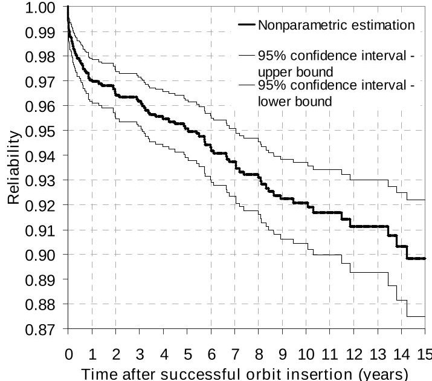

Fig 1. Satellite reliability with 95% confidence intervals (details in [1])

<!-- PDF_PAGE: 2 -->

One limitation of the work in [1] is that satellite of different types and in different orbits have been lumped together and their "collective" failure behavior was statistically analyzed. The issue with this approach is that no two (or more) satellites are truly alike, and, unless they ardocated, satellites operate in and experience different environmental conditions. As a result, the assumption that the latimes of the satellites are independent and identical is attributed (iid) may be challenged, and the "collective" reliagili results may not accurately reflect the specificity of a particular spacecraft or spacecraft type. The statistical analysis dilemma results from the fact that the copa industry lacks "satellite mass production," and do not have the luxury of say the semi-conductor industry here data on thousands of identical transistors operatinder identical environmental conditions can be available statistical analysis, or other industries with prots for which failure data can be easily obtained from located testing. Given the relatively small number of satell launched, data specialization for example for speci spacecraft platform may result in significantly used sample size thus constraining the statistical delta analysis and its precision. In this work, we prevail first-order data specialization, by satellite mass category for which the sample size (and failure occurrence within sample) remains appropriate for statistical analysi

From a statistical or actuarial perspective, several parameters or characteristics of the spacecraft as the spacecraft complexity, its number of instruments or payload size, to name a few, can potentially affect probability of failure of satellites. In this paper we explore the correlation between satellite mass and satellite reliability, and we investigate whether different classes of satellite, defined in terms of mass, exhibit different reliability profiles. We address the following questions: for example, are different spacecraft masses correlated different failure behaviors on-orbit? Do small states exhibit different failure behaviors on-orbit, hence different reliability profiles, than larger one? And more adly, do different satellite classes (in terms of mass) have different reliability profiles?

This possible correlation between spacecraft mass a reliability has not to date been investigated from statistical perspective. Intuitive trends have often been used, but sometimes yielded contradictory conclusions. On board, an increase in mass has naturally been associated the use of design redundancy on-board a spacecraft prove reliability [2]. On the other hand, an increase complexity (for which mass is often considered a good proxy) long been seen as a factor degrading reliability. This phenomenon was already identified during the Apollo program: pressure-fed and storable propellant lunar module propulsion systems allowed bypassing the use ignition systems and pumps, resulting in a reduction mass and complexity, and ultimately an increase in reliability [3]. Furthermore, recent work by Bearden [4] tended tows that NASA spacecraft that failed were characteri ded

high complexity factor (defined by the author as average of technical factors including spacecraft massally, in [5], Fleeter discusses a simple model of spacecraft reliability $ R=R_{0}^{n} $ , wheren is the number of components that "nominally scales with mass", and is the reliability of each component. Using this relation, the authors that "using the same part quality, [a] little spacecraft be more reliable" than a larger one, will be smaller. As noted by Sarsfield [6], the question of system size relation to reliability divides the spacecraft comity with on one side the proponents of small, "single-string thus simple systems, and on the other, the advocate larger systems using more redundancy.

Quantitative answers have therefore to be found resolve this issue and identify correlation, if any, betweespacraft mass and reliability. To this end, we conduct its work statistical reliability analysis of satellites argued by mass categories and we investigate whether these diffelsses of satellite exhibit different reliability profiles

The remainder of this paper is organized as follows section 2, we present the data used in this word an introduce our classification of satellites based onss. In section 3, we conduct a nonparametric analysis of satellite reliability for each class, using the Kaplan-Me estimator (given the censored nature of the data). To facilitate the identification of trends in the reliability behavior then provide in section 4 parametric fits of the reliability curves using the Maximum Likelihood Estimation method as llw as mixtures of Weibull distributions. In section we proceed to the comparative analysis of failure over time, which clearly identifies different reliabil behaviors for different satellite mass bins. Finally, beyond the statistical identifications of these differences, discuss in section 6 possible structural and causal reasons these trends and failure differences, in particular with respect to design, testing and procurement practices.

## 2. DATABASE, DATA DESCRPITION AND CATEGORIZATION

For the purpose of this study, we used an extendabase of failures and anomalies on-orbit. Details about database can be found in [1]. While not "complete" a statistical sense, this database is widely used considered the most authoritative in the space industry data for over 6,400 spacecraft.

We restricted our study to Earth-orbiting satellite successfully launched between January 1990 and October 2008. As a result, we retained from the database 441 satellites launched within this time period and which the satellite mass (at launch) was available. We use our reliability calculations what is referred to in the database as a Class I failure, that is, a retirement of a state due to failure. For each spacecraft in our sample, we call1) its mass; 2) its launch date; 3) its failure date, failure

<!-- PDF_PAGE: 3 -->

occurred; and 4) the "censored time", if no failoccurred. This last point is further explained in the followi subsection 3.1. The data collection template ample data for our analysis are shown in Table 1.

Table 1. Data collection template and sample data in statistical analysis of satellite reliability

<table border="1"><tr><td>Sample unit number</td><td>Mass at launch(kg)</td><td>Launch date</td><td>Failure date(if failure occurred)</td><td>Censored time(if no failure occurred)</td></tr><tr><td>Satellite #1</td><td>1500</td><td>11/06/1998</td><td>11/15/1998</td><td>-</td></tr><tr><td>Satellite #2</td><td>480</td><td>03/01/2002</td><td>-</td><td>10/02/2008</td></tr><tr><td>...</td><td>...</td><td>...</td><td>...</td><td>...</td></tr><tr><td>Satellite #1,444</td><td>2600</td><td>04/26/2004</td><td>03/28/2006</td><td>-</td></tr></table>

After the data was collected, we categorized the lists into different mass bins. Various taxonomies for craft based on their mass have been used over time in the industry. For example, Sarsfield [6] points out that there is no official definition of a small satellite", even though this qualifier has gained much popularity during the last decades. The author adds, "the Center for Satellite Engineering Research at the University of Surrey de a "mini" satellite as being between 100 and 500kg." Similarly, a list of satellites launched from 1991 1995, whose mass is under 425 kg and considered as small provided in [5]. The National Research Council's Aeronautics and Space Engineering Board established Panel on Small Spacecraft Technology that defines spacecraft as those "weighing approximately 600kgs" [7]. In this work, we adopt the more commonly used definition of "small spacecraft" as those within 500kg range [6]. This range corresponds to the categories and BW in the ANSI/AIAA guidelines for spacecraft design [8]. Furthermore, in these guidelines, the 500-2,500 kg corresponds to the category CW, and masses above 500 kg fall into the last category DW.

Based on the previous discussion, we retained for analysis the classification of spacecraft that presented in Table 2.

Table 2. Categories of spacecraft based on mass

<table border="1"><tr><td>Mass at launch(kg)</td><td>Spacecraft category</td><td>Examples</td></tr><tr><td>[0-500]</td><td>Small(S)</td><td>FAST,JASON1,NANOSAT01</td></tr><tr><td>[500-2500]</td><td>Medium(M)</td><td>TOPEX-POSEIDON,GPSNAVSTARII-06</td></tr><tr><td>&gt;2500</td><td>Large(L)</td><td>DirecTV1R,HotBird8</td></tr></table>

Note that the IRIDIUM series of satellites which re initially included the Medium category has been from our sample for the purpose of this statistical analysis. These satellites, based on the same design with a 657 kg, experienced a very large number of failures stly attributed to a malfunction of the Attitude and Control System. This recurrent cause of failure challenged assumption of independence of the failures. Wheallyed separately, the IRIDIUM series exhibited a very ficient reliability behavior from the other satellites beging to the same mass category. This design of satellites there represented an "outlier" that introduced a significant bias in the Medium category that could potentially result flawed interpretations for the satellites of this size general. For these reasons, the IRIDIUM series was removed fhis category. However, the reliability behavior of the DIUM satellites in relation to the unique design, manufacturing and testing practices characterizing this series of craft remains a very interesting research direction thatuld deserve special attention in future work.

In total, we have 415 satellites in our Small mass 554 in the Medium mass bin (IRIDIUM excluded), and 475 the Large mass bin.

## 3. NON-PARAMETRIC ANALYSIS OF SATELLITE RELIABILITY BY MASS CATEGORY

## Censored Data Sample and Kaplan-Meier estimator

Right-censoring occurs in statistical life data when some items under observation are removed from sample before their failure occurs, or when the experiment observation window ends and some items are still operational (again, their failure is not observed) or sample has a combination of these two types of censoring, it contains items with staggered entries. This is know statistical analysis as Type IV censoring or random censoring, and it means the following: 1) the states in our sample are activated at different points in time. (the satellites are launched at different calendar dates all these activation times in our sample are known failures and censoring are stochastic, and 3) cegsoccurs either because a satellite is retired from the before a failure occurs or because the satellite is still rational at the end of our observation window (October 2008). Censoring requires careful attention: deriving liability function from censored life data is not trivial, data is important that it is done properly if the results to be meaningful and unbiased. In this work, we adopt the powerful Kaplan-Meier estimator [9], which is bestited for handling the type of censoring we have in sample. The derivation of the Kaplan-Meier estimator for dan be found in [1]. The Kaplan-Meier estimator of the reliability function with censored data is given Eq. (1):

<!-- PDF_PAGE: 4 -->

$$
\hat {R} (t) = \prod_ {\substack {a l l i s u c h \\ t _ {i}) \leq t}} \hat {p} _ {i} = \prod_ {\substack {a l l i s u c h \\ t _ {i}) \leq t}} \frac {n _ {i} - 1}{n _ {i}}
$$

where:

$$
\left\{ \begin{array}{l} t _ {(i)}: \text {t i m e t o} l ^ {\mathrm {h}} \text {f a i l u r e (a r r a n g e d i n a s c e n d i n g o r d} \\ \hat {p} _ {i} = \frac {n _ {i} - 1}{n _ {i}} \\ n _ {i} = \text {n u m b e r o f o p e r a t i o n a l u n i t s r i g h t b e f o r e} t \\ = n - [ \text {n u m b e r o f c e n s o r e d u n i t s r i g h t b e f o r e} ] t \\ - [ \text {n u m b e r o f f a i l e d u n i t s r i g h t b e f o r e} ] t \end{array} \right.
$$

Should there be ties in the failure times, may units failing at exactly $ t_{(i)} $ this situation is referred to as a tie of multiplicity m then Eq. 2 is replaced by:

$$
\hat {p} _ {\mathrm {i}} = \frac {n _ {\mathrm {i}} - m _ {\mathrm {i}}}{n _ {\mathrm {i}}}
$$

If a censoring time is exactly equal to a failure, a convention is adopted that assumes censoring hasred immediately after the failure (that is, at an itfely small time interval after the failure).

## Results

The data organized in mass bins is now treated with Kaplan-Meier estimator (Eq. (1)), and we obtain the Kaplan-Meier plot of satellite reliability for eachmass category of spacecraft, shown in Fig. 2.

Fig. 2 reads as follows. For example, after a launch, satellite reliability for the Medium size category (500-2500 kg) drops to approximately 97% after five years on-orbit. More precisely, we have:

$$
\hat {R} (t) = 0. 9 6 8 \quad \mathrm {f o r} \quad 4. 5 4 8 \mathrm {y e a r s} \leq t < 5. 7 1 9 \mathrm {y e a r s}
$$

Both small $ \in $ 500 kg) and large (> 2500 kg) satellites exhibit a reliability of 95% after two years. Past years, satellite reliability drops to 87% for large satellites, 91% for small satellites, and 94% for medium satellites. So important failure trends and difference between three satellite mass categories can already be seen in Fi

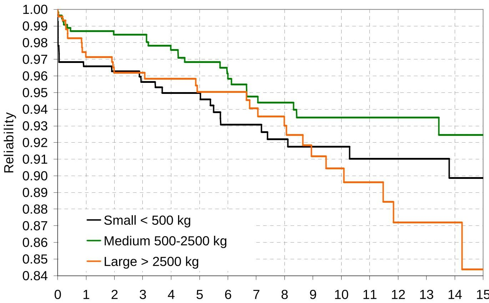

Time after successfull orbit insertion (years)

Fig. 2. Kaplan-Meier plot of satellite reliabilify each mass category

<!-- PDF_PAGE: 5 -->

- Infant mortality: small satellites (with a mass less than 500 kg) exhibit a significant drop in reliability, during the first months following orbit insertion. For example, six months after orbit insertion, their reliability is already down to approximately 96.8%. This striking behavior of "infant mortality" experienced by small satellites is much less severe in the case of bigge satellites. Indeed, for the two other categories (Mm and Large), the drop in reliability is initially moderate. Six months after the orbit insertion, the reliability of large satellites is around 98.3% ,datat of medium satellites is 98.7%.

- Wear-out: while the drop in reliability of small satellites appears to taper off after 7 years, large spacecraft (mass greater than 2,500 kg) exhibits different failure behavior after 7 years, marked by steep decrease in reliability. For this Large category of satellites, this drop is more severe than during first 6 years, as reflected by a change of convexity of the reliability curve approximately 6.5 years after insertion. The "wear-out" failure behavior seems clearly more distinct for large satellites than terra ones.

- Except for the difference in infant mortality, both Medium and Small categories exhibit a similar reliability behavior, with a moderate decrease reliability from year 1 to 8 years, and a taperoff or shallower drop from year 8 to 15.

- In the sample of 1,444 satellites we analyzed, Medium category exhibits the highest reliability satellites, always remaining above 92.4% over course of 15 years after the orbit insertion.

- The Small category exhibits the lowest reliability all satellites up to 9 years after orbit insertion. lower, past 9 years, the large satellites reclaim the ship in failure as their reliability steadily drops beloat of the two other categories.

These trends will be revisited more formally and analytically in Section 5. The important result in Fig. 2 is that different satellite mass categories do indicate different reliability profiles and failure behavior In addition, Figure 2 indicates that the question what smaller or larger satellites are more (or less) is illposed; it cannot be answered without the specific of a time horizon of interest (see previous note on deslp in failure).

## 4. PARAMETRIC ANALYSIS OF SATELLITE RELIABILITY BY MASS CATEGORY

Nonparametric analysis provides powerful results the reliability calculation is not constrained to finy particular

pre-defined lifetime distribution. However, this ability makes nonparametric results neither easy nor convenient use for different purposes, as often encountered in engineering design (e.g., reliability optimization)n addition, some trends and patterns are more clearly identified and recognizable with parametric analysis in the following, we present two parametric methods based on Weibull distribution to fit the nonparametric reliability of each mass category discussed previously.

## Weibull distribution

The Weibull distribution is one of the most commonsed distribution in reliability analysis. Its reliabili (or survivor) function can be written as follows:

$$
R (t) = \exp \left[ - \left(\frac {t}{\theta}\right) ^ {\beta} \right] \quad \mathrm {f o r} t \geq 0
$$

where $ \beta $ is the shape parameter (dimensionless) and the scale parameter (units of time), both nonnegative. The reason for the wide adoption of the Weibull distribution is that it is quite flexible, and with an appropriate choice of the shape parameter, it can capture different kinds of failure behaviors. For example, when 0 $ \beta < 1 $ , the Weibull distribution models infant mortality (which corresponds to a decreasing failure rate); when $ \beta=1 $ , the Weibull distribution becomes equivalent to the Exponential distribution (constant failure rate); and when $ >1 $ , the Weibull distribution models wear-out failures (which corresponds to an increasing failure rate).

In previous publications, we demonstrated the appropriateness of the Weibull distribution as a metric model for satellite reliability [1,10,11]. In this work, we first derive Weibull fits for the three nonparametricibility results using the Maximum Likelihood (MLE) procedure However, the parametric results will be shown to within 1.8 to 3.5 percentage points of the "benchmark" nonparametric results, and for our purposes, the results are not sufficiently accurate. We therefore proceed hwit deriving mixture Weibull distributions for the nonparametric results and demonstrate a significant improvement in the accuracy of the parametric details are discussed next.

## Maximum Likelihood Estimation (MLE) of single Weibu fit

Details of the Maximum Likelihood Estimation proc ed can be found in [12], and its analytic derivation provided in [10]. When applied to the nonparametric reliabil results shown in Fig. 2, the MLE procedure yields t Weibull parameter estimates for each satellite mass category. The results are provided in Table 3.

<!-- PDF_PAGE: 6 -->

Table 3. Maximum Likelihood Estimates of the Welbul parameters for each mass category of satellites

<table border="1"><tr><td rowspan="2">Mass category</td><td rowspan="2">β</td><td>θ</td></tr><tr><td>years</td></tr><tr><td>Small(≤500kg)</td><td>0.3224</td><td>21414.5</td></tr><tr><td>Medium(500-2500kg)</td><td>0.5973</td><td>1469.2</td></tr><tr><td>Large(&gt;2500kg)</td><td>0.6794</td><td>291.4</td></tr></table>

Consider for example the small satellite category given Equation 4 and the information provided in Tableits, nonparametric reliability is best approximated by the following Weibull distribution:

$$
R _ {\mathrm {S m a l l}} (t) = \exp \left[ - \left(\frac {t}{2 1 4 1 4 5}\right) ^ {0. 3 2 2 4} \right]
$$

The values of the shape parameter $ \beta= ( 0.3224) $ and the scale parameter $ \theta=21414.5 $ are the Maximum Likelihood Estimates.

With a shape parameter $ \beta<1 $ , the Weibull fits of satellite reliability provided in Table 3 capture the existence of infant mortality for each mass category of satellites. In that the value of the shape parameter increases monotonous the satellite mass increases (i.e., 0.3224<0.5903794). This trend is in agreement with the comment made previously regarding the increased risk of infant mortality as satellite mass decreases that was observed on the nonparametric reliability curves.

Fig. 3 shows the nonparametric reliability curve the three mass categories, as well as the MLE Weibull Fig. 3 provides a visual verification that the Weibull disution with the MLE parameters provided in Table 3 is a good for the nonparametric reliability of large satellit

For example, for the Large category, the maximumor distance) between the nonparametric reliabilityveu and the Weibull fit is 3.5 percentage points, and the average

<table border="1"><tr><td rowspan="2">Mass category</td><td>Maximum error</td><td>Average error</td></tr><tr><td>percentage point</td><td>percentage point</td></tr><tr><td>Small(≤500kg)</td><td>1.8</td><td>0.7</td></tr><tr><td>Medium(500-2500kg)</td><td>2.0</td><td>0.9</td></tr><tr><td>Large(＞2500kg)</td><td>3.5</td><td>1.1</td></tr></table>

Table 4. Error between the nonparametric reliaband MLE Weibull fit for each satellite mass category

error is 1.1 percentage point. This represents accuracy for a two-parameter (Weibull) distribution. Table provides the maximum and average error between the nonparamelreliability and the Weibull fit for the three mastegories.

Table 4 shows that a single Weibull distribution provides a reasonable approximation of the nonparametric listel reliability for each mass category, with an average on the order of a single percentage point and a maximum ranging from 1.8 to 3.5 percentage points. Howe this reasonable approximation is not good enough for our purposes, and we can see for example in Fig. 3 that parametric fit does not accurately follow the nonparametric ("benchmark") reliability results, especially between year 3 and 7, and between year 7 and 15 where clearly failure trends are present. These different failures can be seen in the change of the convexity of the nonparametric curve around year 7, which reflects steeper failure propensity or reliability degradation after several orbits. The single Weibull fit averages out these amces and fails to capture these different failure trends iforeve the

curve around year 7, which reflects steeper failure propensity or reliability degradation after seven years on orbit. The single Weibull fit averages out these and fails to capture these different failure trends. Improve the accuracy of the parametric fit, we derive next partic fit with mixture distributions.

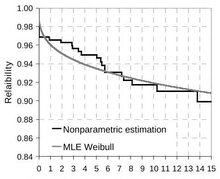

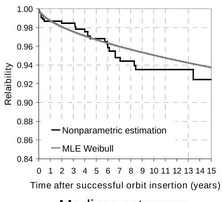

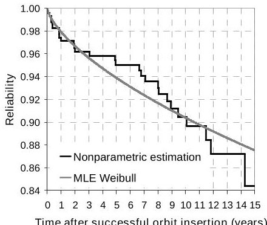

Large category

Fig. 3. Nonparametric reliability and single Wellbfit for the three mass categories

<!-- PDF_PAGE: 7 -->

## Mixture distributions

Several distributions such as the Exponential, Weibull Lognormal, can be used as a basis for linear coatibim to generate a mixture distribution. In this subsection maintain the Weibull as the basis for our parametric calculations and derive mixture of two Weibull distitions for the nonparametric satellite reliability of eachass category. The parametric reliability model with texture of two Weibull distributions can be expressed as fo

$$
R (t) = \alpha \exp \left[ - \left(\frac {t}{\theta_ {1}}\right) ^ {\beta_ {1}} \right] + (1 - \alpha) \exp \left[ - \left(\frac {t}{\theta_ {2}}\right) ^ {\beta_ {2}} \right]
$$

The parameter is used to modify the relative weight given to each Weibull distribution in the mixture. A generalized expression for mixture distributions is provided in [13]. We restrict our calculations in this work to=2 since as will be shown shortly, the results are significant accurate and the 2-Weibull distributions follows with notabl precision the different failure trends in the nonapetric results. Increasing n provides insignificant accuracy improvement.

The nonlinear least squares method provides us which best fits for the parameters of the 2-Weibull mixture distribution for each mass category. The results provided in Table 5.

For example, the resulting reliability function for large satellites is then expressed according to (Equating the appropriate parameters of Table 5, as follows:

$$
R (t) = 0. 9 0 5 \exp \left[ - \left(\frac {t}{2 4 7 0 0}\right) ^ {0. 3 5 5 8} \right] + 0. 0 9 5 \exp \left[ - \left(\frac {t}{1 1 . 9}\right) ^ {3. 5 7 9} \right]
$$

Notice that for the three satellite mass categories mixture distribution consists of a Weibull distribution capturing infant mortality $ \beta_{1} < 1 $), and another one capturing wear-out failures $ \beta_{2} > 1). $

Table 5. Model parameters of the 2-Weibull mixture distribution for each mass category of satellites

<table border="1"><tr><td>Parameter</td><td colspan="3">Mass category</td></tr><tr><td></td><td>Small(≤500kg)</td><td>Medium(500-2500kg)</td><td>Large(&gt;2500kg)</td></tr><tr><td>$\alpha$</td><td>0.9607</td><td>0.9703</td><td>0.905</td></tr><tr><td>$\beta_{1}$</td><td>0.2101</td><td>0.5071</td><td>0.3558</td></tr><tr><td>$\beta_{2}$</td><td>2.754</td><td>5.538</td><td>3.579</td></tr><tr><td>$\theta_{1}$</td><td>$10^{7}$</td><td>6840</td><td>24700</td></tr><tr><td>$\theta_{2}$</td><td>7.3</td><td>6.6</td><td>11.9</td></tr></table>

In addition, the infant mortality component of the texture distribution has a significantly larger weight (than the wear-out component (1 a).

For the three mass categories, the new parameter the reliability using a 2-Weibull mixture distribution accurately follows the nonparametric reliability, as shown Fig. 4.

Table 6 provides the $ ^{2} $Rcoefficients as well as the sum of the squares of errors (SSE) of the mixture distributions for the three satellite mass categories. In addition the graphical inspection of the fits (like in Fig. 4) the high value of the $ ^{2} $R (greater than 0.97) and the low value of the SSE in each case indicate that the fits obtained the mixture distributions are significantly accurate.

Table 6. Measures of goodness-of-fit of the 2-Wib mixture distribution for each mass category of satellites

<table border="1"><tr><td>Coefficient</td><td colspan="3">Mass category</td></tr><tr><td></td><td>Small(≤500kg)</td><td>Medium(500-2500kg)</td><td>Large(&gt;2500kg)</td></tr><tr><td>R2</td><td>0.9757</td><td>0.9841</td><td>0.9835</td></tr><tr><td>SSE</td><td>0.09438</td><td>0.06152</td><td>0.2017</td></tr></table>

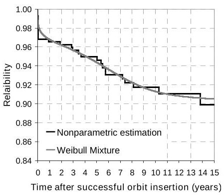

Small category

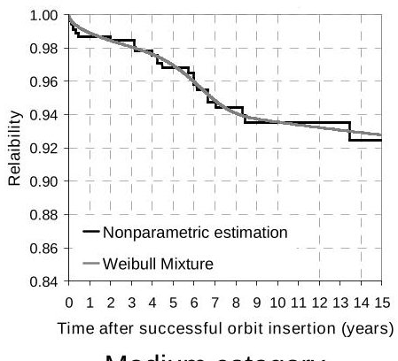

Medium category

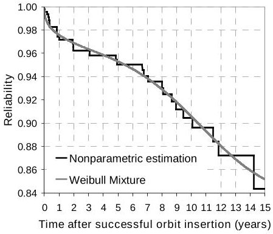

Large category

Fig. 4. Nonparametric reliability and 2-Weibull rtuixe fit for the three mass categories

<!-- PDF_PAGE: 8 -->

To gauge the precision improvement between the lesing Weibull and the 2-Weibull mixture distributions, we calculate both the maximum and the average errbetween the nonparametric reliability (the benchmark result) and the parametric models. The results are shown in Table 7

Table 7. Error between the nonparametric reliabilit and the parametric models over 15 years

<table border="1"><tr><td rowspan="2">Mass category</td><td rowspan="2">Error percentage point</td><td colspan="2">Parametric fit</td></tr><tr><td>Single Weibull</td><td>2-Weibull mixture</td></tr><tr><td rowspan="2">Small(≤500kg)</td><td>maximum error</td><td>1.8</td><td>1.5</td></tr><tr><td>average error</td><td>0.7</td><td>0.3</td></tr><tr><td rowspan="2">Medium(500-2500kg)</td><td>maximum error</td><td>2.0</td><td>0.6</td></tr><tr><td>average error</td><td>0.9</td><td>0.2</td></tr><tr><td rowspan="2">Large(&gt;2500kg)</td><td>maximum error</td><td>3.5</td><td>1.5</td></tr><tr><td>average error</td><td>1.1</td><td>0.4</td></tr></table>

As seen in Table 7, the 2-Weibull mixture distribution is significantly more accurate than the single Weibull distribution in capturing the (benchmark) nonparticle satellite reliability. For all mass categories, average error for the 2-Weibull mixture distribution is reduced over 50% compared with the average error of the single fit.

In the next section, we use these mixture distinctions further probe the difference between the failure factors and reliability trends of the three satellite categories.

## 5. COMPARATIVE ANALYSIS OF SATELLITE RELIABILITY ACROSS MASS CATEGORIES

In this section, we revisit the discussion in Subsection 3.2 regarding the difference in the reliability resultsatellites in different mass categories. Fig. 5 shows the unfairates (or hazard function) of the Small and Large satellite categories. The y-axis is provided in log-scale for readability purpose. The upper panel in Fig. 5 provides a closer look at the failure rate over the short tiperiods (through the use of a log-scale on the x-axis).

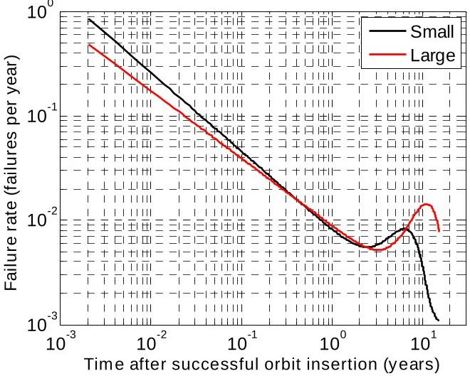

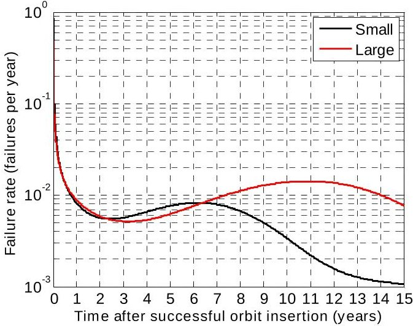

Fig. 5. Failure rates of Small and Large satellite categories

The failure rate $ \lambda (t) $ uniquely determines the reliability function through Equation 8:

$$
R (t) = e ^ {- \int_ {0} ^ {t} \lambda \left(t ^ {\prime}\right) d t ^ {\prime}}
$$

We first notice, on the upper panel in Fig. 5, that failure rate of the small satellites is higher than that of large satellite until roughly for the first four months orbit. This result reflects a previous observation following that small satellites exhibit a more pronounced infarctality than larger ones (small satellites exhibit a significant drop in reliability over the first few months th larger ones, as shown in Fig. 2). We also observe, on the lower in Fig. 5, that the failure rate of the large satellites overtakes that of the small satellites around year 6.5. Assault, more distinct wear-out failures occur in large satellites than in small one (this is reflected in the change in city of the large satellites reliability in Fig. 2 around thisame time). Given Equation 8 and the comparative shapes of failure rates in Fig. 5, it is only a matter of time before reliability of the large satellites drops below that the small ones. This indeed can be seen to occur argeand in Fig. 2.

<!-- PDF_PAGE: 9 -->

Fig. 6 shows the absolute difference (in percentages) in satellite reliability for each pair of mass codes, namely Small/Medium, Small/Large and Medium/Large. This figure is rich in information, but should be interpreted with caution. For example, notice that the Small and Medium categories exhibit the largest difference in reliability of all the pairs up to nine years. The difference originates in the early life of the spacecraft, leading a difference in the infant mortality experienced by small satellites compared to medium satellites (as see Fig. 2 and Fig. 6). After one year, the curves indicate the difference in reliability between those two categories remains stable, varying by less than 0.5 percent. In other words, the conditional reliabilities of small and medium satellites are roughly identical if they live the first year on-orbit (the conditional reliabilities are explored in the next paragraph). By contrast, notice that the reliabilities of the Small and Large categories am somewhat "stable" within one percentage point roughly the first 7 years, the two reliabilities diverge significantly after 9 nine years, suggesting a very different behavior between these two satellite categories in this time interval.

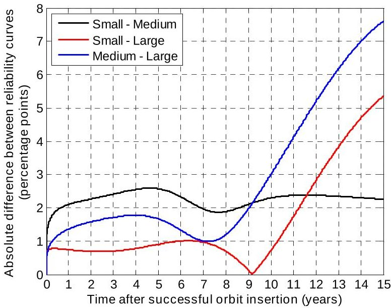

Fig. 6. Pairwise differences in satellite reliabity over time

To better assess whether the reliability and behavior of two different mass categories are similar after given period, we investigate their conditional reliability. For an item that has survived until time, the conditional reliability allows the calculation of its probability of survival for an additional period of operation, knowing that the item has survived until. By considering conditional reliabilities, we can perform a comparative analysis of failure behavior of the different satellite category over different time periods and by selectively filtering out or disregarding failures prior to. The benefits of doing so will be demonstrated shortly. Using the time domain shown in Fig. 7, the conditional reliability is defined as follows [14,15]:

$$
R \left(t \mid T\right) = \Pr \left\{T _ {F} > T + t \mid T _ {F} > T \right\}
$$

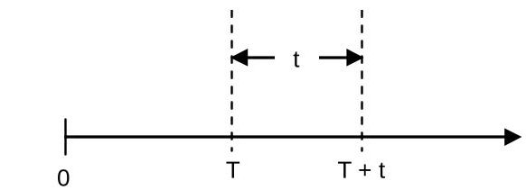

Fig. 7. Time domains for conditional reliability [15]

$ T_{F} $ is the random variable Time-to-Failure. By definit of the conditional probability and the reliability fiction, (Eq. 9) can be reduced to:

$$
R (t | T) = \frac {\Pr \left\{T _ {\mathrm {F}} > T + t \right\}}{\Pr \left\{T _ {\mathrm {F}} > T \right\}} = \frac {R (T + t)}{R (T)}
$$

The conditional reliability is particularly usefdr the study of a burn-in and its impact [16, 17]. In our case, make a related, although broader, use of conditional abilities to study the failure behavior of satellites in different categories. The conditional reliability is useful f comparing two different reliability curves. Indeed the conditional reliability "eliminates" or filters out the failure behavior of the system up to the time To illustrate the relevance of this observation for our study purpose consider the following two systems, the first one offering from significant infant mortality during the $ [0_{i} ] $ period, and the second one is not. In addition, the two sys have the same failure behavior during the $ [t_{2} ] $ period. The reliability curves of these two systems will be elent and hardly comparable. While the reliability curves widely indicate the difference in infant mortality behavior between the two systems, these curves will not identify similarity in failure behavior between the two systems during $ [t_{1}; $ $ t_{2} ] $ period. The difference between the curves is only to the failures during the initial $ [0_{i} ] $ period. Thus, by setting $ T=t_{1} $ , in Eq. 10, we can calculate the two conditional reliability curves over $ t_{1}; t_{2} ] $ , and the two resulting curves will be similar, due to the same failure behavior this period. By filtering out the failures during the initial period, the similarity of the failure behavior of the two systems during $ [t_{1}; t_{2} ] $ can thus be clearly identified. Hence, by carefully selecting the appropriate time(s) the conditional reliability helps us separate the impact of easily, and clearly determine periods of similar failure behavior if they exist.

We performed an extensive scan of different values and retained the instants that yielded the most meaningful relevant comparative analysis. For example, for Small and Large satellite categories, Fig. 6 showed their reliability behavior differed significantly at t=0.5 year (sudden increase in the absolute difference of reliability). Fig. 8a shows the absolute difference between the conditional reliabilities evaluated t=0.5 year for the Small and Large satellite categories. Fig. 8b shows that after filtering out infant mortality or fails up to the

<!-- PDF_PAGE: 10 -->

first 6 months on orbit, the Small and Large categories have a similar failure behavior or conditional reliabiliprofile until t = 8 years (with a small "bump' of less than 0.3 percentage points between year 4 and 8).

After t=8 years, the absolute difference in conditional reliability increases suddenly, suggesting the incidence of the failure behaviors of the two satellite categories. 8b shows the actual conditional reliabilities evaluate T=0.5 year for the Small and Large categories. The variability curves overlap significantly between t=0.5 and 8 years, confirming a similar failure behavior during this period. Att=8 years, the Large satellite category exhibits a much more severe decrease in reliability compared that of the Small category.

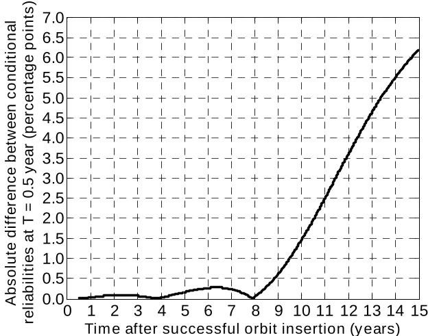

Fig. 8a. Absolute difference in conditional relativity evaluated aT = 0.5 year between the Small and Large categories

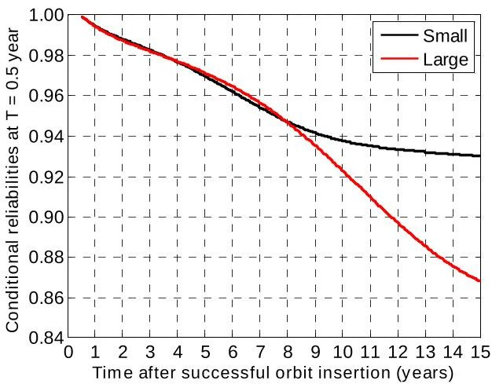

Fig. 8b. Conditional reliabilities evaluated at T=0.5 year for the Small and Large categories

In summary, the statistical analysis revealed periods of interest for the comparative reliability analysis Small and Large satellite categories. These periods landlure behaviors in each period are provided in Table 8.

Table 8. Summary of reliability profiles for the hand Large satellite categories

<table border="1"><tr><td colspan="2">Category</td><td colspan="2">Period</td></tr><tr><td></td><td>0 to 0.5 year</td><td>0.5 to 8 years</td><td>8 to 15 years</td></tr><tr><td>Small satellites</td><td>More pronounced infant mortality</td><td rowspan="2">Identical failure behavior</td><td></td></tr><tr><td>Large satellites</td><td></td><td>Distinct wear-out failures</td></tr></table>

Fig. 9a shows the absolute difference between the conditional probabilities evaluated at=1.5 year for the Small and Medium satellite categories. The figure shows that after filtering out infant mortality failures up to the first years and a half on orbit, the Small Medium satellite categories have a similar failure behavior conditional reliability profile up to =15 years (with a small "bump' of less than 0.5 percentage points around 5e.

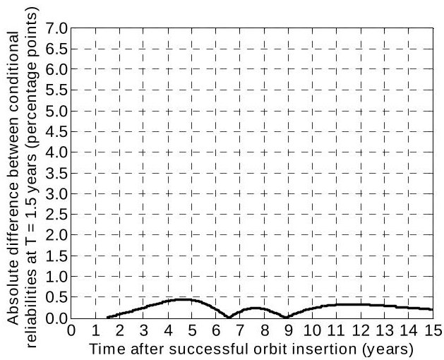

Fig. 9a. Absolute difference in conditional reliability evaluated aT = 1.5 years between the Small and Medium categories

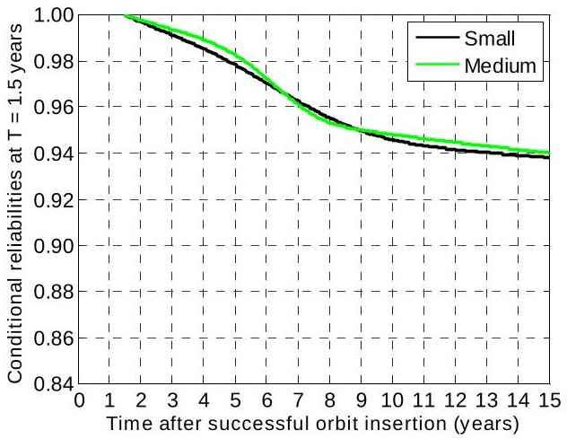

Fig. 9b. Conditional reliabilities evaluated at T=1.5 years for the Small and Medium categories

<!-- PDF_PAGE: 11 -->

Fig. 9b shows the actual conditional reliability. The two reliability curves overlap significantly between = 1.5 and t = 15 years, confirming a similar failure bea during this time period. Before = 1.5 years, Fig. 6 had shown that the early failure behavior was relaivel different, with a higher infant mortality for small satellites than for medium satellite.

The two periods of interest in the comparison of the reliability profiles for the Small and Medium categories are summarized in Table 9.

Table 9. Summary of reliability profiles for the hand Medium satellite categories

<table border="1"><tr><td>Category</td><td colspan="2">Period</td></tr><tr><td></td><td>0 to 1.5 year</td><td>1.5 to 15 years</td></tr><tr><td>Small satellites</td><td>More pronounced infant mortality</td><td rowspan="2">Identical failure behavior</td></tr><tr><td>Medium satellites</td><td></td></tr></table>

Finally, visual inspection of Fig. 6 and analysis the Medium - Large pair yield the following results: rda satellites experience a more pronounced infant than medium satellites up to 1.5 year, and they more severe wear-out than medium satellites between 8 and 15 years. Between 1.5 year and 8 years, the twelite categories exhibit identical failure behavior.

In this section, we identified statistical differences in the failure behaviors of the three satellite categories our approach was based on observations of on-orbit reliability. No causal analysis was attempted to ascertain the reasonsthose differences in failure behaviors exist. Such anlysis is significantly wide-ranging and would require a detailed monograph to be treated thoroughly. While such factors beyond the scope of this work, we do provide in the following section a set of hypotheses that may the causal factors for the statistical differences failure behavior of the three satellite categories.

## 6. HYPOTHESES FOR CAUSALITY ANALYSIS

Possible causes for the differences in failure identified in the previous section include factoated to the testing phase of the satellite prior to launch procurement and parts selections for the spacecraft to factors intrinsically related to the design types of the spacecraft) as discussed in the following.

## Testing

Small satellites do not benefit from the large budget allocated to larger missions. Resource restriction limit the extent of the testing that is performed on satellites. Indeed, the procedures, facilities and equipment (sas thermal-vacuum chambers) used to test a spacecraft remain the same regardless of the size of the space[6]. In the case of small missions, extensive testing tha hare to be forfeited in order to meet budgetary points. Testing techniques such as parts "burn-in" are we critical to "remove latent defects and early failures (if performed at appropriate stress levels and underpr environmental conditions [18]). The higher infanality exhibited by the smaller satellites may be due to differences in this final quality control gate tha testing, as a result of which potential early failures are sred, detected, and fixed for large satellites prior orch. By contrast, smaller satellites, we hypothesize, exhibit pronounced infant mortality because they may beestbo less stringent and extensive testing.

## Procurement and parts selection

Resource constraints, more acute for small satellites, have resulted in an increased adoption of Commercial Off-Shelf (COTS) parts in the design of satellites. M/KOTS parts must undergo a series of tests to become usable for operation in the space environment ("space-rated") frequent use may still represent a challenge in reliability. For example, "COTS manufacturers may implement a processing change resulting in a small performance impact in an Earth environment, burious impact under a space radiation environment" [19]. As result, the "burden of proof [is] on the user and the manufacturer", which once again may exceed the highest capabilities of, or resources allocated to a mission. Specifically, the radiation response of COTS devices can be "difficult to characterize due to large [variably] within a lot and the difficulty of testing imposed by package and hybridization" [20].

We hypothesize that the differences in reliability failure behavior on-orbit between small and large satellite especially with regards to infant mortality, may be in part to a compounded problem of more reliance on TSO for the small satellites, and less testing and modifications of these parts to make them suitable for space invient. This hypothesis might address in part why satellite the small satellite category exhibit the lowest reliabof the three satellite categories during the first 9 years Fig. 2.

## Factors intrinsically related to the design

The mass and geometric limitations (volume and rothe dimensions) imposed on small spacecraft can transito several potential causes of failure behavior. Example:

<!-- PDF_PAGE: 12 -->

- Small spacecraft, for which weight represents a parameter, cannot afford to have as much redundancy as larger spacecraft. They are therefore often base "single-string" designs, which can turn a simple anomaly into a complete loss of the spacecraft.

- The design of small spacecraft relies on a greater package density, which can expose certain parts(su as plastic-encapsulated microcircuits or PEM) other temperatures, resulting in an increased risk dfufai [6].

- "By its nature, a small spacecraft offers less ratio shielding" than large spacecraft [6], and is theref more exposed to the effects of cumulative radiation example, a form of radiation damage called displacement damage dose (DDD) "degrades the performance of solar cells, detectors, opto-coupled optical lenses. It is more difficult to harden again DDD, therefore, the use of shielding [...] is used to mitigate its effects" [20]. As a result, small states that do not benefit from sufficient shielding may be more subject to radiation-induced failures thanular spacecraft.

## Factors that can potentially affect the failure of large satellites include the following:

- Scaling up subsystems that are usually designed to operate within small/medium host spacecraft poses several challenges. Typically, larger and heavier spacecraft experience higher structural and electrical loads than smaller satellites. Power systems may generate excessive heat that accelerates the physic degradation of parts over time. This phenomenon may contribute to the increased wear out experienced by large satellites after 8 years, as seen in Fig. 2.

- The complexity of large satellites may also influen the infant mortality observed in this category of spacecraft. Large spacecraft with multiple instrut and subsystems require intensive wiring and an increased number of interfaces, adding potential points. As the number of connections between subsystems increases, the integration process becomes more delicate. This in turn may increase the likelid of human errors, which can translate into a higher number of failures observed during the early life of large satellites.

and Large categories) in terms of reliability. More importantly, they may simply correspond to the large size for which parts, equipment, and design prestiare currently the most mature and appropriate.

Finally, we noted based on Fig. 2 that satellites in the Medium category exhibited the highest reliability of the three satellite categories, with the lowest mortality and a moderate wear-out behavior. These medium-size satellites may not incur the penalties of small satellites discussed previously (budget restrictions, partcision, residual fragility) and they are less likely to subject to the challenges of larger satellites. In other wordsdimen-sized satellites may benefit from "the best of both world Small

## 7. CONCLUSION

Reliability has long been recognized as a critical for space systems, and potential causes of on-failures are carefully sought for identification and elimination through various types of testing prior to launch. Several parameters or characteristics of the design, submission type, orbit, or spacecraft complexity, can potently affect the probability of failure of satellites. In this paper, we explored the correlation between satellite mass, sidereal here as a proxy for size, and satellite reliability we investigated whether different classes of satellites defined in terms of mass, exhibit different reliability profi To do so, we performed a statistical analysis on a sample 1,444 Earth-orbiting satellites successfully launched between January 1990 and October 2008, by defining three categories of satellites according to their mass (0- 500 kg), Medium (500-2,500 kg), and Large (>2,500 k

From the failure data, we first derived nonparametric reliability curves for each satellite mass category. We then conducted a parametric analysis by fitting the parametric results with Weibull distributions. Two-Weibull more distributions proved good candidates to accurately present the nonparametric curves of reliability for each satellite category. From the parametric results, we conducted detailed comparative analysis of the failure rate failure behavior on orbit of the three satellite mass categories. Our results show that small satellites experience the highest infant mortality of all three satellite mass categories. Past one year and a half, we found that small and medium satellites exhibit a very similar (conditional) inability behavior. Our results also identified distinct wear failure only for the large satellite category (after roughly years on orbit).

Finally, we concluded this work by formulating at hypotheses that may address the causal factors for statistical differences in the failure behavior the three satellite categories. The possible causes for theseences were categorized and discussed under three headings differences in testing phase of the satellite launch; 2) differences in to procurement and parts selestiand 3) differences intrinsically related to the design size of the spacecraft), such as increased structural loads in larger satellites which may contribute wear-out failures.

We hope this work provides helpful feedback to space industry for better understanding on orbit fail behavior of satellites, and ultimately for redesigning satellite and

<!-- PDF_PAGE: 13 -->

screening programs, parts selection and redundancy allocation.

## APPENDIX: CONFIDENCE INTERVAL ANALYSIS

The Kaplan-Meier estimator (Eq.1) provides a maximum likelihood estimate of reliability but does not inform us about the dispersion around $ \hat{R} (t_{i}) $ . This dispersion is captured by the variance or standard deviation of the estimator, which is then used to derive the upper bounds for say a 95% confidence interval (that is 95% likelihood that the actual reliability will fall between the two calculated bounds, with the Kaplan-Meier analysis providing us with the most likely estimate). Theace of the estimator is provided by Greenwood's formula. (E):

$$
\operatorname {v a r} \left[ R \left(t _ {i}\right) \right] \equiv \sigma^ {2} \left(t _ {i}\right) = \left[ \hat {R} \left(t _ {i}\right) \right] ^ {2} \square \sum_ {j \leq i} \frac {m _ {j}}{n _ {j} \left(n _ {j} - m _ {j}\right)}
$$

And the 95% confidence interval is determined by:

$$
R _ {95 \%} \left(t _ {i}\right) = \hat {R} \left(t _ {i}\right) \pm 1. 9 6 \square \sigma \left(t _ {i}\right)
$$

More details about these equations can be found in 22, 23].

When Eqs. (11) and (12) are applied to the data each category along with the Kaplan-Meier estimated state reliability $ \hat{R} (t_{i}) $ shown in Fig. 2, we obtain the 95% confidence interval curves. These results for each category of satellites are shown in Fig. 10.

Fig. 10 shows for example that the reliability of all satellites four years after orbit insertion will between 92.7% and 97.2% with a 95% likelihood (confidence interval). In addition, the most likely reliability estimate is at t = 4 years for the small satellites is the Kaplan result $ \hat{R} ( t=4 \mathrm{years} )=95.0\% $ . Notice that the dispersion of $ R ( t_{i} ) $ around $ \hat{R} ( t_{i} ) $ increases with time. This increase in dispersion can be seen in Fig. 10 by the growing ga between the Kaplan-Meier estimated reliability and confidence interval curves. This phenomenon illstrates the increasing uncertainty or loss of accuracy of statistical analysis of satellite reliability with time resulting from the decreasing sample size (see discussion in Section 1 regarding the limitation of data specialization satellite reliability analysis).

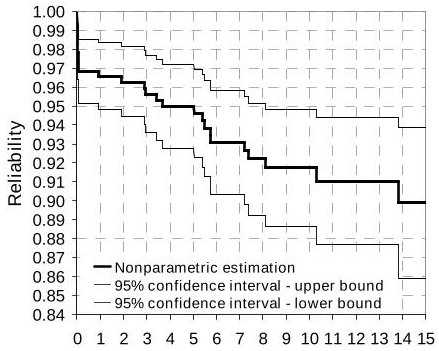

Small category

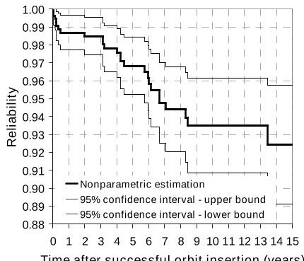

Medium category

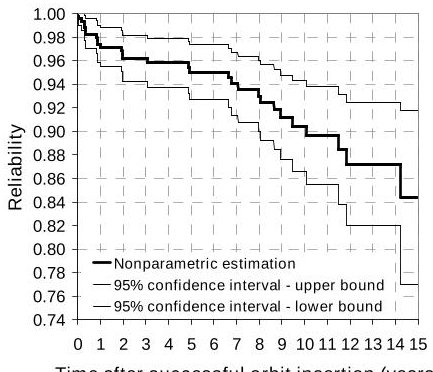

Large category

Fig. 10. Satellite reliability with 95% confidence intervals for each mass category

<!-- PDF_PAGE: 14 -->

## REFERENCES

[1] J-F. Castet, J.H. Saleh, Satellite reliabilistatistical data analysis and modeling, Journal of Spacecraft and Rockets, Vol. 46, No. 5, Sept-Oct. 2009.

[2] H. Hecht, Reliability for Space Mission Plang in: J.R. Wertz, W.J. Larson, Space Mission Analysis and Design, 3 ed., Microcosm Press, Hawthorne, CA, and Springer, New York, NY, 1999, pp. 777- 778.

[3] M. Williamson, Spacecraft Technology: The Earl Years, Institute of Electrical Engineers, Herts, United Kingdom, 2006, p. 306.

[4] D.A. Bearden, A complexity-based risk assessme of low-cost planetary missions: when is a mission too fast and too cheap?, Acta Astronautica 52 (2003 371-379.

[5] R. Fleeter, Design of Low-Cost Spacecraft Jnr. Wertz, W.J. Larson, Space Mission Analysis and Design, $ ^{3} $ ed., Microcosm Press, Hawthorne, CA, and Springer, New York, NY, 1999, pp. 853-863.

[6] L.P. Sarsfield, The Cosmos on a Shoestring Spacecraft for Space and Earth Science, RAND Santa Monica, CA, 1998.

[7] Technology for Small Spacecraft, Panel on $mal Spacecraft Technology, National Research Council National Academy Press, Washington D.C., 1994.

[8] ANSI/AIAA Guide for Estimating and Budgeting Weight and Power Contingencies for Spacecraft Systems G-020-1992.

[9] E.L. Kaplan, P. Meier, Nonparametric Estimation from Incomplete Observations, Journal of the American Statistical Association 53(282) (1958) 457-481.

[10] J-F. Castet, J.H. Saleh, Satellite and satellite subsystems reliability: statistical data analysis a modeling, Reliability Engineering and System Safety, Vol. 94, No. 11, pp. 1718-1728, Nov. 2009.

[11] J-F. Castet, J.H. Saleh, Weibull Modeling for Nonparametric Satellite Reliability: Graphical Versus Maximum Likelihood Estimations submitted to Journal of Spacecraft and Rockets April 2009.

[12] J.F. Lawless, Statistical models and methods lifetime data, $ 2^{d} $ ed., John Wiley & Sons, New York, 2003.

[13] J-F. Castet, J.H. Saleh, Single versus mixture Weibull distributions for nonparametric satellite reliability, submitted to Reliability Engineering System Safety, May 2009.

[14] C.E. Ebeling, An Introduction to Reliability and Maintainability Engineering, McGraw-Hill, New York, 1996.

[15] D. Kececioglu, Reliability Engineering Handbook $ 1^{\mathrm{st}} $ ed., Prentice-Hall, Englewood Cliffs, NJ, 1991.

[16] L.M. Leemis, and M. Beneke, Burn-In Models and Methods: A Review, IIE Transactions (22) (1990), pp. 172-180.

[17] H.W. Block, and T.H. Savits, Burn-In, Statistical Science, 12(1), (1997), p. 1.

[18] T.E. Gindorf, R.F. Miles Jr., G.B. Murphy, Hardware design for long life with high reliability Proceedings of the Annual Reliability and Maintainability Symposium, 1994, pp. 338-341.

[20] J.L. Barth, Prevention of Spacecraft Anomalie The Role of Space Climate and Space Weather models, in: I.A. Daglis, Effects of Space Weather or Technology Infrastructure, Springer Netherlands, 2005, pp. 125-128.

[19] S. Kayali, Utilization of COTS electronics space application, reliability challenges and reality, Commercialization of Military and Space Electronics Conference & Exhibition, Los Angeles, CA, 12-13 Feb. 2002.

[21] J.I. Ansell, M.J. Phillips, Practical methods reliability data analysis, Clarendon Press, Oxford, NY, 1994.

[22] W.O. Meeker, L.A. Escobar, Statistical method reliability data, John Wiley & Sons, New York, NY, 1998.

[23] M. Rausand, A. Høyland, System reliability models, statistical methods, and applications, 2 ed., Wiley-Interscience, Hoboken, NJ, 2004.