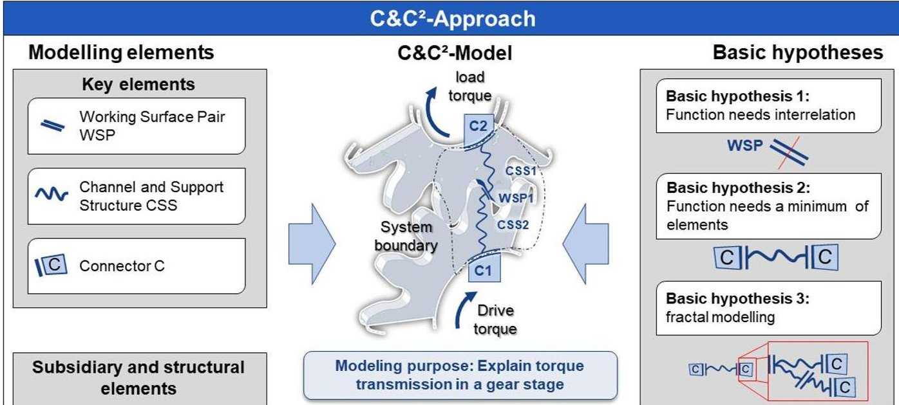
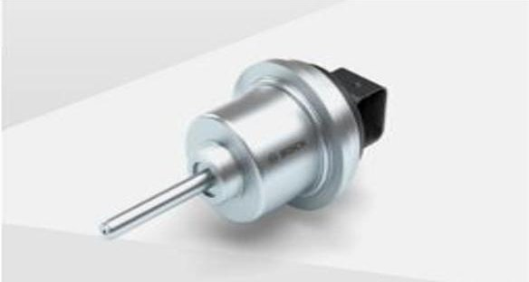
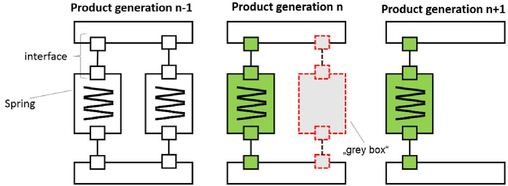
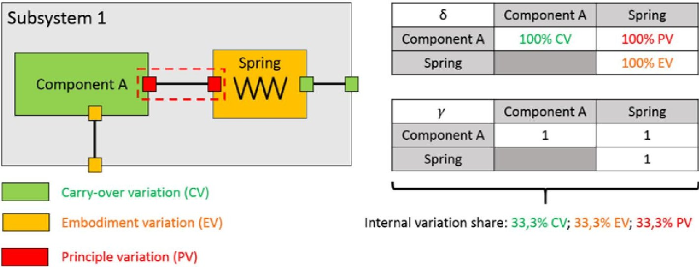
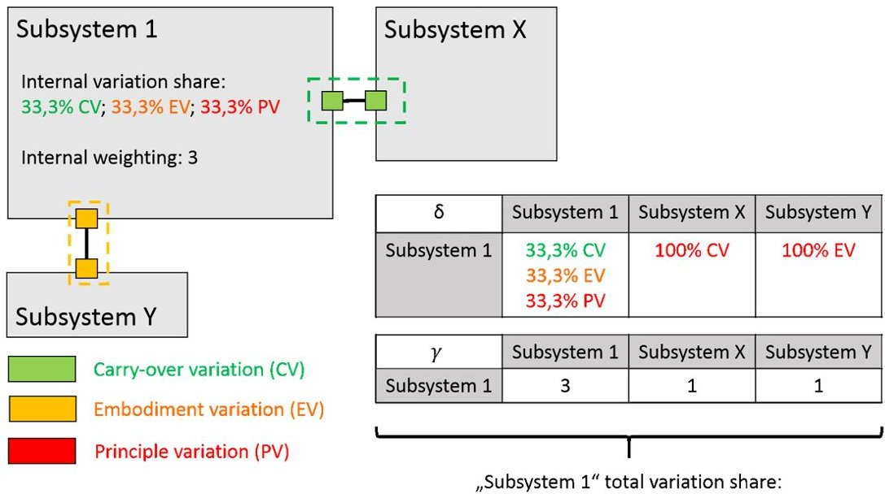
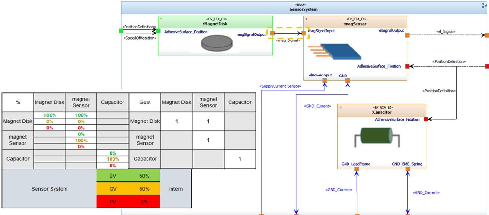
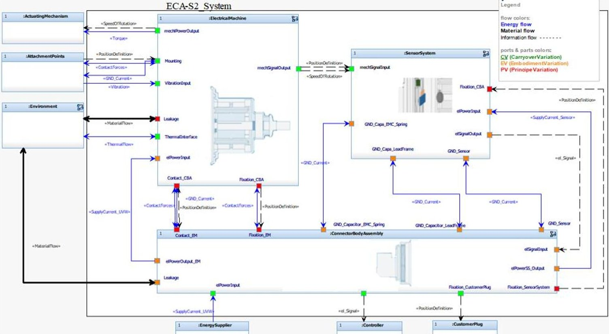

<!-- PDF_PAGE: 1 -->

# SUPPORTING THE MODELLING IN MBSE BY APPLYING PRODUCT GENERATION ENGINEERING USING ELECTRONIC COMPACT ACTUATORS AS AN EXAMPLE

M. Wäschle $ ^{1,\textcircled{x}} $ , A. Martin $ ^{1} $ , A. Radimersky $ ^{2} $ , M. Behrendt $ ^{1} $ and A. Albers $ ^{1} $

$ ^{1} $ Karlsruhe Institute of Technology, Germany, $ ^{2} $ Robert Bosch GmbH, Germany moritz.waeschle@kit.edu

## Abstract

The development of a new motor can be a high effort. In this paper, Model-based Systems Engineering (MBSE) is applied to model the second generation of an electronic compact actuator (ECA). This paper focuses on the traceability between model elements from previous product generations. By integrating the approach of the PGE - Product Generation Engineering in MBSE, developers can store more relevant information in the model; they can accomplish automatic calculations of derived factors and build models more efficiently in further product developments.

Keywords: systems engineering (SE), model-based engineering, product generation engineering (PGE), traceability

## 1. Introduction

Even if the components of a newly developed system are working well, this might not apply to the system as a whole. To handle system complexity, like a national telephone network, the company Bell Telephone Laboratories used the term "systems engineering". (Schlager, 1956; Hall, 1962; Fagen, 1978) With this approach, engineers can develop interdisciplinary systems. Model-based systems engineering (MBSE) focuses on models to handle interdisciplinary complexity over the entire product development process and further lifecycle phases (International Council on Systems Engineering, 2007). Different stakeholders take part in the product development and need to be addressed in system models. Potential benefits are impactor risk analysis, modelling of interfaces and dynamic behaviour and linking components to requirements and tests. A disadvantage is the initial effort to create the model. In this paper, an approach is presented to include PGE - Product Generation Engineering in MBSE

In this paper, an approach is presented to include PGE - Product Generation Engineering in MBSE. MBSE uses the three pillars language, method and tool. We use the language Systems Modeling Language (SysML) in the tool Rational Rhapsody by IBM and methods based on SYSMOD and SPES.

## 1.1. C&C $ ^{2} $ -Approach

For Stachowiak, the advantage of modelling is the pragmatic reduction of complex facts to make them more usable (Stachowiak, 1973). The C&C $ ^{2} $ -Approach helps to visualize functional and effect relationships on different levels. It has its origin in the embodiment of analysis and synthesis (Albers and Matthiesen, 2002). Considering the visualization and formal description, it is suitable for MBSE. The C&C $ ^{2} $ -Approach uses three key elements to describe functionalities (see Figure 1). It contains

<!-- PDF_PAGE: 2 -->

working surfaces (WS), channels & support structures (CSS) and connectors (C) (Albers and Matthiesen, 2002; Albers and Wintergerst, 2014). WS are surfaces of bodies or boundary surfaces of liquids, gases or fields. They are in continuous or occasional contact to other WS to form a working surface pair (WSP) and can exchange energy, material and information (Albers and Wintergerst, 2014). Channels and support structures can connect the WS and transport matter, energy and information. Wiedner describes CSS as volumes of solid bodies, liquids, gases or fields (Wiedner, 2013). Connectors integrate relevant properties for the function, which are located outside the design area (Albers and Wintergerst, 2014). "A wirk-net is the sum of the WSP, C and CSS for executing a function in a specific operating state. (Albers and Wintergerst, 2014)". The approach is based on three hypothesis (Albers and Matthiesen, 2002):

1. Every basic element of a technical system has its function only in contact with another basic element.

2. The function of a technical (sub-) system is realised by two WSP, which are connected by a CSS.

3. Every system, which fulfils a function, contains the basic elements WS and CSS in any shape, number and order.

A working surface can be a component surface like a front surface of a gear wheel. At the front surface, the wheels are in contact and transmit energy. Therefore, the wheel transmits torque to another wheel. Figure 1 shows a rendered CAD cross section. The CSS is the gear wheel itself, which conducts the energy flow. The connectors are the plain bearings of the wheels. From the basic elements, the parameters relevant for the function are identified, as for example the length of the shaft.

Figure 1. Components of the C&C $ ^{2} $ -Approach and their usage to create a C&C $ ^{2} $ -Model (Matthiesen et al., 2018)

## 1.2. PGE - Product Generation Engineering

According to classical construction methods, the design can be separated in corrective and generative procedures (Ehrlenspiel, 2009). Pahl et al. (2007) extend the design by the classification of new, adaption and variation construction (Pahl et al., 2007). According to Albers, a product is always based on reference products (Albers et al., 2015). Reference products are part of a reference system, which is a system with elements of already existing or planned socio-technical systems (Albers et al., 2019). It is the basis and the starting point for the development of a new product generation (Albers et al., 2019). This can be achieved through variations of principles (PV), embodiment (EV) and carry-over variations (CV) (Albers et al., 2015). Reference system elements can be among other things a mindset, predecessor products or a competitor's product (Albers et al., 2015). For example a bulb, where the E27 plinth does not change from the current generation in development n to the next generation n+1. The parameters of the glass of the bulb changed to enhance the light effect, which would be an

<!-- PDF_PAGE: 3 -->

embodiment variation. The principle of how to transform electrical energy in light changed for example from Thomas Edison's patent by using carbon filament to tungsten, which has different chemical characteristics. These result in a description model called Product Generation Engineering to calculate new products according to different variation shares of reference products.

A principle variation results in a change of the numbers of WSP and CSS. In a study conducted by Albers et al., the use of PV resulted in a highly challenging development process. In contrast, the principle solutions stay the same for EV, which is a variation of parameters, but the existing WSP and CSS are not deleted or supplemented. For CV, no changes in WSP and CSS are made besides changes to the connectors as the boundaries of the system in focus. (Albers et al., 2017)

## 1.3. Methodical approach

The SysML model of the actuator is based on the modeling methods SYSMOD and SPES. SYSMOD is a tool-independent method to model the requirements and the functional and physical architecture of complex systems using SysML (Weilkiens and Soley, 2014). SPES was developed by 21 partners from industry and research with the goal to professionalize software development for embedded systems across industries by an integrating and powerful method (Pohl et al., 2012). Hereby, the analysis and architecture processes are based on SYSMOD. The structure of the model is based on the SPES method, by using different model views with different levels of abstraction. Like the SPES method, the model is constructed from different model parts allowing different views of the model and different levels of abstraction. When modelling the system, the first step is to create the context diagram and the basic architecture from the stakeholder requirements.

Both describe the basic system environment as well as the system architecture specified at the beginning. Similar to the SYSMOD modeling process, the use cases can be derived. The analysis of the resulting Conceptual Model can be used to formulate requirements for the system. During this process, the initial business requirements are transformed into technical requirements. These provide a certain solution principle. A functional architecture is then built using the use cases and system requirements. With the Logical Model, subsystems and interfaces are defined. Further requirements are formulated in the requirements model through a subsequent analysis. This cycle continues and the system is further modelled on different abstraction levels. A new requirement leads to an expansion of the system architecture that fulfils the requirement. New requirements can be derived from the analysis of the architecture, which in turn produce new architectural elements. (Weilkiens and Soley, 2014)

## 1.4. Electronic Compact Actuators

The Electronic Compact Actuators (ECA) of Robert Bosch GmbH's are electronically commutated (EC) motors and used as mechatronic actuators for powertrain and chassis applications. The ECA product family consists of three types (ECA-M, -E & -S), which differ mainly in the functional scope of the integrated electronics. The ECA-S2 is operated by a higher-level control unit and sends the current shaft position to this control unit. Therefore, a precise position sensor is integrated in ECA-S2. Potential applications for the ECA-S2 are e.g. gear-select-functions or clutch actuation in transmissions. For the methodical approach presented in this paper, the ECA-S2 is divided in following subsystems: Electrical Machine (elements needed to convert electrical into mechanical power), Sensor System (elements needed to detect and communicate shaft position) and Connector Body Assembly (elements needed to connect Electrical Machine and Sensor System with higher-level control unit. (Robert Bosch GmbH, 2019)

Figure 2. ECA-Type S with position sensor (Robert Bosch GmbH, 2019)

<!-- PDF_PAGE: 4 -->

## 1.5. Further research

Further research focuses on how information in MBSE should be presented to create measurable values to reduce the effects of complexity implications. (Muller et al., 2017). A first idea of how to model the C&C $ ^{2} $ - Approach in MBSE can be found in (Zingel et al., 2012).

They focus on function systems modeling by using activity diagrams to transport material, energy and information (Zingel et al., 2012). These functions are assigned to components (Zingel et al., 2012). Albers et al. focus on the support of PGE in calculations of the effort of variations to develop a new product for a camshaft. First, the FIT-condition identifies valid variants. The NEAREST-FIT-parameter shows how much invalid variants need to change to satisfy the FIT-condition. (Albers et al., 2016) So far, research has treated variants, function modeling and effort. Our aim is it to present a holistic approach for modeling mechatronic systems with the focus on product generation engineering.

## 2. Main part

The goal is to contribute to the support of MBSE by using the PGE-Approach. The research questions this paper aims to provide answers to:

1. How can a type of variation based on the PGE-Approach characterize (sub-) systems in a SysML model?

2. How can different variation shares of a (sub-) system be deduced from the SysML model?

First, we focus on modeling the ECA-S2 in SysML in order to answer research question one. We are using the C&C $ ^{2} $ -Approach for the interconnection of system elements. Finally, we describe the calculation of variation shares for the ECA-S2 system.

## 2.1. Modeling in SysML

This approach focuses on interfaces between system elements. Considering the fractal character of an element, this element consists of subsystem elements and connection to one another. Therefore, it is possible to describe every system element with interfaces and basic elements in subsystem levels. These basic elements are not worth modeling in more detail, because no additional information can be gained. In the C&C $ ^{2} $ -Approach, interfaces are working surface pairs between two elements and result in a specific effect. In SysML, connections and ports can realise interfaces. "Ports are points at which external entities can connect to and interact with a block in different or more limited ways than connecting directly to the block itself. They are properties with a type that specifies features available to the external entities via connectors to the ports. (Object Management Group) " We are using the Internal Block Definition Diagram (IBD) in SysML to model the interconnections of (sub) systems. In the ECA-S2 model, interfaces are visualized by proxy ports in an IBD. Proxy ports, which represent interfaces in the structural architecture, are assigned to respective interface as a type. These interfaces are previously created as interface blocks in the System Interface Model. A proxy port takes over the behaviour and properties of its owning system module (Weilkiens and Soley, 2014). In contrast, a full port is characterized by its own behaviour and properties (Weilkiens and Soley, 2014). WS and proxy ports are comparable in that regard that they both symbolize the border of the system. For this reason, we decided to use proxy ports for our modeling.

The advantage of SysML is the possibility to customize the views depending on the stakeholder or topic. With the focus on PGE, the ports and the elementary blocks are coloured according to the three different variation types. The colours seeing highlights critical interfaces and WSP respectively to the developer.

## 2.2. Top-down approach

Each system can be divided into subsystems and the division can be continued until the desired model granularity is achieved. This is the case when further decomposition would no longer lead to a gain in knowledge or would entail a disproportionate modelling effort. The developer can characterize the remaining "residual subsystem" as an elementary block, as a carry-over, an embodiment- or a principle variation.

<!-- PDF_PAGE: 5 -->

A (sub) system in one level is a CSS. If you increase the granularity by one level, the (sub) system again has connections/WSP and CSS. Therefore, the level of the model shows this levels' specific elements. MBSE's various diagrams providing different views of the model levels. One example would be a polycrystalline metal, which transmits electrical energy and forces. If you look deeper inside, the material grain boundaries are there. Each grain boundary is a WSP to transmit this energy. With the functional architecture, functional assemblies can be characterized by the PGE-Approach, as well. In the C&C $ ^{2} $ -Approach, developers can model formalized functions by WSP and CSS. Therefore, the shown approach is extendable for modeling, connection and characterize functions according to PGE. The idea of different variation shares in systems is extendable to functions. By using swim lanes in the tool Rhapsody, it is possible to link different functions together. System components, which are responsible for the function, can be linked to this function. Depending on the desired granularity, high-level functions are linked to high-level components. Consequently, each layer defines the system components for specific granularity functions.

## 2.3. Application of the C&C $ ^{2} $ -Approach

By analysing the system with the C $ C^{2} $ -Apporach, new effects and therefore principle variation results from new working surfaces and/or omitting WSP. If the geometry or parameters change, the channels & support structures can change or the WSP. No change in an element results in a carry-over variation. (Albers et al., 2017) Therefore, by analysing a reference system element the differences in the wirk-net show the variation shares for the product generation in focus. For instance, by using the previous generation (n-1) of an ECA- motor as the reference system element, the connections/ports show the variation shares of the generation currently under development (n). In the future, an algorithm could precalculate these variation shares of new generations automatically depending on the connections.

A special consideration is necessary, if a WSP is omitted in a new generation, this results in a PV. In order to notice these omitted elements, we propose a "grey box" in generation n to notice the change of the generation n-1 reference system element (Figure 3). For example, the subsystem spring is using in the new generation n one spring instead of two. The second spring is omitted. Therefore, a "grey box" is necessary in generation n to show the PV. This box is not taken into account in following generations.

Figure 3. "Grey box" for the characterization of omitting elements

## 2.4. Approach for characterization and calculation of variation shares

For the characterization of a variation and for the calculation of the variation share calculation, a distinction is made between an internal and an external part of a system. The internal and external parts always refer to the current system and thereby to the system boundaries. The external part covers all interfaces of a subsystem to adjacent subsystems within the parent system, while the internal part covers all interfaces within the subsystem.

The external part covers all interfaces of a subsystem to adjacent subsystems within the parent system, while the internal part covers all interfaces within the subsystem.

<!-- PDF_PAGE: 6 -->

The following example of "System Subsystem 1" is used to present the approach for characterization and variation share calculation. The internal part consists of the elementary blocks "Component A" and "Spring" as well as the red dashed interface between the two elementary blocks. All other interfaces are external interfaces and will not be considered for the moment. The characterization is done by assigning a stereotype and the associated colour, see legend in Figure 4.

Figure 4. SysML modeling and PGE calculation

Variation shares of subsystems are calculated starting at the lowest model level, followed by the variation shares for superordinate subsystems until the calculation for the system is completed. The calculation of the variation shares for the internal part is based on the formula shown below. Two matrices are used to visualize the calculation. The first matrix shows the variation shares. On the main diagonal, we list the internal variation shares of the respective subsystem. In the example from Figure 4, $ \delta_{-} $ (Component A) = 100% carry-over variation (CV) is assigned to ,Component A" and $ \delta_{-} $ Spring=100% embodiment variation (EV) is assigned to "spring". The cell, which is the interface between the two components, receives $ \delta_{-} $ IF=100% principle variation (PV). The second matrix assigns a weight variable to each elementary block and the internal interfaces. This allows the weighting of the variation share for the respective subsystem. With this weighting, we assign a factor to a subsystem based on the number of its elementary blocks and the number of its internal interfaces. The calculation of the variation share is carried out according to the Equation (1). XV is a placeholder for either CV, EV or PV.

$$
\delta_ {X V, S y s _ {i n t}} = \frac {\sum_ {i = 1} ^ {n} \left(\delta_ {X V , T S _ {i n t} , i} \cdot \gamma_ {X V , i}\right) + \sum_ {j = 1} ^ {m} \left(\delta_ {X V , S y s _ {I F i n t} , j} \cdot \gamma_ {X V , j}\right)}{\sum_ {i = 1} ^ {n} \left(\gamma_ {P V , i} + \gamma_ {C V , i} + \gamma_ {E V , i}\right) + \sum_ {j = 1} ^ {m} \left(\gamma_ {P V , j} + \gamma_ {C V , j} + \gamma_ {E V , j}\right)}
$$

i $ \in $ $ \mathbb{N} $ , running variable; n $ \in $ $ \mathbb{N} $ , # of internal systems; m $ \in $ $ \mathbb{N} $ , # of internal interfaces;

Sys int internal system

Sys $ _{IF,int} $ , internal system interfaces

$ \gamma \in \mathbb{N}\backslash\{0\} $ , weighing variable

$ \delta \in \mathbb{R} \mid 0 \% \leq \delta \leq 100 \% $ , share of variation

XV $ \in \{ $ CV, EV, PV}, variation {carry-over parts, embodiment variation, principle variation}

After determining the internal variation share of "Subsystem 1", we calculate the variation share of the entire "Subsystem 1" by also considering the interfaces to neighbouring systems. In the first line of both matrices from Figure 4, we transfer the internal values for the internal variation parts and the weight variable of "Subsystem 1", which we have already determined in the previous calculation. The internal weighting is the sum of all weight variables of subsystems internal parts. In order to calculate the variation shares of the entire ,Subsystem 1", we use the formula (2) and get 40% CV, 40% EV and 20% PV as the result, see Figure 4.

$$
\delta_ {X V, S y s _ {g e s}} = \frac {\delta_ {X V , S y s _ {i n t}} \cdot \gamma_ {i n t} + \sum_ {i = 1} ^ {n} \left(\delta_ {X V , S y s _ {I F e x t} , i} \cdot \gamma_ {X V , i}\right)}{\gamma_ {i n t} + \sum_ {i = 1} ^ {n} \gamma_ {X V , i}}
$$

<!-- PDF_PAGE: 7 -->

Figure 5. Calculation of variation share of total "Subsystem 1"

In the following, we will demonstrate a calculation of the variation shares using the example of the sensor system and the entire ECA-S2 system. The sensor system contains the following components, which are not divided into further subsystems and thus represent elementary blocks. The magnetic disk is a complete carry over from the previous generation and without changes. A new magnetic sensor with the same functional principle but higher resolution replaces the sensor. This leads to an embodiment variation. The additional capacitor is also of the same type as the previous generation with an adapted capacitance. There is also an embodiment variation. The only internal interface between magnet disk and magnet sensor, which defines the distance between these two components, has been adapted in comparison to the previous generation. Therefore, it is an embodiment variation. All elementary blocks and the interface are weighted with one and the variation shares are calculated according to formula (1).

Figure 6. Calculation matrix

The higher-level system ECA-S2 is then examined. The internal variation shares and the weightings of the subsystems Electrical Machine, Connector Body Assembly and Sensor System have already been calculated and are inserted into the matrix as internal values on the main diagonal. In the next step, we focus on the interfaces between these subsystems and external systems and characterize them according to the C&C $ ^{2} $ -Approach. The interface between the sensor system and Connector Body Assembly, which is responsible for positioning and fixing the sensor system, is presented as an example. For the first time an adhesive bond is used, whereby WSP change and a principle variation can be derived. The calculation of the variation shares for the entire system ECA-S2 is based on the formula (2).

<!-- PDF_PAGE: 8 -->

Figure 7. Highest level of the ECA-S2 System

The final calculation of the variation shares for the system ECA-S2 shows that in this system the newly developed share is 63% and the carry-over share 37%. These values are particularly interesting in comparison with the variation shares of other development projects and can support the assessment of the risks of a development project.

## 3. Initial assessments

The presented approaches for characterization and variation share calculation will be evaluated during a PGE research discussion at the Institute of Product Engineering (IPEK) at the Karlsruhe Institute of Technology supported by expert interviews at Robert Bosch GmbH. Six scientific staff members attend the research discussion. The approach presented is assessed positively, with two aspects with potential for improvement. One of the points concerns the way interfaces are modelled. The approach does not clearly show whether an elementary block with two further interfaces could be used for the modeling of an interface and thus change the calculation of the variation percentage. A guideline is necessary in order to model interfaces uniformly and thus to be able to calculate comparable variation proportion calculations. The definition of a guideline is part of future research. Moreover, the removal of components or interfaces cannot be registered in the model. This means that possible principle variations are not considered. The "grey box" approach suggests a possible solution to this problem (see section 2.3). Further comments consider the modeling of state transitions in specific systems and that features like the length of a shaft must be broken down to one subsystem, which changes its features.

In the expert interviews at Robert Bosch GmbH, system engineers, group leaders, designers and bachelor students, took part. From the interviews, it turns out that most of the participants see it as useful to characterize subsystems according to the PGE-Approach in the system architecture and to recognize critical points in the system. A potential for this approach exists according to the evaluation.

## 4. Summary and outlook

## 4.1. Summary

By applying the C&C $ ^{2} $ -Approach and considering connection with ports, this paper answers the question of how types of variations can be represented in SysML. We also showed how a characterization and the calculation of variation shares could be used in SysML. Furthermore, the approach shows how to include the idea of PGE in MBSE. This results in more information for the

<!-- PDF_PAGE: 9 -->

development of by developing a new product generation. The variation share of the new elements and the considered reference system elements become visible to the developer.

The approach is based on the methods SPES and SYSMOD. SPES describes the usage of different model views with different levels of abstraction. We are using the analysis and architecture processes of SYSMOD.

An initial assessment of the approach was conducted at a company and a research institution. It shows the potential of this approach and some comments e.g. the elimination of an elementary subsystem and the calculation and weighting of variation shares should be part of future research.

## 4.2. Outlook

In order to decide how deep to model systems, developers need to define guidelines and provide basic elements. One main advantage of using combining MBSE and PGE together is the possibility to use different reference system elements in MBSE. With links, the developer can connect the reference system to the system in focus. An approach to distinguish between different references systems elements especially if the many system elements refer to the next generation must be developed in future work.

Finally, the aim of calculating the risk of developing of a (sub-) system must be analysed by defining weighing factors and key performance indicators. Reference systems can be modelled in MBSE according to construction kit approach in a separate folder. In this folder, the reference system is linked to the referenced (sub-) system. A specific ID in the reference system element shows the link to the port, which shows the variation share referenced to this element. As a result, changes in the reference system elements can result in immediate changes in the ports.

Moreover, the influence of the PGE-Approach on the selection of solution variants within a SysML model could be investigated by the assessment of the technical development risk based on the proportions of variation in comparison to the original reference system.

The integration of mechanical and electrical domain are modelled, the software domain is not achieved in this example, because the motor does not have a control unit. Consequently, the software domain should be considered in future research.

This approach consists of a retrospective analysis of a system, which has already been developed. Future work should focus on the system analysis during the development of a new product generation.

## References

Albers, A., Bursac, N. and Rapp, S. (2017), "PGE - Produktgenerationsentwicklung am Beispiel des Zweimassenschwungrads", Forschung im Ingenieurwesen, Vol. 81 No. 1, pp. 13-31.

Albers, A., Bursac, N. and Wintergerst, E. (2015), "Produktgenerationsentwicklung - Bedeutung und Herausforderungen aus einer entwicklungsmethodischen Perspektive".

Albers, A. and Matthiesen, S. (2002), "Konstruktionsmethodisches Grundmodell zum Zusammenhang von Funktion und Gestalt technischer Systeme. Konstruktion", In Konstruktion Zeitschrift für Produktentwicklung, 7-8/2002, pp. 55-60.

Albers, A. et al. (2019), Das Referenzsystem im Modell der PGE - Produktgenerationsentwicklung: Vorschlag einer generalisierten Beschreibung von Referenzprodukten und ihrer Wechselbeziehungen.

Albers, A., Walch, M., Bursac, N. and IPEK - Institut für Produktentwicklung am Karlsruher Institut für Technologie (KIT) (2016), "Entscheidungsunterstützung durch die Variationsanteile der Produktgeneration sentwicklung", Konstruktion, No. 4.

Albers, A. and Wintergerst, E. (2014), "The Contact and Channel Approach (C&C $ ^{2} $ -A) - relating a system's physical structure to its functionality", In Chakrabarti, A. and Blessing, L. (Eds.), An Anthology of Theories and Models of Design: Philosophy, Approaches and Empirical Explorations, IWMT Bangalore 2013, Springer.

Ehrlenspiel, K. (2009), Integrierte Produktentwicklung - Denkabläufe, Methodeneinsatz, Zusammenarbeit, Carl Hanser, München.

Fagen, M.D. (Ed.) (1978), A history of engineering and science in the Bell system: National service in war and peace; (1925-1975), 1. pr, Bell Telephone Laboratories, New York.

Hall, A.D. (1962), A methodology for systems engineering, 1. publ., repr, Van Nostrand, Princeton, N.J. [u.a.].

International Council on Systems Engineering (INCOSE) (Ed.) (2007), INCOSE Systems Engineering Vision 2020.

Matthiesen, S. et al. (2018), "Modellbildung mit dem C&C $ ^{2} $ -Ansatz in der Gestaltung - Techniken zur Analyse und Synthese", KIT Scientific Working Papers, Vol. 58.

<!-- PDF_PAGE: 10 -->

Muller, M. et al. (Eds.) (2017), Efficient application of MBSE using reference models: A pge case study.

Object Management Group (OMG), OMG Systems Modeling LanguageTM: Version 1.5 No. formal/2017-05-01, available at: https://www.omg.org/spec/SysML/1.5/ (accessed 6 November 2019).

Pahl, G. et al. (2007), Konstruktionslehre Grundlagen erfolgreicher Produktentwicklung. Methoden und Anwendung, Springer-Verlag.

Pohl, K. et al. (2012), Model-Based Engineering of Embedded Systems: The SPES 2020 Methodology, Springer, Berlin, Heidelberg.

Robert Bosch GmbH (2019), "Aktuator für Anwendungen im Antriebsstrang (ECA). Skalierbarer Antrieb in drei Elektronikvarianten", available at: https://www.bosch-mobility-solutions.de/de/produkte-und-services/pkwund-leichte-nutzfahrzeuge/antriebssysteme/getriebetechnik/aktuator-f%C3%BCr-anwendungen-im-antriebsstrang-(eca)/ (accessed 11 November 2019).

Schlager, K.J. (1956), "Systems engineering-key to modern development", IRE Transactions on Engineering Management, Vol. 3, No. 3, pp. 64-66.

Stachowiak, H. (1973), Allgemeine Modelltheorie, Springer Verlag, Wien.

Weilkiens, T. and Soley, R.M. (2014), Systems Engineering mit SysML/UML: Anforderungen, Analyse, Architektur, 3., überarb. und aktualisierte Aufl., dpunkt.verl., Heidelberg.

Wiedner, A. (2013), Feldstudie zur Identifikation der von Konstrukteuren praktizierten Handlungsmuster bei der Funktion-Gestalt-Synthese, Vol. 65, Karlsruhe.

Zingel, C. et al. and IAENG - International Association of Engineers (2012), "Experiences and Advancements from One Year of Explorative Application of an Integrated Model-Based Development Technique Using C&C $ ^{2} $ -A in SysML", International Journal of Computer Science, Vol. 34-39 No. 2, pp. 165-181.