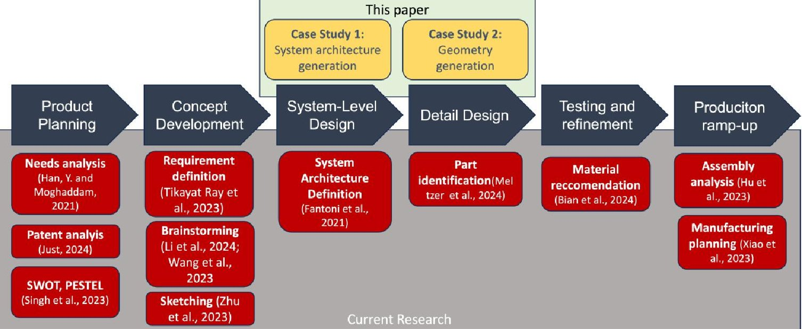
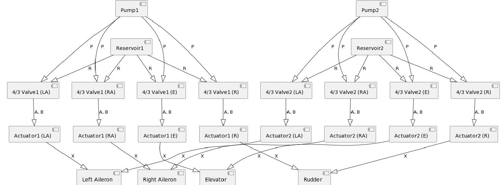
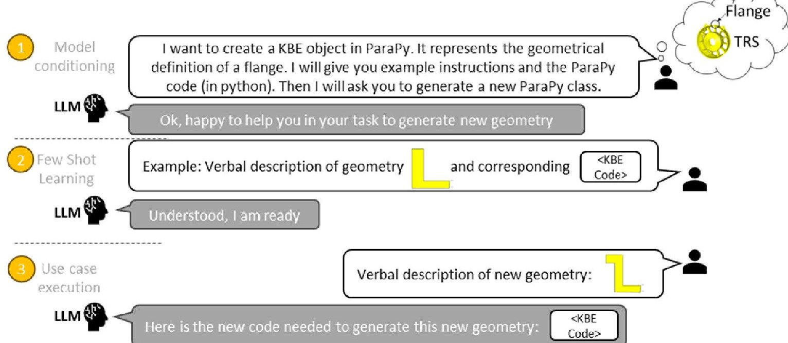
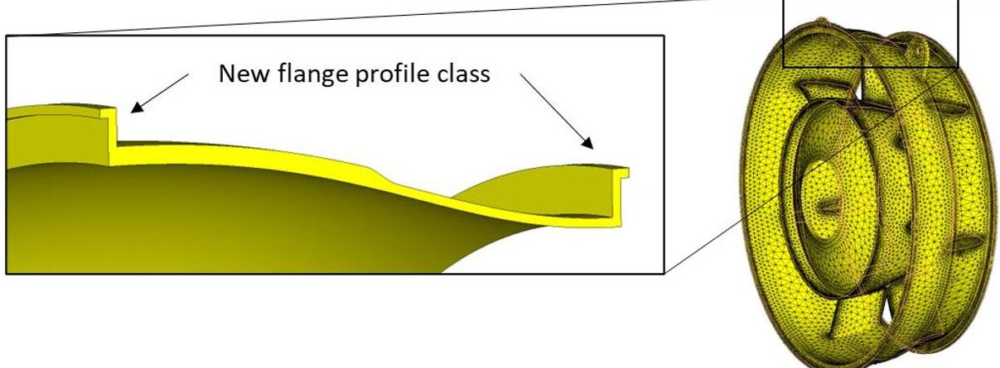

<!-- PDF_PAGE: 1 -->


<div align="center">

# Large language models in complex system design

</div>

Downloaded from: https://research.chalmers.se, 2026-09-08 03:38 UTC

Citation for the original published paper (version of record):

Pradas Gomez, A., Krus, P., Panarotto, M. et al (2024). Large language models in complex system design. Proceedings of the Design Society, 4: 2197-2206. http://dx.doi.org/10.1017/pds.2024.222

N.B. When citing this work, cite the original published paper.

research.chalmers.se offers the possibility of retrieving research publications produced at Chalmers University of Technology. It covers all kind of research output: articles, dissertations, conference papers, reports etc. since 2004. research.chalmers.se is administrated and maintained by Chalmers Library

(article starts on next page)

<!-- PDF_PAGE: 2 -->


<div align="center">

# Large language models in complex system design

</div>

Alejandro Pradas Gomez $ ^{1,} $ , Petter Krus $ ^{2} $ , Massimo Panarotto $ ^{1} $ and Ola Isaksson $ ^{1} $

$ ^{1} $ Chalmers University of Technology, Sweden, $ ^{2} $ Linkoping University, Sweden

alejandro.pradas@chalmers.se

## Abstract

This paper investigates the use of Large Language Models (LLMs) in engineering complex systems, demonstrating how they can support designers on detail design phases. Two aerospace cases, a system architecture definition and a CAD model generation activities are studied. The research reveals LLMs' challenges and opportunities to support designers, and future research areas to further improve their application in engineering tasks. It emphasizes the new paradigm of LLMs support compared to traditional Machine Learning techniques, as they can successfully perform tasks with just a few examples.

Keywords: large language model (LLM), complex systems, artificial intelligence (AI), computer-aided design (CAD), knowledge-based engineering (KBE)

## 1. Introduction

In the field of engineering design, Large Language Models (LLMs) are emerging as powerful tools to significantly enhance the design process (Zhu et al., 2023). These LLMs, such as GPT-4 (Bubeck et al., 2023), hold great promise, especially in the realm of early design and conceptualization activities thanks to their ability to understand and generate human-like text. So far, applications of LLMs in engineering design have focused on the early design stages, which often entail numerous iterations, data synthesis, and problem-solving. LLMs have been proven effective in supporting engineers in brainstorming ideas, sketching concepts, and articulating customer needs and requirements, potentially accelerating the innovation process (Han and Moghaddam, 2021; Han et al., 2022). However, the utility of LLMs can be extended far beyond these capabilities.

There are still open questions on whether LLMs can be effective in supporting the development of complex systems (such as automobiles and aircraft), which present unique characteristics. Firstly, these products often are not developed "from scratch" but evolve from prior products through the introduction of new technologies into an existing product architecture (Suh et al., 2010). However, the new technology candidates for introduction can be of different nature (e.g., a hydraulic vs an electrical steering system), which makes their comparison difficult (Moon and Suh, 2023). Also, complex systems are often characterized by high investments and stringent requirements for reliability and safety, which means that new concepts need to be analysed quantitatively to justify their further development. Often, such quantitative assessment must be performed through computer-based simulation to speed up the development process. This means that the definition of design concepts needs to be detailed enough so that trustworthy simulations can be run. To support the development of such complex systems, specific disciplines such as systems engineering (Sheard and Mostashari, 2009) and knowledge-based engineering (La Rocca and Van Tooren, 2009) have been developed. The application of these disciplines has historically been rather human-intensive when generating and evaluating novel designs (e.g.; the comparison of very different concepts; Muller et al., 2020). At the same time, the representations used during the development of complex systems could make them a good case for the application of LLMs.

<!-- PDF_PAGE: 3 -->

For example, system architectures are often described as a textual mapping among the system functions and the product elements (Ulrich, 1995). Therefore, it is appealing to think about using LLMs to generate and evaluate system architectures from the natural language prompted by the designer. However, little research has been conducted within the Engineering Design community in the quality of the data it generates, and the conditioning or frameworks needed to adapt the model behaviour to the needs of the designer. The hypothesis is that tools based on LLMs can provide support to designers with minimal effort to set-up the models by the designer in the context of the engineering task.

This paper is an early exploration on the potential of LLMs in augmenting the early design of complex systems. By applying it into two cases that the authors are familiar with, we aim to answer the question: What are the challenges and opportunities of LLMs on solving complex engineering problems? We will delve into specific applications and case studies where LLMs have demonstrated their efficacy in creating functional models and generating geometric representations, streamlining the design process, and reducing time-to-market. In this endeavour, we seek to bridge the gap between the world of natural language understanding and engineering, paving the way for more efficient and robust engineering design processes. The potential of LLMs to significantly impact complex design activities, and this paper serves as an initial exploration of the possibilities that lie ahead.

## 2. Current applications of LLMs in design activities

Figure 1 presents some of the current applications of LMMs in engineering design, mapped alongside a generic development process from Ulrich and Eppinger (2008). Given the current rapid evolution of literature regarding engineering design, the reported articles must be considered only as examples of applications. They have been retrieved after applying a "snowballing" literature search on articles already published in peer-reviewed journals. The authors recognize the limits of this literature search approach and will dedicate future efforts on performing a systematic literature review on the topic.





<div align="center">

Figure 1. Current Applications of LLMs in Product Design Activities, mapped alongside a generic development process from Ulrich and Eppinger (2008)

</div>

Notably, the applications are very recent, perhaps due to the recent accessibility to general-purpose LLM tools. Other applications may be found when using other keywords such as Natural Language Processing (NLP). In general, it can be noticed that the use of LLMs have so far been used prevalently in the early design phases (e.g., product planning and concept development). For example, Han and Moghaddam (2021) demonstrated the use of LLMs to understand and capture customer needs accurately. By analysing vast amounts of text and feedback from customers, LLMs can help engineers extract valuable insights, prioritize requirements, and generate detailed documentation that aligns with customer expectations. Other design activities supported by LLMs are patent analysis (Chiarello et al., 2018; Giordano et al., 2021; Giordano et al., 2023) and SWOT/PESTEL analysis (Just, 2024; Singh et al.,

<!-- PDF_PAGE: 4 -->

2023) . Using LLMs in these phases provide useful information for conceptual design phases as well. For example, Tikayat Ray et al. (2023) use LLMs to reformulate design requirements, while other research has focused on the capabilities of LLMs to provide stimuli for brainstorming sessions (e.g.; Li et al., 2023).

From Figure 1, it can be noticed that research has also focused on the ability of LLMs to support assembly and manufacturing planning (e.g., Hu et al., 2023). This is due to the high standardization of assembly and manufacturing sequences, which are often captured as text in Product Data Management systems (PDMs) and Enterprise Resource Planning (ERP) systems.

What has been so far less researched in the role of LLMs in the "central" phases of the development process (System-Level Design, Detail Design, Test and Refinement). Some of the reasons have been provided in the introduction. The following text will describe current examples of applications more in detail. Some applications focus on the description of a system architecture, by analysing textual documentation such as contracts (e.g., Fantoni et al., 2021). These applications show, for example, how the different types of interfaces among the system components can be retrieve from requirements documentation. The typology of such interfaces (e.g. spatial, energy, information, material) can be automatically populated in Design Structure Matrix (DSM) representation. However, no example can be found in cases where multiple system architectures are explored and analysed at the same time (e.g., Suh et al., 2010; Panarotto et al., 2022). Another area which has recently been tackled by LLM-focused research has been CAD and geometry information (e.g., Meltzer et al., 2024). However, current applications has focused on how to improve the searchability of CAD filed in PDM repositories through LLMs. Great potential of LLMs exist also in using textual prompts to automatically generate geometries and shapes to automate the analysis process through simulation. The automatic generation of CAD geometries has been the focus of Knowledge Enabled Engineering (KBE) for at least three decades (e.g., La Rocca, 2012). While the effectiveness of KBE has been proven in several commercial application, the flexibility of KBE approaches in exploring a wide design space has been debated in research (Amadori et al., 2012). In particular, Aranburu et al. (2022) has shown how the variability of automatically generated geometries is dependent on the modelling strategy, highlighting the rigidity of KBE strategies as the complexity of the system increases. While LLMs can streamline the programming part of automatic CAD generation (e.g.; Sarsa, 2022), potentially improving the scalability of KBE approaches, there are still questions on how LLMs can be used to automatically generate geometrical parts, recombined to form a complex system.

CAD models used in engineering use mathematical definition of geometrical entities - such as points, surfaces and volumes - and corresponding operations (translation, morphing, Boolean, etc) to generate a product definition. Existing text-to-3D techniques such as Shape-E (Jun, H. and Nichol, A., 2023) use a diffusion neural network architecture to generate a point cloud geometrical definition. The lack of mathematical definition is the reason why this technique has been discarded, although other authors (Yoo et al., 2021) have proposed to generate mathematical geometrical representations from a pixelated design space. Other authors (Kodnongbua, et al., 2023) propose a parametrized model using LLMs to create new designs with the focus on geometrical appearances for 3d visualization, lacking the engineering geometrical construction described earlier. Compared to previously reference Nelson et al. (2023), this report extends the complexity of the geometry by allowing to modify a section within a whole engineering component, and introduces the "Few Shot Prompt" technique to allow the LLM to create CAD using the KBE language ParaPy that the model has not been exposed to. The combination of LLMs with KBE allows not only the generation of CAD geometry, but also the generation, execution and post-processing of evaluation models such as Finite Element Models (FEM), allowing LLMs to ground their responses in quantitative data.

## 3. LLMs in complex system design: Two use cases

Two use cases are presented, giving the reader a detailed view of the design process and the results of the interaction with the LLMs. These two use cases have emerged as relevant industrial problems after the interactions with two aerospace manufacturers (one aircraft OEM and one first-tier supplier of aeroengine components). The system architecture use case (coming from the OEM) describe how system architectures can be visualized on UML diagrams for visualization or consumption into

<!-- PDF_PAGE: 5 -->

architecture modelling software. The geometrical use case (coming from the first-tier supplier) shows LLMs can generate aerospace CAD models through verbal only instructions. The interaction with LLMs is achieved through ChatGPT, which has additional characteristics that a base LLM. These differences are outside of the scope of this paper.

## 3.1. System architecture design use case

ChatGPT has the potential to automatically generate configuration rules for architectural design, so a system architecture can be generated from a set of required functions. I.e., rules to generate the list of component and how they are connected. An aircraft hydraulic system is used as a case study. Through this example, we walk through the process of defining configuration rules, translating them into UML diagrams, and ultimately generating Python code that can produce generic design diagrams for varying system requirements. The main advantage of asking ChatGPT to create code instead of providing an answer is that the code is deterministic and inspectable, characteristics required for these analyses. The following steps outline the process that culminates in the generation of Python code that implements the design rules for a specific type of systems.

1. Define Configuration Rules: The initial step involves defining a set of configuration rules that guide the architecture and functionalities within the system. For instance, in an aircraft hydraulic system, these rules might detail the types and functions of various components like actuators, valves, and pumps, as well as their interactions. An initial example is also defined.

2. Validate Rules with UML Diagram: After the design rules have been set, they are validated using a UML (Unified Modeling Language) diagram generated by ChatGPT. This serves as a graphical representation of the system and aids in manual validation of the design rules. The design rules may have to be reiterated until the result is satisfactory.

3. Use ChatGPT to Generate Generalized Python Code: By having instructing ChatGPT to be able to use configuration rules for a test case, it can then be instructed to generate Python code that adheres to these rules. This approach allows the user to choose when the code is executed to produce the UML code.

4. Testing and Validation: The Python code generated is manually tested to ensure it adheres to the configuration rules. This validation includes using different inputs to generate different system configurations to be represented as UML diagrams. These may lead to an iterative interaction between user and ChatGPT until a successful code is generated.

5. Finalization: Upon successful testing and validation, the Python code is finalized. It now serves as an automated tool for implementing the design rules, thus streamlining what would typically be a manual design process.

6. Extending the Rules: In the case of complex rules, it can be a good strategy to implement a subset of the rules first. When these have been successfully implemented, the python code can be used in the prompt with additional instructions to extend it to additional rules.

## 3.1.1. Aircraft hydraulic system example

Here is an example for generating design rules for a hydraulic aircraft actuation system. Aircraft actuation systems are used to control primary control surfaces and also secondary control surfaces such as high lift devices, landing gear, etc. In this example, we only look at the primary control surfaces. These require at least two independent circuits for redundancy.

Below is an example of a prompt to generate a system definition as UML code (for PlantUML). It should be noted that the first sentence, gives a concrete example for the LLM to work with, that also provide a general context:

User:

List of Functions: For an aircraft, these would be the left aileron, right aileron, elevator, and rudder.

<!-- PDF_PAGE: 6 -->

Principles: Number of Independent Circuits: There are two of independent hydraulic circuits in the system. Each circuit is connected to all functions. Each function has an actuator for each circuit.

Pump to Valve: Each pump's 'P' (Pressure) port will be connected to the 'P' port of the 4/3 valve controlling the respective actuator.

Reservoir to Valve: The reservoir's 'R' (Return) port will be connected to the 'R' port of the 4/3 valve in the corresponding circuit.

Reservoir to Pump: The reservoir's 'R' (Return) port will be connected to the 'R' port of the Pump in the corresponding circuit.

Valve to Cylinder: The 'A' and 'B' ports of each 4/3 valve will be connected to the 'A' and 'B' ports of the respective cylinder.

Circuit Assignment: The assignment of pumps and reservoirs to circuits should adhere to your specifications.

Make sure all valves are connected to the reservoir.

Each actuator also has a Mechanical port X that is connected to the function it is assigned to.

Generate code for a UML component diagram for PlantUML.

After some minor adjustments, the diagram in Fig. 2. Is obtained. Given the acceptable outcome, the next step involves a request to ChatGTP to generate Python code that can generate this kind of system given the different functions as inputs.





<div align="center">

Figure 2. UML diagram (in PlantUML $ ^{\mathrm{TM}} $ ) of an aircraft actuation system with four functions and two circuits, each with a pump and reservoir connected to a valve and actuator for each function

</div>

The following is an example of the use of the extended Python function generated:

$$
\cdot \quad \mathrm {f u n c t i o n _ {n a m e s}} = [ " L e f t A i l e r o n " , " R i g h t A i l e r o n " , " E l e v a t o r " , " R u d d e r " ]
$$

$$
\mathrm {c i r c u i t} _ {\mathrm {n a m e s}} = [ " R e d " , " B l u e " ]
$$

$$
\mathrm {s p e c i f i c _ {f u n c t i o n s}} = \left\{\mathrm {" F l a p s "}: [ \mathrm {" R e d "} ], \mathrm {" L a n d i n g G e a r "}: [ \mathrm {" B l u e "} ] \right\}
$$

- plantuml_code = generate_plantuml(function_names, circuit_names, specific_functions)

Finally, new inputs are provided to the python code for testing, such as new function or circuit_names. It shows that ChatGPT has the capacity to generalize rules when generating the python code.

<!-- PDF_PAGE: 7 -->

## 3.2. Geometry generation use case: Text-to-CAD

The Detailed Definition phase of the aerospace structural component is still an iterative process where geometrical design changes are frequent due to for example, a system level change or a manufacturing request. The support of LLMs vie ChatGPT (gpt-4-0613) is explored during the update of the geometrical definition to reflect the change request. For this example, the component selected is a Turbine Rear Structure (TRS), and in particular the geometry of a flange located on the outer case forward interface. The definition of the 2D cross section profile of the flange is modified to include a rabbet, and the profile is revolved around the engine axis.

The familiarity with the CAD software required to update the geometrical model limits the activity to only CAD experts. This use case exemplifies the support that a LLM could provide to any design team member to update a component geometry in a very short time using verbal instructions, instead of using CAD GUI operations or scripting code updates. For this demonstration, a KBE system (ParaPy) will be used to interact with the CAD kernel. Similar results can be achieved using other automation techniques in more traditional CAD software such as Siemens NX or Dassault CATIA scripting capabilities. The interaction between the non-CAD and non-KBE expert and the LLM is visualized in Figure 3. A new context window is generated for interaction. The objective of the LLM is to generate a new KBE class to capture the new geometrical definition.





<div align="center">

Figure 3. Diagram representing the design process steps; the three steps on the left represent the conversational support of LLMs with a one shot example

</div>

The process is defined in 3 steps for clarity - they can all be passed to the model in a single prompt.

1. Model Conditioning: The LLM is general instructions on the task to be performed.

2. Few (one) shot propting: The model is exposed to the verbal description of the geometrical steps to be performed and the corresponding KBE code needed to generate the geometry.

3. Use case execution: The user describes verbally the new geometrical definition. The LLM replies with the new KBE code that would represent such geometry.

Figure 4 on the next page shows other perspective of the information shared with the model and how it uses such information to generate the new KBE code. The column on the left (grey) is the information passed as the example to replicate. The column on the right is the new example that the model needs to generate. On the "cross section profile" row the geometry is presented for the reader benefit. The model only has access to the verbal instructions of the geometry generation (second row). The "KBE primitive code" is the output expected from the model, and an additional fourth row is added in Figure 4 for the reader benefit to visualize the outcome of the code when executed.

<!-- PDF_PAGE: 8 -->

<div align="center">

Flange Example given

</div>

<table border="1"><tr><td>Cross section profile</td><td>线段1
线段2
线段4
p0
Thickness_wire
Curve_0</td></tr><tr><td>Verbal instructions</td><td>1. From p0 move along the direction of vector_h a distance h. That point is p1.
2. The line segment between p0 and p1 is line_segment_1.
3. From p1 go a distance t along the direction of vector_t. That point is p2.
4. The line segment between p1 and p2 is line_segment_2.
5. Create a line (inters_line) passing through p2 in the direction of vector_h.
6. Intersect inters_line with the input wire thickness_wire. That point is p4.
7. The line segment between p2 and p4 is line_segment4.
8. Create a profile Part that is a Wire object with the curves that are line_segment1, 2 and 4.</td></tr><tr><td></td><td>1. From p0 move along the direction of vector_h a distance h. That point is p1.
2. The line segment between p0 and p1 is line_segment_1.
3. From p1 go a distance t1 along the opposite direction of vector_t. That point is p2.
4. The line segment between p1 and p2 is line_segment_2.
5. From p2 go a distance t along the direction of vector_h. That point is p3.
6. The line segment between p2 and p3 is line_segment_3.
7. From p3 go a distance t1+t2 along the direction of vector_t. That point is p4.
8. The line segment between p3 and p4 is line_segment_4.
9. Create a line (inters_line) passing through p4 in the direction of vector_h.
10. Intersect inters_line with the input wire thickness_wire. That point is p5.
11. The line segment between p4 and p5 is line_segment5.
12. Create a profile Part that is a Wire object with the curves that are line segments 1, 2, 3 and 4.</td></tr></table>


KBE Primitive code

```python

class FlangeCrossSection(PlanarFace):

    <... code lines skipped for visualization

    ...>

    @Attribute(in_tree=True)

    def p1(self) -> Point:

        vh = self.vector_h.normalized

        return self.p0 + self.h * vh

    @Part

    def line_segment1(self):

        return LineSegment(self.p0,

self.p1)

    <... code lines skipped for visualization

    ...>

    @Attribute

    def profile(self):

        return Wire(curves_in=[

            self.line_segment1,

            self.line_segment2,

            self.line_segment4])

```

KBE generated CAD

```python

class NewFlangeCrossSection(PlanarFace):

    <... code lines skipped for visualization ...>

    @Attribute(in_tree=True)

    def p1(self) -> Point:

        return self.p0 + self.h * self.vector_h.normalized

    @Attribute(in_tree=True)

    def p2(self) -> Point:

        return self.p1 - self.t1 * self.vector_t.normalized

    <... code lines skipped for visualization ...>

    @Part

    def profile(self):

        return Wire(curves_in=[

            self.line_segment1,

            self.line_segment2,

            self.line_segment3,

            self.line_segment4,

            self.line_segment5])

```

<div align="center">

Figure 4. Column comparison between the pre- and post-design change geometry expressed visually and verbally; Prompt and response of the LLM for step 3 are highlighted in the right

</div>

<!-- PDF_PAGE: 9 -->

After the new KBE code has been generated the KBE application is executed, resulting in new CAD and Finite Element Models generated for the TRS component. Figure 5. Visualizes the CAD cross section with the new geometry and the associated FEM model, automatically generated thanks to the KBE reusability paradigm.





<div align="center">

Figure 5. Left: Cross section of the TRS showing the new geometry of the flange; Right: Complete TRS automatically meshed my using the same KBE functions

</div>

The proposed approach has exemplified how LLMs support a CAD geometry to be instantly updated without the need for the team member to be an expert on CAD or KBE.

## 4. Discussion

The outputs of the trade study have been manually checked to ensure their validity. Due to its relative simplicity, this operation has been done manually. The architectural results in case study 3.1 show that the model can understand the user intention, can execute the task, generalize concepts and has the knowledge of a diverse set of areas, such as UML and python. The use case in 3.2 showed that the gpt-4 model has a clear concept of geometrical entities and relationships, and the ability to generate KBE code with minor user input. All of these capabilities are available without the need for a specific machine learning training on custom data, which confirms the hypothesis that LLMs can support designers with minimal input. However, in both examples it required several iterations and prompt versions to generate a valid response.

## 4.1. Opportunities

Solving engineering problems using traditional Machine Learning techniques require vast amounts of example data for training and expertise to train and build predictive models (Behzadi, M.M. et al., 2022). In contrast, using LLMs allow to leverage the generalist training and apply it to a particular engineering problem easily: with a few examples and interacting verbally. The verbal interaction is a key element to ease the adoption of the tool. LLMs can interpret the designer intent in the prompt and generate the desired output without any programming or automation experience.

## 4.2. Challenges

There is a need for engineering designers to be accountable and responsible for their designs, and results generated with LLMs alone cannot be trusted. This risk can be minimized combining the existing engineering tools and LLMs: Engineering tools could be used to perform the calculation and LLM to configure them. LLMs can generalize and adapt to new situations, but they are not aware of the company or project procedures. A support system to embed the knowledge needed (Retrieval Augmented Generation) or to fine tune the model would be beneficial for the user.

The most capable and available large models are currently only provided as an external API service, due to the computational resources and business strategy. This limits the applicability for military projects or customer sensitive data where strict policies must be followed in aerospace. Fortunately, LLMs can also be run on premises, such as the Llama-2 family of models from Meta or Mixtral-7B from Mistral.

<!-- PDF_PAGE: 10 -->

In aerospace applications, repeatability and a solid justification is required for certification and airworthiness. More research is needed to investigate how LLMs interact with designers without stepping over their responsibilities. More robust AI systems are being deployed in incremental phases, such as car autopilot (SAE International, 2021) or aerospace applications supported by AI (EASA, 2023). Therefore, we propose that a specific support scale should be available for LLM activities.

Currently, LLMs are "helpful assistants" and they try to best answer questions with the information provided. Good designers do not have that behaviour. They challenge incomplete or contradictory information, ask for clarification and rework the problem as needed. The "forward-pass" architecture of transformers (Vaswani et al., 2017) on LLMs suggest that additional support is needed outside of the transformers architecture itself to allow the models to rectify and discuss internally before responding.

## 5. Conclusion

The design of complex systems is characterized by human-intensive and expert-intensive activities required to define and evaluate the proposed concepts. This paper presented how LLM can be used to design complex systems and geometries, an area where there is limited research currently. The use cases show that LLMs can be applied at the System Level and Detail phases of the product design process. Future work will focus on evaluate different approaches to embed custom design practices and knowledge, the human-LLM interaction behaviour expected in a design process, exploring different model types and their performance for typical design engineering tasks.

## Acknowledgement

The research presented in this paper has been performed within the 19009 DEFAINE (Design Exploration Framework based on AI for froNt-loaded Engineering) project, and has received funding from the ITEA 3 via the Swedish Innovation Agency VINNOVA.

## References

Amadori, K., Tarkian, M., Olvander, J. and Krus, P., 2012. Flexible and robust CAD models for design automation. Advanced Engineering Informatics, 26(2), pp.180-195. https://doi.org/10.1016/j.aei.2012.01.004

Aranburu, A., Cotillas, J., Justel, D., Contero, M. and Camba, J.D., 2022. How does the modeling strategy influence design optimization and the automatic generation of parametric geometry variations?. Computer-Aided Design, 151, https://doi.org/10.1016/j.cad.2022.103364

Behzadi, M.M. and Ilieş, H.T., 2022. Gantl: Toward practical and real-time topology optimization with conditional generative adversarial networks and transfer learning. Journal of Mechanical Design, 144(2), p.021711.

Bian, S., Grandi, D., Liu, T., Jayaraman, P.K., Willis, K., Sadler, E., Borijin, B., Lu, T., Otis, R., Ho, N. and Li, B., 2024. HG-CAD: Hierarchical Graph Learning for Material Prediction and Recommendation in ComputerAided Design. Journal of Computing and Information Science in Engineering, 24(1). 10.1115/1.4063226

Bubeck, S., Chandrasekaran, V., Eldan, R., Gehrke, J., Horvitz, E., Kamar, E., Lee, P., Lee, Y.T., Li, Y., Lundberg, S. and Nori, H., 2023. Sparks of artificial general intelligence: Early experiments with gpt-4. arXiv preprint arXiv:2303.12712.

Chiarello, F., Cimino, A., Fantoni, G. and Dell'Orletta, F., 2018. Automatic users extraction from patents. World Patent Information, 54, pp.28-38. https://doi.org/10.1016/j.wpi.2018.07.006

European Union Aviation Safety Agency (EASA), 2023. Artificial Intelligence Roadmap 2.0. easa.europa.eu/ai. Last accessed November 2023.

Fantoni, G., Coli, E., Chiarello, F., Apreda, R., Dell'Orletta, F. and Pratelli, G., 2021. Text mining tool for translating terms of contract into technical specifications: Development and application in the railway sector. Computers in Industry, 124, http://dx.doi.org/10.1016/j.compind.2020.103357

Giordano, V., Chiarello, F., Melluso, N., Fantoni, G. and Bonaccorsi, A., 2021. Text and dynamic network analysis for measuring technological convergence: A case study on defense patent data. IEEE Transactions on Engineering Management. https://doi.org/10.1109/TEM.2021.3078231

Giordano, V., Puccetti, G., Chiarello, F., Pavanello, T. and Fantoni, G., 2023. Unveiling the inventive process from patents by extracting problems, solutions and advantages with natural language processing. Expert Systems with Applications, 229, p.120499. https://doi.org/10.1016/j.eswa.2023.120499

Han, J., Sarica, S., Shi, F. and Luo, J., 2022. Semantic networks for engineering design: state of the art and future directions. Journal of Mechanical Design, 144(2), p.020802. https://doi.org/10.1115/1.4052148

<!-- PDF_PAGE: 11 -->

Han, Y. and Moghaddam, M., 2021. Eliciting attribute-level user needs from online reviews with deep language models and information extraction. Journal of Mechanical Design, 143(6), p.061403. https://dx.doi.org/10.1115/1.4048819

Hu, Z., Li, X., Pan, X., Wen, S. and Bao, J., 2023. A question answering system for assembly process of wind turbines based on multi-modal knowledge graph and large language model. Journal of Engineering Design, pp.1-25. https://doi.org/10.1080/09544828.2023.2272555

Jun, H. and Nichol, A., 2023. Shap-e: Generating conditional 3d implicit functions. arXiv preprint arXiv:2305.02463.

Just, J., 2024. Natural language processing for innovation search-Reviewing an emerging non-human innovation intermediary. Technovation, 129, p.102883. https://doi.org/10.1016/j.technovation.2023.102883

Kodnongbua, M., Jones, B.T., Ahmad, M.B.S., Kim, V.G. and Schulz, A., 2023. Zero-shot CAD Program Re- Parameterization for Interactive Manipulation. arXiv preprint arXiv:2306.03217.

La Rocca, G. and Van Tooren, M.J., 2009. Knowledge-based engineering approach to support aircraft multidisciplinary design and optimization. Journal of aircraft, 46(6), pp.1875-1885. https://dx.doi.org/10.2514/1.39028

La Rocca, G., 2012. Knowledge based engineering: Between AI and CAD. Review of a language based technology to support engineering design. Advanced engineering informatics, 26(2), pp.159-179. https://doi.org/10.1016/j.aei.2012.02.002

Li, M., Lou, S., Zheng, H., Feng, Y., Gao, Y., Zeng, S. and Tan, J., 2024. A cognitive analysis-based key concepts derivation approach for product design. Expert Systems with Applications, https://dx.doi.org/10.1016/j.eswa.2023.121289

Marrone, A., 2023. Optimizing Product Development and Innovation Processes with Artificial Intelligence (Master Thesis, Politecnico di Torino). uri: http://webthesis.biblio.polito.it/id/eprint/27710

Meltzer, P., Lambourne, J.G. and Grandi, D., 2024. What's in a Name? Evaluating Assembly-Part Semantic Knowledge in Language Models Through User-Provided Names in Computer Aided Design Files. Journal of Computing and Information Science in Engineering, 24(1), p.011002. https://doi.org/10.1115/1.4062454

Moon, J. and Suh, E.S., 2023. Multiple technology infusion assessment: a framework and case study. Research in Engineering Design, 34(3), pp.347-366. https://doi.org/10.1007/s00163-023-00414-6

Müller, J.R., Panarotto, M. and Isaksson, O., 2020. Design space exploration of a jet engine component using a combined object model for function and geometry. Aerospace, 7(12), p.173. https://dx.doi.org/10.3390/aerospace7120173

Nelson, M.D., Goenner, B.L. and Gale, B.K., 2023. Utilizing ChatGPT to assist CAD design for microfluidic devices. Lab on a Chip, 23(17), pp.3778-3784. https://doi.org/10.1039/D3LC00518F

Panarotto, M., Kipouros, T., Brahma, A., Isaksson, O., Strandh Tholin, O. and Clarkson, J., 2022. Using DSMs in functionally driven explorative design experiments-an automation approach. In DS 121: Proceedings of the 24th International DSM Conference (DSM 2022), Eindhoven, The Netherlands, October, 11-13, 2022 (pp. 68-77). https://doi.org/10.35199/dsm2022.08

SAE International, 2021. axonomy and Definitions for Terms Related to Driving Automation Systems for On Road Motor Vehicles. J3016_202104. https://www.sae.org/standards/content/j3016_202104/

Sarsa, S., Denny, P., Hellas, A. and Leinonen, J., 2022, August. Automatic generation of programming exercises and code explanations using large language models. In Proceedings of the 2022 ACM Conference on International Computing Education Research-Volume 1 (pp. 27-43). https://dx.doi.org/10.1145/3501385.3543957

Sheard, S.A. and Mostashari, A., 2009. Principles of complex systems for systems engineering. Systems Engineering, 12(4), pp.295-311. https://doi.org/10.1002/sys.20124

Singh, J., Samborowski, L. and Mentzer, K., 2023. A Human Collaboration with ChatGPT: Developing Case Studies with Generative AI. In Proceedings of the ISCAP Conference ISSN (Vol. 2473, p. 4901).

Suh, E.S., Furst, M.R., Mihalyov, K.J. and Weck, O.D., 2010. Technology infusion for complex systems: A framework and case study. Systems Engineering, 13(2), pp.186-203. https://doi.org/10.1002/sys.20142

Tikayat Ray, A., Cole, B.F., Pinon Fischer, O.J., White, R.T. and Mavris, D.N., 2023. aeroBERT-Classifier: Classification of Aerospace Requirements Using BERT. Aerospace, 10(3), p.279. https://doi.org/10.3390/aerospace10030279

Ulrich, K., 1995. The role of product architecture in the manufacturing firm. Research policy, 24(3), pp.419-440. https://doi.org/10.1016/0048-7333(94)00775-3

Ulrich, K.T. and Eppinger, S.D. (2008) Product Design and Development. 4th Edition, McGraw-Hill, New York.

Vaswani, A., Shazeer, N., Parmar, N., Uszkoreit, J., Jones, L., et al., 2017. Attention is all you need. Advances in neural information processing systems, 30. ISBN: 9781510860964

Wang, X., Anwer, N., Dai, Y. and Liu, A., 2023. ChatGPT for design, manufacturing, and education. Procedia CIRP, 119, pp.7-14. https://doi.org/10.1016/j.procir.2023.04.001

Xiao, Y., Zheng, S., Shi, J., Du, X. and Hong, J., 2023. Knowledge graph-based manufacturing process planning: A state-of-the-art review. Journal of Manufacturing Systems, 70, pp.417-435. 10.1016/j.jmsy.2023.08.006

Zhu, Q., Zhang, X. and Luo, J., 2023. Biologically Inspired Design Concept Generation Using Generative PreTrained Transformers. Journal of Mechanical Design, 145(4), p.041409. https://doi.org/10.1115/1.4056598