<!-- PDF_PAGE: 1 -->

# Radio Aurora Explorer: Mission science and radar system

H. Bahcivan $ ^{1} $ and J. W. Cutler $ ^{2} $

Received 30 June 2011; revised 15 February 2012; accepted 21 February 2012; published 12 April 2012.

[1] The Radio Aurora Explorer (RAX) satellite is the first of several satellites funded under the NSF CubeSat-based Space Weather and Atmospheric Research Program. RAX is a ground-to-space bi-static radar remote sensing experiment designed to measure and understand the causes of meter-scale ionospheric irregularities. Also known as field-aligned irregularities (FAI), such non-thermal, coherent fluctuations of electron density occur in response to strong ionospheric flows or plasma density gradients during geomagnetic disturbances and are considered a space weather concern due to disruption to communication and navigation signals. The RAX CubeSat was launched in November 2010 and conducted a single experiment in coordination with the Poker Flat Incoherent Scatter Radar. Due to geophysical inactivity, e.g., lack of strong ionospheric electric fields and low ionospheric densities, no FAI were expected or observed. However, the radar receiver payload operation was successfully demonstrated, including the capability to sense signals as low as -110 dBm, the capability of transmitter-receiver synchronization and accurate ranging, processing of 1.2 GB of raw radar data on board in less than 1 hour, and the downlink of the science results within three-four passes. Analysis of the payload data shows that the noise level is sufficiently low. Although the interference level is a concern, it does not appear to significantly limit the measurements. Toward the end of December 2010, the solar power system gradually degraded and the mission terminated in early February 2011 after prolonged loss of contact with the satellite. Meanwhile, RAX II was launched in October 2011 to a polar orbit. This paper describes the RAX science and radar system and presents the results from the first experiment conducted.

Citation: Bahcivan, H., and J. W. Cutler (2012), Radio Aurora Explorer: Mission science and radar system, Radio Sci., 47, RS2012, doi:10.1029/2011RS004817.

## 1. Introduction

[2] Radio Aurora Explorer (RAX) is a CubeSat-based ground-to-space bi-static radar experiment designed to investigate the causes of upper atmospheric/ionospheric turbulence driven by solar wind and magnetospheric electromagnetic forcing. The unique radar scattering geometry composed of a transmitter on the ground and an orbiting receiver in space enables unique high-resolution measurements of meter-scale field-aligned ionospheric irregularities (FAI). Furthermore, the primary payload (UHF radar receiver) is designed to operate with five UHF megawattclass incoherent scatter radars (ISR) on the ground enabling FAI measurement in mid-latitudes, auroral regions and the polar cap.

[3] A satellite similar in concept to RAX is the Fast On-Orbit Rapid Recording of Transient Events (FORTE) satellite launched by Sandia and Los Alamos National Laboratories in 1997. FORTE carried an RF sensor for monitoring

VHF lightning emissions from the ionosphere. Application of the RF sensor for detecting FAI has not been demonstrated although it would have been possible in coordination with the Jicamarca VHF incoherent scatter radar. Other bistatic RF sensing applications have been considered, for example, bistatic radars using satellite-borne television transmissions [Griffiths et al., 1992] and space-to-surface bistatic synthetic aperture radar [Cherniakov, 2002].

[4] The RAX satellite (shown in Figure 1) was launched via the Department of Defense Space Test Program aboard a Minotaur-4 vehicle from Kodiak, Alaska, on November 20, 2010 at 0125 UTC to a 650 km circular, 72° inclination orbit. Due to the snapshot nature of each experiment (300 s) and the probability of geophysical activity over an experimental location being low, a large number of experiments (on the order of 100) were needed to achieve the science goals; for this reason, the mission lifetime was set at 1 year, assuming 1-2 experiment per week. However, only a single end-to-end radar experiment was conducted on December 10, 2010 during quiet geomagnetic conditions. Toward the end of December, the solar power system began to fail. While we conducted another experiment with the Resolute Incoherent Scatter Radar (RISR) in early January 2011, we had to abandon on-board radar data processing due to increasing concern over the power budget. RAX I operations had to be terminated in February 2011 after prolonged loss

<!-- PDF_PAGE: 2 -->

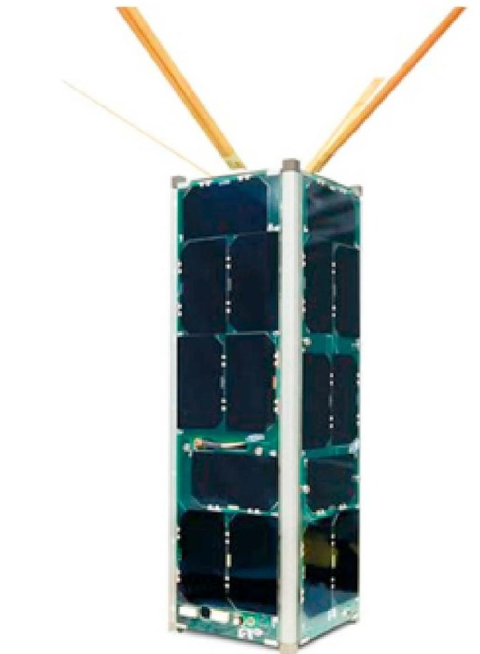

Figure 1. RAX I (launched on 2010/11/21). Shown is the actual flight unit (RAX1B).

of satellite contact. Meanwhile, RAX II was launched on October 28, 2011 and is currently in preparation for continuing the experiments. A previous paper [Bahcivan et al., 2009] provided a brief description of RAX I with emphasis on radar sensitivity. This paper provides the details on the mission science and radar system, and presents observations from the only experiment conducted.

## 2. Science Objectives

[5] The principal science objective of the RAX mission is to understand the microphysics of plasma instabilities that lead to field-aligned irregularities of electron density $ \left(n_{e}\right) $ in the ionosphere between the altitudes of 80 and 400 km. The objectives can be itemized as follows:

[6] 1. Provide high spatial resolution mapping of naturally occurring auroral ionospheric irregularities in the E and F regions for a wide range of ionospheric electric field, currents, and plasma density gradients, as a well as measurements of artificially generated irregularities by high-power HF heating;

[7] 2. Provide high angular (with respect to the geomagnetic field) resolution measurements of meter-scale irregularity k-spectrum, in particular quantifying plasma wave energy distribution parallel to the geomagnetic field lines; and

[8] 3. Simultaneously with the measurements above, provide the background parameters and driving forces (electric field) of the same scattering plasma volume using the incoherently scattered signals back to the ISR.

[9] A main reason that prompted RAX is the difficulty of probing FAI with ground-based radars due to the magnetic field lines in the polar regions being nearly vertical. The geometry is such that a very low-elevation ground-based radar beam span in altitude is too large to resolve the structures in altitude and for HF frequencies refraction causes source location ambiguity. In order to be sensitive to incoherent scatter from thermal electron fluctuations, some of the high latitude ISRs are positioned not to see the much stronger (up to 60 dB) coherent scatter from the turbulence (the turbulence scatter radiates toward space). Orbiting spacecraft cannot descend into the dense upper atmosphere to probe the turbulent structures for long durations, although missions of limited duration, for example a satellite with a perigee in the E region, have been considered. Rocket measurements are infrequent and the rocket-borne electric field probes are not sensitive enough to measure magnetic field alignment and sort out wave energy in magnetic aspect angle.

[10] RAX is specifically designed to remotely measure, with high angular resolution $ (\sim0.5^{\circ}) $ , the 3-D k-spectrum (spatial Fourier transform) of $ \sim1 $ m scale FAI as a function of altitude, in particular measuring the magnetic field alignment of the irregularities. The spacecraft will measure radio aurora, the Bragg scattering from FAI that are illuminated with a narrow beam incoherent scatter radar (ISR) on the ground. The scattering locations are determined using a GPS-based synchronization between ISR transmissions and satellite receptions and the assumption that the scattering occurs only inside the narrow $ (\sim1^{\circ}) $ ISR beam.

[11] A drawing of the experiment is shown in Figure 2. FAI are naturally generated when the electric fields exceed the instability thresholds modified by electron density gradients. Alternatively, FAI is generated by resonant high power HF-ionosphere interactions in the E and F regions. Some of the recent work on artificially generated irregularities include Hysell [2008] for E region irregularities and Blagoveshchenskaya et al. [2011] for the F region. The ISR in the lower right corner illuminates a 3-5 km box region depending on the radar beam width, range, and scattering angle. Incoherently scattered signals are received back at the ISR and the signal spectrum is processed for estimates of the convection electric field E, electron density $ n_{e} $ , and electron and ion temperatures, $ T_{e} $ and $ T_{i} $ , respectively. The coherent scatter is received by RAX. Meanwhile, experimental geometry and radar ranging determines irregularity altitude $ h $ and the aspect angle $ \theta $ , the angle between the Bragg wavevector and the plane perpendicular to the geomagnetic field. Multiple experiments are conducted to form points on the function $ I(E,n_{e},T_{e},T_{i},\theta,h) $ , which will be inferred for the microphysics of plasma instabilities under investigation.

## 2.1. Plasma Instabilities

[12] Table 1 shows the list of potential plasma waves making up the meter-scale irregularities in the ionospheric E and F regions. Some of the references are as follows: lower hybrid waves: responsible for transverse ion acceleration at rocket altitudes [Andrulis et al., 1996; Lynch et al., 1999], occur a result of HF heating in the F region [Ecklund et al., 2008]; electrostatic ion cyclotron waves: excited due to intense field-aligned currents [Kindel and Kennel, 1971];

<!-- PDF_PAGE: 3 -->

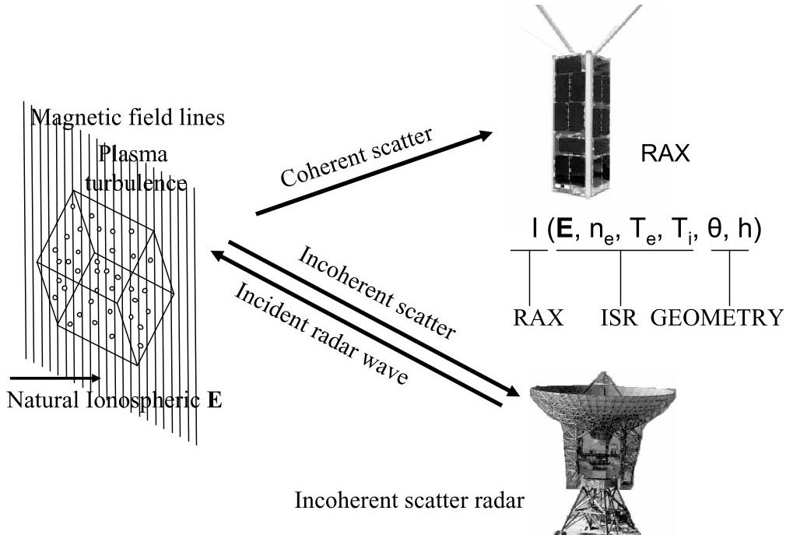

Figure 2. A drawing of the RAX experiment. Ionospheric irregularities (either natural or artificially generated) inside a 3-5 km box are illuminated by the narrow ISR beam. Coherent/incoherent scatter is received by RAX/ISR.

enhanced ion acoustic waves: excited due to intense electrostatic ion cyclotron turbulence [Bahcivan and Cosgrove, 2008]; Farley-Buneman waves: excited when the relative electron-ion drift exceeds the ion-acoustic speed [Farley, 1963], observed by in-situ rocket electric field instruments [e.g., Pfaff et al., 1984; Rose, 1992] and by radar [e.g., Bahcivan et al., 2005]; upper hybrid waves: predicted above 125 km altitude as 10-20 cm waves excited due to suprathermal electrons [Basu et al., 1982] and measured using coherent scatter radar as a result of HF heating in the E region [Hysell, 2008]; Post-Rosenbluth instability: 10- 20 cm waves predicted if the relative ion-neutral drift exceeds 1.8 times the neutral thermal velocity [Ott and Farley, 1975].

[13] It is currently possible to detect and identify most plasma instabilities in the lower thermosphere, but the details of the plasma turbulence, e.g., its spectrum, amplitudes, and field-alignment and how these quantities vary as a function of the driving forces are not known. As we discuss next, this knowledge is necessary to predict space weather, to predict the degradation of trans-ionospheric signals, and for more accurate estimates of the energetics of the upper atmosphere and ionospheric response to HF heating.

## 2.2. Space Weather Impact of Ionospheric Plasma Turbulence

[14] Plasma turbulence impacts propagation of transionospheric communication and navigation signals. Ionospheric irregularities change the refractive index of the medium, which causes signal scattering or scintillation. RAX 3D k-spectrum measurements as a function of geomagnetic and ionospheric parameters will enable prediction of these signal perturbations for different signal frequencies and propagation directions. Considering the broad equatorial spread F literature, GPS scintillations mostly occur due to ionospheric irregularities at 100 m or longer scales. However, we note here that vertical magnetic field lines at high latitudes elongate smaller ( $ \sim1 $ m) scale $ n_{e} $ structures in the

geomagnetic field direction by a factor of $ > 1 0 0 $ ; therefore, GPS signals arriving from certain elevations near the geomagnetic field pass through an ionospheric path that contains $ \sim 1 0 0 $ - m scale $ n_{e} $ irregularities that are comparable to those of equatorial spread F. Several studies on GPS scintillations due to auroral irregularities exist [e.g., Skone and de Jong, 2000] on L2 cycle slips and missing phase observations for stations in the SATREF and SWEPOS networks.

[15] Another space weather impact is the additional energy dissipation due to plasma turbulence. The additional energy dissipation may change the thermospheric temperature/density profiles responsible for satellite drag and may cause loss of satellite tracking. It is known that ionospheric irregularities in the form of plasma turbulence are located on the most resistive part of the ionosphere-magnetosphere current circuit and impact the energetics of the upper atmosphere. The Joule energy dissipation due to the anomalous resistivity created by the plasma turbulence has not been measured well [Bahcivan and Cosgrove, 2010]. Theoretically, the Joule and wave heating rates can be comparable depending on the convection electric field [St-Maurice et al., 1990]. The high-angular resolution measurements will quantify the wave energy distribution over wavevectors with small departures from perpendicularity to the geomagnetic field; tiny departures amount to large energy deposition parallel to the magnetic field due to the relatively large parallel conductivity, i.e., $ \sigma_{0}\gg\sigma_{\perp} $

Table 1. Plasma Waves Investigated by RAX

<table border="1"><tr><td>Plasma Wave/Instability</td><td>Region of Observation</td><td>Previously Detected?</td><td>Scales(m)</td></tr><tr><td>Farley-Buneman</td><td>E</td><td>Y</td><td>0.1-50.0</td></tr><tr><td>EIC</td><td>F</td><td>Y</td><td>1-20</td></tr><tr><td>Post-Rosenbluth</td><td>F</td><td>N</td><td>0.1-0.2</td></tr><tr><td>Lower hybrid</td><td>E/F</td><td>Y</td><td>&lt;1</td></tr><tr><td>Upper hybrid</td><td>&gt;125km</td><td>N</td><td>0.1-0.15</td></tr></table>

<!-- PDF_PAGE: 4 -->

Table 2. RAX Satellite Bus Components

<table border="1"><tr><td>Component</td><td>Description</td></tr><tr><td>Flight computer</td><td>MSP430 series</td></tr><tr><td>UHF transceiver</td><td>lithium-1</td></tr><tr><td>S-Band transceiver</td><td>MHX-2400</td></tr><tr><td>GPS receiver</td><td>Novatel OEMV-1</td></tr><tr><td>GPS-based position and time system</td><td></td></tr><tr><td>Real time clock</td><td></td></tr><tr><td>Inertial measurement unit</td><td>ADIS 16405</td></tr><tr><td>Distributed coarse sun sensors</td><td></td></tr><tr><td>Magnetometers</td><td>PNI MicroMag3</td></tr><tr><td>Passive magnetic stabilization</td><td></td></tr><tr><td>Data processing</td><td>PXA270 microprocessor</td></tr><tr><td>Storage</td><td>lithium ion batteries</td></tr></table>

[16] Finally, the high spatial and angular resolution measurements of plasma turbulence will strongly support efforts on ionospheric modification studies by enabling quantification of artificially generated wave energy saturation and dissipation. High-power HF heating of the ionosphere changes the plasma parameters such as electron and ion temperatures, collision frequencies, and the conductivity. Accurate prediction of the plasma parameter responses as a result of heating parameters (e.g., amplitude and frequency of HF field) is necessary for many applications including generating the most effective ELF/VLF radiation from an artificially modulated current pattern in the D/E regions.

## 3. Radar System Description

## 3.1. The Satellite Bus

[17] Table 2 shows the main RAX satellite bus components. A separate publication focused on the spacecraft hardware will provide the details of each of these components.

## 3.2. The Payload Receiver

[18] The payload radar receiver characteristics are shown in Table 3. Pictures of the inside and outside the enclosure are shown in Figure 3. Details on payload hardware can be found in the documentation on SRI's RAX website.

[19] The receiver operates in a snapshot acquisition mode collecting raw samples at 1 MHz for 300 s over the experimental zone. Following each experiment, the raw data is postprocessed on board the satellite for range-time-intensity and, in certain modes, Doppler spectrum. The snapshot raw data acquisition and post-processing of raw data enables flexibility in forming different radar pulse shapes and patterns.

Table 3. UHF Payload Receiver Characteristics

<table border="1"><tr><td>Characteristic</td><td>Description</td></tr><tr><td>Pulse</td><td>&gt;2μs or CW</td></tr><tr><td>Frequency</td><td>426-510MHz in four bands</td></tr><tr><td>Gain</td><td>adjustable by 60dB</td></tr><tr><td>Internal voltage regulation</td><td></td></tr><tr><td>Sampling res.</td><td>14-bit</td></tr><tr><td>Signals</td><td>in-phase and quadrature</td></tr><tr><td>Calibration</td><td>internal 500MHz source</td></tr><tr><td>Thermal</td><td>dissipative enclosure</td></tr><tr><td>Size</td><td>9.7cm×9.7cm×3.6cm</td></tr><tr><td>Mass</td><td>320g</td></tr><tr><td>Power</td><td>2.6W</td></tr></table>

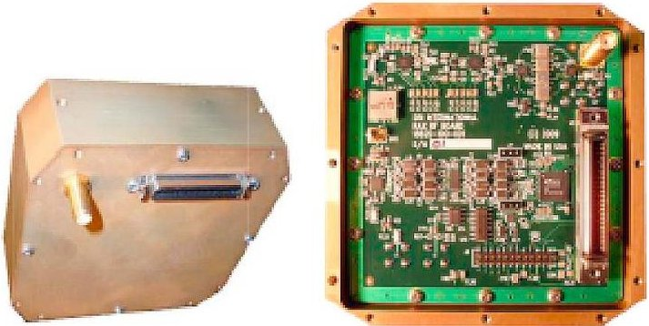

Figure 3. RAX payload: UHF radar receiver.

[20] The payload radar receiver is designed to operate with the UHF incoherent scatter radars shown in Table 4, enabling experiments in the mid-latitudes, the auroral region, and the polar cap.

## 3.3. The Radar Transmitter Used for the First Experiment

[21] Table 5 shows the PFISR radar parameters during the first 300-s of the experiment. Before and after the experiment, PFISR operated with conventional parameters (e.g., multi-beam, long pulse, alternating code) for the measurements of electron density and convection velocities. The $ n_{e} $ measurements have been calibrated using independent $ n_{e} $ measurements using the plasma line technique [Raizada et al., 2008]. Mean ion drifts were obtained by leastsquares fitting a uniform horizontal flow velocity vector to observed line-of-sight velocities measured between the altitudes of 200-400 km.

## 3.4. Ground-to-Space Bi-static Radar Parameters

[22] Table 6 shows the ground-to-space bi-static radar parameters assuming a $ 1^{\circ} $ beamwidth (at half width-half maximum) radar like PFISR. We discuss various parameters in Table 6 below.

## 3.4.1. Radar Sensitivity

[23] A significant portion of Bahcivan et al. [2009] was on RAX radar sensitivity and it was found that the bistatic PFISR-RAX sensitivity is nearly (to within a few dB) equivalent to that of the mono-static Homer UHF radar that operated from Homer, AK in 1970s. Figure 4 shows the same radar sensitivity plot as in Bahcivan et al. [2009] with an updated noise line at -118 dBm corresponding to the actual RAX I noise floor measurements. This plot contains two statistical distributions of Homer radar received power from auroral electrojet irregularities for two different observation periods. The bottom axis is rescaled for RAX.

Table 4. UHF Incoherent Scatter Radars $ ^{a} $

<table border="1"><tr><td>ISR</td><td>Location</td><td>f(MHz)</td><td>Pow(MW)</td><td>BW(deg)</td><td>IL(deg)</td><td>Lat(deg)</td><td>Lon(deg)</td></tr><tr><td>PFISR</td><td>Alaska</td><td>449</td><td>2.0</td><td>1.0</td><td>78</td><td>65.13N</td><td>147.47W</td></tr><tr><td>RISR</td><td>Resolute</td><td>443</td><td>2.0</td><td>1.0</td><td>81</td><td>74.73N</td><td>94.91W</td></tr><tr><td>ESR</td><td>Norway</td><td>500</td><td>1.0</td><td>0.6</td><td>75</td><td>78.15N</td><td>16.03E</td></tr><tr><td>Millstone</td><td>Mass.</td><td>440</td><td>2.5</td><td>0.6</td><td>53</td><td>46.62N</td><td>71.49W</td></tr><tr><td>Arecibo</td><td>P.Rico</td><td>430</td><td>2.5</td><td>0.2</td><td>34</td><td>18.34N</td><td>66.75W</td></tr><tr><td>MUIR</td><td>Alaska</td><td>446</td><td>0.2</td><td>10</td><td>62</td><td>62.40N</td><td>145.17W</td></tr></table>

$ ^{a} $BW: beam width at half width-half maximum, IL: invariant latitude.

<!-- PDF_PAGE: 5 -->

Table 5. Poker Flat Incoherent Scatter Radar Parameters for EXPT #1000

<table border="1"><tr><td>Parameter</td><td>Value</td><td>Units</td></tr><tr><td>Frequency</td><td>449.0</td><td>MHz</td></tr><tr><td>Peak power</td><td>1.6-2.0</td><td>MW</td></tr><tr><td>HPFB</td><td>1.0</td><td>deg</td></tr><tr><td>IPP</td><td>10</td><td>ms</td></tr><tr><td>Pulse length</td><td>100</td><td>μs</td></tr><tr><td>Latitude</td><td>65.1299N</td><td>deg</td></tr><tr><td>Longitude</td><td>147.4707W</td><td>deg</td></tr></table>

## 3.4.2. Experimental Zone

[24] Figure 5 shows the loci of perpendicularity $ (\pm 3^{\circ}) $ and the 1-min satellite tracks that pass through the scattering zone. An estimated 1000 passes are good for experiments in a 1-year mission lifetime. However, for E region irregularities approximately 1 out of 5 experimental passes will have an electrojet speed above the two-stream instability threshold, resulting in electrojet irregularities (based on DE-2 electric field statistics).

## 3.4.3. Spatial and Angular Resolution

[25] The altitude-aspect angle ambiguity functions assuming a 1- $ \mu s $ radar pulse and the PFISR beam at $ 50^{\circ} $ elevation for two positions on the loci of perpendicularity shown in Figure 6 are shown in Figure 7. The ambiguity functions shown area representation of the weights for altitude-aspect angle regions contributing to a radar sample acquired at 1- $ \mu s $ resolution. Nominally, the altitude (angular) resolution is 3-5 km and $ (\sim 1^{\circ}) $ . However, it may be possible to improve the angular resolution to $ \sim 0.1^{\circ} $ by deconvolving the ambiguity function from measurements made at multiple consecutive satellite positions (if sufficient statistics and SNR available).

## 3.4.4. Wavelength Distribution

[26] As shown in Figure 8 the scattering zone contains Bragg wavelengths in the range from 0.4-1.2 m, with a concentration at $ \sim 0.5 $ m. However, as seen from Figure 7, the zones with optimal altitude-angular resolution are near smaller scattering angles, corresponding to the $ \sim 0.5 $ m Bragg scattering zone.

Table 6. RAX Bistatic Radar Parameters

<table border="1"><tr><td>Parameter</td><td>Value</td><td>Units</td></tr><tr><td>Frequency</td><td>426-510</td><td>MHz</td></tr><tr><td>Sampling frequency</td><td>1000000</td><td>I/Q samples/s</td></tr><tr><td>Altitude range</td><td>80-400</td><td>km</td></tr><tr><td>Wavelength range</td><td>0.4-1.2</td><td>m</td></tr><tr><td>Nominal range resolution</td><td>3</td><td>km</td></tr><tr><td>Altitude resolution</td><td>3-5</td><td>km</td></tr><tr><td>Angular resolution w/o deconv.</td><td>1</td><td>deg</td></tr><tr><td>Angular resolution w/ deconv.</td><td>0.1</td><td>deg</td></tr><tr><td>Experimental zone rad</td><td>1200</td><td>km</td></tr><tr><td>Max snapshot acquisition duration</td><td>500</td><td>s</td></tr><tr><td>Experiments per day</td><td>2-3</td><td>per ISR</td></tr><tr><td>RAX capability</td><td>1-2 exps</td><td>per day</td></tr><tr><td>SNR range</td><td>-10 to 80</td><td>dB</td></tr><tr><td>Data options</td><td>raw voltages, GPS/synchronized/unsynchronized</td><td></td></tr><tr><td>Pulse pattern</td><td>software configurable to match ISR</td><td></td></tr></table>

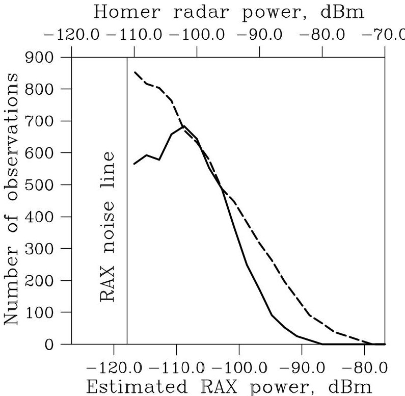

Figure 4. Distribution of received power based on two separate time windows of Homer radar measurements [from Moorcroft, 1987]. The bottom axis is shifted to interpret the data for RAX.

## 3.4.5. Clock Synchronization

[27] A number of TX-RX synchronization methods can be programmed into the RAX radar processing software (depending on the science objectives and satellite power budget for radar signal processing and GPS power budget): (1) GPS-based synchronization: GPS PPS signal timestamps the RAX payload sample stream every $ \sim1 0 0 0 0 0 0 $ th sample;

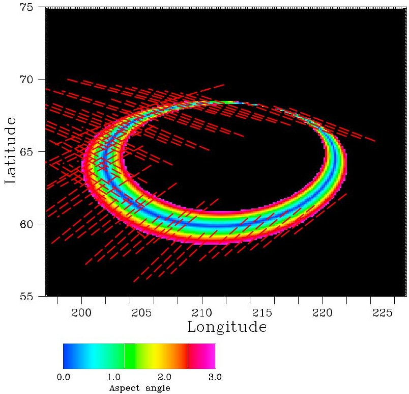

Figure 5. The loci of perpendicularity (<3 degrees) and 1-min satellite tracks over the experimental zone for 30 days. Aspect angle scale units are in degrees.

<!-- PDF_PAGE: 6 -->

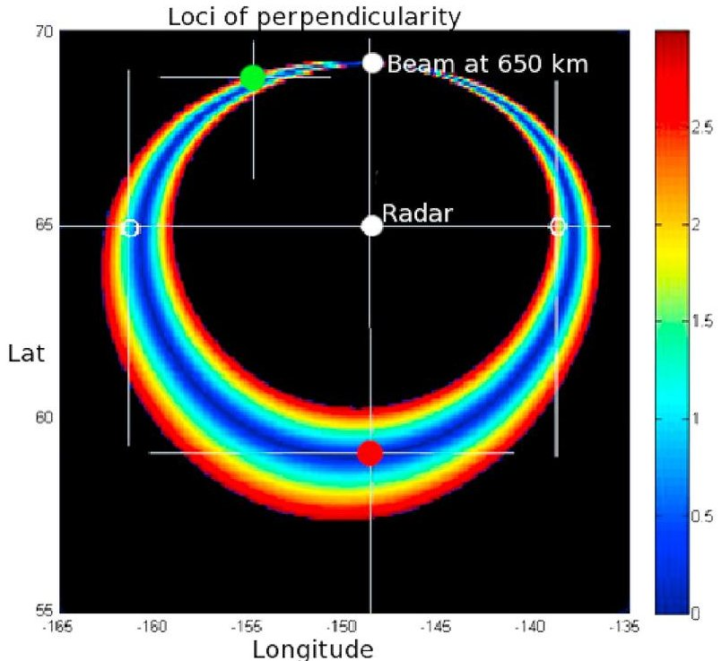

Figure 6. Loci of perpendicularity seen at the satellite altitude (650 km) for irregularities at the altitude of 100 km. The color scale is in degrees. The ambiguity functions corresponding to the locations marked with red and green are shown in Figure 7. Also shown is the radar location and the radar beam position at the satellite altitude.

radar timestamp of the first pulse and the drift values are sent to the spacecraft to reconstruct the timestamps for all the pulses. That is, it is not necessary to uplink the timestamp for each departing radar pulse. The recorded payload timestamps onboard are also used to measure RX clock rate to compensate for Doppler measurements (the same oscillator drives the 1 MHz sample acquisition (ADC) rate and the UHF downconversion frequency). (2) Overflow-based synchronization: A long (365- $ \mu s $ ) direct radar signal saturates or significantly elevates the receiver output every second. An on-board algorithm identifies the long pulse and records the

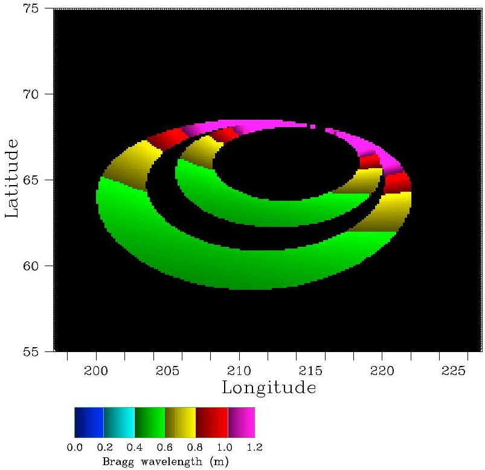

Figure 8. The distribution of Bragg wavelengths within the zones of perpendicularity for E (h=100 km) and F region (h=300 km) irregularities.

rising edge as the marker for arrival time. radar overflow signal timestamp and the drift values are sent to the spacecraft. Knowing the radar-RAX direct path-length and the radar overflow timestamps, RAX timestamps can be reconstructed. Note that this method requires on board clock accuracy <0.5 s. (3) Short incoherent integration with no synchronization: all the radar samples are matched-filtered and incoherently averaged to $ \sim1 $ s; precise ranging is lost but approximate ranging can be achieved using the direct radar signal trace from the range-time-intensity plot and the knowledge of the satellite position. (4) Raw (I and Q) samples; at 9600 bps, RAX telemetry is too limited to downlink the entire 300 s or $ \sim1 $ GB raw data; however, short segments

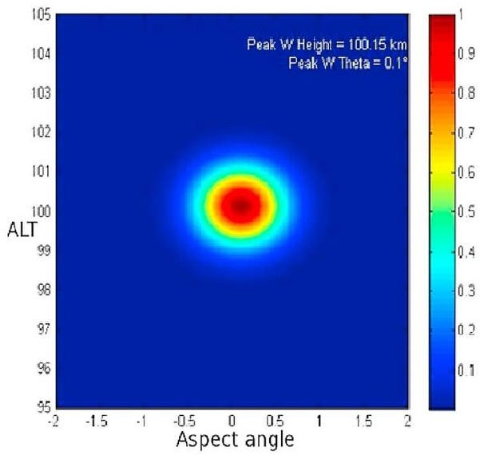

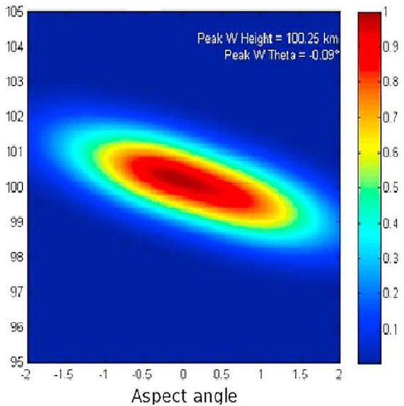

Figure 7. Altitude-aspect angle ambiguity functions for two separate points on the loci-of-perpendicularity seen in Figure 6. The ambiguity functions correspond to the (left) red and (right) green marked locations in Figure 6. The ambiguity functions were computed based on the theoretical PFISR beam pattern and assuming a $ 5 0^{\circ} $ elevation and 1 $ \mu s $ pulse length. Aspect angle is in degrees.

<!-- PDF_PAGE: 7 -->

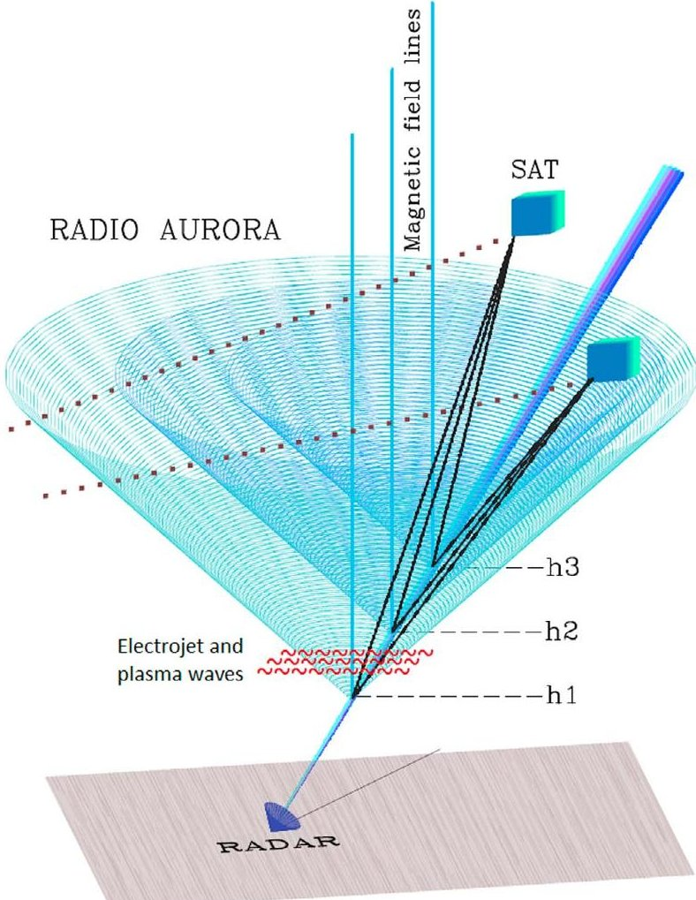

Figure 9. A drawing of a RAX experiment enabling the measurement of the radar aurora (represented by the cones) properties. See text for the details.

(several seconds) can be downlinked for payload receiver diagnostics.

## 3.5. Measurements of Plasma Turbulence Properties

[28] Figure 9 shows a drawing of the irregularities (red wiggles), the magnetic field lines, the radar beam, radio aurora (cones) and the satellite (cubes), and the satellite tracks. The irregularities inside the narrow radar beam and at a given altitude scatter the signals in a hollow cone shape. The thickness of the wall of each cone is a measure of magnetic aspect sensitivity, which is also a measure of plasma wave energy distribution in the parallel and perpendicular directions with respect to the geomagnetic field. In a 300-s radar snapshot experiment, as the satellite trajectory passes through the radio aurora, the payload receiver will record the amplitude and phase of the scattered signals. The altitude information is obtained from the time delay assuming that only the region inside the $ \sim 1^{\circ} $ radar beam is illuminated. Moreover, for a given altitude, the time series of measurements along the satellite track will determine how thick each wall is, determining the magnetic aspect sensitivity of the irregularities. Furthermore, for a given altitude and magnetic aspect angle, the satellite will cross a cone at two points during a single experiment. The two crossings will provide measurements at two different radar Bragg wavelengths, corresponding to measurements at a pair of k-spectrum points.

[29] The software-based radar system allows us to measure the irregularity's Doppler spectrum using pulse-to-pulse ACF measurements. Assuming a spectral width of less than 500 m/s ( $ \sim $ ion-acoustic velocity) [Hysell et al., 2008] and a 0.5-m Bragg wavelength, the corresponding minimum correlation time is 1 ms. As can be inferred from Figure 10, the range aliasing restriction is $ \sim $150 km or $ \sim $500 $ \mu s $ or lower (for $ < 3^{\circ} $ aspect angles and $ 90^{\circ} $ radar-irregularity-satellite scattering angle). Therefore, assuming that scattering from FAI occurs over such narrow perpendicularity range, we expect that pulse-to-pulse ACF at 500 $ \mu s $ or longer lags can be formed to measure spectra of E region irregularities.

[30] Absolute scattering cross-section measurements may be possible, although they require a difficult experiment. It is necessary to measure the scattered Poynting flux intensity at the satellite, which in turn requires the specification of the antenna gain for a given scattered signal polarization defined by the eccentricity and the direction of the polarization. The eccentricity can be obtained from the scattering geometry. The polarization direction can be obtained from the geometry and the estimated Faraday rotation based on the ISR total electron content (TEC) measurements. The RAX antenna gain was calibrated in an anechoic chamber where the antenna gain at a large set of elevation/azimuth pairs were measured using a linearly polarized transmitter. Note that scattering at $ 9 0^{\circ} $ is purely linear and a large portion of the scattering zone at the satellite altitude is near $ 9 0^{\circ} $ , resulting in mostly linear polarization. The antenna calibration data will be utilized to attempt absolute scattering cross-section measurements as a secondary RAX objective.

[31] Finally, it is possible to electronically steer the AMISR radar beam to a large set of positions to construct 3D maps of ionospheric irregularities. Due to the statistical nature of coherent scatter, it is necessary to measure the irregularities with $ \sim100 $ pulses minimum, yielding an uncertainty of 10% in intensity measurements. Considering

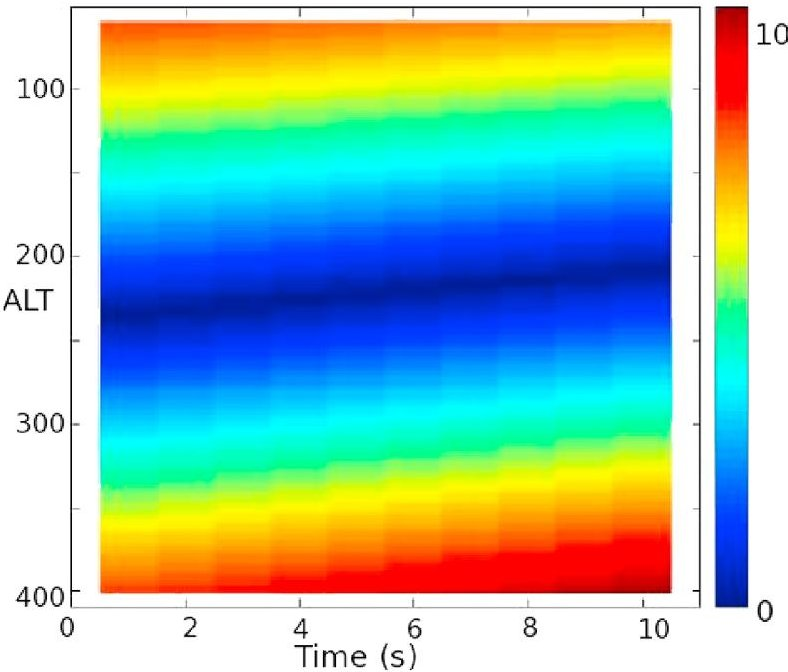

Figure 10. The changing of aspect angle-altitude profile along a satellite track of 10 s (for a fixed PFISR elevation of $ 50^{\circ} $ ). The color scale on the right is in degrees. The altitude axis on the left is in km.

<!-- PDF_PAGE: 8 -->

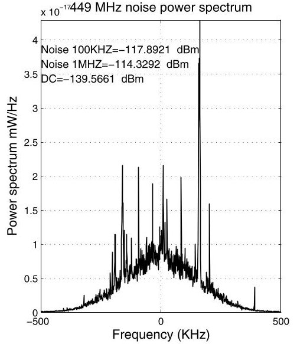

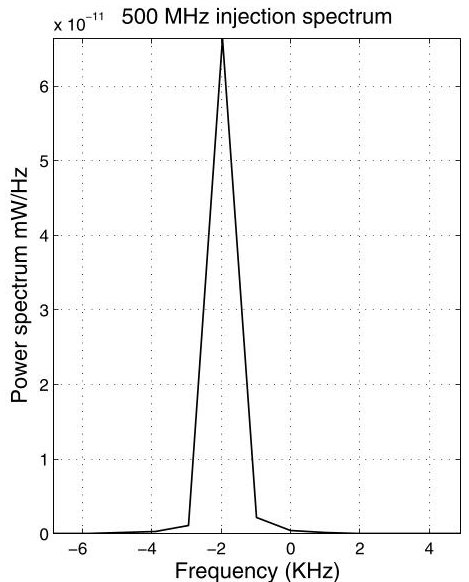

Figure 11. Noise floor test over the Indian ocean.

the transmission of a 100- $ \mu s $ pulse at an inter-pulse period (IPP) of 10 ms for each direction, 10 beam positions with $ \sim 1 $ s integration are possible (duty cycle of 10%). Note that, over Poker Flat, Alaska, in 1 second an aspect angle of only $ 0.15-0.3^{\circ} $ is traversed, implying that both angular and spatial information can be obtained over the imaged 3D region.

## 4. In-Space Receiver Testing and the Experiment #1000

## 4.1. Background Interference and Noise

[32] Figure 11 shows the spectra from two separate but consecutive raw radar data acquisitions of 50 ms each (50000 I/Q pairs) over the Indian ocean on 2010/12/08. The spectrum on the left corresponds to raw data acquired while the receiver was connected to the UHF antenna; while the one on the right corresponds to data with a 500-MHz test signal injection with a 2-kHz offset (DC biases were subtracted first). I/Q balance was within 95%, similar to what was measured on the ground (data not shown). The calculated noise power within the $ \pm 50 $ kHz band centered at 0 Hz is $ -118 $ dBm (based on a calibration constant obtained in the lab using a $ -80 $ dBm signal injection directly into the receiver). The UHF antenna orientation during that 50-ms noise acquisition is unknown. The dominant sources of noise internal to the satellite (e.g., GPS) were off. The calculated noise power $ (-118 $ dBm) was better than the best achieved in the lab/anechoic chamber $ (-110 $ dBm). Note that the noise power measured in the lab with the receiver input terminated was $ -116 $ dBm for the $ \pm 50 $ kHz band (tests done at SRI using the engineering payload with the design nearly identical to the flight unit). The difference of 2 dB is possibly due to the gain difference between the test and the flight unit. Meanwhile, no noise floor calculation is made for the RTI plot shown in Figure 14; instead the lab noise power $ (-116 $ dBm) is used to convert the measured power to SNR.

[33] Figure 12 shows the distribution of the amplitude $ (\sqrt{I^{2}+Q^{2}}) $ of the voltages recorded for 50 ms. The red line shows the theoretical Rayleigh distribution computed using the standard deviation of the voltages. The theoretical curve closely matches the data distribution implying the lack of narrow band interference internal to the satellite.

## 4.2. Experiment #1000 RTI Analysis

[34] ISR-RAX experiments are scheduled on the condition that the satellite passes over a significant portion of the loci of perpendicularity. For the experiment #1000, the trajectory is shown in Figure 13. The circular region is the loci of perpendicularity $ \pm 3^{\circ} $ for FAI at 100 km. The blue (red) cross is the radar location on the ground (radar bore-sight location at the altitude of 650 km).

[35] Figure 14 shows the range-time-intensity (RTI) for the entire 300-s PFISR-RAX experiment. The left axis (range) delay is modulus 10 ms, which is the inter-pulseperiod (IPP). Also shown are the radar magnetic aspect angles along the satellite track corresponding to the (inside the beam) FAI altitudes of 100 and 300 km. The dominant feature on this plot is the direct PFISR signal trace. Note that this trace is aliased within the first 50 s of the experiment.

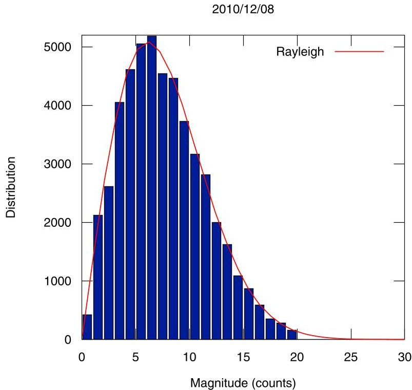

Figure 12. Theoretical Rayleigh distribution based on standard deviation calculated from the in-space payload test data (red line) and the data distribution (blue).

<!-- PDF_PAGE: 9 -->

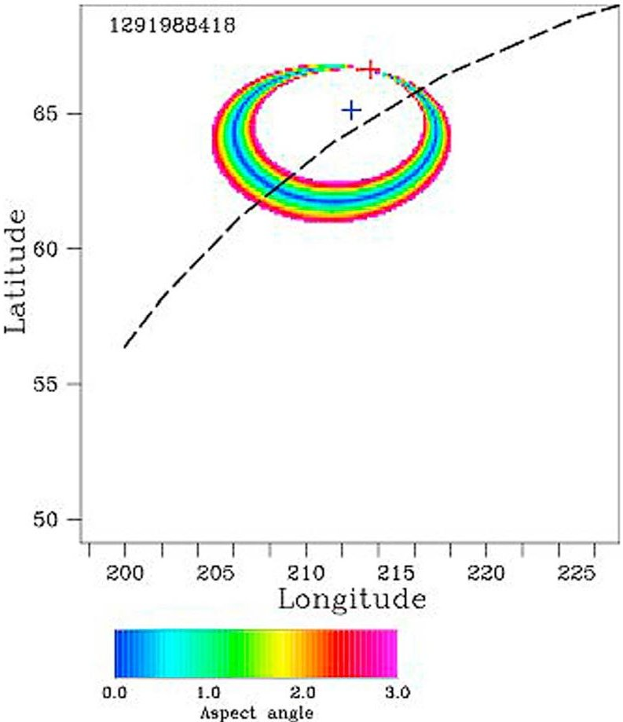

Figure 13. The pass of the experiment #1000 (2011/12/10 UT) over the loci of perpendicularity, i.e., $ \pm 3^{\circ} $ aspect angles.

The signals observed during 10-40 s into the experiment at pulse delays 4.6-5.6 ms and 8.5 ms are identified as clutter from the Air Force Phased Array Warning System (PAWS) radar at Clear Air Force Station, Alaska (PAWS is a United States Air Force Space Command radar system for missile warning and space surveillance). Note that no TX-RX synchronization is applied to this RTI plot, although it is possible using the satellite location (accurate to $ \sim1 $ km) as a function of time and the radar location. Better synchronization can be achieved using the descent/ascent rate of the trace (this is how the clutter was identified and attributed it to a nearby radar).

[36] Background ionospheric conditions based on PFISR and other supporting instruments were geomagnetically quiet. PFISR ran about 30 mins before and after the scheduled 300-s RAX experiment. F region electron densities were low, E region was absent, and the auroral convection was slow, less than 200 m/s. In agreement with the radar data, the Poker Flat, Alaska magnetometer (operated by the University of Alaska Fairbanks) deflections were very small ( $ \sim10 $ nT). The SuperDARN radar located in Kodiak, Alaska did measure some echoes; however, north of Alaska, toward the polar cap. We therefore did not expect FAI over Alaska and did not measure it.

[37] Figure 15 shows the SNR distribution over the entire 300-s pass. While the majority of the SNR is somewhat evenly distributed between 0 and 15 dB SNR, the interference could extend to 40 dB SNR, in which case the measurement of scatter from ionospheric irregularities may be difficult (maximum SNR due to irregularities is $ \sim 3 5 $ dB based on expected backscatter power distribution in Figure 4). However, it should be noted that the range and time duration

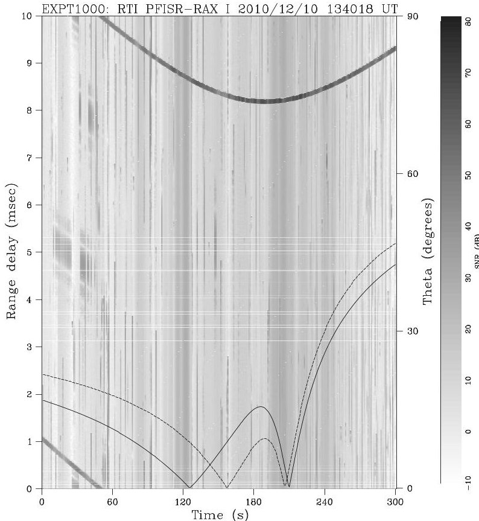

Figure 14. Range time intensity. The main trace is the direct PFISR signal. The signals observed during 10-40 s into the experiment at pulse delays 4.6-5.6 ms and 8.5 ms are clutter from a nearby military radar. The radar magnetic aspect angles along the satellite track corresponding to the (inside the beam) FAI altitudes of 100 and 300 km are shown by the solid and dashed lines, respectively. FAI backscatter is expected when the aspect angle dips near zero.

(along satellite track) of expected scatter due to an FAI at a given altitude are very localized, $ \sim 0. 5 $ ms in range and $ \sim 1 0 $ s in duration for E region backscatter. For the F region, the localization will be even narrower due to larger aspect

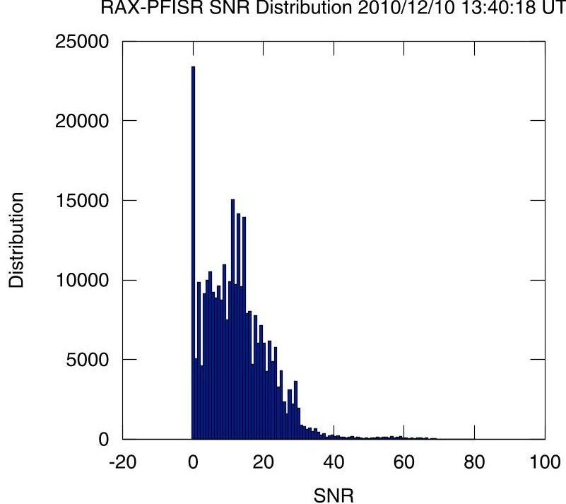

Figure 15. SNR distribution of all data points shown in Figure 14.

<!-- PDF_PAGE: 10 -->

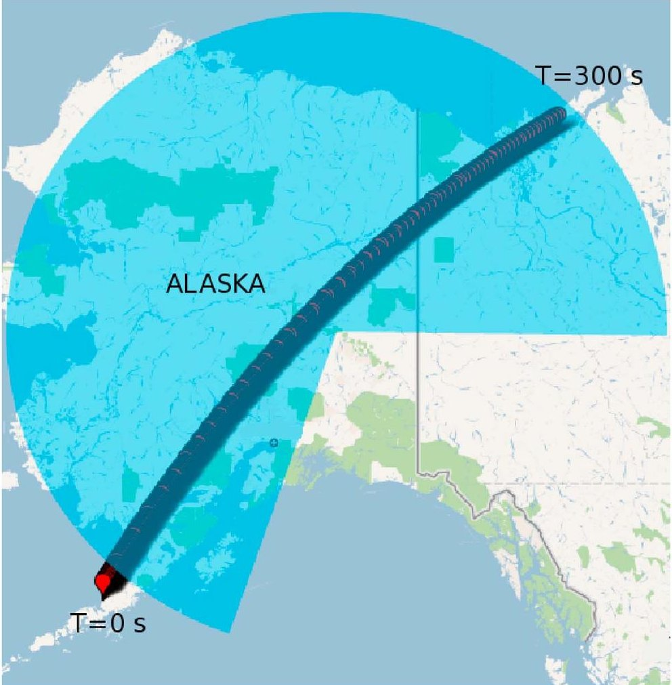

Figure 16. The pass for experiment #1000 over Alaska and the approximate illumination zone of the PAWS radar at Clear Air Force Station, Alaska. It is anticipated that the south-east quadrant is relatively free from interference. In case FAI experiments fall in the interference zone, the PFISR radar beam can be pointed at an angle for irregularity sensing in this quadrant.

sensitivity. Therefore, the narrowly localized signal would be more easily detectable if it is superimposed on the uniformly extended bands like the two dominant strips shown in Figure 14, rather than on localized chirped signals.

[38] Figure 16 shows the pass for Experiment #1000 over Alaska and the pie region illuminated by the PAWS radar at Clear Air Force Station, Alaska. In case the detectability becomes an issue for RAX II and the region outside the illumination shown in Figure 16 toward southeast is found to be more quiet, it is possible to pick a PFISR azimuth and elevation pair such that the loci of perpendicularity will fall in the quiet zone. The experimental zones involving some of the other ISRs (e.g., Resolute Bay) appear to be much farther away from the other PAWS radars (based on PAWS coverage shown in Wikimedia Commons). Nevertheless it is hard to predict an interference floor considering the lack of detailed publicly available information on these radars.

## 4.3. Recovery From Saturation

[39] Figure 17 shows the linear-scale intensity (SNR) of the measured direct PFISR signal (coming from PFISR side lobe, since the main beam is pointed at irregularities) along the satellite path (obtained from the SNR along the curving trace in Figure 14). The signal is most intense around 200 s during which the ground-track of the satellite was very close to PFISR (see Figure 13 where the blue cross represents the PFISR location while the red cross

shows the radar bore-sight location at 650 km). The dominant oscillation period of the signal in Figure 17 near 200 s is 3-4 seconds, which corresponds to the transition time across each of the $ \sim 2^{\circ} $ -wide side lobes of PFISR i.e., $ R\Delta\theta /V=(650\mathrm{km})\cdot(2\pi /180)/(8\mathrm{km/s})\approx 3\mathrm{s}. $

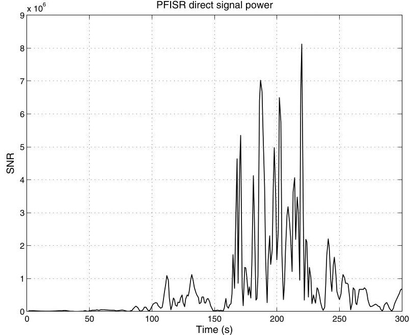

Figure 17. The intensity of the measured direct PFISR signal (coming from PFISR side lobes) along the satellite path.

<!-- PDF_PAGE: 11 -->

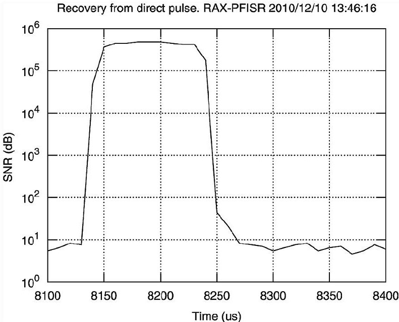

Figure 18. Recovery from direct-path 100- $ \mu s $ PFISR pulse (from side lobes).

[40] Finally, Figure 18 shows a vertical cut from Figure 14 zoomed to 8100-8400 $ \mu s $ delay showing the time series of SNR immediately after the direct PFISR signal hits the receiver at 8125 $ \mu s $ . Note that the SNR rises from 10 to 55 dB in about 20 $ \mu s $ ; following the 100- $ \mu s $ pulse, the recovery occurs in $ \sim 30 $ $ \mu s $ , demonstrating the quick recovery from the powerful direct pulse to observe much weaker coherent scatter signals. Note that the recovery time limits the minimum scattering angle (the angle between the incident wavevector and the scattered wavevector, $ 0-180^{\circ} $ ). This is because the time delay for the radar signals to traverse the scattering path (e.g., radar-to-irregularity and irregularity-to-satellite) must be greater than the time delay for traversing the direct path (radar-to-satellite) at least by the recovery time. For E region irregularities, $ \sim 30-\mu s $ recovery time requires that the scattering angle be a minimum of $ 15^{\circ} $ , which is well within our common experimental geometries.

## 5. Conclusion

[41] As the first NSF CubeSat-based Atmospheric Science and Space Weather project, the RAX satellite was launched in November 2010 and conducted a ground-to-space bistatic radar experiment (EXPT #1000) in December 2011 using as the ground radar transmitter the Poker Flat Incoherent Scatter Radar in Poker Flat, Alaska. Due to geophysical inactivity, e.g., lack of strong ionospheric electric fields and low ionospheric densities, no FAI were expected or observed. However, the radar receiver payload operation has been successfully demonstrated, including the capability to sense the signals as low as -110 dBm, the capability of TX-RX synchronization and accurate ranging, processing 1.2 GB of raw radar data on board in less than 1 h, and the downlink of the science results within 4 passes.

[42] Analysis of the payload data shows that the noise level is sufficiently low. Although the interference level is a concern, it does not appear to significantly limit the measurements. Furthermore, it is likely that the Alaska experimental zone contains regions outside the interference zone.

The interference levels for the experimental zones for the other ISRs remain to be determined.

[43] Meanwhile, RAX II was launched on October 28, 2011 from Vandenberg Air Force Base to a 104 $ ^{\circ} $ inclination, elliptical orbit (400-820 km). The launch was supported by NASA's CubeSat Initiative. RAX II is currently operational and we conducted the first radar experiment again with PFISR on November 22, 2011. The data from this and subsequent experiments will be analyzed and the findings will be published in a separate paper. RAX II experiments will be carried out to investigate both naturally occurring and artificially generated ionospheric irregularities. The higher inclination (compared to that of RAX I) enables more favorable experimental conjunctions with the ISRs at the highest latitudes, e.g., RISR, and joint experiments with the EISCAT Svalbard Radar and the Space Plasma Exploration with Active Radar (SPEAR) HF ionospheric heater. The low perigee (400 km) is very close to the F region irregularities; the implications of this proximity for bistatic radar sensing of FAI at different magnetic field inclinations (in terms of sensitivity and spatial/angular resolution) is to be reported in a future work.

[44] Acknowledgments. RAX was developed under the NSF grant ATM-0121483 to SRI International and the University of Michigan. PFISR operations and maintenance are supported by NSF cooperative agreement ATM-0608577 to SRI International. We acknowledge the contributions made by the RAX team at SRI. We also thank the RAX team at the University of Michigan, in particular Matt Bennett for his inspiring leadership by example and Ben Kempke for his overall brilliance. We thank Andrew Klesh, who, as a postdoc, helped the RAX team learn how to operate at Michigan and was the go-to guy for all our questions.

## References

Andrulis, R. S., C. E. Seyler, and N. Otani (1996), Growth of short wavelength lower hybrid modes in a density depletion and transverse acceleration of ionospheric ions, J. Geophys. Res., 101(A7), 15,723-15,735 doi:10.1029/1999JA900289.

Bahcivan, H., and R. Cosgrove (2008), Enhanced ion acoustic lines due to strong ion cyclotron wave fields, Ann. Geophys., 26, 2081-2095.

Bahcivan, H., and R. Cosgrove (2010), On the generation of large wave parallel electric fields responsible for electron heating in the high-latitude E region, J. Geophys. Res., 115, A10304, doi:10.1029/2010JA015424.

Bahcivan, H., D. L. Hysell, M. F. Larsen, and R. F. Pfaff (2005), The 30 MHz imaging radar observations of auroral irregularities during the JOULE campaign, J. Geophys. Res., 110, A05307, doi:10.1029/ 2004JA010975.

Bahcivan, H., M. C. Kelley, and J. W. Cutler (2009), Radar and rocket comparison of UHF radar scattering from auroral electrojet irregularities: Implications for a nanosatellite radar, J. Geophys. Res., 114, A06309, doi:10.1029/2009JA014132.

Basu, B., T. Chang, and J. R. Jasperse (1982), Electrostatic plasma instabilities in the daytime lower ionosphere, Geophys. Res. Lett., 9(1), 68-71.

Blagoveshchenskaya, N. F., T. D. Borisova, T. K. Yeoman, M. T. Rietveld, I. M. Ivanova, and L. J. Baddeley (2011), Artificial small-scale fieldaligned irregularities in the high latitude F region of the ionosphere induced by an X-mode HF heater wave, Geophys. Res. Lett., 38, L08802, doi:10.1029/2011GL046724.

Cherniakov, M. (2002), Space-surface bistatic synthetic aperture radar, paper presented at Radar 2002 Conference, Inst. of Electr. and Electron. Eng., Edinburg, U. K.

Ecklund, W. L., D. A. Carter, and B. B. Balsley (2008), Numerical study of mode conversion between lower hybrid and whistler waves on short-scale density striations, J. Geophys. Res., 113, A09315, doi:10.1029/ 2008JA013261.

Farley, D. T. (1963), A plasma instability resulting in field-aligned irregularities in the ionosphere, J. Geophys. Res., 68, 6083-6097.

Griffiths, H. D., A. J. Garnett, C. J. Baker, and S. Keaveney (1992), Bistatic radar using satellite-borne illuminators of opportunity, paper presented at Radar 92 International Conference, Inst. of Electr. and Electron. Eng., Brighton, U. K.

<!-- PDF_PAGE: 12 -->

Hysell, D. L. (2008), 30 MHz radar observations of artificial $ E $ region fieldaligned plasma irregularities, Ann. Geophys., 26, 117-129.

Hysell, D. L., G. Michhue, M. F. Larsen, R. Pfaff, M. Nicolls, C. Heinselman, and H. Bahcivan (2008), Imaging radar observations of Farley Buneman waves during the JOULE II experiment, Ann. Geophys., 26, 1837-1850.

Kindel, J. M., and C. F. Kennel (1971), Topside current instabilities, J. Geophys. Res., 76, 3055-3078.

Lynch, K. A., R. L. Arnoldy, P. M. Kintner, P. Schuck, J. W. Bonnell, and V. Coffey (1999), Auroral ion acceleration from lower hybrid solitary structures: A summary of sounding rocket observations, J. Geophys. Res., 104(A12), 28,515-28,534, doi:10.1029/1999JA900289.

Moorcroft, D. R. (1987), Estimates of absolute scattering coefficients of radar aurora, J. Geophys. Res., 92, 8723-8732.

Ott, E., and D. T. Farley (1975), Microinstabilities and production of short wavelength irregularities in the auroral F region, J. Geophys. Res., 80(34), 4599-4602.

Pfaff, R. F., M. C. Kelley, B. G. Fejer, E. Kudeki, C. W. Carlson, A. Pedersen, and B. Hausler (1984), Electric field and plasma density measurements in the auroral electrojet, J. Geophys. Res., 89(A1), 236-244.

Raizada, S., M. P. Sulzer, C. A. Tepley, S. A. Gonzalez, and M. J. Nicolls (2008), Inferring D region parameters using improved incoherent scatter radar techniques at Arecibo, J. Geophys. Res., 113, A12302, doi.10.1029/2007JA012882.

Rose, G. (1992), Three-component a.c. E-field observations during the rocket and scatter experiment in 1988-1989 under radar auroral conditions in northern Scandinavia, J. Atmos. Terr. Phys., 54(6), 669-679.

Skone, S., and M. de Jong (2000), The impact of geomagnetic substorms on GPS receiver performance, Earth Planets Space, 52, 1067-1071.

St-Maurice, J. P., W. Kofman, and E. Kluzek (1990), Electron heating by plasma waves in the high latitude E region and related effects: Observations, Adv. Space Res., 10, 225-237.

H. Bahcivan, Center for Geospace Studies, SRI International, Menlo Park, CA 94025, USA. (hasan.bahcivan@sri.com)

J. W. Cutler, Department of Aerospace Engineering, University of Michigan, Ann Arbor, MI 48109, USA. (jwcutler@umich.edu)