<!-- PDF_PAGE: 1 -->

# Anik-E1 and E2 satellite failures of January 1994 revisited

H.-L. Lam, $ ^{1} $ D. H. Boteler, $ ^{1} $ B. Burlton, $ ^{2,3} $ and J. Evans $ ^{4,5} $

Received 11 May 2012; revised 10 September 2012; accepted 11 September 2012; published 10 October 2012.

[1] The consecutive failures of the geosynchronous Anik-E1 communication satellite on January 20, 1994, and Anik-E2 about nine hours later on January 21 (both incidents occurred on January 20 local time) received considerable publicity because the malfunctions of the satellites disrupted television and computer data transmissions across Canada, as well as telephone services to remote northern communities for hours. This often-cited event is revisited here with materials not covered before. Using publicly available information, Anik-E failure details, media coverage, recovery effort and cost incurred are first presented. This is then followed by scrutiny of space weather conditions pertinent to the occurrences of the Anik-E upsets. We trace the space weather episode's inception on the Sun, propagation through interplanetary medium, and manifestation in magnetic field variations as well as in energetic electron flux increases, and its eventual impact on the Anik-Es. The genesis of the energetic electron enhancements that have been blamed for the satellite malfunctions is thus traceable via high-speed solar wind stream with Alfven wave fluctuations to a longitudinally wide coronal hole on the Sun. Furthermore, strong magnetic pulsations preceding electron flux peaks indicate Pc5 ULF (Ultra Low Frequency) waves as a probable acceleration mechanism for the energetic electron flux enhancement that resulted in the internal charging of the Anik-Es. The magnetic fluctuations may even be possible triggers for the subsequent discharge that caused the satellites to malfunction. This incident illustrates that satellite operators should be on alert for elevated high-energy electron environment that is above established thresholds, as specifications in satellite design may not render a satellite immune from internal charging.

Citation: Lam, H.-L., D. H. Boteler, B. Burlton, and J. Evans (2012), Anik-E1 and E2 satellite failures of January 1994 revisited, Space Weather, 10, S10003, doi:10.1029/2012SW000811.

## 1. Introduction

[2] The Anik-Es were the fifth generation of Anik satellites operated by Telesat Canada to provide communication services across Canada. Both Anik-E1 and Anik-E2 were launched in 1991 into geostationary orbit, positioned at $ 1 1 1. 1^{\circ} \mathrm {W} $ (Anik-E1) and $ 1 0 7. 3^{\circ} \mathrm {W} $ (Anik-E2). The satellites were capable of providing 24 channels of C-band (6/4 GHz)

each, covering all but the furthest north, and 16 channels of Ku-band (14/12 GHz) each, covering all of Canada except for the northern territories, totaling a radiofrequency power of 800 W (see Bertenyi and Tinley [1987] for technical details regarding the Anik-Es). Thus, both payloads had near-full coverage of Canada and partial coverage of United States, and, with each satellite carrying the equivalent of 56 analogue television channels, were the most powerful satellites in commercial use in North America in the early 1990s. Both satellites were critical for Canadian telecommunications because they carried not only virtually all of Canada's television broadcast traffic, but also provided business with a variety of voice, data, and image services. Thus, any malfunction of either satellite would have dire consequences. It turned out that on two consecutive UT days in January 1994 both satellites failed one after another within a nine hour span, creating the worst possible scenario.

[3] The Anik-E satellites were 3-axis stabilized using a biased momentum system, a variation of the WHECON

<!-- PDF_PAGE: 2 -->

(Wheel Control) type, for attitude control. Each satellite had a primary and redundant momentum wheel. It was the failure of the momentum wheel electronics due to space weather that was the root of the problem. The redundant momentum wheel helped restore Anik-E1 but not Anik-E2 because it too failed. The $281.2 million Anik-E1 and the $290.5 million Anik-E2 (in 1994 Canadian dollars for construction and launch) were not insured. Even if the satellites had been insured, it would have taken a considerable amount of time to negotiate a claim and procure a replacement satellite. Failure to fix the on-orbit satellite in a timely fashion would have had a very negative financial impact on Telesat Canada. It turned out, however, that Telesat did manage to acquire the use of "spare on-orbit" capacity, albeit at a significant cost, and also to save the satellite whose redundant momentum wheel failed to be turned on by developing a novel Ground Loop Attitude Control System (GLACS) to regain control of Anik-E2 (more on GLACS later).

[4] Since this particular incident has always been touted as an example of the adverse effects of space weather, it is worthwhile to revisit the event. The objective of this paper is to gather relevant non-proprietary information regarding the event and document them here for a complete picture of an incident that has captured the public's attention, as well as to present space weather conditions pertaining to the satellite operational anomalies that caused the satellites to malfunction. The intention is to present as comprehensive an account as possible regarding this damaging event involving two satellites in two consecutive days. This event serves as a lesson for the need to be vigilant on space environment that produced the deleterious effects on the satellites.

## 2. The Incident

[5] On January 20, 1994 at 1734 UT (12:34 P.M. EST), Anik-E1 began to spin uncontrollably, leaving 40 northern Canadian communities without telephone service and the Canadian Press unable to deliver news to over 100 newspapers and 450 radio stations. Telesat Canada tried to correct the satellite's pointing problems by turning on the redundant momentum wheel system, and Anik-E1 was restored to service seven hours later at 0100 UT of January 21 (08:00 P.M. EST of January 20). About one and a half hours later, at 0214 UT of January 21 (09:14 P.M. EST of January 20), Anik-E2 was plagued with a similar problem to that Anik-E1 experienced earlier by losing Earth lock and starting to spin up. Again, the redundant momentum wheel was turned on in an attempt to stabilize the satellite. However, the backup system failed this time although it has not been able to determine whether the redundant wheel failed on January 21 or may have failed prior to this date. During the Anik-E2 outage, more than 1,600 remote northern communities were without data and television services. Since Anik-E2 carried virtually all of Canada's television broadcast traffic, the national CBC Newsworld and other popular cable channels such as the Weather

Channel, TSN, and MuchMusic went off the air affecting 3.6 million Canadians for hours while Telesat Canada rerouted the services to Anik-E1. It is of interest to note that the Institution of Electrical Engineer's Faraday Lecture entitled "Anyone, Anywhere, Anytime - the magic of communications," originally planned to use Anik-E1 to televise to high schools on February 2, was not available on Anik-E1 because it was urgently needed to replace Anik-E2. About 100,000 home satellite dish owners had to align their satellite dishes manually to Anik-E1 and other satellites such as Hughes Galaxy 6. The disrupted services were re-established within three days, with the bulk of that within one and a half days, albeit at considerable cost to Telesat Canada. In the ensuing months, Telesat Canada tried to re-establish control of Anik-E2 by developing an innovative Ground Loop Attitude Control System (GLACS) (more on GLACS later). Complete operational control of Anik-E2 was finally established on June 21, 1994, and full commercial service was eventually restored on August 1, 1994.

## 3. Media Response

[6] The failures of Anik-E1 and E2 captured the interest of the media. The Ottawa Citizen, a daily newspaper in Ottawa, printed the headline entitled "Space storm disables Anik" on the front page of its Business Section on January 22, 1994, and attributed the satellite failure to a magnetic storm in space "one hundred times greater than we've seen before." The New York Times also reported the event on January 23, 1994 with a heading entitled "2 Canadian Space Satellites Are Knocked Out by Storm" while the Hamilton Spectator screamed with a heading titled "P-ANIK!." The Canadian MacLean's Magazine stated that "an electromagnetic storm of rare intensity" was responsible for the satellite failures in an article entitled "Lost in space." National television news as aired by the Canadian Broadcasting Corporation (CBC) on The Prime Time Magazine blamed "the massive geomagnetic storm at the locations of the satellites" for the Anik-Es failures (the video clip can be viewed in http://archives. cbc.ca/programs/586-437/page/1/). While this particular satellite incident generated a lot of media attention, the space weather conditions attributable to the satellite malfunctions are not as exotic as the media claimed them to be, as shown later.

## 4. The Cause

[7] Several possible causes for the satellite failures that could have originated from electronics, momentum wheels, sensors etc. were investigated by Telesat Canada. Examination of telemetered data from the satellites and diagnostic tests on the satellites eliminated all but the possibility of electrostatic discharge (ESD) damage to a specific part in the speed control loop of the momentum wheel assemblies. This damage caused the control circuitry to produce a false 'full speed' signal, which resulted

<!-- PDF_PAGE: 3 -->

in the eventual slowing down of the momentum wheel to zero. The ESD possibility was also mentioned in Aviation Week and Space Technology [1994a] as follows: "Joe Allen of the U. S. National Geophysical Data Center's Solar Terrestrial Physics Div. said it is likely that the satellites which failed were subjected to bulk charging followed by a discharge that disabled key circuitry." Since high fluxes of energetic electrons are responsible for the internal (bulk) charging of a satellite that leads to ESD, as conclusively demonstrated in a statistical study by Wrenn [1995], space environment, rather than engineering glitches, was the source for the failures of the Anik-Es. Baker el al. [1994a, 1994b] indeed showed the existence of the high energetic electron fluxes preceding and during the satellite failures. However, enhancements of energetic electrons were just part of the "cause and effect" chain of space weather links from the Sun to the ground. Detailed space weather conditions for the entire chain will be presented later.

## 5. The Recovery

[8] Although Anik-E1 was quickly restored by turning on the redundant momentum wheel, Anik-E2's redundant momentum wheel, however, could not be activated. Thus, to recover Anik-E2, a ground-based attitude control solution was needed to feed control commands to the thrusters and magnetic torquers to regain control of all three axes to stabilize the satellite so that the spacecraft could be kept pointing precisely at Canada. To serve this purpose, Telesat Canada developed the Ground Loop Attitude Control System (GLACS). Each Anik-E satellite had 22 thrusters but only 14 were used in the subsequent control of the satellite via GLACS, as the others were too powerful and could not provide small enough control forces and torques. Ground control stations were established in both the east and west regions of Canada (Allan Park (north of Toronto), Ontario and Edmonton, Alberta), as well as near Winnipeg in central Canada to monitor and correct the satellite's movement. Sophisticated computer software was developed to orchestrate the firing of the thrusters for a few milliseconds every few minutes. This enabled Telesat Canada to ensure that Anik-E2 remained focused on Earth for the rest of the satellite's operating life (see Burlton [1995] for details regarding GLACS). Five months later after the incident, Telesat Canada finally re-established control of Anik-E2 on June 21, and full commercial service was eventually restored on August 1, 1994. Thus, instead of writing off the uninsured $300 million satellite, Telesat Canada managed to keep Anik-E2 functioning till November 2005 when it was retired (Anik-E1 was retired in January 2005). It turned out that both satellites exceeded their original design life time.

[9] According to Canadian Radio-television and Telecommunication Commission's rate review of Telesat Canada's RF channel services (Failure and restoral of

## 6. The Cost

satellites, telecom decision CRTC 97-17, Telesat Canada Rate review of RF channel services, 1997, available at http://www.crtc.gc.ca/eng/archive/1997/DT97-17.HTM), the temporary use of U.S. satellite capacity after the Anik-E failures cost Telesat Canada $4.8 million, the transfer of traffic associated with the emergency restoral of the Anik-E1/E2 services cost $1.5 million, and the development and implementation of GLACS cost $7.0 million, all adding up to a total $13.3 million. There are other figures quoted in open sources. From Aviation Week and Space Technology [1994b], "The company's customers were shifted to U.S. satellites during the five months the satellite was out of action. Telesat Canada lost about $15 million as a result." From Baker et al. [2009], "the E2 failure is estimated to have cost Telesat $50 million to $70 million (U.S. dollars) in recovery costs and lost business." Thus, adding up the above, the total cost of the Anik-E malfunctions to Telesat Canada was at least $13.3 million, and could be around $28.3 million or even as high as $50 to $70 million, with the actual costs of interrupted services across Canada not available in the public domain.

## 7. Space Weather Conditions

[10] Previous work has linked the cause of the Anik-E failures to energetic electrons [Baker et al., 1994a, 1994b; Wrenn, 1995]. But that was a small though critical part of the entire picture of the space weather event. Thus, we shall trace space weather conditions from the Sun, through the interplanetary medium, to the particle environment in geosynchronous orbit, and to the magnetic environment in geostationary altitude as well as on the ground. This entire space weather episode had its genesis in a longitudinally wide solar coronal hole continuously emitting high-speed solar wind streams that interacted with the Earth for several days. The persistent high-speed solar wind streams then caused an active geomagnetic field with intense Pc5 ULF waves that resulted in high fluxes of energetic electrons with eventual impact on the satellites. Details of the space weather links now follow.

## 8. Solar Conditions

[11] The year of occurrence of the Anik-E failures was 1994, which was at the lower portion of Solar Cycle 22 as it descended toward the Solar Minimum in 1996. During the declining phase of a solar cycle, the Sun in general is characterized by recurrence of stable coronal holes and a lack of sporadic spectacular transient solar eruptions like solar flares or coronal mass ejections (CMEs) that are prevalent during solar maximum. Thus, in the days preceding the occurrences of the satellite operational anomaly, the Sun was relatively inactive. There were no CMEs, and no major flares with only a M7 flare observed by GOES-7 $ (112.6^{\circ} \mathrm{W}) $ on January 16, which was rather inconsequential. However, the soft X-ray images taken by the Yohkoh Soft X-ray Telescope (SXT) indicates a large southern coronal hole (distinguished as dark region in the

<!-- PDF_PAGE: 4 -->

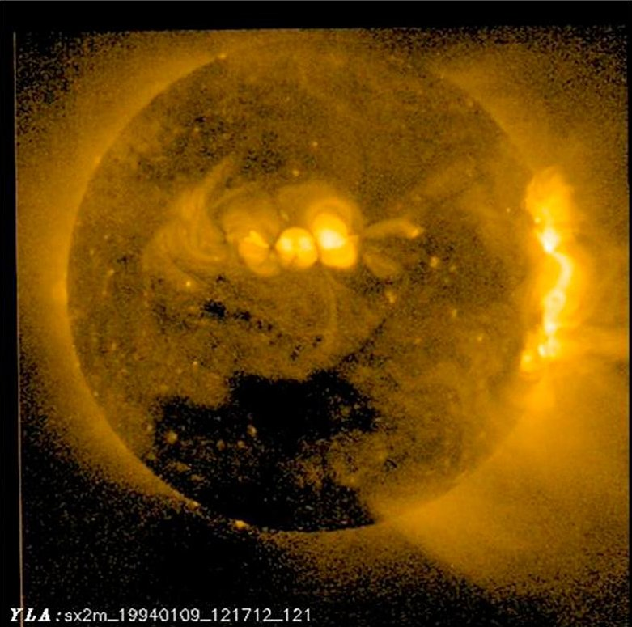

b)

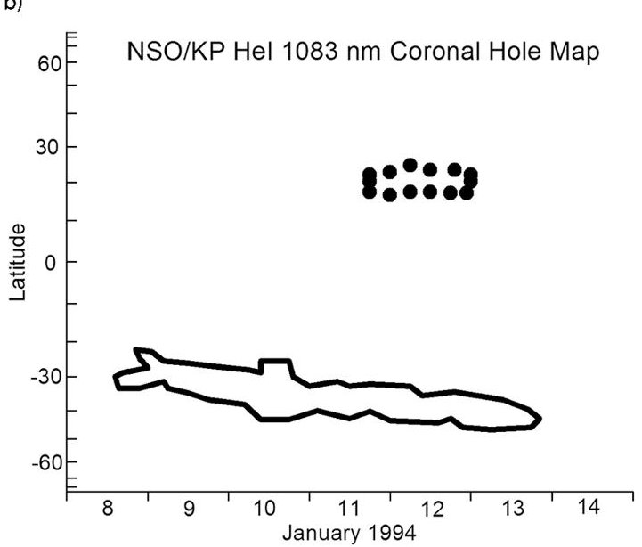

Figure 1. (a) Yohkoh soft X-ray image showing a large coronal hole in the southern solar hemisphere on January 9, 1994 at 1217 UT. (b) Synoptic coronal hole map showing the central meridian passage of the coronal hole. The solid heavy curve is the best estimate of the southern coronal hole boundaries from January 8 to January 13 inclusive, and the dotted curve indicates uncertain boundaries of the northern coronal hole around January 12.

solar image) passing the central meridian of the Sun on January 9 (Figure 1a). The central meridian passage of the coronal hole from January 8 to January 13 is shown in Figure 1b, which was derived from the synoptic HeI 1083 nm coronal hole maps of the National Solar Observatory

(NSO) at Kitt Peak (KP) for Carrington Rotations 1877 and 1878, with the original Carrington longitudes converted to dates. The longitudinally wide coronal hole was the source of high-speed solar wind streams that indirectly caused an enhanced electron flux environment around Anik-E1 and E2, which led to their eventual failures. The Anik-E event highlights that coronal holes, though not as spectacular as coronal mass ejections in causing extreme space weather, can certainly contribute to an adverse space environment that can affect human technological systems.

## 9. Interplanetary Conditions

[12] The interplanetary conditions: solar wind speed, density, and the vertical component of the interplanetary magnetic field $ \left(\mathrm{B}_{z}\right) $ observed by the IMP-8 satellite about 35 Earth radii from Earth, are shown in Figure 2. The solar wind speed started to increase from $ \sim 300 $ km/s to $ \sim 700 $ km/s on January 11 in response to the arrival at IMP-8 of the highspeed solar wind streams emanating from the coronal hole on January 8. From January 12 to January 17, (after which data were not available because the spacecraft was moving to the tail lobe until January 22 when it emerged into the interplanetary medium again), the solar wind speed maintained at high speed levels in the 600-750 km/s range. The solar wind density was high at $ \sim 22.5 $ particles $ \mathrm{cm}^{3} $ on January 10 prior to the solar wind speed increase, and

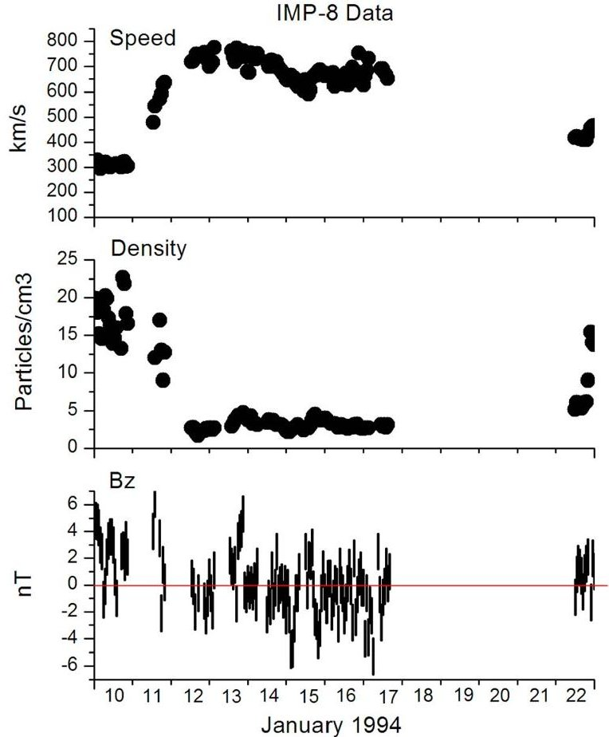

Figure 2. Solar wind speed, density, and the vertical component of the interplanetary magnetic field as observed by IMP-8.

<!-- PDF_PAGE: 5 -->

started to decrease on January 11, dropping to a constant low level of $ \sim 2. 5 $ particles $ \mathrm{c m}^{3} $ on January 12 and thereafter. $ B_{z} $ appeared to behave similarly (i.e., high magnitude in the beginning and low magnitude thereafter). $ B_{z} $ also showed Alfven wave fluctuations, which, together with low density and high speed, are signatures of high-speed solar wind streams emanating from coronal holes. The initial density and $ B_{z} $ increases were due to the compression of plasma and magnetic field when the high-speed solar wind stream emanating from the coronal hole caught up with the slower-speed background solar wind. Kim et al. [2006] pointed out that quiet solar wind conditions accompanied by high-speed solar wind stream are prerequisites for the occurrence of long-duration intervals of enhanced energetic electron fluxes. Prolonged periods of low particle density and of small amplitude $ B_{z} $ fluctuations with respect to Z=0 shown in Figure 2 satisfy quiet solar wind conditions with no strong dynamic pressure and no significant southward $ B_{z} $ . Against this backdrop, if seed electrons due to substorm activities can be accelerated by mechanisms such as ULF waves, enhanced energetic electron fluxes can be expected to last for many days, as is the case presented here.

## 10. X-Ray and Particle Observations

[13] X-ray and particle observations by GOES-7 $ (112.6^{\circ}\mathrm{W}) $ at geosynchronous orbit $ (6.6\mathrm{R_{e}}) $ are shown in Figure 3, with two vertical red lines marking the occurrences of the Anik-E failures. The first panel shows very low solar activity for the entire period, as indicated by X-ray emissions well below the C-flare threshold with only a M7 flare on January 16. Thus, there was no solar precursor for a geomagnetic storm.

[14] During 1989-1994, GOES-7 was the only operational GOES weather satellite (moved to $ 9 8^{\circ} \mathrm{W} $ in 1989 from the original GOES-EAST slot at $ 7 5^{\circ} \mathrm{W} $ when launched in 1987) to cover the whole of continental United States. It was at times moved around, for example, to a western position in winter to cover Pacific storms and to an eastern location in summer to cover east coast hurricanes. By a fortuitous coincidence, GOES-7 happened to be located at $ 1 1 2. 6^{\circ} \mathrm{W} $ in close proximities with the Anik-Es around the times of Anik-E failures. Thus, the particle measurements at GOES-7 were good proxies for the particle environment at the Anik-Es. The panels showing proton fluxes of different energies indicate that proton fluxes were at low levels. The quiet proton levels ruled out single event upset (SEU) by protons as a culprit for the Anik-E operational anomalies. In contrast to the proton fluxes, the >2 MeV energetic electron fluxes (sixth panel in Figure 3) indicate high flux levels for about 10 days from January 12 to January 21, well above the threshold (horizontal red line) that NOAA Space Weather Prediction Center (SWPC) uses for electron alerts. Should the fluxes be above the threshold, there is a high likelihood of internal charging by energetic electrons. The occurrences of the Anik-E failures after $ \sim 9 $ days of high flux build-up are in agreement with the findings of Gubby and Evans [2002], which show that satellite operational

anomalies tend to occur after the 10-day running integral of energetic electron fluence remained above a high fluence threshold for several days. Conceivably, it took days for the charge to accumulate to high levels needed for the discharge of electric field that resulted in Anik-E malfunctions.

## 11. Magnetic Conditions

[15] Figure 4 shows magnetic conditions at geosynchronous altitude and at ground level, with the first through fourth panels presenting the parallel, earthward, normal, and total magnetic fluxes measured onboard GOES-6 (86 $ ^{\circ} $ W) (GOES-6 was used instead of GOES-7 because magnetic data from GOES-7 are unusable), and the fifth and sixth panels showing ground magnetic field variations in the X (northward) component recorded by magnetic observatories operated by Natural Resources Canada (NRCan) at Yellowknife (YKC) (62.5 $ ^{\circ} $ N and 114.5 $ ^{\circ} $ W Geographic; 69.1 $ ^{\circ} $ N and 67.3 $ ^{\circ} $ W Geomagnetic; L of 8.27) and at Fort Churchill (FCC) (58.8 $ ^{\circ} $ N and 94.1 $ ^{\circ} $ W Geographic; 68.8 $ ^{\circ} $ N and 37.5 $ ^{\circ} $ W Geomagnetic; L of 8.18). Both YKC and FCC are situated in the auroral zone near the footprints of magnetic field lines threading the Anik-E and the GOES satellites. This figure clearly shows that there was no major magnetic disturbance during this event. The magnetic measurements in geosynchronous orbit show diurnal variations with oscillations riding on the traces indicating magnetospheric wave activity. The geomagnetic field on the ground was quiet on January 10 and became active for January 11-21 with substorm and pulsational activities (which would be more clearly seen on an expanded magnetic plot of YKC, to be shown later).

[16] Figure 5 is a synopsis of the planetary geomagnetic activity in terms of geomagnetic indices and energetic electrons in terms of daily fluence (flux accumulation over 24 h). Dst and Ap (together with ap and its Kp equivalent), which are global measures of geomagnetic activity, are plotted in the third and fourth panels. The figure shows that the highest Kp is ~5, highest Ap ~30, highest ap ~ 55, and maximum Dst ~ -40. Ap $ ^{*} $ (not shown in the figure) is an index based on the most disturbed 24-h mean of 3-hourly ap indices, and better tracks geomagnetic storms than Ap [Allen, 1982]. The Calendar Distribution of Ap $ ^{*} $ Max compiled by NOAA National Geophysical Data Center (NGDC) (ftp://ftp.ngdc.noaa.gov/STP/GEOMAGNETIC_DATA/ APSTAR/apstar.lst.v1) reveals that there was no geomagnetic event with Ap $ ^{*} $ > 40 in the entire month of January 1994. Thus, these values indicate that there was nothing unusual about the geomagnetic activity that would have suggested the presence of a "massive" magnetic storm taking place at the time of the satellite failures, as reported by the media, nor in the days prior to the upsets when fluxes of the energetic electrons were high.

[17] Although Dst, ap, Ap and Kp are widely used as indicators of geomagnetic disturbances, these indices are biased toward the equatorial and midlatitude regions. To present a more localized picture of geomagnetic conditions

<!-- PDF_PAGE: 6 -->

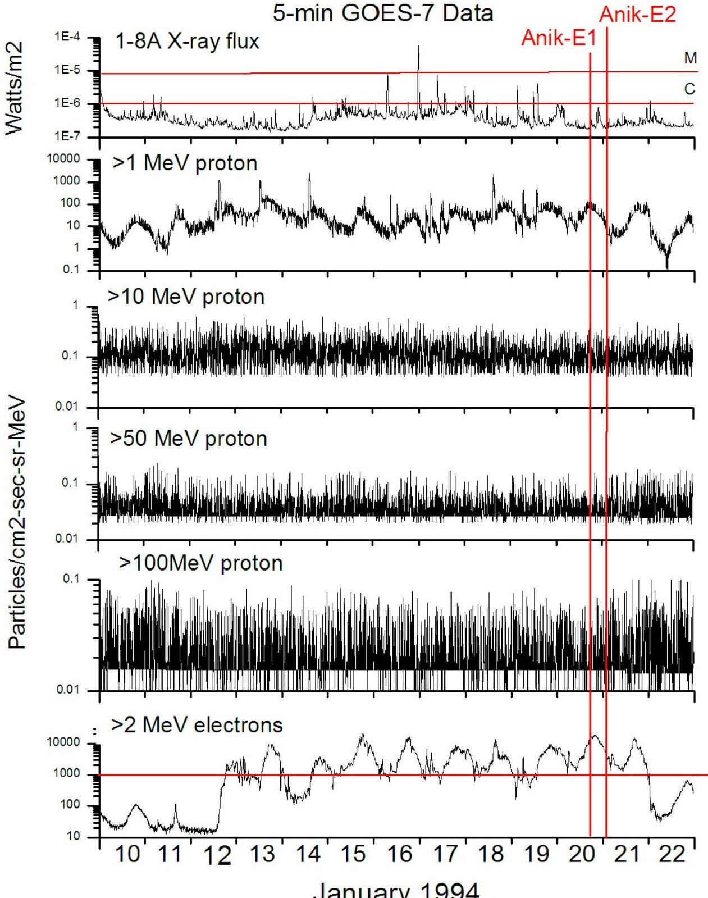

Figure 3. X-ray flux (with C and M indicating C-flare and M-flare), proton flux, and electron flux (with the horizontal red line indicating threshold for high flux) as measured by GOES-7. Times of occurrence of the satellite failures are indicated by the two vertical red lines.

on the ground near the footprints of the geosynchronous satellites, NRCan's auroral zone DRX (the daily means of the hourly ranges in the X-component of the geomagnetic field) was also plotted (second panel). Figure 5 can thus be viewed as a plot showing geomagnetic variations from low latitudes to high latitudes. While the global indices do not indicate the occurrence of magnetic storm, the DRX plot shows active geomagnetic conditions in Canada's auroral

zone where footprints of field lines threading Anik-E1, Anik-E2, GOES-6, and GOES-7 intersect.

[18] The first and second panels of Figure 5 illustrates increases in geomagnetic activity in auroral zone preceded enhancements in energetic electron fluence above the threshold (indicated by the horizontal dashed line) that was established by Wrenn and Smith [1996] to indicate the likelihood of internal charging. The apparent 2-day lag of

<!-- PDF_PAGE: 7 -->

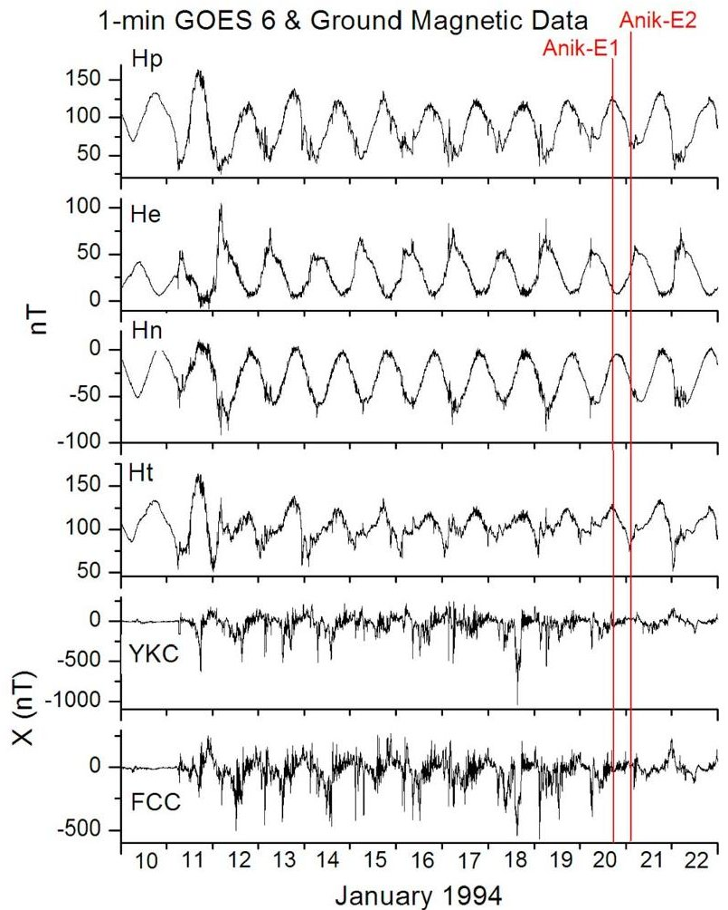

Figure 4. Magnetic field as measured by GOES-6 (first through fourth panels), and by ground magnetic observatories of YKC an FCC located in Canada's auroral zone (fifth and sixth panels). Times of occurrence of the satellite failures are indicated by the two vertical red lines.

electron fluence with respect to DRX conforms to the statistical relationship between electron fluence and magnetic activity over a solar cycle reported by Lam [2004].

## 12. Pc5

[19] To show finer magnetic details, minute-data from an NRCan magnetic observatory at YKC (62.5 $ ^{\circ} $ N and 114.5 $ ^{\circ} $ W) near the footprints of field lines threading GOES-7 (112.6 $ ^{\circ} $ W), Anik-E1 (111.1 $ ^{\circ} $ W), Anik-E2 (107.3 $ ^{\circ} $ W) and GOES-6 (86 $ ^{\circ} $ W) are plotted in Figure 6. The plot shows magnetic variations in the X-component of YKC for January 10-21. Note that scales are different for different days on the plot, for if a fixed scale was used for all the days, then days with weaker activities would only show flat traces without any details. To help discerning the activity levels, different line colors with dark, red, blue, and green in decreasing order of activity are used. At YKC, local midnight is 7 UT and magnetic local midnight for January 1994 is $ \sim $ 0830 UT. Thus, negative bays around those times for a number of days in the plot are indicative of the frequent

occurrences of substorms. Substorms would provide seed electrons to be accelerated to become energetic ones by Pc5 waves [e.g., Kim et al., 2006]. Large amplitude pulsation activity in the Pc5 band (1.7-6.7 mHz or 150-600 s) in the local day time sector (12-24 UT), especially in the morning sector (12-19 UT), are clearly seen in a number of days. The intense Pc5 pulsations (Figure 6) and high speed solar wind (Figure 2) are consistent with Engebretson et al. [1998], which shows that Pc5 pulsation power correlates well with solar wind speed. These strong Pc5 ULF waves were probably excited by the high-speed solar wind stream via the action of the Kelvin Helmholtz instability along the magnetopause [Chen and Hasagawa, 1974].

[20] For a closer look at Pc5, magnetic data were bandpass filtered (1-7 mHz) and Fast Fourier Transform was performed to obtain the power spectral estimates using a 1-h window. The hourly powers of FCC (94.1 $ ^{\circ} $ W) and YKC (114.5 $ ^{\circ} $ W) for January 10-21 are shown together with energetic electron fluxes observed by GOES-7 (112.6 $ ^{\circ} $ W) in Figure 7. The power peaks in the early hours of a UT day correspond to substorm activity which would provide seed electrons for the ULF waves to accelerate, while peaks at other times indicate strong ULF wave activity. The ULF wave activity appeared first enhanced just prior to the occurrence of the first electron peak when the electron flux was still low, and then continued to be strong during the ensuing electron flux increases. With GOES-7 bounded in the east by FCC and in the west by YKC, and with similar temporal variations of the Pc5 power peaks in both stations, the correlation of electron flux peaks with Pc5 power peaks strongly suggest a connection between both phenomena. Since Pc5 power peaks appear a few hours earlier than electron flux peaks, the accelerating mechanism maybe due to magnetic pumping of ULF waves that lead to high energetic electron fluxes in a short time of a few hours, as proposed by Liu et al. [1999].

[21] Finally, the magnetic conditions around the times of Anik-E failures at geosynchronous altitude and those on the ground on an enlarged time scale are presented in Figure 8. The figure shows that the Anik-E1 (111.1 $ ^{\circ} $ W) failure occurred at a magnetic inflection at GOES-6 (86 $ ^{\circ} $ W) and near the end of a pulsation train at YKC (114.5 $ ^{\circ} $ W). Although the Anik-E2 (107.3 $ ^{\circ} $ W) failure occurred after a magnetic inflection at GOES-6, the magnetic signature at YKC does not seem to be as clear. This is perhaps due to the footprint of Anik-E2 being further away from YKC than Anik-E1. In both cases, Hp (the north-south magnetic component) at GOES orbit appeared to change sharply around the times of occurrences of the Anik-E failures. It is tempting to suggest that natural electromagnetic transients could trigger a discharge that disabled the momentum wheel assembly electronics. This is a subject worthy of further study.

## 13. Discussion

[22] For satellite design requirements, Telesat prepares its own space environment specifications according to

<!-- PDF_PAGE: 8 -->

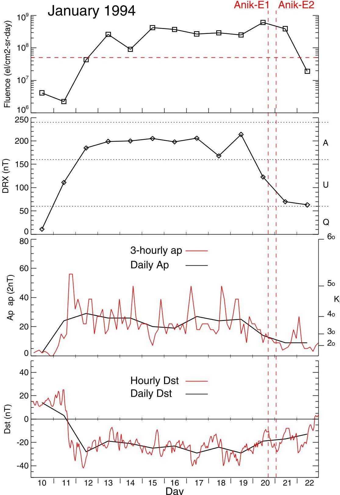

Figure 5. Synopsis of electron fluence and geomagnetic activity for January 10-22, 1994. The first panel is a plot of electron fluence with the horizontal dashes indicating a threshold above which internal charging by electrons is highly likely. The second, third, and fourth panels show auroral zone DRX index, and global magnetic indices of ap, Ap, Kp and Dst. Since ap and Kp are equivalent, the Kp values can be read directly off the ap trace using the Kp scale. Times of occurrence of the satellite failures are indicated by the two vertical red dashes. Q, U, and A in the DRX plot refer to quiet, unsettles, and active conditions respectively.

industry standards, and the environment generally specified by Telesat for design is the NASA-TP-2361 Table 1 scaled to 99th percentile [Gubby and Evans, 2002]. Though the values in the TP-2361 Table are for the worst-case

geosynchronous plasma environment [Purvis et al., 1984], they are for design to control and mitigate surface charging. For specifying the electron environment, the NASA particle model of AE-8 [Vette, 1991] has been a standard for

<!-- PDF_PAGE: 9 -->

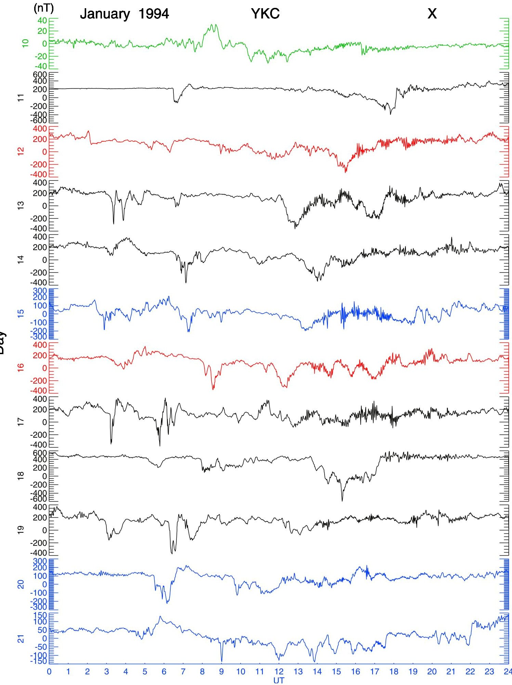

Figure 6. Magnetic record of YKC in the X component for January 10-21, 1994. Different line colors with dark, red, blue and green in decreasing order of activity are used to help discerning the activity levels. Note Pc5 pulsational activities during 12-24 UT and substorm activities during early hours. Local midnight at YKC is 7 UT.

<!-- PDF_PAGE: 10 -->

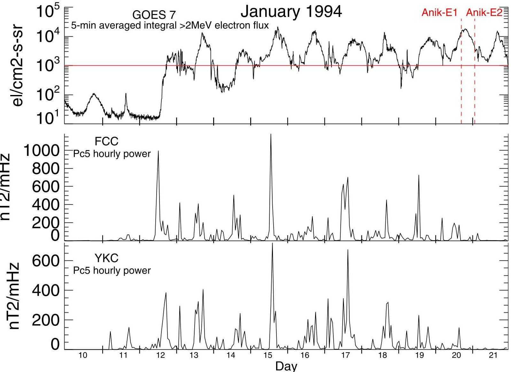

Figure 7. (top) Energetic electron flux and hourly Pc5 powers for (middle) FCC and (bottom) YKC magnetic observatories for January 10-21 1994. Threshold for high flux (horizontal red line) and occurrences of satellite failures (vertical red dashes) are indicated.

the satellite community. The AE-8 model presents a longterm average environment, and does not necessarily agree well with observed data (as shown, for example, by Lauenstein and Barth [2005]). The AE8min electron spectrum is at least an order of magnitude lower than the worst-case electron integral spectrum on the flux vs electron energy plot in NASA [2011]. As pointed out by Gubby and Evans [2002], the range of peak particle flux is probably 30 and 100 times the AE-8 spec depending on the energy, and it is difficult to shield against a high flux environment [Baker et al., 1988].

[23] Figures 3, 5, and 7 indicate an enhanced radiation environment that was well above the thresholds prior to the Anik-E satellite failures. Shielding on the Anik-Es could not stop energetic electrons from penetrating inside to cause the satellite upsets under such an elevated highenergy electron environment. For design considerations, it is worth noting that Fennell et al. [2000] established an approximate 145 mils of aluminum shielding for the reduction to the safe level of $ 1 0^{5} $ electrons/cm $ ^{2} $ -s for omnidirectional electron fluxes, based on the worst-case

study. To limit internal ESD, Frederickson et al. [1992] deduced from CRESS data a criterion of $ < 0.08 $ pA/cm $ ^{2} $ equivalent surface current density as a design requirement.

[24] The fluence threshold of $ 5 \times1 0^{7} $ electrons/cm $ ^{2} $ -srday (Figure 5) was derived by Wrenn and Smith [1996], based on 130 switching events in the attitude measurement equipment due to phantom commands thought to be a consequence of internal charging. The USAF adopts a higher fluence threshold. USAF satellite operators are issued warnings when >2 MeV electron fluence meets either of the following conditions: (1) greater than $ 3 \times1 0^{8} $ per day for 3 consecutive days, or (2) greater than $ 1 0^{9} $ for a single day (http://www.ips.gov.au/Category/Satellite/ Latest Conditions/Electron Fluence Forecast/DDDmodel_ web.html). It should be noted that the Anik-E failures satisfied USAF's first criterion.

[25] The flux threshold of $ 1 0^{3} $ electrons/cm $ ^{2} $ -sr-s (Figures 3 and 7) is used by NOAA Space Weather Prediction Center for alert. The rationale for the choice of the NOAA threshold level was stated by Onsager et al. [1996] as follows: "The satellite user community was polled to solicit their input as to

<!-- PDF_PAGE: 11 -->

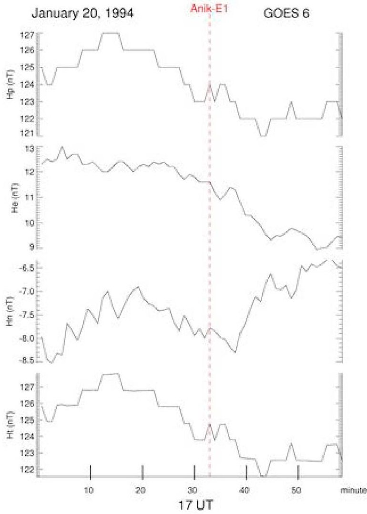

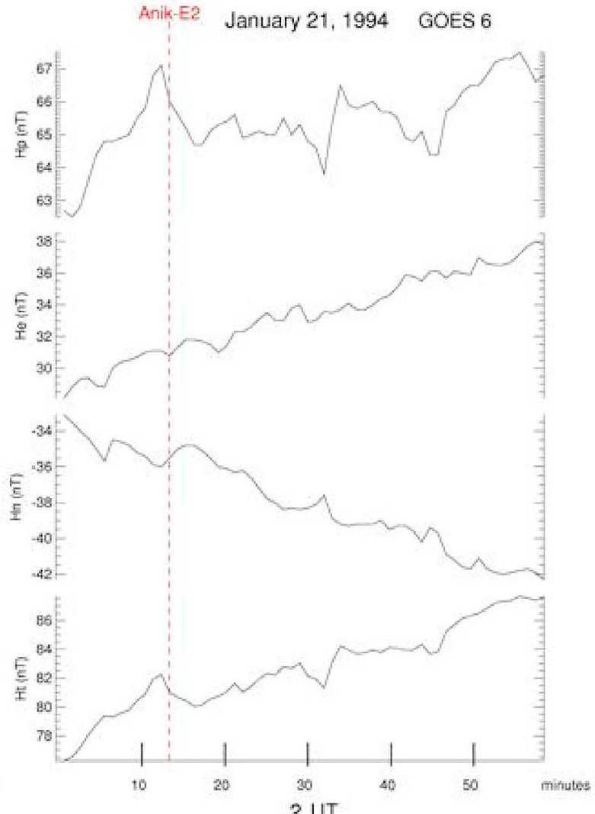

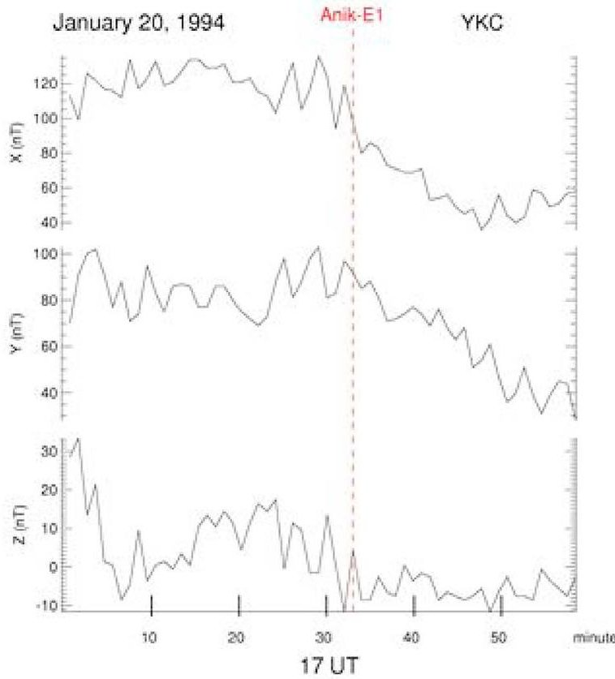

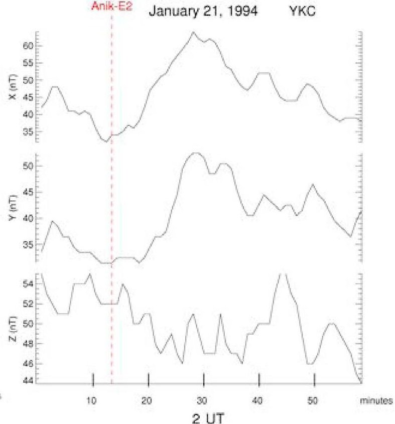

Figure 8. Magnetic variations as observed by (top) GOES-6 and (bottom) YKC (left) for January 20, 1994 for the hour of 17 UT and (right) for January 21 for the hour of 02UT. Times of occurrence of the satellite failures are indicated by vertical red dashes.

<!-- PDF_PAGE: 12 -->

where the threshold should be set to best serve their needs. Since deep dielectric or bulk charging varies with different spacecraft shielding and with different electronic devices, many different levels were suggested. A moderately low level was chosen for the energetic electron alert in order to accommodate the majority of the customer needs."

[26] Internal charging depends on a sustained high level of electron flux (i.e., a function of fluence over a period of a day or more). How high the fluxes need to be and how long they need to be high to induce internal discharge probably depend on many factors, including the specific configuration of the components on the satellite, the age of the satellite, and perhaps also the lower energy electron flux levels. Because the occurrence of internal charging anomalies appears to be a statistical phenomenon that depends on many variables, there is no perfect threshold level. It is up to the individual satellite operators to determine how those flux or fluence levels might affect their assets.

[27] A satellite may have been "hardened" with a high degree of shielding, equipped with the right amount of ideal materials that can accumulate charge with a safe charge leakage rate, and taken into consideration of the sensitivity of the possible victim circuit. But, design alone may not protect the satellite if radiation environment is extremely severe. Thus, situational awareness of high flux or fluence may become necessary. As pointed out by Fennell et al. [2000], for operational considerations, "nowcasting" is a useful technique for anticipating the occurrence of possible internal charging." NOAA Space Weather Prediction Center provides near real-time monitoring of >2 MeV 5-minute integral electron flux in geosynchronous orbit (http://www.swpc.noaa.gov/rt_plots/ elec_3d.html). The crossing of the threshold on the plot signifies significant internal charging that could result in increased risk to satellites.

[28] While now-casting alerts to current hostile particle conditions, forecasting would provide timely warning of impending elevated electron environment. Three of the fourteen Regional Warning Centres (RWC)s of the International Space Environment Service (ISES) (http://www.isespaceweather.org/) provide >2 MeV electron fluence forecast. They are RWC Australia (Radio and Space Weather Services of the Australian Bureau of Meteorology (http:// www.ips.gov.au/)), RWC Canada (The Canadian Space Weather Forecast Centre of Natural Resources Canada (NRCan) (http://www.spaceweather.gc.ca/)), and RWC USA (Space Weather Prediction Center of NOAA (http://www. swpc.noaa.gov/)). Each center uses different methodologies to produce their fluence forecasts. Their forecasts are accessible via the following web links: http://www.ips.gov. au/Satellite/3/1 (Australia), http://www.spaceweather.gc.ca/ current-actuelle/fluence/sffl-eng.php (Canada), and http:// www.swpc.noaa.gov/refm/ (USA). By monitoring the forecasts, satellite operators can be forewarned of high environment days ahead. Should situations warrant them, the satellite operators can reschedule important maneuvers, or go into a heightened state of alert by putting a team ready to

respond instantly to problems and to prepare for recovery for an impending dire situation.

[29] Readers may be interested to note that a sequel to the Anik-E1 upset presented here occurred on March 26, 1996 when Anik-E1 suffered a power disconnect between the solar panel array and the main payload, reducing by about two-third of its communication throughput capacity. The culprit again appears to be internal charging due to $ \sim2 $ week duration enhanced energetic electron fluxes. Details of space weather conditions leading up to the Anik-E1 failure of March 1996 are given by Baker et al. [1996].

## 14. Summary

[30] The failures of Anik-E1 and E2 in January 1994 generated negative societal and economic impact to Canada and attracted considerable media attention. The incident has often been cited as an example of the hazard of space weather. Using non-proprietary sources, the event is revisited here, and publicly available information is used to tell the tale from failure details to media coverage to recovery effort and to cost. The timely solution to the problem, including the development and implementation of the Ground Loop Attitude Control System (GLAC) to control the attitude of the satellite from the ground, may well have saved Telesat Canada from heavy financial loss.

[31] The Anik-E upsets afford a good case study of a chain of space weather processes from Sun to Earth with impact on the near-Earth environment. The origin of the space weather episode was a longitudinally wide coronal hole on the Sun. High-speed solar wind streams from the coronal hole interacting with the magnetosphere, probably through the action of the Kelvin Helmholtz instability along the magnetopause, excited large amplitude Pc5 ULF waves. These strong Pc5 waves then acted as an accelerating mechanism for electrons, producing elevated energetic electron levels for 10 days under quiescent solar wind conditions. The subsequent excess charge build up of these electrons inside the satellite via internal charging finally led to voltages exceeding a discharge threshold. The resulting discharge, possibly triggered by magnetic field fluctuations at geosynchronous altitude, produced damage to the momentum wheel control circuitry that caused the Anik-Es to malfunction.

[32] As the Anik-Es failed in an electron environment that was well above the established thresholds, this event is a reminder that the space environment which geostationary satellites are immersed in can become hostile at times. Satellite operators should be aware of such situations by monitoring the near real-time electron fluxes and the daily electron fluence forecasts.

[33] Acknowledgments. The authors thank National Solar Observatory (NSO) for the provision of the Carrington rotation coronal hole maps, made available through the courtesy of Karen Harvey and Frank Recely as part of an National Science Foundation (NSF) grant. This work made use of the Yohkoh Legacy Archive at Montana

<!-- PDF_PAGE: 13 -->

State University, which is supported by NASA and to which the authors are grateful. The Yohkoh mission was developed and launched by ISAS/JAXA, Japan, with NASA and SERC/PPARC (UK) as international partners. The authors also thank the producers of the GOES, IMP-8, Dst, ap, Ap, and Ap $ ^{*} $ data, which were downloaded from NOAA/NGDC. Terry Onsager is thanked for discussing the NOAA/SWPC threshold for energetic electron fluxes. Thoughtful comments and useful suggestions by the two reviewers are appreciated. The work was performed as part of Natural Resources Canada's Public Safety Geoscience program, with additional support from the Canadian Space Agency.

## References

Allen, J. H. (1982), Some commonly used magnetic activity indices: Their derivation, meaning, and use, in Proceedings of a Workshop on Satellite Drag, pp. 114-134, NOAA, Boulder, Colo.

Aviation Week and Space Technology (1994a), Anik E2 disabled, 28, 31 Jan.

Aviation Week and Space Technology (1994b), Telesat succeeds in Anik E2 rescue, 32, 4 July.

Baker, D. N., R. D. Belian, P. R. Higbie, R. W. Klebesadel, and J. B. Blake (1988), Deep dielectric charging effects due to high energy electrons in Earth's outer magnetosphere, AFSC Rep., AD-A192 154, Def. Tech. Inf. Cent., Fort Belvoir, Va.

Baker, D. N., S. Kanekal, J. B. Blake, B. Klecker, G. Rostoker, H.-L. Lam, and J. Hruska (1994a), Anomalies on the ANIK communications spacecraft, STEP Int., 4(4), 3-5.

Baker, D. N., S. Kanekal, J. B. Blake, B. Klecker, and G. Rostoker (1994b), Satellite anomalies linked to electron increase in the magnetosphere, Eos Trans. AGU, 75(35), 401-402, doi:10.1029/94EO01038.

Baker, D. N., et al. (1996), An assessment of space environmental conditions during the recent Anik E1 spacecraft operational failure [online], ISTP Newsl., 6(2), 8. [Available at http://pwg.gsfc.nasa.gov/istp/newsletter.html]

Baker, D. N., et al. (2009), Severe Space Weather Events—Understanding Societal and Economic Impacts: Workshop Report—Extended Summary, 32 pp., Natl. Acad. Press, Washington, D. C.

Bertenyi, E., and R. J. Tinley (1987), Telesat Canada's Anik E, Acta Astronaut., 16, 257-264, doi:10.1016/0094-5765(87)90113-5.

Burlton, B. (1995), The rescue of Anik E2, Can. Aeronaut. Space J., 41, 57-61.

Chen, L., and A. Hasagawa (1974), A theory of long period magnetic pulsations: 1. Steady state excitation of field-line resonance, J. Geophys. Res., 79, 1024-1032, doi:10.1029/JA079i007p01024.

Engebretson, M., K.-H. Glassmeier, M. Stellmacher, W. J. Hughes, and H. Luhr (1998), The dependence of high latitude Pc5 wave power on solar wind velocity and on the phase of high speed solar wind streams, J. Geophys. Res., 103, 26,271-26,283, doi:10.1029/ 97JA03143.

Fennell, J. F., H. C. Koons, M. W. Chen, and J. B. Blake (2000), Internal charging: A preliminary environmental specification for satellites, IEEE Trans. Plasma Sci., 28, 2029-2036, doi:10.1109/27.902230.

Frederickson, R., E. G. Holeman, and E. G. Mullen (1992), Characteristics of spontaneous electrical discharging of various insulators in space radiations, IEEE Trans. Nucl. Sci., 39, 1773-1782, doi:10.1109/ 23.211366.

Gubby, R., and J. Evans (2002), Space environment effects and satellite design, J. Atmos. Sol. Terr. Phys., 64, 1723-1733.

Kim, H.-J., K. C. Kim, D.-Y. Lee, and G. Rostoker (2006), Origin of geosynchronous relativistic electron events, J. Geophys. Res., 111, A03208, doi:10.1029/2005JA011469.

Lam, H.-L. (2004), On the prediction of relativistic electron fluence based on its relationship with geomagnetic activity over a solar cycle, J. Atmos. Sol. Terr. Phys., 66, 1703-1714, doi:10.1016/j.jastp.2004.08.002.

Lauenstein, J.-M., and J. L. Barth (2005), Radiation belt modeling for spacecraft design: Model comparisons for common orbits, paper presented at Radiation Effects Data Workshop, Inst. of Electr. and Electron. Eng., Seattle, Wash., 11-15 July.

Liu, W. W., G. Rostoker, and D. N. Baker (1999), Internal acceleration of relativistic electrons by large-amplitude ULF pulsations, J. Geophys. Res., 104, 17,391-17,407.

NASA (2011), Mitigating in-space charging effects-A guideline NASA Tech. Handb., NASA-HDBK-4002A, Washington, D. C. [Available at https://standards.nasa.gov/documents/detail/3314877]

Onsager, T. G., R. Grubb, J. Kunches, L. Matheson, D. Speich, R. Zwickl, and H. Sauer (1996), Operational uses of the GOES energetic particle detectors, Proc. SPIE Int. Soc. Opt. Eng., 2812, 281-290.

Purvis, C. K., H. B. Garrett, A. C. Whittlesey, and N. J. Stevens (1984) Design guidelines for assessing and controlling spacecraft charging effects, NASA Tech. Pap., NASA-TP-2361, 47 pp.

Vette, J. I. (1991), The AE-8 trapped electron model environment, NSSDC WDC-A-R&S Rep., 91-24, NASA Goddard Space Flight Cent., Greenbelt, Md.

Wrenn, G. L. (1995), Conclusive evidence for internal dielectric charging anomalies on geosynchronous communication spacecraft, J. Spacecr. Rockets, 32, 514-520, doi:10.2514/3.26645.

Wrenn, G. L., and R. J. K. Smith (1996), Probability factors governing ESD effects on geosynchronous orbit, IEEE Trans. Nucl. Sci., 43, 2783-2789, doi:10.1109/23.556867.