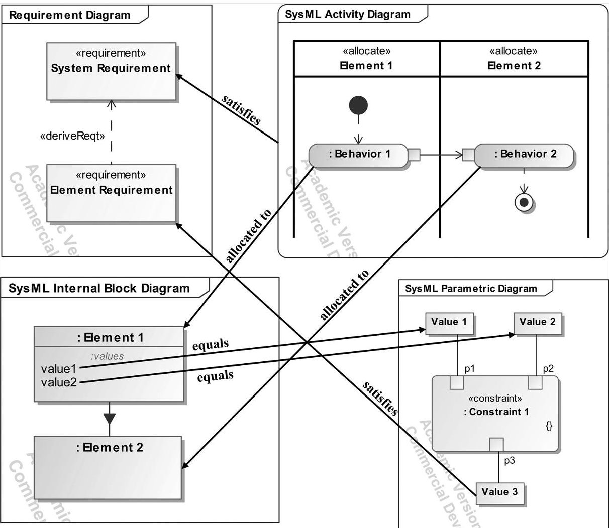
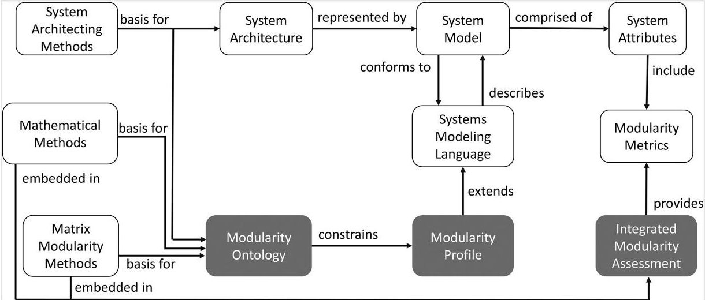
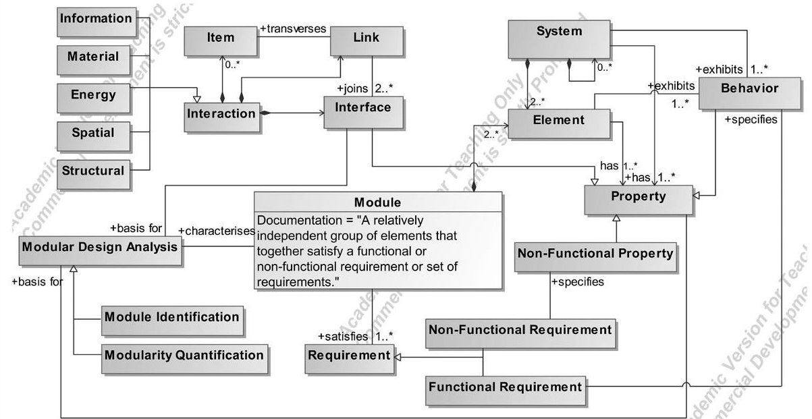
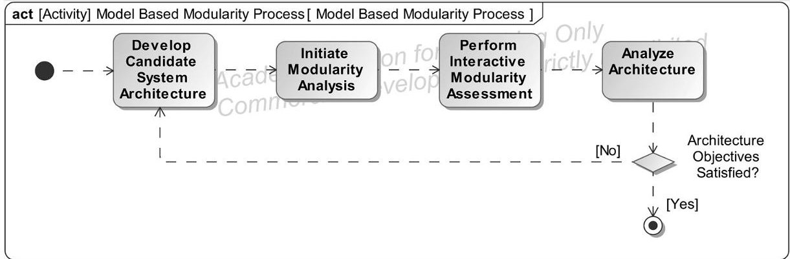
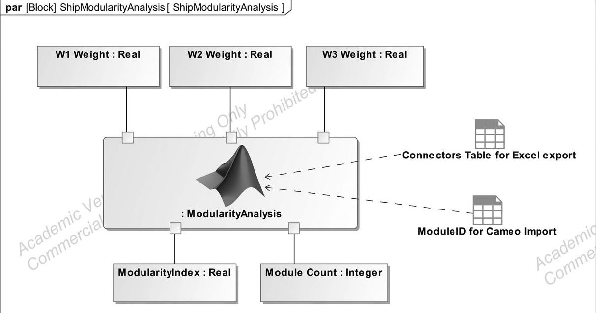
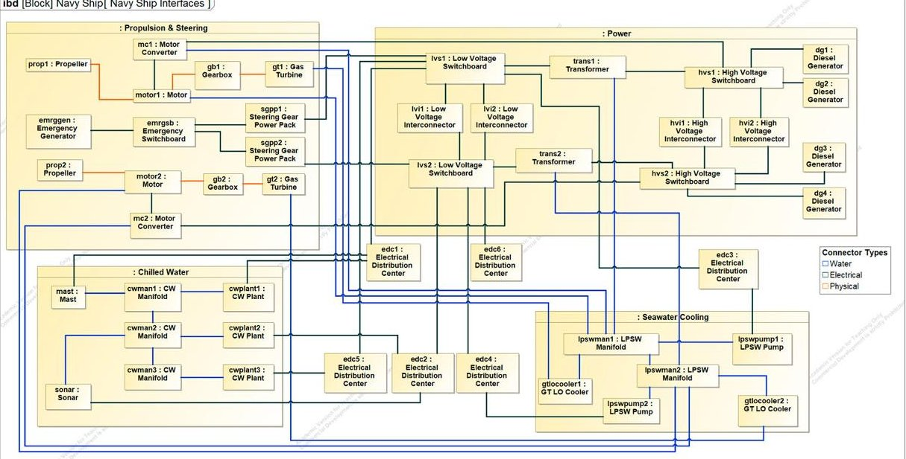
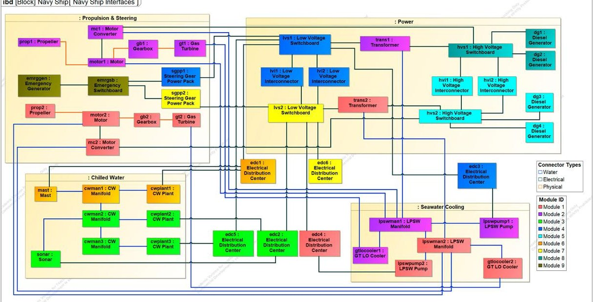
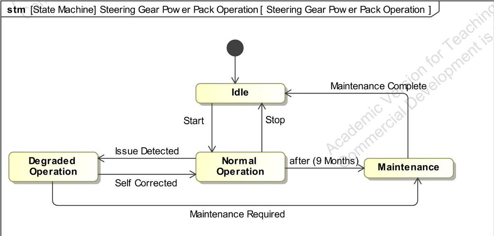
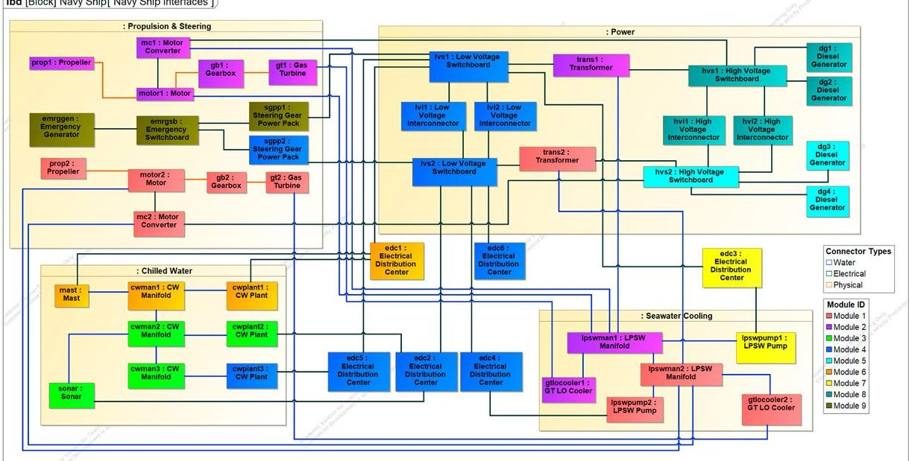
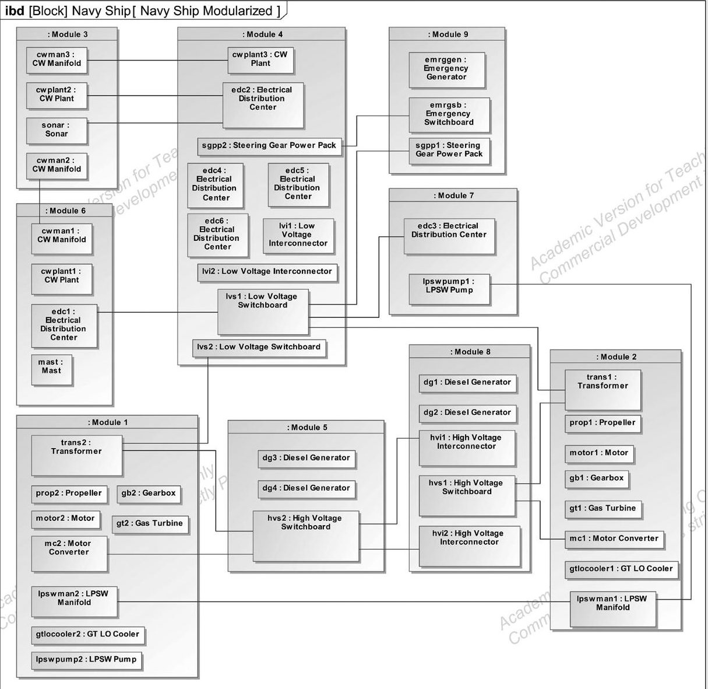

<!-- PDF_PAGE: 1 -->

# A model-based systems engineering approach for developing modular system architectures

Benjamin W. Stirgwolt, Thomas A. Mazzuchi & Shahram Sarkani

To cite this article: Benjamin W. Stirgwolt, Thomas A. Mazzuchi & Shahram Sarkani (2022) A model-based systems engineering approach for developing modular system architectures, Journal of Engineering Design, 33:2, 95-119, DOI: 10.1080/09544828.2021.1980203

To link to this article: https://doi.org/10.1080/09544828.2021.1980203

Published online: 24 Sep 2021.

Submit your article to this journal

Article views: 1341

View related articles

View Crossmark data

Citing articles: 15 View citing articles

<!-- PDF_PAGE: 2 -->

Check for updates

# A model-based systems engineering approach for developing modular system architectures

Benjamin W. Stirgwolt ID, Thomas A. Mazzuchi and Shahram Sarkani

Department of Engineering Management and Systems Engineering, The George Washington University, Washington, DC, USA

## ABSTRACT

Modular system architectures are increasingly important to manufacturers as they seek to decrease system development lead time and as customers have come to expect systems that allow for frequent modular upgrades. There has been considerable research into how to design modules within a system architecture and how to assess the modularity of systems. However, with these established approaches, the modularity assessment is a stand-alone, post-architecting analysis. This research demonstrates how, using model-based systems engineering (MBSE), the assessment of the modularity of a system architecture can be incorporated into the architecting process. To facilitate this, a modularity ontology is developed to guide the semantics and syntax of extensions to the Systems Modeling Language (SysML). Model metadata from behavioural, structural, and state-based system elements is directly assessed using Design Structure Matrix (DSM) based analysis. Elements in the architecture are automatically assigned to modules and the system's modularity is assessed. The approach allows for the system architect to also consider non-functional characteristics in the formation of modules. The architecting and the modularity analysis of the system are completed in a single environment, using SysML parametric diagrams as the catalyst, allowing for a more holistic and complete understanding of the system and its modularity.

## 1. Introduction

From manufacturers of vehicles to manufacturers of multimillion-dollar helicopters, designing systems that can be rapidly developed, deployed, and upgraded is of utmost importance. To create these flexible, easy to upgrade systems, it is critical that the system architecture allows for the removal and replacement of a portion of the system. These loosely coupled, somewhat independent portions of the architecture may be referred to as subsystems, units, or modules. Modularity is the degree to which a system architecture is organised into modules. While there are many reasons for organising an architecture into modules, Baldwin and Clark (2006) state that the objectives of modularisation are 'to make complexity manageable; to enable parallel work; and to accommodate future uncertainty'.

ARTICLE HISTORY Received 7 February 2021 Accepted 9 September 2021

## KEYWORDS

Systems modelling; design structure matrix; modularity and standardisation; ontologies

<!-- PDF_PAGE: 3 -->

Additionally, manufacturers employ modularity in their designs to increase flexibility, foster reuse, decrease development time, and increase a system's upgradeability (Campagnolo and Camuffo 2010).

Beyond commercial manufacturers, the United States Department of Defence (DoD) has recognised the importance of modularity in the systems it acquires - some of which have lifespans of several decades - and has made modular designs a requirement for all major defence acquisition programmes (Patni 2020). As a component of the DoD's Modular Open System Approach (MOSA) to developing and acquiring complex systems, the DoD places importance on having modularity built into a system's architecture to make the design affordable and adaptable. The requirement of having organisations take a modular, open system approach was signed into United States law under Title 10 U.S.C. 2446a.(b), Sec 805 for all major DoD acquisition programmes (Patni 2020).

At the same time, in a variety of industries, universities, and federally funded research entities, system architects are embracing the use of model-based systems engineering (MBSE) methods to develop their system architectures, especially complex system architectures (Madni and Sievers 2018). MBSE is 'the formalized application of modelling principles, methods, languages, and tools to the entire lifecycle of large, complex, interdisciplinary, sociotechnical systems' (Ramos, Ferreira, and Barcelo 2012). However, techniques for developing and evaluating the modularity of a system have evolved outside the realm of architectures developed in an MBSE environment. Despite the widespread interest and requirement of having a modular architecture and being able to evaluate the modularity of the architecture, well-established modularity techniques have not been incorporated into MBSE. With current approaches, the architecting of the system and the assessment of the product's modularity are sequential and independent activities. As changes are made to the system architecture, it is a manual process to input data into the modularity analysis, which is a tedious and error-prone endeavour. Once the analysis is complete, there is no direct feedback into the architecture to make improvements in its modules. With current approaches, the modularity of a system cannot be evaluated in an integrated and efficient manner, thereby missing opportunities to cost-effectively improve the system architecture's level of modularity.

The present paper addresses the need for an integrated approach to developing modular system architectures and assessing a system's modularity in a unified environment. This research demonstrates how - using MBSE-based tools, processes, and language - various aspects of a system architecture can be included in the formulation of a modular system, including the system's functional and non-functional properties. This research develops a modularity ontology to guide extensions to the Systems Modeling Language (SysML) to incorporate modularity concerns in the modelling language. The approach uses a series of algorithms to create initial candidate modules based on the interactions of the system elements, and it allows the architect to intervene in the optimisation routine to account for functional and non-functional considerations. All data - including the system requirements, behaviour, structure, and its properties - are developed, analysed, and maintained in a single environment, providing the system architect with a holistic understanding of the system and its modularity.

The paper provides two contributions to the literature: (1) a scientific contribution through the development of the modularity ontology and its application to extend SysML,

<!-- PDF_PAGE: 4 -->

and (2) a methodological contribution through the integration of modularity concerns into a MBSE system development process.

The remainder of this paper is organised as follows: In the next section, relevant background literature is reviewed related to tools and processes for assessing modularity, as well as the state of the practice of MBSE. In Section 3, the ontology is developed and a methodology is provided for integrating modularity techniques into an MBSE schema. Section 4 shows an application of the proposed approach to a real-world example. A discussion of the approach and its limitations is provided in Section 5. Finally, conclusions and future work are described in Section 6.

## 2. Background

## 2.1. The language of modularity

As many are striving to develop modular systems, one might expect a standardised definition of what a module is or what it means to be modular or how to assess modularity. There is not a standard definition for the terms 'module' or 'modular'. As seen in Table 1, there are a range of definitions. A module can be defined along functional or non-functional boundaries or based on its coupling with the rest of the system.

Modules are commonly defined along functional boundaries; however, this does not necessarily need to be the case. Efatmaneshnik, Shoval, and Qiao (2020) suggest that the primary goal of modules is to address the non-functional requirements of the system in the various lifecycle stages, whether it is changeability, manufacturability, reusability, or upgradability. They suggest that having a controlled definition of a module will facilitate the creation of a standardised process for creating modules and addressing non-functional requirements in the design process, as processes only exist for functional requirements in the systems engineering process standards ISO/IEC/IEEE 15288 and IEEE1220.

While there is divergence in the definition of the term 'module', there have been efforts to standardise the functions of systems and the interactions between the elements of a system. Researchers have realised that a common language for functional modelling, referred to as a functional basis, is important for reducing ambiguity in functional modelling and for increasing the uniformity of interface modelling conducted by different researchers such as Stone and Wood (2000), Hirtz et al. (2002), and Pahl et al. (2007). The primary functions suggested by Hirtz et al. (2002) include branch, channel, connect, control magnitude, convert,

Table 1. A variety of definitions for 'module' exist in the literature.

<table border="1"><tr><td>A module is</td><td>a grouping of components that are similar in the life-cycle processes they undergo,and independent from all components outside of the module as they go through their life-cycle(Gershenson,Prasad,and Zhang2003)</td></tr><tr><td>A module is</td><td>a group of some of the system&#x27;s elements(components,subsystems,etc.),with a physical or notional boundary,and is detachable,either physically or notionally from the system that,by this detachability alone,has a nonfunctional utility for a system lifecycle stage(s)or for a stakeholder(s)Efatmaneshnik,Shoval,and Qiao2020)</td></tr><tr><td>A module is</td><td>group of functional carriers(such as components or parts,or physical elements in a product that contribute to a given function or a set of functions)Bonvoisin et al.2016)</td></tr><tr><td>A module is</td><td>a relatively independent chunk of a system that is loosely coupled to the rest of the system(Hölttä-Otto et al.2012)</td></tr><tr><td>Modules are</td><td>self-contained encapsulated units complete with well-defined interfaces that conform to the plug-and-play passive infrastructure(INCOSE2015)</td></tr></table>

<!-- PDF_PAGE: 5 -->

provision, signal, and support. These functions are decomposed into secondary and tertiary levels. To standardise interaction types, they suggest signal, energy, and material as the primary interaction types but also have a secondary and tertiary decompositions to provide complete coverage. Others have included spatial-type interactions for identifying the adjacency or orientation between elements (Pimmler and Eppinger 1994; Tilstra, Seepersad, and Wood 2012). Having a formalised set of functions and interaction types reduces ambiguity and improves the processing of information. In other functional modelling harmonisation work, ontological approaches have been applied to the behavioural elements in the Unified Modeling Language (UML) and by extension, the Systems Modeling Language (SysML), with a focus on their abstract syntax and semantics to better integrate UML activities, state machines, and interactions (Bock and Odell 2011).

Part of the motivation for these standardisation and harmonisation efforts stems from the recognition that communication amongst a diverse set of stakeholders and system developers tends to be imprecise and ambiguous. The use of MBSE - and its associated formal modelling languages, like UML/SysML - is beginning to address the incompatible and inconsistent semantics used in systems engineering and other domains (Madni and Sievers 2018). This is accomplished using ontologies and metamodels, which are foundational to MBSE. An ontology is 'an explicit representation of a shared understanding of the important concepts in some domain of interest' (Kalfoglou 2001). The objective of the ontology is to turn tacit knowledge into explicit knowledge. A metamodel provides the syntax and constraints for the modelling language and consists of 'object types, attributes of object types, and the rules that enable combining object types and relationships' (Madni and Sievers 2018). SysML was developed in context of the Object Management Group's (OMG) four-layer meta-modelling architecture called the Meta-Object Facility (MOF). This four-layer approach enables the addition of domain-specific modelling concepts in the different layers. Domain-specific concepts may be integrated in the user model (M1) level or at the meta-model (M2) level through language extensions called profiling (McGinnis et al. 2012). To address domain-specific concerns, including the concern of creating modular architectures, appropriate language extensions are needed.

## 2.2. System architecting and model-based systems engineering

System development frequently follows the life cycle stages of the systems engineering 'Vee' model developed by Forsberg and Mooz (1991), INCOSE (2015) starting with business/mission analysis, needs/requirements analysis, and architecture definition. Architecture development occurs in the early stages of development of the system and attempts to describe the properties and characteristics of the system elements that will satisfy the stakeholder and system requirements. The system architecture is a more abstract representation of the system, whereas the system design is focused on the implementation of compatible technologies that align with the requirements, structure, and behaviour described by the system architecture (INCOSE 2015).

One approach to developing a system architecture is through MBSE. MBSE is an approach to systems engineering where all relevant and necessary data concerning the system is contained in a model of the system. The model serves as the authoritative source of truth throughout the development lifecycle of the system (Holt 2021). The model contains consistent, complementary information about the system that is relevant to different

<!-- PDF_PAGE: 6 -->

stakeholders. With all the functional, performance, and structural semantics of the system represented in a precise way (in conformance with a modelling language), the system architect can conduct 'various kinds of analyses - such as performance, safety, or reliability ... with assurance that the information in one view or analysis is consistent with the information in another' (Douglass 2016).

This contrasts with the more traditional approach to designing systems by 'engineering with models' where multiple models are used, often with inconsistent assumptions and underlying semantics (Madni and Sievers 2018). The value of MBSE stems from the fact that MBSE 'integrates requirements, design, analysis, and verification information to address multiple aspects of the system in a cohesive manner, rather than dealing with a disparate collection of individual models' (Friedenthal, Moore, and Steiner 2015). SysML is a formal, general-purpose modelling language used for facilitating the application of MBSE. SysML uses nine types of diagrams to describe the key aspects of a system - its requirements, structure, behaviour, and parametrics.

The simple, conceptual system model given in Figure 1 shows the key aspects of SysML and how the elements of the model interconnect through a set of four SysML diagrams. In this figure, a system level requirement is satisfied by a SysML activity. The actions that occur during the execution of the activity are allocated to the elements of the system. The elements of the system have properties, including value properties that may be used in a parametric analysis. The value properties of the elements are used in a constraint equation, the output of which satisfies an element-level requirement that was derived from the system requirement. A variety of other relations between the parts of the model may exist, but the figure demonstrates the interconnectivity of different aspects of the system architecture model.

Several model-based systems engineering methodologies have been developed that roughly align with the life cycle stages like those outlined by the traditional Vee model. One commonly used method is the Object-Oriented Systems Engineering Method (OOSEM). OOSEM builds on fundamental systems engineering activities like requirements analysis and architecture design but leverages SysML as the modelling language. As its name implies, OOSEM uses an object-oriented approach to create 'flexible and extensible systems that can accommodate evolving technology and changing requirements' (Friedenthal, Moore, and Steiner 2015). Though OOSEM aims to create flexibility and accommodate evolving technology, there is no discussion of how modules can be used to achieve this objective.

Another MBSE methodology is Harmony for Systems Engineering, developed by International Business Machines Corporation (IBM), which also closely follows the systems engineering Vee model. Starting with requirements analysis, requirements are grouped into SysML use cases. The use cases provide the basis for the functional analysis, and the identification of modes/states. After the functional analysis, the functional behaviour of the system and the modes/states are allocated to subsystems. With the Harmony methodology, the process continues with the design synthesis through the systems engineering hand-off to the detailed design teams (IBM Corporation 2011). Though the process discusses architectural analysis (trade studies), it does not directly address the creation of modules as part of the architecting process or in the analysis of the candidate architectures.

More recently, system modelling tool vendor No Magic, Inc., which was acquired by Dassault Systèmes, developed an MBSE methodology called MagicGrid, which is described in

<!-- PDF_PAGE: 7 -->

Figure 1. Four SysML diagrams with their inter-relationships shown.

the MagicGrid Book of Knowledge. Using a grid as a framework to guide the system development, the rows of the grid in this methodology represent the problem, solution, and implementation domains, roughly aligning with ISO/IEC/IEEE 15288. The columns of the grid represent the 'pillars' of SysML: requirements, behaviour, structure, and parametrics (Aleksandraviciene and Morkevicius 2018). The focus of MagicGrid is on the workflow from stakeholder needs through design definition, along with the traceability from one cell of the grid to another; there is no discussion of creating modules as part of the architecting process.

## 2.3. Modularity in product development

In contrast to the architecting processes described in the systems engineering literature, in the product development literature there is an emphasis on defining modules as a fundamental component of the architecting process. Ulrich and Eppinger (2011) suggest that modularity is the most important characteristic of a product architecture. Otto et al. (2016) reviewed the product design literature and identified the common process steps in the early stages of product design. Many of the same processes steps that are included in the Vee process and the model-based system architecting processes also appear in their

<!-- PDF_PAGE: 8 -->

sequence of architecting steps. However, they suggest that as part of the product development process, before an architecture is down selected, it is partitioned into modules. Likewise, Kamrani and Salhieh (2002) describe a process for developing a system, starting with a needs and requirements analysis, performing a decomposition analysis (functional, structural, and function-mapping into elements), conducting a product analysis (design for assembly), as well as a process analysis (design for manufacture). An integral part of their process is the grouping of elements into modules. In the product design literature, there is a consistent focus on the determination of modules as described by Jiao, Simpson, and Siddique (2007), AlGeddawy and ElMaraghy (2013), and Bonvoisin et al. (2016), which is absent from the systems engineering literature.

The Design Structure Matrix (DSM) is a tool that is frequently used for analysing the modularity of a system. The DSM is an n x n matrix, where n is the number of elements being modelled. The DSM maps the system elements to one another through their interactions, which are indicated by the off-diagonal elements of the DSM. The DSM has been used to analyse the system architecture of a wide variety of systems, ranging from electronic systems and buildings to automobiles and aircraft (Eppinger and Browning 2012).

Browning (2016) reviews the significant research that has been conducted on extensions and applications of the DSM, including how the data contained in the DSM can be analysed and extended to determine product modules through clustering analysis, to calculate modularity metrics, to analyse change propagation, to analyse interface intensity and priority, and to analyse a variety of other aspects of a system architecture. Though there has been research in how to extend the capabilities of the DSM, there has been little research into how to better generate the data in the DSM. Suh, Chiriac, and Hölttä-Otto (2015) suggest that a bill of materials (BOM), computer aided design (CAD), or tearing down a product are convenient ways to analyse systems from an assembly-based decomposition perspective. This approach only makes sense when the system has moved into a detailed design stage or there is a physical product that can be examined. These approaches are not feasible early in the system architecture development stages where the elements of the system are abstract entities. In the early stages of system development, Bonjour, Deniaud, and Micaelli (2013) propose a method for creating dual structural and functional DSMs from a domain mapping matrix (DMM), clustering the matrices, and then using expert judgement to determine the consistency of the matrices. This method is labour-intensive and requires the system architect to manually allocate functions to elements as well as provide estimates of the intensities of the couplings. In concluding the review of the DSM state-of-the-art, Browning (2016) states that, 'the fundamental challenges at this point are the large amount of new data required to build a rich structural model of some systems, and the absence of a versatile and user-friendly software toolset'.

The DSM also serves as a foundation for performing a clustering analysis. Many clustering algorithms require either a network or matrix-based representation to be implemented. A variety of clustering algorithms have been used to group the elements of a DSM into clusters with the desire to create a more flexible system architecture. Generally, the objective of clustering algorithms is to minimise the number of inter-module interactions, while maximising the number of intra-module interactions.

One widely used algorithm is the Idicula-Gutierrez-Thebeau Algorithm (IGTA), which was progressively developed and refined by Idicula (1995), Gutierrez Fernandez (1998), and Thebeau (2001). The stochastic, hill-climbing optimisation algorithm is used to select which

<!-- PDF_PAGE: 9 -->

cluster is best for each element. Borjesson and Hölttä-Otto (2012) further evolved the IGTA with the creation of IGTA+, with the objective of improving the algorithm's speed by (1) disallowing elements to belong to more than one cluster, and (2) generating a record of elements that have not yet been tried for a better fit in another cluster. More recently, the IGTA and IGTA+ have been utilised to cluster elements into modules while also considering design constraints (Sinha, Han, and Suh 2020; Sanaei et al. 2016). Sinha, Han, and Suh (2020) use a penalty function-based approach to account for design constraints such as maintenance, packaging, and thermal constraints.

A variety of metrics for quantifying the modularity of a system have also been proposed. Hölttä-Otto et al. (2012) survey the modularity indices and note that metrics tend to fall into the categories of (1) those that assess the interconnectivity of elements/modules and (2) those that assess similarity, accounting for factors such as the manufacturer or materials used. For the coupling metrics, not all metrics can be used to assess all system structures. For example, Hölttä-Otto et al. (2012) note that many indices that have been proposed are unable to account for bus-type architectures, where modules are not connected to each other but rather are connected to a single module called a bus.

The MDL metric developed by Yu, Yassine, and Goldberg (2007) can assess more complicated architectures like those with bus modules as well as those with overlapping clusters. Jung and Simpson (2017) propose a generically termed modularity index (MI) metric that not only accounts for bus-type architectures, but it also addresses the density of connections between and within modules, the connection strengths between and within modules, and the proximity of the interactions to the diagonal of the DSM. In another approach, Sinha, Suh, and de Weck (2018) view modularity as a method for managing the complexity of a system and propose an Integrative Complexity (IC) metric as an alternative modularity metric. They define IC as the complexity associated with integrating the modules of a system and suggest that there is a negative correlation between IC and the modularity of the system. Other metrics include the Module Strength Indicator (MSI) (Whitfield, Smith, and Duffy 2002), the Singular Value Modularity Index (SMI) (Hölttä-Otto and de Weck 2007), and the Non-Zero Fraction (NZF) (Hölttä-Otto and de Weck 2007).

## 3. Methodology

The starting point for this research is the development of the modularity ontology, which guides the development of appropriate extensions to UML/SysML. With the appropriate language established, the system model can be developed and its modularity can be assessed. An overview of the key concepts of this research is provided in Figure 2. The modularity ontology, profile and the integrated assessment process described in this article (and shown as shaded items in Figure 2) are the unique research contributions to the research literature.

## 3.1. Ontology and profile development

Central to developing a modular system and assessing modularity is the development of a modularity lexicon and the relationships between the terms. These terms and relationships are defined in a modularity ontology. A modularity ontology is required to provide the modelling semantic formalisms for addressing the modularity of the system. The ontology

<!-- PDF_PAGE: 10 -->

Figure 2. Proposed approach for assessing a system's modularity. Unique contributions of this research are grey shaded.

guides the development of extensions to UML/SysML, which are too general for domain-specific viewpoints. As discussed by McGinnis et al. (2012) SysML provides an effective means for ontology development for capturing the concepts needed to perform an analysis and create a domain-specific language (DSL). Several approaches exist for extending UML/SysML including: (1) creating new meta-classes or (2) extending existing meta-classes (Bruck and Hussey 2008). As relatively straightforward customisations are needed for incorporating modularity concerns into the metamodel, the approach of adding new properties to existing UML meta-classes was chosen. The extensions of UML/SysML are provided using stereotypes. These new modelling elements and their attributes allow system architects to use the information contained in their descriptive system models and perform mathematical analysis. The top-level ontology shown in Figure 3 considers the behaviour, structure, requirements, and parametrics of modularity. The figure also provides descriptions for the relationships used in the ontology.

The top-level of the modularity ontology shows the key conceptual components of modular systems and their relationships. A system is a 'combination of interacting elements organized to achieve one or more stated purposes' (ISO/IEC/IEEE 15288 2015). The system may be decomposed into an arbitrarily large number of levels of sub-systems until the sub-systems are composed of individual elements. Elements form the lowest level of decomposition in the system hierarchy. Depending on the level of abstraction being modelled, an element may be an assembly of parts or an individual part. For example, a gearbox (a 'black-box' assembly) in a system may appropriately be considered an element if the system is being modelled at a relatively high level of abstraction. In a model at a lower level of abstraction, an individual gear (a singular part) within the same gearbox may be considered an element. Regardless of the level of abstraction, elements of the system have properties, including interfaces, behaviours, and non-functional characteristics.

A module is composed of at least two system elements and is defined herein as a relatively independent group of elements that together satisfy a functional or non-functional requirement or set of requirements. The modules of a system do not have interfaces with other modules; rather, the elements of a module have interfaces with other elements,

<!-- PDF_PAGE: 11 -->

<table border="1"><tr><td>Symbol</td><td>Name</td><td>Description</td></tr><tr><td></td><td>Association</td><td>Shows a relationship between objects with the behaviour/role and the multiplicity of the objects indicated at either end of the solid line</td></tr><tr><td></td><td>Composition</td><td>Shows the relationship of a parent element to its child/children, with the child/children being at the non-diamond end.</td></tr><tr><td></td><td>Generalisation</td><td>Shows the inheritance relationship between two elements, with the more general element(supertype) at the arrowhead end and the more specialised element at the non-arrowhead end(subtype).</td></tr></table>

Figure 3. Top level concepts of the modularity ontology.

potentially both within the module and outside of the module. An interface is a set of properties of an element that describe how the element connects, via a link, and exchanges items with another element. An interaction occurs between two elements of a system when an item (for example, a liquid or a signal) transverses a link that joins two compatible interfaces. At a high level, interactions may be characterised as information, energy, material, spatial, or structural (Sosa, Eppinger, and Rowles 2003). The interfaces, the behavioural properties, and the non-functional properties of the elements form the basis of modularity analysis. Modularity analysis includes the clustering analysis (module identification) and the quantification of the modularity of the system. Concepts from the ontology are implemented in a modularity profile, as shown in Table 2. The profile is the mechanism that extends the language and allows for domain specific concerns (i.e. modularity concerns), to be included in the system model.

## 3.2. Integrated assessment methodology

After establishing the necessary modelling semantics and their relationships, there are four process steps in the integrated approach to assessing a system's modularity, as shown in the SysML activity diagram in Figure 4: (1) Develop the candidate system architecture, (2) Initiate the modularity analysis via SysML parametric diagram (3) Perform an interactive

<!-- PDF_PAGE: 12 -->

Table 2. Implementation of modularity concepts.

<table border="1"><tr><td>Ontology component</td><td>Ontological classification</td><td>UML/SysML</td><td>Implementation</td></tr><tr><td>Module</td><td>Class</td><td>Element</td><td>《module》</td></tr><tr><td>Element</td><td>Class</td><td>Element</td><td>《element》with enumerations for module ID, non-functional characteristics, coupling requirements</td></tr><tr><td>Interface</td><td>Class</td><td>Interface block</td><td>Information, material, energy, spatial, structural interface blocks to type ports</td></tr><tr><td>Junction</td><td>Class</td><td>Connector</td><td>《connector》with enumerations for interaction strength, connector type(used if interface blocks are not used)</td></tr><tr><td>Item</td><td>Class</td><td>Block, value type, signal</td><td>Developed per system architecture</td></tr><tr><td>Joins</td><td>Relation</td><td>N/A</td><td>N/A</td></tr><tr><td>Transverses</td><td>Relation</td><td>N/A</td><td>N/A</td></tr><tr><td>Modularity analysis</td><td>Class</td><td>Constraint property</td><td>Constraint property of block ArchitectureModularityAnalysis</td></tr></table>

Figure 4. Process for developing and assessing a system's modularity.

modularity assessment and (4) Analyse the architecture and perform updates as required. In this integrated, model-based approach, all four steps are completed in one modelling environment. Any changes made to the architecture are therefore included in the analysis without manually having to ensure alignment between the architecture and the analysis tool suite. In this research, Cameo Systems Modeler is used to implement the integrated process. As the proposed approach is built on the data integration of architecting methods, mathematical methods, matrix methods, and the modularity ontology, the methodology is tool agnostic and could very well be completed in a different modelling tool.

## 3.3. Step 1: candidate architecture development

The first step of the process is to develop a candidate system architecture. The architecture will guide the detailed design, with the final product being an instantiation of the architecture. As described previously, the architecture could be developed through a variety of methodologies with the system architect beginning from multiple starting points, depending on the scope and purpose of the modelling effort. The architecture could be described behaviourally, starting from the system's functional requirements, creating a functional architecture, and then mapping the functions to elements. If there is a priori understanding

<!-- PDF_PAGE: 13 -->

of the system, then it may just be described structurally. Ultimately, regardless of the starting point or the methodology, the architecture must show the elements of a system and how those elements interact with each other.

A top-down system decomposition approach is commonly performed as part of the engineering process. To show this decomposition in a model-based environment, it is common to use a SysML block definition diagram (BDD), while a complementary internal block diagram (IBD) or set of IBDs are used to show the interconnections between the elements of the system. Not only does the IBD show the connectors between the elements of the system, but it also shows the type of the connector and what is flowing between the elements, whether it is material, information, energy, etc. Additionally, the interaction strength can be added to the connector through the modularity profile. By default, if there is no connector strength given, the strength is 1, meaning that a connection between the two parts exists. If there is a particularly complicated interface that cannot be changed, for example, then the connector strength is set to a higher value. The connector strength influences the clustering algorithm to group elements that have a stronger connection into the same module.

As with the structure of the system, the functions of the system can be derived from the stakeholder requirements and decomposed. The decomposed functions are allocated to the elements of the system, which tends to create functional partitions of the system. However, as discussed previously, while functional modules are common and widely used, the non-behavioural aspects of the system need to be considered in the development of the system modules for realising the non-functional benefits of a modular architecture; this issue is addressed later in the process. The group of elements may be called a subsystem because together they accomplish some system function, but in terms of modularity, it may not make sense to include certain elements in a functional subsystem, as will be demonstrated.

The SysML activity diagram is one approach for showing the allocation of functions to the structure of the system. In an activity diagram, the object flows correspond to the item flows in the IBD. The object flows in a system model could be used as the basis for the formation of modules. However, if there is a one-to-one allocation between the functional and structural perspectives of the system, there is no benefit of creating modules from object flows as opposed to using the connectors.

At the end of this process step, at a minimum, the system's (structural) architecture should be defined, including the connectors between the elements. Modules are not yet defined in this initial step.

## 3.4. Step 2: initiate modularity analysis

Once the candidate architecture is established, the modularisation of the architecture can begin along with the assessment of the modularity. To conduct this analysis, DSM-based clustering and modularity assessment techniques are used. The DSM-based analysis is embedded in a SysML constraint property, as will be described later. In this integrated, model-based approach, the system architect never directly uses a DSM to analyse the system modules. Instead of a traditionally clustered DSM, which may be difficult to interpret for large systems, the modules are indicated through the assignment of module identification values for the part properties of the system. To assist the visualisation of the modules,

<!-- PDF_PAGE: 14 -->

the module IDs of the elements can be shown either through a table or by using legends on the model's diagrams.

The DSM-based analysis is used in this approach because it serves as a foundation for performing a clustering analysis. As described previously, many clustering algorithms require either a network or matrix-based representation to be implemented. A variety of clustering techniques have been used to group the elements of a DSM into clusters with the desire to create a more flexible system architecture. The general objective of the clustering algorithms is to minimise the number of inter-module interactions, while maximising the number of intra-module interactions. Depending on the architecture, the system architect could develop modules based on the SysML object/control flows between actions or the SysML connectors and their associated items flows between parts. The IGTA+ algorithm is used in this analysis for the modularisation and uses the SysML connectors of the architecture.

For the assessment of the modularity, the Modularity Index (MI) (Jung and Simpson 2017) metric is used as it accounts for three aspects in forming modules: (1) density of connections between and within modules, (2) the connection strengths between and within modules, and (3) the proximity of the interactions to the diagonal of the DSM. The MI algorithm returns a value between 0 and 1, with values closer to 1 indicating a high degree of modularity. Depending on the preferences and needs of the stakeholder or the system architect, the weights of the components of this metric can be varied by changing the SysML constraint parameters of the constraint block. The equations needed for calculating the modularity index are given by Equations (1)-(5). The $ M I_{1} $ portion of the metric assesses the independence of each module, $ M I_{2} $ assesses the density of connectors within a module, and $ M I_{3} $ assesses the proximity of elements' interactions to the diagonal of the DSM. For this article, only equal weights $ (w_{1}, w_{2}, $ and $ w_{3} $ have been applied to $ M I_{1}, M I_{2}, $ and $ M I_{3} $ . Refer to Jung and Simpson's (2017) work for additional details regarding this metric, including its modification for bus-type architectures.

$$
M I = w _ {1} M I _ {1} + w _ {2} M I _ {2} + w _ {3} M I _ {3}
$$

$$
w _ {1} + w _ {2} + w _ {3} = 1, \text {w h e r e} 0 \leq w _ {i} \leq 1
$$

In Equations (3) - (5), $ n_{m} $ is the number of modules; $ BS_{ij} $ is the sum of the connector strengths between modules i and j; $ WS_{i} $ and $ WS_{j} $ are the sum of the within-module connector strengths; $ BC_{ij} $ is the number of connectors between modules; $ WC_{i} $ and $ WC_{j} $ are the number of connectors within modules i and j. $ n_{c} $ is the number of elements (SysML part properties); $ p_{i} $ is the index of the first element in module i; $ q_{i} $ is the index of the last element in module i; $ R_{ij} $ and $ R_{ji} $ are the connector strengths between row i and column j of the DSM; $ R_{max} $ is the maximum connector strength in the DSM. 'Connectors' in the definitions of these equations do not necessarily refer to SysML connectors; the term connector here simply refers to some sort of interaction between elements of a system. The connectors could also represent object flows or control flows on an activity diagram or interactions on a SysML sequence diagram.

$$
M I _ {1} = 1 - \sum_ {i = 1} ^ {n _ {m} - 1} \sum_ {j = i + 1} ^ {n _ {m}} \frac {1}{2 n _ {m} \left(n _ {m} - 1\right)} \left(\left(\frac {B S _ {i j}}{W S _ {i}}\right) + \left(\frac {B S _ {i j}}{W S _ {j}}\right) + \left(\frac {B C _ {i j}}{W C _ {i}}\right) + \left(\frac {B C _ {i j}}{W C _ {j}}\right)\right)
$$

<!-- PDF_PAGE: 15 -->

Figure 5. SysML parametric diagram used for conducting modularity analysis.

$$
M I _ {2} = \frac {\sum_ {i = 1} ^ {n _ {m}} W C _ {i} + n _ {c}}{\sum_ {i = 1} ^ {n _ {m}} \left(q _ {i} - p _ {i} + 1\right) ^ {2}}
$$

$$
M I _ {3} = \frac {\sum_ {i = 1} ^ {n _ {c} - 1} \sum_ {j = i + 1} ^ {n _ {c}} \left(1 - \frac {j - i}{n _ {c} - 1}\right) \left(R _ {i j} + R _ {j i}\right) / R _ {\max}}{\sum_ {i = 1} ^ {n _ {c} - 1} \sum_ {j = i + 1} ^ {n _ {c}} \left(R _ {i j} + R _ {j i}\right) / R _ {\max}}
$$

A SysML parametric diagram is used to initiate both the clustering and the assessment of the modularity, as shown in Figure 5. The value properties are either supplied by the system modeler or are output by the clustering and assessment algorithms. The constraint property of the ArchitectureModularityAnalysis block houses the MATLAB scripts, including those to build a DSM based on the system architecture, the clustering algorithm IGTA+ the modularity metric algorithm, as well as the script for adding the module identification to the tagged properties of the elements of the architecture. Through simulation of the parametric diagram, MATLAB reads the connector data directly from the model as well as the value properties and returns not only a modularity metric but also the module IDs for each of the elements.

## 3.5. Step 3: perform interactive assessment

The algorithmic assessment may yield analytically optimal modularisation, but the results may be unrealistic. There may be good reasons for including or excluding elements from the optimal modules, such as lifecycle concerns or environmental requirements. There is a need to consider objectives of the modularisation and the perspectives of the system stakeholders when modules are developed. Considerations such as maintenance schedules, the manufacturer, and environmental requirements need to be addressed. When these nonfunctional requirements and constraints are considered, modules can be tailored from the

<!-- PDF_PAGE: 16 -->

algorithmically optimal modular architecture that enable the system modeler to realise the desired benefits of modularity, such as maintainability and manufacturability.

To address these constraints, the proposed process allows for the system architect to add attributes to the SysML part properties that serve as a basis for including or excluding elements from modules. The IGTA+ was modified to allow the system architect to force selected part properties to be included or excluded from modules. As has been suggested by Sanaei et al. (2016) for addressing constraints in system modularisation, elements that must be in the same module - perhaps because they are made by the same manufacturer or because they have the same maintenance schedules - are simply merged into a single pseudo-element during the clustering routine. Upon completion of the clustering, the merged pseudo-element is then split apart into the original elements, which have been assigned to the same module. For elements that must be in different modules - perhaps because of weight or vibration constraints - the algorithm is modified so that the IGTA+ ClusterBid value of the element is zero. The ClusterBid is how well-suited an element is for a selected module. Setting this to zero ensures that the elements will be in different modules.

The system modeler or system architect may consider other aspects of the system model as well, such as the state-based behaviour of the system. For example, if elements of the system are on the same maintenance cycle, this should be factored into the consideration of module formation. The SysML state machines for each of the system elements are an appropriate mechanism for accounting for the commonality in the state-based behaviour. Other states, such as when the element reaches retirement (or obsolescence considerations), could also be factors in the formulation of the modules. The appropriate lifecycle states should be generated for each of the elements that are being considered in the system modularisation.

Once the required couplings are set based on the needs of the stakeholders and any design constraints, the parametric analysis can be re-initiated. By overriding the algorithmically optimal modularity, the modularity metric will decrease. While the MI value will decrease upon the system modeler's intervention, the objective should not be to have a highest modularity score possible when creating modular architectures. As discussed in Engel and Reich (2015), maximising the modularity of a system 'may decrease the lifetime value of a system due to excessive costs related to the system's interfaces'. The objective is to have as high of a modularity score as possible, while meeting the stakeholder's objectives for modular design and the system design criteria. This interactive approach allows the system modeler to take advantage of the optimisation afforded by computer algorithm, and at the same time, it provides flexibility in that the system modeler can intervene in the modularisation process to address system constraints.

## 3.6. Step 4: analyse and update architecture

With the candidate architecture defined, the modules defined, and the modularity assessed, it is appropriate to ensure that the architecture supports the strategic plan for incorporating new technology. The technology refresh rate at the module level will likely be greater than the overall system architecture - hence one of the reasons for creating modules in the first place. Technology insertion should happen at the module level. The overall system architecture should be relatively fixed, as are the inter-module interfaces. To better visualise the modules and the interfaces between the modules, it is beneficial to refactor the originally

<!-- PDF_PAGE: 17 -->

defined, functionally-based subsystems into modules in accordance with the optimisation and constraints applied to the architecture in the previous steps. This refactoring allows the system architect to visualise the architecture in a similar manner to how modules would be visualised in a clustered DSM. Having a clear picture of the inter-module interfaces is critical when planning future module updates, as any new technology insertions need to be compatible with the inter-module interfaces. Standardising the inter-module interfaces allows for efficiently creating product variants.

From the beginning of the system development, there should be a technology roadmap detailing which aspects of the system will need to be refreshed and how regularly they will be refreshed. The process of developing a technology roadmap allows the organisation to identify, evaluate, and select strategic alternatives that can be used to achieve a desired science and technology objective' (Kosstoff and Schaller 2001) and to develop standardisation measures early in the product development lifecycle (Schuh, Arnoscht, and Rudolf 2010). In this step, the system architect ensures that the modularised architecture supports the objectives of the technology roadmap and corrects any issues in the architecture in support of the organisation's requirements and objectives.

## 4. Case study

In this case study, the proposed methodology is applied to an existing system architecture. The system of interest is a naval ship, consisting of four subsystems (additional subsystems are omitted for simplicity). This architecture was developed by Paparistodimou et al. (2020) through interviews with SMEs of the technical system architecture. The four subsystems of interest are: the power subsystem, the propulsion and steering subsystem, the chilled water subsystem (which is for the combat systems and power and propulsion), and the seawater cooling subsystem (which is for power, propulsion, and other consumers). Overall, the architecture consists of 48 elements and 64 interactions between them. While larger systems than this could be analysed, even at this level, having an integrated, model-based approach to assessing the modularity of the system is logical as it would be impractical to perform the system modularisation manually.

In this case study, assumptions regarding the elements' properties are made, including their maintenance cycles, their manufacturer, and their sensitivity to vibration. The case study demonstrates how using the proposed, model-based approach allows for the integration of structural, behavioural, and non-functional design constraints in the formulation of system modules and the assessment of the modularity.

The first step in the process is the development of the system architecture. In this case study, the four subsystems were defined by Paparistodimou et al. (2020). The elements of the architecture and the interactions between them were also defined. The only interaction types are electrical, water, and physical. Though different interaction strengths could be used in this case study, all interaction strengths are set to a default value of 1, indicating that an interaction between system elements simply exists. The architecture is translated into a SysML model using the modularity profile. The profile is used to identify elements, interfaces, and their properties that are used in the subsequent clustering analysis. Figure 6 shows the interfaces of the ship's elements and the types of interactions through a SysML IBD. The properties of the elements that are considered in the modularisation are the maintenance cycles, manufacturers, and vibration sensitivity.

<!-- PDF_PAGE: 18 -->

Figure 6. Initial system architecture of the ship with the interfaces and types of interactions defined.

After developing the initial system architecture, the second step in the process is to initiate the modularity analysis, using the ArchitectureModularityAnalysis parametric diagram. The results of the initial analysis are shown in Figure 7. In less than a minute, the initial modularisation results are applied to the properties of the system architecture, i.e. each element is assigned a module identification number. Without having to look at a clustered DSM and without having to leave the system modelling tool, the modules are clearly identified. Of note in this initial modularisation of the architecture is that there is a mixture of modules within a subsystem. Though the subsystems are based on functions, the results of the initial clustering analysis suggest that - at least based on the connectors between elements the subsystem boundaries do not make the most optimal, modular architecture. If the modules were established in accordance with the recommendations from the IGTA+ algorithm, then the modularity metric is MI = 0.64.

In the third step of the process, the candidate architecture and module partitioning are further analysed to ensure that the module definitions are feasible and practical. Any relevant properties of the elements should be considered when formulating modules; which properties are relevant depends on the objectives of the modularisation. In this case study, the maintenance cycle of the elements, their manufacturer, and their sensitivity to vibration are considered in the modularisation. In this integrated approach, the properties that should be considered in the modularisation may already be incorporated into the model as part of the initial architectural design. For example, the state-based behaviour of the system elements may already be defined as they were initially added to the model. A state machine diagram of the Steering Gear Power Pack is shown in Figure 8 and was created during the initial architecting of the system. As seen in the diagram, after nine months of normal operation, the Steering Gear Power Pack transitions into a maintenance state. This timing of the transition to a state of maintenance is also reflected in the properties of the Steering Gear Power Pack for consideration during modularisation. The behaviour of the elements (including their states) should be developed for the remainder of the system architecture.

<!-- PDF_PAGE: 19 -->

Figure 7. Initial clustering of the architecture.

Figure 8. State machine diagram of the Steering Gear Power Pack.

Upon analysing the properties of the system elements, the system architect can intervene in the partitioning of the modules. In this case study, the two low voltage switchboards (lvs1 and lvs2) are made by the same manufacturer and have the same maintenance cycle. In the initial modularisation, lvs1 is in Module 4 and lvs2 is in Module 7. As these elements transition to the maintenance state on the same cycle and have a common manufacturer it is logical to include them in the in same module, though it may not be algorithmically optimal. To intervene and require the two low voltage switchboards to be in the same module, the Required Coupling attribute for lvs2 is populated with lvs1:Low Voltage Switchboard, forcing the two elements to be in the same module. In the same way, element sgpp2 is initially clustered with lvs2 and has the same maintenance cycle. In order to ensure that it remains clustered with lvs2, its Required Coupling attribute is set to lvs2: Low Voltage Switchboard.

<!-- PDF_PAGE: 20 -->

Figure 9. Updated modularisation, accounting for non-functional constraints.

Likewise, the system architect can address any concerns for elements that are highly sensitive to vibrations. In this case, the Electrical Distribution Center (EDC) is sensitive to vibrations, and the initial modularisation includes an EDC in a high vibration environment (gas turbine, gearbox, motor, and propeller). To address this concern, the Required Decoupling attribute is set for the edc4: Electrical Distribution Center and gt2: Gas Turbine. This ensures that edc4 and gt2 will not be in the same module when the parametric analysis is re-run.

Once the required couplings and de-couplings are set after considering the many potential constraints and perspectives of the stakeholders, the parametric analysis can be re-run. The module IDs for the elements are automatically updated as shown in Figure 9. Since the initial algorithmically optimal modularity is being overwritten to address the constraints, the MI value decreases. The new MI value is 0.59, a 4% decrease.

In the fourth step of the process, the system architect re-examines the modules that have been established and makes any necessary updates to the architecture. After performing the modularisation, each of the four originally defined subsystems contained elements that were allocated to different modules. To make the modular visualisation easier, the originally defined subsystems were refactored into modules, as shown in Figure 10. The elements from the Propulsion & Steering subsystem, for example, were split into 4 modules (a portside propulsion module [Module 2], a starboard-side module [Module 1], an emergency steering module [Module 9], and a low voltage power module [Module 4]). The modules contain elements that may or may not have been included in the original subsystems. In the low voltage module, Module 4, the parts sgpp2, cwplant3, edc5, edc2, edc4, and edc6 are included in the module even though they were not part of the originally conceived power subsystem. The modules now serve as the intermediary in the system decomposition between the system level and the element level instead of the subsystems. This is not required, but it makes it easier to visualise the modules and the inter-module interfaces when all the elements are clustered together, like how the clusters would be shown on a DSM after performing the clustering analysis.

<!-- PDF_PAGE: 21 -->

Figure 10. Modularised architecture with inter-module interfaces shown and intra-module interfaces elided.

After establishing the modules, the system architect should verify that the modules support the technology road map and correct any issues that exist in the architecture. The inter-module interfaces are of critical importance to ensure future technology is compatible with the architecture's interfaces. With the architecture partitioned by modules instead of subsystems, it simplifies the visualisation of the inter-module interfaces, as shown in Figure 10. The intra-module interfaces have been elided in this diagram.

## 5. Discussion

The goal of MBSE is to create a consistent, coherent model of the system that contains the relevant data required by various stakeholders. This model may include the functional and non-functional requirements of the system, the structure of the system and its interfaces, the behaviours that the system and its elements perform, and equations that constrain the properties of the system elements. In addition to these fundamental aspects of a system

<!-- PDF_PAGE: 22 -->

model, other analyses like reliability, safety, and cybersecurity may be incorporated into the system architecture model. As modularisation is also a critical consideration in the development of a system, this article has described an approach for incorporating modularity into model-based system architecting. There are several primary benefits associated with an MBSE approach to modularisation over a traditional DSM-based approach:

1. With a traditional DSM-based approach to modularisation, the modularisation is a stand-alone analysis. It is generally used to understand modules and the interactions between the modules, whether those modules are teams of people or parts of a product. This analysis is not integrated with other analyses. It is one of the tools used in the previously discussed 'engineering with models' paradigm. With the model-based approach described in this article, the DSM-based modularisation is no longer standalone. The modularisation analysis is integrated into the system architecture model. The results of the modularisation are included in the properties of the elements of the system. Wherever those elements are used throughout the model and whatever analysis those elements are used in, the modularisation properties are included. If changes are made to the architecture, the impact to the modularisation can readily be assessed.

2. With a traditional DSM-based approach to modularisation, only a limited amount of information about the system elements can be included in the matrix. At best, the interactions between the elements may be identified at a high-level, such as a power or material interaction. While this may be sufficient during the initial stages of architecting, additional details are needed as the design progresses, such as the frequency, temperature, or data length of the item flow. With the model-based approach, different levels of abstraction of the interfaces can be represented in a unified model. At the high level, it may be sufficient to describe an interaction as a signal, but when the design evolves (and a relatively 'simple' interface inherently becomes more complex), the specifics of the interface can be added to the model, allowing for both abstract and detailed views of the interface, depending on the needs of the model viewer.

3. With a traditional DSM-based approach to modularisation, the elements and their modules are separated from the system requirements. If a change is made to one of the interactions, there is no indication if that change has had an impact on a requirement. If a change is made to one of the requirements that impacts the modularisation, there is no direct connection to the DSM. With the model-based approach since the requirements are connected to the elements of the architecture, the system architect can be aware of the impacts of a change.

4. With a traditional DSM-based approach to modularisation, the focus is on the structural architecture, specifically the elements of the system and their interactions. In the DSM, there is no behavioural model of the system, or if there is a behavioural model it is separate from the structural DSM. However, when a system is initially conceived, it is frequently described initially by what the system needs to do and the behaviours it needs to exhibit. With the model-based approach, the system can be concurrently described both behaviourally and structurally. These two aspects of the system are interconnected in the system model allowing the modularisation to account for both the behaviour and the structure of the system.

5. With a traditional DSM-based approach to modularisation, there is no concept of when the interactions between the system elements occur. The DSM simply shows that the

<!-- PDF_PAGE: 23 -->

elements and the interactions between the elements exist. While this may be sufficient for simple, mostly mechanical systems, for complex electro-mechanical and cyberphysical systems, the states of the elements could be an important consideration in the modularisation. With the model-based approach, the states of each of the elements of the system can be modelled and be factored into the system modularisation.

This article has described a model-based approach for modularising a system. As described in Bonvoisin et al. (2016), there are two forms of modularisation: (1) Design of Modules, wherein modularisation is part of the design process and (2) Identifying Modules, wherein modularisation is applied to the elements of an existing system. These two forms of modularisation are addressed in this article, with the focus being on the design of modules: incorporating modularity analysis into the early system architecture development stage. In the proposed approach, the modularisation is conducted ex ante (prior to the detailed design, implementation, integration, verification, etc.). The case study follows the second form of modularisation wherein an existing ship's architecture was modularised ex post. Bonvoisin et al. (2016) describe a third aspect of modular product design as 'design with modules'. The design with modules involves using existing modules and integrating them into the system architecture. This article does not address design with modules but could accommodate such an activity by simply applying a module identification value to the SysML part properties of each element in the module and applying the required coupling property, as previously described.

## 6. Conclusions and future work

This article has demonstrated how a system architecture can be developed and its modularity assessed in an integrative, model-based approach. Today's system architectures especially complex system architectures, are increasingly being developed in an MBSE environment, frequently using SysML as the language to describe the system architecture. The methods for evaluating the modularity of a system were developed and have evolved outside of this model-based environment. This article demonstrates how to integrate modularisation assessment techniques into a system architecting environment through extensions to SysML. Doing this allows the system architect to explore a variety of design constraints and candidate architectures without having to use multiple tools and harmonise the data between the tools. With the proposed approach the architecting and the assessment of the modularity are integrated and concurrent activities, allowing for rapid evaluation and re-architecting.

There are several areas of work that should be explored from here. One area of research is how to incorporate the 'openness' (standardisation) of interfaces into the assessment of the modularity. In the current approach, the interfaces/SysML connectors are critical for the formation of the modules, including the relative strength of the interfaces. Having interfaces that share common, widely accepted standards allows for the modules to be more separable from the architecture. The separability of the modules is not considered in the formulation of the modules. Incorporating the openness of the modules into the modularity assessment would give a clearer picture of the interchangeability/replaceability of the modules. Another aspect of the formulation of the modules that should be considered in the future is the use of interfaces from the behavioural aspects of the system. Currently only the

<!-- PDF_PAGE: 24 -->

structural connectors are used for the formation of the modules, but the approach should be extended to include the use of SysML control flows, object flows, and interactions. An additional area of research is how to avoid manually populating the interaction strengths. Currently, the interaction strengths must be set by the user, and if no value is applied, then the connection strength is assumed to be one. In the future, automated approaches for populating the connection strength should be explored, perhaps by examining the item flows and object flows between the elements.

## Disclosure statement

No potential conflict of interest was reported by the author(s).

## Funding

The author(s) reported there is no funding associated with the work featured in this article.

## ORCID

Benjamin W. Stirgwolt http://orcid.org/0000-0001-7204-0499

## References

Aleksandraviciene, Aiste, and Aurelijus Morkevicius. 2018. MagicGrid Book of Knowledge. Kaunas: Vitae Litera.

AlGeddawy, Tarek, and Hoda ElMaraghy. 2013. "Reactive Design Methodology for Product Family Platforms, Modularity and Parts Integration." CIRP Journal of Manufacturing Science and Technology 6 (1): 34-43.

Baldwin, Carliss Y, and Kim B Clark. 2006. "Modularity in the Design of Complex Engineering Systems." In Complex Engineered Systems: Science Meets Technology, edited by Dan Braha, Ali A. Minai, and Yaneer Bar-Yam, 175-205. New York: Springer.

Bock, Conrad, and James Odell. 2011. "Ontological Behavior Modeling." Journal of Object Technology 10:1-36.

Bonjour, Eric, Samuel Deniaud, and Jean-Pierre Micaelli. 2013. "A Method for Jointly Drawing up the Functional and Design Architectures of Complex Systems During the Preliminary System-Definition Phase." Journal of Engineering Design 24 (4): 305-319. doi:10.1080/09544828.2012.737457.

Bonvoisin, Jéremy, Friedrich Halstenberg, Tom Buchert, and Rainer Stark. 2016. "A Systematic Literature Review on Modular Product Design." Journal of Engineering Design 27 (7): 488-514. doi:10.1080/09544828.2016.1166482.

Borjesson, Fredrik, and Katja Hölttä-Otto. 2012. "Improved Clustering Algorithm for Design Structure Matrix." International Design Engineering Technical Conferences & Computers and Information in Engineering Conference.

Browning, Tyson R. 2016. "Design Structure Matrix Extensions and Innonvations: A Survey and New Opportunities." IEEE Transactions on Engineering Management 63 (1): 27-52. doi:10.1109/TEM.2015. 2491283.

Bruck, J., and K. Hussey. 2008. Customizing UML: Which Technique Is Right for You? Eclipse, June 19. Accessed 25 November 2020. https://wiki.eclipse.org/MDT/UML2#Articles.

Campagnolo, Diego, and Arnaldo Camuffo. 2010. "The Concept of Modularity in Management Studies: A Literature Review." International Journal of Management Reviews 12 (3): 259-283.

Douglass, Bruce Powel. 2016. Agile Systems Engineering. Waltham: Morgan Kaufmann.

Efatmaneshnik, Mahmoud, Shraga Shoval, and Li Qiao. 2020. "A Standard Description of the Terms Module and Modularity for Systems Engineering." IEEE Transactions on Engineering Management 67 (2): 365-375. doi:10.1109/TEM.2018.2878589.

<!-- PDF_PAGE: 25 -->

Engel, Avner, and Yoram Reich. 2015. "Advancing Architecture Options Theory: Six Industrial Case Studies." Systems Engineering 18 (4): 396-414. doi:10.1002/sys.21312.

Eppinger, Steven D., and Tyson R. Browning. 2012. Design Structure Matrix Methods and Applications. Cambridge, MA: MIT Press.

Forsberg, K., and H. Mooz. 1991. "The Relationship of System Engineering to the Project Cycle." Proceedings of the National Council for Systems Engineering (NCOSE), Chattanooga, 57-65.

Friedenthal, Sanford, Alan Moore, and Rick Steiner. 2015. A Practical Guide to SysML: The Systems Modeling Language. 3rd ed. Waltham: Morgan Kaufmann.

Gershenson, J. K., G. J. Prasad, and Y. Zhang. 2003. "Product Modularity: Definitions and Benefits." Journal of Engineering Design 14 (3): 295-313. doi:10.1080/0954482031000091068.

Gutierrez Fernandez, Carlos Iñaki. 1998. "Integration Analysis of Product Architecture to Support Effective Team Co-location." Massachusetts Institute of Technology.

Hirtz, Julie, Robert B Stone, Daniel A McAdams, Simon Szykman, and Kristin L Wood. 2002. "A Functional Basis for Engineering Design: Reconciling and Evolving Previous Efforts." Research in Engineering Design 13:65-82. doi:10.1007/s00163-001-0008-3.

Holt, Jon. 2021. Systems Engineering Demystified. Birmingham: Packt.

Hölttä-Otto, Katja, Noemi A Chiriac, Dusan Lysy, and Eun Suk Suh. 2012. "Comparative Analysis of Coupling Modularity Metrics." Journal of Engineering Design 23 (10-11): 790-806. doi:10.1080/09544828.2012.701728.

Hölttä-Otto, Katja, and Olivier de Weck. 2007. "Degree of Modularity in Engineering Systems and Products with Technical and Business Constraints." Concurrent Engineering 15 (2): 113-126. doi:10.1177/1063293X07078931.

IBM Corporation. 2011. "Systems Engineering Best Practices with the Rational Solution for Systems and Software Engineering Deskbook Release 3.1.2." Somers.

Idicula, John. 1995. "Planning for Concurrent Engineering." Nanyang Technological University.

INCOSE (International Council on Systems Engineering). 2015. Systems Engineering Handbook. 4th ed. Hoboken, New Jersey: John Wiley & Sons.

ISO/IEC/IEEE 15288.2015. "Systems and software engineering - system life cycle processes."

Jiao, Jianxin, Timothy W Simpson, and Zahed Siddique. 2007. "Product Family Design and Platform Based Product Development: A State-of-the-art Review." Journal of Intelligent Manufacturing 18: 5-29.

Jung, Sangjin, and Timothy W Simpson. 2017. "New Modularity Indices for Modularity Assessment and Clustering of Product Architecture." Journal of Engineering Design 28 (1): 1-22. doi:10.1080/09544828.2016.1252835.

Kalfoglou, Yannis. 2001. "Exploring Ontologies." In Handbook of Software Engineering and Knowledge Engineering. Vol. 1, edited by S K Chang, 863-887. Singapore: World Scientific Publishing Company.

Kamrani, Ali K, and Sa'ed M Salhieh. 2002. Product Design for Modularity. 2nd ed. Norwell: Kluwer Academic Publishers.

Kosstoff, Ronald N, and Robert R Schaller. 2001. "Science and Technology Roadmaps." IEEE Transactions on Engineering Management 48 (2): 132-143.

Madni, Azad M, and Michael Sievers. 2018. "Model-based Systems Engineering: Motivation, Current Status, and Research Opportunities." Systems Engineering 21:172-190. doi:10.1002/sys.21438.

McGinnis, L., E. Huang, K. S. Kwon, and V. Ustun. 2012. "Ontologies and Simulation: A Practical Approach." Journal of Simulation 5 (3): 190-201. doi:10.1057/jos.2011.3.

Otto, Kevin, Katja Hölttä-Otto, Timothy W Simpson, Dieter Krause, Sebastian Ripperda, and Seung Ki Moon. 2016. "Global Views on Modular Design Research: Linking Alternative Methods to Support Modular Product Family Concept Development." Journal of Mechanical Design 138:071101.

Pahl, G., W. Beitz, J. Feldhusen, and K.-H. Grote. 2007. Engineering Design: A Systematic Approach. 3rd ed. London: Springer.

Paparistodimou, Giota, Alex Duffy, Robert Ian Whitfield, Philip Knight, and Malcolm Robb. 2020. "A Network Science-Based Assessment Methodology for Robust Modular System Architectures During Early Conceptual Design." Journal of Engineering Design 31 (4): 179-218. doi:10.1080/09544828.2019.1686469.

<!-- PDF_PAGE: 26 -->

Patni, Himanshu. 2020. "Modular Open Systems Approach Overview and Efforts." Defense Standardization Program Journal, 5-8.

Pimmler, Thomas U, and Steven D Eppinger. 1994. "Integration Analysis of Product Decompositions." ASME Design Theory and Methodology Conference. Minneapolis.

Ramos, Ana Luisa, José Vasconcelos Ferreira, and Jaume Barcelo. 2012. "Model-Based Systems Engineering: An Emerging Approach for Modern Systems." IEEE Transactions on Systems, Man, and Cybernetics - Part C: Applications and Reviews 42: 101-111. doi:10.1109/TSMCC.2011.2106495.

Sanaei, Roozbeh, Kevin Otto, Katja Hölttä-Otto, and Kristin L Wood. 2016. "Incorporating Constraints in System Modularization by Interactive Clustering of Design Structure Matrices." International Design Engineering Technical Conferences and Computers and Information in Engineering Conference. ASME.

Schuh, G., J. Arnoscht, and S. Rudolf. 2010. "Integrated Development of Modular Product Platforms." In PICMET 2010 Technology Management for Global Economic Growth, edited by Dundar F Kocaoglu, Timothy R Anderson, and Tugrul U Daim, 1-13. Phuket: IEEE.

Sinha, Kaushik, Seok-Youn Han, and Eun Suk Suh. 2020. "Design Structure Matrix-Based Modularization Approach for Complex Systems with Multiple Design Constraints." Systems Engineering 23: 211-220. doi:10.1002/sys.21518.

Sinha, Kaushik, Eun Suk Suh, and Olivier de Weck. 2018. "Integrative Complexity: An Alternative Measure for System Modularity." Journal of Mechanical Design 140: 051101.

Sosa, Manuel E, Steven D Eppinger, and Craig M Rowles. 2003. "Identifying Modular and Integrative Systems and Their Impact on Design Team Interactions." Journal of Mechanical Design 125: 240-252. doi:10.1115/1.1564074.

Stone, R. B., and K. L. Wood. 2000. "Development of a Functional Basis for Design." Journal of Mechanical Design 122 (4): 359-370.

Suh, Eun Suk, Noemi Chiriac, and Katja Hölttä-Otto. 2015. "Seeing Complex System Through Different Lenses: Impact of Decomposition Perspective on System Architecture Analysis." Systems Engineering 18 (3): 229-240. doi:10.1002/sys.21294.

Thebeau, Ronnie E. 2001. "Knowledge Management of System Interfaces and Interactions from Product Development Processes." Massachusetts Institute of Technology.

Tilstra, Andrew Harold, Carolyn Conner Seepersad, and Kristin L Wood. 2012. "A High-Definition Design Structure Matrix (HDDSM) for the Quantitative Assessment of Product Architecture." Journal of Engineering Design 23 (10-11): 767-789. doi:10.1080/09544828.2012.706748.

Ulrich, K., and S. D. Eppinger. 2011. Product Design and Development. 5th. New York: McGraw-Hill Education.

Whitfield, Robert Ian, Joanne S Smith, and Alex H B Duffy. 2002. "Identifying Component Modules." 7th International Conference on Artificial Intelligence in Design, Cambridge, 571-592.

Yu, Tian-Li, Ali A. Yassine, and David E. Goldberg. 2007. "An Information Theoretic Method for Developing Modular Architectures Using Genetic Algorithms." Research in Engineering Design 18:91-109. doi:10.1007/s00163-007-0030-1.