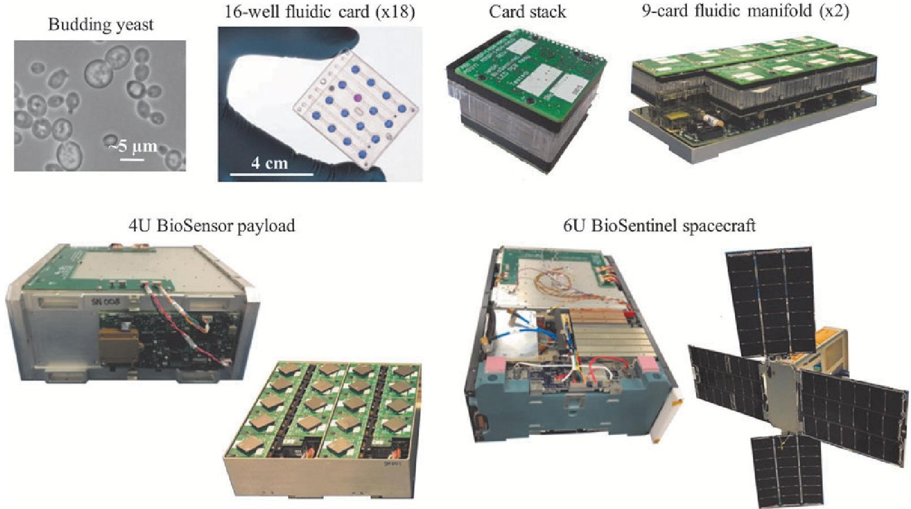

<!-- PDF_PAGE: 1 -->

# BioSentinel: A Biological CubeSat for Deep Space Exploration

Sofia Massaro Tieze $ ^{1,2} $ Lauren C. Liddell, $ ^{2,3} $ Sergio R. Santa Maria, $ ^{2,4} $ and Sharmila Bhattacharya $ ^{2} $

## Abstract

BioSentinel is the first biological CubeSat designed and developed for deep space. The main objectives of this NASA mission are to assess the effects of deep space radiation on biological systems and to engineer a CubeSat platform that can autonomously support and gather data from model organisms hundreds of thousands of kilometers from Earth. The articles in this special collection describe the extensive optimization of the biological payload system performed in preparation for this long-duration deep space mission. In this study, we briefly introduce BioSentinel and provide a glimpse into its technical and conceptual heritage by detailing the evolution of the science, subsystems, and capabilities of NASA's previous biological CubeSats. This introduction is not intended as an exhaustive review of CubeSat missions, but rather provides insight into the unique optimization parameters, science, and technology of those few that employ biological model systems. Key Words: BioSentinel—Deep space—CubeSat—Biosensor—Space radiation. Astrobiology 23, 631-636.

## 1. Introduction

NASA HAS ENTERED a new era of human exploration into deep space, with a plan to put astronauts back on the Moon and eventually land human missions on Mars and beyond. However, since the last Apollo mission in 1972, NASA has not sent humans or other biological organisms beyond low Earth orbit (LEO), outside of our planet's protective magnetosphere. To reach the red planet, humans will be entering unfamiliar territory, and innovative solutions must be developed to address the challenges of this undertaking. The risk posed by the deep space radiation environment is a critical gap in our knowledge and preparedness for deep space travel (Straume et al., 2017).

On the journey to Mars, astronauts will face a constant low-flux rain of ionizing radiation from the full galactic cosmic ray (GCR) spectrum, in addition to variable and unpredictable solar activity-dependent solar particle events (SPEs) (Cucinotta et al., 2010). NASA supports research querying the biological effects of ionizing radiation at ground-based research facilities, but the dynamic and unique composition of the deep space radiation environment is practically impossible to fully simulate on Earth; for long-term space travel or habitation, its chronic aspect also renders simulations for prolonged durations impractical (La Tessa et al., 2016). As we prepare to send humans on extended missions beyond LEO, it is critical to understand how persistent exposure to space radiation affects living organisms. For deep space missions to be feasible,

significant technological and biomedical countermeasures must be developed to protect the crew from the effects of chronic radiation exposure. CubeSat missions can inform these countermeasures by querying relevant space environments with robust biological systems supported by autonomous technology and can thus play an instrumental role in enabling future human deep space exploration.

The CubeSat project was first developed in 1999 as a collaboration between California Polytechnic State University and Stanford University's Space Systems Development Laboratory. The objective of the project was to provide educational research institutions with affordable access to space, decrease development time, and increase launch opportunities for small spacecraft. Commercial groups and government agencies have also since advanced small standardized payloads for impactful space research (Poghosyan and Golkar, 2017). The popularization of CubeSats is largely due to their unique standardized unit (U); 10cm cubes weighing $ \sim1 $ kg, which can be arranged to produce a variety of payload configurations and a range of sizes (with a typical maximum of 6U). This standardization allows companies to offer mass-produced off-the-shelf components, which reduces engineering and development costs. Furthermore, the small size of CubeSats also limits the transportation and deployment costs of space flight; a CubeSat mission can be a secondary payload on any rocket that is traveling to the desired orbit and has sufficient additional performance margin

<!-- PDF_PAGE: 2 -->

and the flexibility and space for a dispenser to be installed (Poghosyan and Golkar, 2017).

Since CubeSat payloads are affordable and provide potential for biological space exploration independently from astronaut support, NASA began developing biosensors to query various space environments. To date, NASA Ames Research Center (ARC) is the only NASA institution to have developed and operated biological CubeSats (Tables 1 and 2). Currently, ARC is in the process of preparing for the launch of BioSentinel, a CubeSat that will utilize yeast cells to probe the deep space radiation environment. Here we introduce BioSentinel and the special collection of research articles dedicated to this mission and provide a brief overview of the progression and development of CubeSats containing model organisms.

## 2. NASA's Biological CubeSats

NASA launched its first biological CubeSat, GeneSat-1, into LEO in 2006. The 3U nanosatellite was designed to study the effects of space flight on gene activity in microbes; the technology developed for GeneSat-1 successfully pioneered autonomous life support for microorganisms in a CubeSat platform (Ricco et al., 2007; Parra et al., 2008). Other notable biological CubeSats followed, with the launch of PharmaSat in 2009, and O/OREOS (Organism/Organic Exposure to Orbital Stresses) in 2010, which built upon GeneSat-1's experimental and technical heritage. PharmaSat contained optical sensor systems to detect the growth, density, and health of yeast cells and examined how yeast responded to an antifungal treatment, elucidating changes to drug action in space (Ricco et al., 2011). O/OREOS contained two experiment payloads, SEVO (Space Environment Viability of Organics) and SESLO (Space Environment Survivability of Living Organisms). SESLO housed two types of dormant dry microorganisms, which were rehydrated in orbit and then monitored through optical absorbance to track alterations to growth and metabolism induced by microgravity and radiation. SESLO researchers demonstrated that flying desiccated biology could enable the design and development of a compact and efficient microfluidic delivery system and allow cells to accumulate radiation doses over 6 months before being sampled (Nicholson et al., 2011).

In 2014, NASA launched SporeSat to study the mechanisms of plant cell gravity sensing by using lab-on-a-chip devices with integrated real-time sensors. SporeSat implemented a pair of miniature centrifuges to study calcium ion channel activity as a function of the magnitude of artificially generated gravity (Park et al., 2017). Most recently, in 2017, NASA launched EcAMSat (Escherichia coli AntiMicrobial Satellite), a 6U nanosatellite that investigated the effects of microgravity on antibiotic resistance of a pathogenic variant of the bacterium E. coli. EcAMSat employed microfluidic technology and further optimized the optical sensor system for detecting the growth and metabolic activity of microorganisms developed for PharmaSat and SESLO. EcAMSat utilized the standard configuration for a 6U CubeSat; it demonstrated that this configuration could enhance space flight science mission applicability by extending mission capabilities; providing more power; and accommodating larger instruments, propulsion, and electronics volumes, while remaining small enough to be launched as a secondary payload (Matin et al., 2017; Padgen et al., 2020).

While conducting cutting-edge scientific experiments, each mission refined space flight-proven technology and imparted valuable lessons to the next generation of CubeSats. A description highlighting the chronological progression of the technical and research capabilities of these missions is described in Tables 1 and 2, respectively.

## 3. The BioSentinel Mission

BioSentinel builds on the legacy of PharmaSat, O/OREOS, and EcAMSat, and will be NASA's first biological CubeSat to probe interplanetary space. It will fly as a secondary payload on the Space Launch System (SLS) Artemis-1 mission (formerly known as Exploration Mission 1 or EM-1), currently scheduled to launch no earlier than November 2020. The objective of Artemis-1 is to deliver the unmanned Orion vehicle to a circumlunar trajectory, which will then return to Earth after $ \sim 3.5 $ weeks. BioSentinel is the sole biological payload among the 13 free-flying CubeSats that will be mounted between the interim cryogenic propulsion stage (ICPS) and the Orion crew vehicle. After Orion separates from the ICPS, the nanosatellites will deploy over a period of several days. Once deployed, BioSentinel will first undergo a $ \sim 700 $ -km lunar fly-by, then enter into a stable heliocentric orbit. As it orbits the sun, BioSentinel will conduct science experiments for 6-12 months, accumulating doses of radiation analogous to that of a potential human Mars mission. At the 6-month nominal mission duration, it will be $ \sim 0.2 $ astronomical units (0.2 AU, $ \sim 30 $ million km) from Earth (Ricco et al., 2020).

The BioSentinel spacecraft contains the budding yeast, Saccharomyces cerevisiae, to assay biological responses to accumulated doses of deep space radiation. Despite over a billion years of evolution separating yeast from humans, we share hundreds of homologous genes that govern essential cellular processes, including DNA damage and repair (Kachroo et al., 2015). S. cerevisiae was also selected for its space flight heritage and relatively easy genetic manipulation. Furthermore, yeast can be desiccated yet remain viable for long periods of time (Santa Maria et al., 2020). Thus, unlike other more homologous and complex eukaryotic model systems, yeast can survive the constraints of long-duration space flight as well as extensive prelaunch periods without substantial life support during payload integration and testing.

Two strains of S. cerevisiae will fly on BioSentinel: a wild type strain that serves as a control for yeast health, and a rad51 deletion strain that is defective for DNA damage repair and will, therefore, display metabolic and growth deficits as it accumulates radiation damage (Santa Maria et al., 2020). Given a long prelaunch period and a nominal 6-month experimental phase in space, yeast preparation and desiccation were carefully optimized to maximize viability over time (Santa Maria et al., 2020). Within the payload, dried yeast cells are located in the wells of 18 discrete polycarbonate fluidic cards (16 wells per card; 288 wells total). Each fluidic card (Fig.1) is comprised of multiple layers, including filter membranes to prevent cross-contamination between wells, microchannels to allow the influx of nutrients and efflux of waste, and heating elements that enable yeast growth during an experimental phase. Each card stack also contains optical source and detector boards. Card stacks are mounted onto fluidic manifolds (nine cards per manifold) connected to tubing, reagent bags, pumps, bubble traps, calibration cells, and electronics, all of which fit into a 4U aluminum enclosure or BioSensor (Fig.1).

<!-- PDF_PAGE: 3 -->

TABLE 1. PROGRESSION OF BIOLOGICAL CUBESAT TECHNICAL CAPABILITIES

<table border="1"><tr><td>Mission</td><td>Properties</td><td>Subsystems</td><td>Mission specifics</td></tr><tr><td>GeneSat-1</td><td>3U CubeSat,2U bio payload; partners: NASA ARC,Santa Clara University and Stanford University; weight:6.8kg</td><td>Attitude control; command and data handling; power:solar cells and secondary batteries; electrical power subsystem; microfluidics and heating elements; optics and sensors(pressure,temperature, humidity,radiation,and acceleration); communications:radio,monopole antenna;onboard computer and bulk storage memory;science data downlink(telemetry)</td><td>Launch:December16,2006(NASA Wallops Flight Facility;Air Force MinotaurI rocket); orbit:LEO,~450km above Earth;duration:21days;main experiment~4days;outcome:full mission success;sample return:no</td></tr><tr><td>PharmaSat</td><td>3U CubeSat,2U bio payload; partners:ARC and University of Texas Medical Branch;weight:5.5kg</td><td>1U spacecraft bus heavily derived from GeneSat-1;improved fluidics and optical detection systems from GeneSat-1,including48-well fluidic card,antifungal delivery system,and3-LED optical emission/detection system</td><td>Launch:May19,2009(NASA Wallops Flight Facility;AF MinotaurI rocket); orbit:LEO,~450km;duration:>21days;main experiment~4days;outcome:full mission success;sample return:no</td></tr><tr><td>O/OREOS</td><td>3U CubeSat,two1U biological modules; partners:ARC,Bay Area Environmental Research Institute,SETI Institute and University of Florida;weight:5.5kg</td><td>1U spacecraft bus derived from PharmaSat;two independent1U astrobiology payload modules(SESLO and SEVO);software,sensor,thermal,mechanical,power, communications, optical,and fluidics subsystems from PharmaSat served as the basis for the bus and SESLO payload</td><td>Launch:November20,2010(Kodiak Launch Complex,Alaska;AF MinotaurIV rocket); orbit:LEO,~630km;duration:6months;outcome:full mission success;sample return:no</td></tr><tr><td>SporeSat</td><td>3U CubeSat,2U bio payload; partners:ARC and Purdue University;weight:5.5kg</td><td>Spacecraft bus technologies derived from PharmaSat andO/OREOS;three BioCD lab-on-a-chip devices for real-time measurements of calcium signaling in fern spores;onboard50-mm minicentrifuges to generate artificial gravity(two BioCDs were centrifuged in space)</td><td>Launch:April18,2014(Cape Canaveral,FL;Falcon9 rocket,SpaceX-3); orbit:LEO,~325km;outcome:successful space demo(LED failure on ground and in space);sample return:no</td></tr><tr><td>EcAMSat</td><td>6U CubeSat,3U bio payload; partners:ARC and Stanford University;weight:14kg</td><td>Used a copy of the1U PharmaSat bus;fluidics and optical detection system built upon that of PharmaSat(~90%commonality);modified filter system to allow bacterial growth and higher pressure in fluidic system;experimental temperature of37℃</td><td>Launch:November20,2017(NASA Wallops Flight Facility;Antares230 rocket); orbit:LEO,~400km;duration:>120days;main experiment~6days;outcome:full mission success;sample return:no</td></tr><tr><td>BioSentinel</td><td>6U CubeSat,4U bio payload(BioSensor);partners:ARC;weight:14kg</td><td>2U spacecraft bus developed for deep space;fluidic card material changed to heat-resistant polycarbonate(16wells per card);dedicated thermal control and microfluidics systems per fluidic card;calibration cells for fluidics and optics;Timepix LET spectrometer sensor;autonomous attitude control,momentum management,and safe mode;long distance communications through DSN;micropropulsion system</td><td>Anticipated launch:secondary payload onSLSArtemis-I;orbit:heliocentric orbit,beyondLEO;duration:6-12months;sample return:no;ISS control(4U BioSensor unit) launching onSpaceX-21(6-month duration mission with sample return)</td></tr></table>

ARC=Ames Research Center; DSN=deep space network; EcAMSat=Escherichia coli AntiMicrobial Satellite; LEO=low Earth orbit; LET=linear energy transfer; O/OREOS=Organism/Organic Exposure to Orbital Stresses; SESLO=Space Environment Survivability of Living Organisms; SEVO=Space Environment Viability of Organics; SLS=Space Launch System.

<!-- PDF_PAGE: 4 -->

TABLE 2. PROGRESSION OF CUBESAT RESEARCH CAPABILITIES

<table border="1"><tr><td>Mission</td><td>Research study</td><td>Advancement of research capabilities</td></tr><tr><td>GeneSat-1</td><td>Organism:Escherichia coli(bacteria);studied effects of microgravity on biological cultures in a 12-well microfluidic card; tracked microbe population through optical density and gene activation through GFP expression; findings: decreased growth rates in flight samples compared with ground controls(Parra et al.,2008).</td><td>First fully automated self-contained biological experiment to fly on a CubeSat; proved that scientists can design and launch a new class of inexpensive spacecraft,and conduct significant science in space</td></tr><tr><td>PharmaSat</td><td>Organism:Saccharomyces cerevisiae(budding yeast); provided life support, growth monitoring,and analysis capabilities for yeast in a 48-well microfluidic card; tracked growth by optical density, metabolism with alamarBlue metabolic indicator dye,and the effects of microgravity on yeast susceptibility to antifungal drugs; findings: slower yeast growth in microgravity.At low doses of antifungal,no differences were observed between flight and ground samples;however,significant metabolic activity still observed at higher dose in microgravity(Ricco et al.,2011).</td><td>First NASA principal investigator-led CubeSat mission</td></tr><tr><td>O/OREOS</td><td>Organisms:Bacillus subtilis(bacteria),Halorubrum chaoviatoris(archaea);tested how microorganisms adapt to the stresses of the space environment,in a two-part experiment:SESLO:monitored survival,growth,and metabolism ofB. subtilisthroughin situ optical density and alamarBlue dye in three 12-well microfluidic cards;SEVO: tracked photodegradation of organic molecules and biomarkers through UV/visible/NIR spectroscopy; findings(SESLO):slower growth in microgravity.No significant loss of viability was observed throughout the mission(Nicholson et al.,2011).</td><td>First astrobiology CubeSat mission; first to demonstrate two distinct completely independent science experiments on a single autonomous CubeSat; first time microorganisms were loaded into the payload in a dried dormant form,then rehydrated on orbit; flying desiccated biology enabled the design and development of a compact and efficient fluidic delivery system,and allowed cells to accumulate radiation doses for 6 months before sampling;cells grew even after $\sim$1 year in dried state;first time microwells were activated in multiple stages(2 weeks,3 months,and 6 months) to compare the response with radiation over time</td></tr><tr><td>SporeSat</td><td>Organism:Ceratopteris richardii(fern spores);studied the effects of microgravity on the calcium ion channel activity of germinating fern spores,using three lab-on-a-chip devices(BioCDs),and minicentrifuges that spun to produce artificial gravitational forces; findings:no spore germination due to failure in red LED illumination.Successful demo of minicentrifuges with ion-sensitive electrodes(Park et al.,2017).</td><td>First time artificial gravity capabilities were incorporated into a CubeSat design</td></tr><tr><td>EcAMSat</td><td>Organism:E. coli; investigated the effects of microgravity on antibiotic resistance of a pathogenic variant ofE. coliin a 48-well microfluidic card; findings: microgravity did not enhance antibiotic resistance in pathogenicE. coli(Padgen et al.,2020).</td><td>First 6U CubeSat to be deployed from ISS;6U format provided 50% more solar panel power to keep experiments at 37℃ for extended periods,and allowed for the accommodation of larger instruments</td></tr><tr><td>BioSentinel</td><td>Organism:S. cerevisiae; monitor the DNA damage response to the deep space radiation environment; track cell growth and metabolism through optical density and alamarBlue indicator dye in 18 individual fluidic cards; compare biological response with physical dosimetry using an onboard LET spectrometer; compare deep space results with ISS and ground control BioSensor units</td><td>First biological CubeSat to go beyond LEO;first biological deep space CubeSat with matching biological payload on ISS,querying different radiation environments</td></tr></table>

NIR, near-infrared; UV, ultraviolet.

The BioSensor also has its own secondary payload, a TimePix-based radiation spectrometer, which will allow for the correlation of physical in situ dosimetry with the biological response to radiation. This spectrometer measures both the linear energy transfer (LET) and total ionizing dose of radiation exposures (Pinsky and Pospisil, 2020). The 4U BioSensor is integrated with a $ \sim $ 2U spacecraft bus equipped

with solar panel arrays, batteries, micropropulsion system, star tracker navigation system, transponder, antennas, and command and data handling systems (Ricco et al., 2020).

Once BioSentinel enters its experimental phase in deep space, yeast cells will be rehydrated with a mixture of nutrient-rich medium and redox indicator dye, and cell growth and metabolism will be monitored with an optical

<!-- PDF_PAGE: 5 -->

FIG.1. The BioSentinel biological CubeSat and its subsystems. Budding yeast cells are first added into the microfluidic card wells. After yeast desiccation, the fluidic cards are sealed, and electronic optical emission and detection boards and heating elements are mounted onto each card. The cards are placed onto two fluidic manifolds (nine cards per manifold), followed by integration of the manifolds into the 4U BioSensor enclosure. Finally, the 4U BioSensor payload is integrated into the 6U BioSentinel spacecraft.

detection system (Padgen et al., unpublished data). Calibration cells and reserved fluidic card wells empty of yeast will be used to confirm the mixing ratio of the reagents in-flight and to normalize the optical data. Two cards will be rehydrated in concert upon a command from ground control at select intervals over the course of the mission, allowing for a progressive series of experiments as the cells accumulate radiation dose and DNA damage. One set of cards will be reserved for activation in the event of a SPE. As optical data are collected, it will be telemetered back to Earth, along with correlated measurements of total radiation dose and particle type detected by the onboard LET spectrometer (Ricco et al., 2020). In the absence of contact with ground control, the spacecraft will function autonomously in stasis mode. The sensitivity of the yeast to various particle types and low doses of radiation has been assessed, including the response to a simulated GCR spectrum (Santa Maria et al., unpublished data). In addition to the deep space nanosatellite, a second copy of the 4U BioSensor science payload will be flown on the ISS, allowing for comparisons between the biological effects of space flight in different radiation environments.

During the design, development, and testing of the BioSentinel CubeSat, a number of improvements have been made to flight heritage technology (Table 1). Alterations to fluidic card design and a small increase in BioSensor size allow for significantly more sample replicates and conditions (288 wells in BioSentinel vs. 48 wells in previous 3U CubeSats). The use of heat-resistant fluidics materials, such as polycarbonate, improves the practicality and efficiency of the sterilization method and reduces risk. Previously, fluidics components were sterilized with ethylene oxide (EtO) that required the prolonged off-gassing of toxic volatiles that affect the health and survival of biological samples. Now, materials are sterilized by autoclaving, which is a much more common and biocompatible sterilization method. The fluidic manifold and thermal control systems are more capable and specific in the individual activation and heating of fluidic cards. The inclusion of independent calibration cells allows for normalization of optical data every time an individual card is activated throughout the mission (Padgen et al., unpublished data).

In addition to these changes to the BioSensor payload, several spacecraft components have been improved in this iteration or are novel to biological nanosatellites (Ricco et al., 2020). The 3D-printed cold gas micropropulsion system, for example, will be used to perform the detumble maneuver immediately upon deployment from the ICPS, in addition to momentum management maneuvers (Stevenson and Lightsey, 2016). Long distance communication through the deep space network will allow scientists and engineers to communicate with the spacecraft at distances hundreds of thousands of kilometers (or more) from the command system on Earth. The onboard LET radiation spectrometer will allow scientists to directly correlate the radiation environment to the extent of biological damage at different time points over the course of the mission.

Finally, and perhaps most importantly, the platform developed for the 4U BioSentinel BioSensor payload can be leveraged into future autonomous biological spacecraft missions, including free-flying satellites in and beyond LEO and integrated biosensors on lunar rovers or the lunar gateway. Moreover, with some changes in design and some creative repurposing, the model organism or vehicle can be exchanged to answer cutting-edge research questions and explore novel frontiers.

<!-- PDF_PAGE: 6 -->

## 4. Conclusion

BioSentinel builds and improves upon a rich legacy of biological CubeSat technologies. The iterative advancement of biological CubeSats permits pioneering science, providing insight into the biological risks of long-duration space flight, and establishing exciting possibilities for innovative life science and human exploration of deep space.

## Author Disclosure Statement

## Funding Information

No competing financial interests exist.

This work was supported by NASA's Advanced Exploration Systems Division in the Human Exploration and Operations Mission Directorate.

## References

Cucinotta, F.A., Hu, S., Schwadron, N.A., Kozarev, K., Townsend, L.W., and Kim, M.H.Y. (2010) Space radiation risk limits and Earth-Moon-Mars environmental models. Space Weather 8:1-12.

Kachroo, A.H., Laurent, J.M., Yellman, C.M., Meyer, A.G., Wilke, C.O., and Marcotte, E.M. (2015) Systematic humanization of yeast genes reveals conserved functions and genetic modularity. Science 348:921-925.

La Tessa, C., Sivertz, M., Chiang, I.H., Lowensteinm, D., and Rusek, A. (2016) Overview of the NASA space radiation laboratory. Life Sci Space Res 11:18-23.

Matin, A.C., Wang, J.H., Keyhan, M., Singh, R., Benoit, M., Parra, M.P., Padgen, M.R., Ricco, A.J., Chin, M., Friedericks, C.R., Chinn, T.N., Cohen, A., Henschke, M.B., Snyder, T.V., Lera, M.P., Ross, S.S., Mayberry, C.M., Choi, S., Wu, D.T., Tan, M.X., Boone, T.D., Beasley, C.C., Piccini, M.E., and Spremo, S.M. (2017) Payload hardware and experimental protocol development to enable future testing of the effect of space microgravity on the resistance to gentamicin of uropathogenic Escherichia coli and its $ \sigma^{\mathrm{S}} $ -deficient mutant. Life Sci Space Res 15:1-10.

Nicholson, W.L., Ricco, A.J., Agasid, E., Beasley, C., Diaz-Aguado, M., Ehrenfreund, P., Friedericks, C., Ghassemieh, S., Henschke, M., Hines, J.W., Kitts, C., Luzzi, E., Ly, D., Mai, N., Mancinelli, R., McIntyre, M., Minelli, G., Neumann, M., Parra, M., Piccini, M., Rasay, R., Ricks, R., Santos, O., Schooley, A., Squires, D., Timucin, L., Yost, B., and Young, A. (2011) The O/OREOS mission: first science data from the Space Environment Survivability of Living Organisms (SE-SLO) payload. Astrobiology 11:951-958.

Padgen, M.R., Lera, M.P., Parra, M.P., Ricco, A.J., Chin, M., Chinn, T.N., Cohen, A., Friedericks, C.R., Henschke, M.B., Snyder, T.V., Spremo, S.M., Jing-Hung, W., and Matin, A.C. (2020) EcAMSat spaceflight measurements of the role of $ \sigma^{\mathrm{s}} $ in antibiotic resistance of stationary phase Escherichia coli in microgravity. Life Sci Space Res 24:18-24.

Park, J., Salmi, M.L., Wan Salim, W.W.A., Rademacher, A., Wickizer, B., Schooley, A., Benton, J., Cantero, A., Argote, P.F., Ren, M., Zhang, M., Porterfield, D.M., Ricco, A.J., Roux, S.J., and Rickus, J.L. (2017) An autonomous lab on a chip for space flight calibration of gravity-induced transcellular calcium polarization in single-cell fern spores. Lab Chip 17:1095-1103.

Parra, M.P., Ricco, A.J., Yost, B., McGinnis, M.R., and Hines, J.W. (2008) Studying space effects on microorganisms autonomously: GeneSat, PharmaSat, and the future of bionanosatellites. Gravit Space Biol 21:9-18.

Pinsky, L.S. and Pospisil, S. (2020) Timepix-based detectors in mixed-field charged-particle radiation dosimetry applications.

Radiat Meas. [In press, journal pre-proof]. DOI: 10.1016/j.radmeas.2019.106229.

Poghosyan, A. and Golkar, A. (2017) CubeSat evolution: analyzing CubeSat capabilities for conducting science missions. Prog Aerosp Sci 88:59-83.

Ricco, A.J., Hines, J.W., Piccini, M., Parra, M., Timucin, L., Barker, V., Storment, C., Friedericks, C., Agasid, E., Beasley, C., Giovangrandi, L., Henschke, M., Kitts, C., Levine, L., Luzzi, E., Ly, D., Mas, I., McIntyre, M., Oswell, D., Rasay, R., Ricks, R., Ronzano, K., Squires, D., Swaiss, G., Tucker, J., and Yost, B. (2007) Autonomous genetic analysis system to study space effects on microorganisms: results from orbit. In Proceedings of the $ 14^{th} $ International Conference on Solid- State Sensors, Actuators and Microsystems (Transducers '07/ Eurosensors XXI), IEEE, New York, NY, pp 33-37.

Ricco, A.J., Parra, M., Niesel, D., Piccini, M., Ly, D., McGinnis, M., Kudlicki, A., Hines, J.W., Timucin, L., Beasley, C., Ricks, R., McIntyre, M., Friedericks, C., Henschke, M., Leung, R., Diaz-Aguado, M., Kitts, C., Mas, I., Rasay, M., Agasid, E., Luzzi, E., Ronzano, K., Squires, D., and Yost, B. (2011) PharmaSat: drug dose response in microgravity from a free-flying integrated biofluidic/optical culture-and-analysis satellite. In Proceedings of the SPIE 7929, Microfluidics, BioMEMS, and Medical Microsystems IX, 79290T, SPIE, Bellingham, WA, p 9.

Ricco, A.J., Santa Maria, S.R., Hanel, R.P., and Bhattacharya, S.; BioSentinel Team; Radworks Group. (2020) BioSentinel: a 6U Nanosatellite for Deep-Space Biological Science. IEEE Aero El Sys Mag 35 [accepted for publication].

Santa Maria, S.R., Marina, D., Massaro Tieze, S., Liddell, L.C., and Bhattacharya, S. (2020) BioSentinel: long-term Saccharomyces cerevisiae preservation for a deep space biosensor mission. Astrobiology. [published online ahead of print]. DOI: 10.1089/ast.2019.2073.

Stevenson, T. and Lightsey, G. (2016) Design and characterization of a 3D-printed attitude control thruster for an interplanetary 6U CubeSat. In Proceedings of the $ 30^{th} $ Annual AIAA/USU Conference on Small Satellites, SSC16-V-5, Logan, UT, pp 1-7.

Straume, T., Slaba, T., Bhattacharya, S., and Braby, L. (2017) Cosmic-ray interaction data for designing biological experiments in space. Life Sci Space Res 13:51-59.

Address correspondence to: Sergio R. Santa Maria NASA Ames Research Center Moffett Field, CA 94035

E-mail: sergio.santamaria@nasa.gov

Submitted 13 March 2019 Accepted 26 February 2020 Associate Editor: John Rummel

## Abbreviations Used

Abbreviations Used

ARC = Ames Research Center

EcAMSat = Escherichia coli AntiMicrobial Satellite

GCR = galactic cosmic ray

ICPS = interim cryogenic propulsion stage

LEO = low Earth orbit

LET = linear energy transfer

O/OREOS = Organism/Organic Exposure to Orbital Stresses

SESLO = Space Environment Survivability of Living Organisms

SPE = solar particle event