<!-- PDF_PAGE: 1 -->

Received June 19, 2021, accepted July 4, 2021, date of publication July 26, 2021, date of current version August 6, 2021. Digital Object Identifier 10.1109/ACCESS.2021.3096468

# Comparative Analysis of Model-Based and Traditional Systems Engineering Approaches for Architecting a Robotic Space System Through Automatic Information Transfer

PAULO J. YOUNSE $ ^{1} $ , JESSICA E. CAMERON $ ^{1} $ , AND THOMAS H. BRADLEY $ ^{2} $ $ ^{1} $ Jet Propulsion Laboratory, California Institute of Technology, Pasadena, CA 91109, USA $ ^{2} $ Department of Systems Engineering, Colorado State University, Fort Collins, CO 80523, USA

Corresponding author: Paulo J. Younse (paulo.j.younse@jpl.nasa.gov)

ABSTRACT This study seeks to compare the quantity of information that is automatically transferred through the associations generated using a model-based systems engineering (MBSE) approach versus a traditional systems engineering approach to measure the benefits of MBSE in architecting a robotic space system. Both an MBSE approach and non-MBSE approach were applied to architecting an orbiting sample Capture and Orient Module (COM) system concept for a Capture, Containment, and Return System (CCRS) payload concept for Mars Sample Return (MSR). These approaches were applied in parallel to provide a side-by-side comparison of the approaches. The approaches were analyzed using design structure matrices (DSM) and evaluated based on the amount of information transferred between process tasks manually (e.g., elements physically typed into text boxes in a presentation slide) vs automatically (e.g., elements automatically filled out within a block in a model view due to explicitly defined element associations). A total of 4,819 information element transfers were traced in DSMs and used to quantitatively compare the two approaches. The non-MBSE approach required manual transfer for all 4,819 information elements. The MBSE approach required manual transfer for 4,189 information elements and automatic transfer for 630 information elements, providing a minor increase in the automation of information transfer relative to the non-MBSE approach. By incorporating the use of additional MBSE artifacts into the trade study and peer review tasks, manual transfer could potentially be reduced to 931 information elements, and automatic transfer increased to 3,888 information elements.

- INDEX TERMS Model-based systems engineering (MBSE), robotic space systems, systems architecture, systems engineering processes.

## I. INTRODUCTION

On August 5, 2012, NASA's 900 kg Mars Science Laboratory (MSL) Curiosity rover successfully landed on the surface of Mars and set out to search for evidence of past habitable environments [1], [2]. The Curiosity rover pushed the boundaries of technology and systems engineering, consisting of approximately 50,000 parts, involving nearly 3,000 NASA employees and 4,000 non-government workers, and was considered the most complex rover of its time ever sent to another planet [1], [3], [4].

Despite the technical and scientific achievements of the rover, the project experienced numerous development

challenges, and in the end, saw an increase in over $881 million in costs from its original 2008 project baseline, as well as a 26-month launch delay due to technical problems that necessitated late design changes in hardware, avionics, and software [5]. A metric for design changes used by NASA is "drawing growth" after the Critical Design Review (CDR), where MSL saw a 147% growth [6]. Some of these late design changes were attributed to the discovery of divergent requirements uncovered late during the testing phase. These divergent requirements were found to be a consequence of not having a rigorously defined architecture to pull together and cohesively manage the complex web of documentation of system and subsystem functional requirements, environmental requirements, interface control documents, institutional policy documents, and planetary protection requirements [7].

<!-- PDF_PAGE: 2 -->

The complexity of space missions is quickly growing faster than NASA's ability to manage them [8]. Two future space missions under development by NASA and the European Space Agency (ESA) are the Sample Retrieval Lander (SRL) and Earth Return Orbiter (ERO) missions, which are planned as follow-up missions to the Mars 2020 rover mission as part of the MSR campaign (see Fig. 1) [9]-[13]. SRL would land on Mars with a fetch rover to retrieve samples collected by the Mars 2020 rover and place them into Mars orbit within an Orbiting Sample (OS) container. The ERO would autonomously capture the OS and return it to Earth within an Earth Entry Vehicle (EEV). An independent review board reviewed the Pre-Phase A MSR technical concept and found the architecture extremely complex, requiring a long series of critical events to be carried out with high precision and reliability [14]. If NASA is to succeed in future complex robotic space missions like those associated with MSR, new systems engineering approaches to manage the growth in complexity associated with these future missions could play a critical role in controlling costs, maintaining schedule, and ensuring mission success.

MBSE provides a systems engineering paradigm to manage complex systems by aiming to reduce design errors, reduce cost through prevention of costly rework, and improve system quality and project performance over traditional systems engineering techniques [15], [16]. MBSE helps to achieve this during the architecting process by developing an integrated system model that captures key system architectural information and links that information through model associations.

The purpose of this research is to explore the advantages of an MBSE approach in architecting a robotic space system relative to a non-MBSE approach, as assessed by the quantity of information transfer that can be automated for carrying out the architecting process. One of the major drivers of project cost, schedule overruns, and project risk is process iteration [17]. Several causes of process iterations include poor communication of information (e.g., information not clearly or appropriately transmitted) and errors (e.g., defective information created and propagated without correction). Automation of information transfer has the potential to improve communication of information and reduce errors that could later lead to costly process iterations, rework, and design changes.

The MSR CCRS COM Pre-Phase A architectural development activity was used as a case study to assess the benefits of MBSE over traditional systems engineering in achieving automatic information transfer.

This research is motivated by the observation that despite the claims made in the literature that MBSE is beneficial to the development of engineered systems, there is lack of empirical evidence in the literature that supports this hypothesis [18]. Additionally, there is a limited number of case studies with side-by-side comparison of MBSE and non-MBSE approaches that provide quantitative evidence of the advantages MBSE approaches over traditional, document-based

approaches [16]. This paper presents a unique methodology that uses DSMs as a tool to perform a side-by-side comparison of an MBSE and non-MBSE architecting approach used to architect the COM and quantitatively measures the benefits in terms of automatic information transfer between activities within the DSMs. This research provides the following unique contributions to the literature:

- A case study that compares an MBSE approach side-by-side with a non-MBSE approach for architecting a robotic space system

- An MBSE approach for architecting a robotic space system that defines the structure, data, behavior, and requirements of the system at each organization level and incorporates trade studies and peer reviews between levels

- A methodology that uses DSMs as a tool to quantitatively measures the benefits of an MBSE approach relative to a non-MBSE approach

- Quantitative evidence of the benefits of an MBSE approach over a non-MBSE approach for architecting a robotic space system in terms of automatic information transfer

This paper is organized as follows. Section II provides background on MBSE, architecture frameworks, design structure matrices, and the COM case study. Section III provides details on the methodology, consisting of developing a resource breakdown structure, synthesizing a system architecting process, mapping out architecting process tasks of the non-MBSE and MBSE approaches, recording the quantities of information transfer between tasks, comparing quantities of automatic information transfer between the two approaches, and extending the MBSE architecting approach to increase automatic information transfer. Section IV provides a summary of the results. Section V discusses the benefits of MBSE based on an analysis of the results, as well as recommendations for future work. Section VI finishes with a conclusion.

## II. BACKGROUND

The following section provides an overview of MBSE, architecture frameworks, DSMs and the COM robotic space system used as a case study in this research.

## A. MODEL-BASED SYSTEMS ENGINEERING

MBSE emphasizes the use of models to perform systems engineering activities that are traditionally performed using documents [19]. To carry out MBSE, a modeling language, modeling method, and modeling tool are needed [20]. Listings of MBSE modeling languages, methods, and tools can be found in publications by Rashid et al. [21], Estefan [22], Madni and Sievers [23], and the Body of Knowledge and Curriculum to Advance Systems Engineering (BKCASE) editorial board [24]. MBSE aims to provide benefits over traditional, document-based systems engineering in terms of reduced effort to implement system development through

<!-- PDF_PAGE: 3 -->

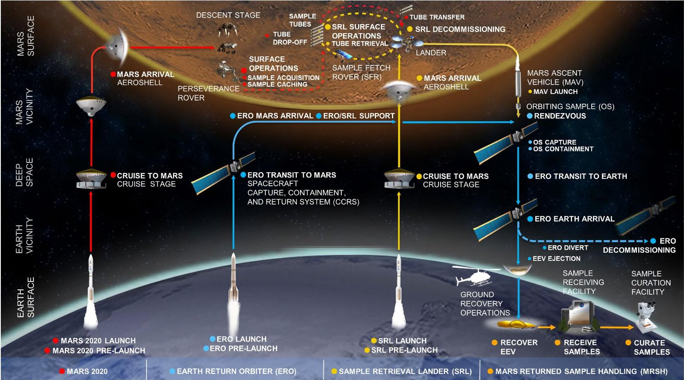

FIGURE 1. Notional MSR architecture. Note that all elements beyond mars 2020 are conceptual [9].

increased productivity, reduced inefficiencies, and reduced lag in information flow [16], [25]----[27].

MBSE methods have been used to aid in the development of complex space systems. Examples of space system projects that utilized MBSE include the ExoMars mission [28] and e.Deorbit mission [29].

Mazzini et al. assessed the applicability of the ModelBased Space System Engineering (MBSSE) methodology on the ExoMars mission [28]. System requirements, system context, data, control flows, mission use cases, scenarios functional architecture, and software architecture were modeled. The MBSSE approach proved successful in defining a preliminary space system and offered improved traceability and separation of concerns between systems engineering and software engineering.

Estable et al. applied a Federated and Executable Models MBSE methodology during the architecture definition phase of the ESA e.Deorbit robotic satellite mission study [29]. SysML models were developed to capture the mission Concept of Operations, system capabilities, functional architecture, safety diagram, fault tree, product tree, and requirements using Cameo Systems Modeler. The methodology demonstrated improved efficiency in the systems engineering work.

The above case studies asserted that there are benefits to using MBSE when applied to space systems. However, none of these studies provided quantitative evidence of MBSE's advantages over traditional, non-MBSE approaches. Additionally, there is an absence of case studies that perform

side-by-side comparisons of an MBSE approach with a non-MBSE (traditional, document-based) approach [16]. This research aims to address these gaps in the literature by providing a case study that performs side-by-side comparisons of MBSE and non-MBSE approaches, as well as collect quantitative data that can be used to measure the costs and benefits of the two approaches. This paper specifically investigates how an MBSE approach can improve the systems engineering process by automating the transfer of information between tasks.

## B. ARCHITECTURE FRAMEWORK

Architecture can be defined as the fundamental concepts or properties of a system in its environment embodied in its elements, relationships between those elements, and principles of their design and evolution [30]. An architecture framework collects and relates viewpoints to enable the system architect to construct useful and consistent architecture descriptions [31].

The framework used in this research to collect and relate the architectural information content for the COM is shown in Fig. 2. The framework was synthesized from frameworks used in the Model-Based System Architecture Process (MBSAP) [32] and MagicGrid [33] methodologies. A table format, like that used by MagicGrid, was adopted due to its ability to visually represent and organize architectural artifacts. The structure, data, behavior, and requirements perspectives from the MBSAP perspectives were applied to

<!-- PDF_PAGE: 4 -->

<table border="1"><tr><td rowspan="2" colspan="2"></td><td colspan="4">Perspective</td></tr><tr><td>Structure</td><td>Data</td><td>Behavior</td><td>Requirements</td></tr><tr><td rowspan="3">Organization Level</td><td>Module Level(L4)</td><td>Glossary:Terms,Term DescriptionsClassifications:Hierarchy Levels,Interface Types,Element OwnershipsProduct Breakdown:Product Breakdown Structure,Element Types,Element Hierarchy Levels,Element OwnershipAssignments,Structural DecompositionsBlock Diagrams:System Block Diagram,Parts,Part Types,Part Ownerships,Part Ownership Assignments,Interfaces,Interface Type Assignments,Flow Item Allocations,Flow DirectionsSpecifications:Description,Owner,Attributes,AllocatedFunctions,Data Generation and Use,External Interfaces,Allocated Requirements,Applicable Design Principles,Recommended Approaches,Approach Rationales,Risks,Development Strategies,Development Strategy Rationales,Core Competencies</td><td>Glossary:Terms,Term DescriptionsClassifications:Hierarchy Levels</td><td>Glossary:Terms,Term DescriptionsScenarios:Functional Flows,FunctionalDecompositions,Functions,Function HierarchyLevels,ControlFlows,FunctionalAllocations</td><td>Glossary:Terms,Term DescriptionsClassifications:HierarchyLevels,Requirement TypesRequirements:RequirementsHierarchy,Requirements,Requirement IDs,RequirementHierarchyLevels,RequirementRequirement Types,Requirement Texts,Requirement Rationales,Requirement Types,VerificationMethods,Parents,Requirements Allocations</td></tr><tr><td>Subsystem Level(L5)</td><td></td><td></td><td></td><td></td></tr><tr><td>Assembly Level(L6)</td><td></td><td></td><td></td><td></td></tr></table>

FIGURE 2. Architecture framework used for developing the COM architecture with a listing of the system information content for all levels within each perspective.

the columns of the table. The system levels were applied to the rows of the table. Three levels were defined for the COM framework: Module Level (Level 4), Subsystem Level (Level 5), and Assembly Level (Level 6). These levels were defined based on the CCRS project's product breakdown structure.

The architectural information content (e.g., system elements, element properties, and relationships to describe the architecture) captured within the COM architecture framework is also summarized in Fig. 2. This information content was selected by the COM engineering team at JPL and informed by the NASA Systems Engineering Handbook [34], Expanded Guidance for NASA Systems Engineering [35], and MBSAP [32].

## C. DESIGN STRUCTURE MATRIX

A DSM is a network modeling tool used to graphically represent elements of a system and their interactions in the form of a matrix [17]. Process Architecture DSMs model process activities as the elements, and flows of information between the activities as the interactions. The "inputs in rows" (IR) convention was used, where inputs to activities are captured in the rows, and outputs from activities are captured in the columns. The numerical DSM extended form was used, where numerical values and colors represent the number and type of interactions. Cordero et al. used numeric DSMs to sequence, analyze, and improve model-based concurrent conceptual design processes in conceptual design studies of space missions [36]. Similarly, DSMs were used in this research to model and analyze the MBSE and non-MBSE architecting approaches used to develop the COM architecture.

## D. CAPTURE AND ORIENT MODULE CASE STUDY

The COM Pre-Phase A architectural development was used as a case study to assess the benefits of the MBSE

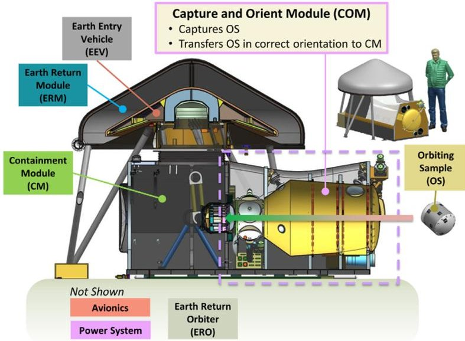

FIGURE 3. Notional CCRS concept [9].

approach over the traditional, non-MBSE systems engineering approach. The CCRS houses the COM. The COM captures, constrains, orients, inspects, and assembles the OS into the Primary Containment Vessel (PCV) in preparation for PCV sealing and installation into the EEV for future delivery to Earth.

An early concept for CCRS with the COM is shown in Fig. 3. The COM is organized into three architectural levels of decomposition: Level 4 (Module Level), Level 5 (Subsystem Level), and Level 6 (Assembly Level). Level 4 represents the overall COM. Level 5 represents the seven major COM subsystems: Capture Mechanism (CM), Sensor System (SS), Capture Cone (CC), Orientation Mechanism (OM), Transfer Mechanism (TM), COM Infrastructure (CI), and Thermal Control System (TCS). These subsystems are illustrated in Fig. 4. Level 6 represents the assemblies that make up each of the subsystems, such as individual actuators, mechanisms, structural elements, and sensors.

<!-- PDF_PAGE: 5 -->

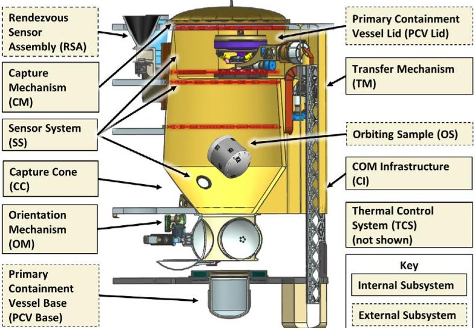

FIGURE 4. Notional COM concept [9].

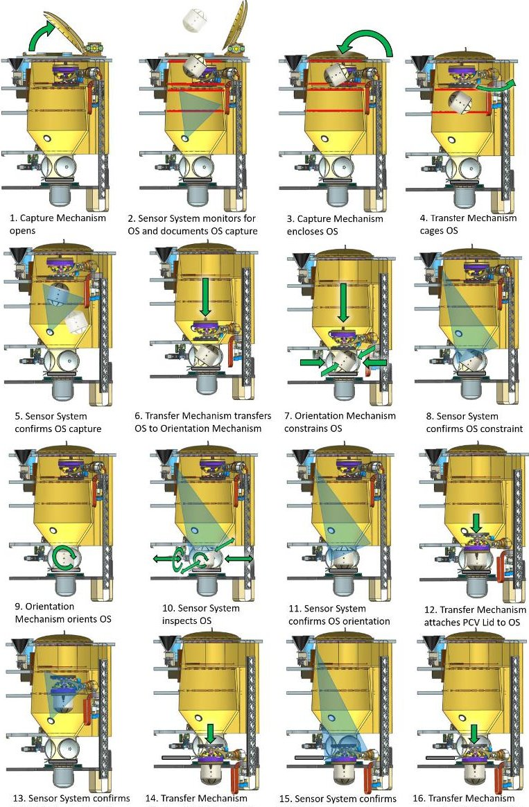

FIGURE 5. COM operational concept [9].

The COM would be designed to operate autonomously in Mars orbit within a space environment. Fig. 5 shows an operational concept of the COM, depicting OS capture, constraint, orientation, inspection, and assembly into the PCV. Further details on the COM and its operations are described by Younse et al. [9].

The COM architecture development took place during Pre-Phase A, which is the first of seven phases of the NASA Project Life-Cycle. During Pre-Phase A, the project explores a range of ideas and develops an initial, feasible system concept [37]. The architecture development was carried out over the course of two years by the COM engineering team at the Jet Propulsion Lab (JPL) in Pasadena, California. The same team members carried out the architecting tasks using both the MBSE and non-MBSE approaches in parallel over the same course of time.

## III. METHODOLOGY

The DSM Approach to Architectural Modeling and Analysis described by Eppinger and Browning [17] was followed to model and analyze the architecting process. The approach involves decomposing the system process down to its constituent elements, identifying the relationships amongst the system's elements, analyzing the elements and their relationships and their implications for the system process, displaying the system process in the form of a DSM model, and improving the system process based on the results of the DSM analysis. This DSM approach was further elaborated and specialized for architecting a robotic space system, and carried out through a series of seven steps described in this section.

## 1) DEVELOP A RESOURCE BREAKDOWN STRUCTURE FOR ARCHITECTING A ROBOTIC SPACE SYSTEM

Resource breakdown structures (RBS) were developed for both the MBSE and non-MBSE architecture approaches. Resources were defined as any person or systems engineering artifact generated and utilized to capture and organize architecture information, as well as carry out tasks associated with the architecting process. For the COM, this included specific JPL personnel and specialized systems engineering artifacts capable of capturing and communicating robotics, mechanical, electrical, thermal, flight software, contamination control, and planetary protection technical knowledge associated with a robotic space system.

Microsoft PowerPoint, Word, and Excel were utilized to implement the non-MBSE tasks due to their compatibility with current document-based systems engineering artifacts used at JPL, as well as common use within the engineering team for capturing and communicating numerical, textual, and graphical system information.

Cameo Systems Modeler using the SysML language profile was utilized for the MBSE approach to allow model integration into the top-level MSR campaign model that was previously established by JPL and ESA to integrate technical and programmatic information across all missions and mission elements [38]. SysML and MagicDraw (the prior release of Cameo Systems Modeler) was chosen by the campaign as the implementing modelling language and tool due to the extensive experience and resources of both agencies [39].

<!-- PDF_PAGE: 6 -->

## 2) SYNTHESIZE A ROBOTIC SPACE SYSTEM ARCHITECTING PROCESS

A system architecting process was developed to architect a robotic space system and generate the artifacts developed in Step 1 using the COM architecture framework shown in Fig. 2.

The general architecting process flow was developed following the MBSAP methodology, where the top level of the system is defined in an Operational Viewpoint, the lower levels in the Logical/Functional Viewpoint, and final level of the design in the Physical Viewpoint [32]. A layered approach to define the architecture following the STRATA methodology [40] and NASA Systems Engineering Engine System Design Process [34] was taken, where each level of the architecture is defined prior to drilling down to the next lower, more specific levels.

An object-oriented design methodology was taken to define each architectural level. In object-oriented design, the first step is to identify objects comprising the system, their associations and characteristics, and their interactions and interfaces [32]. This information is captured in the Structural and Data perspectives. Next, sequences of activities carried out by the individual objects are defined, which are captured in the Behavioral perspective. Requirements are developed as the final step of each level, as performed in the SCARIT Process Model [41].

## 3) MAP OUT THE ROBOTIC SPACE SYSTEM ARCHITECTING PROCESS TASKS OF A NON-MBSE APPROACH

For the non-MBSE architecting approach, the tasks defined in Step 2 were sequenced in a series of activity diagrams, with the resources represented as swimlanes. Tasks were allocated to personnel resources. Information generated and consumed by each task were identified and traced to each document resource (i.e. slides, manuscripts, spreadsheets, prototypes). Fig. 6 provides an example of an activity diagram showing two tasks allocated to the "COM Systems Engineer." Information generated from the tasks are depicted in the boxes leading down into the document where the information is captured. Information consumed by the tasks are depicted in the boxes leading from the resource where the information is retrieved. Information transferred from one task to another task occurs when the same information is recorded to and retrieved from the same resource. In this example, the information type "Element Types" are transferred from the Define CCRS Structural Elements task to the Define CCRS Internal Structure task. The quantities of information elements transferred from one task to another in this manner are what were captured and quantified in the DSMs.

## 4) MAP OUT THE ROBOTIC SPACE SYSTEM ARCHITECTING PROCESS TASKS OF AN MBSE APPROACH

The tasks defined in Step 2 were also sequenced in a series of activity diagrams for the MBSE approach. Information elements generated and consumed by each task were identified

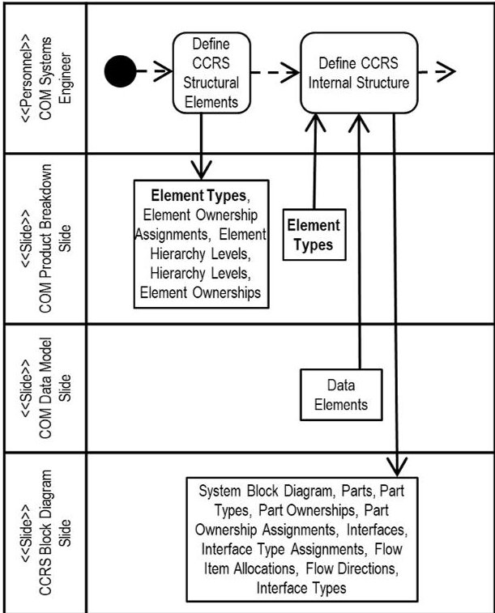

FIGURE 6. Example activity diagram for the non-MBSE approach for task 1 and task 2 from table 1 showing resources, interactions between resources, and information generation and consumption for each task. The information type "element types" is bolded to show an example of information transfer between the two tasks.

and traced to each document or model resource (i.e. slides, spreadsheets, prototypes, block definition diagrams, internal block diagrams, blocks, activity diagrams, requirements diagrams, profiles, glossary tables). Fig. 7 shows an example of an activity diagram for the first two architecting process tasks for the MBSE approach.

## 5) RECORD THE QUANTITIES OF INFORMATION TRANSFER BETWEEN THE ROBOTIC SPACE SYSTEM ARCHITECTING TASKS OF THE NON-MBSE AND MBSE APPROACHES

DSMs were developed for both the non-MBSE and MBSE approaches to describe the information transferred between tasks (as mapped out in Steps 3 and 4), classify the information transfer based on whether it is manual or automatic, and quantify the amount of information manually or automatically transferred.

Fig. 8 shows an example DSM for 16 of the 76 COM architecting process tasks that cover the COM Architecture Definition, COM Trade Study, and COM Architecture Peer Review. The task IDs are represented on both the vertical and horizontal axes of the matrix. Information fed forward between tasks is captured in the lower left portion of the matrix. Information fed back between tasks is captured in the upper right portion of the matrix. Information transferred manually between resources (information that must be manually transcribed or recreated between resources due to the lack of explicit links and associations of information elements between model views or documents) is indicated by the red-shaded cells. Information transferred automatically (information that is automatically filled in or updated

<!-- PDF_PAGE: 7 -->

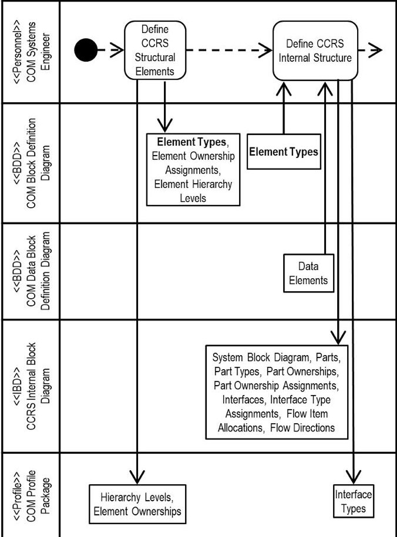

FIGURE 7. Example activity diagram for the MBSE approach for task 1 and task 2 from table 1 showing resources, interactions between resources, and information generation and consumption for each task. The information type "element types" is bolded to show an example of information transfer between the two tasks.

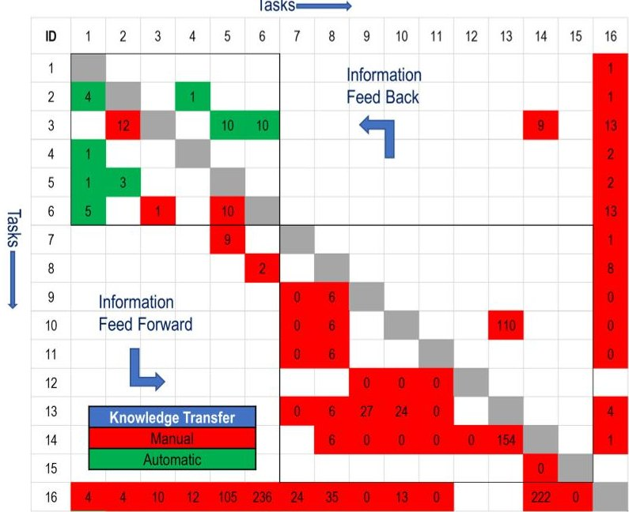

FIGURE 8. Example design structure matrix for the MBSE approach for the L4 architecture definition, COM trade study, and COM architecture peer review tasks.

between resources due to explicit links and associations of information elements between model views) is indicated by the green-shaded cells. The quantities of information transferred between tasks are represented as numbers within the cells. Cells that are shaded and show a zero can have information transferred, but did not have any in those instances.

6) COMPARE THE QUANTITIES OF AUTOMATIC INFORMATION TRANSFERS BETWEEN THE NON-MBSE AND MBSE ROBOTIC SPACE SYSTEM ARCHITECTING APPROACHES

The number of manual and automatic information transfer between tasks were compared in a table for both the non-MBSE and MBSE approaches. These values were taken from each of the DSMs, and presented both in terms of individual quantities and percentages of the total quantities of information transfer.

## 7) EXTEND THE MBSE ROBOTIC SPACE SYSTEM ARCHITECTING APPROACH

Based on the results of the DSM analysis performed in Step 6, an extensive MBSE approach was defined that further takes advantage of MBSE resources for the trade study and peer review tasks to further increase automatic information transfer. This involved looking at what tasks were manual, determining which MBSE resources could be further utilized for these tasks, developing a DSM of the approach, and quantifying the amount of information that could be manually and automatically transferred.

## IV. RESULTS

This section presents the system architecting process developed for both the non-MBSE and MBSE approaches, describes the RBSs and DSMs generated for each approach, and compares the quantities of information manually and automatically transferred between tasks in the DSMs of each approach. Following the comparison, a proposed extensive MBSE approach is described, along with its potential improvements to the original MBSE approach.

## A. ROBOTIC SPACE SYSTEM ARCHITECTING PROCESS

The high-level, general architecting process developed is shown in Fig. 9. The process starts at the Module Level (L4), and proceeds to define the COM module of CCRS and its external interfaces within the Structure Perspective, the data generated and used by the COM within the Data Perspective, the activities the COM performs in the Behavior Perspective, and the functional and non-functional requirements the COM must meet. After the COM level of the architecture is defined, the process repeats to define the COM at the Subsystem and Assembly levels (L5 and L6).

As the architecting process progressed downward through each level, trade studies were carried out to synthesize the

<table border="1"><tr><td rowspan="2" colspan="2"></td><td colspan="4">Perspective</td></tr><tr><td>Structure</td><td>Data</td><td>Behavior</td><td>Requirements</td></tr><tr><td rowspan="3">Organization Level</td><td>Module Level(L4)</td><td>1</td><td>2</td><td>3</td><td>4</td></tr><tr><td>Subsystem Level(L5)</td><td>5</td><td>6</td><td>7</td><td>8</td></tr><tr><td>Assembly Level(L6)</td><td>9</td><td>10</td><td>11</td><td>12</td></tr></table>

FIGURE 9. General architecting process numbered by order of operation.

<!-- PDF_PAGE: 8 -->

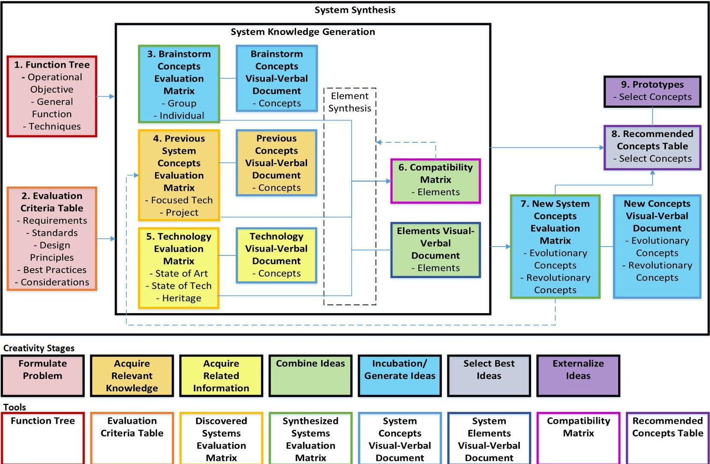

FIGURE 10. Overview of trade study process used to progress downward through each system level [42].

next level of system elements. The trade study process used to define the COM architecture is shown in Fig. 10. The process starts by first defining the system functions and evaluation criteria to formulate the problem that the trades study addresses in Trade Study Steps 1-2. Next, system knowledge is generated, recorded, evaluated, and assessed for cross-compatibility through a series of brainstorming activities, research into previous system concepts and available technologies, and a combining of ideas in Trade Study Steps 3-6. Finally, any new concepts are generated, a prioritized list of concepts are recommended, and a prototypes are developed in Trade Study Steps 7-9.

The trade study process was defined by JPL using a toolkit derived from systems engineering tools and developed based on principles from creativity research, educational psychology, and cognitive psychology [42]. The trade study process defines the structural elements of the next level, as well as captures the information associated with design decisions made in the trade study. Following each trade study, peer reviews were held to review the trades and recommended design concepts, gather technical feedback, and seek approval to proceed down to the next level of architecture definition.

The overall system architecting process was further specialized for the COM and expanded into a set of 26 activities,

as shown in the flowchart in Fig. 11. The overall process started with definition of the Level 4 structure, data, behavior, and requirements at the COM level, then proceeded with a COM trade study and peer review. Next, the Level 5 structure, data, behavior, and requirements were defined. Trade studies and peer reviews were carried out for the Capture Mechanism, Orientation Mechanism, and Transfer Mechanism. Finally, the Level 6 structure, data, behavior, and requirements were defined for each of the COM subsystems.

The 26 activities in Fig. 11 were further decomposed into a unique set of 76 tasks, which are listed in Table 1. The color coding in Table 1 indicates which tasks were associated with the structure, data, behavior, and requirements definition, as well as trade study and peer review activities. The task IDs of the 76 tasks in Table 1 were numbered based on the general order they were performed. These IDs were used as task references in the DSMs.

## B. NON-MBSE APPROACH

Table 2 lists the different types of resources identified for the non-MBSE approach, the tools implemented for each resource category, and the total quantity of resources used. The non-MBSE approach captured system architecture information using documents consisting of slides, manuscripts, and spreadsheets. Below is a more detailed description of the

<!-- PDF_PAGE: 9 -->

TABLE 1. List of COM architecting process task names and IDs.

<table border="1"><tr><td>ID</td><td>Task</td><td>ID</td><td>Task</td></tr><tr><td>1</td><td>Define CCRS Structural Elements</td><td>39</td><td>Generate New OM Systems</td></tr><tr><td>2</td><td>Define CCRS Internal Structure</td><td>40</td><td>Recommend OM Concepts</td></tr><tr><td>3</td><td>Define CCRS Element Specifications</td><td>41</td><td>Prototype OM Concepts</td></tr><tr><td>4</td><td>Define L4 Data</td><td>42</td><td>OM Peer Review</td></tr><tr><td>5</td><td>Define L4 Behavior</td><td>43</td><td>Generate TM Function Tree</td></tr><tr><td>6</td><td>Define L4 Requirements</td><td>44</td><td>Generate TM Evaluation Criteria</td></tr><tr><td>7</td><td>Generate COM Function Tree</td><td>45</td><td>Brainstorm TM Concepts</td></tr><tr><td>8</td><td>Generate COM Evaluation Criteria</td><td>46</td><td>Research Previous TM Concepts</td></tr><tr><td>9</td><td>Brainstorm COM Concepts</td><td>47</td><td>Research Relevant TM Technology</td></tr><tr><td>10</td><td>Research Previous COM Concepts</td><td>48</td><td>Assess TM Compatibility</td></tr><tr><td>11</td><td>Research Relevant COM Technology</td><td>49</td><td>Generate New TM Systems</td></tr><tr><td>12</td><td>Assess COM Compatibility</td><td>50</td><td>Recommend TM Concepts</td></tr><tr><td>13</td><td>Generate New COM Systems</td><td>51</td><td>Prototype TM Concepts</td></tr><tr><td>14</td><td>Recommend COM Concepts</td><td>52</td><td>TM Peer Review</td></tr><tr><td>15</td><td>Prototype COM Concepts</td><td>53</td><td>Define CM Structural Elements</td></tr><tr><td>16</td><td>COM Architecture Peer Review</td><td>54</td><td>Define CM Internal Structure</td></tr><tr><td>17</td><td>Define COM Structural Elements</td><td>55</td><td>Define CM Element Specifications</td></tr><tr><td>18</td><td>Define COM Internal Structure</td><td>56</td><td>Define CC Structural Elements</td></tr><tr><td>19</td><td>Define COM Element Specifications</td><td>57</td><td>Define CC Internal Structure</td></tr><tr><td>20</td><td>Define L5 Data</td><td>58</td><td>Define CC Element Specifications</td></tr><tr><td>21</td><td>Define L5 Behavior</td><td>59</td><td>Define SS Structural Elements</td></tr><tr><td>22</td><td>Define L5 Requirements</td><td>60</td><td>Define SS Internal Structure</td></tr><tr><td>23</td><td>Generate CM Function Tree</td><td>61</td><td>Define SS Element Specifications</td></tr><tr><td>24</td><td>Generate CM Evaluation Criteria</td><td>62</td><td>Define OM Structural Elements</td></tr><tr><td>25</td><td>Brainstorm CM Concepts</td><td>63</td><td>Define OM Internal Structure</td></tr><tr><td>26</td><td>Research Previous CM Concepts</td><td>64</td><td>Define OM Element Specifications</td></tr><tr><td>27</td><td>Research Relevant CM Technology</td><td>65</td><td>Define TM Structural Elements</td></tr><tr><td>28</td><td>Assess CM Compatibility</td><td>66</td><td>Define TM Internal Structure</td></tr><tr><td>29</td><td>Generate New CM Systems</td><td>67</td><td>Define TM Element Specifications</td></tr><tr><td>30</td><td>Recommend CM Concepts</td><td>68</td><td>Define CI Structural Elements</td></tr><tr><td>31</td><td>Prototype CM Concepts</td><td>69</td><td>Define CI Internal Structure</td></tr><tr><td>32</td><td>CM Peer Review</td><td>70</td><td>Define CI Element Specifications</td></tr><tr><td>33</td><td>Generate OM Function Tree</td><td>71</td><td>Define TCS Structural Elements</td></tr><tr><td>34</td><td>Generate OM Evaluation Criteria</td><td>72</td><td>Define TCS Internal Structure</td></tr><tr><td>35</td><td>Brainstorm OM Concepts</td><td>73</td><td>Define TCS Element Specifications</td></tr><tr><td>36</td><td>Research Previous OM Concepts</td><td>74</td><td>Define L6 Data</td></tr><tr><td>37</td><td>Research Relevant OM Technology</td><td>75</td><td>Define L6 Behavior</td></tr><tr><td>38</td><td>Assess OM Compatibility</td><td>76</td><td>Define L6 Requirements</td></tr><tr><td></td><td></td><td></td><td></td></tr><tr><td></td><td>Structure Definition</td><td></td><td>Requirements Definition</td></tr><tr><td></td><td>Data Definition</td><td></td><td>Trade Study</td></tr><tr><td></td><td>Behavior Definition</td><td></td><td>Peer Review</td></tr></table>

TABLE 2. Resources used with the non-MBSE architecture approach.

<table border="1"><tr><td>Resource Category</td><td>Resource Types</td><td>Tool</td><td>Qty</td></tr><tr><td>Personnel</td><td>Systems Engineers,Cognizant Engineers</td><td>N/A</td><td>8</td></tr><tr><td>Slide</td><td>Product Breakdowns,System Block Diagrams,Data Models,Function Trees,Visual-Verbal Documents,Peer Review Packages</td><td>Microsoft PowerPoint</td><td>39</td></tr><tr><td>Manuscript</td><td>Product Specifications</td><td>Microsoft Word</td><td>46</td></tr><tr><td>Spreadsheet</td><td>Scenarios,Requirements,Glossaries,EvaluationCriteriaTables,EvaluationMatrices,CompatibilityMatrices,RecommendedConceptTables,PeerReviewAdvisories</td><td>Microsoft Excel</td><td>35</td></tr><tr><td>Prototype</td><td>Prototypes</td><td>Physical Model</td><td>4</td></tr><tr><td colspan="3">Total Resources</td><td>132</td></tr></table>

key systems engineering artifacts generated in the non-MBSE approach, along with the tools used to generate them:

- Glossary: Excel spreadsheet listing key terms.

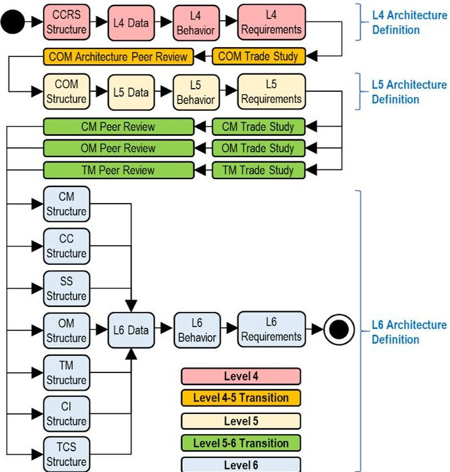

FIGURE 11. Flowchart of the COM architecting process implemented down to level 6 following the general architecting process in fig. 9.

- Product Breakdown: PowerPoint slide showing the decomposition of the COM module down to the subsystems and assemblies.

- System Block Diagrams: PowerPoint slides for each module, subsystem and assembly showing the individual elements, along with heater power, temperature sensor, separation device, servo motor control, workhorse motor control, optical, data, sensor power, and mechanical interfaces.

- Product Specifications: Word documents for each module, subsystem, and assembly containing a textual description of the system element, its key attributes, the functions it performs, the requirements it must meet, and other relevant characteristics.

- Data Model: PowerPoint slide showing the specialization of data products used by the COM module, subsystems, and assemblies.

- Scenario: Excel spreadsheet capturing the individual steps that lay out the main operational scenario.

- Requirements: Excel spreadsheet containing the system requirements at the module, subsystem, and assembly levels.

- Function Trees: PowerPoint slides capturing the system operations, objectives, functions, and potential techniques.

- Evaluation Criteria Tables: Excel spreadsheets listing and defining the criteria for the trade studies.

- Evaluation Matrices: Excel spreadsheets used to document, decompose, and evaluate potential system concepts and technologies.

- Visual-Verbal Documents: PowerPoint slides capturing images and descriptions for potential system concepts, technologies, and system elements.

<!-- PDF_PAGE: 10 -->

TABLE 3. Resources used with the MBSE architecture approach.

<table border="1"><tr><td>Resource Category</td><td>Resource Types</td><td>Tool</td><td>Qty</td></tr><tr><td>Personnel</td><td>Systems Engineers,Cognizant Engineers</td><td>N/A</td><td>8</td></tr><tr><td>Slide</td><td>Function Trees,Visual-Verbal Documents,PeerReview Packages</td><td>Microsoft PowerPoint</td><td>28</td></tr><tr><td>Spreadsheet</td><td>Evaluation Criteria Tables,Evaluation Matrices,Compatibility Matrices,Recommended Concept Tables,PeerReview Advisories</td><td>Microsoft Excel</td><td>32</td></tr><tr><td>Prototype</td><td>Prototypes</td><td>Physical Model</td><td>4</td></tr><tr><td>Block Definition Diagram</td><td>Product Breakdowns,DataModels</td><td>Cameo Systems Modeler</td><td>2</td></tr><tr><td>Internal Block Diagram</td><td>System Block Diagrams</td><td>Cameo Systems Modeler</td><td>9</td></tr><tr><td>Block</td><td>Product Specifications</td><td>Cameo Systems Modeler</td><td>46</td></tr><tr><td>Activity Diagram</td><td>Scenarios</td><td>Cameo Systems Modeler</td><td>27</td></tr><tr><td>Requirements Diagram</td><td>Requirements</td><td>Cameo Systems Modeler</td><td>1</td></tr><tr><td>Profile</td><td>Classifications</td><td>Cameo Systems Modeler</td><td>1</td></tr><tr><td>Glossary Table</td><td>Glossaries</td><td>Cameo Systems Modeler</td><td>1</td></tr><tr><td colspan="3">Total Resources</td><td>159</td></tr></table>

- Compatibility Matrices: Excel spreadsheets evaluation the compatibility of system elements amongst one another.

- Recommended Concept Tables: PowerPoint slides presenting a set of selected concepts for further recommendation and evaluation.

- Peer Review Packages: PowerPoint slides at the module and subsystem levels providing an overview of the system architecture and relevant trade studies.

- Peer Review Advisories: Excel spreadsheets containing technical and programmatic advisories captured during the peer reviews.

Fig. 12 shows the DSM generated for the non-MBSE approach with the full set of 76 tasks. The groups of tasks corresponding to the activities depicted in Fig. 11 are called out along the diagonal of the matrix for reference. A total of 4,858 information element transfers between tasks were recorded. Since all resources exist as independent documents in the non-MBSE approach, all 4,858 information elements needed to be manually transferred.

## C. MBSE APPROACH

Table 3 lists the different types of resources identified for the MBSE approach, the tools implemented for each resource category, and the total quantity of resources used. The MBSE approach captured system architecture information using SysML diagrams tied to a single system model generated in Cameo Systems Modeler. The SysML diagrams used in the MBSE approach include Block Definition Diagrams (BDD), Internal Block Diagrams (IBD), Activity Diagrams (AD), and Requirements Diagrams (RD). The Glossary Table available in Cameo Systems Modeler was also used. Below is a more detailed description of the key systems engineering artifacts generated in the MBSE approach, along with the SysML diagrams used in Cameo Systems Modeler to generate them:

- Glossary: Glossary Table listing key terms.

- Product Breakdown: BDD showing the decomposition of the COM module down to the subsystems and assemblies. Block specifications captured products specifications for each module, subsystem, and assembly.

- System Block Diagrams: IBDs for each module, subsystem and assembly showing the individual elements, along with heater power, temperature sensor, separation device, servo motor control, workhorse motor control, optical, data, sensor power, and mechanical interfaces.

- Data Model: BDD showing the specialization of data products used by the COM module, subsystems, and assemblies.

- Scenario: ADs capturing the individual actions and control flows that lay out the main operational scenario.

- Requirements: RD containing the system requirements at the module, subsystem, and assembly levels.

The trade study tools, peer reviews packages, and peer review advisories used the same documents and tools as the nonMBSE approach.

Fig.13 shows the DSM generated for the MBSE approach with the full set of 76 tasks. The same 4,858 elements that were transferred between tasks in the non-MBSE approach were also transferred between tasks in the MBSE approach. The only difference between the non-MBSE and MBSE approaches are the resources that the information is stored in and retrieved from (the MBSE approach utilizes model views and profiles in place of some of the documents used in the non-MBSE approach). Using the MBSE resources, 630 of the information transfers were able to be automated, since the MBSE model allows for explicit links and associations between information elements. Manual information transfer was, therefore, reduced to 4,228 elements. Note that even though an MBSE model was used to capture the COM architecture information, most of the information transfer between tasks were still manual. This is because documents were still used by the personnel to carry out many of the tasks associated with the trade studies and peer reviews.

## D. COMPARISION OF THE NON-MBSE AND MBSE APPROACHES

Table 4 compares the number of manual and automatic information transfers between tasks for both the non-MBSE and MBSE approaches. The MBSE approach had a smaller number of manual information transfers, and a greater number of automatic information transfers, between tasks than the non-MBSE approach. With the MBSE approach, 13% of the information was able to be associated through SysML relationships in the COM system model, allowing the information to be automatically transferred between tasks.

## E. EXTENSIVE MBSE APPROACH

As reported in Table 4, the MBSE approach used to architect the COM still utilized documents for its trade studies and peer reviews, resulting in 87% of the information transfer still

<!-- PDF_PAGE: 11 -->

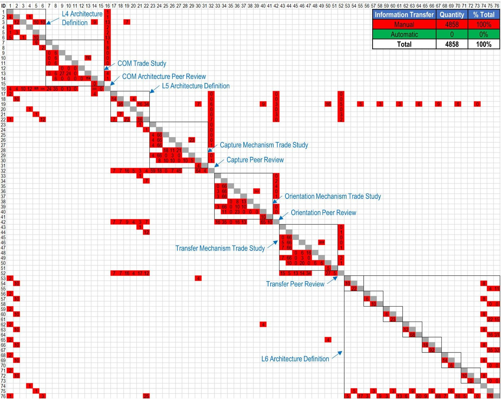

FIGURE 12. Design structure matrix for the non-MBSE approach with the groups of tasks corresponding to the activities depicted in Fig. 11 called out along the diagonal for reference.

TABLE 4. Number of manual and automatic information transfers between tasks for the non-MBSE, MBSE, and extensive MBSE approaches.

<table border="1"><tr><td rowspan="2">Information Transfer</td><td colspan="2">Non-MBSE Approach</td><td colspan="2">MBSE Approach</td><td colspan="2">Extensive MBSE Approach</td></tr><tr><td>Quantity</td><td>% Total</td><td>Quantity</td><td>% Total</td><td>Quantity</td><td>% Total</td></tr><tr><td>Manual</td><td>4858</td><td>100%</td><td>4228</td><td>87%</td><td>931</td><td>19%</td></tr><tr><td>Automatic</td><td>0</td><td>0%</td><td>630</td><td>13%</td><td>3927</td><td>81%</td></tr><tr><td>Total</td><td>4858</td><td>100%</td><td>4858</td><td>100%</td><td>4858</td><td>100%</td></tr></table>

being manually executed. To increase automatic information transfer, opportunities to apply MBSE resources to the trade study and peer review tasks were explored. This included replacing the remaining document-based resources, such as spreadsheets and PowerPoints, with MBSE-based resources, such as Instance Tables, Dependency Matrices, Profiles, and BDDs. Below is a more detailed description of the new systems engineering artifacts proposed for the extensive MBSE

approach, along with the SysML diagrams used in Cameo Systems Modeler to generate them:

- Function Trees: BDDs would capture the system operations, objectives, functions, and potential techniques using activity blocks. The BDDs would replace the equivalent PowerPoint slides.

- Concept and Element Visuals: BDDs would capture images and descriptions for potential system concepts,

<!-- PDF_PAGE: 12 -->

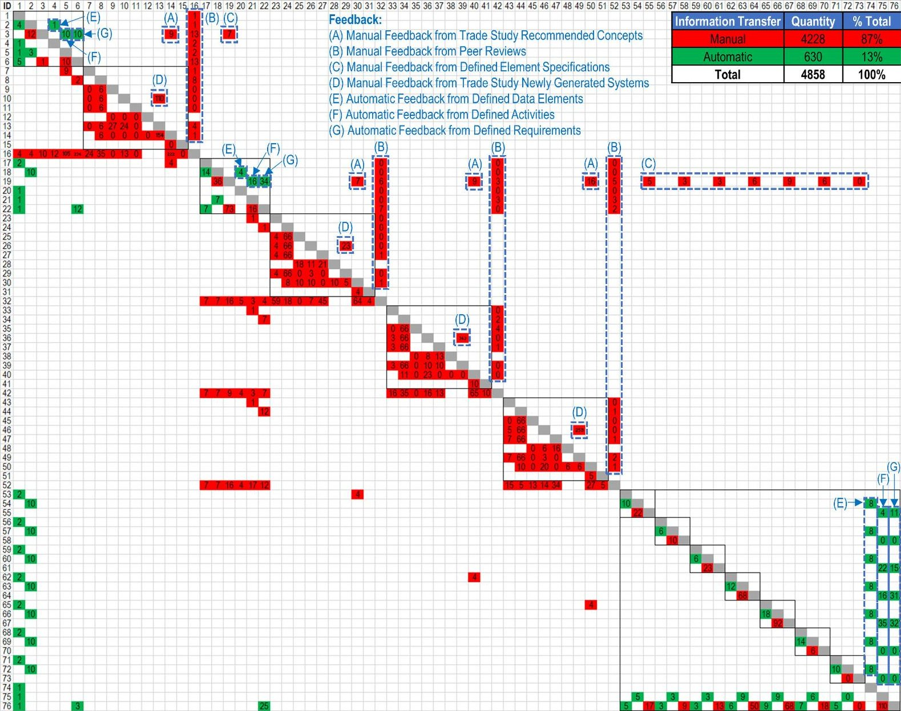

FIGURE 13. Design structure matrix for the MBSE approach with feedback loops labeled for reference.

technologies, and system elements using blocks displaying image properties. The BDDs would replace the Visual-Verbal Document PowerPoint slides.

- Concept Compositions: Dependency matrices would be used to decompose system concept. This would replace the system decompositions in the Evaluation Matrix Excel spreadsheets.

- Evaluation Criteria Tables: Instance Tables would list the criteria for the trade studies, using Blocks and Value Types to capture and define trade study evaluation criteria. This would replace the equivalent Excel spreadsheets.

- Evaluation Matrices: Instance Tables would be used to document and evaluate potential system concepts and technologies. This would replace the equivalent Excel spreadsheets.

- Recommended Concepts Tables: Instance Tables would present a set of selected concepts for further recommendation and evaluation. This would replace the equivalent Excel spreadsheets.

Additionally, the SysML diagrams associated with the architecture description and trade studies would be utilized for

the peer reviews, reducing the amount of the information that would need to be manually transferred from their native resources to PowerPoint slides within the Peer Review Packages.

Table 5 shows a table of resources for the extensive MBSE approach that utilizes more MBSE resources than the prior MBSE approach. Fig. 14 shows the resulting DSM for the extensive MBSE approach, where the yellow cells represent opportunities for manual information transfer to be automated through converting the non-MBSE resources used in those tasks to MBSE resources. When comparing Table 3 to Table 5, the number and types of resources increase with the use of additional, more specialized MBSE diagrams in the extensive MBSE approach. Through utilizing these additional MBSE resources, the percent of automatically transferred information elements is estimated to increase from 13% to 81%, as shown in Table 4.

Implementing the above changes proposed for the extensive MBSE approach would require an internal effort to develop new MBSE templates, patterns, and procedures, as well as education to familiarize additional team members and peers on SysML, which is the primary reason the

<!-- PDF_PAGE: 13 -->

ID 1 2 3 4 5 6 7 8 9 10 11 12 13 14 15 16 17 18 19 20 21 22 23 24 25 26 27 28 29 30 31 32 33 34 35 36 37 38 39 40 41 42 43 44 45 46 47 48 49 50 51 52 53 54 55 56 57 58 59 60 61 62 63 64 65 66 67 68 69 70 71 72 73 74 75 76

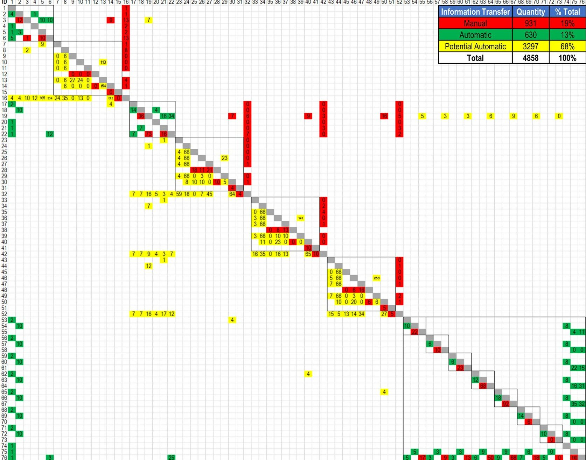

FIGURE 14. Design structure matrix for the extensive MBSE approach.

extensive MBSE approach was not utilized for the initial MBSE approach in this research. However, this effort appears feasible to implement in the future given proper investments in time and resources.

## V. DISCUSSION

To date, many of the comparisons of MBSE to default systems engineering processes have been performed qualitatively. The value proposition for MBSE is asserted to include improvements in quality, velocity/agility, user experience, and knowledge transfer. These categories are based on a framework developed by McDermott et al. for defining and categorizing MBSE benefits and metrics [43]. Because this study performed a direct, comparative analysis of an MBSE and non-MBSE approach, the results lead to a unique elucidation of the quantitative MBSE benefit categories around MBSE-implementation in practice. A summary of the improvements of the MBSE approach over the Non-MBSE approach for each of the four MBSE benefit categories is shown in Table 6. Additionally, limitations identified with the

MBSE approach provide recommendations for future work to improve the approach.

## A. IMPLICATIONS FOR QUANTIFYING THE QUALITY BENEFITS OF MODEL-BASED SYSTEMS ENGINEERING

Automatic information transfer improves the quality of the system and its associated systems engineering artifacts by reducing the risk of defects incurred by miscommunication from manual information transfer. As quantified in this study of a practical MBSE process, MBSE only automated 13% of the total information transfer during architecting. This study measured that even in MBSE-intensive architecture processes, many of the steps of architecting, review, tradeoff, and information transfer are still performed manually. This type of result suggests that the quality benefits of MBSE may be relatively small until an architecture process can realize a high-level of MBSE-enabled automation, implying only minimal improvement in system quality due to automatic information transfer in MBSE efforts that are isolated or incomplete.

<!-- PDF_PAGE: 14 -->

TABLE 5. Resources for the extensive MBSE architecture approach.

<table border="1"><tr><td>Resource Category</td><td>Resource Types</td><td>Tool</td><td>Qty</td></tr><tr><td>Personnel</td><td>Systems Engineers,Cognizant Engineers</td><td>N/A</td><td>8</td></tr><tr><td>Slide</td><td>Function Trees,PeerReview Packages</td><td>Microsoft PowerPoint</td><td>4</td></tr><tr><td>Spreadsheet</td><td>Compatibility Matrices,PeerReview Advisories</td><td>Microsoft Excel</td><td>8</td></tr><tr><td>Prototype</td><td>Prototypes</td><td>Physical Model</td><td>4</td></tr><tr><td>Block Definition Diagram</td><td>Product Breakdowns,DataModels,Function Trees,Evaluation CriteriaDefinitions,Concept andElement Visuals</td><td>Cameo Systems Modeler</td><td>30</td></tr><tr><td>Internal Block Diagram</td><td>System Block Diagrams</td><td>Cameo Systems Modeler</td><td>9</td></tr><tr><td>Block</td><td>Product Specifications</td><td>Cameo Systems Modeler</td><td>46</td></tr><tr><td>Activity Diagram</td><td>Scenarios</td><td>Cameo Systems Modeler</td><td>27</td></tr><tr><td>Requirements Diagram</td><td>Requirements</td><td>Cameo Systems Modeler</td><td>1</td></tr><tr><td>Profile</td><td>Classifications,EvaluationCriteriaTypes</td><td>Cameo Systems Modeler</td><td>5</td></tr><tr><td>Glossary Table</td><td>Glossaries</td><td>Cameo Systems Modeler</td><td>1</td></tr><tr><td>Instance Table</td><td>EvaluationCriteriaTables,EvaluationMatrices,RecommendedConceptTables</td><td>Cameo Systems Modeler</td><td>40</td></tr><tr><td>DependencyMatrix</td><td>ConceptCompositions</td><td>Cameo Systems Modeler</td><td>16</td></tr><tr><td colspan="3">Total Resources</td><td>199</td></tr></table>

## B. IMPLICATIONS FOR QUANTIFYING THE

## VELOCITY/AGILITY BENEFITS OF MODEL-BASED SYSTEMS ENGINEERING

Work required to otherwise manually transfer information between tasks and check for consistency was slightly reduced through automatic information transfer. The MBSE approach enabled automation of 13% of the total information transfer, affecting 35 of the 76 architecting tasks (46% of the tasks). This implies only minimal improvement in velocity due to only minimal potential reduction in work time from automatic information transfer.

Iteration and rework due to feedback are also major drivers in velocity, particularly since these feedbacks are often unplanned and destabilizing [17]. Most of the information feedback in JPL's documented MBSE architecting process were through manual feedbacks from trade study, peer review, and element specification activities, as labeled (A), (B), (C), and (D) in Fig. 13. Feedback that occurs the furthest distance above the diagonal in the DSM indicate a greater number of activities that may need to be repeated in an iteration, which can have the largest impact on hindering velocity. Manual feedback from peer review and element specification activities fell into this category, and the rearchitecting that occurred from this feedback were primary drivers in the length of time required to define the COM architecture. These discussion points illustrate again that as long as MBSE enabled automatic information transfer is excluded from impactful design activities, such as peer review and element specifications, MBSE's impact on architecting velocity will be limited.

TABLE 6. Improvements of the MBSE approach over the non-MBSE approach for each of the four MBSE benefit categories.

<table border="1"><tr><td>MBSE Benefit Categories</td><td>Improvements of the MBSE Approach over the Non-MBSE Approach</td></tr><tr><td>Quality</td><td>Improved quality by reducing risk of defects incurred by miscommunication due to automated knowledge transfer of 630 of 4,858 knowledge elements(13% of knowledge elements)</td></tr><tr><td>Velocity/Agility</td><td>Improved velocity by reducing work time due to automation in 35 of 76 architecting tasks(46% of tasks)</td></tr><tr><td>User Experience</td><td>Improved user experience by reducing the burden of systems engineering tasks due to automation in 35 of 76 architecting tasks(46% of tasks)</td></tr><tr><td>Knowledge Transfer</td><td>Improved knowledge transfer within the COM engineering team in 630 of 4,858 knowledge elements(13% of knowledge elements) due to automated knowledge transfer associated with architecture definition tasks.No improved knowledge transfer between the COM engineering team and external peer reviewers in 1,361 of the 4,858 knowledge elements(28% of knowledge elements) due to no automated knowledge transfer associated with peer review tasks.</td></tr></table>

Another limitation with the MBSE approach was that a greater investment in time was required to set up and develop the models with the MBSE approach, relative to composing the documents in the non-MBSE approach. This observation is in line with Madni et al., who also recognize that systems engineering initiatives that employ an MBSE approach require greater upfront investing in the earlier stages of the systems life cycle than needed with traditional systems engineering [44]. Therefore, velocity benefits of the MBSE approach were not directly apparent, as the minor velocity benefits from the automatic information transfer during the architecting process were also offset by the additional time required to set up the MBSE model. This initial time investment associated with model setup should be considered when assessing the overall velocity benefits of an MBSE approach during system architecting.

## C. IMPLICATIONS FOR QUANTIFYING THE USER EXPERIENCE BENEFITS OF MODEL-BASED SYSTEMS ENGINEERING

User experience was improved through reduced burden of systems engineering tasks and support for automation. The MBSE approach showed reduced burden of manual information transfer through automation for the Level 4, Level 5, and Level 6 architecture definition tasks, but not for tasks associated with the trade studies and peer reviews. The architecture definition tasks consisted of 36 of the 76 tasks (47% of the tasks), and the trade study and peer reviews consisted of 40 of the 76 tasks (53% of the tasks). The MBSE approach automated information transfer only in the architecture definition tasks, in which 35 of the 36 architecture definition tasks were automated (or 46% of the total number of architecting tasks). This can be attributed to the fact that the MBSE tool and language utilized in the MBSE approach did not have well-defined information constructs, diagrams, and templates for the trade study and peer review tasks. Therefore, the engineering team found it a challenge to implement ideation, design tradeoff studies, and reviews with MBSE using Cameo Systems Modeler and SysML. This is in line with a survey performed by Huldt and Stenius, which indicated greater value with MBSE in architecting and design tasks, over decision support tasks and technical reviews [27].

<!-- PDF_PAGE: 15 -->

## D. IMPLICATIONS FOR QUANTIFYING THE KNOWLEDGE TRANSFER BENEFITS OF MODEL-BASED SYSTEMS

## ENGINEERING

For the architecting processes studied here, automatic information transfer with the MBSE approach only occurred within the architecture definition tasks, and only accounted for 13% of the total information transfer during architecting. These automations aided with transfer of system knowledge between the Cognizant Engineers and Systems Engineers, as well as collaborative efforts between engineering team members associated with these tasks. Since automatic information transfer was not executed in the peer reviews, the MBSE approach did not offer knowledge transfer benefits between the engineering team and the external peer reviewers. Peer reviews contributed to 4 of the 76 tasks (5% of the tasks) and 1,361 of the 4,858 knowledge element transfers (28% of the knowledge element transfers). MBSE was not implemented for peer reviews due to the current limitations of NASA's MBSE tool, process, and language to generate all the desired views for the peer review presentations, the current lack of a method to collect reviewer feedback and integrate them with the system model, and unfamiliarity of the reviewers with the SysML language. Carlson and Vaneman similarly found in a survey that only a small percent of Preliminary Design Review (PDR) questions could be addressed with current MBSE methods, and highlighted the need to develop new visualizations for technical reviews to adequately address these needs [45].

## E. FUTURE WORK

For future work, these findings suggest a series of follow-ups and advancements, including testing the methodology on additional systems, testing the methodology with different MBSE languages and tools, testing the methodology with two independent development teams, expanding the approach to include parametrics, and developing and testing the extensive MBSE approach with increased automatic information transfer:

- Testing the methodology on additional systems: Applying the MBSE and non-MBSE approaches on additional systems can help validate the methodology across additional engineering domains, as well as gather additional data on how much information transfer can be automated through applying MBSE methods.

- Testing the methodology with different MBSE languages and tools: Different languages possess unique information construct and diagrams. Different tools possess unique abilities to utilize the language, interact with the system model, and generate templates. These unique capabilities could be applied to the trade study and peer review tasks, and potentially improve the MBSE approach's ability to automate information transfer within these tasks.

- Testing the methodology with two independent development teams: This research was carried out by a single development team, which applied the MBSE and

non-MBSE approaches in parallel. With this approach, there is a potential that decisions made for one of the implementation approaches could have influenced the other. Testing the methodology with two independent development teams could help insure that the decision-making in the MBSE and non-MBSE approaches remain independent and decoupled.

- Expanding the MBSE approach to include parametrics: Mathematical relationships between value properties can be captured within a system architecture description. The MBSE architecture approach used in this research captured block value properties, but did not explicitly model mathematical relationships. Integrating parametric diagrams into the architecture framework and architecting process can provide another means to leverage additional capabilities of MBSE and provide further opportunities for automatic information transfer.

- Developing and testing the extensive MBSE approach with increased automatic information transfer: The current MBSE approach used to architect the COM only utilized MBSE during the architecture definition tasks. The trade study and peer review tasks did not utilize MBSE and were still document-based. To address this issue, potential opportunities to apply MBSE methods to the trade study and peer review tasks were explored. This extensive MBSE approach should be implemented on future system architecting activities to validate the approach and measure its ability to increase automatic information transfer for the trade study and peer review tasks.

In developing this study and these recommendations, the authors acknowledge that MBSE as a discipline is under continuous development. With advancements in the language, tool, and processes of MBSE will come improvements in the as-measured performance of MBSE architecting projects.

## VI. CONCLUSION

MBSE and traditional, document-based systems engineering (non-MBSE) approaches were applied in parallel to architect an orbiting sample COM system concept for a CCRS payload concept for the potential MSR campaign. The approaches were applied at three architecture levels of the COM: the module level (Level 4), the subsystem level (Level 5), and the assembly level (Level 6). The approaches also covered trades study and peer review tasks between each architecture level.

To explore the advantages of the MBSE approach, resource breakdown structures for the architecting approaches were generated, a system architecting process was synthesized, architecting process task interactions between resources were mapped out in activity diagrams, quantities of manual and automatic information transfer between tasks were recorded in DSMs, and quantities of manual and automatic information transfer were compared for both the non-MBSE and MBSE architecting approaches. A total of 132 resources were used in the non-MBSE approach, and 159 resources in the MBSE

<!-- PDF_PAGE: 16 -->

approach. The architecting process was broken down into 76 steps. A total of 4,858 information element transfers were recorded between the various process steps. All 100% of these information elements were transferred manually in the non-MBSE approach. The MBSE approach, on the other hand, was able to automate 13% of these information transfers. Additionally, an extensive MBSE approach that further utilizes MBSE resources for the trade study and peer review tasks was predicted to further increase automation to 81%.

Through performing a side-by-side comparison of the MBSE approach with the non-MBSE approach to architect the COM, several findings from this case study were made:

- The MBSE approach developed for architecting the COM proved effective in establishing the architecture of a robotic space system, which included definition of the structure, data, behavior, and requirements of the system at the module, subsystem, and assembly levels.

- The methodology using the DSMs proved a useful tool to identify the information transferred between tasks during the architecting process and facilitate in quantitatively measuring the benefits of the MBSE approach relative to the non-MBSE approach in terms of automatic information transfer.

- The MBSE approach used to architect the COM provided only minor benefits, with an increased automation of information transfer of only 13% of total information element transfer relative to the non-MBSE approach. Increased automatic information transfer provided potential improvements in system quality, user experience in the architecting approach, and knowledge transfer within the engineering team. Velocity benefits of the MBSE approach were not directly apparent, as the minor velocity benefits from the automated knowledge transfer during the architecting process were also offset by the additional time required to set up the MBSE model.

- A large part of the architecting process, particularly tasks related to trade studies and peer reviews, did not utilize MBSE and still relied on manual information transfer. If MBSE resources were applied to trade study and peer review tasks, the value of MBSE during system architecting could be much higher, potentially up to 81%.

The conclusions drawn from this study were limited to a single system within the robotic space systems domain, using SysML and Cameo Systems Modeler as the modeling language and tool. Additionally, the MBSE approach did not utilize MBSE resources for all system architecting tasks, which limited the ability to assess the full potential of MBSE during the architecting process. Directions for future work should include testing the methodology on additional systems to validate the methodology across additional engineering domains, testing the methodology with different MBSE languages and tools to potentially improve the MBSE approach's ability to automate information transfer, testing the methodology with two independent MBSE and non-MBSE development teams to insure that the decision-making in the

two approaches remain independent, expanding the MBSE approach to include parametrics to leverage additional capabilities of MBSE and provide further opportunities for automatic information transfer, and developing and testing the extensive MBSE approach to validate the approach and measures its ability to increase automatic information transfer.

## ACKNOWLEDGMENT

The research described in this publication was carried out at the Jet Propulsion Laboratory of California Institute of Technology under contract from the National Aeronautics and Space Administration (NASA). The decision to implement Mars Sample Return will not be finalized until NASA's completion of the National Environmental Policy Act (NEPA) process. This document is being made available for information purposes only. Support and guidance were also provided by Richard Mayer, Department of Psychological and Brain Sciences, University of California Santa Barbara, and John Borky, Systems Engineering Department, Colorado State University.

## REFERENCES

[1] D. W. Way, "Preliminary assessment of the Mars science laboratory entry, descent, and landing simulation," in Proc. IEEE Aerosp. Conf., Big Sky, MT, USA, Mar. 2013, pp. 1-16, doi: 10.1109/AERO.2013.6497404.

[2] J. P. Grotzinger, J. Crisp, A. R. Vasavada, R. C. Anderson, C. J. Baker, R. Barry, D. F. Blake, P. Conrad, K. S. Edgett, B. Ferdowski, and R. Gellert, "Mars science laboratory mission and science investigation," Space Sci. Rev., vol. 170, nos. 1-4, pp. 5-56, Sep. 2012, doi: 10.1007/s11214-012-9892-2.

[3] E. Guizzo, "A new spin on robot actuators," IEEE Spectr., vol. 30, no. 2, pp. 40-42, Dec. 2010.

[4] A. Smith, "Curiosity: How many jobs did the Mars landing create?" CNN Money, vol. 6, Aug. 2012. [Online]. Available: https://money.cnn. com/2012/08/06/news/companies/mars-curiosity-jobs/index.htm

[5] NASA: Assessments of Major Projects, GAO-12-207SP, United States Government Accountability Office, Washington, DC, USA, Mar. 2012.

[6] NASA: Assessments of Selected Large-Scale Project, GAO-09-306SP, United States Government Accountability Office, Washington, DC, USA, Mar. 2009.

[7] R. Welch, D. Limonadi, and R. Manning, "Systems engineering the curiosity rover: A retrospective," in Proc. 8th Int. Conf. Syst. Syst. Eng., Jun. 2013, pp. 70-75, doi: 10.1109/SYSoSE.2013.6575245.

[8] T. Bayer, "Is MBSE helping? Measuring value on Europa Clipper," in Proc. IEEE Aerosp. Conf., Big Sky, MT, USA, Mar. 2018, pp. 1-13, doi: 10.1109/AERO.2018.8396379.

[9] P. Younse, C. Chiu, J. Cameron, M. Dolci, E. Elliot, A. Ishigo, D. Kogan, E. Marteau, V. Malyan, J. Mayo, J. Munger, P. Ohta, E. Olds, L. Strahle, and R. Willson, "Concept for an on-orbit capture and orientation module for potential mars sample return," in Proc. IEEE Aero. Conf., Big Sky, MT, USA, Mar. 2020, pp. 1-22, doi: 10.1109/AERO47225.2020.9172814.

[10] B. Muirhead, A. Nicholas, and J. Umland, "Mars sample return mission concept status," in Proc. IEEE Aero. Conf., Big Sky, MT, USA, Mar. 2020, pp. 1-8, doi: 10.1109/AERO47225.2020.9172609.

[11] T. Zurbuchen and D. Parker, "Joint statement of intent between the national aeronautics and space administration and the European space agency on mars sample return," Berlin Airshow, Apr. 2018. [Online]. Available: https://mepag.jpl.nasa.gov/announcements/2018-04- 26%20NASA-ESA%20SOI%20(Signed).pdf

[12] National Academies of Sciences, Engineering, and Medicine, Visions into Voyages for Planetary Sciences in the Decade 2013-2022: A Midterm Review, The National Academies Press, Washington, DC, USA, 2018, doi: 10.17226/25186.

[13] B. K. Muirhead and A. Karp, "Mars sample return lander mission concepts," in Proc. IEEE Aerosp. Conf., Big Sky, MT, USA, Mar. 2019, pp. 1-9, doi: 10.1109/AERO.2019.8742215.

<!-- PDF_PAGE: 17 -->

[14] National Aeronautics and Space Administration, Mars Sample Return Program Final Report of the Independent Review Board, National Aeronautics and Space Administration, Washington, DC, USA, 2020.

[15] J. Topper and N. Horner, "Model-based systems engineering in support of complex systems development," John Hopkins APL Tech. Dig., vol. 32, no. 1, pp. 419-432, 2013.

[16] E. Carroll and R. Malins, Systematic Literature Review: How is ModelBased Systems Engineering Justified. Albuquerque, NM, USA: Sandia National Laboratories, 2016, doi: 10.2172/1561164.

[17] S. Eppinger and T. Browning, Design Structure Matrix Methods and Applications. Cambridge, MA, USA: MIT Press, 2012, doi: 10.7551/mitpress/8896.001.0001.

[18] K. Henderson and A. Salado, "Value and benefits of model-based systems engineering (MBSE): Evidence from the literature," Syst. Eng., vol. 24, no. 1, pp. 51-66, Jan. 2021, doi: 10.1002/sys.21566.

[19] S. Friedenthal, A. Moore, and R. Steiner, A Practical Guide to SysML, 3rd ed. Needham, MA, USA: OMG Press, 2014, doi: 10.1016/C2013-014457-1.

[20] L. Delligatti, SysML Distilled: A Brief Guide to the Systems Modeling Language. Upper Saddle River, NJ, USA: Addison-Wesley, 2014.

[21] M. Rashid, M. W. Anwar, and A. M. Khan, "Toward the tools selection in model based system engineering for embedded systems—A systematic literature review," J. Syst. Softw., vol. 106, pp. 150-163, Aug. 2015, doi: 10.1016/j.jss.2015.04.089.

[22] J. Estefan, "Survey of model-based systems engineering (MBSE) methodologies," INCOSE MBSE Focus Group, vol. 25, pp. 1-12, May 2007.

[23] A. M. Madni and M. Sievers, "Model-based systems engineering: Motivation, current status, and research opportunities," Syst. Eng., vol. 21, no. 3, pp. 172-190, May 2018, doi: 10.1002/sys.21438.

[24] BKCASE Editorial Board, The Guide to the Systems Engineering Body of Knowledge (SEBoK), version 2.4, The Trustees of the Stevens Institute of Technology, Hoboken, NJ, USA, 2021.

[25] J. Fernandez and C. Hernandez, Practical Model-Based Systems Engineering. Norwood, MA, USA: Artech House, 2019.

[26] C. J. White and B. L. Mesmer, "Research needs in systems engineering: Report from a University of Alabama in Huntsville workshop," Syst. Eng., vol. 23, no. 2, pp. 154-164, Mar. 2020, doi: 10.1002/sys.21501.

[27] T. Huldt and I. Stenius, "State-of-practice survey of model-based systems engineering," Syst. Eng., vol. 22, no. 2, pp. 134-145, Mar. 2019, doi: 10.1002/sys.21466.

[28] S. Mazzini, E. Tronci, C. Paccagnini, and X. Olive, "A model-based methodology to support the space system engineering (MBSSE)," in Proc. Embedded Real Time Softw. Syst., Toulouse, France, May 2010, pp. 1-41.

[29] S. Estable, T. Granger, T. Lochow, T. Zoebelein, N. Brauer, I. Tolchinsky, S. Gerene, and H. Koning, "Systems modelling and simulation of the ESA e. Deorbit space debris removal mission," in Proc. NAFEMs, Stockholm, Sweden, Jan. 2017, pp. 1-41.

[30] Systems and Software Engineering—Architecture Description, document ISO/IEC/IEEE 42010, 2011.

[31] D. Emery and R. Hilliard, "Every architecture description needs a framework: Expressing architecture frameworks using ISO/IEC 42010," in Proc. Joint Work. IEEE/IFIP Conf. Softw. Archit. Eur. Conf. Softw. Archit., Cambridge, U.K., Sep. 2009, pp. 31-40, doi: 10.1109/WICSA.2009. 5290789.

[32] J. Borky and T. Bradley, Effective Model-Based Systems Engineering. Cham, Switzerland: Springer, 2019, doi: 10.1007/978-3-319-95669-5.

[33] A. Aleksandraviciene and A. Morkevicius, MagicGrid Book of Knowledge. Kaunas, Lithuania: Vitae Litera, 2018.

[34] NASA Systems Engineering Handbook, SP-2016-6105 Rev2, National Aeronautics and Space Administration, Washington, DC, USA, 2016.

[35] Expanded Guidance for NASA Systems Engineering, SP-2016-6105- SUPPL, National Aeronautics and Space Administration, Washington, DC, USA, 2016.

[36] S. K. S. Cordero, C. Fortin, and R. Vingerhoeds, "Concurrent conceptual design sequencing for MBSE of complex Systems through design structure matrices," in Proc. Design Soc. Conf., vol. 1, Cavtat, Croatia, Oct. 2020, pp. 2375-2384, doi: 10.1017/dsd.2020.96.

[37] NASA Systems Engineering Processes and Requirements, NPR 7123.1 National Aeronautics and Space Administration Washington, DC, USA, 2013.

[38] S. J. Herzig, D. Velez, B. Nairouz, B. Weatherspoon, R. Tikidjian, T. M. Randolph, and B. Muirhead, "A model-based approach to developing the concept of operations for potential Mars sample return," in Proc. AIAA SPACE Astronaut. Forum Expo., Orlando, FL, USA, Sep. 2018, pp. 1-15, doi: 10.2514/6.2018-5389.

[39] J. Huesing, F. Beyer, H. P. de Koning, and J. Delfa, "MBSE for MSR—Introducing MBSE to early phase mission design for Mars sample return," in Proc. SECESA, Glasgow, U.K., Sep. 2018, pp. 1-5.

[40] D. Long and Z. Scott, A Primer for Model-Based Systems Engineering. Blacksburg, VA, USA: Vitech Corporation, 2011.

[41] S. Saunders, "Promoting the real value of systems engineering using an extended SCARIT process model," in Proc. INCOSE Int. Symp., Jun. 2007, vol. 17, no. 1, San Diego, CA, USA, pp. 532-546, doi: 10.1002/j.2334-5837.2007.tb02893.x.

[42] P. Younse, J. Strahle, M. Dolci, P. Ohta, K. Lalla, and R. Adajian, "A systems architecting methodology using Bloom's taxonomy to promote creative engineering synthesis," in Proc. IEEE Aero. Conf., Big Sky, MT, USA, Mar. 2018, pp. 1-24, doi: 10.1109/AERO.2018.8396453.

[43] T. McDermott, N. Hutchison, M. Clifford, E. Van Aken, A. Salado, and K. Henderson, "Benchmarking the benefits and current maturity of modelbased systems engineering across the enterprise," Syst. Eng. Res. Center, Stevens Inst. Technol., Hoboken, NJ, USA, Tech. Rep. SERC-2020-SR001, 2020.

[44] A. Madni and S. Purohit, "Economic analysis of model-based systems engineering," Systems, vol. 7, no. 12, pp. 1-18, Feb. 2019, doi: 10.3390/systems7010012.

[45] R. Carlson and W. Vaneman, "Evaluating current systems engineering models for applicability to model-based systems engineering technical reviews," Nav. Engineers J., vol. 132, no. 2, pp. 51-58, Jun. 2020.

PAULO J. YOUNSE received the B.S. degree in mechanical engineering from California Polytechnic State University, San Luis Obispo, and the M.E. degree in agricultural engineering from the University of Florida. His experience resides in mechanical design, machine vision, systems engineering, system architecting, and planetary sample collection. Previous experience includes development of the Mars 2020 rover sample caching architecture and sample tube hermetic seals, work on

unmanned underwater vehicles at the Boeing Company, and visual navigation and control for agricultural robots at the University of Florida. He is currently a Robotics Engineer with the Robotic Systems Group, NASA's Jet Propulsion Laboratory, Pasadena, CA, USA. He is also leading development of the robot transfer arm for the mars sample return capture, containment, and return systems.

JESSICA E. CAMERON received the Bachelor of Science degree in aerospace engineering from California State Polytechnic University, Pomona, in 2021. She is currently a Systems Engineer for the Mission Operations Team working on NASA's InSightlander at the Jet Propulsion Laboratory, NASA. Previously, she assisted with model-based systems engineering and project management work for Mars Sample Return.

THOMAS H. BRADLEY is currently the Department Head and Woodward Endowed Professor of systems engineering with the Walter Scott, Jr. College of Engineering, Colorado State University, where he conducts research and teaches a variety of courses in system engineering, multidisciplinary optimization, and design. His research interests include the applications in automotive and aerospace system design, energy system management, and lifecycle assessment.