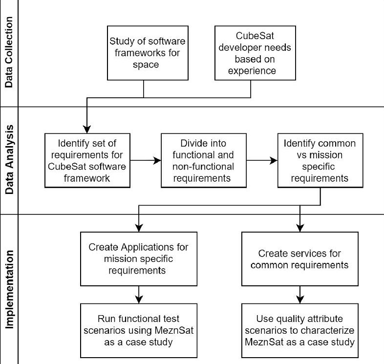
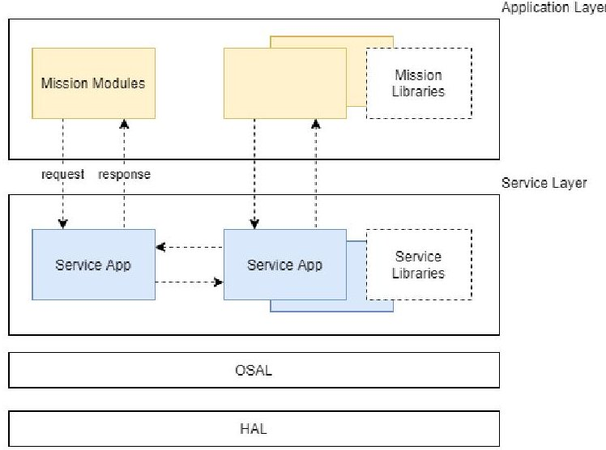
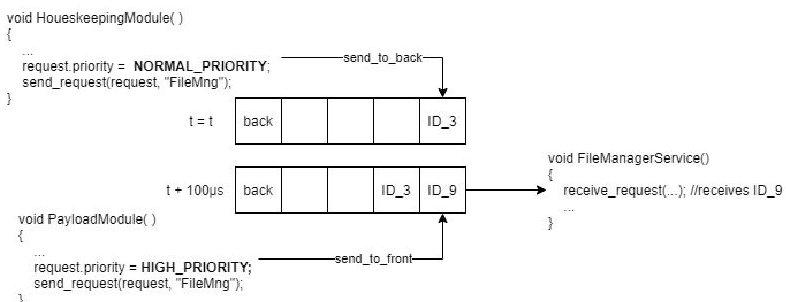
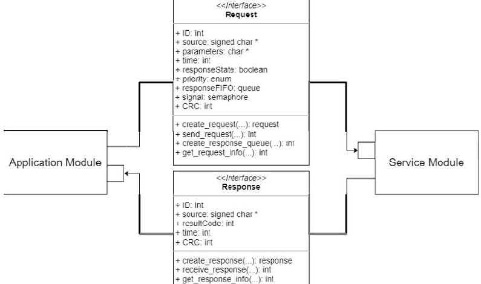
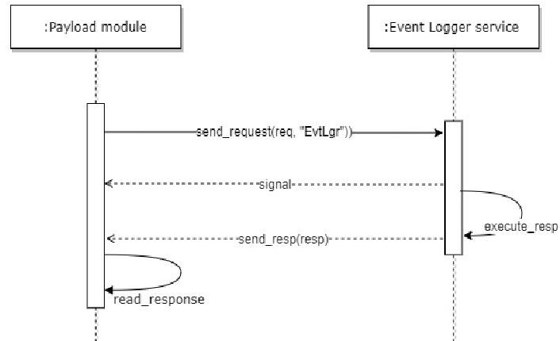
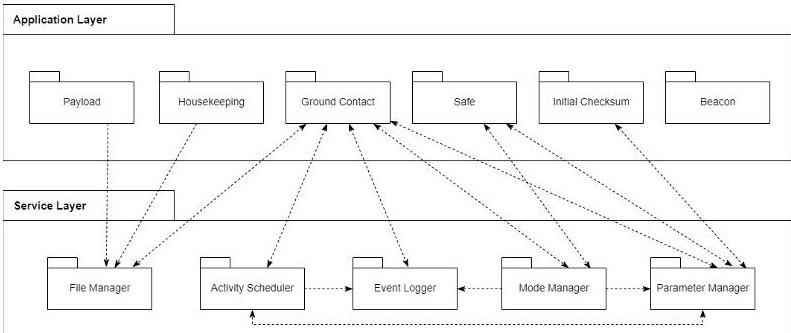
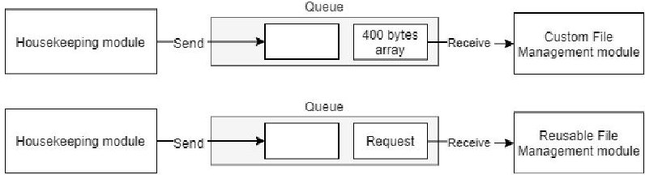
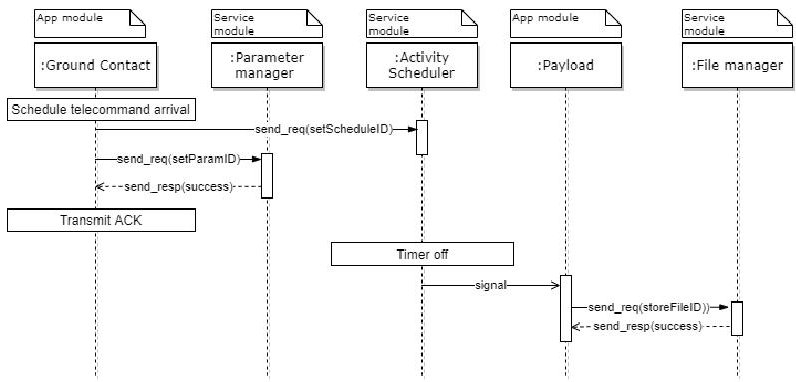
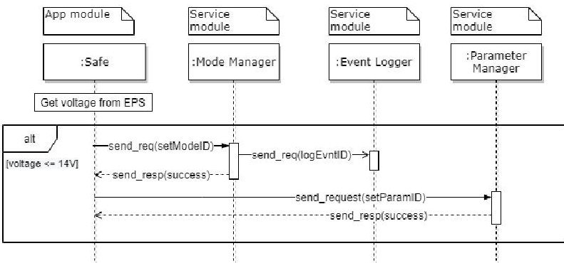

<!-- PDF_PAGE: 1 -->


Received June 2, 2021, accepted June 27, 2021, date of publication July 15, 2021, date of current version August 9, 2021. Digital Object Identifier 10.1109/ACCESS.2021.3097537

<div align="center">

# A Highly Modular Software Framework for Reducing Software Development Time of Nanosatellites

</div>

AISHA K. EL ALLAM $ ^{1} $ , ABDUL-HALIM M. JALLAD $ ^{2,3} $ , (Member, IEEE), MOHAMMED AWAD $ ^{1} $ , MAEN TAKRURI $ ^{4} $ , (Senior Member, IEEE), AND PRASHANTH R. MARPU $ ^{5} $ , (Senior Member, IEEE)

$ ^{1} $ Department of Computer Science and Engineering, American University of Ras Al Khaimah, Ras Al Khaimah, United Arab Emirates

$ ^{2} $ Department of Electrical Engineering, United Arab Emirates University, Al Ain, United Arab Emirates

$ ^{3} $ National Space Science and Technology Center, United Arab Emirates University, Al Ain, United Arab Emirates

$ ^{4} $ Department of Electrical, Electronics and Communications Engineering, American University of Ras Al Khaimah, Ras Al Khaimah, United Arab Emirates

$ ^{5} $ Group 42, Abu Dhabi, United Arab Emirates

Corresponding author: Abdul-Halim M. Jallad (a.jallad@uaeu.ac.ae)

This work was supported in part by the United Arab Emirates Space Agency.

ABSTRACT The standardization of the physical aspects of nanosatellites (also known as CubeSats) and their wide adoption in academia and industry has made the mass production and availability of off-the-shelf components possible. While this has led to a significant reduction in satellite development time, the fact remains that a considerable amount of mission development time and effort continues to be spent on flight software development. The CubeSat's agile development environment makes it challenging to utilize the advantages of existing software frameworks. Such an adoption is not straightforward due to the added complexity characterized by a steep learning curve. A well-designed flight software architecture mitigates possible sources of failure and increases mission success rate while maintaining moderate complexity. This paper presents a novel approach to a flight software framework developed specifically for nanosatellites. The software framework is characterized by simplicity, reliability, modularity, portability, and real-time capability. The main features of the proposed framework include providing a standardized and explicit skeleton for each module to simplify their construction, offering standardized interfaces for all modules to simplify communication, and providing a collection of ready-to-use common services open for further enhancement by CubeSat software developers. The framework efficiency was demonstrated through a software developed for the MeznSat mission that was successfully launched into Low Earth Orbit in September 2020. The proposed software framework proved to simplify software development for the application developer while significantly enhancing software modularity.

INDEX TERMS CubeSat, flight software, nanosatellites, software architecture.

## I. INTRODUCTION

Nanosatellites are loosely defined as satellites with a total mass of less than 10 Kgs. The introduction of the CubeSat standard has led to a reduction in the cost, development time, and engineering effort associated with launching these nanosatellites through the standardization of hardware modules and subsystems. However, much less attention has been given to the software architecture, qualities, and characteristics despite their being mission-critical components [1].

The associate editor coordinating the review of this manuscript and approving it for publication was Yang Liu $ ^{ID} $ .

Additionally, the need for a short orbit time has been impacted by long software development cycles due to the traditional custom approach of creating unique software for each mission. This recent realization has led to several attempts to develop a software architecture that asserts correct functionality as well as completes an adaptable standard counterpart of CubeSat hardware. The software architecture is the set of structures needed to reason about the system and its properties. The reasoning should be about vital attributes of the system, including functionality achieved by the system, system's availability in the face of faults, the difficulty of making specific changes to the system, and many others [2].

<!-- PDF_PAGE: 2 -->


<div align="center">

TABLE 1. Common architectural components among existing frameworks.

</div>

<table border="1"><tr><td>Features</td><td>NanoSat MO Framework[8]</td><td>core Flight System(cFS)[9]</td><td>SAVIOR CORDET(C2)[10]</td><td>SUCHAI[4]</td><td>F Prime[11]</td><td>Kubos[12]</td></tr><tr><td>Modular Unit</td><td>Apps</td><td>Apps</td><td>Service</td><td>Client</td><td>Components</td><td>Apps</td></tr><tr><td>Central Software controller</td><td>NanoSat MO Supervisor</td><td>Executive Service</td><td>N/A</td><td>Invoker</td><td>N/A</td><td>Applications Service</td></tr><tr><td>General architecture</td><td>Layered, Core services(Software management,Mission &amp; Control,platform etc.)and user-defined apps.</td><td>Layered,cFSapps(Housekeeping,Health andSafety,Scheduler etc.)and missionapps</td><td>Layered,Standard services andapplication-specific services developed for each specific application</td><td>Layered,default client models(Initialization,Communication,Flight plan etc.)and mission-specific client models</td><td>Layered,Components(behaviors),ports(interconnection for data),and topologies</td><td>Standard services(Scheduler,Communication,Telemetry database etc.)and missionapps</td></tr><tr><td>Software Bus(messaging mechanism)</td><td>Not defined</td><td>Publish subscribe on top of queue</td><td>Based on the middle ware</td><td>Queue</td><td>Static topologies with typed connections</td><td>HTTP endpoints accept GraphQL requests and return JSON responses</td></tr><tr><td>Language</td><td>JAVA</td><td>C</td><td>C</td><td>C</td><td>C++</td><td>Python,Rust,C</td></tr></table>

In the process of pursuing an architectural design to fulfill well-established requirements such as modularity [1], [3], reliability [2], [4], and reusability [2], [5], existing architectures instinctively formed a common standard system of elements. This is demonstrated in Table 1, in which many architectures follow a modular structure. The elements are static modules of some kind, such as classes, layers, or a division of functionality [2]. Despite their varying complexity, implementation, and language of choice, the architectures were designed to follow very similar concepts encapsulating the software into a layered hierarchy with the core functionality divided into two: common functionalities and user-defined functionalities. Reusability is promoted by having the application built as a combination of standard functionalities that capture the main behavior common to all nanosatellites, and application-specific functionalities, which are specified by the user for each separate project. All the listed frameworks divide each layer's functionality into modules and define the possible dependencies between modules such that they can be added, modified, and removed without affecting the entire system. Each of the frameworks presented in Table 1 uses a different concept as their core unit to achieve modularity e.g., Application in NanoSat MO framework, Client in SUCHAI, and Components in F Prime. The application level functionalities may be either taken over from the standard functionalities or created as standalone instantiations of the

defined modular unit. The main differences lie in the interaction pattern, the number of core functionalities offered, semantic standardization of messages or commands, and how portability is achieved through the layers beneath. Regardless of the implementation details, the learning curve associated with the frameworks mentioned in this article, and generally in the scope of nanosatellite software frameworks, is steep considering a CubeSat project's agile nature. Nevertheless, the trends observed in Table 1 provide a good starting point in constructing an architecture that suits the CubeSats requirements.

This paper proposes a software framework for CubeSat missions that expedites the CubeSat software development cycle using the methodology described in Fig.1. We achieve this by providing the tools that allow developers to construct and tailor their flight software in short development cycles. These tools combine design flexibility, explicit software design and reliability features uniquely required by CubeSat missions. Although several other software frameworks for satellites were reported in the literature, most of them target larger satellites requiring very complex mission flight software with great emphasis on reliability rather than simplicity. When used for nanosatellites, these frameworks lead to additional complexity and longer development times given the steep learning curve involved. Many software projects fail to manage complexity because they

<!-- PDF_PAGE: 3 -->





<div align="center">

FIGURE 1. The methodology used to develop the framework starts by collecting data based on previous work and current cubesat missions and frameworks. Next, the data is analyzed and categorized based on common and mission-specific requirements before being implemented in a case study.

</div>

do not consider control of complexity to be part of the architecture [6].

The proposed framework provides multi-level flexibility by allowing developers to define the services they would like to include, allowing easy interfacing to the application layer, and providing a template and a skeleton for developing custom services. The software framework emphasizes development simplicity through the explicit definition of module skeletons and interfaces. In addition, the framework ensures reliability that is embedded within the system design. The article also contributes to the literature by providing an up-to-date requirements analysis of flight software frameworks concerning nanosatellites and briefly reviews the relevant projects and research in this area.

The paper begins by outlining the characteristics of existing frameworks and defines the most desired attributes of a flight architecture based on literature and experience. These attributes are described within the proposed architectural software design before their applications are demonstrated based on own experience in building MeznSat, a CubeSat for Greenhouse Gases Monitoring [7].

## II. IDENTIFYING THE REQUIREMENTS

The past two decades of space missions reveal some common behavioral patterns for CubeSats. Requirements were created to satisfy the functional traits and qualities of flight software given the limitations and external conditions that affect the development environment such as funding and piggyback launch opportunities. Ideally, the functional requirements must be fulfilled through the period of development without

deteriorating the quality of the non-functional requirements. Based on our previous experience developing software for CubeSats and our review of the literature, we have identified a set of requirements that we believe are necessary for a flight software framework that facilitates a shorter software development lifecycle especially within an agile, flexible, and time-constrained development environment. In this section, we present these requirements and the motivations behind them.

Non-functional requirements constitute the justifications of design decisions and constrain the way in which the required functionality may be realized [13]. Defining an appropriate set of requirements necessitates a clear understanding of the quality attribute itself and how it drives the system to reach the desired outcome. The accumulation of the design decisions based on these quality attributes formulates the architectural blocks. Several attempts to define a general set of requirements common to all nanosatellites forming the basis of the software architecture have been reported in the literature [4], [13]. The most repetitive features include modularity [1], [3], [14], reusability [2], [5], [11], [15], extensibility [15], [1], portability [5], [15], [14] re-configurability [16], scalability [5], [14], fault tolerance [3], [17], and autonomy [1], [3], [17]. Frequently, the definition of a particular feature varies slightly from one solution to the other. In KubOS [12], the portability of services with no code change is possible given that they are ported to a KubOS-supported On-Board Computer (OBC). In contrast, in cFS [9], portability is defined as having an Operating System Abstract Layer (OSAL) to provide portability to different OS (Linux, RTEMS, FreeRTOS, etc.). Similarly, reliability in Manyak [3] meant that the uplink time must be maximized, while Normann and Birkeland [15] refers to the ability of the OBC to recover from transient errors such as Single Event Latches (SEL) and Single Event Upsets (SEU). In other papers, they are used interchangeably, for example "reliability" in Miranda et al. [14] is a synonym to "robustness" in Pessans-Goyheneix et al. [16]. The question then becomes: what does it mean to be "x" in the context of a flight software for a small satellite? While many of these attributes are essential in the domain of space mission software, a notable attribute that is often left behind, perhaps due to traditional hardware centric approach, is the level of complexity (or simplicity) of flight software development. The term "complexity" for software remains ill-defined and loosely used [18], leading to various definitions with different meanings. In Zuse [18] various definitions of software complexity are presented, however it is highlighted that "the measurement of complexity is synonymous with determining the degree of difficulty in analyzing, maintaining, testing, designing and modifying software." This definition is also supported by researchers in the CubeSat flight software community defining the importance of reduced complexity leading to ease of understanding, a gentle learning curve and having a Minimum Viable Product (MVP) up and running in the least amount of time [4].

<!-- PDF_PAGE: 4 -->


<div align="center">

TABLE 2. Attributes driving the architectural design as compared in previous frameworks.

</div>

<table border="1"><tr><td></td><td>CORDET(C2)</td><td>NASAFS</td><td>KubOS</td><td>SUCHAI</td><td>F Prime</td><td>MO Nanosat</td></tr><tr><td rowspan="2">ModularPerformance(Real-time)</td><td>Yes</td><td>Yes</td><td>Yes</td><td>Yes</td><td>Yes</td><td>Yes</td></tr><tr><td>May runon a non-Realtime system</td><td>Yes</td><td>No</td><td>No</td><td>May runon a non-Realtime system</td><td>May runon a non-Realtime system</td></tr><tr><td>Simplicity(Manageabilityof complexity)</td><td>No</td><td>No</td><td>No</td><td>Yes</td><td>Moderate</td><td>No</td></tr><tr><td>OS Portable</td><td>Yes</td><td>Yes</td><td>No</td><td>Yes</td><td>Yes</td><td>Yes</td></tr></table>

In a mission-critical agile environment, the CubeSat architect's very high tendency to overshadow the quality attributes in efforts to satisfy the functional behavior of the system without constraint is more of a reason to keep these frameworks easy to deploy and integrate since they must encapsulate the anticipated attributes [19]. Table 2 summarizes the general attributes, including simplicity, which we believe should drive CubeSat software's design pattern. The table also indicates whether other software frameworks achieve them or not. The simplicity level of the frameworks was measured by attempting to implement the same use case using each framework and by analyzing previous literature.

Having quite the flight heritage, the NASA cFS framework [9] is a strong candidate for satellites in general. However, it is still technically challenging for new users to configure and deploy due to its embedded history with big complex satellites, and thus lacks the aforementioned simplicity [20]. Also, as a governmental organization, it is difficult for NASA to implement an open-source product business model [21]. Although the OpenSatKit [20] was created to lessen these problems, it introduces its own learning curve with additional complexity from two other bundled tools, the COSMOS and the 42 Simulator. F prime by the Jet Propulsion Laboratory is another open-source framework by NASA [11]. Unlike cFS, it is specifically tailored for small-scale systems, reducing complexity, and uses static topologies with types connections to provide strong compile-time guarantees.

On the other hand, SUCHAI [4] was able to capture the essence of simplicity through an architecture based on a command processor design pattern, in which commands can be added through a simple interface. Chosen by design, the asynchronous nature of the architecture, however, expels the real-time requirement by having inaccurate timings for its command execution. For instance, a flight plan schedule could be delayed due to the long execution time of a previous command call. The architectural design of having all the commands go through a proxy-like component and having this very component responsible for any additional control strategies required by the CubeSat may further jeopardize the real-time execution and reduce the modularity of functionalities. Ideally, real-timeliness must be realized while maintaining an organized execution flow.

While LVCUGEN promotes modularity and software reuse [35], the framework was developed with a completely

different set of design goals than the nanosatellite frameworks considered in this paper. Thus, the authors did not investigate it further.

The common non-functional requirements of CubeSats are summarized as follows:

NFR1 The flight software shall be simple and explicit. This is measured by how fast the programmer could plug-and-play with the framework at hand and understand how to interface between modules.

NFR2 The software shall be modular and extensible in the sense that a new functionality should not majorly affect separate functionalities and extending to a functionality should not result in changing several separate areas of the structure. This enhances maintainability and modifiability of the software in the long run.

NFR3 Portability. With the growing number of spacegrade components and platforms on the market (microcontrollers, operating systems etc.), the flight software shall be built with the possibility in mind of porting it to other hardware and software targets.

NFR4 Reliability. The flight software shall adopt techniques that enhance robust and reliable data communication between its components and reinforce software assurance techniques such as software resets.

NFR5 The flight software shall have the ability to support real-time operations from both the OS and framework levels. The OS must handle inter-component communication and intra-component deadlines to satisfy their real-time requirements. This is usually fulfilled by utilizing an RTOS. Simultaneously, the framework architecture patterns of data and control interaction among the components must not be constructed in any way that delays the flow of commands. This quality is part of enhancing the performance of the system.

It is worth noting that some software requirements such as Fault Detection Isolation and Recovery (FDIR), schedulability and system reconfiguration are required for the actual mission flight software, and is not a requirement for the software framework design. FDIR implementation for example requires tight interaction between software and hardware to determine what kinds of hardware and software detectors, monitors, sensors and actuators are best suited for the mission and the FDIR software will be designed accordingly [37]. In other words, FDIR implementation is the responsibility of the flight software developer. The proposed framework as with the other frameworks reviewed in this paper is designed to be a tool for flight software developers to design flight software for nanosatellites. Final mission software will have to incorporate these important requirements of flight software, which in the context of the proposed framework will be designed as dedicated software modules.

## III. SOFTWARE ARCHITECTURE DESIGN

Based on the requirements identified in section 2 and previous experience in designing and implementing flight software for CubeSats, we propose a solution based on a four-layer

<!-- PDF_PAGE: 5 -->

architecture. The solution emphasizes simplicity and explicitness while respecting the need for reliability and real-time operations for space applications. The idea is for flight software engineers to be able to adopt the framework with a minimal learning curve. The proposed framework has the following features: (1) Standardized and explicit skeletons for each module that would simplify their construction; (2) Standardized interfaces for all modules that would facilitate their communication; (3) Uses C language as it is the most commonly used in space software; (4) A collection of common services that are ready to use and extend. Standardizing the skeletal architecture of a module and its communication reinforces reusability while reducing the learning curve associated with having several custom architectural components. Modules are defined as a set of related functionalities encapsulated in a task or a thread.





<div align="center">

FIGURE 2. General architecture overview.

</div>

The overall architecture of the proposed framework is shown in Fig. 2. This architecture follows a layered approach as layered structures cut propagation of errors [1] and engender portability [2], as demonstrated earlier in Table 1. The top layer is the application layer and contains mission-specific modules to be developed by the mission software team. Examples of such modules would include payload operation, attitude control, housekeeping, and spacecraft initialization procedure. Beneath the application layer is the services layer, which provides reusable modules that are common to CubeSats in general and would include modules such as file management and event logging. Users may simply use the services to fulfill their mission applications or create their own services. This approach provides a growing library of services that can be used as needed by any CubeSat software team. The services layer sits on top of a real-time operating system. Typically, an Operating System Abstraction Layer (OSAL) will be present in order to allow multiple operating systems to be used with the framework and therefore achieve portability across OS's (NFR.3). FreeRTOS is vastly popular within the CubeSat community/industry due to its lightweight memory footprint (5 to 10 KB of ROM).

In addition, it provides a variety of ports to commonly used microcontrollers which makes it a good choice in space to reduce development time and improve the learning curve [22]. Hence, we base the framework implementation on FreeRTOS at this stage, with future work being planned to integrate other operating systems such as Linux and RTEMS with the OSAL. A Hardware Abstraction Layer (HAL) is also available for commonly used CubeSat hardware, including the drivers required by the Operating System and the application (UART, I2C, etc.).

The main components that make up the architecture are the application modules, service modules, and request and response interfaces. The architecture separates service requests from their execution by requiring application modules to communicate the requests to the service module. Historically, the request-response paradigm has been adopted in many specific fields due to its simple but powerful messaging pattern [23]; it is especially common in client-server architectures [24]. In the subsections below, we provide details of each component within the framework.

## A. REQUESTS AND RESPONSES

Communication to and from application and service modules is made through a common interface to maintain the modularity of the software, and therefore add and remove modules seamlessly without affecting the rest of the system. Namely, the interfaces that need to be respected are the "request" and "response" interfaces. Requests and responses are mechanisms for inter-component communication made through a communication object (e.g., Queues). A request is typically a command made to another module to perform some service such as writing to a file; while, a response signals the completion of that service along with information about its execution state.

In order to prevent the involuntary suspension of the execution of an application module (or a service user in general) while waiting for a response to the request, a request/response for a service is designed to follow a similar form of split-phase programming [25]. The first phase consists of issuing the request by the application module, which returns immediately indicating whether the request was placed or not. The second phase involves the service provider issuing a signal to indicate if the request was successfully received to reinforce the reliability of communication (NFR.4). Failure to provide this signal will signal the application module to repeat the request based on the request's importance. In the event that the application module was expecting a response, it will then optionally choose to place a block on the response with a dedicated timeout or resume operation before periodically checking for the response.

Great emphasis is placed on timeouts in the process of communication between modules because they can indicate a service failure in the layer below. The fault can be dealt with directly in the mission module or by another service that performs health and recovery techniques (general reset, component reset, etc.) based on each service's heartbeat. In its

<!-- PDF_PAGE: 6 -->


simplest form, a request consists of a command that encapsulates all the required information needed for its execution by another module and is represented by a C struct. The information included in the C structure communicated to the service user is:

- Identification: used to identify a command/action within a service uniquely.

- Parameters: the values required by the service in order to execute the command.

- Priority: urgent requests can be given a high priority, while normal requests are given the default priority.

- Response state: indicates if the service user is interested in receiving the response to this request. This can be used if the user wants to defer response management to the service module itself. Similarly, the service module can also choose to defer response handling to another service. This avoids the compulsory coupling of the response to the sender of the request.

- Response queue: pipe in which the responses related to this request are placed if the response state is true.

- Signal: indicates that the request has been successfully and reliably communicated to the service.

Other useful information related to the request such as the timestamp, source, and CRC is automatically appended when the request is made to enhance reliability (NFR.4) through the integrity of command transmission, comprehensive data logging, and increasing error detection strategies while reducing the developer's effort. The request has the property of priority, pertinent to the quality attribute of real-time execution (NFR.5). Implementation wise, the priority of a request is used to decide whether it should be sent to the front or to the back of a service request queue to provide precedence to urgent requests if other requests already existed in the request queue as depicted in FIGURE 3.





<div align="center">

FIGURE 3. High priority requests are sent to the front while normal requests are sent to the back.

</div>

The response consists of information about the request execution result from a service provider to the service user who made the request. In addition to meta data such as the timestamp, CRC, and source, the response consists of a C struct (Fig. 4) which encapsulates information such as:

- Identification: used to identify a reply within a module uniquely

- Result Code: stores the result/telemetry of the execution





<div align="center">

FIGURE 4. Request structure from an app module to a service module with a reply structure from the service to the app.

</div>

## B. APPLICATIONS MODULES

The application modules consist of mission-specific requirements that can be fulfilled through the help of reusable service modules. A CubeSat software developer composes an application by writing requests to a service provider and receiving responses as the service user. An application module can only be a service user, therefore sending requests to other services and reacting to the received responses appropriately. Additionally, application modules are not allowed to communicate with each other directly to organize the architectural execution flow of program and to make the design more routine and predictable. Direct communication via requests and responses jeopardizes the architectural framework. However, communications between mission modules can be made through a routing service in the service layer if this functionality is desired.

Typically, an application module is represented by a task. A task is the multitasking unit used by the framework and is a higher-layer abstraction of the operating system-specific task/thread/process implemented in the OSAL. For instance, creating a task in the software would be done using OS_create_task which would consequently create a task in FreeRTOS or a process in Linux. All modules created will be associated with an ID/Name in order to be referenced and identified by the service layer applicably.





<div align="center">

FIGURE 5. The sequence of request and response cycle between an application module and service.

</div>

FIGURE 5 illustrates the sequence of communication between a service user, the Payload application module, and

<!-- PDF_PAGE: 7 -->

a reusable service, the Event Logger. The Payload module starts by creating and sending a request before checking if the request was successfully received or not. Based on the requirements of the application module, it can then decide to block on the response queue with a timeout or execute other operations before checking again. The figure depicts a non-blocking check in which the Payload module performs some other computation before it checks again and reads the response.

The standard skeletal architecture of the application module will therefore consist of making service requests followed by confirming their reception, reading their responses and processing them if desired along with other mission-specific operations and control strategies. Listing 1 demonstrates a housekeeping application mission that runs periodically to collect data before requesting the common file management service in order to store it into non-volatile storage. The housekeeping module waits for the response to be available for a maximum of 10 seconds before moving on.

```cpp

void vHousekeepingMain() {

    int retValue;

    unsigned char housekeepingDataBuff[HK_BUFF_SIZE] = {0};

    QueueHandle responseFIFO;

    responseFIFO = create_response_queue();

    while(1) {

        //collect HK data from subsysystems

        hk_collect_data(housekeepingDataBuff);

        //create a request

        request *req = create_request( "FileManager", STORE_DATA_TO_FILE,

                responseFIFO, TRUE_8BIT, DEFAULT_PRIORITY,

                housekeepingDataBuff, HK_BUFF_SIZE);

        //send out the request

        send_request(req, "FileManager");

        //receive the response

        if (receive_response(responseFIFO, &response, BLOCK_10_SEC)

            == pdPASS) {

            retValue = get_result_code();

        }

        //collect every 30 seconds

        OS_Task_Delay(30000 / portTICK_RATE_MS);

    }

}

```

<div align="center">

LISTING 1. Skeletal view of a housekeeping application module communicating HK to the file manager service.

</div>

Since services are identified by the commands they provide, a service user (application module) will need to look at a manual-like script (commented header file, word manual, etc.) in order to understand how to interact with the service, including the parameters required per ID. A verification check is performed for each command directed at a service to check if the command request is valid. Although the check is implemented as a function call for requests at arrival, its inclusion as an architectural component is also plausible. In this case, requests will go through the verifier component before being redirected to their dedicated service. The component must be implemented with a requirement of low latency per command to prevent command execution delays.

## C. REUSABLE SERVICE MODULES

a command is identified by a unique ID within a service. A service abstracts a hardware resource (ex. Time service abstracts the hardware RTC) or provides common functional sequences (e.g., a service to aggregate data coming from other services). A group of ID's can be reserved for each service that defines its own ground interface for the ground operator to interact with the service. In the framework, a service is characterized and identified by a C struct with the following members:

A reusable service module provides common functionalities that are usually required by all CubeSats. A service is defined by the nature of the commands it provides; therefore,

- Name: a name to uniquely identify the service

- Function prototype of the service

- Parameters the service takes in if any

- Request queue: each service maintains its own queue for other service users to place their requests through.

- A preliminary list of all the commands offered by the service

All service interfaces are provided through service.h and consist of creating, deleting and managing a service in general. The initial configuration of a service is made through populating the structure and passing it into a function call to start the service in the main, as demonstrated in Listing 2, while modification to a service can be made at runtime through shared memory regions (global variables).

```cpp

void taskMain() {

    //Initiate command list for each service

    request_list_t fileMangSerList[FM_CMD_SIZE] =

    {

        {STORE_DATA_TO_FILE, "%p %d", 2}, //ID, fmt, nparams

        {GET_FILE, "%s %d", 2},

        //...

    };

    //Start all the desired services

    svc_create_new(vFileManagmentMain, "FileManager", NULL,

    fileMangSerList, FM_CMD_SIZE);

    //...

    //Start mission modules

    mo_create_new(vHousekeepingMissionMain, NULL);

    //...

    //Exit entry point

    OS_Delete_Self();

}

```

<div align="center">

LISTING 2. Entry point of flight software.

</div>

Like the application modules, a service module is represented by a task, however, with a different standard skeletal body. Unlike the application modules, services can communicate with each other via the same interfaces an application module and a service module communicate. The service's adapted skeletal body consists of conditional statements that execute the request based on the ID. Typically, any module providing a common service must follow this skeletal body implementation in order to be added to the service layer. Listing 3 demonstrates how a file management service would appear. Consequently, removing a functionality from a service will only require the removal of its corresponding conditional statement and functional extensibility (NFR.2) is achieved in a service by the addition of a conditional statement for a new command.

<!-- PDF_PAGE: 8 -->


```cpp

void vFileManagementMain(void *pvParameters) {

  request requestData;

  QueueHandle requestQueue = get_request_queue(NULL);

  int retVal;

  while(1) {

    //A service starts by checking and waiting for requests

    if(get_request(requestQueue, &requestData, MAX_DELAY) == pdPASS) {

      //Once a request is received, an action is made based on the request ID

      if (requestData.id == STORE_DATA_TO_FILE) {

        unsigned char* data;

        size_t nbe;

        //send signal to indicate request receival

        give_signal(requestData);

        parse(get_req_params(requestData), "%p %zu", &data, &nbe);

        os_take_mutex(SDcard);

        retVal = memory_store_data(data, nbe, "HK");

        os_give_mutex(SDcard);

        //send out response

        if (get_resp_state(requestData)) {

          response resp;

          set_response(&resp, STORE_DATA_TO_FILE_RES, retVal,

                          OS_Get_Task_Name(), get_time());

          send_response(requestData.responseFIFO, &resp);

        }

      }

      //Request ID #2

      else if (requestData.id == FORMAT_FILE_SYSTEM) ...

    }

    OS_Task_Delay(500);

  }

}

```

<div align="center">

LISTING 3. File management service pseudo-code.

</div>

The following extensible set of services define solutions required by previously deployed CubeSats that can be implemented in the service layer:

- Event Logger Service: Consists of a service that logs events into a non-volatile memory location on the OBC, usually being the SD card. Logging events and especially errors are critical to assess the operation of the satellite, identify faults, and measure the effectiveness of the fault tolerance and recovery strategy onboard [26].

- File Manager Service: Provides an interface for protecting and managing files such as storing and retrieving data from non-volatile memory locations on the OBC. This may be utilized by the Housekeeping mission application to store the collected data from the subsystem to the SD card.

- Parameter Manager Service: Provides an interface for storing and managing system and operational parameters such as the status of the satellite, time, counter, etc. The service takes care of protecting simultaneous accesses to the parameter storage location, usually the FRAM, and enables parameter defaulting when the satellite is required to reset to a valid state in case of an anomaly [27].

- Activity Scheduler Service: Enables the execution of scheduled events based on a timestamp or count down [27], [4].

of using this service is defining what services/mission apps should run during nominal operations versus Safe mode [26], 28], [29], [13].

- Mode manager Service: Disables and enables other services and mission applications based on the satellite's predefined operation modes. Modes of operations help manage the satellite state based on events that may put the satellite at risk. The simplest form

- Health and Monitor Service: Executes events based on values and events [26]. Mission modules may communicate with this service based on a custom pre-defined period to confirm their heartbeat. In case a mission module fails to deliver the heartbeat request in its designated time, this service may restart it (watchdog).

- Ground Contact Service: provides a common interface for sending and receiving telecommands and telemetry from the ground. Each service offers a ground interface that the ground contact service is familiar with. (A task that sends telemetry to the ground, all other services can pass telemetry to its queue.)

- Software Bus Service: provides a shared communication channel that facilitates connections and communication between software modules.

The architecture above addresses the set of NFRs identified in section II as follows:

NFR1 - Simplicity and Explicitness: The explicit and solid definition of the software unit (application modules and services) skeletons and the interfaces. The skeletons and interfaces are designed to be as explicit and straightforward as possible.

NFR2 - Modularity and Extensibility: Adding a new functionality consists of either adding a new service module, adding a new App module, or extending on the conditional statements of an existing module.

NFR3 - portability: An OSAL layer enables porting to other OSs.

NFR4 - Reliability: Components interact in one defined way to aid reliability [2]. The requests and responses follow a reliable 2-phased sequence for communication between applications and services while allowing them to carry the necessary information.

NFR5 - Real-time: Requests have a priority level to determine precedence for execution backed up by an RTOS.

## IV. MEZNSAT: A CASE STUDY

Four verification and validation methods for small satellites were identified in the survey conducted by Jacklin [36]. These four methods, identified based on a review of more than 165 articles, are as follows: 1. Simulation and testing, 2. Model-based software design and verification, 3. formal methods, and 4. fault-tolerant software design and verification by run-time monitoring. The first method, namely the extensive testing of flight satellite software functionality and performance using flight hardware, testbeds, and simulation tools, is the most common method for satellite software assurance [36]. We have plans to expand our project's scope by developing a software simulator capable of offering module developers the ability to validate and verify each module without the need for flight hardware. However, this is beyond the scope of this article, which focuses on the software framework architecture. Hence the V&V is done through actual

<!-- PDF_PAGE: 9 -->

testing on flight hardware, as demonstrated by the case study presented in the section.

This section demonstrates the proposed software architecture applied to MeznSat; a CubeSat developed jointly by the American University of Ras Al Khaimah (AURAK) and Khalifa University (KU) [7]. MeznSat is a 3-unit (3U) CubeSat with exterior dimensions of $ 1 0 c m \times1 0 c m \times3 0 c m $ and a mass of approximately 4 kg. Equipped with two imaging payloads, the primary scientific objective is to explore the performance of sensing in the shortwave infrared (SWIR) region (1000-1650 nm) to detect the levels of greenhouse gasses. The tentative secondary experiment is to investigate the possibility of detecting algal blooms using the SWIR spectrometer data. MeznSat was successfully launched on September 28, 2020.

Through practical demonstration, the architecture will be evaluated for the correctness of the described qualities while fulfilling the CubeSat's functionality. The essential functions of the CubeSat software are common to all spacecrafts, with the primary behavior summarized in the following points:

FR1 Shall have the capability to periodically collect and store telemetry in non-volatile storage.

FR2 Shall have the capability to execute scheduled payload operations at a designated time.

FR3 Shall have a telemetry and telecommand interface to send data and receive commands from the ground station.

FR4 Shall automatically switch to Safe mode in the event of some predefined faults.

FR5 Shall log occurring events on the satellite.





<div align="center">

FIGURE 6. Application and service layers of MeznSat flight software based on the proposed architecture. The arrowed connections demonstrate the flow of requests and responses. Control strategies such as signals are not demonstrated shown in this diagram.

</div>

Based on these requirements, the two-layered architecture formulated in FIGURE 6 contained the following mission modules, with some of the services mentioned in the previous section.

- Safe check module: runs the fault detection and recovery algorithm based on health variables and signals to satisfy FR4. It communicates with the Mode Manager Service in order to switch modes of the satellite based on the modes defined in the concept of operations. Modes are defined by the enabled functionality of the satellite, consequently the running modules. For instance, the Payload module will be suspended to prevent payload operation during Safe mode.

- Housekeeping module: satisfies FR1 by aggregating data from several subsystems into a specific sequence of data stored via the File Manager to be readily available for download.

- Payload module: implements payload calibration in which the two payloads take several images at approximately the same time. It communicates with the File Manager service to store payload outputs as per FR2. Due to the high volume of data coming from the payloads, the File Manager offers two open-source compression schemes to compress the data before storage. The first scheme, miniLZO, uses the Lempel-Ziv-Oberhumer (LZO), a portable, lossless data compression algorithm focusing on decompression speed [30]. The second scheme, miniZ, is a lossless, high-performance data compression library in a single source file that implements the zlib (RFC 1950) and Deflate (RFC 1951) compressed data format specification standards [31].

- Ground contact: handles incoming commands from the ground stations, requesting services based on the command before sending back the response as an ACK, NACK or telemetry. This module communicates with every service in order to make them accessible to the ground station. The nature of the architecture encourages this module to be implemented as a service as well. It comes back to the desired flow of commands and the offered command functionality based on the software architect.

- Initial Checksum: handles initialization activities such as 30 minutes idle time post-deployment and antenna deployment.

- Beacon: sends a periodic beacon consisting of crucial system variables. This module does not make any requests to any service; however, the ground operator may still alter a few functionalities, such as the period of transmission through the Parameter Manager.

The housekeeping mission module collects around 400 bytes of raw data from several subsystems before it requests their storage into one of the SD cards onboard. A typical design would consist of creating one task which collects and stores the data as well. A more modular approach will consist of two tasks that communicate through a queue that is configured only to take in an array size of 400 bytes. Hardcoding mission-specific values eliminate the possibility of reusability and extensibility in future missions. Alternatively, the flight architecture commonizes the components to enable communicating different data types of different sizes and customizes operation on data based on the ID in a service. Consequently, the data and the data size must be sent as parameters of a request as demonstrated in FIGURE 7.

The payload operations sequence is an example of fulfilling the mission requirements through control signals and services. Scheduled payload operations begin with the operator sending a designated command with a timestamp, as demonstrated in Fig. 8. The Ground contact app module

<!-- PDF_PAGE: 10 -->





<div align="center">

FIGURE 7. Specific un-reusable implementation vs common reusable implementation.

</div>





<div align="center">

FIGURE 8. Payload operation process. The process starts with a command from the ground station to schedule a payload execution. The ground contact sends a request to both the activity scheduler and parameter manager to store the time schedule. The activity Scheduler starts a timer that notifies the payload app module when to run.

</div>

communicates the timestamp through a request to the Activity scheduler, starting a timer. The Payload App module runs when the timer is off through receiving a signal (i.e., binary semaphore) from the Activity Scheduler. The parameter manager is used to store the timestamp in case of a reset in order to avoid loss of the schedule data and consequently miss a payload operation opportunity.

Carefully designed modes of operation of a CubeSat contribute to the mission success by managing the state of the satellite based on planned and unplanned events. The design is usually driven by the mission payload, power and communications budgets, along with a fault detection, isolation and recovery plan based on the software and hardware components. The architecture complements this requirement through a Mode Manager Service in which the currently running components define the mode of operation. MeznSat is designed to change modes from normal mode in which all functionalities are running as usual to safe mode based on several observed critical variables. Once the safe mode is enabled, minimum functionality is achieved by suspending non-major tasks to isolate possible sources of the problem, lowering the risk of permanent failure until human operators inspect it in a ground station range.

Specifically, the MeznSat observes multiple telemetry points including three main critical variables in the safe application module: total voltage, tumbling angle and reset signal. FIGURE 9 demonstrates how the CubeSat switches to safe mode once the voltage becomes lower than a predefined threshold. A request is made to the Mode Manager to disable the payload mission module and the activity service to stop payload operation and to prevent further scheduled operations





<div align="center">

FIGURE 9. Switch from normal mode to Safe mode procedure based on voltage. Add payload off procedure.

</div>

as per the safe mode requirement. The safe mission module also requests to change the rate of the beacon to lower power consumption and turn off any payload if they were already powered on.

A notable example of the importance of mode management on flight software occurred when no ground contact was established with the satellite for 168 hours during one of the endurance test sessions. The EPS was previously configured to proceed with a special type of reset if no contact was established for a long time, in which all its configured values would revert to their original values. The original configuration turns on the payloads after a reset, which is undesirable for the mission due to their high-power consumption. The safe mode protected the satellite from a complete power drain and potentially a total mission failure by disabling payload operation and allowing the CubeSat to charge until the ground operator reverted the EPS configuration values to the desired mission configuration.

## V. DISCUSSION

CubeSat Software development forms a bottleneck in the CubeSat development cycle. In this paper, we presented a software framework to overcome this issue. It is a simple framework that can reduce flight software development time while maintaining CubeSat missions' required reliability levels. The proposed framework's design philosophy depends on defining standardized skeletons for the building blocks of the software and standardizing the interfaces between them. Standardization would provide a pre-defined structure to the software developer that would simplify the software construction process. Mission services can be built with well-defined interfaces that can be used by mission software developers to construct their applications by interfacing with these services.

To quantify the main attribute of the architecture's simplicity, we used the Halstead metrics [32] to measure a flight software's cognitive complexity with and without the framework. Unlike the widely known asymptotic complexity metrics, which are commonly expressed in terms of the "Big O notation," the Halstead metrics aim to measure the cognitive algorithmic complexity. These metrics facilitate this by defining functions of operators and operands' counts with the target to gauge certain qualities such as vocabulary,

<!-- PDF_PAGE: 11 -->

volume, level, trouble, programming exertion, and required programming time [32]. The metrics count on four software measures: $ n_{1} $ represents the distinct operators; $ n_{2} $ represents the distinct operands; $ N_{1} $ is the total number of occurrences of operators; and $ N_{2} $ is the total number of occurrences of operands. As such, we may derive program characteristics such as:

- The program size as determined by the length (L) $ N_{1}+ N_{2} $ , the vocabulary (VOC) $ n_{1}+ n_{2} $ , and volume (VOL) $ L * \log_{2} VOC. $

- The difficulty (D) of the program as the redundancy of the implementation $ n_{1}/2*N_{2}/n_{2}. $

- The mental activity or effort (E) required to develop and write down a program as D * VOL.

<div align="center">

TABLE 3. Halstead measure on two MeznSat apps with and without the framework.

</div>

<table border="1"><tr><td></td><td colspan="3">Without the FW</td><td colspan="3">With the FW</td></tr><tr><td></td><td>VOL</td><td>D</td><td>E</td><td>VOL</td><td>D</td><td>E</td></tr><tr><td>Housekeeping task</td><td>5159.78</td><td>26.96</td><td>139159</td><td>937.18</td><td>10.04</td><td>9417.24</td></tr><tr><td>Payload task</td><td>15750.4</td><td>53.39</td><td>841033</td><td>1184.6</td><td>52.62</td><td>588543</td></tr></table>

TABLE 3 shows the cognitive algorithmic complexity of two application modules implemented for the MeznSat software with and without the framework (FW). Without the framework, the Housekeeping task is responsible for collecting and storing the data itself, along with logging its events directly in the non-volatile memory. With the framework, storing and logging the events are assigned to their dedicated services which reduces the size of the application, relocating the majority of the difficulty and effort to the services. As for the Payload application module, the differences in difficulty is moderate because it depends heavily on the hardware of the payload on MeznSat. However, other measurements such as the volume and effort are apparent with the framework's presence because multiple operations are simply reduced to a service request call.

The results above show that the framework allowed for a reduction in the flight software development effort by an average of 61.5%. This quantitative evaluation of the reduction in complexity introduced due to the software framework has also been verified qualitatively by the software engineers involved in the flight software development. The involved software engineers reported that they were able to finalize tasks with comfort and less effort when they utilized the framework.

The proposed framework is planned to be used for additional CubeSat missions currently under development. The modularity of the system will allow the framework to offer an extensible library of software services and modules with flight heritage, as more missions adopt it for developing flight software.

## VI. CONCLUSION AND FUTURE WORK

Architectural rules and attributes exist in order to achieve the desired functionality while confirming their correctness by construction and technique. The work described in this paper identifies five quality attributes that an architect should adopt in building the flight software of a CubeSat. Namely, it should be explicit and straightforward to avoid software complications found in bigger satellites (NFR1), it should be modular and extensible (NFR2), it should be portable (NFR3), it should be reliable to support mission success (NFR4), and it should achieve respect real-time needs of the application (NFR5). These attributes were identified by studying previous flight software frameworks and by assessing the requirements of MeznSat as a case study. The paper also presents a software framework targeting CubeSat missions, reflecting the identified requirements. The framework adopts a layered architecture with explicit definitions of module skeletons and interfaces to enforce software development simplicity. The framework was verified through the development of software for the MeznSat mission that was recently successfully launched to space. The software made use of five service modules and six application modules. The application modules were built to satisfy specific mission requirements such as payload and safe mode. On the other hand, the service modules were built in a reusable fashion to meet common CubeSat requirements. The approach facilitated a short development cycle with reduced complexity as compared to other satellite flight frameworks and as evident from the Halstead metrics.

A developer may apply use cases (i.e., our approach in the case study) to rationally assert the quality attributes as they develop the software through time. However, these qualities' preservation and assertion can be further enhanced through software engineering tools such as deadlock and model checkers, visual architecture evaluation tools, and evaluation methods such as the Architecture Tradeoff Analysis Method (ATAM). The next step would be to use these tools on the proposed architecture to evaluate their effectiveness and enhance the architecture based on the results.

The existence of modules to build upon is commonly used to reduce development time as with the many middleware architectures available across the various domains and applications. The available event logger service that was built during MeznSat's development can be initialized with suitable parameters for another CubeSat mission rather than building the service from scratch. The ready to use extendable collection of common standards will only grow by having more CubeSats utilize the proposed framework. Thus, the next step would be to make it available for use by other CubeSat developers. In return, making it open-source will allow gathering survey results on qualitative and quantitative measures such as service creation time, total development time, and time to modify or extend a functionality. However, due to the domain' sensitivity and the stringent reliability requirements, a system has to be designed to verify the level of testing and flight

<!-- PDF_PAGE: 12 -->


heritage of each incorporated module. The availability of a variety of operating ports is yet another method to reduce development time. Therefore, extending the OSAL to support other Operating Systems such as RTEMS is another future milestone for the framework.

## ACKNOWLEDGMENT

The authors would like to thank Dr. Omar Al Emam and David Gil from the National Space Science and Technology Center (NSSTC) for their valuable input.

## REFERENCES

[1] C. Araguz, M. Mari, E. Bou-Balust, E. Alarcon, and D. Selva, "Design guidelines for general-purpose payload-oriented nanosatellite software architectures," J. Aerosp. Inf. Syst., vol. 15, no. 3, pp. 107-119, Mar. 2018.

[2] L. Bass, P. Clements, and R. Kazman, Software Architecture in Practice, 3rd ed. Upper Saddle River, NJ, USA: Addison-Wesley, 2013.

[3] G. D. Manyak, "Fault tolerant and flexible CubeSat software architecture," Ph.D. dissertation, Dept. Elect. Eng., California Polytech. State Univ., San Luis Obispo, CA, USA, Jun. 2011.

[4] C. E. Gonzalez, C. J. Rojas, A. Bergel, and M. A. Diaz, "An architecturetracking approach to evaluate a modular and extensible flight software for CubeSat nanosatellites," IEEE Access, vol. 7, pp. 126409-126429, 2019.

[5] J. Wilmot, L. Fesq, and D. Dvorak, "Quality attributes for mission flight software: A reference for architects," in Proc. IEEE Aerosp. Conf., Mar. 2016, pp. 1-7.

[6] R. C. Malveau and T. J. Mowbray, "Software architecture: Drill school," in Software Architect Bootcamp, 2nd ed. Upper Saddle River, NJ, USA: Prentice-Hall, 2003, pp. 125-147.

[7] A.-H. Jallad, P. Marpu, Z. A. Aziz, A. Al Marar, and M. Awad, "MeznSat—A 3U CubeSat for monitoring greenhouse gases using short wave infra-red spectrometry: Mission concept and analysis," Aerospace, vol. 6, no. 11, p. 118, Oct. 2019.

[8] C. Coelho, O. Koudelka, and M. Merri, "NanoSat MO framework: Achieving on-board software portability," in Proc. SpaceOps Conf., May 2016, p. 2624.

[9] NASA. Core Flight System. Accessed: Jul. 28, 2021. [Online]. Available: https://cfs.gsfc.nasa.gov/Introduction.html

[10] A. Pasetti and V. Cechticky. (2017). The CORDET Framework C2 Implementation User Manual. P&P Software. [Online]. Available: https://www.pnp-software.com/cordetfw/UserManual.pdf

[11] R. Bocchino, T. Canham, G. Watney, L. Reder, and J. Levison, "F Prime: An open-source framework for small-scale flight software systems," in Proc. 32nd Annu. AIAA/USU Conf. Small Satell., 2018, pp. 1-19.

[12] (2014). A Flight Software Framework for Satellites. Kubos. [Online]. Available: https://www.kubos.com/kubos/

[13] D. Landes and R. Studer, "The treatment of non-functional requirements in MIKE," in Software Engineering—ESEC (Lecture Notes in Computer Science). Berlin, Germany: Springer, 1995, pp. 294-306.

[14] D. J. F. Miranda, M. Ferreira, F. Kucinskis, and D. McComas, "A comparative survey on flight software frameworks for 'new space' nanosatellite missions," J. Aerosp. Technol. Manage., vol. 11, pp. 1-13, Oct. 2019.

[15] M. A. Normann and R. Birkeland, "Software design of an onboard computer for a nanosatellite," Ph.D. dissertation, Dept. Eng. Cybern., Norwegian Univ. Sci. Technol., Trondheim, Norway, 2016.

[16] M. Pessans-Goyheneix, J. Bønding, M. Burchard, T. Kasper, and F. Jensen, "Software framework for reconfigurable distributed system on AAUSAT3," Aalborg Univ., Aalborg, Denmark, Tech. Rep., 2008. Accessed: Jul. 28, 2021. [Online]. Available: https://citeseerx.ist.psu.edu/viewdoc/download?doi=10.1.1.713.4456&rep=rep1&type=pdf

[17] A. Heunis, "Design and implementation of generic flight software for a CubeSat," M.S. thesis, Dept. Elect. Electron. Eng., Stellenbosch Univ., Stellenbosch, South Africa, Oct. 2014.

[18] H. Zuse, "Introduction," in Software Complexity: Measures and Methods, Berlin, Germany: W. de Gruyter, 1991, pp. 1-6.

[19] S. A. M. Johl, "A reusable command and data handling system for university CubeSat missions," M.S. thesis, Dept. Aerosp. Eng., Univ. Texas Austin, Austin, TX, USA, Dec. 2013.

[20] D. McComas, "Increasing flight software reuse with OpenSatKit," in Proc. IEEE Aerosp. Conf., Mar. 2018, pp. 1-8.

[21] (Aug. 2019). OpenSatKit User's Guide. 2nd ed. Emergent Space Technologies. Woodbine, MD, USA. [Online]. Available: https://github.com/OpenSatKit/OpenSatKit/blob/master/docs/OpenSatK it_Users-Guide.pdf

[22] FreeRTOS. (2020). FreeRTOS FAQ—Links to All RTOS FAQ Pages. [Online]. Available: https://www.freertos.org/FAQ.html

[23] G. Hohpe and B. Woolf, "Message construction," in Enterprise Integration Patterns: Designing, Building, and Deploying Messaging Solutions. Boston, MA, USA: Addison-Wesley, 2004, pp. 143-182.

[24] H. S. Oluwatosin, "Client-server model," IOSR J. Comput. Eng., vol. 16, no. 1, pp. 67-71, 2014.

[25] P. Levis, S. Madden, J. Polastre, R. Szewczyk, K. Whitehouse, A. Woo, D. Gay, J. Hill, M. Welsh, E. Brewer, and D. Culler, "TinyOS: An operating system for sensor networks," in Ambient Intelligence, W. Weber, J. M. Rabaey, and E. Aarts, Eds. Berlin, Germany: Springer, 2005, pp. 115-148.

[26] S. Johl, E. G. Lightsey, S. M. Horton, and G. R. Anandayuvaraj, "A reusable command and data handling system for university cubesat missions," in Proc. IEEE Aerosp. Conf., Mar. 2014, pp. 1-13.

[27] S. F. Hishmeh, T. J. Doering, and J. E. Lumpp, "Design of fight software for the KySat CubeSat bus," in Proc. IEEE Aerosp. Conf., Mar. 2009, pp. 1-15.

[28] H. A. Askari, E. W. H. Eugene, A. N. Nikicio, G. C. Hiang, L. Sha, and L. H. Choo, "Software development for galassia CubeSat-design, implementation and in-orbit validation," in Proc. Joint Conf. 31st Int. Symp. Space Technol. Sci. (ISTS), 2017, pp. 1-8.

[29] S. Nakajima, R. Funase, S. Nakasuka, S. Ikari, M. Tomooka, and Y. Aoyanagi, "Command centric architecture (C2A): Satellite software architecture with a flexible reconfiguration capability," in Proc. 68th Int. Astron. Congr. (IAC), Adelaide, SA, Australia, 2017, p. 17.

[30] R. Geldreich. (May 17, 2011). Miniz. Google Code. [Online]. Available: https://code.google.com/archive/p/miniz/

[31] M. F. X. J. Oberhumer. (Mar. 1, 2017). Minilzo. LZO real-time data compression library. [Online]. Available: https://www.oberhumer. com/opensource/lzo/

[32] T. Hariprasad, G. Vidhyagaran, K. Seenu, and C. Thirumalai, "Software complexity analysis using halstead metrics," in Proc. Int. Conf. Trends Electron. Informat. (ICEI), Tirunelveli, India, May 2017, pp. 1109-1113, doi: 10.1109/ICOEI.2017.8300883.

[33] P. Arberet, J.-J. Metge, O. Gras, and A. Crespo, "TSP-based generic payload on-board software," in Proc. Data Syst. Aerosp. (DASIA), Istanbul, Turkey, May 2009.

[34] J. Galizzi, J.-J. Metge, P. Arberet, E. Morand, F. Vigeant, A. Crespo, M. Masmano, J. Parada, I. Ripoll, V. Brocal, and F. Roubert, "LVCUGEN (TSP-based solution) and first porting feedback," in Proc. Embedded Real Time Softw. Syst. (ERTS), Toulouse, France, Feb. 2012, pp. 1-8.

[35] F. Apper, A. Ressouche, N. Humeau, M. Vuillemin, A. Gaboriaud, F. Viaud, and M. Couture, "Eye-Sat: A 3U student CubeSat from CNES packed with technology," in Proc. 33th Annu. Small Satell. Conf., Logan, UT, USA, 2019, pp. 1-10.

[36] S. A. Jacklin, "Survey of verification and validation techniques for small satellite software development," Space Tech Expo, NASA Ames Res. Center, Mountain View, CA, USA, Tech. Rep., May 2015.

[37] NASA-HDBK-2203, NASA, Washington, DC, USA. (Feb. 28, 2013). NASA Software Engineering Handbook. Accessed: Jul. 28, 2021. [Online]. Available: https://swehb.nasa.gov/


AISHA K. EL ALLAM received the B.S. degree in computer science (as a Valedictorian) from AURAK, Ras Al Khaimah, United Arab Emirates, in 2018. Upon graduation, she began to work as a Research Engineer with Space Laboratory, AURAK University, developing the first 3U CubeSat in the Country. Her focus was on designing the concept of operations, command and data handling systems, and the flight software architecture of the satellite. Her research interests include artificial

intelligence, data analysis, flight software architectures, and the Internet of Things.

<!-- PDF_PAGE: 13 -->


ABDUL-HALIM M. JALLAD (Member, IEEE) received the B.Eng. degree from the University of Kent, U.K., in 2003, and the Ph.D. degree from the University of Surrey, U.K., in 2009. At the University of Surrey, he was a member of the Surrey Space Centre, where he was involved in several research and development projects in collaboration with Surrey Satellite Technology Ltd., (SSTL), where he was also the World Leader in the development of small satellites. He has served

as the Director for the Center of Information, Communication and Networking Education and Innovation (ICONET), American University of Ras Al Khaimah (AURAK). He is currently with the Department of Electrical Engineering and the National Space Science and Technology Centre, United Arab Emirates University. His research interests include embedded systems, the Internet of Things, system-on-chip design, spacecraft on-board data handling, middleware design, VLSI design, and reconfigurable architectures. He has received several academic achievement prizes.


MAEN TAKRURI (Senior Member, IEEE) received the B.Sc. and M.Sc. degrees in electrical engineering from The University of Jordan, and the Ph.D. degree in electrical engineering from the University of Technology, Sydney (UTS), Australia, in 2010. At UTS, he was a member of the Centre for Real-Time Information Networks (CRIN). In 2008, he served as a Visiting Researcher for the Department of Electrical and Electronic Engineering, University of Melbourne,

Australia. He was the Chairman of the Department of Electrical, Electronics and Communications Engineering, AURAK. He is currently the Director of the Center of Information, Communication, and Networking Education and Innovation (ICONET), American University of Ras Al Khaimah (AURAK). His research interests include signal processing and data fusion, estimation theory and target tracking, biomedical systems, machine learning, image processing, and the Internet of Things.


MOHAMMED AWAD received the M.Sc. and Ph.D. degrees in computer science from the University of Houston, USA, in 2006 and 2011 respectively. He joined the Department of Computer Science and Engineering, School of Engineering, American University of Ras Al Khaimah, Ras Al Khaimah, United Arab Emirates, in 2013. His research interests include machine learning, e-learning, CubeSats, and security, more specifically E-voting and I-voting security. An additional

area of interest concerns safeguarding the transmission of biometric data and integrating captured biometric data into the electoral process.


PRASHANTH R. MARPU (Senior Member, IEEE) received the M.Sc. degree in wireless engineering from the Technical University of Denmark, in 2006, and the Ph.D. degree from TU Bergakademie Freiberg, Germany, in 2009. He served as an Associate Professor for the Department of Electrical Engineering and Computer Science, Khalifa University of Science and Technology (KUST), Abu Dhabi, United Arab Emirates. He is currently working as a Technical

Lead in Space Program at Group 42, Abu Dhabi, United Arab Emirates. He was involved in designing and building small satellites as the Project Manager of four satellite projects. His research interests include space systems, remote sensing, and machine learning.


