<!-- PDF_PAGE: 1 -->

Received 18 May 2023, accepted 5 June 2023, date of publication 8 June 2023, date of current version 15 June 2023. Digital Object Identifier 10.1109/ACCESS.2023.3284039

RESEARCH ARTICLE

# Toward Conceptual Analysis of Cyber-Physical Systems Projects Focusing on the Composition of Legacy Systems

ANDRÉ A. S. IVO $ ^{1,2} $ , SHEILA GRANATO RIBEIRO $ ^{2} $ , FÁTIMA MATTIELLO-FRANCISCO $ ^{2} $ AND ANDREA BONDAVALLI $ ^{3} $ , (Senior Member, IEEE)

$ ^{1} $National Center for Monitoring and Alert Natural Disasters (CEMADEN), São José dos Campos 12247-016, Brazil $ ^{2} $National Institute for Space Research (INPE), São José dos Campos 12227-010, Brazil $ ^{3} $Department of Mathematics and Informatics, University of Florence, 50142 Florence, Italy

Corresponding author: André A. S. Ivo (andre.ivo@cemaden.gov.br)

This work was supported by the National Institute of Science and Technology for Climate Change Phase 2 under CNPq Grant 465501/2014-1, FAPESP Grant 2014/50848-9 and the National Coordination for High Level Education and Training (CAPES) Grant 88887.136402/2017-00. This work was supported in part by the H2020-MSCA-RISE-2018 - project ADVANCE ("Addressing Verification and Validation Challenges in Future Cyber-Physical Systems") under Grant 823788. In this work Andrea Bondavalli was partially supported by project SERICS (PE00000014) under the MUR National Recovery and Resilience Plan funded by the European Union - NextGenerationEU.

ABSTRACT The increase in connectivity and the continued need to evolve existing systems impose on system engineers the reality of dealing with System of Systems (SoS) concept in practice. The composition of legacy systems presents significant challenges, especially when a Cyber-Physical System (CPS) is involved. Due to the complexity of the interactions between CPS computational solutions and the physical environment, added to the operational independence of CPS as constituent system, emergent behaviors might unpredictably emerge when the CPS and other system run to collaborate being difficult to control. The purpose of this article is to present the Discovery and Requirement Canvas method and its contributions on highlighting emergent behavior. Introduced in the context of EMBED-SoSE approach, the method supports the process of designing a CPSoS in the early phases of a project, when the stakeholders' needs, constraints, and alternatives must be analyzed in terms of the integration possibilities of existing constituent systems. An experimental study conducted with 22 senior professionals from the software and aerospace industries validates the practicability of the method Discovery & Requirement Canvas demonstrating its efficacy. The results of the experiment are compared using descriptive and inferential statistics. In addition, the method was applied to a real-world case study in the field of monitoring natural disasters.

INDEX TERMS System of systems, cyber-physical systems, Internet of Things, systems engineering model-based system engineering.

## I. INTRODUCTION

Technological progression is a dynamic and contemporary phenomena, the outcome of a change from a physical to a wholly digital environment [1], which has an enormous impact on all aspects of people's everyday life [2]. There is no market area that has not been significantly impacted by the introduction of new, highly networked technology. These highly networked and integrated systems enable technical improvements in crucial sectors such as personalized

The associate editor coordinating the review of this manuscript and approving it for publication was Jose Saldana $ ^{1D} $ .

healthcare, traffic flow management, smart manufacturing emergency response, and disaster prevention while also improving the quality of life [3]. These systems, which have the potential to provide new disruptive services, are technically known as Cyber-Physical System of Systems (CPSoS), a class of System of Systems (SoS) that, like the Internet of Things (IoT), focuses on the integration of smart (cybernetic) devices, with sensors and actuators that directly observe and influence the physical environment [4].

According to Carreira [1], the Cyber-Physical System (CPS) idea was popularized by the proliferation of IoT devices. There are various properties that identify a CPSoS,

<!-- PDF_PAGE: 2 -->

however based on Maier's classification [5], operational independence of Constituent Systems (CSs) and emergent behavior are identified as a common trait of SoS [6]. The emergent behavior capability, which becomes active or evident only when CSs begin to collaborate, has the potential to offer new services to our society. The emergent phenomenon is described by Kopetz [7] using a quotation ascribed to Aristotle: "The whole is larger than the sum of its parts". The interactions between the "parts" can produce a "whole" with attributes beyond those of any of its constituent "parts".

In general, the formation or development of a CPSoS is not a project with a well-defined scope; rather, it is a matter of integrating legacy systems and Commercial off-the-shelf (COTS) components in a coordinated manner to achieve specific objectives [7], which makes a system dynamic in terms of its size and shape over time [8]. The integration process is a crucial design requirement for these systems. As the complexity of the components rises, so do the efforts required to comprehend the intangibles (developing behaviors and requirements), particularly in the information flow, where these features are frequently concealed [7].

Systems Engineering strives to design, develop, implement, and manage complex systems in accordance with user requirements [8], [9]. With the introduction of CPSoS, this task becomes more difficult due to the integration of legacy systems, COTS components, and the physical environment, as well as the need to comprehend the intangible characteristics of systems [7].

The success of Model-based systems engineering (MBSE) is due to the use of models as design artifacts rather than documents. Using models to represent and manage system information improves the effectiveness and quality of systems development activities throughout the whole lifetime [10]. Although numerous types of models are utilized to support the creation and operation of CPSoS, the process still relies on the systems' design artifacts to collect all SoS project information, especially during the early phases of the life-cycle.

In recent years, the scientific community has presented works with the objective of reducing the complexity and cognitive effort required to comprehend CPSoS by employing appropriate simplification strategies [11], [12]. In this regard, Smith [13] examines the maintenance and evolution challenges of SoSs in his article titled "Systems of Systems: New Challenges for Maintenance and Evolution". This software engineering-focused study defines the fundamental dimensions of a SoS and traces its implications for the evolution and maintenance of software.

In 2012, Hallerstede [14] addresses the issue in his paper, which was released under the title "Technical Challenges of SoS Requirements Engineering". The goal was to point out the need suitable tools to aid in SoS requirements engineering.

In 2016, the European Union undertook a study in the context of the project "Architecture for Multi-criticality Agile Dependable Evolutionary Open System-of-Systems"

(AMADEOS), which achieved major results in the SoSs modeling. This paper offered a conceptual model that includes a well-defined language for describing SoS and investigating emergent behavior, a generic architectural framework, and a SoS design approach backed by MBSE modeling tools [15], [16].

More recent work, "Detecting Emergent Behavior in Scenario-Based Specifications using a Probabilistic Model" (2020) [17] presents an automated approach to detecting emergent behavior in scenario-based specifications using a probabilistic model. Highlighting that emergent behavior is one of the characteristics that most imposes risks and requires greater cognitive efforts from stakeholders, this work presents a significant contribution to the discovery of emergent behaviors.

However, advancements either contemplate computational and probabilistic tools or contribute to the MSBE set of models and artifacts. According to the INCOSE Systems Engineering Vision 2035 [18], one of the issues for Systems Engineering is the massive fragmentation of artifacts and support tools; thus in order to address these contemporary challenges, Systems Engineering approaches for CPSoS designing must be integrated, flexible, and adaptable.

In this context, the Discovery and Requirement Canvas method presented in this article contributes to reducing the challenges associated with the development of CPSoS, particularly in the process of integrating and maintaining legacy systems (referred to as constituent systems - CS in the context of SoS/CPSoS).

The Discovery and Requirement Canvas method provides an integrated and intuitive approach to supporting the initial phases of CPSoS engineering, when the activities of conceptual analysis and system requirement specification are carried out, based on the composition of the constituent systems, constraints, and alternatives brought forward by stakeholders. The Discovery CANVAS and Requirement CANVAS tools are described and applied in the process of designing a CPSoS project. The tools' validation is demonstrated through controlled experiments that are compared and evaluated using descriptive and inferential statistics based on parametric data generated during the activity's development. In a real-world case study dubbed Cigarra Project, the method was used to support the evolution of the Brazilian Government's Natural Disaster Monitoring Network.

The paper is organized as follows. Section II presents the required background information. The section III provides an overview of the literature review and the most significant connected works. Section IV describes the Discovery & Requirements method, which is supported by two CANVAS tools that aid in the CPSoS project design process. Section V describes a controlled experiment to objectively determine if the proposed method can provide benefits during the process of composing constituent systems. The discussion and limitations of the research and experiment are presented in Section VI. Section VII also includes a real-world case study to evaluate the approach's generalization to industrial

<!-- PDF_PAGE: 3 -->

operations. Section VIII concludes with findings and future prospects.

## II. BACKGROUND

## A. THE CPSoS CHARACTERISTICS

The concept of a Cyber-Physical System (CPS) has gained popularity as a result of the proliferation of Internet of Things (IoT) with a huge number of connected devices. Despite these efforts, it remains challenging to characterize a CPS due to the generic nature of most definitions [19]. This challenge was a stimulus for a number of initiatives to characterize CPS, including the development of the "Cyber-Physical European Roadmap and Strategy" (CyPhERS) project, an initiative co-funded by the European Commission.

As in the IoT, the Cyber component is intended to control the Physical component in the sense that it possesses "intelligence" or, at the very least, a strategy for guiding the physicist toward a predetermined objective. However, the term CPS began to be used without distinction, becoming a synonym for any system that interacts with its physical surroundings [1].

Cyber (smart) and physical components are not sufficient for a system to be considered cyber-physical; therefore, not every IoT is a CPS. So, what distinguishes a CPS? It is widely agreed that CPS consists of a large-scale SoS with a huge number of integrated, highly adaptive components, including both human and sociotechnical systems [1]. These large-scale systems are better referred to by the term Cyber-Physical System of Systems (CPSoS).

Considering CPSoS to be a specific case of SoS, the implementation of the system is not a traditional project with a well-defined life-cycle, but rather a matter of systems integration, which in most cases already exist (legacy systems) and are independent, each with its own local "Owner" or "Authority" [8]. In an SoS context, many of the assumptions used in traditional system design are not warranted, such as the scope of the system being known, the design phase of a system being concluded by an acceptance test, and failures being rare occurrences [12].

SoS is the collection of autonomous systems collaborating toward a shared objective. Technically, independent systems are known as Constituent Systems (CS). The ISO/IEC/IEEE 21839 [6] standard defines SoS and CS as follows:

- System of Systems (SoS): A collection of systems or system components that work together to produce a unique capacity that none of the constituent systems can achieve on its own. Extension of the definition to CPSoS.

- Constituent Systems (CS): In general, legacy systems or COTS make up the constituent systems. One or more SoS may contain constituent systems. Each constituent is a useful and independent system in its own right, with its own life-cycle, objectives, and management capabilities. However, it interacts with the SoS in order to provide its unique ability. Extension of the definition to CPS.

According to reference [1], what distinguishes CPSoS is the large number of interconnected and highly adaptive components, which include human and socio-technical systems and exhibit a number of reoccurring characteristics.

The emergent phenomenon is identified as a characteristic shared by SoS, and it is this phenomenon that makes SoS a system capable of breaking through some knowledge barriers and generating previously unknown situations/opportunities [5]. Figure 1 shows a scheme for classifying emergent phenomena.

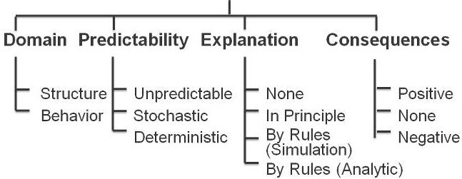

FIGURE 1. Emergent phenomena [7], [20].

We refer to an emergent structure, behavior, or property as a "phenomenon". In many cases, these phenomena are described and explained only after their discovery, which, in most cases, is accidental.

Formulating all these emergent phenomena is a difficult task that requires a lot of cognitive effort and financial resources. The first appearance of an emergent phenomenon is often a surprise to an observer [7].

## B. CHALLENGES

For conceptual analysis purpose, not all combinations permitted by Figure 1 are applicable. In fact, focusing on CPSoS design we are particularly interested in the domain of emergent phenomena regarding its behavior. Figure 2 classifies the emergent behavior of a CPSoS based on the effects of this behavior on the overall mission of a CPSoS and the ability to predict or be aware of the emergent behaviors.

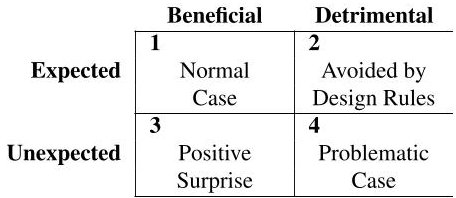

FIGURE 2. Emergent behavior's consequences [7], [20].

Normal case (quadrant 1) is the expected and beneficial emergent behavior that results from a conscious design effort. Unexpected and beneficial emergent behavior is a positive surprise (quadrant 3). By adhering to proper design rules, undesirable emergent behaviors can be prevented (quadrant 2). The problematic case is quadrant 4, where there is unexpected and detrimental emergent behavior [7].

A catastrophic accident can be caused by unexpected detrimental emergent behavior in critical CPSoSs. A conscious design discipline aims to shift, as knowledge advances, an increasing number of emergent phenomena from

<!-- PDF_PAGE: 4 -->

quadrant 4 to quadrant 2, where steps can be taken to mitigate eliminate, or prevent detrimental emergent [7].

Moreover, the majority of CPSoS are comprised of Commercial off-the-shelf (COTS) components and legacy constituent systems, about which very little is known and where the information flow is frequently obscured [7].

Although efforts are concentrated on unexpected detrimental emergent behaviors, the conscious design of a CPSoS that takes into account known and beneficial behaviors has the potential to create a new group of systems with disruptive functionality and services.

## C. THE CPSoS SYSTEMS ENGINEERING

Across recent decades, Systems Engineering methods, procedures, and tools have been successfully used in a variety of engineering disciplines. The ISO/IEC/IEEE 21839(2019) is the universal reference standard for the SoS/CPSoS Systems Engineering process [6].

Figure 3 depicts the usual life-cycle of a SoS/CPSoS (as defined by ISO/IEC/IEEE 21839(2019)) which is comparable to other cycles such as the space area defined by notes ECSS-E-ST-10-02C [21] or NASA [22]. As a System of Systems matures, each Constituent System follows a series of stages representative of its own life-cycle.

FIGURE 3. Typical project ISO Life Cycle [6].

According to ISO [6], these steps may be implemented in many progressions, with iteration and recursion possibilities, as depicted in Figure 4.

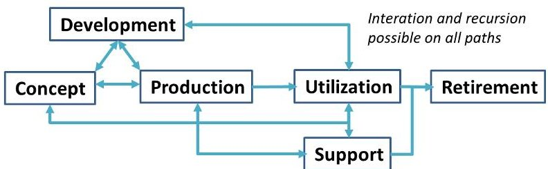

FIGURE 4. Possible progress of ISO life cycle stages [6].

Table 1 provides a summary of the principal function of each life-cycle stage.

TABLE 1. ISO Life cycle stages and their purposes [6].

<table border="1"><tr><td colspan="2">Stage</td><td colspan="2">Main Activities/Purpose</td></tr><tr><td rowspan="3">Concept</td><td>C1</td><td>Identify stakeholders&#x27; needs</td><td></td></tr><tr><td>C2</td><td>Explore concepts</td><td></td></tr><tr><td>C3</td><td>Propose viable solutions</td><td></td></tr><tr><td rowspan="4">Development</td><td>D1</td><td>Refine system requirements</td><td></td></tr><tr><td>D2</td><td>Create solution description</td><td></td></tr><tr><td>D3</td><td>Build system</td><td></td></tr><tr><td>D4</td><td>Verify and validate system</td><td></td></tr><tr><td rowspan="2">Production</td><td>P1</td><td>Produce systems</td><td></td></tr><tr><td>P2</td><td>Inspect and test</td><td></td></tr><tr><td>Utilization</td><td>U1</td><td>Operate system to satisfy users&#x27; needs</td><td></td></tr><tr><td>Support</td><td>S1</td><td>Provide sustained system capability</td><td></td></tr><tr><td>Retirement</td><td>R1</td><td>Store, archive or dispose of system</td><td></td></tr></table>

Compared to this, Figure 5 depicts the usual life-cycle provided by ECSS for space missions.

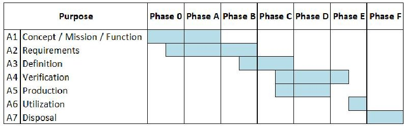

FIGURE 5. Typical project ECSS Life Cycle [21].

Table 2 displays the equivalences between the ISO and ECSS standards for life-cycle procedures.

TABLE 2. Equivalences in the ISO and ECSS life cycle.

<table border="1"><tr><td>ECSS Phase</td><td>ECSS Purpose</td><td>ISO Purpose</td></tr><tr><td>Phase 0</td><td>A1,A2</td><td>C1,C2</td></tr><tr><td>Phase A</td><td>A1,A2</td><td>C1,C2,D1</td></tr><tr><td>Phase B</td><td>A2,A3</td><td>C2,C3,D1,D2</td></tr><tr><td>Phase C</td><td>A3,A4,A5</td><td>D3,D4,P1</td></tr><tr><td>Phase D</td><td>A4,A5</td><td>D4,P1,P2</td></tr><tr><td>Phase E</td><td>A4,A6</td><td>D4,P2,U1,S1</td></tr><tr><td>Phase F</td><td>A7</td><td>R1</td></tr></table>

Although the approach and principles of this work can be applied to any SoS, including those in the space domain, the focus of this work is on CPSoS systems; hence, ISO/IEC/IEEE 21839(2019) [6] processes and definitions will be explored.

The Discovery and Requirements Canvas method is adherent to EMBED-SoSE (EMergent BEhavior-Driven System of Systems) approach described in "EMBED-SoSE: Drawing a System of Systems" [20]. In addition, the method Discovery and Requirements Canvas covers the earliest stages of the life cycle proposed by ISO (Figure 3) and shown in Figure 6 by the rereading of EMBED-SoSE.

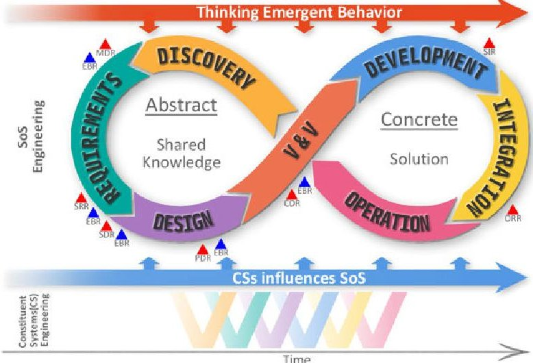

FIGURE 6. EMBED-SoSE Life Cycle [20].

<!-- PDF_PAGE: 5 -->

## III. RELATED WORKS

In recent years, researchers have done studies that can aid in the creation and understanding of SoS/CPSoS, such as Smith [13], who presents a study on the maintenance and evolution issues of SoSs in his work titled "Systems of Systems: New Maintenance and Evolution Challenges". In 2012, Hallerstede [14] addressed in a tangential manner the technical issues of SoS requirements engineering, in his paper titled "Technical Challenges of SoS Requirements Engineering". The objective of this effort was to aid in the development of tools that would facilitate SoS requirements engineering; the results were published in the article titled "A ModelBased Approach to Requirements Engineering for Systems of Systems" [23].

To study how researchers have approached the SoS/CPSoS scenario and to gain a better understanding of the this scenario, systematic literature reviews were conducted. A total of 192 relevant papers were reviewed in the end. To identify the major efforts, the results were categorized according to those that directly address emergent behavior and seek to reduce the cognitive effort and complexity required to comprehend these behaviors [11], [12] and the composition of their constituent systems.

The main works/projects that have contributed to advancements in the CPSoS engineering process are outlined below:

1) COMPASS - (2014): In 2014, the "Comprehensive Modeling for Advanced Systems of Systems" (COMPASS) project was officially completed. The proposed method is based on the relationships and guarantees of the constituent systems that are explicitly recorded in a formal language ("COMPASS Modeling Language" (CML)) and analyzed by new tools that exploit the formality of the CML's semantics to aid in the analysis and guarantee of SoS properties. [24];

2) DANSE - (2015): In 2015, "Designing for Adaptability and Evolution in System of Systems Engineering" (DANSE) was officially concluded. The DANSE project developed a collection of methodologies and tools for the technical management of a SoS. DoDAF, MoDAF, and NAF serve as the primary foundation for DANSE's methodology and tools [25];

3) AMADEOS - (2016): The main objective of the "Architecture for Multi-criticality Agile Dependable Evolutionary Open System-of-Systems" (AMADEOS) project was to bring awareness of time, dynamics, and evolution to the design of SoS, to establish a solid conceptual model that provides: a well-defined language to describe SoS, to investigate emergent behavior; a generic architectural framework; and a SoS design methodology supported by modeling tools [16];

4) NIST - Framework for Cyber-Physical Systems - (2017): The Cyber-Physical Systems Public Working Group (CPS PWG), an open public forum established by the National Institute of Standards and Technology, developed the CPS Framework (NIST). The ultimate

objective of the CPS Framework is to provide a common language to describe interoperable CPS architectures so that these systems can interoperate across domains, enabling the formation of a SoS [3];

5) MPM4CPS - Multi-Paradigm Modeling for CyberPhysical Systems (2018): In 2018, the "Multi- Paradigm Modeling for Cyber-Physical Systems" (MPM4CPS) project was concluded. In 2020, the book "Foundations of Multi-Paradigm Modeling for Cyber-Physical Systems" was published, compiling the design results based on the fact that there is no super formalism to support the multiple design dimensions of a CPSoS, and that in order to design effectively, engineers (in the role of modelers) must be conversant with multiple formalisms [1];

6) Investigating emergent behavior caused by electric vehicles in the smart grid using co-simulation (2019): This paper proposes a co-simulation approach using Mosaik, a framework tailored to the Smart Grid domain. By doing so, the power system including several EVs and their charging strategy is modeled according to the Smart Grid Architecture Model (SGAM) in the first step. Next, in order to simulate and validate the system's emergent behavior, an excerpt of a real-world case study is utilized. Based on the outcome of this co-simulation, the practical investigation of Smart Grids can be improved by applying protruded demand side response approaches [26];

7) Detecting Emergent Behavior in Scenario-Based Specifications using a Probabilistic Model (2020): This paper presents an automated approach to detect emergent behaviour in scenario-based specifications using a probabilistic model. Emergent behaviours are the unexpected behaviours in software specifications that are not easily visible in the design documents but may appear during execution and cause risk hazards after the implementation. This work defines the interactions between system components as a sequence of words in a sentence and we predict the possible violation in the order of execution using probabilities [17];

8) EMBED-SoSE: Drawing a Cyber-physical System of Systems (2022): The paper introduces the EMergent BEhavior-Driven System of Systems Engineering (EMBED-SoSE) approach that aims to support system engineers on dealing with intangible aspects of CSs in continued way on the life cycle of CPSoS. The goal of EMBED-SoSE approach is to facilitate and reduce the cognitive effort in the systems design and verification process [20].

The projects were compared based on characteristics that could somehow reduce the cognitive effort of the initial phases of the project life cycle. The following characteristics were used for:

<!-- PDF_PAGE: 6 -->

(a) Models: Indicates that the project provides or presents CPSoS artifacts adhering to MBSE;

(b) Integrated Models: Indicates the use of interoperable models to highlight communication interfaces and information flow issues among the CSs in the same project artifact;

(c) Framework design: Indicates whether the project presents a framework for the development of a CPSoS. A framework proposes a kind of template or model that, when used, offers certain devices and structural elements;

(d) Emergent behavior awareness: The project presents some tool or technique that somehow supports the emerging behaviors analysis or even makes contributions in the sense of reducing the cognitive effort to understand these behaviors;

(e) Visual artifact: The project offers or presents some kinds of visual artifact models to aid in figuring out new user requirements and the lack of communication interfaces between CSs candidates for composition;

(f) Intangible aspects: The project presents some tools or even makes some contributions to reduce the cognitive effort required to understand intangible aspects, user requirements, among others.

(g) Life cycle model: The project presents its contribution relationship with a life-cycle model adherent to the CPSoS engineering process.

Table 3 demonstrates that even though project (3) (6) (7) and (8) address (d) and (f) characteristics of CPSoS, only project (8) does it through an integrated model aided by a visual tool, which are expressed in (b) and (e) characteristics. Moreover, except work (8), no direct and explicit attention is paid to presenting tools, methods, or approaches that can lessen engineers' and specialists'cognitive effort on the requirements analysis of the intended CPSoS. In general, the works show models or other kinds of approaches in isolation without explicit connection with each other, which means they don't have integrated models. The lack of integrated models affects the necessary abstraction in the early stages of the project.

TABLE 3. Projects comparison.

<table border="1"><tr><td></td><td colspan="8">Project</td></tr><tr><td>Characteristic</td><td>1</td><td>2</td><td>3</td><td>4</td><td>5</td><td>6</td><td>7</td><td>8</td></tr><tr><td>Models</td><td>√</td><td>√</td><td>√</td><td>√</td><td>√</td><td></td><td>√</td><td>√</td></tr><tr><td>Integrated models</td><td></td><td></td><td></td><td></td><td></td><td></td><td></td><td>√</td></tr><tr><td>Framework design</td><td>√</td><td>√</td><td>√</td><td>√</td><td>√</td><td></td><td></td><td>√</td></tr><tr><td>Emergent behavior awareness</td><td></td><td></td><td>√</td><td></td><td></td><td>√</td><td>√</td><td>√</td></tr><tr><td>Visual artifact</td><td></td><td></td><td></td><td></td><td></td><td></td><td></td><td>√</td></tr><tr><td>Intangible aspects</td><td></td><td></td><td>√</td><td></td><td></td><td>√</td><td>√</td><td>√</td></tr><tr><td>Life cycle model</td><td></td><td>√</td><td>√</td><td>√</td><td></td><td></td><td></td><td>√</td></tr></table>

## IV. DISCOVERY & REQUIREMENTS CANVAS

The Discovery and Requirements Canvas method were created to aid the cognitive process in complex Systems Engineering through the systematized use of visual tools. For this purpose, the entire approach was built using cognitive

neuroscience techniques, which seek to elucidate how human mental capacities such as memory, language, perception, function and etc.

Neuroscience's primary goal is to understand what occurs in the human brain during the cognitive process [27]. Thus, it is possible to employ specialized strategies that enhance cognition and meaning generation throughout the Systems Engineering process.

The typical design of a system is produced and documented in a conventional way, i.e., a collection of artifacts are generated during the project's life-cycle to generate the solution's design, but the cognitive relationship between these artifacts is not immediately evident [20]. When attempting to comprehend the solution, an engineer must evaluate and examine the generated artifacts; the answer to your questions could be dozens of pages away. Although the project plan and its deliverables are established in a conventional way, the relationship between its components is complex, fragmented, parallel, simultaneous, and branching [18]. Therefore, in order to comprehend the solution as a whole, it is important to establish a global perspective of all artifacts, which can be fairly challenging for SoS/CPSoS systems [20].

This complexity is amplified in CPSoS by the number of constituent systems and the potential for emergent behaviors. On the basis of the concept of visual thinking, the proposal to facilitate the understanding of complex systems is to depict them using shared visual models.

The concept is to collaboratively construct a model of the system and in an integrated way, preventing any engineer or stakeholder from creating their own version of the system. In addition, the idea employs a strategy to influence engineers in a design concerned with emergent behavior, i.e., the method leaves this concern evident throughout the design process, so triggering the unconscious creative process. The same idea applies to subliminal marketing messaging. A subliminal message is any stimulus or information that is presented to a receiver at a level that is imperceptible at the conscious level in an effort to affect their opinions and decisions [28].

Although the Discovery Canvas and Requirements Canvas were conceived as part of the EMBED-SoSE [20] approach, they can be used independently or in conjunction with other conventional models, such as MBSE.

## A. DISCOVERY CANVAS

The Discovery Canvas attempts to direct the discovery process via a visual and integrated tool where all engineers and stakeholders can cooperate to develop a SoSs or CPSoS [20]. Figure 7 depicts the Discovery Canvas, which, in addition to integrating the assumptions of visual thinking, takes into account the characteristics and challenges of a CPSoS, as stated in sections II-A and II-B. The Discovery Canvas was inspired by Alexander Osterwalder's Business Model Canvas [29], the first canvas model utilized within businesses. The approach has become well-known in the business sector and has numerous uses.

<!-- PDF_PAGE: 7 -->

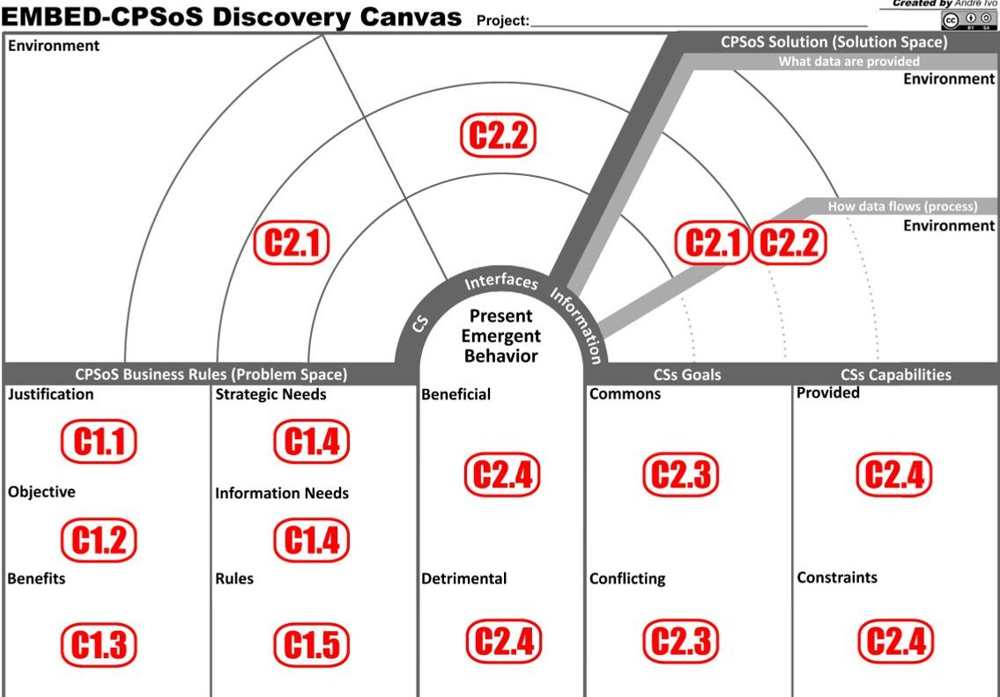

(a) Canvas

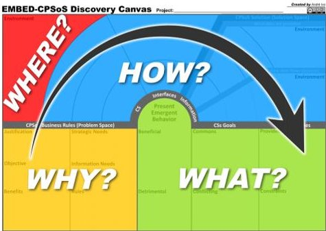

## FIGURE 7. Discovery Canvas [20].

The Discovery Canvas was designed to address the conceptual stage of the ISO/IEC/IEEE 21839 life cycle [6]. According to ISO/IEC/IEEE 21839 [6], in the conceptual stage the stakeholders' needs should be identified (C1 in Table 1); concepts should be explored (C2 in Table 1); and a feasible solution should be proposed (C3 in Table 1). To accomplish this, it is necessary to evaluate all available information pertinent to understanding user resource needs and identifying information gaps. Specifically, issues pertaining to understanding the capability being sought and the context of the user's capability requirement should be addressed [6], such as those listed in Table 4.

The items in Table 4 are a summary of the ISO/IEC/ IEEE 21839 [6] recommendations and concept phase considerations.

TABLE 4. ISO Concept stage concerns [6].

<table border="1"><tr><td>ISO</td><td>Activities/Purpose</td></tr><tr><td>C1.1</td><td>Recognize at least one need for a new System of Interest(SoI)</td></tr><tr><td>C1.2</td><td>Identify how the new SoI addresses current and future needs</td></tr><tr><td>C1.3</td><td>Identify which non-material factors have an impact(e.g., personnel, training, description of how users will conduct the operation or business process, life-cycle support,and others)</td></tr><tr><td>C1.4</td><td>Recognize a minimum of one stakeholder need for the new system of interest(SoI)</td></tr><tr><td>C1.5</td><td>Identify constraints on potential solutions imposed by the operational or business context</td></tr><tr><td>C2.1</td><td>Identify the connections between the System of Interest(SoI) and other Constituent Systems(concept of operation)</td></tr><tr><td>C2.2</td><td>Identify the constituent system interfaces of interest to the SoI</td></tr><tr><td>C2.3</td><td>What are the goals of the constituent systems and the interoperability requirements for the interdependencies?</td></tr><tr><td>C2.4</td><td>Identify the features/capabilities provided by the SoI and its constituent systems</td></tr><tr><td>C2.5</td><td>Identify dependencies among capabilities for the new SoI</td></tr><tr><td>C2.6</td><td>Identify how design resource data interacts with constituent systems and their interfaces</td></tr></table>

(b) Explain

Figure 7a depicts the Discovery Canvas and its integrated relationship with the principal ISO/IEC/IEEE 21839 lifecycle Activities [6], which are mentioned in Table 4.

In addition to incorporating the guidelines of ISO/IEC/ IEEE 21839 [6], it is essential to note that the Discovery Canvas was designed to guide and engage the unconscious creative process of engineers and stakeholders, hence enhancing cognition and stimulating the search for emergent behaviors. On the basis of the challenges presented in section II-B and with a focus on transforming unexpected detrimental emergent behaviors into known and expected cases, the Discovery Canvas process should activate and facilitate the neurological mechanisms through which our brain creates meanings and seeks to solve problems.

In conclusion, the Discovery Canvas is a large board/frame on which information about the system architecture will be arranged to produce an integrated and shared picture of all possible information of interest. Despite not using all the questions of the 5W1H technique, the proposed method was inspired from it and it was divided into "WHY?", "WHERE?", "HOW?" and "WHAT?" [20].

In reality, it is recommended that the Canvas be printed in a format larger than A1 and completed collectively in expert brainstorming sessions. The method advises following the sequence of items in Table 4 and Figure 7b in a clockwise direction; however, the process must be participatory and can be revisited as needed [20].

In comparison to conventional models such as the MBSE, at least three artifacts are required to represent Canvas: a) Diagram of Stakeholder Requirements (needs); b) Diagram of Functions and Capabilities; and c) Diagram of Operation Concept. The Discovery Canvas allows for the seamless execution of the same activity. This is not to say that the

<!-- PDF_PAGE: 8 -->

Discovery Canvas replaces the MBSE, but when utilized in a complementary way, it can significantly improve the Systems Engineering process.

## B. REQUIREMENTS CANVAS

The Requirement Canvas is an extension of the Discovery Canvas, i.e. a continuation of the discovery process with the goal of evaluating new features/capabilities or even the maintenance process of an existing CPSoS. Figure 8 depicts the expanded use of the canvas, with the Discovery Canvas on the left and the Requirement Canvas on the right, giving an integrated dashboard for the solution's control and analysis.

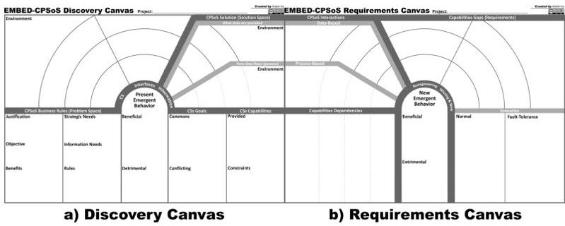

FIGURE 8. Extended Canvas.

Figure 9 depicts a Requirement Canvas that takes into account, in addition to the assumptions of visual thinking, the characteristics and challenges of a CPSoS, as discussed in sections II-A and II-B.

Similarly to the Discovery Canvas, the Requirement Canvas was constructed to meet a portion of the conceptual stage and a part of the development stage specified by the ISO/IEC/IEEE 21839 life-cycle [6]. Beginning with a sufficiently deep technical refinement of the system requirements, system architecture, and design solution, the Development Stage creates one or more viable products that enable a service during the Use Stage.

According to ISO/IEC/IEEE 21839 [6], the development stage should: a) refine the system requirements (D1 of Table 1); b) produce the solution description (D2 of Table 1); c) construct the system (D3 of Table 1); and f) verify and validate the system (D4 of Table 1).

In the context of this work, only activities D1 and D2 will be addressed, and for that, the information available in the Discovery Canvas must be evaluated and additional discussions and revisions can be conducted, addressing, among other things, those in Table 5, which is a summary of the recommendations and ISO/IEC/IEEE 21839 [6] considerations for the development stage.

Figure 9a illustrates the Requirement Canvas and its integrated relationship with the principal Activities of the ISO/IEC/IEEE 21839 life-cycle [6], as shown by tables 4 (highlighted in red) and 5 (highlighted in blue).

In the same manner as the Discovery Canvas, it is advised that the Requirement Canvas be printed in >= A1

## TABLE 5. ISO Development stage concerns [6].

<table border="1"><tr><td>ISO</td><td>Activities/Purpose</td></tr><tr><td>D1.1</td><td>Recognize and identify constituent system impacts that must be addressed to achieve capacity requirements (reengineering)</td></tr><tr><td>D1.2</td><td>Capture user needs and interoperability expectations in system requirements</td></tr><tr><td>D1.3</td><td>Refine requirements, as well as strategies and tools for establishing and maintaining traceability between requirements and built system</td></tr><tr><td>D2.1</td><td>Transform requirements into one or more feasible products or services that meet the needs of stakeholders during the Use Stage</td></tr></table>

format, positioned next to the Discovery Canvas to create the Extended Canvas of Figure 8, and then filled out collaboratively by experts during brainstorming sessions. The technique suggests its completion in a clockwise manner, according to the order of elements in Table 5 and as seen in Figure 9b; nevertheless, the process must be participatory and can be revisited as often as necessary.

In comparison to conventional models such as the MBSE, at least four artifacts are required to represent Canvas: a) Dependency diagram; b) Sequence diagram; c) Requirements diagram; and d) Scenario diagram for use case. The Requirement Canvas allows for the seamless execution of the same activity.

## C. HOW TO USE

## 1) FOREWORD

If there is something that requires a great deal of "Computation Power" from our brain, it is the creation of a system project, during which multiple concepts must be associated and a series of analyses must be performed and merged for each aggregated element [30]. A design of a system such as CPSoS is, first and foremost, the formulation of hypotheses about an unknowable future scenario, which become consistent through the integration of the legacy systems, concepts, and definitions that compose it.

According to Wujec [31], the greater the understanding of the working of the human brain and how it makes sense and meaning, the greater the capacity of humans to communicate and exchange information, i.e., the process of cognition will be facilitated. Cognition is the capacity to assimilate and process information from various sources (perception, experience, beliefs, etc.) in order to transform it into knowledge.

Visual thinking is a strategy to boost our brain's "Computation Power". Visual thinking is a sort of nonverbal thinking that psychologists has been explored extensively in recent years [32]. Psychologists believe that the primary function of visual thinking is the ability to integrate the various meanings of images into a coherent, visible image. Visual thinking also aids in the development of an ontology for the products of abstract verbal thought, thereby making an abstract essence intellectually visible [32]. Examining and analyzing complex problems with it can give new insights and a deeper

<!-- PDF_PAGE: 9 -->

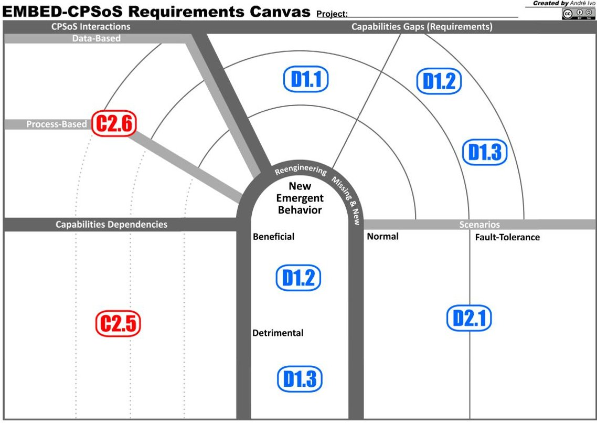

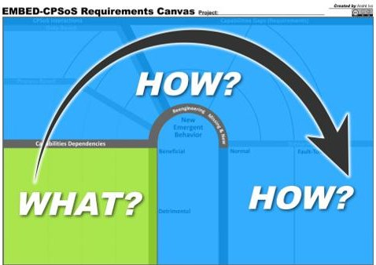

(a) Canvas

FIGURE 9. Requirement Canvas.

(b) Explain

comprehension in domains ranging from the scientific to the artistic [32].

These were the fundamental concepts around which the Discovery and Requirements Canvas was developed and constructed. In practice, the strategy recommends employing tangible media, such as Canvas printed on a poster (>= A1 format), posted on a wall, and sticky notes (post-its) to complete them. Physical media boost the creative process and materialize naturally intangible notions and definitions. However, the usage of the virtual canvas is entirely possible and can be advantageous for both documentation and virtual workplaces and home offices.

## 2) IMPORTANT DEFINITIONS

In a pragmatic manner, Canvas reflects simply the essentials, as shown (but not limited to) in Table 3 to the earliest phases of a project's development. Canvas can be utilized in one of two ways: a) as a document/official and consistent artifact of the project that will be immediately followed by the development and execution phases; or b) as a preliminary tool that will shape the logic of the project and serve as a foundation for subsequent transcription of the traditional and reference models of the MBSE. Additionally, it is essential to understand that:

1) Canvas is not a flowchart of the project since a flowchart depicts a series of steps, whereas the focus of Canvas is on the relationships between concepts;

2) Canvas is primarily a tool for collaborative building;

3) Canvas should be objective, essential, and pragmatic;

4) In Canvas, there are no established roles, only four principles:

a) It should ideally be created in a group;

b) At least one participant must have Systems Engineering knowledge, preferably CPSoS or SoS;

c) At least one of the participants must understand the business needs; and

d) There should be participants who have some familiarity with the constituent systems.

## 3) TO USE

Before beginning the brainstorm session or the project concept review meeting, the environment must be prepared. Choose the medium (physical or virtual), with physical being preferred. Post the Canvas poster (>= in A1 format) on the wall. Define a standard for using post-it notes (sticky notes) to visually communicate project concepts and essential

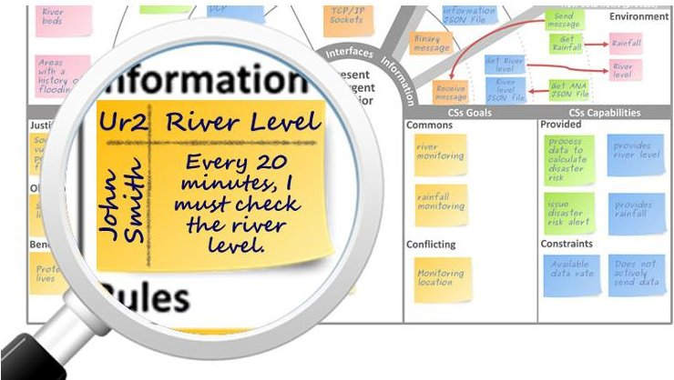

FIGURE 10. User requirements sticky notes.

<!-- PDF_PAGE: 10 -->

information. To represent a certain concept, such as risk or importance, you can employ color patterns, writing styles, and even stickers. Figure 10 illustrates the use of sticky notes (post-its).

Figure 10 depicts the sticky note (post-it) of the user requirement example, which was divided into four sections: a) The user/stakeholder (John Smith); b) a code to track the user's requirement/necessity (Ur2); c) an objective title (River Level); and d) an objective description of the requirement (Every 20 minutes I must check the river level). This is one of the numerous possibilities for using sticky notes (postits) that the team has the freedom to use or create as needed. This freedom allows the team to create their own taxonomy for the project.

Despite the fact that Canvas is not considered a flowchart, the project life cycle (Figura 3) defines a sequence that assists us in describing how to use the tool. This work employs a sequential approach and makes use of the activities defined in ISO/IEC/IEEE 21839 [6], as defined in Table 1.

The process begins with the Discovery Canvas, which also marks the beginning of the conceptualization stage as defined by ISO/IEC/IEEE 21839 [6], and continues with the Table 6 activities, the purpose of which is to address the Table 4 concerns. Table 6 outlines a step-by-step process for filling in the canvas; however, it is important to note that the Canvas are not a flowchart and that the sequence may be varied in subsequent iterations and revisions as the team deems fit.

After completing the Discovery Canvas and the early phase of project design, the Requirements Canvas filling must be started. The requirement canvas must be prepared in the same manner as the discovery canvas, i.e., by printing the poster and affixing it to a wall, ideally in the manner depicted in Figure 8 for the extended canvas. The procedure initiates the development phase with the review of various concepts and the refinement of the system requirements, as outlined in Table 7, which address the problems described in Table 5.

The conceptual stage concludes with completion of the Requirements Canvas, and the development stage begins. System Requirements Review (SRR) should mark the completion of the Requirement Canvas by assessing whether all GAPS and Scenarios have been identified. The Review of Emergent Behaviors (EBR) should then be carried out with the goal of identifying all GAPs of beneficial and especially detrimental emergent behaviors. This is the time, if the team so wishes, to transform the Canvas into the traditional and reference models of the MBSE.

Finally, it is important to note that the challenge of recognizing, describing, and communicating intangible characteristics to the project's stakeholders is essential to the design of a complex system such as CPSoS. According to Wujec [31], our brain produces a succession of mental models based on the experiences of each individual in order to determine the meaning of something; therefore, each engineer can create his own materialization of the intangible components of the system. Consequently, each project engineer will design one of the unlimited options of materializing the same intangible

TABLE 6. Discovery Canvas Activities.

<table border="1"><tr><td>Canvas</td><td>Activities</td></tr><tr><td>Justification(C1.1)</td><td>A system project begins with the mission statement, which typically consists of needs that justify it. Mission requirements are phrases that identify requirements that will be accomplished by one or more systems of interest.</td></tr><tr><td>Objective(C1.2)</td><td>Describes the purpose of any mobilization of efforts and resources. How does the new system adress to business requirements and the project&#x27;s mission? In summary, explain how the new system addresses the Justification.</td></tr><tr><td>Benefits(C1.3)</td><td>The benefits must account for project implementation gains. All project stakeholders should be considered for project benefits. When possible, benefits should specify quantitative criteria. Lastly, the benefits must align with the needs that justify the initiative and its stated objectives.</td></tr><tr><td>Needs(C1.4)</td><td>Strategic and Information needs: or stakeholder/user requirements (needs) for a new system of interest (SoI). User requirements and needs are the means by which you communicate what you deem essential or desirable in the new system.</td></tr><tr><td>Rules(C1.5)</td><td>Project and system premises and restrictions can be used to specify rules. Premises are assumptions regarding components or factors over which the project team has no control or influence. Any limitations imposed on the team&#x27;s work that limit their flexibility of options, such as financial resources, time, and available technology, are considered restrictions.</td></tr><tr><td>CS(C2.1)</td><td>It is necessary to identify the constituent systems (CS) that can collaborate with or are affected by the new system of interest. Additionally, the environment in which these systems are located or interact must be taken into account.</td></tr><tr><td>Interfaces(C2.2)</td><td>It covers the communication interfaces needed to integrate the component systems. The level and technical detail of the description of the interfaces is determined by the team and is directly related to the level of detail proposed for that canvas filling interaction; that is, initial interactions will undoubtedly have a low technical level, but over time and after some refinements, interface descriptions should acquire more crucial technical information for the project, such as protocol definitions.</td></tr><tr><td>Information(C2.1/C2.2)</td><td>It is necessary to identify the information and type of each piece of data sent between interfaces. Ideally, the data flow and potential protocols should also be defined.</td></tr><tr><td>CSs Goals(C2.3)</td><td>Commons and Conflicting: In general, the individual objectives (goals) to which each CS reacts must be specified and categorized if they are shared objectives with the new system of interest or if they contradict in some way. These objectives (goals) can be represented at many degrees of abstraction, ranging from strategic objectives (high level) to technical objectives (low level).</td></tr><tr><td>Capabilities(C2.4)</td><td>Provided and Constraints: Identify the capabilities provided and constraints of the constituent systems. Capabilities are accountable for supplying resources and functions for the interaction of constituent systems.</td></tr><tr><td>Emergent Behavior(C2.4)</td><td>Identify the beneficial and detrimental emergent behaviors of the component systems and the new system of interest. We may not be able to explain emergent behaviors, but as knowledge advances through the canvas, the team&#x27;s ability to evaluate them improves.</td></tr></table>

component, which will undoubtedly be imprecise, unpredictable, and rife with gaps.

To avoid this consequence, the proposed dynamics generate a collective image that materializes the concepts and definitions of the project among the engineers through the integrated model of Canvas. Thus, it is anticipated that the process has been simplified, thereby reducing the cognitive effort required to comprehend and create the system. The method was examined according to Section V in order to determine its efficacy.

<!-- PDF_PAGE: 11 -->

TABLE 7. Requirement Canvas Activities.

<table border="1"><tr><td>Canvas</td><td>Activities</td></tr><tr><td>Capabilities Dependencies(C2.5)</td><td>Identify dependencies between capabilities. Capacity can be dependent on a single or multiple CS. Understanding capability dependencies is crucial for comprehending the potential implications of CS capability changes and, consequently, for planning fault tolerance features and system maintenance.</td></tr><tr><td>CPSoS Interactions(C2.6)</td><td>Interactions in general are composed of sub-interactions that might be machine-to-machine, machine-to-human, or machine-to-environment in nature. The interaction between CSs resources might essentially be data-driven, process-driven, or flow-driven. Interactions are:(a) Data-Based:Refers to the interaction paradigm that is heavily dependent on data exchange, where data from many systems are processed to meet CPSoS requirements.Mashups[33] are prevalent instances of data-based interactions within a SoS context.(b)Process-Based:Refers to the interaction model that is strongly based on processes or data flow supported by CPSoS.In general,this process involves the control and flow of data beyond the limits of the CSs.Service-oriented systems are based on process-based interactions,such as the payment system in an e-commerce transaction,which can involve multiple systems that must be notified through service APIs.</td></tr><tr><td>Reengineering(D1.1)</td><td>Identify which capabilities given by constituent systems(CS) require modification or evolution.Before they are ready for external usage,several CS capabilities may require re-engineering.For instance,if a resource was created for internal use only,it might not have any security features.Understanding capabilities in the context of existing and future interactions with CPSoS might provide useful insights for their design.</td></tr><tr><td>Missing&amp;New(D1.2/D1.3)</td><td>Identify and refine system requirements/capabilities not provided by constituent systems(CSs) and missing from the new system of interest that meets user needs and provides business value.It&#x27;s crucial to carefully identify these capabilities&#x27; requirements and create them so they&#x27;re reusable and,most importantly,have the least impact.</td></tr><tr><td>New Emergent Behavior(D1.2/D1.3)</td><td>Identify new behaviors that are beneficial or detrimental to the system.Due to the nature of emergent behaviors,detecting them is not an easy task,hence this is one of the tasks that demands greater attention.At this time,all Discovery Canvas and Requirement Canvas ought to be examined in search of newly emergent behaviors,particularly those that are negative.It is recommended that fault tolerance techniques,requirements,and scenarios be made so that dangerous behaviors and the bad effects they have on the system don&#x27;t happen.When identifying new emergent behaviors are required for the new system of interest,it may be necessary to revisit other sections of the Discovery and Requirements Canvas to identify individual capabilities that can support the new behaviors.</td></tr><tr><td>Scenarios(D2.1)</td><td>Identify and describe the normal scenarios(use cases) and fault tolerance situations in which the discovered GAPS are involved.This activity&#x27;s purpose is to define the potential operations of the new capabilities of the system&#x27;s requirements in a manner that satisfies the needs of the users and the mission of the project for the system of interest.</td></tr></table>

## D. EXTENDED USE: RISK ANALYSIS

complexity [34], necessitating special attention to risks associated primarily with safety and security.

The engineering of complex CPSoS, such as those associated with power generation facilities, aviation systems marine vessels, etc., continues to increase in size and

Systems engineering relies on techniques such as Fault Tree Analysis (FTA), Failure Mode and Effects Analysis (FMEA), Reliability Block Diagram (RBD), Monte-Carlo Simulation (MCS), Markov Analysis (MA), etc., that have extensive scientific contributions in the literature [34].

In this paper, the Discovery and Requirements Canvas method propose FMEA risk analysis. FMEA is a highly structured method for identifying, evaluating, and prioritizing all potential failure modes and their effects in a system [34], [35].

TheURE 1. The FMEA describes risk prioritization through the Risk Priority Number (RPN), which is calculated by multiplying the probability of occurrence (O), severity (S), and detection probability (D) [34], [35], as shown by the RNP Equation (1).

$$
R N P = O \cdot S \cdot D
$$

whereсессуары where:

- "O" describes the probability of a risk event;

- "S" represents the effects of a risk event, including cost impact, time impact, and security impact;

- "D" probability of detecting a risk and controlling its root causes prior to the occurrence of a risk event.

Unquestionably, the implementation of FMEA in the Discovery and Requirements Canvas method must occur during detailing iterations, when specialists and architects are supposed to have already acquired familiarity with the CPSoS system during the conceptual analysis conducted using canvas. From this point forward, Canvas tools propose a visual FMEA risk analysis, identifying the failure scenarios for:

1) Communication interfaces;

2) Communication protocols;

3) Validity of exchanged information between Constituent Systems (CS);

4 Dependencies;

5) Capabilities Gaps;

6) Emergent Behavior;

For each failure mode identified, engineers and specialists shall evaluate and assign a score (1 to 10) for the probability of occurrence (O), severity (S), and probability of detection (D), and assign a sub-item to the Canvas, as shown in Figure 11.

It is crucial to highlight that Canvas is flexible, and that the initial structure permits modifications, so that the team

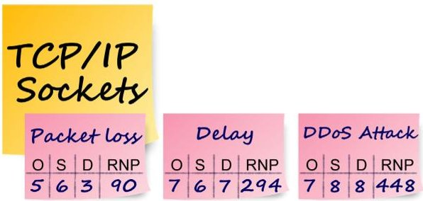

FIG FIGURE 11. FMEA: Communication interface failure modes.

<!-- PDF_PAGE: 12 -->

has the freedom to utilize in a manner that best satisfies the expectations of the group. In addition to the FMEA, other techniques can be used for risk analysis, such as the Fault Tree Analysis (FTA), which can be expressed directly on the Canvas using post-its, building a more adequate and familiar vision for engineers and specialists.

Based on risk analysis and prioritization, the section namely Scenarios in Figure 9a can be used to engineers assess and propose requirements and fault tolerance mechanisms.

In this way, the safety and security risks posed by legacy systems in complex CPSoS can be mitigated through a comprehensive and visual strategy that takes into account potential security vulnerabilities primarily on communication interfaces and information exchanges before their exploitation by unauthorized intruders.

## V. FEASIBILITY STUDY EXPERIMENT

This section outlines the experimental study performed to evaluate the Discovery and Requirements Canvas's recommended method. Engineers and specialists were divided into two groups (GA and GB) for the conceptual study of a hypothetical CPSoS in this experiment. Using its knowledge of Model-based systems engineering, GA conducted the analysis in a conventional manner (MBSE). On the other hand GB conducted the analysis utilizing the Discovery and Requirement Canvas methodologies. At the conclusion of the activity, the solutions were compared and evaluated using descriptive and inferential statistics based on the parametric data generated throughout its development.

The experiment was conducted in accordance with Wohlin's [36] instructions to answer the following Research Questions (RQ) objectively:

- RQ1: Did the Discovery and Requirement Canvas methods improve engineers' and specialists' ability to identify system requirements as compared to the conventional method?

- RQ2: Did the Discovery and Requirement Canvas methods improve engineers' and specialists' ability to identify system emergent behaviors as compared to the conventional method?

- RQ3: Compared to the conventional way, did the Discovery and Requirement Canvas techniques make the integration interfaces between SCs more evident?

- RQ4: How does the time required to complete the activity differ between Traditional and Canvas methods?

- RQ5: Are the difficulties encountered by engineers and specialists associated with the use of the Discovery and Requirement Canvas methods?

- RQ6: Are the benefits and drawbacks found by engineers and specialists associated with the use of Canvas methods?

## A. GOAL

The main purpose of this experiment is to investigate how models are created and to objectively compare the number of requirements, the number of emergent behaviors, the

perceived ease of identifying interfaces, difficulties, benefits, and drawbacks from the perspective of engineers and specialists in the context of systems engineering. In addition, the experiment will examine the feasibility of the Discovery and Requirement Canvas methodologies in facilitating system knowledge and lowering engineers' cognitive effort in comprehending the composition of constituent systems, emergent behaviors, and system requirements.

## B. VARIABLES, TREATMENTS AND OBJECTS

There are two independent variables: the two validation methods the traditional method and the method proposed by the Discovery and Requirement Canvas, (treatments) and the experimental object (the analysis task of a hypothetical SoS).

There are three objective dependent variables: the number of discovered requirements, the number of emergent behaviors, and the duration of the task (response variable).

In addition, there are three dependent subjective variables: the perceived difficulties, benefits and drawbacks of use, and usefulness by Engineers and Specialists. These variables are calculated using closed- and open-ended questions to obtain participant feedback.

## C. PARTICIPANTS

There were 22 senior representatives from the software development and aerospace industries who were selected. Participation in the experiment required the participant to have experience with systems development and systems engineering. Table 8 shows the distribution of participants' academic backgrounds.

TABLE 8. Academic distribution.

<table border="1"><tr><td>Degree</td><td>Participants</td></tr><tr><td>Graduation</td><td>1</td></tr><tr><td>Specialization</td><td>7</td></tr><tr><td>Master&#x27;s degree</td><td>8</td></tr><tr><td>Doctorate degree</td><td>5</td></tr><tr><td>Post doctoral</td><td>1</td></tr></table>

The 22 participants were allocated at random into two groups: 11 from Group A (GA) and 11 from Group B. (GB). In terms of years of experience, Table 9 provides some background information about participants. According to inferential statistics derived from a t-Test study, the two groups had comparable levels of systems engineering experience (p-value = 0.662). However, the t-Test analysis for system development experiences reveals a statistically significant difference (p-value = 0.012) between the groups. When analyzing Table 9, it is determined that the average experience in system development for the GA is 19 years and for the GB, it is 13 years, indicating that, despite the disparities between the groups, the GB possesses considerable expertise in task development.

Despite the fact that all participants had good knowledge and experience in system engineering, the majority of them (about 64% of them) had no experience with SOS. To mitigate

<!-- PDF_PAGE: 13 -->

TABLE 9. Participants background.

<table border="1"><tr><td>Experience</td><td>Group</td><td>Min</td><td>Mean</td><td>Max</td><td>StDev</td></tr><tr><td rowspan="2">Systems Developer</td><td>GA</td><td>13</td><td>19</td><td>32</td><td>5.02</td></tr><tr><td>GB</td><td>4</td><td>13</td><td>20</td><td>5.73</td></tr><tr><td rowspan="2">Systems Engineering</td><td>GA</td><td>2</td><td>10</td><td>25</td><td>6.21</td></tr><tr><td>GB</td><td>2</td><td>10</td><td>25</td><td>7.19</td></tr></table>

this need, all participants received training through video and textual material on the main characteristics of SoSs.

## D. TASK DESIGN AND DESCRIPTION

In order to evaluate the feasibility of the Discovery and Requirement Canvas methods through the objectives defined for this experiment (Section V-A), engineers and specialists were asked to develop the analysis of the conceptual stage and the elicitation of system requirements;

Both groups were provided with the identical information and training. Based on the MBSE models, the GA group delivered the artifacts. The GB team submitted the artifacts in the Discovery Canvas (Section IV-A) and Requirements Canvas (Section IV-B) formats. Information regarding constituent systems (CSs) and their integration interfaces, available data kinds, capabilities, and emergent behaviors are included in the set of artifacts.

The experiment was based on the study "Internet of Vehicle (IoV) Applications in Expediting the Implementation of Smart Highway of Autonomous Vehicle: A Survey" [37]. Consequently, the objective of this experiment was to design an intelligent and integrated traffic control at the intersection of two intelligent roads (Smart Highway), as depicted in Figure 12.

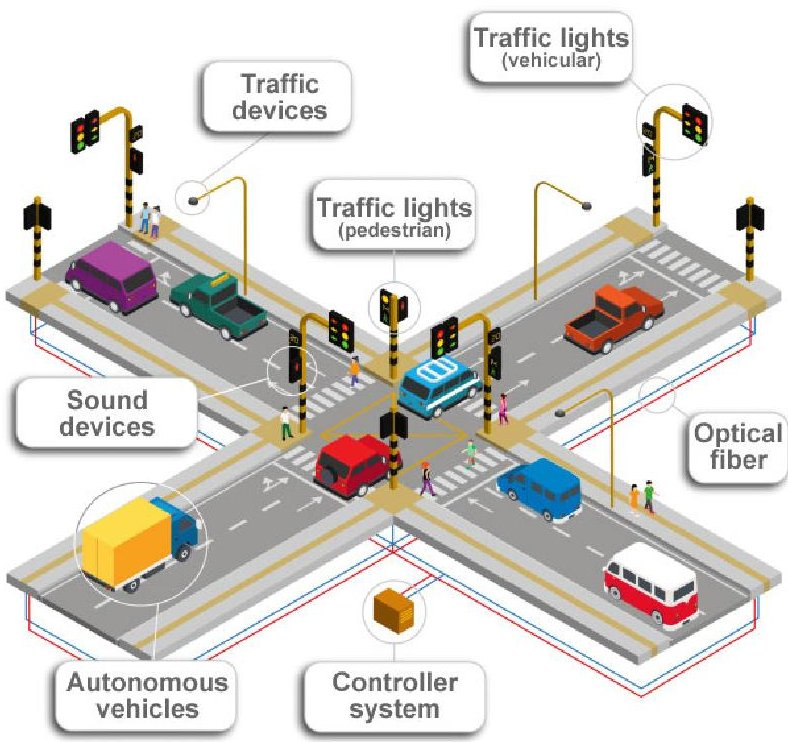

FIGURE 12. Traffic Control - CPSoS proposed for the experiment.

In short, it is anticipated that the systems will be linked and their capabilities utilized to produce the desired outcomes. Engineers and experts must be able to identify as many

Capabilities Gaps (Requirements) and Emergent Behavior as possible.

Among the goals of this traffic control are:

1) the establishment of a secure crosswalk;

2) crossing roads safely;

3) exclusive lanes for public transport;

4) integration with smart bike lanes;

5) optimal control of traffic lights;

6) emergency alert notifications;

7) intelligent parking control and allocation;

8) flood control and monitoring based on meteorological sensors;

9) electronic inspection;

This CPSoS relies primarily on three communication modes:

1) Vehicle to Vehicle (V2V);

2) Vehicle to Infrastructure (V2I);

3) Infrastructure to Vehicle (I2V)

## E. PROCEDURE

When the experiment was planned, two conditions were established regarding the activities realization: (a) the case study should be in the public domain and easy to make; and (b) everyone should do the experiment using the same concepts.

Moreover, the participants were trained and had a maximum of 3 hours to complete the task. During the experiment, 5 observed parameters (OP) were directly and objectively measured and recorded:

1) OP1: the number of requirements discovered;

2) OP2: the number of emergent behaviors discovered;

3) OP3: the time taken to complete the task;

4) OP4: if the participant recognizes that the interfaces have become more evident; and

5) OP5: difficulties in completing the task.

In addition to OP5, 36 quantitative and qualitative indicators on the activity and individuals' opinions on the methods were recorded. Primarily for the purpose of evaluating the method's acceptability, a questionnaire consisting of thirteen items was developed so that the internal consistency could be examined using Cronbach's Alpha, and therefore, the consistency of the responses could be determined.

The experiment was carried out in such a way that the methods were randomly assigned to the experimental groups, according to the distribution shown in Table 10.

TABLE 10. Design experimental.

<table border="1"><tr><td>Group</td><td>N</td><td>Method</td><td>Type</td></tr><tr><td>GA</td><td>11</td><td>Traditional Engineering</td><td>Control group</td></tr><tr><td>GB</td><td>11</td><td>Canvas</td><td>Experimental Group</td></tr></table>

## F. EVALUATION

The evaluation was performed by analyzing the created artifacts and registered parameters. In addition, participants had to highlight the difficulties, benefits, and drawbacks of the

<!-- PDF_PAGE: 14 -->

proposed strategy based on the application of the experiment, in addition to indicating whether the method may be applied in other applications.

To objectively evaluate the results, the following measures were established for each Research Question (RQ). The answer to Research Question 1 (RQ1) is determined using both descriptive and inferential statistics by comparing the number of requirements recorded by each method. Similarly, descriptive and inferential statistics were employed to compare the number of emergent behaviors documented by each method in order to respond to Research Question 2 (RQ2).

The RQ3 was answered by analyzing the closed and open responses regarding the ease of understanding the integration interfaces. RQ4 is answered by comparing the time spent completing tasks using descriptive and inferential statistics.

The RQ5 is answered by examining the responses of the participants to questions on the difficulties encountered. The purpose of this qualitative analysis was to map the reasons for the challenges indicated by the participants. Finally, the RQ6 is answered using qualitative analysis, descriptive and inferential statistics, and the participants' responses to questions on perceived benefits and drawbacks.

## G. EXPERIMENTAL RESULTS

This section presents the results of the experimental study and is organized to answer the six Research Questions (RQ), based on the observed data and recorded parameters.

The observed parameters (OP) during the experiment, presented in section V-E (Procedure), were recorded individually and categorized by participant to address the research questions (RQ) shown in table 11.

TABLE 11. Experimental observed parameters.

<table border="1"><tr><td rowspan="2">Participants</td><td colspan="2">OP1/RQ1</td><td colspan="2">OP2/RQ2</td><td colspan="2">OP3/RQ3</td><td colspan="2">OP4/RQ4</td></tr><tr><td>GA</td><td>GB</td><td>GA</td><td>GB</td><td>GA</td><td>GB</td><td>GA</td><td>GB</td></tr><tr><td>Stakeholder01</td><td>6</td><td>15</td><td>4</td><td>1</td><td>No</td><td>Yes</td><td>128</td><td>30</td></tr><tr><td>Stakeholder02</td><td>6</td><td>6</td><td>3</td><td>5</td><td>No</td><td>Yes</td><td>70</td><td>150</td></tr><tr><td>Stakeholder03</td><td>6</td><td>14</td><td>3</td><td>8</td><td>No</td><td>Yes</td><td>185</td><td>110</td></tr><tr><td>Stakeholder04</td><td>5</td><td>8</td><td>1</td><td>6</td><td>Yes</td><td>No</td><td>180</td><td>80</td></tr><tr><td>Stakeholder05</td><td>4</td><td>15</td><td>4</td><td>8</td><td>No</td><td>Yes</td><td>140</td><td>80</td></tr><tr><td>Stakeholder06</td><td>10</td><td>4</td><td>5</td><td>5</td><td>No</td><td>Yes</td><td>50</td><td>95</td></tr><tr><td>Stakeholder07</td><td>7</td><td>3</td><td>2</td><td>7</td><td>No</td><td>No</td><td>135</td><td>105</td></tr><tr><td>Stakeholder08</td><td>5</td><td>3</td><td>3</td><td>7</td><td>Yes</td><td>Yes</td><td>100</td><td>100</td></tr><tr><td>Stakeholder09</td><td>6</td><td>13</td><td>2</td><td>5</td><td>No</td><td>Yes</td><td>150</td><td>120</td></tr><tr><td>Stakeholder10</td><td>7</td><td>18</td><td>3</td><td>5</td><td>Yes</td><td>Yes</td><td>200</td><td>96</td></tr><tr><td>Stakeholder11</td><td>4</td><td>4</td><td>4</td><td>4</td><td>No</td><td>Yes</td><td>170</td><td>240</td></tr></table>

The observed parameters (OP) provide direct answers to questions RQ1, RQ2, RQ3, and RQ4. However, the RQ5 and RQ6 questions are derived from questionnaire-recorded quantitative and qualitative indicators of the activity and opinions of individuals regarding the methods.

## 1) RQ1, RQ2 AND RQ4 RESULTS

The RQ1, RQ2, and RQ4 questions were analyzed in light of the results obtained by the GA and GB groups.

Descriptive statistics for the questions are presented in Table 12. Examining the average number of identified

TABLE 12. Descriptive statistics.

<table border="1"><tr><td>RQ</td><td>Group</td><td>Mean</td><td>StDev</td><td>Min</td><td>Median</td><td>Max</td></tr><tr><td rowspan="2">RQ1</td><td>GA</td><td>6.00</td><td>1.67</td><td>4</td><td>6</td><td>10</td></tr><tr><td>GB</td><td>9.36</td><td>5.70</td><td>3</td><td>8</td><td>18</td></tr><tr><td rowspan="2">RQ2</td><td>GA</td><td>3.09</td><td>1.14</td><td>1</td><td>3</td><td>5</td></tr><tr><td>GB</td><td>5.55</td><td>2.02</td><td>1</td><td>5</td><td>8</td></tr><tr><td rowspan="2">RQ4</td><td>GA</td><td>137</td><td>47.9</td><td>50</td><td>140</td><td>200</td></tr><tr><td>GB</td><td>110</td><td>52.3</td><td>30</td><td>100</td><td>240</td></tr></table>

requirements (RQ1) and emergent behaviors (RQ2), the GB group (using the Discovery and Requirement Canvas methods) was able to report a higher number than the GA. The GA group needed more time than the GB group when examining the average time required (RQ4) for the development of the task.

Figure 13 shows a boxplot comparison of the results obtained by the two groups.

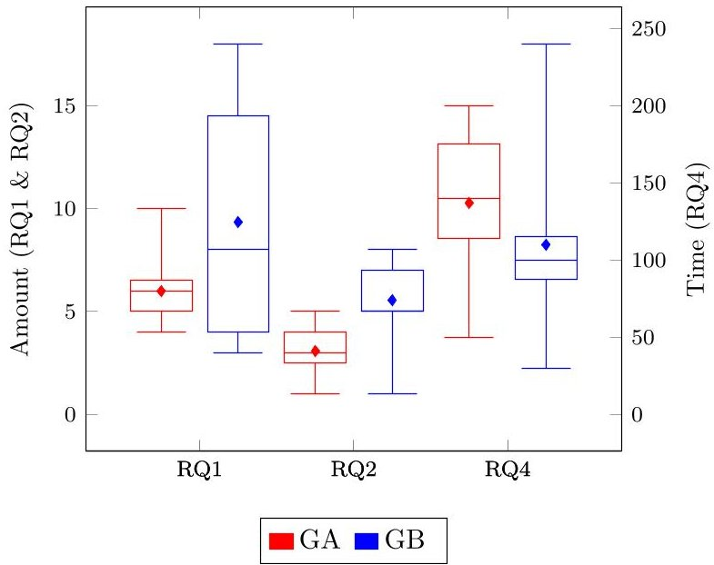

FIGURE 13. Blox plot representing RQ1, RQ2 & RQ4.

To determine whether there was a statistically significant difference between the two methods, the Shapiro-Wilk test was employed to ensure that the data were normally distributed. In fact, the Shapiro-Wilk test indicates that these samples do not deviate from a normal distribution, as shown in Table 13, where RQ1, RQ2, and RQ4 all have p values greater than 0.05. The samples were examined using the t-Test for independent samples based on the results of the normality test.

For RQ1 and RQ2, one-tailed tests with the null hypothesis $ H_{0}1 $ & $ H_{0}2 $ $ (H_{0}\mu_{GA}=\mu_{GB}) $ and the alternative hypothesis $ H_{a}1 $ & $ H_{a}2 $ $ (H_{a}\mu_{GA}<\mu_{GB}) $ were performed, as defined:

H: The GA group identifies fewer requirements (RQ1) and emergent behaviors (RQ2) on average than the GB group.

For RQ4, a two-tailed test was conducted with the null hypothesis $ H_{0}4\left(H_{0}\mu_{GA}=\mu_{GB}\right) $ and the alternative hypothesis $ H_{a}4\left(H_{a}\mu_{GA}\neq\mu_{GB}\right) $:

<!-- PDF_PAGE: 15 -->

TABLE 13. Hypothesis testing about RQ1, RQ2 & RQ4.

<table border="1"><tr><td rowspan="2">RQ</td><td colspan="2">Shapiro-Wilk</td><td colspan="2">t-Test</td><td rowspan="2"></td></tr><tr><td>Stat</td><td>p</td><td>Stat</td><td>p</td></tr><tr><td>RQ1</td><td>0.959</td><td>0.474</td><td>-1.88</td><td>0.037</td><td>√</td></tr><tr><td>RQ2</td><td>0.939</td><td>0.186</td><td>-3.52</td><td>0.001</td><td>√</td></tr><tr><td>RQ4</td><td>0.957</td><td>0.430</td><td>1.28</td><td>0.214</td><td></td></tr></table>

- statistically significant difference

H: There is no significant difference between the two groups in terms of time spent.

According to Table 13, the one-tailed t-test results for hypotheses $ H_{0}1 $ $ H_{a}1 $ $ H_{0}2 $ and $ H_{a}2 $ obtained values less than the alpha level of 0.05 (5%) , suggesting that the null hypothesis is rejected and the alternative hypothesis is confirmed. Therefore, there is a statistically significant difference between the groups, with the GB group discovering more requirements (RQ1) and emergent behaviors (RQ2) than the GA group.

For question RQ4, the t-Test obtained values above the alpha level of 0.05(5%) , so the null hypothesis cannot be rejected, and it is possible to conclude that there is no statistically significant difference between the groups, despite the fact that the group GB completed the task (RQ4) faster than the group GA.

## 2) RQ3, RQ5 AND RQ6 RESULTS

For questions RQ3, RQ5, and RQ6, an associative analysis was performed by comparing the results to a possible association utilizing the Discovery and Requirement Canvas methods.

Importantly, research questions RQ5 and RQ6 were answered by a collection of questions (11 closed questions and 2 open questions), which were evaluated using objective data records and qualitative data (in which participants expressed their opinion) of the technique. According to Table 14 by Landis [38], the Cronbach's alpha coefficient recorded a value of 0.705, indicating substantial reliability, in order to analyze the qualitative portion and confirm that the responses of the participants were coherent.

TABLE 14. Cronbach's Alpha [38].

<table border="1"><tr><td>alpha</td><td>Consideration</td></tr><tr><td>&lt;0.00</td><td>Poor</td></tr><tr><td>0.00-0.20</td><td>Light</td></tr><tr><td>0.21-0.40</td><td>Fair</td></tr><tr><td>0.41-0.60</td><td>Moderate</td></tr><tr><td>0.61-0.80</td><td>Substantial</td></tr><tr><td>0.81-1.00</td><td>Almost Perfect</td></tr></table>

Under the null hypothesis $ ( H_{0}3, H_{0}5\& H_{0}6) $ , Fisher's Exact Test was applied to each question to verify the association with the Discovery and Requirement Canvas method, as defined:

H: The answers are associated with the use of approaches.

The results are organized by research question in Table 15.

TABLE 15. Contingency table.

<table border="1"><tr><td colspan="2">RQ3-Interface</td><td>GA</td><td>GB</td><td>p</td><td></td></tr><tr><td>More</td><td>Yes</td><td>03(45.5%)</td><td>09(81.8%)</td><td rowspan="2">0.030</td><td rowspan="2">√</td></tr><tr><td>Evident</td><td>No</td><td>08(54.5%)</td><td>02(18.2%)</td></tr><tr><td colspan="2">RQ5-Difficulties</td><td>GA</td><td>GB</td><td>p</td><td></td></tr><tr><td rowspan="2">Df1</td><td>Yes</td><td>05(45.5%)</td><td>03(27.3%)</td><td rowspan="2">0.659</td><td rowspan="2"></td></tr><tr><td>No</td><td>06(54.5%)</td><td>08(72.7%)</td></tr><tr><td rowspan="2">Df2</td><td>Yes</td><td>04(36.4%)</td><td>02(18.2%)</td><td rowspan="2">0.635</td><td rowspan="2"></td></tr><tr><td>No</td><td>07(63.6%)</td><td>09(81.8%)</td></tr><tr><td rowspan="2">Df3</td><td>Yes</td><td>05(45.5%)</td><td>02(18.2%)</td><td rowspan="2">0.361</td><td rowspan="2"></td></tr><tr><td>No</td><td>06(54.5%)</td><td>09(81.8%)</td></tr><tr><td rowspan="2">Df4</td><td>Yes</td><td>02(18.2%)</td><td>03(27.3%)</td><td rowspan="2">1.000</td><td rowspan="2"></td></tr><tr><td>No</td><td>09(81.8%)</td><td>08(72.7%)</td></tr><tr><td rowspan="2">Df5</td><td>Yes</td><td>05(45.5%)</td><td>02(18.2%)</td><td rowspan="2">0.361</td><td rowspan="2"></td></tr><tr><td>No</td><td>06(54.5%)</td><td>09(81.8%)</td></tr><tr><td rowspan="2">Df6</td><td>Yes</td><td>00(00.0%)</td><td>09(81.8%)</td><td rowspan="2">&lt;0.001</td><td rowspan="2">√</td></tr><tr><td>No</td><td>11(100%)</td><td>02(18.2%)</td></tr><tr><td colspan="2">RQ6-Benefits</td><td>GA</td><td>GB</td><td>p</td><td></td></tr><tr><td rowspan="2">Be1</td><td>Yes</td><td>02(18.2%)</td><td>4(36.4%)</td><td rowspan="2">0.635</td><td rowspan="2"></td></tr><tr><td>No</td><td>09(81.8%)</td><td>7(63.6%)</td></tr><tr><td rowspan="2">Be2</td><td>Yes</td><td>02(18.2%)</td><td>9(81.8%)</td><td rowspan="2">0.009</td><td rowspan="2">√</td></tr><tr><td>No</td><td>09(81.8%)</td><td>2(18.2%)</td></tr><tr><td rowspan="2">Be3</td><td>Yes</td><td>00(00.0%)</td><td>11(100.0%)</td><td rowspan="2">&lt;0.001</td><td rowspan="2">√</td></tr><tr><td>No</td><td>11(100.0%)</td><td>00(00.0%)</td></tr><tr><td rowspan="2">Be4</td><td>Yes</td><td>05(45.5%)</td><td>09(81.8%)</td><td rowspan="2">0.183</td><td rowspan="2"></td></tr><tr><td>No</td><td>06(54.5%)</td><td>02(18.2%)</td></tr><tr><td colspan="2">RQ6-Drawbacks</td><td>GA</td><td>GB</td><td>p</td><td></td></tr><tr><td rowspan="2">Dw1</td><td>Yes</td><td>06(54.5%)</td><td>02(18.2%)</td><td rowspan="2">0.183</td><td rowspan="2"></td></tr><tr><td>No</td><td>05(45.5%)</td><td>09(81.8%)</td></tr><tr><td rowspan="2">Dw2</td><td>Yes</td><td>08(72.7%)</td><td>03(27.3%)</td><td rowspan="2">0.086</td><td rowspan="2"></td></tr><tr><td>No</td><td>03(27.3%)</td><td>08(72.7%)</td></tr><tr><td rowspan="2">Dw3</td><td>Yes</td><td>05(45.5%)</td><td>03(27.3%)</td><td rowspan="2">0.659</td><td rowspan="2"></td></tr><tr><td>No</td><td>06(54.4%)</td><td>08(72.7%)</td></tr><tr><td rowspan="2">Dw4</td><td>Yes</td><td>06(54.5%)</td><td>02(18.2%)</td><td rowspan="2">0.183</td><td rowspan="2"></td></tr><tr><td>No</td><td>05(45.5%)</td><td>09(81.8%)</td></tr></table>

- statistically significant association

When examining RQ3 - Interface in Table 15, the result of the Fisher's Exact Test for hypothesis $ H_{0}3 $ (p-value = 0.030) indicates that there is a 3% statistical probability of the null hypothesis not being rejected at the alpha level of 0.05 (5%). Therefore, it is possible to conclude that there was a statistically significant association between the perception of ease of identification of interfaces and the use of approaches, in addition to the fact that 81.8% of participants in the GB group versus 45.5% of participants in the GA group indicated that they perceived ease of identification.

Table 15, RQ5 - Difficulties displays the results of the participant-reported difficulties. For this question, qualitative analyses were conducted on the indicators and they were categorized as Difficulties:

- Df1: To understand the case study specification and documentation

- Df2: To work with Systems Engineering

- Df3: To understand characteristics of SoSs

- Df4: To work with the proposed approach

- Df5: To find the answers in the artifacts

- Df6: To find documentation of the approach

At the alpha level of 0.05(5%) , there was no statistically significant association between Df1 through Df5 difficulties and hypothesis $ H_{0}5 $ . Concerning the Df6 difficulty, the test revealed a statistically significant correlation, between the

<!-- PDF_PAGE: 16 -->

difficulty in locating adequate documentation of the approach and its application. In other words, the group that utilized the Canvas method deemed the documentation insufficient, which was reflected in an index of 27.3% difficulties in working with the approach (Df4) for the GB group compared to an index of 18.2% difficulties for the GA group.

The group RQ6 - Benefits of table 15 displays the results of the participant-reported benefits. The benefits were classified as follows:

- Be1: Ease of finding information

- Be2: Facilitates system understanding

- Be3: Allows the knowledge collectively construction

- Be4: Integration interfaces became more evident

The result of hypothesis $ H_{0} 6 $ concerning the benefits Be1 and Be4 suggests that there is a statistical chance that the hypothesis is not rejected at an alpha level of 0.05(5%). Therefore, it is fair to conclude that there was no statistically significant association between the Be1 and Be4 benefits and the use of methods, despite the fact that a bigger number of participants in the GB group (using Canvas) reported these benefits. The test indicated a statistically significant relationship, at the alpha level, between the Be2 and Be3 benefits and the use of the Discovery and Requirement Canvas methodologies. In other words, the groups believed that the adoption of methods increased system comprehension and allowed for the collective construction of knowledge.

The Group RQ6 - Drawbacks in Table 15 presents the participant-reported drawbacks. The drawbacks were divided into the following categories:

- Dw1: Difficulty finding information

- Dw2: Difficulty system understanding

- Dw3: Difficulty in using the methodology

- Dw4: Integration interfaces were not evident

The result for hypothesis $ H_{0} $ 6, for drawbacks Dw1 through Dw4, indicates that there is a statistical probability that the hypothesis should not be rejected at the 0.05 alpha level. Therefore, it is possible to conclude that there was no statistically significant association between the drawbacks and the use of the methods, despite the fact that a larger proportion of participants in the GA group reported the drawbacks on average.

## VI. DISCUSSION

This section presents the answers to the Research Questions (RQ) to summarize the key findings of the Discovery and Requirement Canvas techniques' validation experiment. The experiment's threats are next explored, followed by the experiment's results and practical implications.

In general, the descriptive results of the experiment in section V demonstrate that the use of the Discovery and Requirement Canvas method produces a positive effect on the execution of the tasks and proposed objectives, and the statistical analysis can produce important indicators on the effects of applying the method. Thus, the hypotheses evaluated for each research question will be briefly discussed below.

- RQ01: Observations indicate that "Yes", the application of the CANVAS method resulted in a greater capacity to identify system requirements;

- RQ02: Observations indicate that "Yes", the application of the CANVAS method enhanced the capacity to recognize emergent behaviors.

- RQ03: Observations indicate that "Yes", the application of the CANVAS method enhanced the capacity to identify integration interfaces.

- RQ04: The observations suggest that there is "No" difference in the time required for the task's development.

- RQ05: The observations indicate that there is "No" association between difficulties and the application of the CANVAS method.

- RQ06: The observations suggest that the CANVAS method has benefits related to the system's ease of comprehension and the potential for Engineers and experts to develop collective knowledge.

## A. THREATS TO VALIDITY

According to [36], this subsection discusses potential threats to the experiment in terms of internal validity, external validity, construct validity, and conclusion validity.

## 1) INTERNAL VALIDITY

Threats to internal validity concern the observed causal relationship between treatment and outcome that is not a result of the influence of another factor and cannot be controlled or measured [36].

Because the group received treatments in isolation and with highly skilled individuals, some social threats to internal validity were avoided, such as compensatory rivalry and resentful demoralization. The sample includes participants with similar backgrounds (master's and doctoral degrees). However, the two groups were balanced in terms of prior knowledge.

With regard to instrumentation threats, all participants received the same instructions and were qualified for the experiment through training to align their SoS knowledge. The measurement was performed using objective qualitative and quantitative data. Threats related to the testing process were mitigated by avoiding any intervention during the experiment.

## 2) EXTERNAL VALIDITY

Threats to external validity concern the generalization of results to industrial practice [36].

All participants are senior professionals from the software and aerospace industries. Although the results can be generalized to industrial practice, it is ideal that the experiment be replicated on a larger scale in an industrial setting involving all professionals responsible for the same system. The proposed tasks were small in order to more directly validate the objectives defined for this experiment (Section V-A) and thus avoid participant fatigue (internal validity).

<!-- PDF_PAGE: 17 -->

Such tasks, however, represent only a part of the actual SoS construction activity. To have a scenario closer to the construction of a real SoS, more complete experiments, such as the analysis of a complete system, can be carried out. Given this motivation, this work presents, in Section VII, the application of the Discovery and Requirement Canvas methods in a case study.

## 3) CONSTRUCT VALIDITY

Analyses that consider the relationships between theory and observation, i.e., whether the treatment (method) accurately reflects the cause and the outcome accurately reflects the effect, pose threats to construct validity [36].

In addition to descriptive and inferential statistics, at least three measures were used to mitigate single-method bias: requirements, emergent behaviors, and task time. Each group only implemented one of the evaluated method, so the experiment was subject to mono-operation bias. Even if both methods were used, the results would be biased by prior knowledge. After implementing the first method, the group would understand the requirements and emerging behaviors, which would benefit the second method (influencing the internal validity).

## 4) CONCLUSION VALIDITY

Threats to conclusion validity are related to issues that may affect our analysis of the experiment's results, such as sample size selection, statistical test selection, and caution in implementing and analyzing an experiment [36].

The number of participants is too low to detect a significant effect in this experiment. The study's validity is enhanced by the use of highly qualified participants; however, the data should be viewed as indicative, not conclusive. Prior to selecting statistical tests, data normality (Shapiro-Wilk) was evaluated. In light of the unpaired or independent samples, descriptive and inferential statistics were used to test hypotheses. A sufficient level of significance was set when testing null hypotheses.

## B. OVERALL DISCUSSION AND FUTURE RESEARCH

In general, the results of the experiment provide strong evidence that the application of the Canvas Method can yield positive outcomes. Table 16 provides a summary of descriptive and inferential findings based on Section V experiment results.

TABLE 16. RQ Analysis Summary.

<table border="1"><tr><td></td><td colspan="2">Positive evidence?</td><td rowspan="2">Positive result?</td></tr><tr><td>RQ</td><td>Descriptive</td><td>Inferential</td></tr><tr><td>RQ1</td><td>Yes</td><td>Yes</td><td>Yes</td></tr><tr><td>RQ2</td><td>Yes</td><td>Yes</td><td>Yes</td></tr><tr><td>RQ3</td><td>Yes</td><td>Yes</td><td>Yes</td></tr><tr><td>RQ4</td><td>Yes</td><td>Yes</td><td>Yes</td></tr><tr><td>RQ5</td><td>Yes</td><td>Yes</td><td>Yes</td></tr><tr><td>RQ6</td><td>Yes</td><td>Yes</td><td>Yes</td></tr></table>

In conclusion, all questions (RQ) have positive probabilistic responses based on descriptive and inferential statistics. Notable is RQ4, a question pertaining to the time required to complete the task, for which the inferential statistics did not yield a significant probability; therefore, the null hypothesis cannot be rejected. The null hypothesis for RQ4 implies that the time spent by the GA and GB groups is equivalent; for the analysis of the Canvas method, this is a favorable finding because, in principle, its use does not delay or burden the development. In overall, the outcomes of the experiment indicate that the Discovery and Requirement Canvas method were beneficial to the Systems Engineering process.

In order to ensure applicability and acceptability, the Canvas Method was applied to a real-world scenario presented in Section VII.

## VII. REAL CASE STUDY

This section offers a case study of how Brazil should modernize its observational network for monitoring and alerting natural catastrophes. Currently the network counts on a set of CPSs, which operation and maintenance shall be simpler and less expensive.

Between 2007 and 2011, Brazil suffered an annual repeat of catastrophes never before recorded. In 2007, natural catastrophes affected 2.7 million citizens [39]. In this regard, the National Center for Monitoring and Early Warning of Natural Disasters (Cemaden) was established in July 2011 by Presidential Decree No. 7,513 [40]. Cemaden monitors 1000 vulnerable municipalities 24 hours a day, uninterrupted, utilizing 5857 devices [41].

The observational network of Cemaden is one of the largest national data collection platforms (DCPs), but it is insufficient to monitor 5,000 Brazilian municipalities and tens of thousands of risk areas. These estimates were derived from the sociodemographic database of the 2010 Brazilian Census, which reported 27,660 high-risk areas in only 824 Brazilian municipalities [42].

In this context, Cemaden, a federal agency, has presented relevant results for Brazilian society, however keeping the Observational Network operational is a great challenge, with an average availability of 72% in recent years.

Through the analysis of maintenance records collected between 2014 and 2019,totaling approximately 9,000 inspections of 2,828 DCPs installed across the national territory, and the metadata of the information sent to Cemaden, it was possible to identify the failures that cause the most DCP service interruptions. Table 17 displays the outcome of the analysis.

Approximately 96% of the 2,828 DCPs examined had these issues. They pose a grave threat to Cemaden's mission since they reduce the quality of the observation network's services and make it difficult to expand and cover more of the national territory.

Focusing on these needs, the Cigarra Project was proposed, with the intention of modernizing and constructing an economically sustainable model that, in addition to expansion,

<!-- PDF_PAGE: 18 -->

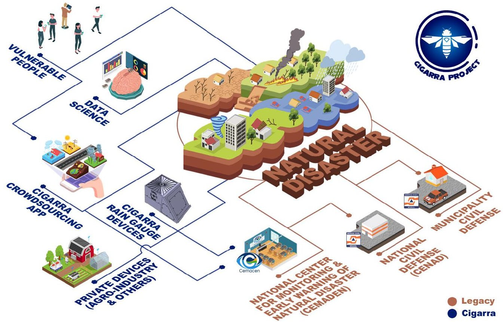

FIGURE 14. Cigarra architecture.

TABLE 17. Main failure of CEMADEN Monitoring Networks.

<table border="1"><tr><td>Vulnerability</td><td>Type</td><td>#Occ.3</td><td>%Occ.3</td><td>%Acc.4</td><td>%DCPs</td></tr><tr><td>Communication failure1</td><td>T</td><td>2724</td><td>18,0%</td><td>18,0%</td><td>96%</td></tr><tr><td>Rain gauge clogging1</td><td>P</td><td>2671</td><td>17,8%</td><td>35,8%</td><td>46%</td></tr><tr><td>Dirty solar panel2</td><td>P</td><td>2343</td><td>15,5%</td><td>51,3%</td><td>83%</td></tr><tr><td>Expired battery2</td><td>T</td><td>1989</td><td>13,2%</td><td>64,5%</td><td>70%</td></tr><tr><td>Outdated firmware2</td><td>T</td><td>1585</td><td>10,5%</td><td>75,0%</td><td>56%</td></tr><tr><td>Datalogger and Modem2</td><td>T</td><td>1469</td><td>9,7%</td><td>84,7%</td><td>52%</td></tr><tr><td>Theft and vandalism2</td><td>H</td><td>1368</td><td>9,1%</td><td>93,8%</td><td>48%</td></tr><tr><td>SIM cards2</td><td>T</td><td>405</td><td>2,7%</td><td>96,5%</td><td>14%</td></tr><tr><td>Internal connectors2</td><td>T</td><td>371</td><td>2,5%</td><td>99,0%</td><td>13%</td></tr><tr><td>Enclosure Box2</td><td>PH</td><td>147</td><td>1,0%</td><td>100%</td><td>5%</td></tr><tr><td>Total</td><td>-</td><td>15072</td><td>-</td><td>-</td><td>-</td></tr></table>

$ ^{1} $ Calculation metadata-based.

$ ^{2} $ Calculation reports-based.

$ ^{3} $ Occurrence (Amount of equipment affected)

$ ^{4} $ Accumulated Occurrence.

P Physical.

$ ^{T} $ Technological.

$ ^{H} $ Human.

permits broader universal data accessibility. As depicted in Figure 14, the Cigarra project's new architecture is a modern CPSoS that can connect the existing observational network with a new set of systems, including:

(a) low-cost and easily accessible equipment for measuring environmental variables (such as rainfall and temperature);

(b) crowdsourcing mobile apps that allow the general public and members of society to submit knowledge regarding the likelihood of natural disasters occurring;

(c) data science systems that can generate a new profile for disaster risk analysis;

(d) private network equipment for monitoring environmental variables in sectors such as agriculture, oil and gas, and transportation, among others.

The integration of a new generation of systems with legacy systems in a coordinated way, generating benefits for Cemaden's CPSoS, is the main challenge, as is well known in the literature. Among the new systems, the APP Cigarra Crowdsourcing stands out because it actively involves human interaction, which allows for a wide range of interactions that are only limited by the user's imagination.

The complexity is made worse by the fact that each operator in the CPSoS becomes an instance of a system, with all the features of an SoS, like its own independent governance.

Given these facts, the use of the Discovery and Requirement Canvas method contributed significantly to the objective and unambiguous description of the interconnections between the complex constituent systems, as well as the reduction of cognitive effort required of specialists.

It is crucial to note that, being a project of the Brazilian Federal Government, this project still has access and publication restrictions. High-level material necessary to comprehension will be supplied in this work; however, sensitive information will be removed due to security and access constraints.

## A. CIGARRA PROJECT: CONCEPTUAL ANALYSIS

The Cigarra Project aims to create a new management model for the Cemaden observation network, with a focus on decentralizing administrative authority over network equipment. To make this decentralization possible, the equipment must adhere to a standard and have the lowest possible purchase

<!-- PDF_PAGE: 19 -->

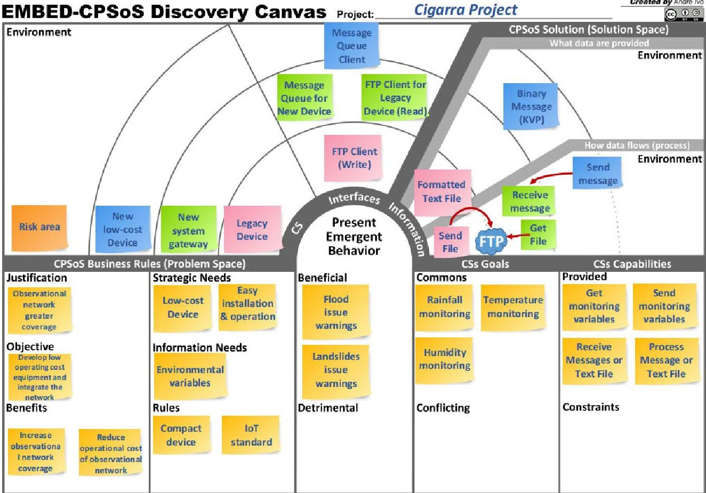

FIGURE 15. Cigarra Discovery Canvas.

and running costs, resulting in a significant reduction in maintenance costs and encouraging network expansion.

The most difficult aspect of this project is accurately capturing the needs of natural disaster specialists and translating them into system requirements for developing new devices equipped with new sensors that can be integrated into the existing system. Moreover, the new management model to be created shall allow the current Cemaden/CPSoS to continuously evolving, aggregating new CSs to the existing observational network. The Discovery and Requirement Canvas method were used to guide the systems engineering process and the development of the Cigarra project.

As shown in Figure 6, the Cigarra project went through the Discovery and Requirements phases of the EMBED-SoSE approach.

## 1) DISCOVERY CANVAS

Figure 15 is a high-level illustration of the results of the Discover stage.

Using the Discovery Canvas artifact, the new CPSoS of the Cigarra Project was identified during the Discovery stage. Natural disaster specialists and system engineers brainstormed the background and needs of the Cigarra Project. As shown in Figure 15, the C 1.1 region of CANVAS highlights the importance of increasing the coverage of the observational network. The C 1.4 adds the need of low-cost device and easy operation.

Through the visual model proposed by the canvas, specialists discuss everything from mission justifications to

technical details such as the communication standard between devices, which in this case indicates that legacy devices generate text files, which are uploaded to an FTP server. One of the outcomes expressed in C 2.4 region is the CS capability of variable processing in situ in order to provide warnings, which emerge as Beneficial Emergent Behavior. New devices should use a modern message queuing server to send binary data in the form of key-value pairs;

For seeking of space, other regions of Figure 14 are not described. The Discovery CANVAS figured out a more robust data collecting device (Cigarra DCP) would improve the observational network.

## 2) REQUIREMENTS CANVAS

Figure 16 represents, at a high level, the requirements discovered and documented by engineers and specialists in the "Requirements" step. The Requirements Screen artifact translates user needs into system requirements in regions D1.1, D1.2, and D1.3.

The dynamics and visual persistence proposed by CANVAS make the discovery of gaps and functionalities necessary for the system more intuitive. Benefits that are evident when new emerging behaviors can be perceived by the team are presented in Region D1.2, and D1.3.

In the Cigarra Project, it was possible to identify the behavior of "Mapping the quality of the telecommunications signal" which should help in the allocation of new devices, in addition to the detrimental behavior of "Overconfidence of the population in the system";

<!-- PDF_PAGE: 20 -->

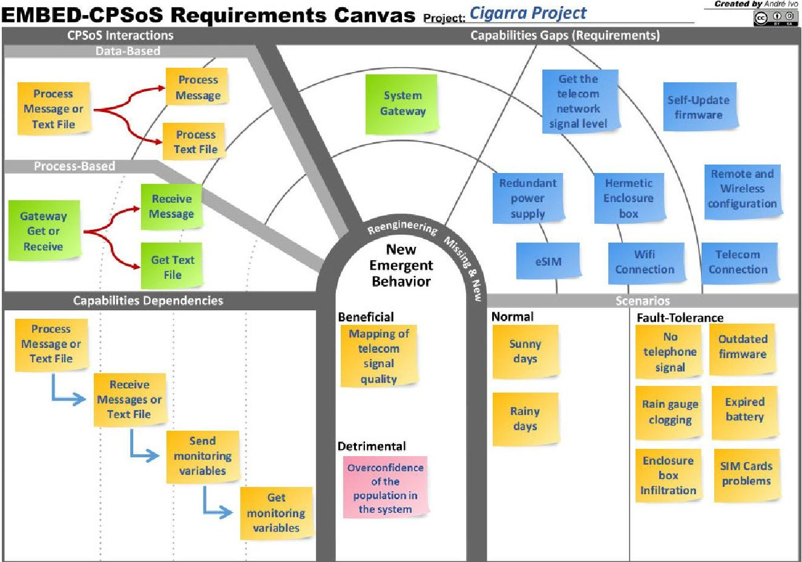

FIGURE 16. Cigarra Requirements Canvas.

## 3) FINAL CONSIDERATIONS AND WORKING PROGRESS

It is critical to emphasize that the Cigarra Project refers to the process of maintaining and evolving the Observational Network, or, in other words, to the process of developing the composition of a CPSoS. In a more concrete sense, the Cigarra Project is one of the possibilities for expanding the observational network. This potential is largely dependent on the development of reliable equipment with lower operating costs, allowing the failures recorded in Table 17 to be decreased to a more tolerable level (mitigated) as Cigarra DCP-type equipment replaces benchmark equipment.

Cigarra DCP underwent many iterations during the design and V&V stages. The work "Prototyping low-cost automatic weather stations for natural disaster monitoring" [43] produced a prototype resulting from the initial interaction. This project's primary purpose was to evaluate the concept and application of a low-cost device by comparing its performance to that of standard equipment for the Cemaden network. Based on the promising results of this first study, Cigarra DCP underwent a new interaction, and new prototypes were built and evaluated, as described in the study "On the use of ontology-based integration architecture in Cemaden's Natural Disaster Observational Network" [44]. This work describe about how ontological principles were used to make a new architecture for sending and receiving data.

The Cigarra DCP is in full development. Its infrastructure is formed by a set of DCP networks, which must be made possible by modernizing and creating equipment networks

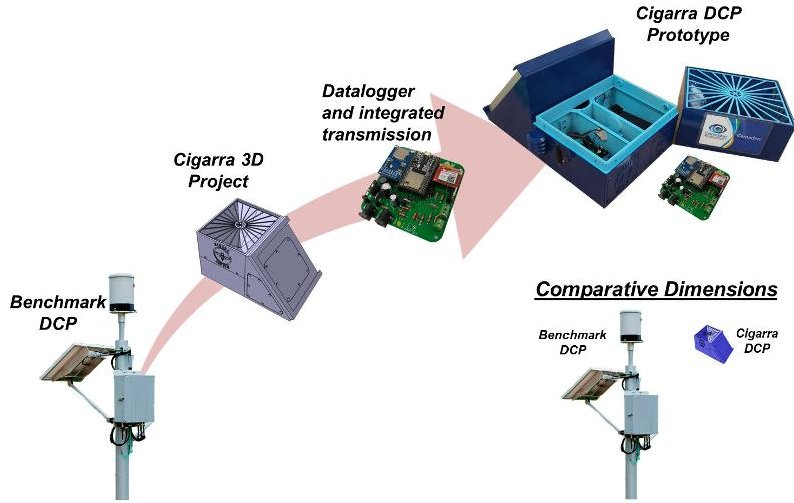

FIGURE 17. Cigarra DCP Prototype Evolution.

in the Cigarra DCP standard. The technological evolution of the modernization of each PCD is shown in Figure 17, and a prototype is currently being tested in laboratories. It is worth mentioning that Cigarra Project component proposes the development of a comprehensive Cigarra DCP for environmental monitoring that is completely open to the public (Open Source Hardware and Software), oriented toward the use of modern IoT (Internet of Things) technologies, low-cost, flexible, dependable, and scalable, as well as the standardization of interfaces and protocols for the entire technological communication chain.

The benchmark DCPs that Cemaden acquired more than a decade ago are huge and comprise a large number of

<!-- PDF_PAGE: 21 -->

connectors, screws, and external elements. In addition, its maintenance necessitates the care and inspection of all these pieces, as well as a physical link between the equipment and the technician's computer, which offers a significant challenge given that this equipment is typically mounted in extremely high locations. Limited access. Unlike the equipment recommended by the Cigarra Project, where there are no connectors or exterior pieces, which substantially simplifies maintenance. The equipment is a single unit, with all peripherals and equipment incorporated. Moreover, they are based on contemporary IoT (Internet of Things) technologies, which do not require a physical connection for configuration and may be accomplished remotely or via Wi-Fi.

One of the ideas behind Cigarra DCP is that it should be flexible. It has sensors that can be set up and changed to fit your business needs. The equipment is prepared to be coupled with a new context or domain and can generate new emergent behaviors.

This case study demonstrated that use of the Discovery and Requirement Canvas (cause) method has a positive impact on the composition and maintenance processes of the Cemaden Observational Network's constituent systems (legacy systems), producing results that directly respond to the needs of Cemaden's natural disaster experts.

It is worth noting that the use of the Discovery and Requirement Canvas method had further positive impacts when the team discovered the detrimental emergent behaviors during the requirements stage. The behavior "Overconfidence of the population in the system" is extremely important for Cemaden's mission because by generating this confidence, the population of risk areas can lose the fear of a disaster by blindly trusting the system.

In addition, by indicating the detrimental emergent behavior, the team recognized an intangible, unknown, and detrimental behavior, allowing this item to be addressed. In other words, it's evidence that the Discovery and Requirement Canvas method worked together to solve the problem outlined in Section II-B.

In general, the results demonstrate that the use of the Discovery & Requirement Canvas method aids the development of a large project such as Cigarra; suggesting the possibility of generalizing the method to industrial practices.

## VIII. CONCLUSION

This work presents the Discovery & Requirement Canvas method, which empower the MBSE with the ability to anticipate emergent behavior analysis on the early phase of CPSoS projects. The method based on visual thinking integrates several neuroscience concepts into a single artifact, CANVAS, that has the potential to improve the systems engineering process on the task of composing CSs. The method allows the collective construction of a simpler and more effective design for the integration and composition of legacy systems.

The experiment yielded positive results, with a focus on the ability to recognize emerging behaviors.

The applicability of the method was demonstrated in the case study namely Cigarra, a large project provided by National Center for Monitoring and Early Warning of Natural Disasters (Cemaden). The results suggest that the Discovery and Requirement Canvas decrease the cognitive effort required to understand the composition of legacy CPSoS systems through integrated visual models that increase the creative capacity of engineers and specialists.

In order to validate the method Discovery & Requirement Canvas, an experiment was conducted with 22 senior participants from the software and aerospace industries.

Despite the fact that the Cigarra project is still in the midst of development, the results indicate that the application of the approach significantly contributed to the systems engineering process.

Observations suggest that the proposed method requires more detailed documentation to aid engineers and specialists, based on records of RQ5 issues. These observations suggest the opportunity for new research and tools that support the modernization and consolidation of approach application.

## REFERENCES

[1] P. Carreira, V. Amaral, and H. Vangheluwe, Foundations of Multi- Paradigm Modelling for Cyber-Physical Systems. Berlin, Germany: Springer, Jan. 2020.

[2] E. Brynjolfsson, A. McAfee, and M. Spence, "New world order: Labor, capital, and ideas in the power law economy," Foreign Affairs, vol. 93, no. 4, pp. 44-53, 2014. [Online]. Available: http://www.jstor.org/stable/24483556

[3] E. R. Griffor, C. Greer, D. A. Wollman, and M. J. Burns, "NIST Framework for cyber-physical systems: Volume 1, overview," NIST, Gaithersburg, MD, USA, Tech. Rep. 1500-201, 2017.

[4] I. Bojanova, G. Hurlburt, and J. Voas, "Imagineering an internet of anything," Computer, vol. 47, no. 6, pp. 72-77, Jun. 2014.

[5] M. W. Maier, "Architecting principles for systems-of-systems," Syst. Eng., vol. 1, no. 4, pp. 267-284, 1998.

[6] International Organization for Standardization, Standard ISO/IEC/IEEE 21839, Genebra, Jul. 2019.

[7] H. Kopetz, A. Bondavalli, F. Brancati, B. Fromel, O. Hoftberger, and S. Iacob, Emergence in Cyber-Physical Systems-of-Systems (CPSoSs). Cham, Switzerland: Springer, 2016, ch. 3, pp. 73-96.

[8] SEBOK. (2018). Guide to the Systems Engineering Body of Knowledge (SEBOK). [Online]. Available: https://www.sebokwiki.org

[9] I. Sommerville, Engenharia De Software. Upper Saddle River, NJ, USA: Prentice-Hall, 2011. [Online]. Available: https://books.google.com.br/books?id=H4u5ygAACAAJ

[10] Systems Engineering Vision 2020 (INCOSE-TP-2004-004-02), International Council on Systems Engineering—INCOSE, San Diego, CA, USA, 2007.

[11] H. Kopetz, Real-Time Systems: Design Principles for Distributed Embedded Applications, 2nd ed. Berlin, Germany: Springer, 2011.

[12] A. Ceccarelli, A. Bondavalli, B. Froemel, O. Hoftberger, and H. Kopetz, Basic Concepts on Systems of Systems. Cham, Switzerland: Springer, Dec. 2016, ch. 1.

[13] D. Smith and G. Lewis, "Systems of systems: New challenges for maintenance and evolution," in Proc. Frontiers Softw. Maintenance, Oct. 2008, pp. 149-157.

[14] S. Hallerstede, F. O. Hansen, J. Holt, R. Lauritsen, L. Lorenzen, and J. Peleska, "Technical challenges of SoS requirements engineering," in Proc. 7th Int. Conf. Syst. Syst. Eng. (SoSE), Jul. 2012, pp. 573-578.

[15] P. Lollini, M. Mori, A. Babu, and S. Bouchenak, AMADEOS SysML Profile for SoS Conceptual Modeling. Cham, Switzerland: Springer, 2016, pp. 97-127.

[16] A. Bondavalli, S. Bouchenak, and H. Kopetz, Cyber-Physical Systems of Systems: Foundations—A Conceptual Model and Some Derivations: The AMADEOS Legacy, vol. 10099. Berlin, Germany: Springer, 2016.

<!-- PDF_PAGE: 22 -->

[17] M. Jahan, Z. S. H. Abad, and B. Far, "Detecting emergent behavior in scenario-based specifications using a probabilistic model," in Proc. IEEE 10th Int. Model-Driven Requirements Eng. (MoDRE), Aug. 2020, pp. 31-38.

[18] C. Davey, P. Nielsen, P. Schreinemakers, S. Friedenthal, C. Oster, E. Sparks, S. Matthews, T. Riethle, H. Stoewer, D. Nichols, and G. Roedler, "Systems engineering vision 2035," Int. Council Syst. Eng. (INCOSE), San Diego, CA, USA, Tech. Rep., 2021. [Online]. Available: https://www.incose.org/about-systems-engineering/se-vision-203

[19] M. Torngren, S. Bensalem, V. Cengarle, J. McDermid, R. Passerone, and A. S. Vincentelli, "Cps: Significance, challenges and opportunities," KTH, Mechatronics, Stockholm, Sweden, Tech. Rep. D5.2 , 2014.

[20] A. Ivo, S. Ribeiro, and F. Mattiello-Francisco, "EMBED-SoSE: Drawing a cyber-physical system of systems," in Proc. 17th Int. Conf. Eval. Novel Approaches Softw. Eng., 2022, pp. 485-493.

[21] European Cooperation For Space Standardization, Standard ECSS-E-ST10-02, Noordwijk, The Netherlands, Feb. 2018.

[22] National Aeronautics and Space Administration, Nasa Washington, DC, USA, 2017. [Online]. Available: https://www.nasa.gov/connect/ ebooks/nasa-systems-engineering-handbook

[23] J. Holt, S. Perry, R. Payne, J. Bryans, S. Hallerstede, and F. O. Hansen, "A model-based approach for requirements engineering for systems of systems," IEEE Syst. J., vol. 9, no. 1, pp. 252-262, Mar. 2015.

[24] J. Holt, S. Perry, F. O. Hansen, A. Miyazawa, K. Kristensen, and R. Hains, "Final report on guidelines for sos engineering," COMPASS, U.K., Tech. Rep. D21.6, 2014.

[25] L. Mangeruca, R. Passerone, C. Etzien, T. Gezgin, T. Peikenkamp, M. Jung, A. Alexandre, R. Bullinga, S. Imad, E. Honour, S. Paul, and S. Klaas, "Danse methodology v2," ALES, Germany, Tech. Rep. D4.3, 2013.

[26] C. Binder, J. Gross, C. Neureiter, and G. Lastro, "Investigating emergent behavior caused by electric vehicles in the smart grid using co-simulation," in Proc. 14th Annu. Conf. Syst. Syst. Eng. (SoSE), May 2019, pp. 230-235.

[27] V. Ramachandran, S. Blakeslee, and R. J. Dolan, "Phantoms in the brain probing the mysteries of the human mind," Nature, vol. 396, no. 6712, pp. 639-640, 1998.

[28] T. D. Wilson and N. Brekke, "Mental contamination and mental correction: Unwanted influences on judgments and evaluations," Psychol. Bull., vol. 116, no. 1, pp. 117-142, 1994.

[29] A. Osterwalder and Y. Pigneur, Business Model Generation: A Handbook for Visionaries, Game Changers, and Challengers. Hoboken, NJ, USA: Wiley, 2010. [Online]. Available: https://books.google.com.br/books?id=fklTInjiPQAC

[30] FINOCCHIO. (2020). PM Canvas 2ED. [Online]. Available: https:// books.google.com.br/books?id=d5LODwAAQBAJ

[31] T. Wujec. (2009). 3 Ways the Brain Creates Meaning. TED: Ideas Worth Spreading. [Online]. Available: https://www.ted.com/talks/tom_wujec_3_ways_the_brain_creates_meaning

[32] V. I. Zhukovskiy and D. V. Pivovarov, "The nature of visual thinking," Siberian Federal Univ., Tech. Rep., 2008. [Online]. Available: http://elib.sfu-kras.ru/handle/2311/641

[33] A. Soylu, F. Mödritscher, F. Wild, P. De Causmaecker, and P. Desmet, "Mashups by orchestration and widget-based personal environments: Key challenges, solution strategies, and an application," Program, vol. 46, no. 4, pp. 383-428, Sep. 2012.

[34] M. Shafiee, E. Enjema, and A. Kolios, "An integrated FTA-FMEA model for risk analysis of engineering systems: A case study of subsea blowout preventers," Appl. Sci., vol. 9, no. 6, p. 1192, Mar. 2019. [Online]. Available: https://www.mdpi.com/2076-3417/9/6/1192

[35] M. Cheng and Y. Lu, "Developing a risk assessment method for complex pipe jacking construction projects," Automat. Construct., vol. 58, pp. 48-59, Oct. 2015. [Online]. Available: https://www.sciencedirect.com/science/article/pii/S0926580515001545

[36] C. Wohlin, P. Runeson, M. Host, M. Ohlsson, B. Regnell, and A. Wesslen, Experimentation in Software Engineering. Berlin, Germany: Springer, 2012. [Online]. Available: https://books.google.com.br/books?id=QPVsM1_U8nkC

[37] U. Z. A. Hamid, H. Zamzuri, and D. K. Limbu, Internet of Vehicle (IoV) Applications in Expediting the Implementation of Smart Highway of Autonomous Vehicle: A Survey. Cham, Switzerland: Springer, 2019, ch. 9, pp. 137-157, doi: 10.1007/978-3-319-93557-7_9.

[38] J. R. Landis and G. G. Koch, "The measurement of observer agreement for categorical data," Biometrics, vol. 33, no. 1, p. 159, Mar. 1977.

[39] CEMADEN. (2011). Cemaden Creation History. [Online]. Available: http://www.cemaden.gov.br/historico-da-criacao-do-cemaden/

[40] BPD República. (2011). Decreto $ n^{\circ} $ 7.513 de $ 1^{\circ} $ de Julho de 2011: Altera o Decreto n. 5886 de 6 de Setembro de 2006, Que Aprova a Estrutura Regional e o Quadro Demonstrativo Dos Cargos Em Comissão e Das Funções Gratificadas Do Ministério da Ciencia e Tecnologia e dispõe Sobre o Remanejamento de Cargos Em Comissão. BRASIL. PRESIDÊNCIA DA REPÚBLICA. [Online]. Available: http://www.planalto.gov.br/ccivil_03/_ato2011-2014/2011/decreto/d7513.htm

[41] CPRM. (2020). Mapa On-line. [Online]. Available: https://geoportal. cprm.gov.br/desastres/

[42] R. C. D. S. Alvala, M. C. D. A. Dias, S. M. Saito, C. Stenner, C. Franco, P. Amadeu, J. Ribeiro, R. A. S. De M. Santana, and C. A. Nobre, "Mapping characteristics of at-risk population to disasters in the context of Brazilian early warning system," Int. J. Disaster Risk Reduction, vol. 41, Dec. 2019, Art. no. 101326. [Online]. Available: https://www.sciencedirect.com/science/article/pii/S221242091930545X

[43] G. F. L. R. Bernardes, R. Ishibashi, A. A. S. Ivo, V. Rosset, and B. Y. L. Kimura, "Prototyping low-cost automatic weather stations for natural disaster monitoring," Digit. Commun. Netw., May 2022. [Online]. Available: https://www.sciencedirect.com/science/article/pii/S2352864822000931

[44] A. Ivo, S. Ribeiro, F. Mattiello-Francisco, and R. Ishibashi, "On the use of ontology-based integration architecture in Cemaden's natural disaster observational network," in Proc. Anais Estendidos Do X LatinAmer. Symp. Dependable Comput., 2021, pp. 10-13. [Online]. Available: https://sol.sbc.org.br/index.php/ladc_estendido/article/view/18532

[45] D. Chelimsky, D. Astels, B. Helmkamp, D. North, Z. Dennis, and A. Hellesoy, The RSpec Book: Behaviour Driven Development With Rspec, Cucumber, and Friends, 1st ed. 2010.

[46] R. A. de Carvalho, F. L. D. C. Silva, and R. S. Manhaes, "Mapping business process modeling constructs to behavior driven development ubiquitous language," 2010, arXiv:1006.4892.

[47] M. Tovey, "Thinking styles and modelling systems," Design Stud., vol. 7, no. 1, pp. 20-30, Jan. 1986.

[48] D. Roam, Back of the Napkin: Solving Problems and Selling Ideas With Pictures. Singapore: Marshall Cavendish International (Asia) Private Limited, 2009. [Online]. Available: https://books.google.com.br/books?id=ATWJAAAAQBAJ

[49] R. Pressman, Software Engineering: A Practitioner's Approach. Boston, MA, USA: McGraw-Hill, 2005. [Online]. Available: https://books.google.com.br/books?id=bL7QZHtWvaUC

[50] R. Wazlawick, Engenharia De Software: Conceitos e Prática. Amsterdam, The Netherlands: Elsevier, 2013. [Online]. Available: https://books.google.com.br/books?id=GJMkmwEACAAJ

[51] S. J. Clement, D. W. McKee, R. Romano, J. Xu, J. M. Lopez, and D. Battersby, "The internet of simulation: Enabling agile model based systems engineering for cyber-physical systems," in Proc. 12th Syst. Syst. Eng. Conf. (SoSE), Jun. 2017, pp. 1-6.

[52] M. Uschold and M. Gruninger, "Ontologies: Principles, methods and applications," Knowl. Eng. Rev., vol. 11, no. 2, pp. 93-136, Jun. 1996.

[53] C. Emmeche, S. Koppe, and F. Stjernfelt, "Explaining emergence: Towards an ontology of levels," J. Gen. Philosophy Sci., vol. 28, no. 1, pp. 83-117, 1997, doi: 10.1023/A:1008216127933.

[54] M. Aiguier, P. L. Gall, and M. Mabrouki, "Emergent properties in reactive systems," in Proc. 15th Asia-Pacific Softw. Eng. Conf., 2008, pp. 277-289.

[55] C. B. Keating, "Research foundations for system of systems engineering," in Proc. IEEE Int. Conf. Syst., Man Cybern., Oct. 2005, pp. 2720-2725.

[56] C. B. Nielsen, P. G. Larsen, J. Fitzgerald, J. Woodcock, and J. Peleska, "Systems of systems engineering: Basic concepts, model-based techniques, and research directions," ACM Comput. Surv., vol. 48, no. 2, pp. 1-41, Sep. 2015, doi: 10.1145/2794381.

[57] R. F. Calhau and R. D. A. Falbo, "An ontology-based approach for semantic integration," in Proc. 14th IEEE Int. Enterprise Distrib. Object Comput. Conf., Oct. 2010, pp. 111-120.

[58] T. Mayerhofer, P. Langer, and G. Kappel, "A runtime model for fUML," in Proc. 7th Workshop Models@run.Time, New York, NY, USA, Oct. 2012, pp. 53-58, doi: 10.1145/2422518.2422527.

<!-- PDF_PAGE: 23 -->

[59] E. Guerra and M. Aniche, "Chapter 9—Achieving quality on software design through test-driven development," in Software Quality Assurance, I. Mistrik, R. Soley, N. Ali, J. Grundy, and B. Tekinerdogan, Eds. Boston, MA, USA: Morgan Kaufmann, 2016, pp. 201-220. [Online]. Available: http://www.sciencedirect.com/science/article/pii/B9780128023013000090

[60] K. Beck, Test Driven Development. Amsterdam, The Netherlands : Addison-Wesley Longman, 2002.

[61] D. Astels, Test Driven Development: A Practical Guide. Upper Saddle River, NJ, USA: Prentice-Hall, 2003.

[62] Q. Tu, "Evolution in open source software: A case study," in Proc. Int. Conf. Softw. Maintenanc, 2000, pp. 131-142.

[63] J. Dahmann, "1.4.3 system of systems pain points," in Proc. INCOSE, Jul. 2014, vol. 24, no. 1, pp. 108-121. [Online]. Available: https:// onlinelibrary.wiley.com/doi/abs/10.1002/j.2334-5837.2014.tb03138

[64] E. A. Lee, "Cyber physical systems: Design challenges," in Proc. 11th IEEE Int. Symp. Object Compon.-Oriented Real-Time Distrib. Comput. (ISORC), May 2008, pp. 363-369.

[65] P. Lee and T. Anderson, Fault Tolerance, Principles and Practice (Dependable Computing and Fault-Tolerant Systems). Berlin, Germany: Springer-Verlag, 1990. [Online]. Available: https://books.google.com.br/books? id=r9tQAAAAMAAJ

[66] J. Toro, "Inundações e deslizamentos na região serrana do rio de janeiro janeiro de 2011. Relatório elaborado pelo banco mundial com apoio do governo do estado do rio de janeiro," BANCO MUNDIAL, Tech. Rep., 2011.

[67] A. A. S. Ivo, E. M. Guerra, S. M. Porto, J. Choma, and M. G. Quiles, "An approach for applying test-driven development (TDD) in the development of randomized algorithms," J. Softw. Eng. Res. Develop., vol. 6, no. 1, pp. 1-31, Dec. 2018.

[68] J. Zhou, H. Kikuchi, S. Sasaki, S. Muramatsu, and Y. Onozato, "Performance of CDMA cellular system with effects of soft handover under lognormal shadow channels," in Proc. IEEE Int. Conf. Commun., Circuits Syst. West Sino Expositions, 2002, pp. 332-336.

[69] W. Zhi, "Calculation of shadow fading loss in the RLB of WCDMA," Telecom Eng. Technics Standardization, vol. 7, p. 20, Jan. 2006.

[70] G. Lewis, E. Morris, P. Place, S. Simanta, D. Smith, and L. Wrage, "Engineering systems of systems," in Proc. 2nd Annu. IEEE Syst. Conf., Feb. 2008, pp. 1-6.

[71] L. Takayama, W. Ju, and C. Nass, "Beyond dirty, dangerous and dull: What everyday people think robots should do," in Proc. 3rd ACM/IEEE Int. Conf. Human-Robot Interact. (HRI), New York, NY, USA, Mar. 2008, pp. 25-32, doi: 10.1145/1349822.1349827.

[72] R. Bemthuis, M.-E. Iacob, and P. Havinga, "A design of the resilient enterprise: A reference architecture for emergent behaviors control," Sensors, vol. 20, no. 22, pp. 1-39, 2020.

[73] J. Brings, M. Daun, K. Keller, P. A. Obe, and T. Weyer, "A systematic map on verification and validation of emergent behavior in software engineering research," Future Gener. Comput. Syst., vol. 112, pp. 1010-1037, Nov. 2020.

[74] S. Kalantari, E. Nazemi, and B. Masoumi, "Emergence phenomena in selforganizing systems: A systematic literature review of concepts, researches, and future prospects," J. Organizational Comput. Electron. Commerce, vol. 30, no. 3, pp. 224-265, Jul. 2020.

ANDRÉ A. S. IVO received the bachelor's degree in computer engineering from Vale do Paraíba University, in 2006, the M.B.A. degree in project management from Fundação Getulio Vargas, in 2010, and the M.Sc. degree in space engineering and technologies from the National Institute for Space Research (INPE), in 2013, where he is currently pursuing the Ph.D. degree. He was involved in private high-tech companies as a Software Engineer, having extensive knowledge in system engineering, and a Systems Manager, a Coordinator, and a System Engineer, with extensive expertise in system engineering, automation, databases, quality and maturity models, and service models. Since 2016, he has been a Full Technology Specialist Federal Civil Servant with CEMADEN, where he is responsible for the observational networks and researching and developing new technologies with a focus on forecasting and monitoring natural disasters.

SHEILA GRANATO RIBEIRO is currently pursuing the master's degree in space engineering and technology from the National Institute for Space Research (INPE). She researches technology teams productivity-related methodologies and processes at INPE. She has held positions as the Project Manager and a Coordinator, a Business Analyst, and a User Experience Designer with several private high-tech companies. She highlighted her work as a Business Analyst with the Telecom

Sector (VIVO), where she was responsible for developing new products and systems. She is an agile master in digital transformation in the education sector.

FATIMA MATTIELLO-FRANCISCO received the bachelor's degree in computer science from the Institute of Mathematics and Computer Sciences (ICMC), Universidade de São Paulo (USP), the M.Sc. degree in electronic and telecommunication engineering, fault tolerance field, from the National Institute for Space Research (INPE), and the Ph.D. degree in computing engineering from the Aeronautical Institute of Technology (ITA), Brazil, in 2009. She is currently a Senior System

Engineer with the National Institute for Space Research (INPE), Brazil. She is the Project Manager of nanosatellite Cubesat-based developed by INPE in cooperation with universities and a Lecturer of space system engineering for pos-graduation at INPE. She has experience on designing ground systems for satellite operation and on testing embedded software. Her current research interests include model-based testing, model-based engineering, dependable computing, verification and validation techniques with an emphasis on integration testing of real-time critical systems, and empirical studies.

ANDREA BONDAVALLI (Senior Member, IEEE) is currently a Full Professor in computer science with the University of Florence. Previously, he has been a Researcher and a Senior Researcher of the Italian National Research Council, working at the CNUCE Institute in Pisa. In particular, he has been involved in safety, security, fault tolerance, evaluation of attributes, such as reliability, availability, and performability. His scientific activities have originated more than 220 papers appeared in

international journals and conferences. He supports as an Expert of the European Commission in the selection and evaluation of project proposals and regularly consults companies in the application field. His research interest includes the dependability and resilience of critical systems and infrastructures. He participates to (and has been chairing) the program committee in several international conferences, such as IEEE FTCS, IEEE SRDS, EDCC, IEEE HASE, IEEE ISORC, IEEE ISADS, IEEE DSN, and SAFECOMP.