<!-- PDF_PAGE: 1 -->

# Research on satellite Modeling and Real-time Simulation Monitoring Based on MBSE

Yuqian Huang

School of Information Science and Technology Hangzhou Normal University Hangzhou, China woshihuangyuqian@126.com

Wanwan Diao

Hangzhou Normal University

School of Information Science and Technology

Hangzhou, China

1121231620@qq.com

Baokun Hu

Hangzhou Normal University

School of Information Science and Technology

Hangzhou, China

Bourne@hznu.edu.cn

Zhenghua Xia

School of Information Science and Technology

Hangzhou Normal University

Hangzhou, China

2020112011028@stu.hznu.edu.cn

Abstract—The problems existing in the text-based systems engineering method include heavy workload for change management, poor readability of design documents, low reuse rate, inability to simulate and so on.This paper firstly draws on the Magic Grid methodology, which is suitable for complex product development, and comprehensively describes complex systems from multiple views, forming a set of model-based systems engineering modeling methods(MBSE)with strong traceability and logicality;Secondly, the method is applied to the power subsystem, and the models under different views are created using the system modeling language SysML (systems modeling language);Finally, based on the model, real-time simulation monitoring is carried out for the behavior activity graph, and the model simulation process can be traced back. It is verified that the modeling method can better design the system and meet the requirements of complex system design.e system and meet the requirements of complex system design.

Keywords—MBSE, Magic Grid, satellite, Simulation monitoring

## I. INTRODUCTION

In recent years,Model-Based Systems Engineering (MBSE) has been more and more widely used in the research and development of complex products and major scientific research projects in China[1][2][3][4].MBSE has been vigorously developed in China under the background of large engineering systems such as satellite exploration, manned spaceflight, nuclear power and aircraft,and the core key link in the engineering implementation of mbse is system design and simulation verification.The main purpose of the design of model-based system engineering is to make the model close to the attributes of the logical domain and the physical domain of the corresponding physical entity as much as possible, integrate the reliability model with the structural model and behavioral model of the system, and realize the integrated analysis of security, reliability and performance.The purpose of its simulation work is to verify the correctness of the model, which often involves complex simulation problems caused by the behavioral interactions between various fields.In addition, it is necessary to add synchronous or asynchronous problems in time, and it is necessary to convert and normalize engineering problems,

which is an extremely complex and difficult work [5][6].At present, the Rhapsody software released by the American I- Logix company[7] , the Cameo Systems Modeler software developed by the No Magic company[8], and the M-design platform independently developed by Zhejiang University in China have all realized the design and simulation functions of the corresponding models. Features[9].

Different from traditional industries such as automobiles and aircrafts with extremely high engineering maturity, satellite systems have outstanding characteristics such as few reference cases, strong design constraints, large differences between models, and strong coupling between satellite system design and specific mission requirements [10][11].At the same time, the scale of the satellite system is large, the structure is extremely complex, and the technical difficulty is high, the coupling degree is strong, and there are strict requirements for reliability [12][13][14].Zhao Qi and other researchers explored the application framework and scheme of model-based systems engineering in the large and complex satellite constellation system, built a multi-domain integration model of the satellite constellation system, and adopted the hierarchical progressive modular method to demonstrate the multi-domain integrated modeling process for constellation system models[15].Researchers such as Li Wenping refer to the U.S. Department of Defense Architecture Framework (DoDAF) to build a system view (SV) such as the functional model, node model, and process model of the satellite communication system. It is verified that the MBSE-based system modeling method can effectively build functional models, node models and process models, and carry out verification and validation of system functions, interface relationships and workflows [16].Jiang Wei and other researchers based on the development process and method of MBSE, modeled and analyzed the mission analysis, mission context, and requirements of the Fire Satellite spacecraft, and finally carried out integrated simulation verification of the model, verifying that MBSE can It can well ensure the consistency of design information in the spacecraft design process, improve work efficiency, and reduce spacecraft research and development costs. [17].

At present, most studies have not concluded a design method and process that can meet the complex system of

<!-- PDF_PAGE: 2 -->

satellites.And due to the high complexity of the satellite system, there is no software at home and abroad that can trace the simulation process in the simulation verification stage. Therefore, this paper improves the magic grid methodology and explores its application in satellite design. At the same time, taking the power subsystem under the satellite system as an example to describe the method in detail in the power subsystem demand analysis, behavior design and system structure, constraint analysis and simulation verification, etc.Finally, on the basis of the model, a customized plug-in real-time simulation monitoring technology is developed for research to realize the traceability of the simulation process[20][21].

## II. MAGIC GRID METHODOLOGY AND DESIGN PROCESS

Magic Grid is a model-based systems engineering methodology proposed by No Magic based on the INCOSE OOSEM method and engineering practice for complex product development. It considers system modeling, system simulation and system optimization in all aspects.Considering the complex structure of satellite system, this paper improves the methodology to fit the satellite system.The goals to be achieved are first defined from a stakeholder perspective (top-level requirements), and then quantified and decomposed at the system (black-box perspective) and component level (white-box perspective).Through multiple trade-offs from overall design to detailed design, solutions to different problems can be defined and evaluated step-by-step, enabling virtual verification of expected performance at the system level.From the perspective of change management, in order to reduce the impact of changes in satellite requirements in the design process, a "relational" step is added to the modeling process to ensure traceability of the model at each level, so as to check the compliance of the model and evaluate the impact of changes at any time.

The design scheme of the satellite system in this paper is shown in Figure 1. In general, it is divided into five stages ("relationship" step runs through each stage):

Part1:Carry out business analysis and peripheral analysis of satellite system to obtain the demand model of satellite system;

Part2:Refinement of mission scenarios, and carry out functional analysis to obtain a functional model of the satellite system;

Part3:Analyze the parameters of the satellite system to obtain the parameter constraint model of the satellite system;

Part4:Logical architecture analysis, capture the High Level System Architecture, deeply analyze the composition, behavior and system indicators of the logical layer, and obtain the composition relationship between the system and the sub-system and the information flow relationship between the sub-system and the sub-system , forming an information flow model;

Part5:The physical structure analysis, combined with the satellite system design experience, captures the existing stand-alone library, carries out multi-level solution trade-offs obtains the information flow relationship within the subsystem, and forms an information flow model.

<table border="1"><tr><td rowspan="5">DOMAIN</td><td></td><td></td><td>REQUIREMENTS</td><td>BEHAVIOR</td><td>STRUCTURE</td><td>PARAMETERS</td><td>RELATIONSHIP</td></tr><tr><td rowspan="2">Tech Analysis</td><td>Requirement Analysis (black box)</td><td>Stakeholder Needs</td><td>Use Cases</td><td>System Context</td><td>Measurements of Effectiveness</td><td>demand function relationship</td></tr><tr><td>Logical Architecture (white box)</td><td>Stakeholder Needs</td><td>Functional Analysis</td><td>System Composition</td><td>System Indicators</td><td>Sub-system stand-alone relationship</td></tr><tr><td rowspan="2">Overall Design</td><td>System-level Physical Architecture</td><td>System Requirement</td><td>System Behavior</td><td>System Physical Structure</td><td>System Parameters</td><td>demand-behavior relationship</td></tr><tr><td>Sub-system-level Physical Architecture</td><td>Subsystem Requirement</td><td>Subsystem Behavior</td><td>Subsystem Physical Structure</td><td>Subsystem Parameters</td><td>system and system behavior</td></tr></table>

Fig. 1. Improved Magic Grid methodology

The improved satellite development methodology takes the model as the core, and aims to express the structure of the model in each process of systems engineering and the modeling of information transmission. The requirements, functions, structures, design, development, testing and other contents are closely linked by the model.The roles and functions of various models are shown in Figure 2.

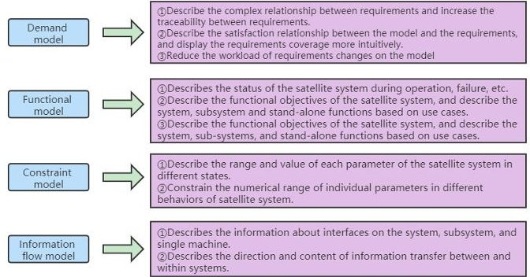

Fig. 2. MBSE model functionality

## III. MBSE MODELING OF POWER SUPPLY SUBSYSTEM

The goal of satellite system modeling is to ensure a consistent and cohesive description of the satellite architecture across multiple disciplines and subsystem views(For example, power subsystem, Measurement and Control subsystem, Temperature Control system, Antenna system and Transponder system),and ensure quality and modeling processes that meet stakeholder needs and meet system, subsystem and stand-alone requirements.

In order to verify the effectiveness and practicability of the improved methodology of Magic Grid methodology, this paper takes the power supply subsystem of satellite system as an example to conduct modeling,and set a use case behavior of power generation and power supply.

## A. Requirement Analysis

## 1) Non-functional analysis

In view of the constraints of weight, volume and power consumption of the whole satellite system, the nonfunctional requirements of the power supply subsystem are proposed as follows:

(a)Total mass of power subsystem $ \leq 50 $ kg;

(b)Total volume of power subsystem $ \leq 5 0 0 0 0 \mathrm{c m}^{2} $;

(c)Power subsystem power consumption $ \leq 2 0 $ W;

2) Functional Analysis

<!-- PDF_PAGE: 3 -->

In this paper, the top-level function of the power subsystem is set as: solar panels use solar radiation to generate electricity, and then store the electricity in the power storage to provide power to other subsystem components. Combined with the task characteristics, the toplevel requirements are decomposed, and the functional requirements of the power subsystem are obtained as follows.

(a)Solar panels per square meter of power $ \geq 2 0 0 $W;

## (b)Maximum storage capacity of solar battery $ \geq1 0 0 0 $AH;

Based on the above non-functional requirements and functional requirements, the establishment of a power subsystem requirement diagram is shown in Figure 3, which provides input and traceability sources for the design of the logic architecture stage.

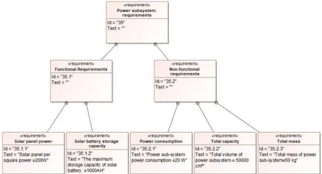

Fig. 3. Demand model

## B. Functional model modeling

On the basis of demand analysis, use cases are established for tasks of power subsystem, the whole chain relationship of each single machine in power subsystem is sorted out, and the refined relationship between the requirement and use case is established. The task use case diagram is shown in Figure 4.According to the functional requirements, this paper divides the task use case into three parts:charging, storage battery and discharging, creating an association relationship between ground personnel and them, and expressing the direct or indirect relationship with ground personnel.

Figure 5 shows the activity diagram of the power subsystem from a white-box perspective. Create a swim lane for the activity diagram, and assign the three tasks of charging, storing batteries, and discharging in the use case diagram to solar panels, solar batteries, which ensured the traceability of the system function design, and the top-level functional model design of the power sub-system is completed.

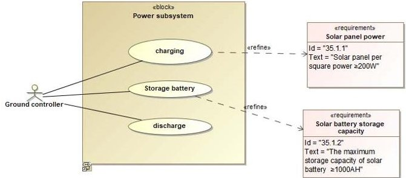

Fig. 4. Functional use case diagrams

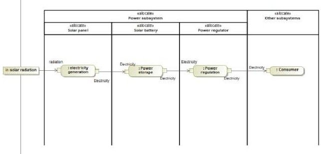

Fig. 5. Power subsystem activity diagram

## C. Functional model modeling

In the SysML parameter diagram, the Constraint Block parameters are mapped to the system variable parameter diagram. Parameter diagrams can analyze and control key parameters, throwing out incorrect parameters and parameters that do not conform to the function specification. Based on the above demand analysis, parameter constraints are carried out for the total mass, total volume, power consumption, solar panel per square power and maximum storage under the power subsystem, as shown in Figure 6.

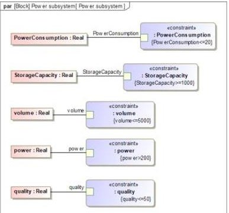

Fig. 6. Power subsystem parameter constraint diagram

## D. Information flow modeling

Information flow is the process of transferring information from source to sink in a specified flow direction and format. This phase takes functional requirements and functional architecture as inputs,map functionality to logic and get the initial logical architecture supported by product domain knowledge,This includes all subsystems in the requirements. For each subsystem, indicate the requirements that subsystem designers need to meet when designing subsystem solutions,such as core interface type requirements, interface flow requirements, data flow type requirements, etc.

## 1) Logical architecture information flow diagram

The core task of the logical architecture design stage is to synthesize a reasonable overall plan. In the satellite system structure, only the sub-system level needs to be designed at this stage.As shown in Figure 7, the information flow diagram of the logic architecture is expressed, which describes the data flow information of the power supply subsystem to the measurement and control subsystem, the temperature control system, the antenna system and the transponder system.Suppose there are four different types of interfaces on the power subsystem,use SysML's "Interface Block" component to express the type of the Interface(32V,24V,16V,8V),create "Item flow" to express the flow on the interface(in,out,in-out),use the "Signal" component to express specific information flow

<!-- PDF_PAGE: 4 -->

content.Finally, the logical architecture information flow diagram of power supply subsystem and other subsystems is formed.The correctness of its information flow will be verified in the system simulation verification stage.

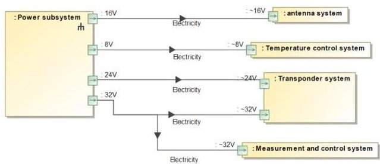

Fig. 7. Logical architecture information flow diagram

## 2) Physical architecture information flow diagram

The core task of the physical architecture design stage is to synthesize a detailed scheme.The information expressed in the physical architecture information flow diagram needs to be specific to a physical component (commonly known as a single machine),and the information expressed is more detailed and rich.This stage takes the logical architecture of the product as input, and connects the information flow information from the subsystem to the corresponding physical component inside the subsystem by finding and assigning the corresponding physical component for each logical component.As shown in Figure 8, based on the information flow diagram of the logical architecture, the interfaces on the subsystem are connected to the single machine inside the subsystem, and the corresponding interface type is created on the single machine to form the information flow diagram of the physical architecture.

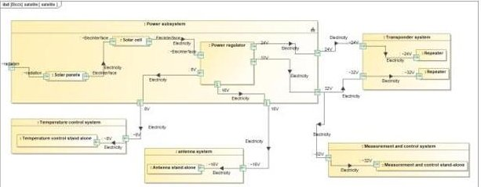

Fig. 8. Physical architecture information flow diagram

## E. Relational Modeling

Relational modeling exists in every link in the modeling and design process. The core task of relational modeling is to reduce the workload brought to designers by changes in the satellite design process.The relational model can help designers quickly locate the model affected by the change, and the change can be transferred to the corresponding model immediately. There are many ways to express the relational model. Figure 4 shows the relationship between requirements and use cases. The relational model is generally defined in the logical design and overall design stages.In the detailed stage, a relational model as shown in Figure 9 is available. The granularity is finer and more intuitive to describe the connection between the power subsystem requirements and the design structure and design method.

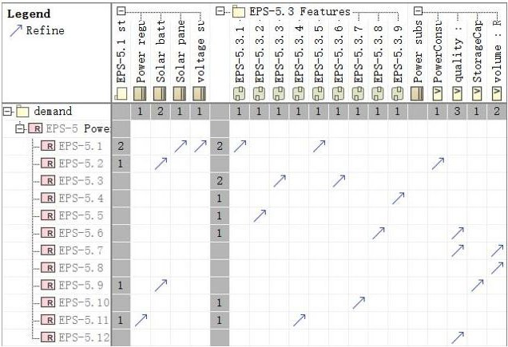

Fig. 9. Requirement relation model

## IV. SYSTEM SIMULATION VERIFICATION

The process of simulation verification is not only the process of experimentation, but also the process of collecting and accumulating information.In order to check whether the working state design, behavior design and key core constraints of the power subsystem meet the requirements, and verify the reliability of behavior logic and correctness of information flow,This paper uses the simulation verification function provided by the Cameo Systems Modeler (CSM) modeling tool to simulate and verify the power subsystem model.

This paper draws up the state machine diagram of the power subsystem when it is on-orbit, as shown in Figure 10: When the Start signal is received, the power sub-system starts working mode and initialization(Use Do Activity to call the Activity diagram).If the system initialization fails enter the system troubleshooting.If the check fails, the system returns to the OFF state and waits,If yes, enter the operation state.Otherwise, the initialization succeeds and the operation state is directly entered(The behavior of the operation state is shown in Figure 11).When the system receives the Stop signal,The system enters the OFF state again and waits for the signal.

During the simulation process, sending the Start signal to this state and successfully receiving the Int OK signal during initialization make the system enter the operation activity simulation. The correctness of the top-level state design is verified during simulation.

The action state behavior is shown in Figure 11.In this paper, the proposed activities of this state are:The system reads the Power Consumption parameter in the context(Use the "read Self" component to read the context parameters and use "read Structural Feature" component to read the Power Consumption parameters),And Check them with the "Check consumption" activity,If the result is not false,the power subsystem starts charging.Otherwise, the Stop signal is sent through the send Signal component,turn the power subsystem into OFF state.

For the information flow model,Send signals with the "Send Signal" component of the activity diagram,need to set the "on Port" and "Signal" properties in Send Signal."On Port" corresponds to the interface that you want to send information to,"signal" corresponds to the content of the flow.During the simulation process, set the on Port property to "16V" on the power subsystem and the signal property to "electricity" through the send Signal component in the

<!-- PDF_PAGE: 5 -->

activity diagram, then the information flow shown in Figure 12 will appear in the information flow diagram. transfer process. The correctness of the information flow design is verified in the simulation process.

Aiming at the static characteristics of the system such as volume and mass,The design parameters of each sub-system can be initialized by creating examples,the effectiveness of the top-level design constraint is verified by simulation(If the parameter background color is green, the requirements are met; if the parameter background color is red, the requirements are not met), See Figure 13. The relationship between specific parameters is shown in Figure 6.

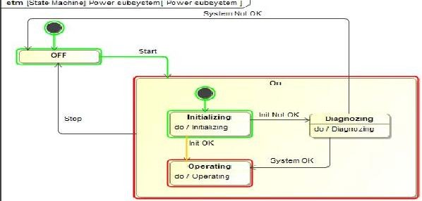

Fig. 10. Diagram of the operating state of the power subsystem

Fig. 11. Operating state behavior activity

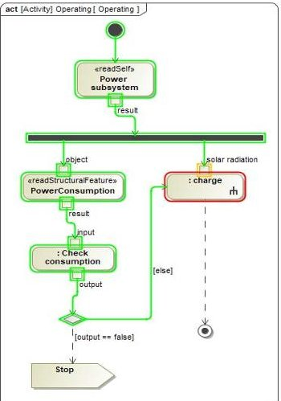

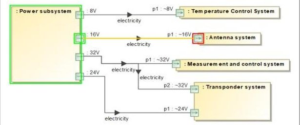

Fig. 12. Information flow diagram

## V. RESEARCH ON REAL-TIME SIMULATION MONITORING

Fig. 13. Demand-satisfy-constraint simulation

In order to record the key process and key information of the model simulation, so that the designer can trace the simulation process after the simulation, this paper studies the function of real-time monitoring of the simulation process on

the basis of CSM software. Based on the CSM platform, the "Listen" plug-in is developed, which makes the plug-in compatible with CSM software and supports real-time monitoring and recording of the simulation process.

## A. Customized real-time simulation monitoring process

This research uses JAVA code for development, and its process and principle are shown in Figure 14. Specific steps are as follows:

(a)Based on JFrame window frame and JTable dynamic table to achieve dynamic data display.

(b)Create a new thread based on Thread, and realize the real-time simulation monitoring function according to the basic principles of simulation and FUML related knowledge.

(c)Import the development part into the software by means of plug-in, and enable the emulation monitor.

(d)Based on XWPFDocument method class, to export the simulation process.

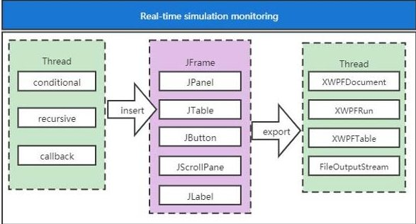

Fig. 14. Customized real-time simulation monitoring process and principle

## B. Real-time simulation monitoring verification

In order to verify the effectiveness of the above real-time simulation monitoring function, the power supply subsystem simulation case in the paper is used as an experiment.And make the following custom constraints:When the simulation passes through a control flow,If the components at both ends of the control flow are "Call Behavior Action",And both are connected by their "pin",Record relevant information when the condition is met(First Action Name,Behavior Name,Pin Name,Pin Type,Second Action Name,Behavior Name,Pin Name,Pin Type).

After the Listen plug-in is launched,The information that meets the customized conditions can be recorded in a new window in real-time,As shown in Figure 15,The plug-in successfully records the execution sequence and content of the activity diagram("Charge" action to "SaveElectricity" action, "SaveElectricity" action to "Discharge" action, "Discharge" action to "UseElectricity" action,and data transmission content, pinType and other information).The operator can export the recorded data in the form of a word document to the local through the "export" button.The experiment verified the feasibility of real-time simulation monitoring function,when the system is very large and the simulation model is very complex, it can effectively help designers to trace the simulation process, reduce working time and labor, and improve the efficiency of model simulation to a certain extent.

<!-- PDF_PAGE: 6 -->

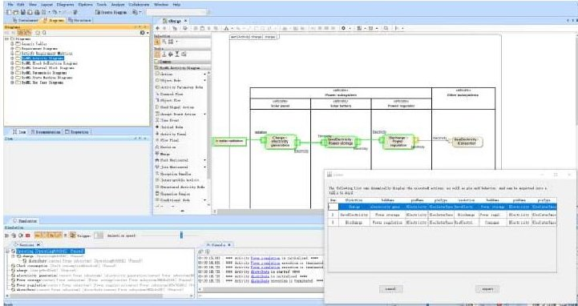

Based on the MBSE idea, this paper improves the Magic Grid methodology in order to fit the satellite system, takes the power subsystem in the satellite system as the research object, and completes the system modeling from the perspectives of demand analysis, use case design, state design, function design, information flow design, etc. The reliability of the model is verified by system simulation, and it is verified that the method fits well with the complex system of satellites, and the preliminary exploration of the satellite system development process based on this method is completed, which is a further exploration and application in the field of satellite system design based on MBSE. Provides a valuable reference.

## VI. CONCLUSION

Fig. 15. Real-time simulation monitoring

Based on the model simulation, this paper studies the real-time monitoring technology of the simulation process successfully records the simulation process that conforms to the customized rules, realizes the traceability of the simulation process, reduces the number of model simulations, saves labor and time, and to a certain extent, it improves the efficiency of model simulation.

MBSE is still in the stage of study, research and exploration in the aerospace field. In the future study and research, on the basis of the existing one, it is planned to continue to look for a methodology and method that is more in line with spacecraft modeling, so as to provide the basis for model-based spacecraft modeling. Design provides method support. The second is to continue research and development under the technology of tracking simulation, realize the multi-faceted record of model simulation, and provide advanced technical means for spacecraft model simulation.

## REFERENCES

[1] Henderson Kaitlin and Salado Alejandro. Value and benefits of model-based systems engineering (MBSE): Evidence from the literature[J]. Systems Engineering, 2020, 24(1): 51-66.

[2] Liu Yusheng.MBSE: The enabling technology for the innovative design of intelligent manufacturing in China[J].Science & Technology

Review,2017,35(22):58-64.

[3] Akundi Aditya and Lopez Viviana. A Review on Application of Model Based Systems Engineering to Manufacturing and Production Engineering Systems[J]. Procedia Computer Science, 2021, 185: 101-108.

[4] Konstantin Kernschmidt and Stefan Feldmann and Birgit Vogel-Heuser. A model-based framework for increasing the interdisciplinary design of mechatronic production systems[J]. Journal of Engineering Design, 2018, 29(11):617-643.

[5] Fan Songtao,HAO Haisheng.Research on spacecraft digital twin system technology based on model operating system[J].Information and Communications Technology and Policy,2021,47(09):8-15.

[6] Bemmami K.E. and David P.. Managing the use of simulation in systems engineering: An industrial state of practice and a prioritization method[J]. Computers in Industry, 2021, 131.

[7] Sun Yubo,Wu Zemin.The Application of Function-Logic Modeling Based On Rhapsody for The Evaporation Circulating Cooling System[J].Henan Science and Technology,2018(10):36-39.

[8] SysML in Action with Cameo Systems Modeler[M]. Elsevier Ltd, 2017.

[9] Wang Libing. The Design and Implementation of Model Validation and Automatic Layout--Based on M-Design:A Platform for Modeling of Multi-domain System engineering[D].Zhejiang University,2018.

[10] Wang Jianjun,Xiang Yongqing,Zhao Ning.Spacecraft system engineering development management platform based on lean and collaborative concept[J].Systems Engineering and Electronics, 2018,40(6):1310-1317.

[11] Xing Zhuoyi,Zhu Shunjie,Huang Xiaofeng,Sheng Ruiqing.Design on Software-defined Spacecraft System Architecture[J].Spacecraft Engineering,2021,30(05):1-8.

[12] Jiao Hongchen,Lei Yong,Zhang Hongyu,Zhang Guobin,Wang Yaodong.Research on modeling and design method of spacecraft system based on MBSE[J].Systems Engineering and Electronics, 2021,43(09):2516-2525.

[13] Chen Changyu,He Wenxing,Yi Wangmin,et al.Digital configuration management method for spacecraft assembly[J].Acta Aeronautica et Astronautica Sinica,2020(07):52-55.

[14] Wang Jianjun,LI Y,WEN M.Quality management for spacecraft system design[J].Quality and Reliability,2020(1):10-15.

[15] Zhao Qi,Guo Xiaoyan,Zhao Yuan.Exploration of digital twin application in satellite constellation system[J].Foreign Electronic Measurement Technology,2021,40(02):121-128. DOI:10.19652/j.cnki.femt.2002158.

[16] Li Wenping,Bai Hefeng,Zhao Yi,Wu Leilei,Wang Xiaoting.Modeling and Simulation of Satellite Communication System Base on MBSE[J]. Space-Integrated-Ground Information Networks, 2021,40(02):121- 128. DOI:10.19652/j.cnki.femt.2002158.

[17] Jiang Wei,Luo Jiawei,Wang Zhendong.Research on Spacecraft Modeling Application Based on MBSE[J].China Plant Engineering, 2021(17):139-143.

[18] Fu Yu,Cui Yufu,Li Zhigang,Liu Yuanmo.Study on Simulation Model of Small Satellite Power Subsystem of GalnP2/GaAS/Ge Solar Array-Li-lon Battery[J].Space Electronic Technology,2019,16(04):56-67+88.

[19] Han Fengyu,Lin Yiming,Fan Haitao.Research and Practice of Model-Based Systems Engineering in Spacecraft Development, 2014, 23(03):119-125.

[20] Anonymous. CAESAR Plug-in for MagicDraw[J]. NASA Tech Briefs, 2020, 44(2):52-52.

[21] Anonymous. Scenario Power Load Analysis Tool (SPLAT) MagicDraw Plug-in[J]. NASA Tech Briefs, 2016, 40(4):52.