<!-- PDF_PAGE: 1 -->

# EROSS: In-Orbit Demonstration of European Robotic Orbital Support Services

Máximo A. Roa, Alexander Beyer, Ismael Rodríguez, Martin Stelzer, Marco de Stefano, Jean-Pascal Lutze, Hrishik Mishra, Ferdinand Elhardt, Gerhard Grunwald German Aerospace Center (DLR) Wessling, Germany maximo.roa@dlr.de

Vincent Dubanchet, Hervé Renault,

Fabienne Niemeijer, Cédric Jacopini,

Paul Atinsounon,

Stéphanie Behar-Lafenetre

Thales Alenia Space France

Cannes, France

stephanie.behar@thalesaleniaspace.com

Juan A. Béjar-Romero, Sebastián Torralbo-Dezainde, Mercedes Alonso-Alonso GMV Madrid, Spain

Andrea Merlo, Marco Lapolla Thales Alenia Space Italy Torino, Italy

Andrzej Jakubiec, Lukasz Kozlowski,

Arkadiusz Lukasiak

PIAP Space

Warsaw, Poland

Abstract—This paper describes the results achieved within phases A and B1 of the project EROSS: European Robotic Orbital Support Services, an in-orbit demonstration mission aiming to show in orbit the capture, refueling and upgrade of a client satellite. An overall mission concept is provided, followed by the description of the technological blocks and the experiments showcasing the technology used in the mission.

Kristoffer N. Gregertsen SINTEF Digital Trondheim, Norway

## TABLE OF CONTENTS

1. INTRODUCTION ... 1

2. OVERALL MISSION CONCEPT ... 2

3. TECHNOLOGICAL BLOCKS ... 4

4. EXPERIMENTAL TESTBEDS ... 5

5. CONCLUSION ... 7

ACKNOWLEDGEMENTS ... 8

REFERENCES ... 8

BIOGRAPHY ... 9

## 1. INTRODUCTION

Novel technologies and new actors, especially from the private sector, have enabled simpler and more affordable access to space. However, the subsequent increased facility to reach different orbits also highlights the need of a more sustainable vision for the use of space. It is not possible anymore to design and launch disposable spacecrafts without considering the consequences, and On-Orbit Servicing (OOS) is a first step towards a change of paradigm. Activities such as refueling, repairing, and upgrading will become increasingly important for stakeholders involved in the rational use of satellite infrastructures. Commercial satellite

customers are growingly demanding life extension missions which creates a suitable framework for supporting the development of the required technologies with a commercial vision in mind. Moreover, the end-of-life management of space assets is fundamental both from an orbital management perspective and for sustainability aspects, soon to be enforced by law.

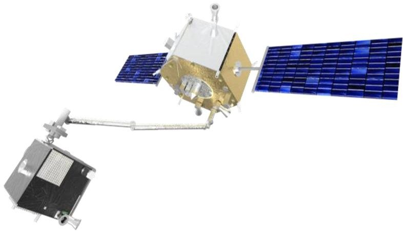

Figure 1. OOS mission using a servicer, endowed with a robotic arm, to capture a prepared client.

Designing a European mission to enable a go-to-market for future OOS missions is the main goal for the EROSS project (European Robotic Orbital Support Services). The project leverages on key robotic technologies developed in the past years thanks to the European Commission H2020 Strategic Research Cluster (SRC), the European Space Agency, and national agencies initiatives. The project EROSS $ ^{+1} $ , which took place from 2021 until 2023 under the lead of Thales Alenia Space France, included phases A and B1 of the future on-orbit servicing demonstration mission that addresses the

<!-- PDF_PAGE: 2 -->

most relevant market needs, while validating previous developments of the SRC through the so-called OGs (Operational Grants) $ ^{2} $ . This project gathers key players to shape the future space ecosystems and foster European competitiveness into this global shifting paradigm that space economy is facing. EROSS+ brings in a concept of a demonstration mission that will cover the full rendezvous phase of a collaborative and prepared client satellite including capture and servicing operations (refueling, payload exchange, repair). The validation of capabilities to perform future on-orbit operations was carried out through three demonstrators, one for visual navigation, led by GMV, another one for validation of the control approach for platform and robot arm, and another one for robotic capture, the latter ones led by DLR. The first demonstrator showcases the coordinated close rendezvous between two free-flying spacecraft comparable in mass and inertia, using a simulation testbed based on robots mounted on linear guides. The control demonstration uses an experimental facility to test and validate control approaches for coordinated and free-floating control of the platform and robot arm. The robotic capture demonstrator uses the CAESAR robotic arm to implement autonomous grasping and manipulation tasks required in the mission. The demonstrators successfully validated the basic technologies required for EROSS, including sensors, actuators, robotic implementations, and software frameworks and algorithms.

Now, the mission continues in Phases B2/C thanks to the EROSS IOD project $ ^{3} $ , currently under development. The final aim is to prepare and carry out the last maturation and manufacturing steps after years of R&D to fly a European pioneering mission by 2026 with a customer-driven approach. This paper presents the general concept of the demonstration mission, with identification of key technologies required for the targeted market, and shows the validation of building blocks for the mission through the demonstration testbeds.

## 2. OVERALL MISSION CONCEPT

The overall mission of EROSS is to design and prepare a high-impact, low-cost in-orbit mission to demonstrate the capability of European industry to propose sustainable, highly automated, flexible and economically viable space infrastructures. The whole idea is to validate the capability of carrying out on-orbit operations of this type for future missions, with the following objectives:

- Technology maturation: Support the maturation of rendezvous and autonomous robotic technologies for space application, leveraging on previous building blocks developed in prior H2020 and other European projects.

- ORU accommodation: Allow late integration of an ORU, as a demonstration of the modularity for next generation of space assets.

- Commercial exploitation: Explore the emerging OOS (Inspection/surveillance, Life extension, Change of Orbit, End-of-life removal/Deorbiting) and longer term markets (Refuelling, Upgrade, Assembly) to prepare a viable European commercial solution in a sustainable context.

- Shift to a New Space ecosystem: Support and enable the shift of paradigm and pave the way towards On-Orbit Manufacturing, Repair, Recycling and Re-use, shifting from conventional to adaptive and intelligent solutions for space.

The demonstration mission concept includes the complete orbital rendezvous phase of a Servicer satellite with a collaborative Client satellite prepared for On-Orbit Servicing that shall be followed by the capture and then servicing operations. A servicer and a dummy client are produced. The servicer is endowed with a robotic arm, used for capturing and servicing the dummy client. The overall mass of the mission is below 700kg. The dummy client and the servicer will be launched together on a LEO orbit with an altitude lower than 600 km. After launcher separation, dummy client and servicer are separated and are operated independently.

After rendezvous operations using the Narrow Angle Camera (NAC), the capture of the dummy client is initiated. Information coming from the Wide-Angle Camera (WAC) is used to perform the navigation at close distances. Then, two cases of capture are considered:

- Capture of an unprepared client (Figure 2): the capture is performed via the Launch Adapter Ring (LAR) using a gripper installed at the end of the robotic arm. The final approach and capture are performed under visual servoing control, using information from the cameras mounted on the robotic arm. After capture, a standard interconnect located at the bottom of the gripper tool is latched to the servicer in order to allow a stiffer connection between servicer and client. The robotic arm is then disconnected from the gripper tool, and can be used for other servicing tasks on the client, e.g. inspection. The unmating sequence basically follows the reverse order of steps.

- Capture of a prepared client (Figure 3): in this case, the client is endowed with a dedicated grasping interface (handle) compatible with the LAR gripper. Visual markers around the handle are used to guide the capture process. After the capture, the arm is used to berth the client on a fluid transfer interface. The robotic arm releases the gripper tool on its storage position, and the arm is then used to transfer an ORU from the servicer to the client. After completing these operations, the client is released.

After completing the mission, the dummy client will be deorbited using the servicer propulsion.

<!-- PDF_PAGE: 3 -->

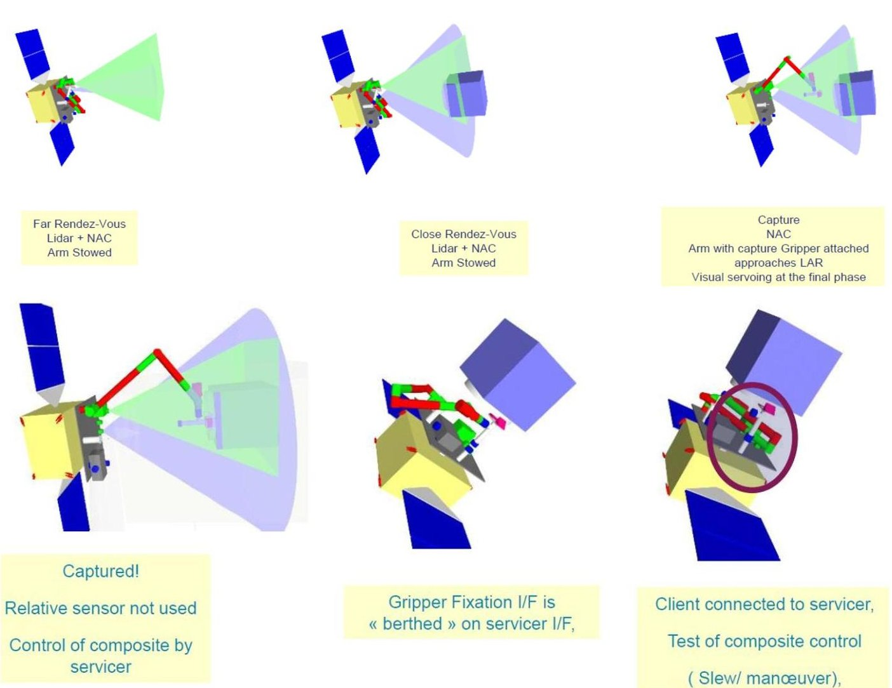

Figure 2. Sequence for capture and operations on an unprepared client.

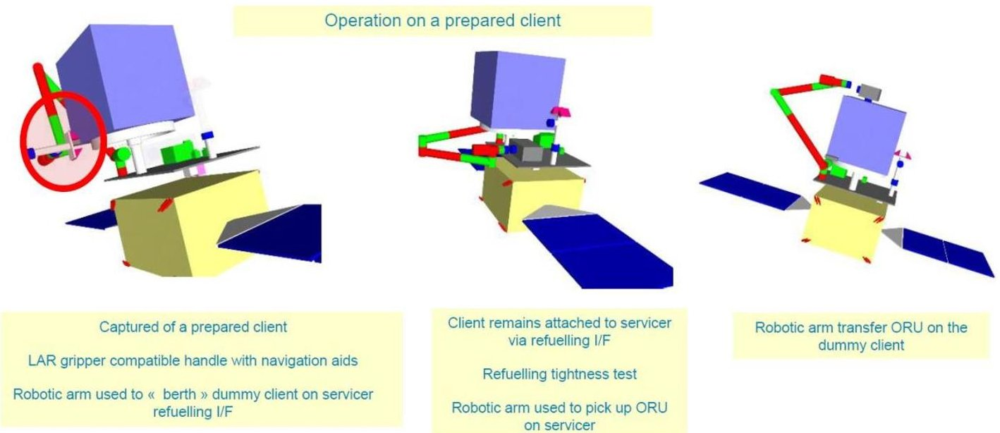

Figure 3. Sequence for capture and operations on a prepared client.

<!-- PDF_PAGE: 4 -->

## 3. TECHNOLOGICAL BLOCKS

Different blocks compose the HW/SW tree of the servicer module (Figure 4), as presented in Figure 5.

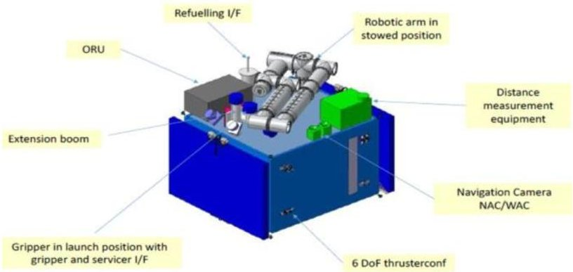

Figure 4. Components on the servicer satellite.

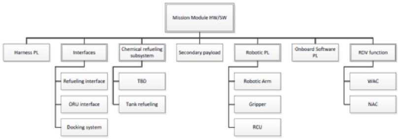

Figure 5. Product tree for the servicer satellite.

## Robotic arm

The robotic arm is the CAESAR (Compliant Assistance and Exploration SpAce Robot) arm, developed by DLR [1]. The arm has an overall length of 2.5m and 7 degrees of freedom (DoF), which endows it with large dexterity and kinematic redundancy. Each joint counts with torque sensors, so it can be controlled in position and torque modes. The overall robotic arm consists of the impedance controlled articulated arm with integrated electronics, a power conditioning unit, and a robot control unit. Fast control loops in the joints and the high-speed real-time and deterministic communication bus EtherCAT, connecting the joints and the Robot Control Unit (RCU), ensure smooth and accurate motion and force control during operation. All the required cabling for power and communication is routed inside the hollow shafts of the arm. The robotic arm is endowed with a standard interconnect (SI) at its tip. The SI is used as an end effector to manipulate for instance and ORU, or as a tool exchanger, to retrieve the LAR gripper in order to capture the client satellite. For this mission, the selected SI is HOTDOCK [2], developed by Space Application Services. The SI provides mechanical, electrical and data connectivity. An active SI is installed at the end of the arm, and a passive SI is required on the objects to be manipulated, e.g. gripper tool and ORU.

## LAR Gripper

The LAR gripper (LARIS) is a robotic end-effector designed for the tasks of capturing the LAR and the dedicated Standard Grasping Fixture (SGF) on the unprepared and prepared client, respectively (Figure 6). The gripper, developed by

PIAPS, is designed as a two-jaw mechanism that provides a soft capture (the client is within the grasping envelope, which prevents it from escaping the capture) and a hard capture (the client is rigidly grasped by the gripper) [3]. These states are verified with suitable sensors. The gripper is compatible with different LAR types, has a large grasping envelope (up to $ \pm 2 0 \mathrm{m m} $ and $ \pm 5 $ deg simultaneously applied), and a low mass (below 6 kg). The gripper is mounted on a gripper tool, which contains a HOTDOCK passive interface, for manipulation of the gripper with the robotic arm, and an additional interface for connection to the client in the storage configuration. This additional SI is a SIROM interface [4], developed by SENER.

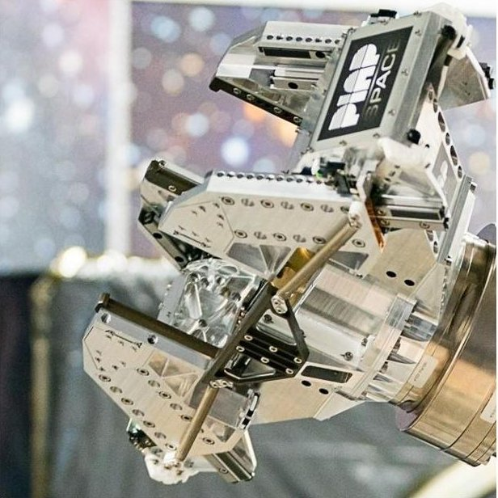

Figure 6. LARIS gripper.

Relative Navigation and Visual Servoing

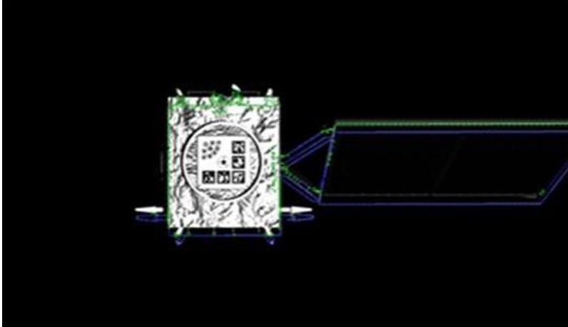

Figure 7. Model-based client tracking for rendezvous.

A key element of the Demonstration Payload is the VisualBased Navigation (VBN) applied both to the approach trajectory towards the Client spacecraft using Narrow and Wide-Angle cameras, and to the robotic operations using the Robotic Arm Camera (RAC) with a "hand-eye" configuration. These cameras provide the Platform and the Robotic Arm with a direct pose estimation of their target object pose, either the Client platform, Launch Adaptor Ring, or Standard grasping interface. Based on an image or a sequence of images, advanced image processing and tracking algorithms can provide accurate capability to obtain relevant pose information, which includes line-of-sight and range at

<!-- PDF_PAGE: 5 -->

long-range distances, and full 6 DoF relative pose at medium and close distances. The knowledge of the client is used to provide the navigation solutions, and a model-based approach is used to estimate the required poses (Figure 7). For the prepared client case, a visual marker is used to provide the relative pose of the client with respect to the robotic arm.

## Refueling interfaces

Refueling is considered as one of the key services to be fulfilled in orbit to extend the life duration of the Client spacecraft. To this end, a specific interface is required on the Servicer side. Two candidates have been identified so far (Figure 8), and the final selection depends on the evolution of these interfaces. The current candidates are ASSIST [5], developed by GMV under an ESA contract, and refueling SIROM [6], currently under development by SENER.

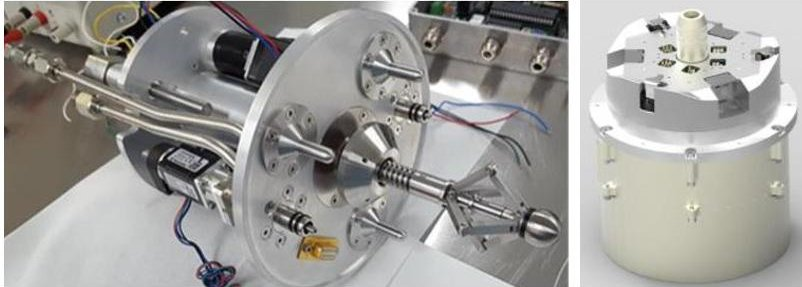

Figure 8. Refueling interfaces. Left: ASSIST. Right: SIROM.

## Software

Beyond the standard software required for navigation of a satellite, EROSS requires additional software packages to handle the robotic operations. These include:

- Robotic control and skill engine: the low-level control of the robot joints and attached components (SI, gripper) is achieved through an EtherCAT master. A suitable control approach that provides position and impedance control for each joint, as well as overall cartesian control for the robotic end effector, guarantees the different control modes required for the robotic operations. The atomic actions performed by the robotic arm are called skills, and a skill engine provides and chooses the action templates required for each individual operation.

- Robotic and service management: the overall supervision of the robotic operations is provided by a component based on ERGO (European Robotic Goal-Oriented Autonomous Controller), developed by GMV [7] as one of the original OGs sponsored by the SRC. ERGO allows different levels of autonomy for the robotic operations. The ESROCOS/TASTE framework [8] may be used as middleware for communication among functions belonging to ERGO.

- Robotic path planning: the path planner component provides the required trajectory for the coordinated control of servicer and arm. It is based on a kinodynamic planner [9], and works as a ground component that provides the required paths. Those paths are subsequently uploaded to the servicer for its execution.

## 4. EXPERIMENTAL TESTBEDS

The validation on ground of the technologies required for the EROSS mission has been performed on three different setups, validating the following aspects:

1. Rendezvous

2. Control of the platform and robotic arm

3. Robotic capture

## Rendezvous experiment

The rendezvous experiment involved different technologies, including Guidance and Navigation Control (GNC) and the acquisition and processing of imaging data using the rendezvous image processing software developed by GMV. An on-board computer (OBC) runs the main GNC software involved in the rendezvous operation. The software (SW) used in this experiment includes only the rendezvous image processing and the robotic & servicing management running on the Spacecraft Control Unit (SCU), communicating with the SW running on the OBC.

The main integration points for the experiments were: porting and running the rendezvous image processing developed by GMV on a target SCU platform, transporting images and control of cameras from the Robot Control Unit (RCU) to the rendezvous image processing on the SCU, and communication between the OBSW (On Board Software) and the rendezvous image processing. The Electrical Ground Support Equipment (EGSE) contains the simulation environment that communicates and controls the GMV platform robotic lab setup.

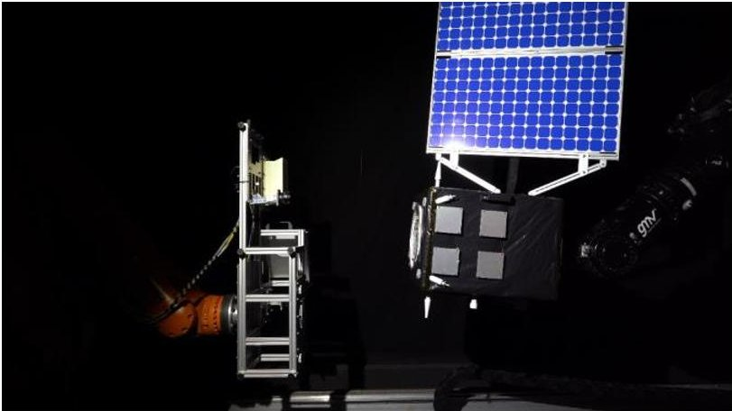

Figure 9. Experimental rendezvous testbed at GMV.

Rendezvous tests were successfully conducted on a specially prepared bench platform, GMV platform-art $ \textcircled{c} $ , equipped with two robotic arms to simulate the rendezvous operations (Figure 9). This robotic setup consists of two industrial robots carrying 1/3-scale mockups of the Servicer and Client spacecraft. The Servicer mockup is kept fixed on the fixed robotic arm, and the Client mockup is attached to the moving robotic arm. This second arm is then commanded to move the Client from the point of view of the Servicer and its cameras. This movement is then captured by the WAC mounted on the Servicer mockup to replicate the final approach of the rendezvous operations.

<!-- PDF_PAGE: 6 -->

The following test scenarios were exercised:

- Initial fly-around from a position along V-bar to R-bar, station keeping in the R-bar hold point and final approach along R-bar with different illumination conditions, i.e. sun elevation angles.

- Force motion along V-bar axis from first hold point to second hold point, station keeping at second hold point, and final approach along V-bar with a representative illumination condition.

- Fly-around inspection of the Client spacecraft starting from a hold point in V-bar.

The tests enabled to validate the Image Processing SW with experimental images using ground truth and Navigation inputs data. It is also important to remark the acquisition of test data, i.e. images and GNC data, performed during this campaign that allow the characterization of the most relevant operations of the rendezvous scenario.

Control of platform and robotic arm

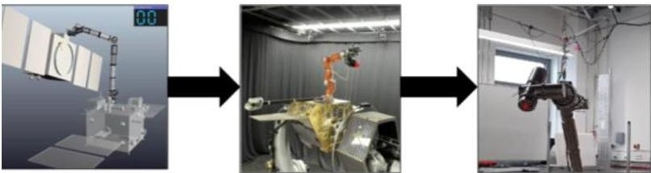

Figure 10. Prototyping in Co-simulation (left), Hardware-in-the-loop Validation on OOS-Sim (Center), and Integration and Verification on the CAESAR robot testbed (right).

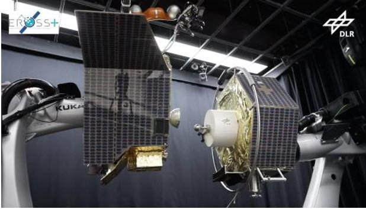

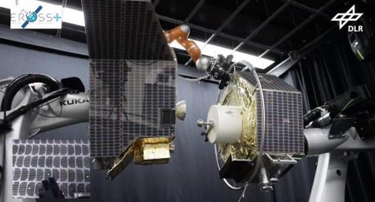

Figure 11. OOS-Sim facility, showing the capture of a client satellite.

The process for validating the controller follows a step-wise approach, as shown in Figure 10. The first step is based on a Co-simulation environment, which contains all the elements of the mission scenario with the corresponding dynamics parameters of the chaser and client satellite, as well as for the CAESAR arm. The second level of validation exploits a

Hardware-in-the-loop facility, namely the OOS-Sim [10]. Within the OOS-Sim, two KUKA industrial robots commanded in admittance mode replicate the dynamics of the two spacecraft, namely the servicer (left) and the client (right), as shown in Figure 11. The facility can replicate zero-g conditions on-ground, and it is used as a platform to validate control algorithms. Note that the servicer is equipped with a DLR-KUKA lightweight manipulator arm, which performs the capture task. This lightweight robot arm has position and torque interface and therefore can be exploited to test the impedance control before the final verification on the CAESAR arm.

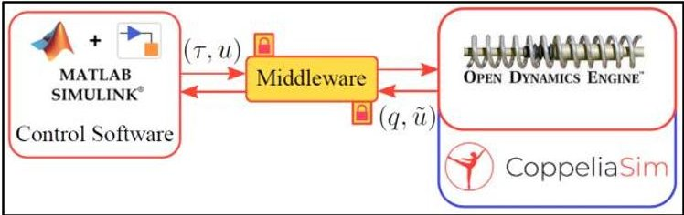

Figure 12. Co-Simulation framework for control prototyping.

For control prototyping, the control software was developed in MATLAB/Simulink and the developed Co-simulation considers the dynamics (including mass and inertial parameters) of the EROSS client and servicer satellite (as well as the robotic arm) simulated by an external dynamic engine (Open Dynamics Engine (ODE) in CoppeliaSim). Figure 12 summarizes the developed framework where the external dynamic engine provides feedback with respect to the state of the plant and the controller possesses recursive kinematics and dynamics computation. Furthermore, the designed Co-simulation offers the possibility to control the joints directly at 1KHz, the control frequency of the CAESAR arm. The control parameters are the same as the parameters to be used in the real mission.

This framework was used to evaluate the controller, and an example of maneuver performed with the Co-simulation for the EROSS+ project is shown in Figure 13. The client satellite has a residual velocity of 1 deg/s and the CAESAR arm starts its approach. The errors resulting from the cosimulation are less than 5mm and $ 0. 5^{\circ} $ for the end-effector and less than 5mm and $ 0. 0 2^{\circ} $ for the platform, as shown in Figure 14. In compliance with the mission requirements, the sampling rates of sensors/actuators at the platform as well as the visual input were set at 10 Hz.

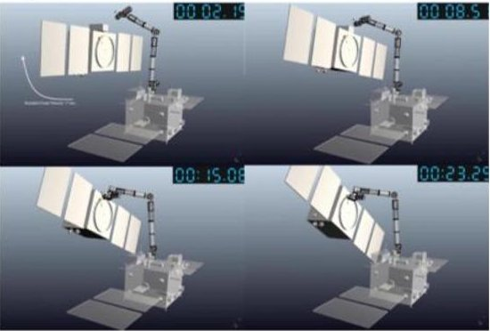

Figure 13. Snapshot of the Co-simulation during the approach phase.

<!-- PDF_PAGE: 7 -->

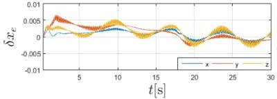

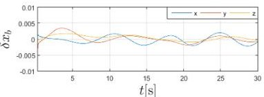

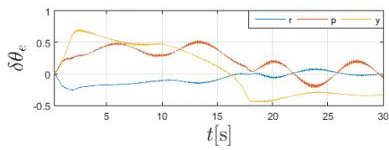

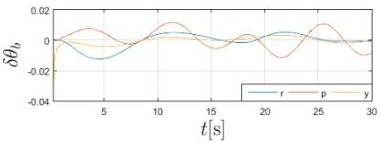

Figure 14. Co-simulation results: End-effector error in position and orientation (left), Platform errors in position and orientation (right).

Robotic capture experiment

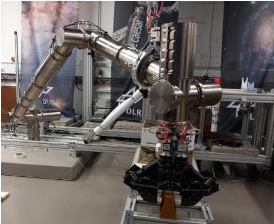

Figure 15. Experimental robotic testbed at DLR.

The robotic capture experiment is more complex and involves more components and technologies than the rendezvous experiment. Its objective is to test the hardware integration by functional and performance analysis of the relevant components. A continuous integration approach allows a step-by-step replacement of COTS components with flight hardware. The experiment includes the CAESAR robotic arm with a HOTDOCK interface mounted at its end effector, two cameras mounted at the end of the robotic arm and interfaced to the RCU, and the LAR gripper that can be retrieved by the robotic arm (Figure 15). The robotic control software runs on a relevant SCU. The robot is non-gravity bearing and thus needs to be supported by a cable-driven system, called Motion Suspension System (MSS), which provides the required gravity compensation to perform the intended robotic operations [11]. An optimal gravity compensation strategy is proposed in [12] to minimize the joint torques acting on the robot arm; the resulting suspension force is provided by the MSS. For simulating the client, a satellite mockup is mounted on a linear guide, which can move with a velocity up to 10 mm/s, thus mimicking a residual motion during the capture phase. The mockup can also be manually oriented along two directions, thus changing the approach angle of robot arm to client. This allows to ensure arbitrary starting conditions within the available range. However, the representativeness of the client mockup according to the floating dynamics of a satellite in orbit is limited, and floating-base control approaches are tested in the OOS-Sim facility.

Several tests were performed with focus on functionality and performance of individual components, including:

- Robotic arm performance: reachability, motion to and from different configurations (including stowage), accuracy of the robotic arm (without vision), applicable forces.

- Functional integration tests: communication, power transfer and monitoring of LAR gripper; communication, power and monitoring of HOTDOCK.

- Performance of visual servoing capability: calibration of visual sensors, detection of Apriltags, detection of LAR.

- Robot interaction with the MSS.

During the full robotic capture experiments, three different operations were performed: capture of the unprepared client, capture of the prepared client, and transfer of the ORU from the storage to the final position (Figure 16). All of the procedures were successfully performed and proved the working interaction between the hardware and software components. At this stage, the results are qualitatively evaluated. Failures on the robotic capture of the unprepared client were recognized and used to improve the behavior of the LAR detection in order to properly trigger the soft capture process. Within EROSS+ only the capture operations were verified, detumbling [13] and refueling operations will be verified at a later stage in the development process.

## 5. CONCLUSION

The objective of EROSS (European Robotic Orbital Support Services) is to build a European solution for the Servicers and the future serviced LEO/GEO satellites, leveraging on key robotic technologies developed in the past years thanks to the European Commission H2020 Strategic Research Cluster (SRC), the European Space Agency and national agencies initiatives. This project gathers all the key players who will shape the future space ecosystems and foster European competitiveness into this global shifting paradigm that space economy is facing. EROSS brings in a concept of a demonstration mission that will cover the full rendezvous phase of a collaborative and prepared client satellite including the capture, the servicing operations (refueling, payload exchange, repair) and also in-orbit assembly. This will support the validation of capabilities to perform future on orbit operations.

Within phases 0 to B1, different demonstration experiments have covered the following validation objectives:

- Generation of the required datasets for validating the perception pipelines during rendezvous and capture.

- Model-in-the-Loop validation of all rendezvous phases.

- Experimental validation, i.e. Software & Hardware in the Loop, of the main short-range rendezvous phases with a Software-in-the-Loop (SIL) close-range scheme to characterize the behavior of the navigation and visual perception components.

- Hardware-in-the-Loop (HIL) Validation of coordinated and free-floating control schemes for control of base and robot arm in the servicer.

<!-- PDF_PAGE: 8 -->

- SIL/HIL validation of the capture process in the robotic testbench with real-time demonstration;

The experimental implementation allowed the verification of evolution in TRL of the technological blocks required for the mission. Now, the mission moves forward in phases B2/C through the EROSS IOD project, which continues the evolution and validation of the building blocks, and prepares the mission toward the implementation phase and potential launch in 2026.

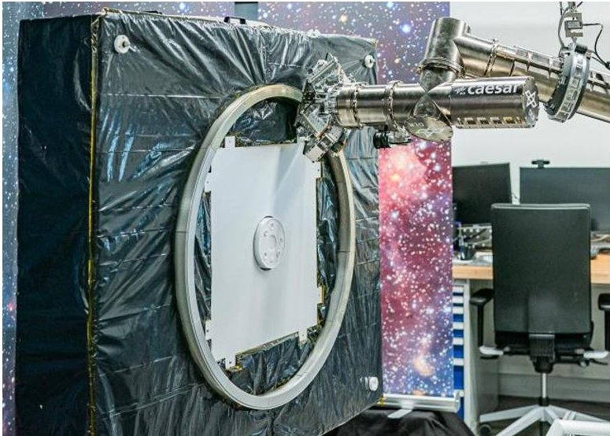

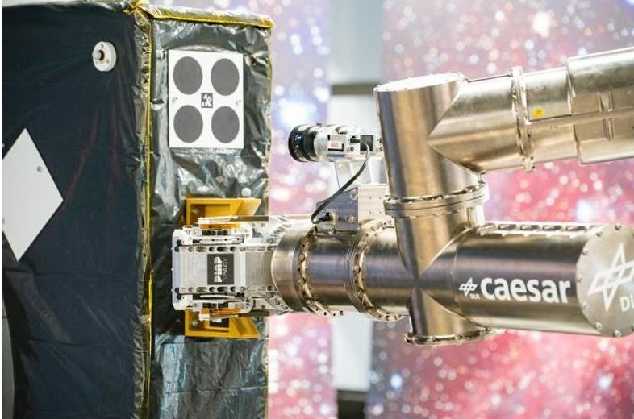

## ACKNOWLEDGEMENTS

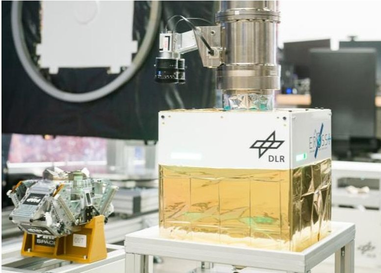

Figure 16. Snapshots of robotic experiments: capture of an unprepared client at the LAR (above), capture of a prepared client using the SGF (middle), and installation of an ORU (bottom).

This project has received funding from the European Union's H2020 research and innovation programme under grant agreement No 101004346, project EROSS+. and grant agreement No. 101082464, project EROSS IOD.

## REFERENCES

[1] A. Beyer, G. Grunwald, M. Heumos, M. Schedl, R. Bayer, W. Bertleff, B. Brunner, R. Burger, J. Butterfass, R. Gruber, T. Gumpert, F. Hacker, E. Kraemer, M. Maier, S. Moser, J. Reill, M. Roa, H. Sedlmayr, N. Seitz, M. Stelzer, A. Stemmer, G. Tubio, T. Wimmer, M. Grebenstein, C. Ott, A. Albu-Schäffer, "CAESAR: Space Robotics Technology for Assembly, Maintenance, and Repair," in Proc. 69th Int. Astronautical Congress - IAC, 2018.

[2] P. Letier, T. Siedel, M. Deremetz, E. Pavlovskis, B. Lietaer, K. Nottensteiner, M.A. Roa, J. Sanchez, J. Corella, J. Gancet, "HOTDOCK: Design and Validation of a New Generation of Standard Robotic Interface for On-Orbit Servicing," in Proc. 71st Int. Astronautical Congress - IAC, 2020.

[3] L. Kozłowski, A. Łukasiak, P. Janusiak, M. Pawłowski, A. Lyczek, K. Cichorek, "Design and development of a robotic gripper for capturing prepared and unprepared satellites," in Proc. 20th European Space Mechanisms and Tribology Symp., 2023.

[4] M. Díaz-Carrasco, G. Guerra, G. Gala and J. Viñals, "Standard Interface for Robotic Manipulation (SIROM): Current state and future development for one of the main building blocks for space robotics advancement," in Proc. 72nd Int. Astronautical Congress - IAC, 2021.

[5] A. Medina, A. Tomassini, M. Suatoni, M. Avilés, N. Solway, I. Coxhill, I. Paraskevas, G. Rekleitis, E. Papadopoulos, R. Krenn, A. Brito, B. Sabbatinelli, B. Wollenhaupt, C. Vidal, S. Aziz and G. Visentin, "Towards a standardized grasping and refuelling on-orbit servicing for geo spacecraft," Acta Astronautica, vol. 134, pp. 1-10, 2017.

[6] G. Guerra, J. Viinals, I. Soto, M. Diaz-Carrasco, J. Gala, "Development of a robotic Fluid Transfer interface based on RIDER connector," in Proc. Symp. on Advanced Space Technologies in Robotics and Automation - ASTRA, 2022.

[7] J. Ocón, J. Delfa, A. Medina, D. Lachat, R. Marc, M. Woods, I. Wallace, A. I. Coles, A. J. Coles, D. Long, T. Keller, M. Helmert, S. Bensalem, "ERGO: A Framework for the Development of Autonomous Robots," in Proc. Symp. on Advanced Space Technologies in Robotics and Automation - ASTRA, 2017.

[8] M. Muñoz, M. Wirkus, K. Hoeflinger, N. Tsiogkas, S. Bensalem, O. Rantanen, D. Silveira, J. Hugues, M. Shilton, H. Bruyninckx, "ESROCOS: development and validation of a space robotics framework," in Proc. Symp. on Advanced Space Technologies in Robotics and Automation ASTRA, 2019.

<!-- PDF_PAGE: 9 -->

[9] S. Stoneman, R. Lampariello, "Embedding nonlinear optimization in RRT* for optimal kinodynamic planning," Proc. IEEE Conf. on Decision and Control - CDC, 2014, pp. 3737-3744.

[10] J. Artigas, M. De Stefano, W. Rackl, R. Lampariello, B. Brunner, W. Bertleff, R. Burger, O. Porges, A. Giordano, C. Borst, A. Albu-Schäffer, "The OOS-SIM: An on-ground simulation facility for on-orbit servicing robotic operations," in Proc. Int. Conf. Robotics and Automation ICRA, pp. 2854-2860, 2015.

[11] F. Elhardt, R. Boumann, M. De Stefano, R. Heidel, P. Lemmen, M. Heumos, C. Jeziorek, M.A. Roa, M. Schedl, T. Bruckmann, "The Motion Suspension System - MSS: A Cable-Driven System for On-Ground Tests of Space Robots," in Proc. IFToMM (Int. Federation for the Promotion of Mechanism and Machine Science) World Congress, 2023.

[12] M. De Stefano, R. Vijayan, A. Stemmer, F. Elhardt and C. Ott, "A Gravity Compensation Strategy for On-ground Validation of Orbital Manipulators," in Proc. IEEE Int. Conf. on Robotics and Automation - ICRA, 2023, pp. 11859-11865.

[13] R. Vijayan, M. De Stefano and C. Ott, "A Detumbling Strategy for an Orbital Manipulator in the Post-Grasp Phase," in Proc. IEEE Int. Conf. on Robotics and Automation - ICRA, 2022, pp. 4080-4086.

## BIOGRAPHY

Maximo A. Roa is a Senior Scientific Researcher and Group Leader of "Robotic Planning and Manipulation" at the Institute of Robotics and Mechatronics, German Aerospace Center (DLR).

Alexander Beyer is the Lead Engineer of the CAESAR arm at the Institute of Robotics and Mechatronics, German Aerospace Center (DLR).

Ismael Rodriguez is a Scientific Researcher at the Institute of Robotics and Mechatronics, German Aerospace Center (DLR).

Martin Stelzer is a Scientific Researcher at the Institute of Robotics and Mechatronics, German Aerospace Center (DLR).

Marco de Stefano is a Senior Scientific Researcher and Group Leader of "Flying and Floating-base robots control" at the Institute of Robotics and Mechatronics, German Aerospace Center (DLR).

Jean-Pascal Lutze is a Scientific Researcher at the Institute of Robotics and Mechatronics, German Aerospace Center (DLR).

Hrishik Mishra is a Scientific Researcher at the Institute of Robotics and Mechatronics, German Aerospace Center (DLR).

Ferdinand Elhardt is a Scientific Researcher at the Institute of Robotics and Mechatronics, German Aerospace Center (DLR).

Gerhard Grunwald heads the "Orbital Robotics" Domain at the Institute of Robotics and Mechatronics, German Aerospace Center (DLR).

Vincent Dubanchet is a GNC specialist at Thales Alenia Space France.

Hervé Renault is a mission specialist at Thales Alenia Space France.

Fabienne Niemeijer is a mission specialist at Thales Alenia Space France.

Cedric Jacopini is a mission engineer at Thales Alenia Space France.

Paul Atinsounon is a mission engineer at Thales Alenia Space France.

Stéphanie Behar-Lafenetre is a Project Manager at Thales Alenia Space France, and main coordinator of the EROSS project.

Juan A. Béjar-Romero is a Project Manager at Flight Segment and Robotics Unit in GMV, Spain.

Sebastián Torralbo-Dezainde is a Project Engineer at Flight Segment and Robotics Unit in GMV, Spain.

Mercedes Alonso-Alonso is a Project Engineer at Flight Segment and Robotics Unit in GMV, Spain.

Andrzej Jakubiec is a project manager at PIAP Space Poland.

Lukasz Kozlowski is a Technical Leader - Mechanical Engineer at PIAP Space, Poland.

Arkadiusz Lukasiak is a Systems Engineer at PIAP Space Poland.

Andrea Merlo heads the "Optics, Robotics and AI" Group at Thales Alenia Space Italy.

Marco Lapolla is a Robotics Engineer at Thales Alenia Space Italy.

Kristoffer Nyborg Gregertsen is Senior Researcher and Research Manager of the "Reliable Automation" group at SINTEF Digital, Norway.