<!-- PDF_PAGE: 1 -->

# Results from the ASTERIA CubeSat Extended Mission Experiments

Lorraine Fesq,

Patricia Beauchamp,

Cornelia Altenbuchner,

Rob Bocchino,

Amanda Donner,

Martin Feather,

Kyle Hughes,

Brian Kennedy,

Ryan Mackey,

Faiz Mirza,

David Sternberg,

Matthew W. Smith,

Martina Troesch

Jet Propulsion Laboratory,

California Institute of Technology

4800 Oak Grove Dr.

Pasadena, CA 91109

{Lorraine.M.Fesq, Patricia.M.Beauchamp,

Cornelia.Altenbuchner, Robert.L.Bocchino,

Amanda.Neufeld, Martin.S.Feather,

Kyle.E.Hughes, Brian.M.Kennedy, Ryan.Mackey,

Faiz.Mirza, David.C.Sternberg,

Matthew.W.Smith,

Martina.I.Troesch}@jpl.nasa.gov

Sara Seager Massachusetts Institute of Technology 77 Massachusetts Ave. Cambridge, MA 02139 seager@mit.edu

Mary Knapp MIT Haystack Observatory 99 Millstone Rd. Westford, MA 01886 mknapp@mit.edu

Ksenia O. Kolcio Okean Solutions, Inc. 1211 E. Denny Way, #32A Seattle, WA 98112 ksenia@okean.solutions

Patrick Doran Pearl River Technologies, LLC NASA Goddard Space Flight Center 8800 Greenbelt Rd. Greenbelt, MD 20771 pldoran@cpp.edu

Abstract Over the past two years, JPL has used the ASTERIA (Arcsecond Space Telescope Enabling Research In Astrophysics) CubeSat as an in-flight test platform during extended missions. ASTERIA successfully completed its prime mission in early 2018, and continued to operate in low Earth orbit (LEO) for an additional twenty months. This paper describes demonstrations that were performed on the spacecraft and on the ground-based testbed during the extended mission. These demonstrations fall into three categories: Autonomy technology maturation, hardware characterization, and science discovery.

Autonomy technology maturation supported three development efforts. The first shifted the spacecraft commanding paradigm from time-based sequences to Task Networks (tasknets), which allow simpler commanding and more robust onboard execution. The second demonstrated onboard orbit determination in Low Earth Orbit (LEO) without GPS. This activity used a fully-independent means of spacecraft orbit determination for Earth orbiters using only passive imaging. The third technology provided in situ hardware health state estimation using a model-based reasoning technique. These three technologies were demonstrated either in flight or on the testbed individually, and then were combined to demonstrate the capability to perform autonomous navigation on board without ground intervention, even in the presence of anomalies.

Hardware characterization involved both onboard and ground-based activities. On board, nonstandard attitude control modes were commanded to characterize the spacecraft pointing jitter as a function of target brightness, reaction wheel speed, controller gain, and the number of guide stars. The

results provide insights into the contribution of jitter to the ASTERIA photometry and inform the feasibility of future astrophysics small satellite missions for which jitter control is an enabling technology. On the ground, the ASTERIA Operations Team coordinated with Amazon Web Services (AWS) to configure their new ground stations to communicate with ASTERIA to prove out their viability. ASTERIA used AWS ground stations for nominal operations for the last four months of the mission.

978-1-7281-7436-5/21/$31.00 ©2021 IEEE

Finally, ASTERIA continued to perform exoplanet science as the spacecraft was well-suited to execute long-term monitoring of stars such as alpha Centauri to search for small transiting planets. The science team also imaged a number of interesting objects including a comet, an asteroid, cities at night, and the moon, and coordinated with other projects on Targets of Opportunity for follow-up confirmations and co-observations. Throughout the prime and the extended missions, the ASTERIA spacecraft proved to be a mighty platform that "will go into history as an innovative milestone."[1]

## TABLE OF CONTENTS

1. INTRODUCTION ... 2

2. BACKGROUND ... 2

3. EXTENDED MISSION RESULTS ... 4

4. SUMMARY ... 7

ACKNOWLEDGEMENTS ... 7

REFERENCES ... 8

BIOGRAPHIES ... 9

<!-- PDF_PAGE: 2 -->

## 1. INTRODUCTION

The Arcsecond Space Telescope Enabling Research In Astrophysics (ASTERIA) CubeSat, shown in Figure 1, continued to operate for over 20 months beyond its prime mission. During this time, the spacecraft was used as a test platform to upload and mature autonomy technologies, characterized hardware performance, proved the viability of new ground stations, all while continuing to perform exoplanet science [2]. Specifically, the extended mission achieved the following.

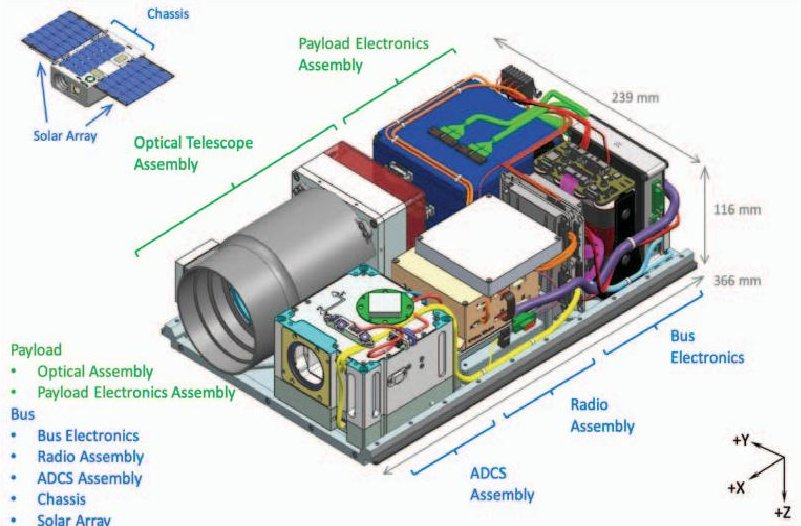

Figure 1. A break-out of the ASTERIA spacecraft Design. ASTERIA was a CubeSat - a small satellite made up of units (U) that are each 10 centimeters cubed, or about 4 inches on each side. Consisting of 6 CubeSat units, ASTERIA was about the size of a briefcase.

## Autonomy Technology Maturation

Three complementary autonomy technologies were developed and demonstrated either on board the spacecraft or on the ground-based testbed. These three technologies were as follows. First, a new commanding paradigm was introduced that allows simpler commanding and more robust execution. This involves using an on-board planner/scheduler and executive that operate on task networks (tasknets) that tell the spacecraft what to do (i.e., tasks), vs how and when to execute commands (as performed with traditional time-based sequences). Second, new software was uploaded to demonstrate onboard orbit determination in Low Earth Orbit (LEO) without GPS. This activity demonstrated a fully independent means of spacecraft orbit determination using only passive imaging. Third, a physics-based modeling approach was used to detect and identify hardware malfunctions on the ASTERIA testbed. Onboard system health estimation is fundamental for advancing onboard autonomy. These three technologies, when combined, transformed what is typically a ground-intensive housekeeping task to maintain orbit knowledge, into a fully autonomous activity that determines when orbit knowledge will fall below a specified threshold, plans and executes navigation observations and calculations, and replans in the presence of anomalies [3].

## Characterize hardware performance

The ASTERIA Extended Mission team performed two hardware characterization activities, one on board and one on the ground. On board, the spacecraft was commanded to perform observations under different operating conditions. Data was collected to characterize the spacecraft pointing jitter as a function of target brightness and reaction wheel speed. These data will yield additional insights into the contribution of jitter to the ASTERIA photometry and inform the feasibility of other astrophysics small satellite missions for which jitter control is an enabling technology. On the ground, the ASTERIA Operations Team coordinated with Amazon Web Services (AWS) to configure new ground stations to communicate with spacecraft. ASTERIA used two AWS ground stations for nominal operations for the last four months of the mission.

## Science Discovery, and Beyond

ASTERIA was well-suited to perform long-term photometric monitoring of stars, and observed alpha Centauri to search for small transiting planets. Additional observations also have been achieved including targeting other spacecraft and performing Earth Science imaging. The science team imaged a number of interesting objects including a comet, an asteroid, cities at night, and the moon. The science team also coordinated with other projects to observe interesting targets of opportunity.

All of these activities were interleaved with one another to exploit the use of the spacecraft over the timeframe of the extensions. In addition to maximizing the scientific potential of this operational spacecraft, these extensions provided additional context for future small satellite astrophysics missions. After the end of the mission, the Autonomy Maturation teams continued experiments using the testbed, demonstrating additional capabilities, and combining the unique offerings of each to prove the viability of performing autonomous navigation on board without ground intervention, even in the presence of faults.

## 2. BACKGROUND

ASTERIA was a 6U CubeSat space telescope that operated in low-Earth orbit from November 2017 through December 2019. Developed as a technology demonstration mission under the Jet Propulsion Laboratory (JPL) Phaeton Program for training early career engineers, ASTERIA achieved its original mission goals by demonstrating sub-arcsecond pointing stability and milliKelvin thermal stability over 20-minute observations [4][5]. These capabilities are unprecedented in a CubeSat platform. ASTERIA made a marginal detection of the known transiting planet 55 Cancri e. Following the prime mission, ASTERIA's mission was extended, and the spacecraft became a test platform to mature spacecraft autonomy technologies, was used to characterize hardware onboard and in ground stations, and continued performing science, as shown in Figure 2. ASTERIA provided an ideal platform to perform these activities for a number of reasons. First, it was designed, developed, built, tested, and operated in-house at JPL, and

<!-- PDF_PAGE: 3 -->

team members from the prime mission brought their expertise to these experiments. Second, the onboard software was modifiable, allowing the team to upload new software to control the spacecraft. Third, ASTERIA was a very capable spacecraft with an impressive imaging system. Finally, the project provided a ground-based testbed of the spacecraft. The mission extensions allowed NASA and JPL to continue using the ASTERIA spacecraft for technology demonstrations and for additional science observations.

ASTERIA's orbit was monitored monthly to estimate the remaining lifetime left on the mission, as shown in Figure 3. The spacecraft did not have a propulsion system, and the attitude control engineer estimated that once the spacecraft reached approximately 300km, the reaction wheels no longer would have enough control authority to maintain pointing. Aerodynamic drag analysis showed that ASTERIA's orbit was viable through early 2020. Furthermore, housekeeping telemetry showed that the spacecraft subsystems remained healthy and could continue to operate for almost two years past the prime mission [5]. Onboard experiments were planned through March 2020 to maximize use of the calculated remaining lifetime. However, on December 5th, 2019, three months shy of the expected end of mission, the spacecraft did not respond to

uplinked commands. The operations teams coordinated with three ground stations - Morehead State University's 21m antenna and the Amazon Web Services 5m antennas in Oregon and Ohio, to try to regain communications with the spacecraft and to perform a number of maneuvers to help assess the cause of the loss of communications (LOC). In the week prior to LOC and due to cyclical variations in the solar beta angle, the spacecraft experienced a period of short eclipses, with a few orbits entirely in sunlight. The longer sunlight periods likely raised the temperature of onboard components. As part of the LOC investigation, the operations team sent attitude change commands to the spacecraft while it was being observed from the ground, and confirmed that the spacecraft responded as expected. This narrowed the cause to one or more components in the downlink path. As a result of the early end-of-mission, only two of the three autonomy experiments were flown in space. However, the team focused on using the ground-based testbed to continue the autonomy technology maturation.

The remaining sections describe the Extended Mission accomplishments in the areas of Autonomy Technology Maturation, Hardware Characterization, and Science Discovery.

<table border="1"><tr><td colspan="3">Mission Duration Overview</td></tr><tr><td>Prime(3 months)</td><td>Extended:Autonomy Technology Maturation,Hardware Characterizations,ExoplanetScience,and beyond!(22 months)</td><td>EOL(~3 mons)</td></tr><tr><td></td><td></td><td>Predicteduncontrollable</td></tr></table>

Figure 2. ASTERIA continued to operate for 22 months past its Prime Mission, ending only three months shy of expected end of life when the spacecraft was estimated to reach 300km altitude and lose control authority.

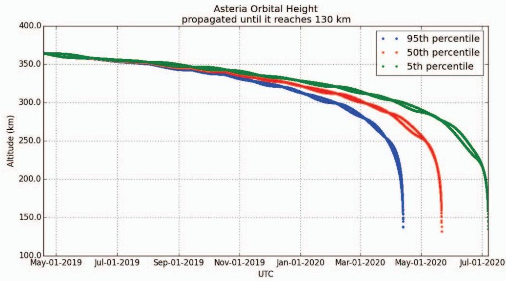

Figure 3. ASTERIA lifetime calculation. This plot shows orbit propagated in May 2019 with $ 9 5^{th} $ $ 5 0^{th} $ , and $ 5^{th} $ percentile solar flux models. End of Mission was declared when the spacecraft reached 300km on February 29, 2020.

<!-- PDF_PAGE: 4 -->

## 3. EXTENDED MISSION RESULTS

## Autonomy Technology Maturation

For almost two years, the ASTERIA spacecraft and its ground-based testbed were used as platforms to demonstrate and validate a number of autonomy-related technologies. Three technologies, described in this section, were written using JPL's Flight Software coding standards, were integrated individually into the ASTERIA flight software, were verified using static analyzers, and underwent formal reviews. Two of the technologies were uploaded to the spacecraft and demonstrated on board before the end of the mission; the third was demonstrated on the ground-based testbed. The culmination of this work was a ground-based demonstration of all three technologies compiled into one version of the ASTERIA flight software, and integrated to work together using JPL's Framework for Robust Execution and Scheduling of Commands Onboard (FRESCO) autonomy framework [6]. The following subsections describe each of the technologies as well as the combined demonstration.

Tasknet-based Commanding and Execution-A flight software module called the Multi-mission Executive (MEXEC) demonstrated the use of tasknets with an onboard planner and executive to operate a spacecraft. Tasknets allow more flexible and robust on-board execution by operating at a "task" level by maintaining models of intention and behavior that a planner and executive can use on board vs commanding with and executing time-based sequences. Traditionally, ASTERIA was operated using simple, time-based command sequences that were generated on the ground and uplinked almost daily to the spacecraft. The first step to demonstrating a task-based commanding paradigm with MEXEC on ASTERIA was to integrate MEXEC with the ASTERIA F' flight software [7]. F Prime is a JPL-developed, open-source flight software framework tailored to small-scale systems such as CubeSats and instruments. It provides a component-based software architecture and a set of tools that allow easy integration of new components such as MEXEC. The integration required careful design and development, but demonstrated that MEXEC is adaptable to different software instead of being designed for a single use-case.

To demonstrate proper performance of MEXEC and this new commanding paradigm, the first in-flight experiment used tasknets that were developed to replicate the behavior of ASTERIA's traditional sequences. During the two-week period for this experiment, ASTERIA performed scientific observations using MEXEC showing the effectiveness of these tasknets and the applicability of this approach for increasing the efficiency and robustness of future space missions [8].

A second in-flight experiment was planned to use more of MEXEC's capabilities, but was moved to the testbed after the mission ended earlier than expected. This second experiment was designed to show MEXEC's ability to react and replan on board by managing ASTERIA's momentum.

External torques acting on the spacecraft can cause momentum buildup, which leads to attitude control loss. To keep ASTERIA safe, fault protection would put ASTERIA into safe mode and reset the spacecraft if the momentum magnitude became too high over a period of time, meaning that upcoming observations would be lost and requiring reset recovery procedures. To avoid this, operators would schedule observations based on predicted momentum reported from ground tools. MEXEC can monitor the momentum on board and autonomously dump momentum before it reaches the fault protection threshold, preventing the spacecraft from going into safe mode and requiring reset recovery procedures, allowing observations to continue. The tasknets used for this experiment were intentionally designed to increase momentum to the point where MEXEC would need to react to dump momentum. The experiment, performed on the testbed with simulated sensor input using the Real-time Dynamics Processor by Blue Canyon Technologies, executed as expected with MEXEC reacting to on-board system state by dumping momentum and resuming observations when appropriate [8].

Autonomous Optical Navigation-ASTERIA demonstrated onboard orbit determination on a CubeSat in Low Earth Orbit (LEO) without GPS. Optical navigation algorithms (AutoNav) were integrated into the F' flight software, tested on the testbed, and then uploaded to the spacecraft to demonstrate a fully independent means of spacecraft orbit determination using only passive imaging. The spacecraft was commanded through a sequence to capture images of the Vesta asteroid, which were and fed the AutoNav algorithms to calculate ASTERIA's orbit. This in-flight experiment demonstrated the ability to run the AutoNav algorithms on a CubeSat, although the iterations needed to refine the orbit knowledge were not performed due to the limited flight computer resources available. A second experiment was planned to use geo-stationary satellites (geo-sats) as the targets instead of small bodies. These satellites provide better information than asteroids since they are closer. In preparation for this experiment, images of geo-sats were captured by the ASTERIA camera and sent to the ground for analysis. The AutoNav team determined that the geo-sats were too faint to use as targets as they moved through the field of view during imaging. The AutoNav team then worked with the Operations team to command the spacecraft to track the geo-sats in order to build up the signal-to-noise ratio of these target. This proved successful, and ground-based AutoNav algorithms were able to calculate ASTERIA's orbit based on these new images. A second experiment, to perform orbit determination based on geo-sat images on board, was not completed as planned due to the early end of the mission. However, the in-flight experiment and the ground-based analyses proved that this AutoNav capability can enable future missions to navigate in a GPS denied environment if using higher fidelity instrumentation, such as a better resolution imager and a more accurate clock [9].

<!-- PDF_PAGE: 5 -->

Model-Based Health Assessment—System health estimation is fundamental for advancing onboard autonomy. JPL is maturing a model-based health assessment capability with Okean Solutions, Inc. to assess spacecraft hardware health in situ that is different from traditional monitor-response mechanisms [10]. Model-based Off-Nominal State Identification and Detection (MONSID) provides continuous health state estimation, verifying correct behavior and detecting and identifying hardware components exhibiting off-nominal behavior. Traditional fault protection handles faults by detecting when limits have been exceeded, but does not provide information about which hardware component is causing the out-of-limits conditions. Since the cause is not identified, the response is limited to safe mode, which stops science sequences and performs actions to ensure the safety of the vehicle, such as shutting down non-essential hardware and pointing solar arrays to the sun. System health estimation provides healthy/failed/suspect state information for on-board hardware, and identifies which component is causing anomalous behavior. This additional information is fundamental for advancing on-board autonomy because it provides a smart executive such as MEXEC with information on what hardware components are available, enabling it plan around the failed hardware to continue achieving goals. A MONSID model of ASTERIA's XACT attitude control subsystem hardware was developed, and the MONSID engine was integrated with the ASTERIA flight software, providing the ability to confirm healthy hardware and to detect and identify hardware malfunctions. This software was planned for an in-flight experiment in February 2020; however, on December 5th, 2019, the spacecraft did not respond to uplinked commands, and subsequent attempts to regain communications were not successful. The MONSID team responded by testing the software on the ASTERIA testbed. Application of MONSID to ASTERIA's attitude control system was successfully tested with a combination of test bed data and actual flight telemetry including nominal and off nominal behaviors. MONSID was able to detect attitude sensor glitches and short reaction wheel excursions in otherwise nominal flight data. See [11] for a detailed discussion on the test campaigns and results.

Combined Autonomy DemonstrationsThe three technologies described in the previous sub-sections were combined to achieve autonomous orbit determination even in the presence of anomalies. The three software elements, MEXEC, AutoNav, and MONSID, were integrated together into the ASTERIA Flight Software, and architected following the FRESCO framework guidelines, including using a State Database to collect the current state of the system. This database provides one source of truth for all software elements to use, to keep them synchronized and operating on the same data. This experiment demonstrated moving what currently is a ground-intensive activity of orbit determination into a fully autonomous onboard capability. Once a tasknet is uploaded to maintain orbit knowledge within a designated threshold, MEXEC will monitor orbit

knowledge and schedule navigation observations and activities using information from AutoNav to perform orbit determination in perpetuity in order to keep the knowledge below the threshold. In parallel, MONSID monitors the hardware and posts health states to the State Database that then are used by MEXEC to assess and respond to possible impacts to the plan. See [3] for details describing this experiment. The integration of on-board planning/scheduling/execution, autonomous orbit determination, and hardware health state estimation capabilities provide a powerful combination that could allow future spacecraft to identify when orbit knowledge needs to be updated, plan and execute observations that support optical navigation to increase the knowledge, and plan around anomalies of the hardware needed to perform these activities.

## Hardware Characterization

The ASTERIA spacecraft provided an excellent platform to characterize both flight hardware and new ground hardware. In-flight activities were performed to understand the jitter imparted by the reaction wheels, to improve ground-based simulations, to better analyze ASTERIA science data, and to provide characterizations for future missions where jitter is an important factor such as astrophysics missions. The ASTERIA team also certified new ground stations provided by Amazon Web Services.

Jitter Observations and Analysis The behaviors of the ASTERIA spacecraft when performing observations were simulated on the ground prior to launch [12]. Critically for ASTERIA, the pre-launch analysis included assessments of the jitter under ASTERIA's fine pointing control mode [13]. Jitter is the high-frequency attitude motion of the satellite over a specified time scale, such as the camera exposure time. Increased jitter (i.e., increased motion of the camera relative to the incident light during the image exposure) leads to blurring as the light from the star is distributed over more pixels on the camera, which in turn leads to reduced photometric precision. Reaction wheels can be a large source of jitter on many CubeSats, including ASTERIA. These wheels are physically rotating parts that impart disturbance forces and torques, causing the spacecraft to rotate, with disturbance magnitudes that scale with rotation speed. Additionally, the wheels operate continuously, so the disturbances occur continuously. By contrast, thruster systems on other CubeSats such as the JPL Lunar Flashlight mission contribute to jitter intermittently [14].

Prior to launch, the ASTERIA mission performed analysis to estimate the in-flight jitter. The analysis used reaction wheel models provided by JPL's Small Satellite Dynamics Testbed (SSDT) [15]. Therefore, flight data was obtained to determine the flight-level of jitter and to validate the models used in the SSDT to determine predictions of on-orbit performance. Doing so improved the understanding of the ASTERIA spacecraft, and also provides future missions with validated analysis.

<!-- PDF_PAGE: 6 -->

The first activity was to validate models used in the SSDT simulation. These models, including the magnetic field, sun position, and orbital decay, inform the feasibility of many additional mission types, since they model aspects inherent to low Earth orbit operation.

An example of one model's model-data comparison performed as part of this experiment is the SSDT's magnetic field model for Low Earth Orbit spacecraft. Figure 4 shows the magnetic field as measured in the inertial frame by both the orbiting and simulated ASTERIA spacecraft. The magnetic field strength reported by the simulation follows a similar profile to the flight data as shown in the top plot, though there are still errors on the order of half the strength of the magnetic field, as shown in the center plot. This error is due to the combination of errors in the simulated propagation of the orbit and in the modeling of the magnetic field. This effect is especially visible at the start of the simulation, where the position is fixed to the value of the flight spacecraft, though the simulated magnetic field strength is not equal to the flight data. The simulation model, however, is only a small amount worse at modeling the true magnetic field, since the lower plot shows that the difference between the XACT's onboard magnetic field and the measured magnetic field is on the same order as the difference between the SSDT's simulation and flight values.

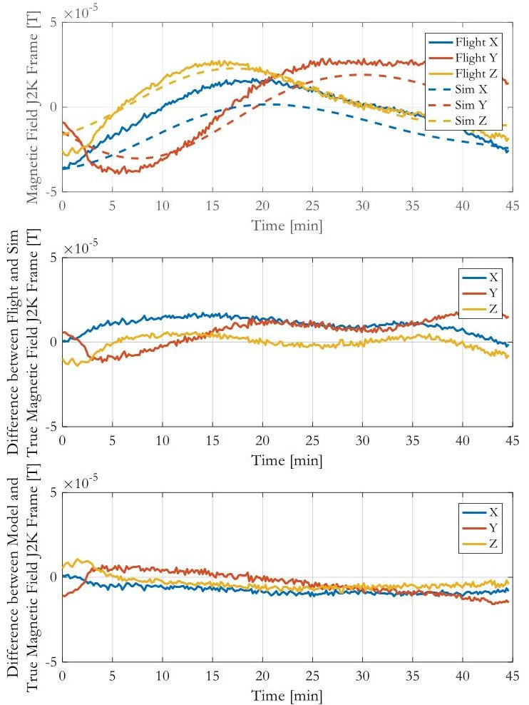

Figure 4. Comparison of magnetic field observed inflight with simulation results (top), along with the difference between the in-flight measured and the simulated magnetic field (center) and between the XACT's onboard magnetic model and the measured flight magnetic field (bottom).

One of the target stars for the jitter analysis activity was Alpheratz. Because of limitations in imaging command sequence building, precise reaction wheel speeds could not be assured at the time of imaging. As a result, the data collected was analyzed relative to the average of the three wheel speeds when the images were collected. Figure 5 shows the average of the wheel speeds along the horizontal axis and the widths of a Gaussian fit to the spot size on the ASTERIA detector along the vertical axis. The colors reflect the commanded wheel speeds for each collected image. The variability in the image spot sizes reflects the jitter in these 20 Hz images.

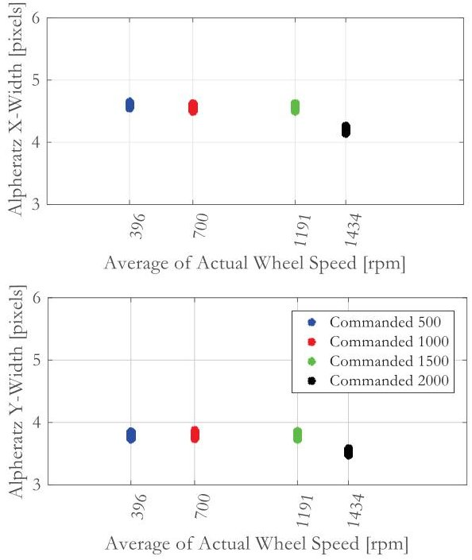

Figure 5. Two-dimensional Gaussian fit sizes to Alpheratz spots across average wheel speeds.

While the jitter assessment was not able to make a full validation of the simulated reaction wheel imbalances that lead to spacecraft jitter, several trends were observed. At higher wheel speeds, the images exhibited a broader range of blur effects, particularly starting around a reaction wheel speed average of 1400 rpm, where the image widths can take both larger and smaller values than what is observed at lower wheel speeds. Unfortunately, there was no way to achieve slower wheel speeds, since the spacecraft was at the mercy of large external disturbances, nor could the wheels achieve higher rates, since the team did not want to risk saturating the wheels during the observations. Additionally, there was not any collected data to identify a particular wheel speed that caused a significantly larger jitter level, and no specific commanded bias showed a particularly low level of jitter. Further details are described in [16].

The second jitter experiment aimed to quantify the effect of the two-stage pointing control system on photometric precision for a range of stellar magnitudes. For this experiment, a set of 6 stars ranging in V-magnitude from - 0.2 to 6.6 were observed for at least three spacecraft orbits in three different attitude control modes. The first mode was coarse pointing (XACT only), with no feedback from

<!-- PDF_PAGE: 7 -->

star centroiding on the detector and no piezo stage correction. The second mode provided feedback to the XACT from star centroid measurements on the detector, but did not include piezo stage corrections. The third mode was the normal science operating mode - fine pointing using the piezo stage to compensate for drift in star centroids at 20 Hz [4]. Data from these experiments are still being analyzed and will be presented in a future publication.

Certifying New Ground StationsThe ASTERIA Ground Data Systems Team coordinated with Amazon Web Services (AWS) to configure new ground stations to communicate with the spacecraft. ASTERIA's Mission Operation System (MOS) was refactored to support cloudbased operations using the AWS ground stations. ASTERIA was the first spacecraft to use this service, and successfully demonstrated the ability for NASA to use commercial ground stations for communications with LEO spacecraft. The experiment was so successful that ASTERIA continued using two AWS ground stations for nominal operations for the remainder of the mission [17].

## Science Discovery

The extended mission provided an opportunity to achieve new science. Science goals shifted from confirming ASTERIA's capabilities with a detection of a known exoplanet [18], to searching for new exoplanets [19][20]. ASTERIA was well-suited to perform long-term monitoring of stars and observed alpha Centauri AB as well as HD 219134 for small transiting planets. Opportunistic targets were added to the observation list including pointing the camera at the Earth to image cities at night (see Figure 6), imaging an asteroid and geo-synchronous spacecraft in support of the AutoNav experiment, and the "Christmas" comet 46P/Wirtanen in December 2018. The science team also coordinated with other projects to follow up on targets of opportunity in support of external scientists and projects such as TESS and Roman.

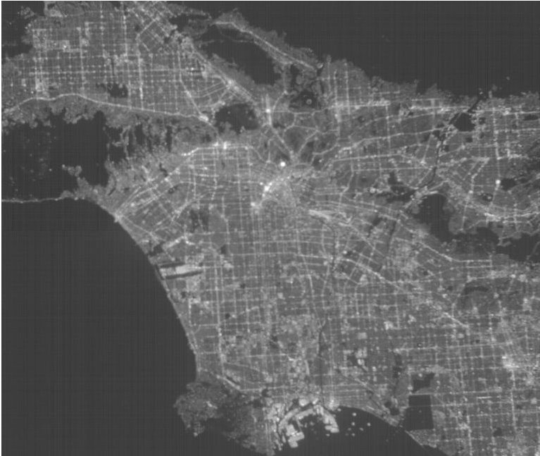

Figure 6. Image of the Los Angeles Basin taken by the ASTERIA camera. The bright dot near the center of the image is Dodger Stadium during a game.

## 4. SUMMARY

The ASTERIA Mission was an exciting and notable success, not only for the pointing and thermal control demonstrated during its prime mission, but also for all of the firsts achieved during almost two years of extended operations. ASTERIA was the first CubeSat to detect an exoplanet, the first CubeSat to demonstrate autonomous optical navigation, the first spacecraft to use Amazon Web Services ground stations, and the first CubeSat to perform joint observations with the Hubble Space Telescope. Instead of turning off the spacecraft at the end of its planned mission, JPL repurposed it, using the CubeSat as a workhorse to demonstrate autonomy technologies for use on upcoming missions, to characterize spacecraft hardware for future small satellite missions using similar subsystems, to confirm the viability of new ground stations, and maximized the scientific potential searching for new exoplanets. This was possible because of the support from numerous programs at JPL, from NASA Headquarters, and from MIT. The diverse team members, from scientists to operators to technologists, worked as a tight-knit team to coordinate the many distinct and sometimes conflicting activities required to accomplish the wide-ranging goals, and to share the limited resources both on the ground and on the spacecraft. Despite many obstacles put before the team - from an early end-of-life, to COVID-19 causing an interruption in testbed activities, to the California wild fires triggering evacuations for some team members, we all are very proud of what we accomplished, and look forward to opportunities to build on the legacy that ASTERIA has provided—to science, to autonomy, and to future CubeSats.

## ACKNOWLEDGEMENTS

We thank the following people for supporting our efforts to use the spacecraft for technology demonstrations, hardware characterization and extended science:

- The Spacecraft Developers and Operators who supported the extended mission: Brian Barker, Brian Campuzano, Peter DiPasquale, Kristine Fong, Ansel Rothstein-Dowden, Jose Carlos Abesmis, Jules Lee, Chris Pong, Chris Volk;

- The Technology Experimenters: David Ardila, Shyam Bhaskaran, Martin Feather, Scott Hughes, Jeff Levison, Tomas Martin-Mur, Faiz Mirza, Swati Mohan, Allen Nikora, Aadil Rizvi, Professor Soon-Jo Chung (Caltech), Carolyn Maynard (Raytheon), Matt Litke and Maurice Prather (Okean Solutions, Inc.);

- The Science Team: Vanessa Bailey, Brice-Olivier Demory (U. of Bern), Akshata Krishnamurthy (MIT and JPL), Irene Kain (JPL summer intern); and

- Ground Station Support Personnel: Ben Malphrus and team (Morehead State University), Shayn Hawthorne and team (Amazon Web Services).

<!-- PDF_PAGE: 8 -->

Finally, we graciously thank the Sponsors for supporting this work including JPL's Phaeton Program, Advanced Concept Program, Strategic Research and Technology Development Program, and National Security Program Office; NASA Headquarters Earth Science Technology Office; and MIT and the Heising-Simons Foundation.

Part of the research was carried out at the Jet Propulsion Laboratory, California Institute of Technology, under a contract with the National Aeronautics and Space Administration (80NM0018D0004). $ \textcircled{c} $ 2020. All rights reserved.

## REFERENCES

[1] Zurbuchen, T. (2020) 4 January. Available at https://twitter.com/Dr_ThomasZ (Accessed 22 January 2020).

[2] Fesq, L., et al., "Extended Mission Technology Demonstrations Using the ASTERIA Spacecraft", IEEE Aerospace Conference Proceedings, March 2019.

[3] Feather, M. et al., "Demonstrations of System-Level Autonomy for Spacecraft", to be published in IEEE Aerospace Conference Proceedings, March 2021.

[4] Pong, C., "On-Orbit Performance & Operation of the Attitude & Pointing Control Subsystems on ASTERIA", $ 32^{nd} $ Annual AIAA/USU Conference on Small Satellites, 2018.

[5] Smith, M., Donner, A., Knapp, M., et al., "On-Orbit Lessons Learned from the ASTERIA Space Telescope Mission," 32rd Annual AIAA/USU Conference on Small Satellites, 2018.

[6] Amini, R., Fesq, L., Kolcio, K., Mackey, R., Mirza, F., Rasmussen, R., Troesch, M., "FRESCO: A Framework for Spacecraft Systems Autonomy," to be published in IEEE Aerospace Conference Proceedings, March 2021.

[7] Bocchino, R., Canham, T., Watney, G., Reder, L., Levison, J., "F Prime: An Open-Source Framework for Small-Scale Flight Software Systems," Proc. AIAA/USU Conference on Small Satellites, 2018.

[8] Troesch, M., Mirza, F., Hughes, K., Roshstein-Dowden, A., Bocchino, R., Donner, A., Feather, M., Smith, B., Fesq, L., Barker, B. and Campuzano, B., "MEXEC: An Onboard Integrated Planning and Execution Approach for Spacecraft Commanding. Workshop on Integrated Execution (IntEx) / Goal Reasoning (GR), International Conference on Automated Planning and Scheduling," ICAPS IntEx/GR 2020, October 2020.

[9] Kennedy, B. M., Doran, P., Hughes, R. S., Hughes, K., Bocchino, R., Lubey, D., Mages, D. and Fesq, L., "Satellite-to-satellite imaging in support of LEO optical navigation, using the ASTERIA CubeSat," CubeSats and SmallSats for Remote Sensing IV (Vol. 11505, p. 115050H), International Society for Optics and Photonics, August 2020.

[10] Kolcio, K., Mackey, R. and Fesq, L., "Model-Based Approach to Rover Health Assessment-Mars Yard Discoveries," IEEE Aerospace Conference Proceedings, March 2019.

[11] R. Mackey, C. Altenbuchner, M. Sievers, A. Nikora, L. Fesq, K. Kolcio, M. Prather, M. Litke, "On-Board Model Based Fault Diagnosis for CubeSat Attitude Control Subsystem: Flight Data Results," to be published in IEEE Aerospace Conference Proceedings, March 2021.

[12] Pong, C., Sternberg, D., and Chen, G., "Adaptations of Guidance, Navigation, and Control Verification and Validation Philosophies for Small Spacecraft", $ 4 2^{n d} $ AAS Guidance and Control Conference, 2019.

[13] Smith, M., Donner, A., Knapp, M., et al., "On-Orbit Lessons Learned from the ASTERIA Space Telescope Mission," 32rd Annual AIAA/USU Conference on Small Satellites, 2018.

[14] Lai, P., Sternberg, D., Haw, R., et al., "Lunar Flashlight CubeSat GNC System Development for Lunar Exploration", International Astronautical Congress, 2018.

[15] Sternberg, D., Pong, C., Filipe, N., et al., "Jet Propulsion Laboratory Small Satellite Dynamics Testbed Simulation: On-Orbit Performance Model Validation", Journal of Spacecraft and Rockets, Vol. 55, no. 2, pg. 322-334, 2017.

[16] Sternberg, D. and Mohan, S., "Validation of Small Satellite Dynamics Simulation Modules using ASTERIA Flight Data", to be published in IEEE Aerospace Conference Proceedings, March 2021.

[17] Hughes, K., di Pasquale, P., Babuscia, A., Fesq, L., "On Demand Command and Control of ASTERIA with Cloud-based Ground Station Services," to be published in IEEE Aerospace Conference Proceedings, March 2021.

[18] Knapp, M., et al., "Demonstrating High-Precision Photometry with a CubeSat: ASTERIA Observations of 55 Cancri e," Astronomical Journal, 160, 23.

[19] Krishnamurthy, A., Knapp, M., Gunther, M., et al., "Transit Search for Exoplanets Around Alpha Centauri A and B with ASTERIA," submitted to the Astronomical Journal.

<!-- PDF_PAGE: 9 -->

## BIOGRAPHIES

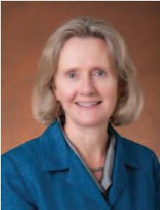

Lorraine Fesq is a Principal Engineer at the Jet Propulsion Laboratory, California Institute of Technology, and was the Project Manager of the ASTERIA mission. She serves as Associate Director for the Caltech Center for Autonomous Systems and Technologies. Lorraine

has over 40 years of aerospace experience that spans industry, government and academia, and has worked all mission phases of spacecraft projects. Lorraine holds two patents and received a NASA Public Service Medal for her work on the Chandra X-ray Observatory and a NASA Exceptional Achievement Medal for advancing the Fault Management discipline within NASA. Lorraine taught in the Aeronautics/Astronautics department at MIT and worked on multiple spacecraft projects at TRW, Ball Aerospace and JPL. She received her B.A. in Mathematics from Rutgers University and her M.S. and Ph.D. in Computer Science from the University of California, Los Angeles.

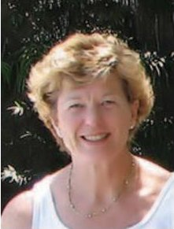

Patricia M. Beauchamp is currently the Chief Technologist for the Engineering and Science Directorate at the Jet Propulsion and also on the NASA Planetary Science Division Technology Team (PESTO). She is on the executive committee of the Outer Planet Assessment Group and has been

responsible and/or involved in developing technology plans for the Outer Planets, Venus and Small Bodies Assessment Groups. Her previous JPL assignments include serving as Manager of the Planetary Instrument Development Office, Leader of the Center for In-Situ Exploration and Sample Return (CISSR), and Project Manager for the MICAS Instrument on DS1. She is the recipient of the JPL Explorer, many NASA Group Achievement Awards, SGV Woman of Achievement in Science and AESC Recognition of Excellence. Pat received a B.S. in Chemistry and B.A. in Mathematics from CSUF in 1976 and a PhD in Chemistry from Caltech in 1981 followed by a post-doctoral fellowship in Chemical Engineering. Before joining JPL in 1991 she managed the detector and materials research department at Aerojet ElectroSystems.

Cornelia Altenbuchner is currently a Robotics Technologist at the NASA Jet Propulsion Laboratory (JPL) in Pasadena California. Cornelia earned her PhD from the University of Maryland College Park in Aerospace Engineering, during which time she conducted research at the NASA Langley Research Center and the National

Institute of Aerospace. Her primary contributions are technology development in the areas of flexible multibody dynamics modeling and simulation, robotic systems conceptual mission design, dynamics and controls as well as Flight Software development. At NASA JPL, she works on robotic systems, which includes dynamic, autonomy and conceptual aspects required to support missions to Europa and Mars 2020.

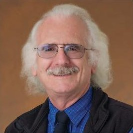

Martin Feather received his BA and MA in Mathematics and Computer Science from the Cambridge University, UK, and PhD in Artificial Intelligence from the University of Edinburgh, UK, all in the previous millennium. He is a

Principal Software Assurance Engineer in JPL's Office of Safety and Mission Success, and has been with JPL for 25 years. His activities are focused on identifying, developing and infusing research results that offer the prospect of improving assurance of space missions, with a particular interest in software.

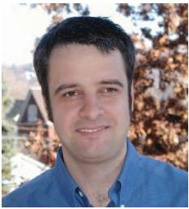

Robert Bocchino a Flight Software Engineer in the Small-Scale Flight Software Group at JPL. He holds a Ph.D. in computer science from the University of Illinois at Urbana-Champaign, and he was a Postdoctoral Associate at Carnegie

Mellon University. Since joining JPL in 2013, Robert has worked on both technology development and flight projects. He was the flight software technical lead for the ASTERIA missions. Recently, Robert has worked on technology development in the areas of flight software development and testing, fault-tolerant and autonomous flight software, and high-performance space computing.

Amanda Donner is a mission assurance manager at NASA Jet Propulsion Laboratory. She held many roles on ASTERIA including the Mission Assurance Manager during development, the Mission Manager for much of the extended mission, and the Project Manager for a period following the prime mission. Amanda

received her M.S. in Mechanical Engineering from UC Davis.

<!-- PDF_PAGE: 10 -->

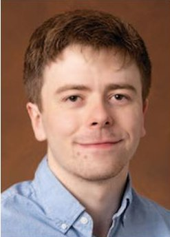

Kyle Hughes was the Mission Manager and FSW Integration and Test Lead during extended ASTERIA mission operations at the Jet Propulsion Laboratory (JPL), California Institute of Technology. He currently is a Software Systems Engineer on the Spectro-Photometer for the History of the Universe, Epoch of Reionization and Ices

Explorer (SPHEREx) mission. He received his B.S. in Computer Engineering from Columbia University.

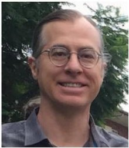

For the past twenty years, Brian Kennedy has been a member of the Mission Design and Navigation section at NASA's Jet Propulsion Laboratory. Brian led the ASTERIA Autonomous Optical Navigation research team. He was until recently

the Orbit Determination Team Lead for the Dawn Mission and the Lead for the OSIRIS-REx Independent Bennu Asteroid Shape Model Team. His past work at JPL included support for the Deep Space 1, Odyssey, MER, Stardust, Deep Impact, LCROSS and EPOXI missions. Brian graduated from The University of Colorado in 1993 with a B.S. in Aerospace Engineering Sciences.

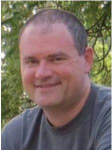

Ryan Mackey is a senior software systems engineer and researcher of Integrated System Health Management technologies at JPL. He is a graduate of the Graduate Aeronautical Laboratories, California Institute of Technology (GALCIT). His projects focus on development of anomaly

detection, data mining, and prognostics technologies along with applications to air and space systems and cybersecurity His current tasks include system engineering for the Europa Clipper mission and application of Integrated System Health Management technologies to aircraft and spacecraft. He has been granted three US Patents for his contributions o ISHM.

Faiz Mirza is a Member of Technical Staff in the Artificial Intelligence Group (3971), Planning and Execution Section, of the Jet Propulsion Laboratory, California Institute of Technology. Faiz graduated from the University of

Edinburgh with a M.S. in Artificial Intelligence. He was an undergraduate at the University of California Riverside, where he completed a B.S. in Computer Science. Previously he was an intern at Amazon. While at Edinburgh, he was a Teaching Assistant for a Software Testing course and while at UC Riverside he worked as a systems administrator.

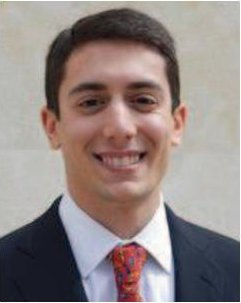

David Sternberg is a guidance and control systems engineer at the NASA Jet Propulsion Laboratory, having earned his S.B., S.M., and Sc.D. degrees in the MIT Department of Aeronautics and Astronautics. He is currently working on the development, testing, and operation

of satellite attitude determination and control hardware for small satellites, having served as the lead attitude control system operator for the MarCO satellites, and is a guidance and control analyst for the Psyche mission.

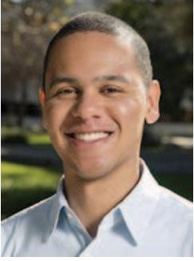

Matthew W. Smith is a member of the Flight System Systems Engineering group at the Jet Propulsion Laboratory. He served as the ASTERIA Project System Engineer and Payload Lead during development, and as Mission Manager during the primary mission. His research interests are in systems

engineering for space-based optical instruments modeling and simulation, and multi-disciplinary design optimization. He holds a B.A. in Applied Mathematics from Harvard University, an M.Phil in Engineering from the University of Cambridge (UK), and M.S. and Ph.D. degrees in Aeronautics and Astronautics from the Massachusetts Institute of Technology.

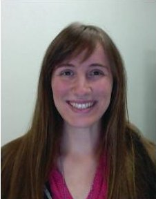

Martina Troesch is a member of the Artificial Intelligence group at the Jet Propulsion Laboratory. She holds a B.S. and M.S. from the University of Southern California in Aerospace Engineering, as well as an M.S. in Computer Science from Stanford University.

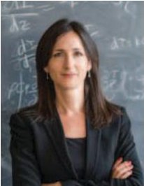

Sara Seager received her B.Sc. in mathematics and physics from the University of Toronto in 1994. She earned a Ph.D. in astronomy from Harvard University in 1999, where she investigated recombination in the early Universe before moving to the then brand-new field of exoplanets. She was

a long-term member at the Institute for Advanced Study in Princeton, NJ, and a senior research staff member at the Carnegie Institution of Washington in Washington, D.C., before joining the MIT faculty in 2007. She was awarded the American Astronomical Society's Helen B. Warner prize in 2007 for her work on exoplanet atmospheres. Professor Seager was the Principal Investigator for the ASTERIA CubeSat mission.

<!-- PDF_PAGE: 11 -->

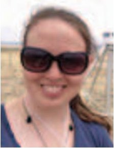

Mary Knapp received a BS in Aerospace Engineering at MIT in 2011 and PhD in Planetary Science in 2018 and is currently a Research Scientist at MIT Haystack Observatory. She was awarded an NSF Graduate Research Fellowship in 2012. Her research focus is the detection and

characterization of exoplanetary magnetic fields via low frequency radio emission. Her additional research interests include the development of small spacecraft for astronomy and planetary science She participated in the development of the ASTERIA CubeSat since 2010 through launch and operations, until end of mission.

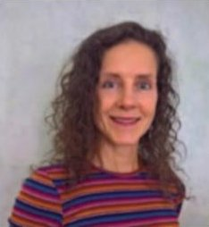

Ksenia Kolcio is the Vice President of Okean Solutions, an SBC located in Seattle, WA, where she leads aerospace systems engineering technical activities. Ksenia has been the PI on several SBIR Phase I, II, and III programs with the Air Force

Research Laboratory and NASA JPL focusing on modelbased fault management solutions that strive to increase spacecraft autonomy. Ksenia has also subcontracted with partner companies on other NASA Phase II and III programs, and DoD BAA contracts in the areas of spacecraft attitude control and navigation mission analysis. Prior to co-founding Okean Solutions, she was employed at Microcosm, Inc. for seven years as a Senior Systems/GN&C Engineer where she led and managed GN&C hardware & software development, CONOPS, and systems analysis on SBIR Phase I, II, and III programs with NASA and DoD. Prior to Microcosm, she worked at Northrop Grumman Space Technology (NGST) for 8 years in the Avionics Systems Center. At Northrop Grumman, Ksenia worked on a variety of NASA and DoD flight programs from design to Integration and Test. In addition to spacecraft control design, analysis, and test she was an autonomy and fault management lead engineer responsible for fault management architecture development and testing. She received a Ph.D. in Electrical Engineering from University of Cincinnati. She is a member of AIAA.

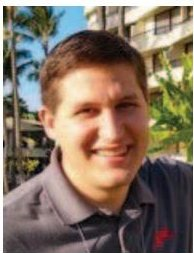

Patrick Doran currently is an employee of Pearl River Technologies, LLC and is in the process of completing his Master's of Science in Aerospace Engineering at California State Polytechnic University, Pomona. His University research has been focused on autonomous swarm satellite

navigation. Previously, he spent two years interning for the Mission Design and Navigation section at NASA's Jet Propulsion Laboratory, where he supported the ASTERIA Autonomous Optical Navigation internal research team.