<!-- PDF_PAGE: 1 -->

# SLIM: Collaborative Model-Based Systems Engineering Workspace for Next-Generation Complex Systems

Manas Bajaj $ ^{1} $ , Dirk Zwemer $ ^{1} $ , Russell Peak $ ^{2} $ , Alex Phung $ ^{1} $ , Andrew G. Scott $ ^{1} $ , Miyako Wilson $ ^{2} $

1. InterCAX LLC, 75 5 $ ^{th} $ Street, Suite 213, Atlanta, GA 30308, USA

manas.bajaj@intercax.com, +1-404-592-6897

2. Georgia Institute of Technology, Manufacturing Research Center, 813 Ferst Drive, Atlanta, GA 30318, USA

Abstract-Development of complex systems is a collaborative effort spanning disciplines, teams, processes, software tools, and modeling formalisms. It is the vision of model-based systems engineering (MBSE) to enable a consistent, coherent, interoperable, and evolving model of a system throughout its lifecycle. However, no currently available modeling language can represent all aspects of a system (including system-of-systems) at all levels of abstraction across the lifecycle.

To address this challenge, we envision SLIM—a collaborative, model-based systems engineering workspace for realizing next-generation complex systems. SLIM is an acronym for Systems Lifecycle Management. It will fulfill the MBSE vision by using SysML to represent the front-end conceptual abstraction of a system, thereby providing seamless continuity of system definition from initiation to delivery to sustainment. SLIM will allow users to wrap discipline-specific models (such as CAD, CAE, and STK) as SysML elements and plug-and-play with the system model. Hence, SLIM enables seamless interoperability of models, methods, and tools by using SysML as an integration mechanism while providing the flexibility to create and manage federations of domain-specific models either defined using open standards such as STEP AP210, AP203/214, and AP233, or in commercial-off-the-shelf (COTS) tools. SysML parametrics provides constructs for fine-grained connections and knowledge capture between SysML and domain-specific models. With SLIM, system engineers can perform automated requirements verification, systems simulations, trade studies and optimization, risk analysis, model-based design reviews, change management, and other systems engineering tasks from the earliest stages of system development directly from the SysML model.

In this paper, we present the motivation, conceptual architecture, and use cases for SLIM in sections 1 and 2 followed by tools currently available or under-development as part of SLIM in section 3. SLIM tools presented in this paper (section 3) are typically of two types: (1) SysMLbased analysis tools, and (2) SysML-based integration tools. While the former will allow system engineers to orchestrate system development directly from the SysML model, the latter provides methods and interfaces for integrating discipline-specific models to SysML.

Development and deployment of SLIM across organizations will require collaboration, feedback, and contribution from potential stakeholders and users. The paper also invites

collaborators and early adopters for using SLIM tools and contributing to the development of SLIM. $ ^{1 2} $

## TABLE OF CONTENTS

1. INTRODUCTION TO SLIM...1

2. USE CASES & DEFINITION...5

3. TOOLS & CAPABILITIES...7

4. SUMMARY & FUTURE WORK...14

REFERENCES...14

BIOGRAPHY ...15

## 1. INTRODUCTION TO SLIM

SLIM is an integrated software platform for system lifecycle management. It is envisioned to provide capabilities that combine the strengths of model-based systems engineering and product lifecycle management (PLM). Though the scope of SLIM is from system design to delivery and sustainment, this paper primarily focuses on system design and analysis aspects of SLIM and related tools available to date. In this section, we first present the motivation for SLIM in terms of gaps in current state-of-the-art commercial tools for design and analysis of complex systems. Following this, we present a conceptual architecture of SLIM and describe key end-user capabilities that SLIM will provide.

## Motivation

Figure 1 illustrates two fundamental gaps in currently available tools for systems design and analysis. These gaps are described below in the context of project lifecycle phases for typical NASA systems [1].

Gap 1 concerns the lack of model-based continuity of system design and simulation activities from the early mission design phases to the later design phases. In the context of lifecycle phases of typical NASA systems, Gap 1 is manifested in transitions between the different phases, such as Pre-Phase A to Phase A, Phase A to Phase B, and Phase B to Phase C. Gap 1 exists because the modeling and simulation tools used to create system models (design and analysis) are different in early mission phases versus the later mission phases. Tools used in a design phase capture only those aspects of the mission that are relevant for that phase, and hence there is no continuity of system definition,

<!-- PDF_PAGE: 2 -->

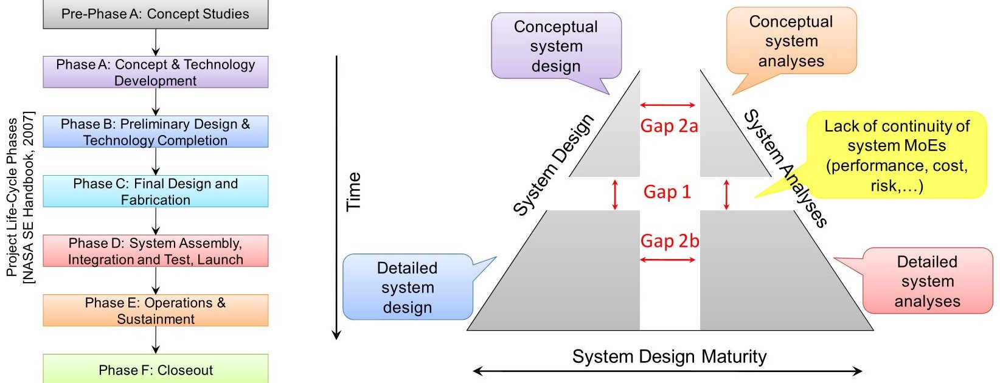

Figure 1: Gaps in current state-of-the-art tools for design and simulation of complex systems

requirements, performance parameters, and their evaluation results through system design and development phases. Results of design exploration, uncertainty in design parameters, assessment of systemic risk, and other crossphase parameters and studies are typically buried in mammoth and difficult-to-maintain spreadsheets, documents, and proprietary domain-specific tools thereby making it difficult to track and communicate them effectively during phase transitions.

Information forwarding for core aspects of the system, such as the requirements and objectives, structure and behavior, performance and risk parameters, cost, power and weight budgets, and its development process (tasks, resources and milestones) need to be maintained continuously through the system design and development phases independent of the diverse COTS tools used for representing and managing these aspects. In this light, some of the questions posed by system realization teams are:

- How does one ensure that models defined in tools during early mission stages and later design stages are representations of the same system?

- How does one ensure that the requirements and performance parameters evaluated in tools during early mission and later mission phases concern the same system or even the same mission?

- How does one relate the analysis and evaluation results obtained during early mission phases and those obtained during later phases?

- How does one propagate trade study results, uncertainties in mission parameters, and systemic risk assessment from the preliminary design phases to detailed design phases?

Gap 2 concerns disconnects between design and analysis/simulation models in different design phases, such as between conceptual system design models and mathbased analysis models in early design phases (Gap 2a) or

between CAD $ ^{3} $ and CAE $ ^{4} $ models in detailed design phases (Gap 2b). In general, Gap 2 manifests in heterogeneous model transformations beyond design and analysis, such as between requirements and structure, logical structure and physical structure, and structure and behavior.

Typically, individual modeling and simulation tools represent only specific aspects of a system, such as requirements, system structure, and system behavior, and do not provide a holistic model of the entire system. As a result, systems engineering activities can at best be realized using point-to-point data flows, custom model transformation, and workflow automation software to keep all aspects in sync. There is an urgent need in systems engineering for using a single coherent system model that can federate domain-specific design and analysis models in a configuration managed environment.

## Conceptual Architecture

SLIM is a software environment for integrated model-based systems engineering. As shown in Figure 2, it uses SysML as the front-end for multi-disciplinary teams to collaboratively develop a unified, coherent representation of the system from the earliest stages of development. The system model (in SysML) can 'co-evolve' with the associated domain-specific models, such as ComputerAided Design and Engineering (CAD/CAE) models. Relationships between the system model and the domain-specific models can range from qualitative dependency relations to quantitative acausal parametric relations which are executable on-demand for seamless model traceability and interoperability. The SysML-based system model is a

<!-- PDF_PAGE: 3 -->

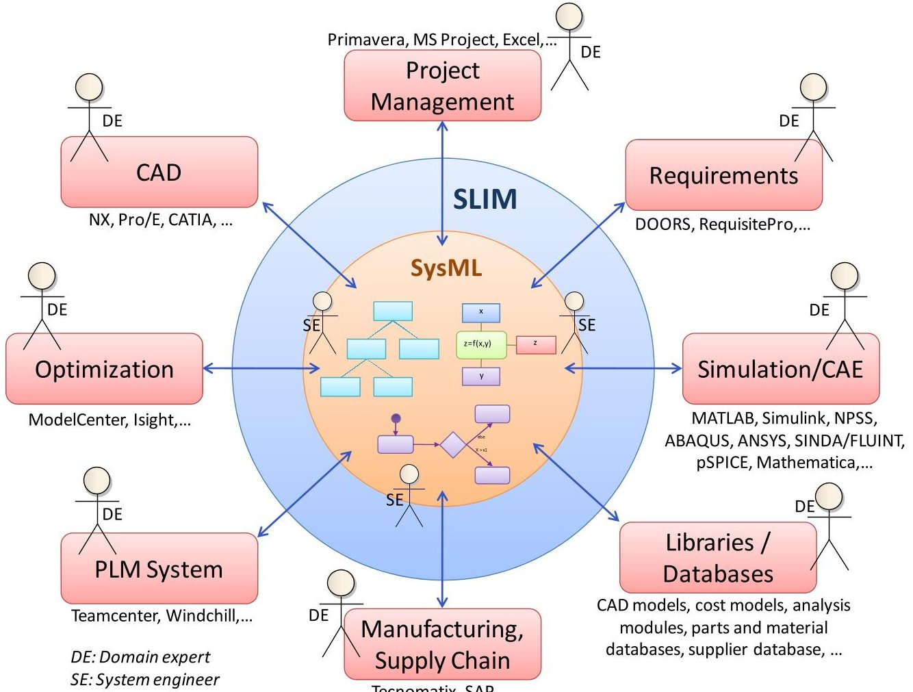

Figure 2: Conceptual architecture of SLIM

conceptual abstraction of the system that has sufficient details for orchestrating all systems engineering activities, ranging from automated requirements verification and system trades to risk analysis, and dependency and change management. This unified system model is not a data store but a map of the system which can be used to federate domain-specific models of different aspects of the system.

SLIM builds on existing SysML authoring environments, such as MagicDraw [2], Artisan Studio [3], Rhapsody[4], and Enterprise Architect[4], and PLM environments, such as Teamcenter [5] and Windchill [6]. SLIM provides plugins to SysML authoring environment for facilitating systems engineering design, integration, and verification and validation (V&V) flows directly from the SysML model. Automated requirements verification, system trades and optimization, risk analysis, sizing, cost and performance estimation, producibility analyses, model-based design reviews, and more can be triggered from the SysML model. At its core, SLIM provides software tools that are independent of any systems engineering methodology, and are building blocks for supporting different types of design and verification flows. We envision that SLIM will provide system engineering teams the flexibility to define, test, and deploy organization-specific workflows using the building block tools.

## Preliminary design and evaluation of advanced concepts

SLIM directly answers the following challenge-the

conceptual design process has the highest impact on the product lifecycle but the least availability of design and decision support tools. SysML, the front-end of SLIM, is a general-purpose systems modeling language and an open standard that is not confined to any specific configuration at any level of the design or any specific design methodology. SLIM serves as a decision support environment for systems-of-systems, where concepts relating to the system-of-interest can be co-developed in the context of the operating environment, organization, humans, manufacturing facilities, government regulations, and market behavior. With a unified SysML model as the centerpiece, the impact of changes in requirements or any other element can be studied on both qualitative and quantitative levels.

SLIM provides analysis tools (section 3) for executing SysML constructs representing different aspects of the system, such as SysML parametric models for sizing, cost, performance, and SysML activity models for mission profiles. As a result, systems engineers can perform system trades, risk analyses, and automated requirements verification on system alternatives on a continuous basis. SLIM's integration tools (section 3) will allow system engineers to connect the SysML-based system model to design and analysis models in COTS tools-concept sketches in CAD tools and orbit planning models in STK [7]—for driving system analysis during conceptual phases. A key factor in the incorporation of new designs, materials, and manufacturing technologies into new systems is the

<!-- PDF_PAGE: 4 -->

ability to model the entire end-to-end product lifecycle. SysML can incorporate issues of producibility, maintainability and disposal into the system model from the earliest stages of conceptual design. While SysML provides rich and extensible constructs for modeling "systems-of-systems", SLIM enables qualitative and quantitative "what-if" analyses and trades for both unconventional and conventional systems built on combinations of new and existing technology.

## Transition from conceptual design to detailed design

SLIM provides plug-n-play and automated model reconfiguration capabilities to swap low-fidelity analysis models with high-fidelity ones, while still maintaining the conceptual relationships (in SysML) between the models. The suite of integration tools in SLIM (section 3) allows system engineers to wrap externally-defined design and simulation models and codes as SysML constructs and replace (or combine) low-fidelity by high-fidelity analyses. Bi-directional relationships between the SysML-based system model and domain-specific models in COTS tools, as shown in Figure 2, represent both qualitative and quantitative relationships that enable a wide range of model interoperability services—traceability, transformation, reconfiguration, synchronization, and conflict resolution.

## Detailed design and analysis

SLIM builds on several years of design-analysis integration research [8-11] that provides patterns and methods to automatically compose SysML-based simulation templates—parametric models relating design models to analysis models—from a library of analytical building blocks for variable topology systems. These patterns make it possible to abstract analysis model formulation from solution, thereby allowing analysts to perform trades on solution methods (e.g. FEM, FDM, Meshless) and solvers (e.g. ANSYS, ABAQUS). Trades and sensitivity analyses

can be automatically triggered from the SysML-based simulation templates that also provide specifications for design space exploration and multi-disciplinary design optimization using tools such as ModelCenter [12] and Isight [13].

## Design Environment Development

SLIM provides a rich and seamless design environment for complex systems engineering, which includes organizations, humans, operating environment, and other aspects in addition to the system-of-interest. Figure 3 illustrates the difference between existing design environments and SLIM's design environment for realizing complex systems. Typical design environments for complex systems are driven by document-based integration or point-to-point model-based integration between models representing different aspects of the system. Lack of specialized tools for conceptual design, unlike CAD and CAE tools for detailed design, results in usage of diagramming tools (such as PowerPoint [14] and Visio [15]) with spreadsheets for numerical analysis. Workflow automation tools provide a means to transfer data from one tool to another at best. A significant amount of time and resources are spent by system engineering teams in the administration of islands of automation, document-based interfaces, and producing reports for design reviews.

In contrast, SLIM's design environment is driven by a SysML-based system model that is the centerpiece of the design process from the beginning. SLIM provides tools that aid system engineering activities directly from the SysML-based system model. SysML structure and behavior constructs (such as blocks and activities) replace PowerPoint and Visio, while parametrics replaces spreadsheets. Automated unit checking, requirements verification, and trades can now be performed from the SysML model. Changes in the design architecture automatically reflect in the analysis models (unlike manual

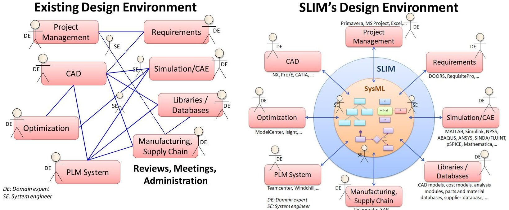

Figure 3: Comparison of existing design environment and SLIM's design environment for complex systems 4

<!-- PDF_PAGE: 5 -->

updates from PowerPoint to spreadsheets).

Since no single modeling language can represent all aspects of a system throughout its lifecycle, SLIM provides tools that integrate SysML with a wide-array of in-house and COTS design and simulation tools (including documents and spreadsheets for data presentation and reporting). The level of integration can range from qualitative dependency relationships for traceability, interface specifications for model generation and reconfiguration, or quantitative relationships for model synchronization. Coupled with enterprise PLM systems, SLIM provides change and configuration management, conflict resolution, and modelbased communication between stakeholders.

SLIM provides libraries of reusable models—SysML constructs connected to native design and simulation models—that make it easy to assemble and perform optimization and trades on the system model. Examples of libraries for aircraft design include design objects (wing, fuselages, tails, and airfoils), analysis models (cost, sizing), system behavior (mission profiles), materials, and manufacturing constructs.

For complex systems engineering, SLIM provides a powerful alternative to "PowerPoint and Spreadsheet engineering" and point-to-point integration of analysis codes (spreadsheets, MATLAB/Simulink, C++, Fortran, Java) disintegrated from the system design definition.

## 2. USE CASES & DEFINITION

The objective of SLIM is to facilitate model-based design, analysis, review, change management, procurement, and sustainment of complex systems. Figure 4 is a SysML use case diagram that illustrates some of the key systems engineering use cases that SLIM will address. The use cases are described in this section in an anti-clockwise order of appearance in the figure, starting with the use case Facilitate model-based design and analysis.

SLIM tools that are currently available or underdevelopment are primarily focused on model-based design and analysis of complex systems. This includes tools for parametric analysis, orchestrating system simulations, performing trade studies and risk analyses, and automated verification of requirements.

SLIM will facilitate model-based design reviews. Design reviews in existing design environments involve manual creation of an extensive set of documents that have to be carefully scanned by review teams. In SLIM's design environment, reviewers will be able to invoke all system alternatives that were analyzed, the types of analyses performed, the analysis results, and design decisions and rationale directly from the SysML-based abstraction of the system. Document-based artifacts can be automatically generated from the SysML model for archival and future reference.

A unified system model can represent not only the design

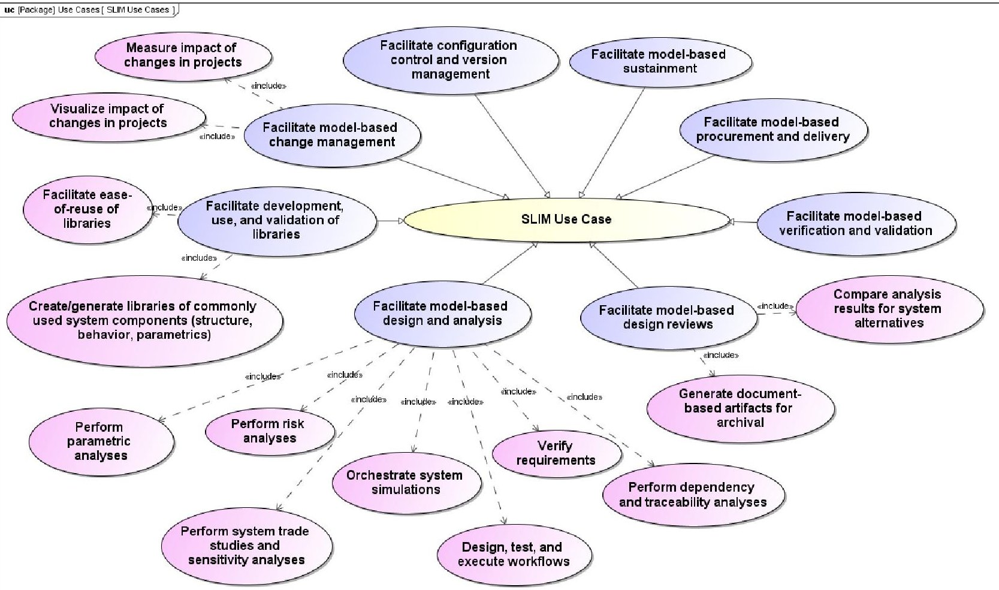

Figure 4: Key systems engineering use cases of SLIM

<!-- PDF_PAGE: 6 -->

and analysis aspects of a system but also test procedures necessary for verification and validation (V&V) and their relationships to system and sub-system requirements. SLIM can facilitate model-based V&V directly from the SysML model. Test activities can be scheduled and automatically executed each time a new version of the system model is checked into the repository. This capability is similar to unit and functional testing and project automation commonly used in software development projects, but for large system engineering projects.

SLIM can facilitate model-based procurement and delivery of complex systems. The SysML-based system model is not only useful for facilitating the development of complex systems but also as a contractual artifact binding the relationship between an organization and its customers, suppliers, and collaborators. Customers can float requestfor-proposals (RFPs) using requirements, use cases, and functional specifications defined using SysML. Proposals and deliverables in the form of SysML-based design models can then be automatically verified and analyzed against specifications. After a system has been delivered and deployed, the SysML-based system model serves as a blue print of system structure, behavior, and target performance rating, much like design drawings and access plans for aircrafts and ships. System upgrade, maintenance, repair, and other sustainment-related plans can then be mapped and generated from the system model.

Design environments for collaborative development of

complex systems need to provide configuration control and version management capabilities. SLIM will leverage project management and configuration control capabilities native to commercial-strength PLM tools (such as Teamcenter).

With the existence of a system model, SLIM can facilitate model-based change management. Changes in customer requirements, available resources, system design and behavior are common in large systems engineering projects. With SLIM, system engineers can analyze the impact of changes via visualization and parametric analyses from the SysML model. Such analysis will be crucial to planning, controlling, and affecting changes in the system design process.

SLIM will provide tools for creating libraries of reusable system constructs, such as those based on structural, parametrics, and behavior concepts. Examples include libraries of aircraft wings and fuselages, libraries of aircraft maneuvers and mission profiles, and libraries of cost, weight, and sizing analysis models. Elements in the library can be defined natively in SysML, or can be SysML elements wrapping externally-defined library elements such as CAD and STK models.

Figure 5 is a SysML block definition diagram that shows the conceptual decomposition of the SLIM framework. SLIM tools are accessible and driven from SysML authoring environments, and access externally-defined models in PLM

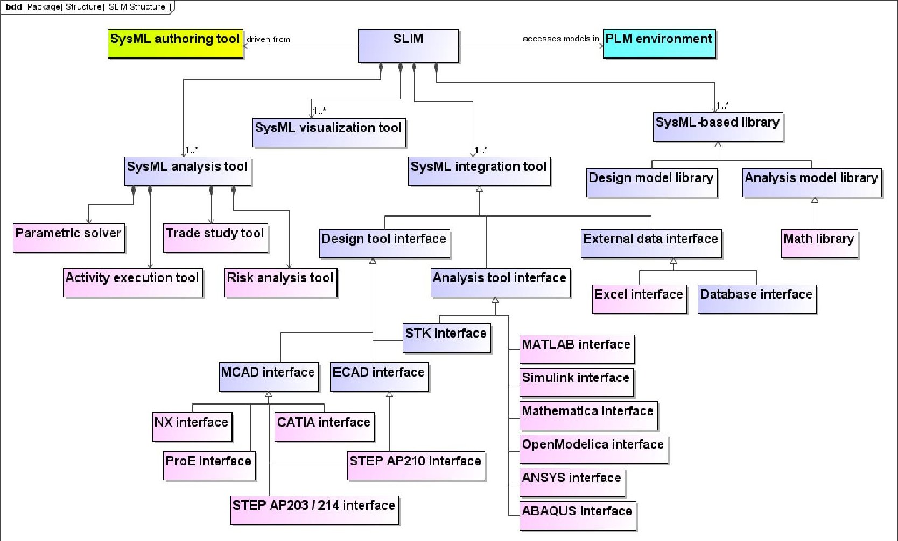

Figure 5: Conceptual decomposition of the SLIM framework

<!-- PDF_PAGE: 7 -->

environments. The main components of the SLIM framework are listed below, followed by a detailed description of tools and their availability in section 3.

- SysML analysis tools provide capabilities to trigger system-level analyses and automated requirements verification from a SysML model. This includes (1) Parametric solver tool for executing parametric relationships, (2) Trade study tool for performing trade studies using parametric models, (3) Risk analysis tool for performing Monte Carlo simulations based on parametric and activity models, and (4) Activity execution tool for executing SysML activity models.

- SysML visualization tools provide capabilities to visualize SysML models in addition to the nine (9) types of SysML diagrams for enhanced model traceability. Flattened and hierarchical graph- and table-based views can better highlight cross-cutting relationships.

- SysML integration tools provide capabilities to integrate the SysML-based system model with models and data based on other open standards (such as STEP) or defined in COTS and in-house tools. Integration tools are described in detail in section 3.

- SysML-based libraries provide building blocks for creating and executing the SysML-based system model. Library elements could be defined natively in the SysML environment, such as library of math functions for parametric analyses and trade studies, or involve SysML elements wrapping CAD, CAE, and STK models in PLM environments.

## 3. TOOLS & CAPABILITIES

In sections 1-2, we presented the vision and use cases of SLIM. In this section, we present SLIM tools and capabilities that are: (1) available commercially for production usage, (2) available as beta for early adopters, and (3) are under development. We invite users to participate in this effort by using existing tools, providing feedback, and contributing to the development of new tools under the SLIM framework. As illustrated in Figure 5, two categories of SysML-based tools are presented here. These are: (1) SysML analysis tools, and (2) SysML integration tools, as described in section 2 above.

## Parametric solver

The Parametric solver tool executes SysML parametric models using math solvers such as Mathematica [16], OpenModelica [17], and MATLAB [18]. Parametrics is one of the four pillars of SysML and provides modeling constructs to define acausal, fine-grained, mathematical relationships between SysML block properties. As a result, parametrics is applicable to a broad range of systems engineering use cases. For example, parametric relations could represent the following scenarios and more:

- Design constraints, such as sum of the weights of all parts should be equal or less than a pre-defined value.

- Simulation templates that relate design and analysis models, such as the calculation of cost variables, key performance parameters (KPPs), risk metrics, and other measures of effectiveness (MoEs) from the design model.

- Mathematical relationships between different design views and analysis views, such as relationships between properties of logical and physical system structure, between properties of hardware and software components, or between SysML blocks representing physical system components and the corresponding CAD models.

- Property-based requirements, such as the refinement of text-based requirements as mathematical constraints that can then be automatically verified for design alternatives.

As a result, SLIM's Parametric Solver tool is a powerful and broadly applicable systems engineering tool. It can be used for verifying or solving design constraints; computing system MoEs, KPPs, and risk metrics; synchronizing diverse views of the system; automatically verify requirements; and more.

Figure 6 shows a parametric model (in MagicDraw) of the FireSat system model being developed by the INCOSE SSWG Challenge Team [19]. This parametric model relates performance metrics (ground coverage and scan resolution) and annual operational cost of the FireSat to the design and operational variables, such as orbit altitude, sensor resolution, and angle covered by the optical instruments. The performance metrics and the cost variable are highlighted in red in the parametric diagram. The parametric model also shows constraints to verify requirements. The ResolutionReqt constraint block (bottom right corner of the parametric diagram) is a mathematical representation of a text-based requirement concerning FireSat scan resolution. It compares the scan resolution to the required value (30m) and computes the ScanResVerify property that represents the result of verifying the resolution requirement (1 for pass and 0 for fail).

Figure 7 shows the trade study results generated by the ParaMagic $ ^{[20]} $ - Parametric solver tool for MagicDraw. Each row represents a trade study scenario (given values of design and operational variables) for 2 FireSats. In this case, ParaMagic read input values for each scenario from the spreadsheet, computed target variables (Cost/yr., Coverage/day, and Target Resolution), verified them against requirements, and exported results back to the spreadsheet. Columns with names Cost req., Coverage req., and Res. req. correspond to the results of verifying cost requirement, coverage requirement, and resolution requirement (for each FireSat)—1 for pass and 0 for fail. The results indicate that when the satellites operate at lower orbits, the annual costs exceed the operating budget and the coverage is not

<!-- PDF_PAGE: 8 -->

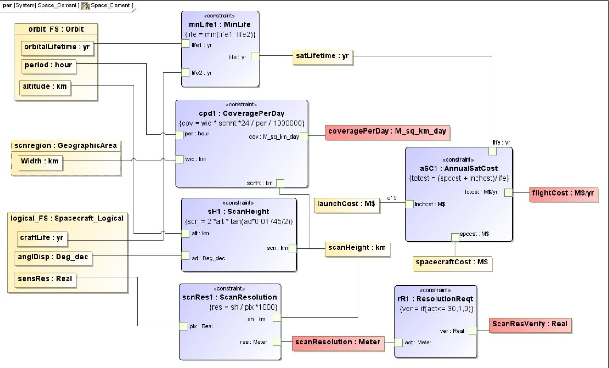

Figure 6: SysML parametric model for computing coverage, scan resolution, and flight cost of the FireSat

<table border="1"><tr><td colspan="2">Satellite 1</td><td colspan="2">Satellite 2</td><td></td><td></td><td></td><td></td><td colspan="2">Satellite 1</td><td colspan="2">Satellite 2</td></tr><tr><td>Altitudekm</td><td>Ang. Aperturedeg</td><td>Altitudekm</td><td>Ang. Aperturedeg</td><td>Cost/yr.M$/yr</td><td>Cost req.1-pass,0-fail</td><td>Coverage/dayM sq km/day</td><td>Coverage req.1-pass,0-fail</td><td>Tgt. Resolutionmeters</td><td>Res. req.1-pass,0-fail</td><td>Tgt. Resolutionmeters</td><td>Res. req.1-pass,0-fail</td></tr><tr><td>300</td><td>3</td><td>300</td><td>3</td><td>77.23</td><td>0</td><td>2.50</td><td>0</td><td>15.71</td><td>1</td><td>15.71</td><td>1</td></tr><tr><td>325</td><td>3</td><td>325</td><td>3</td><td>51.61</td><td>0</td><td>2.70</td><td>0</td><td>17.02</td><td>1</td><td>17.02</td><td>1</td></tr><tr><td>350</td><td>3</td><td>350</td><td>3</td><td>36.28</td><td>0</td><td>2.89</td><td>0</td><td>18.33</td><td>1</td><td>18.33</td><td>1</td></tr><tr><td>375</td><td>3</td><td>375</td><td>3</td><td>26.65</td><td>0</td><td>3.08</td><td>1</td><td>19.64</td><td>1</td><td>19.64</td><td>1</td></tr><tr><td>400</td><td>3</td><td>400</td><td>3</td><td>20.36</td><td>0</td><td>3.26</td><td>1</td><td>20.94</td><td>1</td><td>20.94</td><td>1</td></tr><tr><td>425</td><td>3</td><td>425</td><td>3</td><td>19.67</td><td>1</td><td>3.45</td><td>1</td><td>22.25</td><td>1</td><td>22.25</td><td>1</td></tr><tr><td>450</td><td>3</td><td>450</td><td>3</td><td>19.67</td><td>1</td><td>3.63</td><td>1</td><td>23.56</td><td>1</td><td>23.56</td><td>1</td></tr><tr><td>475</td><td>3</td><td>475</td><td>3</td><td>19.67</td><td>1</td><td>3.81</td><td>1</td><td>24.87</td><td>1</td><td>24.87</td><td>1</td></tr><tr><td>500</td><td>3</td><td>500</td><td>3</td><td>19.67</td><td>1</td><td>3.99</td><td>1</td><td>26.18</td><td>1</td><td>26.18</td><td>1</td></tr><tr><td>525</td><td>3</td><td>525</td><td>3</td><td>19.67</td><td>1</td><td>4.17</td><td>1</td><td>27.49</td><td>1</td><td>27.49</td><td>1</td></tr><tr><td>550</td><td>3</td><td>550</td><td>3</td><td>19.67</td><td>1</td><td>4.34</td><td>1</td><td>28.80</td><td>1</td><td>28.80</td><td>1</td></tr><tr><td>575</td><td>3</td><td>575</td><td>3</td><td>19.67</td><td>1</td><td>4.52</td><td>1</td><td>30.11</td><td>0</td><td>30.11</td><td>0</td></tr><tr><td>600</td><td>3</td><td>600</td><td>3</td><td>19.67</td><td>1</td><td>4.69</td><td>1</td><td>31.42</td><td>0</td><td>31.42</td><td>0</td></tr></table>

Figure 7: Trade study and requirement verification results generated by ParaMagic and exported to spreadsheet

sufficient to meet the requirements. On the other hand, when the satellites operate at higher orbits, the resolution requirement fails. Rows highlighted in green are scenarios for which all requirements were successfully met. Sensitivity plots and other graphs can also be generated by the Parametric solver tool.

The Parametric solver tool comes with a library of constraint blocks that wrap commonly used math functions, such as trigonometric, logarithmic, exponential, hyperbolic, conditionals (if-else), and aggregate functions. Complex functions can be composed from simpler functions using SysML parametrics. Constraint blocks can also wrap

externally-defined functions and scripts, such as MATLAB function and script M-files and Mathematica functions.

Figure 8 shows a parametric diagram in Artisan Studio where the SimulinkHomeHeating constraint block wraps a MATLAB script M-file used for executing a Simulink model. ParaSolver [21]—Parametric Solver tool for Artisan Studio—executes all relationships in the parametric model, including the wrapped Simulink model, to compute the target properties. In a similar manner, constraint blocks can wrap user-defined Mathematica functions. Figure 8 also shows the ParaSolver browser (bottom left) which presents the parametric models for a system alternative in an object-oriented spreadsheet

<!-- PDF_PAGE: 9 -->

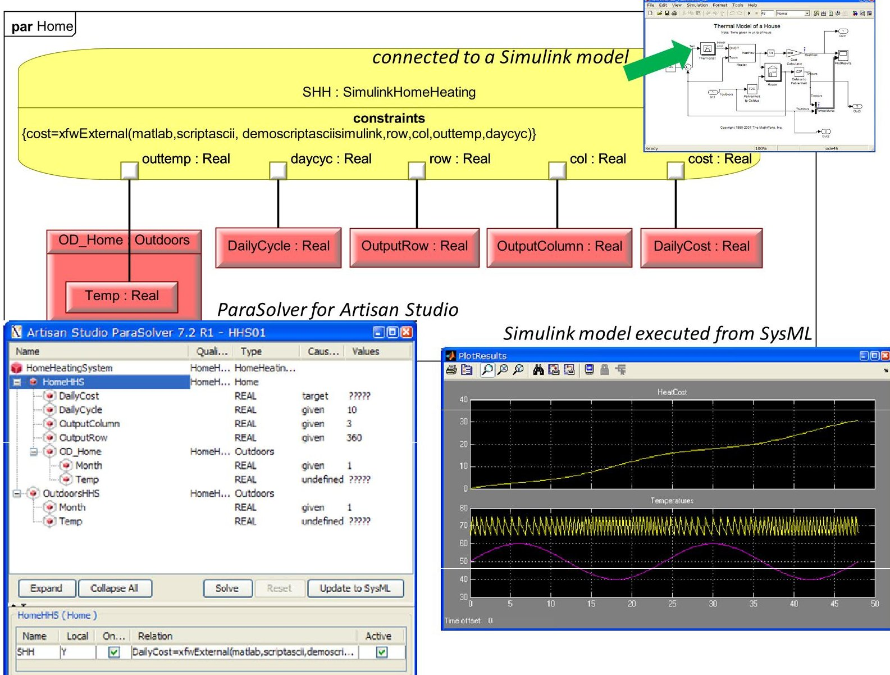

Figure 8: Parametric constraints wrapping Simulink models executed by ParaSolver (for Artisan Studio)

structure. When a user selects a specific system component, the parametric relations owned by that component can be seen in the relationship table of the browser.

The Parametric Solver tool can be used by system engineers to orchestrate system simulations and automate analysis workflows. System engineers can create parametric models that chain externally-defined MATLAB functions or scripts, Mathematica functions, Simulink models to compute key performance parameters and other MOEs.

SysML Parametric solvers are available for production usage for the following SysML authoring tools:

- ParaMagic $ ^{\circ} $ [20] for MagicDraw

- Melody $ ^{\mathrm{TM}} $ [22] for Rational Rhapsody

- ParaSolver $ ^{\mathrm{TM}} $ [21] for Artisan Studio

These tools are being used for system design and analysis at leading organizations in aerospace, defense, supply chain, energy, and electronics and telecommunications sectors.

## Trade study tool

The Trade study provides system engineers the capability to setup and execute trade studies directly from the SysML model. In its current version, the Trade study tool allows system engineers to execute parametric models in a batch mode for a set of scenarios that have been specified explicitly or implicitly as intervals or discrete values. Figure 9 illustrates the configuration view of the Trade study tool. The configuration view shows the SysML instance model in the left hand pane that serves as a fixed topology template for parameter variations in the trade study. Users can identify inputs, constants, and outputs in the trade study, and specify the data sources and targets for the input and output variables respectively. Inputs can be setup in an explicit manner by specifying discrete values or connecting to a cell range in an Excel spreadsheet, or in an implicit manner by specifying a range with increments. The Trade study tool automatically generates scenarios (if specified implicitly) by permuting all combinations of input variables. While running a trade study, the tool shows the specific scenario for which parametric models are being executed and the specific solver being used. After execution, the Trade study tool exports results to the spreadsheets specified for the output variables during configuration. Post-processing and

<!-- PDF_PAGE: 10 -->

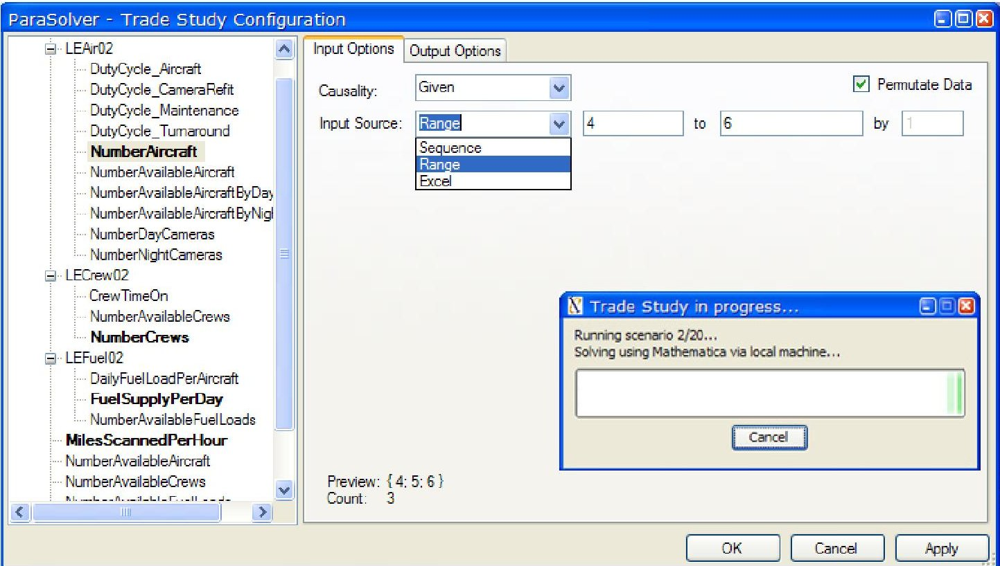

Figure 9: Trade study tool - configuration view

plotting capabilities of Excel can be used for displaying and reporting trade study results.

The Trade study tool is commercially available with each of the three Parametric solver tools—ParaMagic $ ^{\mathrm{TM}} $ Melody $ ^{\mathrm{TM}} $ , and ParaSolver $ ^{\mathrm{TM}} $ .

In the future, the Trade study tool will be enhanced to perform design exploration during system trades, potentially leveraging optimization and design exploration capabilities of ModelCenter and Isight.

## Risk analysis tool

SLIM's Risk analysis tool will provide system engineers the capability to compute system MoEs, KPPs, cost, and other metrics given the uncertainties in input variables-design operation, project, and others. Given the probability distributions for input variables, the Risk analysis tool will run Monte Carlo-type simulations on SysML parametric models and/or activity models to calculate probability distributions and related statistical metrics for output variables (such as system MoEs and KPPs). Such analyses directly benefit system engineers developing proposals or designing complex missions in performing trades between performance, cost, schedule, and risk.

Figure 10 illustrates a battlefield mission where a defense system composed of aircrafts, UAVs, ground forces, and analysis cells is trying to track and destroy time-sensitive targets (TSTs). The figure shows a SysML parametric model in Rational Rhapsody SysML modeling tool which is used to compute: (1) the response time of the defense system once a time-sensitive target is spotted, (2) the probability that the target is able to fire a missile before

being destroyed, and (3) the probability that the target is eventually destroyed before it goes into hiding. The spreadsheet in the figure shows the input and output variables for this analysis. The output variables indicate if the missile was fired by the time-sensitive target (TST), if the TST was destroyed, and the response time of the overall defense system. A value of 1 indicates success and a value of 0 indicates failure. Input values were generated based on normal probability distributions with given mean and variance. For a defense system alternative (specified number of ground troops, aircrafts, and cells), the analysis shows 36% mean probability that a missile is fired by the target and 100% probability that the target is destroyed before it goes into hiding. The response time for the scenarios is shown using a histogram and a cumulative frequency curve.

The Risk analysis tool builds on capabilities available with the Trade study tool, and is available with all three Parametric solver tools—ParaMagic, Melody, and ParaSolver.

## Activity execution tool

SysML activity models are used for modeling functionbased behavior of systems, such as for modeling mission profiles for multi-mission space systems, or specifications for satellite launch and in-orbit behavior. Execution of activity models provides system engineers the ability to simulate and analyze system behavior, and perform tradeoffs between system performance, risk, and cost. Figure 11 illustrates a SysML activity model for driving mini-rovers (as shown in the picture). Execution of this activity model generates and executes python code that governs the movement of the rover. The example also demonstrates the use of SysML for system operations. The same SysML

<!-- PDF_PAGE: 11 -->

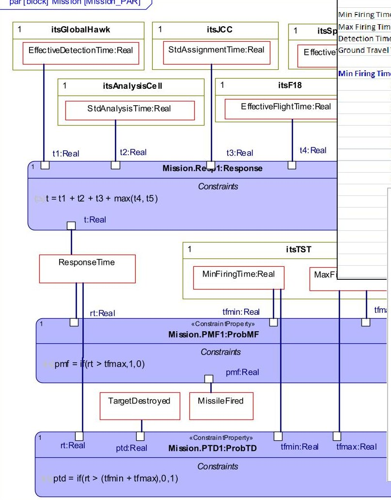

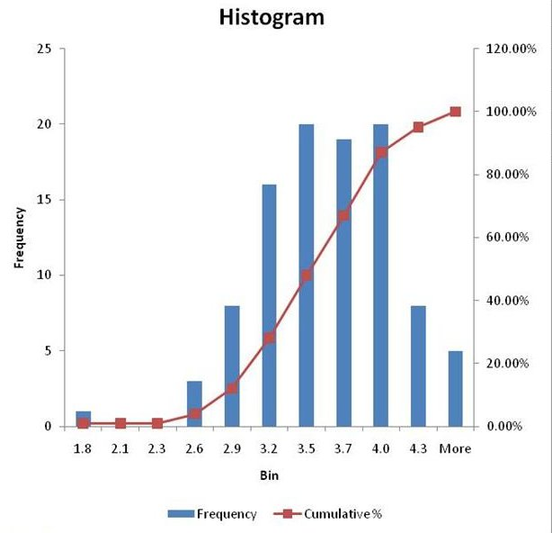

Figure 10: Computing success probabilities and response times in a battlefield mission - Melody $ ^{\mathrm{TM}} $ for Rhapsody

model used for designing the system can be used for operating it. This prototype capability is available as a plugin (called MyroMagic) for MagicDraw SysML authoring tool.

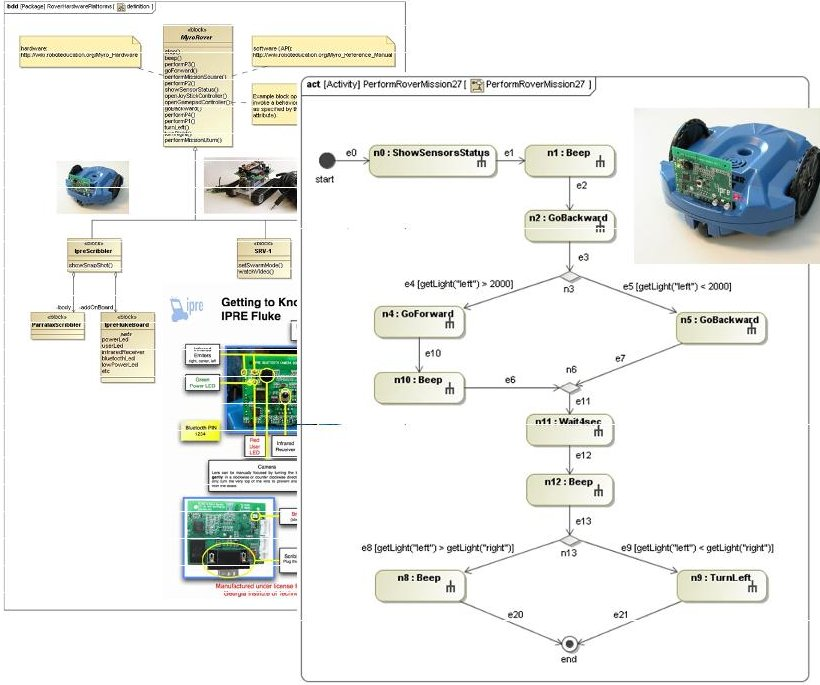

Figure 11: Activity model for driving mini-rovers

## SysML-Excel integration

The SysML-Excel integration tool allows system engineers to connect Excel spreadsheets to SysML models. SysML is used for modeling the system architecture, behavior, and related parametrics, while Excel is used for data storage, presentation, and reporting. With the SysML-Excel integration tool, system engineers can connect system properties to cells in spreadsheets, and automatically read from or write to Excel. Figure 12 shows the SysML-Excel integration tool. In the setup utility, properties configured to read from Excel are shown in blue and those configured to write to Excel are shown in red. After setup, users can invoke Excel read/write operations from the SysML model. This capability is available with all three Parametric solver tools—ParaMagic, Melody, and ParaSolver.

## SysML-MATLAB/Simulink integration tool

The SysML-MATLAB/Simulink integration tool allows users to wrap MATLAB M-files (functions or scripts) as SysML constraint blocks and reuse them in SysML parametric models. During execution, the Parametric solver tool invokes MATLAB/Simulink for executing constraint relationships wrapping M-files and brings results back to SysML or uses it for solving next set of constraint relationships. This capability is available with all three Parametric solver tools—ParaMagic, Melody, and ParaSolver.

<!-- PDF_PAGE: 12 -->

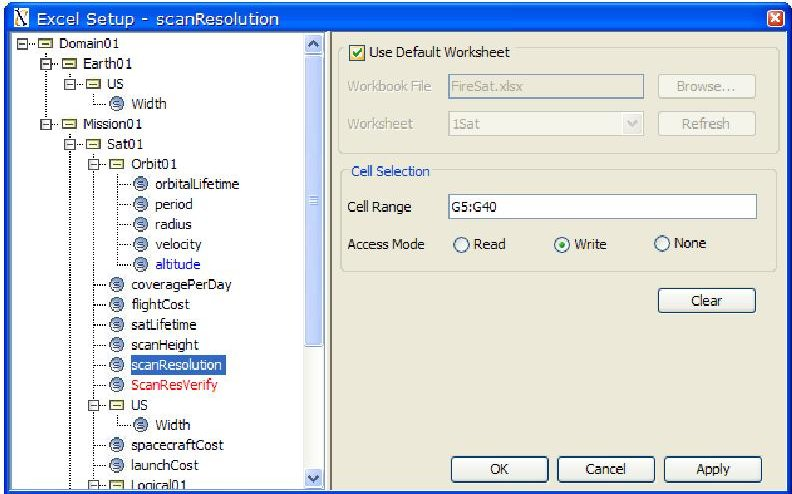

Figure 12: SysML-Excel integration tool

## SysML-Mathematica integration tool

The SysML-Mathematica integration tool allows users to wrap user-defined Mathematica functions (.m files) as SysML constraint blocks and reuse them in SysML parametric models, in the same manner as MATLAB M-files. In addition, the Parametric solver tool uses Mathematica as the core solver for executing parametric relationships. This capability is available with all three Parametric solver tools—ParaMagic, Melody, and ParaSolver.

## SysML-OpenModelica integration

The Parametric solver tool uses OpenModelica (free) as a core solver for executing parametric relationships. This capability is available with all three Parametric solver

tools—ParaMagic, Melody, and ParaSolver. In the future, SLIM will support the use of Modelica libraries based on the SysML-Modelica transformation specifications [23].

## SysML-CAD (MCAD and ECAD) and -STK integration

The SysML-CAD integration tool allows users to connect the SysML-based system model to CAD models. This capability is necessary for both: (a) integrating CAD-based concept sketches with the system model during preliminary design, (b) transitioning from conceptual to detailed design, and (c) maintaining a consistent view of the system and its components during detailed design, especially for cases where multiple CAD models (MCAD, ECAD) are being developed for a single component. Figure 13 illustrates a generalized approach for integrating SysML and design models (e.g. CAD, STK). The integration approach is shown for a single sub-system component that needs to be connected to its detailed definition in the design tool (CAD, STK). Step 1 shows the system model (LHS) as being developed by the system engineer, and the detailed design model (RHS) as being developed by a designer. The CAD integration tool automatically generates a view of the CAD model in the SysML modeling environment along with the mapping relationships, as shown in Step 2. Then, the system engineer and the designer can relate the properties of the CAD model view and the system model using SysML parametrics, as shown in Step 3. This knowledge is often lost in ad-hoc documents and spreadsheets. Execution of parametric relationships, using the Parametric solver tool, achieves bi-directional flow of information between the system model and the CAD model.

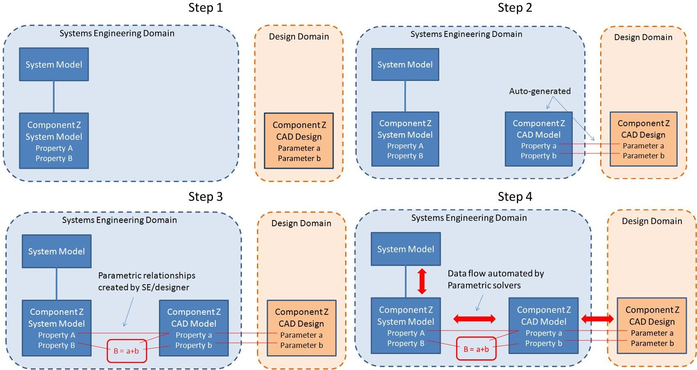

Figure 13: SysML-Design (MCAD/ECAD, STK) integration capability-end-user steps

<!-- PDF_PAGE: 13 -->

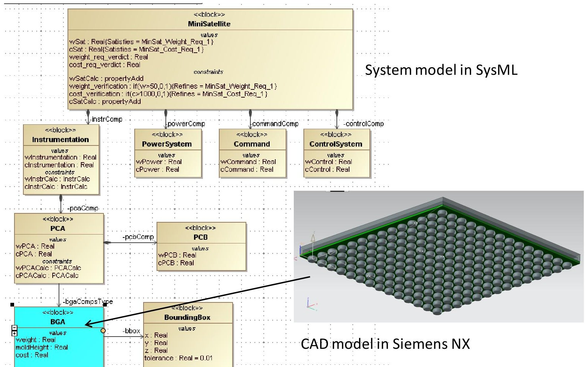

Figure 14: Mini-Satellite system model in SysML. BGA electronic component and its CAD definition are highlighted.

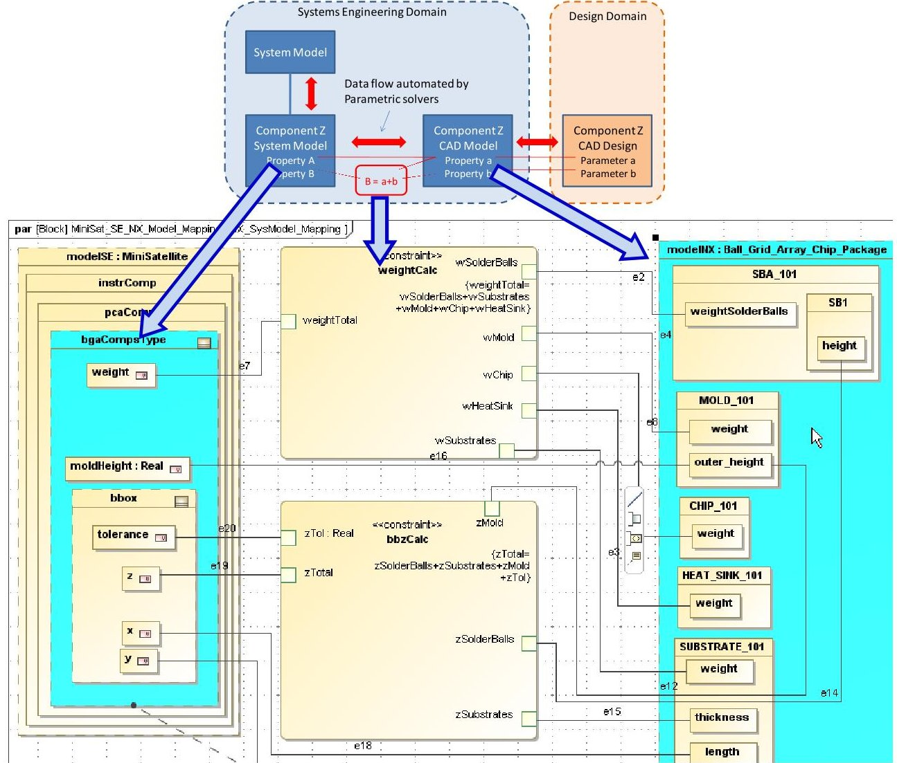

Figure 15: Parametric relationships between the BGA component in the system model and its CAD definition. 13

<!-- PDF_PAGE: 14 -->

Figure 14 and Figure 15 illustrate the SysML-CAD integration tool for a Mini-Satellite system. One of the components (BGA) of the Mini-Satellite is being designed in NX [24] CAD tool. The system engineer wants to connect the parameters of the BGA component in the system model to the properties of its detailed CAD definition in order verify component and system-level requirements. The SysML-CAD integration tool automatically generates a SysML view of the CAD model, as shown on the RHS in Figure 15. Then, the system engineer creates parametric relationships between the BGA component in the system model (LHS in Figure 15) and the SysML view of its CAD definition (RHS in Figure 15). The Parametric solver tool is used to execute these and other parametric relationships to achieve information flow between the CAD model to the SysML-based system model. Changes made to the BGA CAD model in NX can automatically be reflected in the BGA component of the Mini-Satellite and vice versa. This interaction is based on a live connection between the SysML authoring environment (e.g. MagicDraw) and NX, which is established by the CAD integration tool. As a result of this capability, a system engineer can automatically pull the latest updates in the SysML model from the detailed design model, and use this information for performing system-level analyses, verifying requirements, performing trades, and more.

## 4. SUMMARY & FUTURE WORK

This paper presents our vision of SLIM as a collaborative model-based systems engineering workspace that uses SysML as the front-end for orchestrating system engineering activities from the early stages of system development. The SysML-based system model serves as a unified, conceptual abstraction of the system independent of the specific design and analysis tools that shall be used in the development process. SLIM provides analysis tools to compute system MoEs and KPPs, orchestrate simulations, perform trades, analyze risk, automatically verify requirements, and more directly from SysML. It also provides plugins to integrate the system model (in SysML) to a variety of design and analysis tools, such as CAD tools, STK, CAE/FEA tools, Simulink, and math solvers MATLAB, Mathematica, OpenModelica, and Excel. SLIM enables a consolidated design environment where the SysML-based system model is used for model-based X, where X = design, analysis, reviews, V&V, deployment, and procurement. SLIM tools and capabilities are driven from a SysML authoring environment, and work with models that are configuration controlled in the enterprise PLM environment.

Several key components of the SLIM framework are available for production usage, as described in section 3. Other important capabilities are under-development. In section 2, we have presented the key systems engineering use cases that define the roadmap for SLIM. We invite interested users and organizations to help shape this

roadmap, use existing SLIM tools and provide feedback and contribute to the development of SLIM.

## REFERENCES

[1] NASA, Systems Engineering Handbook, NASA/SP- 2007-6105 Rev 1. 2007, Washington, D.C. 20546.

[2] No Magic. MagicDraw SysML modeling tool, version 16.9. 2010 [cited 2010 Oct 24]; Available from: http://www.magicdraw.com/sysml.

[3] Atego. Artisan Studio. 2010 [cited 2010 Oct 24];

Available from: http://www.atego.com/products/artisan studio/.

[4] IBM. Rational Rhapsody. 2010 [cited 2010 Oct 24];

Available from: http://www-

01.ibm.com/software/rational/products/rhapsody/designe

r/.

[5] Siemens PLM. Teamcenter. 2010 [cited 2010 Oct 24];

Available from:

http://www.plm.automation.siemens.com/en_us/products

/teamcenter/.

[6] PTC. Windchill. 2010 [cited 2010 Oct 24]; Available from: http://www.ptc.com/products/windchill/.

[7] AGI. STK. 2010 [cited 2010 Oct 24]; Available from: http://www.stk.com/.

[8] Bajaj, M., Knowledge Composition Methodology for Effective Analysis Problem Formulation in Simulation-based Design, in G.W.Woodruff School of Mechanical Engineering. 2008, Georgia Institute of Technology: Atlanta. p. 359.

[9] Peak, R., Paredis C.J.J., Tamburini D.R., Bajaj M., Kim I., and Wilson M., The Composable Object (COB) Knowledge Representation: Enabling Advanced Collaborative Engineering Environments (CEEs), COB Requirements & Objectives (v1.0). 2005, The Georgia Institute of Technology: Atlanta, GA, USA.

[10] Peak, R.S., Burkhart R.M., Friedenthal S.A., Wilson M.W., Bajaj M., and Kim I. Simulation-Based Design Using SysML Part 1: A Parametrics Primer. in The Seventeenth International Symposium of the International Council on Systems Engineering. 2007. San Diego, California, USA.

[11] Peak, R.S., Burkhart R.M., Friedenthal S.A., Wilson M.W., Bajaj M., and Kim I. Simulation-Based Design Using SysML Part 2: Celebrating Diversity by Example. in The Seventeenth International Symposium of the International Council on Systems Engineering. 2007. San Diego, California, USA.

[12] Phoenix Integration. ModelCenter. 2010 [cited 2010 Oct 24]; Available from: http://www.phoenixint.com/software/phx_modelcenter.php.

[13] Dassault Systèmes SIMULIA. Isight. 2010 [cited 2010 Oct 24]; Available from: http://www.simulia.com/products/isight.html.

[14] Microsoft. PowerPoint. 2010 [cited 2010 Oct 24];

Available from: http://office.microsoft.com/en- us/powerpoint/.

[15] Microsoft. Visio. 2010 [cited 2010 Oct 24]; Available from: http://office.microsoft.com/en-us/visio/.

<!-- PDF_PAGE: 15 -->

[16] Wolfram Research. Mathematica. 2010 [cited 2010 Oct 24]; Available from: http://www.wolfram.com/products/mathematica/index.ht ml.

[17] The Open Source Modelica Consortium. OpenModelica 1.5. 2010 [cited 2010 Oct 24]; Available from: www.openmodelica.org.

[18] The MathWorks. MATLAB. 2010 [cited 2010 Oct 24];

Available from:

http://www.mathworks.com/products/matlab/.

[19] INCOSE. Space Systems Working Group (SSWG) and Challenge Team. [cited 2010; Available from: http://www.omgwiki.org/MBSE http://www.incose.org/practice/techactivities/wg/sswg/.

[20] InterCAX. ParaMagic $ ^{\textcircled{R}} $ - SysML Parametric Solver for MagicDraw. 2010 [cited 2010 Oct 24]; Available from: http://www.intercax.com/sysml

http://www.magicdraw.com/paramagic.

[21] InterCAX. ParaSolver - SysML Parametric Solver for Artisan Studio. 2010 [cited 2010 Oct 24]; Available from: http://www.intercax.com/sysml.

[22] InterCAX. Melody - SysML Parametric Solver for Rational Rhapsody. 2010 [cited 2010 Oct 24];

Available from: http://www.intercax.com/sysml http://www.intercax.com/melody.

[23] Object Management Group. SysML and Modelica Integration. 2010 [cited 2010 Oct 24]; Available from: http://www.omgwiki.org/OMGSysML/doku.php?id=sys ml-modelica:sysml_and_modelica_integration.

[24] Siemens PLM. NX. 2010 [cited 2010 Oct 24];

Available from:

http://www.plm.automation.siemens.com/en_us/products /nx/.

## BIOGRAPHY

Manas Bajaj, PhD is the Chief Systems Officer and Director at InterCAX LLC. Manas' research interests are in SysML and model-based systems engineering (MBSE), computer-aided design and engineering (CAD/CAE), advanced modeling and simulation methods, and open standards for product and systems lifecycle management (PLM/SLM). He has authored several publications, including those that won best paper awards. He has been actively involved in the development, implementation, and deployment of the OMG SysML standard, and the STEP AP210 (ISO 10303-210) standard for electronics. He is a Content Developer for the OMG Certified Systems Modeling Professional (OCSMP) program, and coaches organizations on SysML and MBSE. Manas has led several industry and government projects to success, including prestigious SBIR grants from NASA and NIST. He earned his Ph.D. and M.S. in Mechanical Engineering from the Georgia Institute of Technology, and his B.Tech. in Ocean Engineering and Naval Architecture from the Indian Institute of Technology (IIT), Kharagpur, India. He is a member of INCOSE and a contributor in OMG and PDES Inc. working groups.

Dirk Zwemer, PhD is the President and CEO at InterCAX LLC. He has led systems engineering projects with several organizations. Dr. Zwemer has over thirty years experience in manufacturing industries with Bell Labs, Exxon, ITT, SRI Consulting and other organizations. He is the author of three patents and multiple technical papers, trade journal articles, and market research reports. Prior to joining InterCAX, he held positions as VP Technology, VP Operations, and President of AkroMetrix LLC, a leader in mechanical test equipment and services for the global electronics industry. He received a PhD in Chemical Physics from UC Berkeley and an MBA from Santa Clara University. Dr. Zwemer is a certified OCSMP Model Builder (Fundamental).

Russell Peak, PhD is a Senior Researcher at the Georgia Institute of Technology where he serves as Director of the Modeling & Simulation Lab (www.msl.gatech.edu) and Associate Director of the Product & Systems Lifecycle Management (PSLM) Center (www.pslm.gatech.edu). Dr. Peak specializes in knowledge-based methods for modeling & simulation, standards-based product lifecycle management (PLM) frameworks, and knowledge representations that enable complex system interoperability. Dr. Peak originated the multi-representation architecture (MRA)a collection of patterns for CAD-CAE interoperability—and composable objects (COBs)a noncausal object-oriented knowledge representation. Dr. Peak leads the INCOSE MBSE Challenge Team www.pslm.gatech.edu/projects/incose-mbse-msi) for Modeling & Simulation Interoperability with applications to mechatronics (including mobile robotics testbeds) as a representative complex systems domain. He is a Content Developer for the OMG Certified Systems Modeling Professional (OCSMP) program, and coaches organizations on SysML and MBSE. Dr. Peak earned his Ph.D., M.S., and B.S. in Mechanical Engineering from Georgia Institute of Technology.

Alex Phung is a senior research engineer at InterCAX LLC. He has 12 years of experience in a wide range of software development technologies. Mr. Phung is a certified OCSMP Model Builder (Fundamental) and has over five years of experience in UML and SysML software development. Mr. Phung earned his M.S. and B.S. in Mechanical Engineering from Texas A&M University.

Andrew G. Scott is a research engineer at InterCAX LLC. He is an experienced SysML modeler and software developer. Mr. Scott earned his B.S. in Mechanical Engineering at Georgia Institute of Technology.

Miyako Wilson is a research engineer at the Manufacturing Research Center at Georgia Institute of Technology. She specializes in object-oriented software development. Ms. Wilson earned her M.S. in Mechanical Engineering at Georgia Institute of Technology and B.S. in Mechanical Engineering at Arkansas State University.