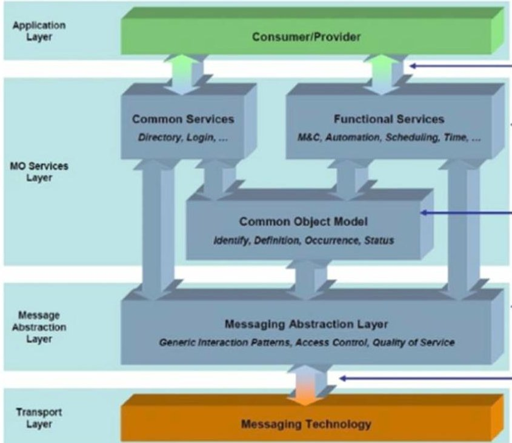
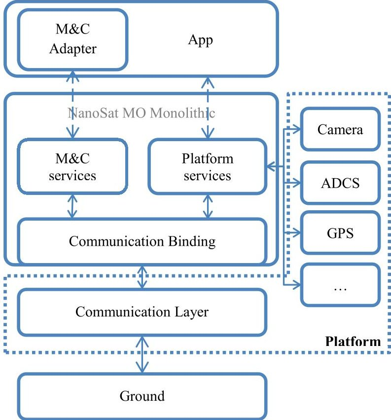
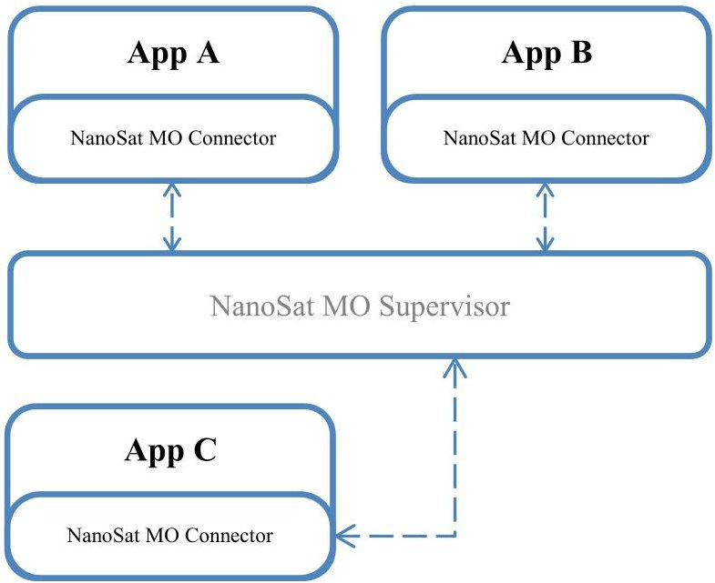
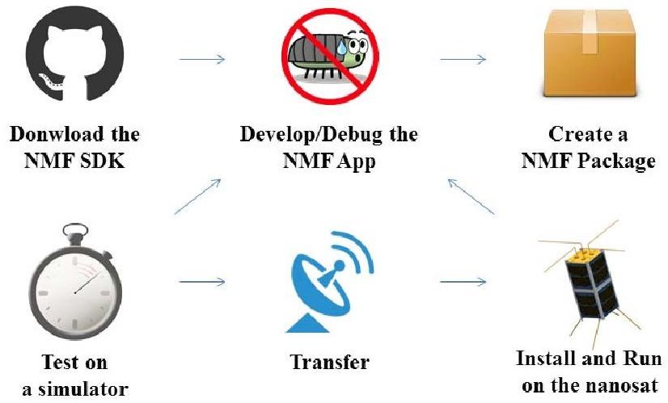
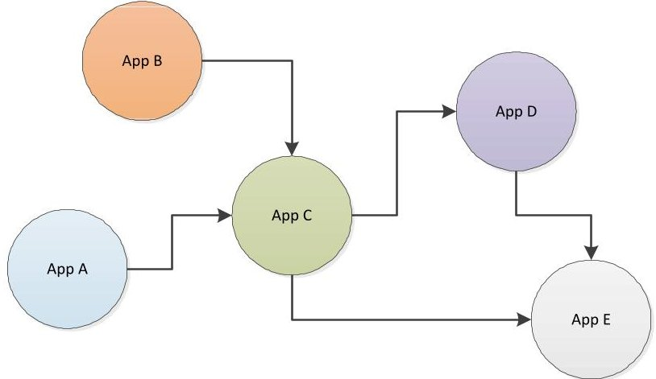
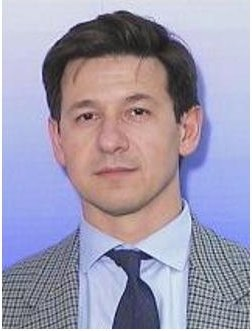

<!-- PDF_PAGE: 1 -->

<div align="center">

# NanoSat MO Framework: When OBSW turns into apps

</div>

César Coelho

TU Graz and ESA/ESOC

Robert-Bosch-Straße 5

Darmstadt, Germany 64293

+496151/902286

Cesar.Coelho@esa.int

Otto Koudelka

TU Graz, Institute of Communication

Networks and Satellite Communications

Inffeldgasse 12

Graz, Austria 8010

+43 (316) 873 - 7440

Koudelka@tugraz.at

Mario Merri

ESA/ESOC

Robert-Bosch-Straße 5

Darmstadt, Germany 64293

Mario.Merri@esa.int

Abstract—The rising market of smartphones and tablets brought new ideas into software by providing quick development of software using well defined libraries from Android and iOS. Additionally, Android gave the community an extra degree of freedom by making their mobile apps, portable entities of software where the same app can run on the hardware of different vendors as long as the devices have the same underlying Android framework. Comparatively, the NanoSat MO Framework (NMF) based on CCSDS Mission Operations (MO) services intends to change the current view on On-Board Software (OBSW) by turning it into flexible "apps" that can be easily developed, debugged, tested, deployed and updated at any time without causing any major problem to the spacecraft. Furthermore, it will be possible to use the same "app" on different nanosatellite platforms as long as the NMF components are used. This means that an app developed using NMF's Software Development Kit (SDK) will be able to, for example, publish telemetry, receive telecommands or acquire the latest GPS position on different nanosatellites without any change in the code. It shall be used for the first time in the context of the ESA OPS-SAT mission in order to allow its experimenters to seamlessly develop their experiments in form of a NMF app without the need of understanding the low-level implementation details of the satellite platform. Software management is a key element that should not be underestimated on a framework intended run multiple apps. Installing, uninstalling, updating packages and starting, stopping, killing apps can define the behavior of the spacecraft and thus the NMF encompasses well-defined interfaces for software management. A new mind-set is introduced in this paper and a different approach compared to today's OBSW monolithic view is presented, making the following question arise: "How will space software look like in 20 years from now?"

## TABLE OF CONTENTS

1. INTRODUCTION ... 1

2. CCSDS MISSION OPERATIONS SERVICES AND

OPS-SAT ... 2

3. NANOSAT MO FRAMEWORK (NMF) ... 3

4. NMF APPS' LIFECYCLE ... 4

5. A NEW WORLD OF SPACE APPS ... 6

6. CONCLUSION ... 7

7. FUTURE WORK ... 7

REFERENCES ... 7

BIOGRAPHY ... 8

978-1-5090-1613-6/17/$31.00 $2017 European Union

## 1. INTRODUCTION AND STATE OF THE ART

The classical on-board software (OBSW) is currently seen as an almost immutable piece of software which is developed for a particular use case where future updates would imply patching specific memory areas. Moreover, many times the OBSW is written for embedded devices that will never be updated again.

The sudden increase of commercial of-the-shelf (COTS) hardware for nanosatellites with great amounts of processing power are allowing space community to think and move towards spacecraft with system environments capable of running full Operating Systems. OPS-SAT is a good example of this transition, as it provides an experimental platform composed of a MityARM device with 1 GB of RAM, an ARM processor and a lightweight version of Linux, the Yocto project. [1]

The idea of creating portable on-board software has been introduced by A. A. Koltashev in "A Practical Approach to Software Portability" and their approach relies on the strong typing and separate compilation of Modula-2 programming language. Another existing onboard software framework is core Flight System (cFS), a product line that uses a layered architecture and compile-time configuration parameters which make it portable and scalable. The software layers that defined the application run-time environment are now under a NASA-wide configuration control board with the goal of sustaining an open-source application ecosystem. Even though cFS follows the concepts of stratification, portability and code reuse, it is developed with a focus on embedded software systems while the NanoSat MO Framework is developed for systems that are not scarce in resources but are capable of running complete Operating Systems. [2] [3] [4]

The paper explains the CCSDS Mission Operations services together with OPS-SAT, then it goes over the NanoSat MO Framework concept. Based on the new ideas coming from the NMF, a lifecycle of NMF apps is described and more advanced use cases are exemplified on how to take full advantage of the NMF.

<!-- PDF_PAGE: 2 -->

## 2. CCSDS MISSION OPERATIONS SERVICES AND OPS-SAT

The NanoSat MO Framework is based on the CCSDS Mission Operations concept and it is intended to be implemented and used by experiments on the future ESA OPS-SAT mission as first reference implementation. OPS-SAT is an in-orbit laboratory mission designed to test new software where no single-point of failure is allowed to exist. Therefore, in case of a system failure, the mission shall be always recoverable. The reliability of the experimental platform provides the perfect opportunity to try the NanoSat MO Framework. [5]

## OPS-SAT

The recent miniaturization of space components and electronics has allowed the design of smaller satellites which are considerably cheaper to build and launch than conventional satellites. This decrease in the total cost of a space mission has boosted a new growing market for small satellites and, as the number of small satellites keeps increasing, there is a raising demand for reusable software across nanosatellites.

ESA and its European industry partners generate many new and innovative ideas for advancing European space technology regarding mission operations every year, but the majority of these innovations never make it to orbit. OPS-SAT emerged, providing a low cost in-orbit laboratory available for authorized experimenters to test, demonstrate and validate their developed software experiments. OPS-SAT is the first CubeSat designed by ESOC and is a safe experimental platform which shall fly in a LEO dawn-dusk orbit. OPS-SAT makes available a reconfigurable platform, at every layer from channel coding upwards, and it will be available for experimenters wishing to test and demonstrate new software and mission operation concepts.[6]

## CCSDS Mission Operations services

CCSDS Mission Operations (MO) is a set of standard end-to-end services based on a service-oriented architecture which are currently being defined by the Consultative Committee for Space Data Systems (CCSDS) and it is intended to be used for mission operations of future space missions.

The layered MO services framework (Figure 1) allows mission operation services to be specified in an implementation and communication agnostic manner. The core of the MO service framework is its Message Abstraction Layer (MAL) which ensures interoperability between mission operation services deployed on different framework implementations.

The MO services are specified in compliance to a reference service model, using an abstract service description language, the MAL. This is similar to how Web Services are specified in terms of Web Services Description Language WSDL. For each concrete deployment, the abstract service

interface must be bound to the selected software implementation and communication technology.

Standardization of a Mission Operations Service Framework offers a number of potential benefits for the development, deployment and maintenance of mission operations infrastructure: [8]

- Increased interoperability between agencies;

- Re-usage between missions;

- Reduced costs;

- Greater flexibility in deployment boundaries;

- Increased competition and vendor independence;

- Improved long-term maintainability.

The deployment of standardized interoperable interfaces between operating Agencies, the spacecraft and internally on-board would in itself bring a number of benefits. Each organization would be able to develop or integrate their own multi-mission systems that can then be rapidly made compliant with the spacecraft. It does not preclude the reuse of legacy spacecraft, simply requiring an adaptation layer on the ground to support it, rather than many mission-specific bespoke interfaces. In the on-board environment, where software development costs are considerably higher due to platform constraints and reliability requirements, software reuse can bring immense savings. [9]





<div align="center">

Figure 1. CCSDS Mission Operations framework

</div>

The NMF inherits all the advantages of the MO framework an extends it with a special focus for nanosatellites by providing pre-implemented components that can be easily assembled in order to achieve a full end-to-end system.

<!-- PDF_PAGE: 3 -->

## 3. NANOSAT MO FRAMEWORK (NMF)

The NanoSat MO Framework (NMF) provides a standard on-board software framework for nanosatellites that facilitates not only the monitoring and control of the nanosatellite software applications, but also the interaction with the platform. This is achieved by using the Mission Operations Monitor and Control services included in the MO service suite and by defining a set of new Platform services which shall also follow the MO services framework architecture. Furthermore, a new set of services will be defined for software management.





<div align="center">

Figure 2. NanoSat MO Monolithic simplified architecture.

</div>

In the context of the NanoSat MO Framework, an app is defined as an on-board software application that can access the platform peripherals via the Platform services and additionally can be started, monitored, stopped, killed, installed, uninstalled and updated from ground. Optionally, it can expose M&C services to ground and to other apps running on-board.

By having a central Directory service where all the apps register their services' URIs, it is possible to discover them both from space and ground. This allows the development of apps that use services made available by other apps onboard. One promising envisaged use case is having an app providing file transfer capabilities to other apps. Furthermore, apps are allowed to have their own MO services API implementation that is independent of the underlying transport technology. This opens the possibility of easily embedding new future standard APIs into an app for testing purposes, for example, the CCSDS MO Planning

and Scheduling services could be developed and tested in an app.





<div align="center">

Figure 3. Multiple apps instantiated and connected to the NanoSat MO Supervisor.

</div>

There are a set of high-level components that allow the establishment of complete end-to-end deployment scenarios. Each high-level component must choose which services and transport layers shall be used depending on the functionalities and deployment location of that component. Additionally, some of them might need to be further whittled depending on the chosen platform. With this in mind, a modular and flexible approach was taken for the design and development in order to maximize reuse and customizations between different missions and user needs.

A software bundle is being assembled with all the NanoSat MO Framework related software. It comes with a collection of services' sets, many transport layers, generic and specific implementations of the high-level components, a set of apps, ground demos, a Consumer Test Tool (CTT) to configure apps and an OPS-SAT Software Simulator. The software bundle will be available online for free under an open-source license.

The NanoSat MO Framework is composed of high-level components that are able to provide concrete deployments: Generic NanoSat MO Monolithic, Generic NanoSat MO Supervisor, NanoSat MO Connector, Ground MO Adapter and Ground MO Proxy. [4]

The Ground MO Adapter and Ground MO Proxy are components intended to be deployed on ground. When combined with the space segment part, they are capable of providing end-to-end deployment solutions.

The NanoSat MO Supervisor and the NanoSat MO Connector are components intended to be deployed in space. The NanoSat MO Connector provides towards the app

<!-- PDF_PAGE: 4 -->

developer the possibility to execute actions, set/retrieve parameter values, and additionally, common interfaces to access the satellite's platform peripherals. This interface is the exact same interface as the one used on the monolithic architecture and therefore it is possible to do a swap of the underlying architectures without any major changes on the business logic of the app.

The NanoSat MO Supervisor allows having multiple apps sharing the same Platform services for the interaction with the peripherals on-board. Additionally, it brings software management capabilities such as: starting, stopping, installing, updating and uninstalling apps on-board of the spacecraft.

## 4. NMF APPS' LIFECYCLE

A NMF app can be developed using the NMF Software development Kit (SDK) and then packaged into a NMF Package. After, the app can be tested on a simulator, either purely software-based or on a private Flatsat and then transferred to the nanosatellite where it can be installed and started.





<div align="center">

Figure 4. NMF apps' lifecycle

</div>

## Download the NMF SDK

The NMF SDK will be available online on GitHub under an open-source license and can be cloned by anyone around the world. [10]

The SDK will includes demo apps, ground implementation examples, a guide to develop NMF apps, a Consumer Tester Tool, a tool to generate NMF Packages and a "Playground" environment to test everything.

## Develop/Debug the NMF App

An NMF app can be started to be developed by adding the correct NMF dependency in the POM file of the project (in case maven is used) or by simply duplicating one of the many demo projects available in the SDK. During development, the apps can reuse many already existing libraries available and that will significantly speed up the development time.

The app can control the spacecraft using the Platform services, a set of high-level interfaces made available by the NanoSat MO Framework. These are self-invented MO services for interacting with common peripherals available on most nanosatellites.

## Create a NMF Package

The NanoSat MO Framework will include a "Package Management" service that provides functionality similar to a package management system. This means that an application can be wrapped in a package, sent to the spacecraft and then installed, uninstalled or upgraded. Furthermore, an "App Launcher" service will also be present in order to start, stop and kill applications. [10]

An NMF Package is a digital content distribution package intended to be used to install, uninstall and update applications on a spacecraft system that uses the NanoSat MO Framework. An NMF Package can be generated by using the tools provided by the NMF SDK. The application inside the package doesn't necessarily need to be a NMF app, it can also be a dedicated or spacecraft-specific

```java

Vector3D sunVector = ((AttitudeInstanceSunPointing) attitudeInstance).getSunVector();

try {

    nmf.pushParameterValue(PARAMETER_ADCS_MODE, attMode.toString());

    if (sunVector != null) {

        nmf.pushParameterValue("sunVector3D_X", sunVector.getX());

        nmf.pushParameterValue("sunVector3D_Y", sunVector.getY());

        nmf.pushParameterValue("sunVector3D_Z", sunVector.getZ());

    }

}

} catch (IOException ex) {

    Logger.getLogger(DemoAdapter.class.getName()).log(Level.SEVERE, null, ex);

}

```

<div align="center">

Figure 5. A code snip demonstrating the simplicity of pushing parameter values from space to ground.

</div>

<!-- PDF_PAGE: 5 -->

<table class="table table-bordered"><thead><tr><th>Obj Inst Id</th><th>name</th><th>description</th><th>rawType</th><th>rawUnit</th><th>generationEnabled</th><th>updateInterval</th></tr></thead><tbody><tr><td>1</td><td>ADCS.ModeOperation</td><td>The ADCS mode operation</td><td>String</td><td></td><td>□</td><td>3</td></tr><tr><td>2</td><td>GPS.NumberOfSatellitesInView</td><td>The number of satellites in vie...</td><td>Integer</td><td>sats</td><td>□</td><td>4</td></tr><tr><td>3</td><td>GPS.Latitude</td><td>The GPS Latitude</td><td>Double</td><td>degrees</td><td>□</td><td>2</td></tr><tr><td>4</td><td>GPS.Longitude</td><td>The GPS Longitude</td><td>Double</td><td>degrees</td><td>□</td><td>2</td></tr><tr><td>5</td><td>GPS.Altitude</td><td>The GPS Altitude</td><td>Double</td><td>meters</td><td>□</td><td>2</td></tr><tr><td>6</td><td>Magnetometer.X</td><td>The Magnetometer X component</td><td>Double</td><td>microTesla</td><td>□</td><td>2</td></tr><tr><td>7</td><td>Magnetometer.Y</td><td>The Magnetometer Y component</td><td>Double</td><td>microTesla</td><td>□</td><td>2</td></tr><tr><td>8</td><td>Magnetometer.Z</td><td>The Magnetometer Z component</td><td>Double</td><td>microTesla</td><td>□</td><td>2</td></tr><tr><td>9</td><td>positionVector3D_X</td><td>This Parameter Definition was...</td><td>Double</td><td></td><td>✓</td><td>0</td></tr><tr><td>10</td><td>positionVector3D_Y</td><td>This Parameter Definition was...</td><td>Double</td><td></td><td>✓</td><td>0</td></tr><tr><td>11</td><td>positionVector3D_Z</td><td>This Parameter Definition was...</td><td>Double</td><td></td><td>✓</td><td>0</td></tr><tr><td>12</td><td>quaternion1</td><td>This Parameter Definition was...</td><td>Float</td><td></td><td>✓</td><td>0</td></tr><tr><td>13</td><td>quaternion2</td><td>This Parameter Definition was...</td><td>Float</td><td></td><td>✓</td><td>0</td></tr><tr><td>14</td><td>quaternion3</td><td>This Parameter Definition was...</td><td>Float</td><td></td><td>✓</td><td>0</td></tr><tr><td>15</td><td>quaternion4</td><td>This Parameter Definition was...</td><td>Float</td><td></td><td>✓</td><td>0</td></tr></tbody></table>

<div align="center">

Figure 6. CTT: Consumer Test Tool displaying the list of parameters definitions available on the provider.

</div>

application however then it won't be a portable entity of software such as the NMF apps that can be developed using the NMF SDK. [11]

## Test on a Simulator

After packaging the app it is possible to install it on a simulated environment similar to the real one. The NMF SDK will provide a "NMF Playground" which is an out-of-the-box-solution where app developers can test their apps. This simulated environment was inspired by OPS-SAT's mission requirements and characteristics because the first set app developers are expected to be OPS-SAT experimenters. It will include the simulation of the orbit of a typical nanosatellite and provide the possibility to control its attitude, get GPS data, take pictures, get magnetometer data, among others, by using the NMF Platform services. [12]

In order to facilitate the configuration and testing during development, there will be provided a Consumer Test Tool (CTT, previously known as Configuration Manager tool) which provides a user-friendly interface to allow the testing of an app developed with the NMF. For each service there is a consumer GUI panel that provides a visual interface to configure and interact with the service. This application takes advantage of the Ground MO Adapter for the connection to the apps. [4]

Additionally, ESA intends to make available a dedicated Flatsat to be used remotely by external experimenters in order to allow them to test their experiment before flight with most of the hardware that will fly in OPS-SAT.

Throughout this whole phase, one can always go back to the Develop/Debug phase in case the app doesn't work as expected.

## Transfer

At the moment, the NMF does not provide natively a solution for File Transfer and therefore relies on third party software for the transfer of packages to space.

Having a native file transfer interface completely integrated into the NMF is a possibility and could potentially facilitate the development of apps that generate data that needs to be downlinked to ground. The dedicated interface would be available in the NanoSat MO Connector and it would connect to another app containing file transfer capabilities.

The CCSDS has defined the CCSDS File Delivery Protocol (CFDP), a space standard for reliable transfer of files across the space link. OPS-SAT intends use an application provided by ESA implementing CFDP in order to transfer files between ground and space. [13] [7]

## Install and Run on the nanosatellite

Two services have been defined and implemented in order to install and run apps, the Package Management service and the Apps Launcher service.

The NanoSat MO Framework will include a "Package Management" service that provides functionality similar to a package management system in order to install, uninstall or upgrade packages. Furthermore, the "Apps Launcher" service will be available in order to start, stop and kill the apps that have been installed in the nanosatellite.

<!-- PDF_PAGE: 6 -->

After installing and running the app, one might find mission-specific problems or possible performance optimizations that can be done, if so, the app developer can easily go back to the Develop/Debug phase and afterwards, transfer the new version and update the app on the nanosatellite.

For monitoring and control of OPS-SAT experiments, ESOC has been developing a project that integrates WebEUD and the Ground MO Adapter in order to provide an easy web interface to access apps that are running on-board. OPS-SAT experimenters will be able to directly use this web interface, as they would have to plug the Ground MO Adapter into their own MCS otherwise. This is only possible thanks to the standardization efforts done by the CCSDS in defining a standard for the Monitor and Control services that all apps automatically implement when they use the NanoSat MO Connector component. [14] [15]

## 5. A NEW WORLD OF SPACE APPS

When a mobile app is developed, it is never intended to cover all the possible functionalities of a normal phone but instead they are software entities dedicated to executing particular tasks in order to reach the user goals. Extending this idea to the space domain would create a new set of space software developers focused on particular satellite operations and functionalities. Just as the Uber $ ^{\mathrm{TM}} $ app and Snapchat $ ^{\mathrm{TM}} $ app have very different purposes to the user.

Nowadays, there's a high demand for mobile app software developers in the market mainly because of the new generation of phones with advanced processing capabilities that can run full Operating Systems that have internet access availability most of the time. These app developers do not know the implementation details of every single smartphone and instead they develop their apps against well-defined interfaces that let them do the operations they intend on most of the smartphones.

## Reuse of apps between nanosatellites

By shifting the software development approach to a low risk activity focused on nanosatellite-specific functionality rather than development of complete systems, smaller companies would be able to specialize on particular spacecraft functionalities and easily enter the space software arena by providing a software product to many different spacecraft.

Nanosatellite owners would also benefit because they would have a broader set of choices when picking the software to let them achieve the mission goals.

Moreover, some developers/companies could become more transparent about their flight software apps and release it online under an open-source license and make business from the technical support, software training or satellite customization assistance.

## Sharing resources within the nanosatellite

The approach of having functionality divided into different apps does not limit a certain resource to a single app. The Platform services implementation included on the NMF will be thread-safe and will expose a set of MO services that can be consumed by different apps simultaneously. For example, the GPS service allows multiple consumers to get the last known position of the nanosatellite or, in a more advanced example, to control the attitude of the nanosatellite by different consumers. In this case, if a second app tries to control the attitude while in use, the operation will return an error with the duration remaining for the first app to release the attitude mode set.

The NanoSat MO Supervisor is the component responsible for exposing the Platform services to other apps however the concept can be expanded to mission-specific services to be consumed by mission-specific apps.

## Cascading apps

Following the line of thought mentioned above, where one app is connect to the services exposed by another app, it is possible to expand this by creating an app that exposes new services and connects to the services exposed by another app at the same time. This allows to cascade multiple apps that are separated by functionality into a n-apps chain which follows the service composability principle of the service-oriented design paradigm.





<div align="center">

Figure 7. Apps exposing and consuming services to/from other apps

</div>

## Formation flying apps

Many missions nowadays need to have multiple spacecraft working together in order to achieve its mission goals. The most common types of formations are: constellation formations, cluster formations and trailing formations.

Multiple instances of the same app could be deployed in different satellites of a multi-satellite mission.

For Cluster Formations the necessary coordination between the different spacecraft could be more flexibly designed to

<!-- PDF_PAGE: 7 -->

support coordination between multiple nodes. A concrete example could be given for ESA's Asteroid Impact Monitoring (AIM), a candidate mission that intends to collect data from a set of nanosatellites flying around the impact zone created by the DART spacecraft. By having interlinked apps on different nanosatellites, a higher degree of coordination could be achieved. [16]

## Pay-per-Orbit

With small customization, the NMF could start and stop apps autonomously based on location or time and that would allow the creation of a business model where users can "rent" the satellite and deploy their apps only over certain areas of the world for their apps to run.

## 6. CONCLUSION

The framework's target audience is nanosatellites and everyday these are starting to use faster and faster processors which include System on a Chip (SoC) solutions with large amounts of RAM capable of running full operating systems such as it happens in OPS-SAT.

The NMF provides a new way of developing software by breaking the OBSW into multiple software entities that are separated by functionality just like in current mobile phones. This has the potential to increase software reusability between nanosatellites and consequently reduce costs.

The NMF is expected to be available online in 2017 and it is expecting to finally bring on-board software to the forefront of technology.

## 7. FUTURE WORK

The NMF SDK allows app developers to start creating apps that can run on any nanosatellite with NMF therefore it is an important part that should be made available as soon as possible. This SDK will be used by OPS-SAT experimenters to develop their software in a fast and quick way and so it can potentially give a lot of feedback for future improvements on the NMF. The first implementation of the NMF will be in OPS-SAT and its development is ongoing. The process of identification of potential future missions where the NMF can run could be started.

## REFERENCES

[2] Andrey Koltashev, "A Practical Approach to Software Portability Based on Strong Typing and Architectural Stratification", Modular Programming Languages, Volume 2789 of the series Lecture Notes in Computer Science pp 98-101.

[3] D. McComas, S. Strege, J. Wilmot, "core Flight System (cFS): A Low Cost Solution for SmallSats", Goddard Space Flight Center, 2015

[4]C. Coelho, M. Merri, M. Sarkarati, O. Koudelka, "NanoSat MO Framework: Achieving On-board Software Portability", SpaceOps, 2016

[5] C. Coelho, D. Evans, O. Koudelka, "CCSDS Mission Operations Services on OPS-SAT", 10th IAA Symposium on Small Satellites for Earth Observation, 2015

[6]O. Koudelka, M. Wittig, D. Evans, "ESA's OPS-SAT Nanosatellite Mission - A Laboratory in the Sky", 10th IAA Symposium on Small Satellites and Earth Observation, 2015

[7] D. Evans, A. Lange, J. Feiteirinha, J. Nörtemann, C. Coelho, "OPS-SAT: Preparing for the Operations of ESA's First NanoSat", SpaceOps, 2016

[8] CCSDS, Mission Operations Services Concept, Green Book. Issue 3. December 2010

[9] S. Cooper, "CCSDS Mission Operations Services in Space", SpaceOps, 2012

[10] GitHub site: www.github.com

[11] C. Coelho, M. Merri, M. Sarkarati, O. Koudelka, "OPS-SAT Experiments' Software Management with the NanoSat MO Framework", AIAA Space 2016, 2016

[12] C. Suteu, "Master Thesis: OPS-SAT Software Simulator", Julius Maximilian University Würzburg & Luleå University of Technology, 2016

[13] CCSDS, CCSDS File Delivery Protocol (CFDP), Blue Book. Issue 4. January 2007

[14] J. Schütz, "EGOS User Desktop: A Generic User Interface Framework for Ground Segment Software", GSAW, 2014

[15] CCSDS, Mission Operations Monitor & Control services, Red Book. Issue 3. March 2014

[16] F. Ferrari, M. Lavagna, "Asteroid Impact Monitoring mission: Mission Analysis and innovative strategies for close proximity manoeuvring", $ 4^{th} $ IAA Planetary Defence Conference, 2015

<!-- PDF_PAGE: 8 -->


César Coelho obtained his Bachelor degree in Aerospace Engineering from Instituto Superior Tecnico (in Lisbon) in 2012. Right after, he joined the SpaceMaster program, a Joint European Master in Space Science and Technology. Since October 2014, César is doing his PhD with Graz University of

Technology in collaboration with the European Space Agency under the NPI program and the research is focused on designing an on-board software framework for nanosatellites inspired by smartphones methodologies. The research shall be implemented and used by experiments in the future ESA OPS-SAT mission. Cesar is also a member of the CCSDS SM&C Working Group.


Otto Koudelka studied Electrical Engineering at Graz University of Technology (TU Graz). He received Master and PhD degrees with honours in communications. In 2002 he became Professor in Communications at TU Graz. He is head of the Institute of Communication Networks and

Satellite Communications at TU Graz since 2000. He also served as Director of the Institute Applied Systems Technology, respectively, Head of the Space and Acoustics Research Group at Joanneum Research until 2012. From 2005-2011 he was Vice Dean of the Faculty of Electrical Engineering and Information Technologies. He is Principal Investigator and project leader of the BRITE-Austria/TUGSAT-1 nanosatellite mission (the first Austrian satellite) launched in 2013. He is also PI of the Austrian communications and wave propagation experiments on ESA's ALPHASAT satellite studying adaptive communications and project leader for ESA' OPS-SAT nanosatellite mission. He is member of IEEE and OVE (Austrian Association of Engineers).





Mario Merri has graduated in Electronic Engineering from Politecnico di Milano. He received his Master and PhD degree at the University of Rochester, New York, USA. Since 1989, he has been working at the European Space Agency where he is the Division Head of the Mission Data Systems

Division (OPS-GD) at the European Space Operations Centre in Darmstadt, Germany which is responsible for the design, development and maintenance of basic software complex for many ESA missions. Mario is also the Area Director of the CCSDS Mission Operations and Information Management Services Area (MOIMS).