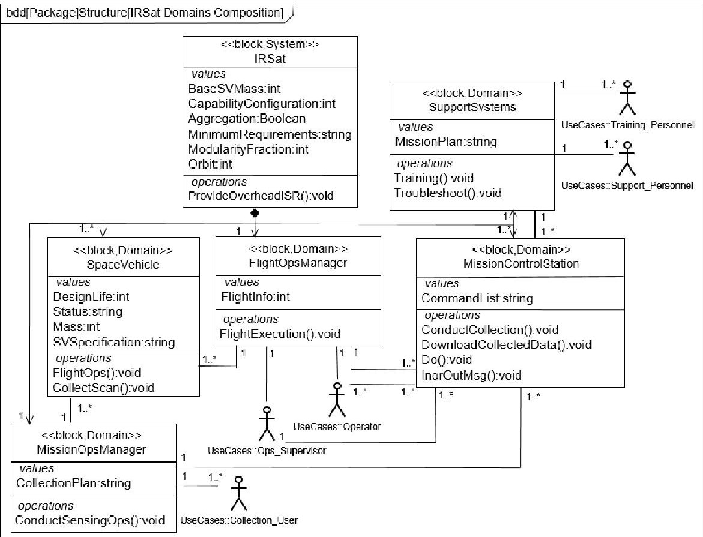
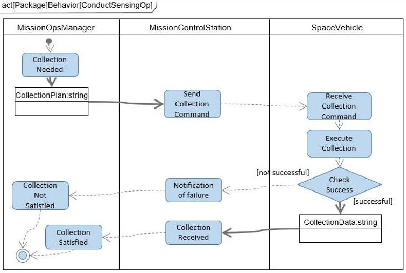
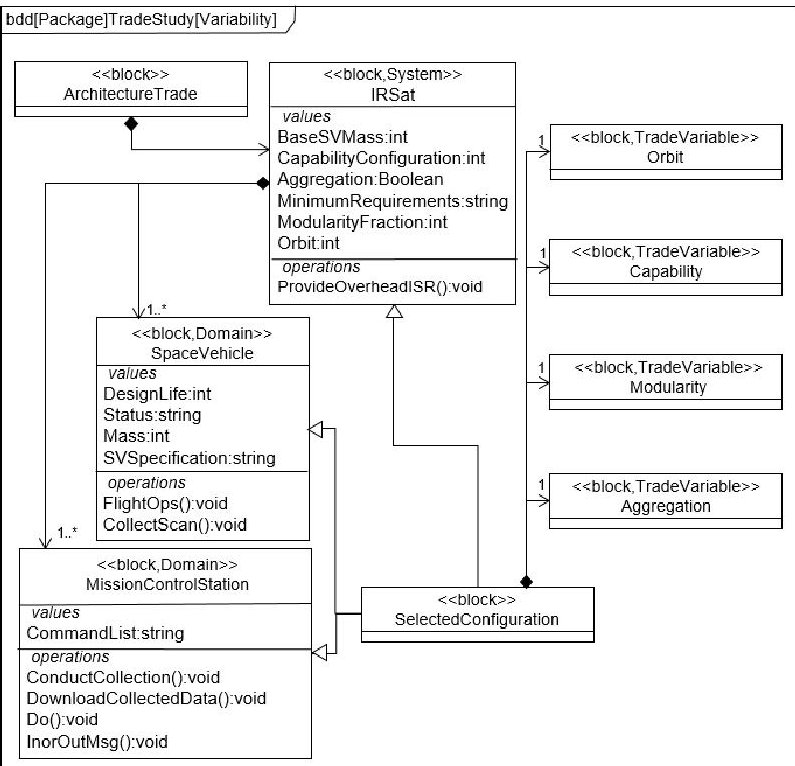
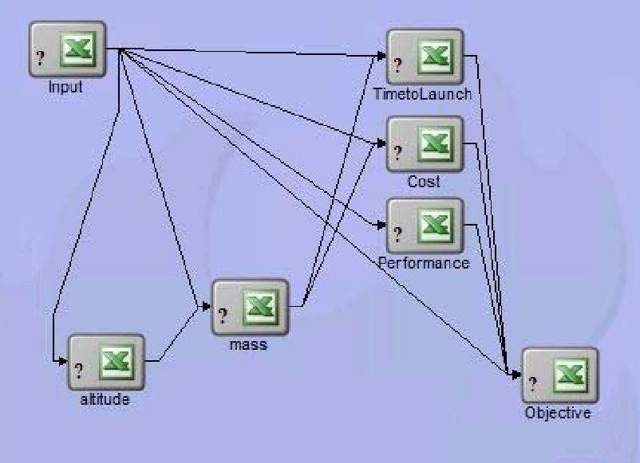
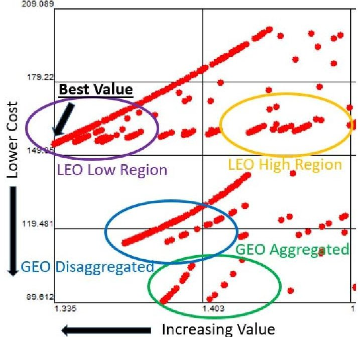

<!-- PDF_PAGE: 1 -->

# Model-Based Architecture Optimization for Major Acquisition Analysis of Alternatives

Maj Michael LaSorda United States Air Force Space and Missile Systems Center 483 N. Aviation Blvd. El Segundo, CA 90245 719-439-3233 Michael.lasorda@us.af.mil

John Borky Colorado State University College of Engineering 1301 Campus Delivery Fort Collins, CO 80523 719-640-8423 Mike.borky@colostate.edu

Ron Sega Colorado State University College of Engineering 1301 Campus Delivery Fort Collins, CO 80523 970-491-7067 Ron.sega@colostate.edu

Abstract—Architecture selection trade studies in DoD acquisitions, in particular during the mandated Analysis of Alternatives (AoA) process of a Major Defense Acquisition Program (MDAP), typically select several parameters of interest and generate a comparison set of 4 or 5 potential architectures. These architectures are then individually evaluated on each parameter of interest, with the results manually compared. Measures of effectiveness (typically dealing with technical performance) and cost are independently analyzed per DoD guidance. Based on advances in model-based systems engineering (MBSE), systems architecting best practices, and analytical tools, we propose a better option to conduct a multidisciplinary optimization (MDO) for the parameters of interest, including cost, to generate the architecture that presents the best value for the government while meeting affordability and performance constraints. This allows for more potential architectures to be evaluated quickly and can lead to the identification of the most promising architectures that may not have been identified utilizing more traditional manual methods. MDO can also be demonstrated to have greater transparency, more robust uncertainty analysis, and increased flexibility in adapting to scope changes in the evaluation than a more manual approach. In this research, a satellite architecture trade study analyzing disaggregation, modular satellite development, and alternative orbits was conducted with the more manual technique per current AoA guidance, and the MDO technique utilizing the ModelCenter $ ^{\mathrm{TM}} $ tool developed by Phoenix Integration, Inc. The results of the techniques were compared and demonstrated how MDO can capture extra value from an architecture trade study, in particular an AoA, than a more manual process. In addition, the techniques themselves were compared on the basis of cost, level of effort, uncertainty, transparency, and flexibility with the intent of identifying improved DoD guidance for MDAP acquisitions.

## TABLE OF CONTENTS

1. INTRODUCTION...1

2. OVERVIEW OF APPROACH...2

3. EVALUATION METHOD GRADING...3

4. CASE STUDY...4

5. COMPARISON OF METHODS...6

6. SUMMARY...8

APPENDIX...8

A.DISCLAIMER...8

ACKNOWLEDGEMENTS...8

978-1-5386-2014-4/18/$31.00 ©2018 IEEE

REFERENCES ...8

BIOGRAPHY ...9

## 1. INTRODUCTION

## Current Analysis of Alternatives Process

United States Department of Defense (U.S. DoD) acquisitions undergo an AoA evaluation early in the acquisition lifecycle in order to help decision makers understand the tradespace for new materiel solutions to satisfy an operational need. This AoA process is an analytical comparison of the operational effectiveness, suitability, and life-cycle cost of alternatives that satisfy established capability needs. Successful completion of AoAs must be certified to Congress for Major Defense Acquisition Programs (MDAPs). Per current DoD guidance, cost analysis is performed separately from measure of effectiveness and performance analysis [1].

Current AoAs are long, expensive processes. Typical recent Air Force AoAs had an average cost of $15M and took 21 months to complete [2]. This is considered a worthwhile investment as the resultant decisions could impact many billions of dollars of government acquisitions.

## Opportunities for Improvement

Within the authors' experiences, the AoA process has opportunities for improvement, in particular with how they enable a final decision on a materiel solution. While many different criteria are thoroughly analyzed within the current AoA process, all too often how that influences a final decision is unclear as the results for the various criteria are somewhat subjectively compared at senior-level decision meetings. Most frequently, the architecture corresponding to the lowest cost for acceptable performance is selected as cost is easily quantifiable and therefor stakeholders that push for lowest cost can often make the most persuasive argument. The result may not actually be the best value for the government.

In a resource-constrained environment, it is critical to provide the greatest capability for the cost. Very often, the lowest cost to meet the minimum requirements isn't at that value point.

<!-- PDF_PAGE: 2 -->

The U.S. DoD acquisition community has conducted an initiative known as "Better Buying Power" since 2010 focused on improving the value the DoD achieves for each dollar spent. The latest version, "BBP 3.0" specifically advocated for identifying better objective measures of value for DoD and industry alike [3].

By exploiting new Model-Based Systems Engineering (MBSE) techniques, this research seeks to demonstrate a better, more-rigorous, model-based analytical approach to objectively measure and select best value from an architecture trade study, specifically an AoA. We believe the results can be applied more generally to architecture optimization in many system categories.

## MBSE Background

Model-based systems engineering essentially refers to controlling systems engineering processes through the use of models (formally a single linked model) rather than documents. It is a fundamental shift in the technical execution of major acquisition programs [4].

There are challenges with implementing MBSE effectively. These include contractual requirements [5] and lack of staff with education and expertise on MBSE processes, leading some to suggest document-based processes may be safer [6].

Still, MBSE has had many demonstrated successes. A comprehensive study found MBSE, when applied rigorously, resulted in a "significant advantage" when compared to document-based systems engineering, primarily from cost and schedule savings [7]. It has been applied to a wide range of domains including information security systems [8], test and evaluation applications [9], and space systems [10].

## Problem Statement

Typically in a Space Acquisition AoA, a handful of driving design characteristics are selected to be varied, such as orbit, aggregating (combining) multiple missions on one physical satellite, and varying capability capacity. A handful of candidate architectures then are generated representing the boundary conditions and are independently evaluated on how they perform on various performance measures, risk, and cost per DoD guidance. In practice, these solutions are then debated by various groups of stakeholders until concurrence is eventually realized.

Current U.S. DoD AoAs, especially for DoD space acquisitions, often struggle with being able to convey the relative importance of additional capability and other measures against cost, which drives the decision toward the cheapest solution that meets the minimum requirements rather than selecting what may be the best value. A contributing factor to this is a lack of clear guidance on the relative importance of the other measures of success, leading to multiple stakeholders having multiple opinions. Cost tends to be a major forcing function, so that minimizing cost tends to result when concurrence can't be reached on what provides the best total value.

Given the push to provide clear, objective definitions of "best value" for DoD systems rather than just minimizing cost [3], we believe modifications to the current AoA standard process are in order. This paper outlines a modified approach to leverage MBSE in AoAs in order to arrive at a best value solution. We have compared this new approach to the current standard process and found the results promising.

## 2. OVERVIEW OF NEW AOA APPROACH

## New Recommended Procedure

Our recommended approach to AoAs is to select quantifiable parameters of interest and cost, select desired weightings, and then conduct an optimization to identify the best architecture choice. These parameters of interest and relative weightings would have to be agreed to by at an appropriately empowered organizational level to ensure stakeholder buy-in. Since requirements for DoD systems are currently identified and validated through the Joint Capabilities Integration and Development System (JCIDS) [11], we suggest a similar approval level for these parameters of interest and corresponding weightings.

This initial set of parameters of interest, including cost, and weightings define an objective function that can then be optimized to select the ideal architecture.

## Utilizing MBSE Methods in AoAs

Leveraging MBSE to conduct an optimization such as this has been explored. Several authors have investigated cost optimizations utilizing a model integration tool such as ModelCenter $ ^{\mathrm{TM}} $ by Phoenix Integration [12], [13], [14]. There are also a number of other techniques being developed. For instance, [15] developed an interesting technique leveraging design rules and evolutionary algorithms to alter the structure of the objective function itself. While these methodologies primarily focused on life cycle cost minimization, they provide a solid and ever-expanding foundational basis to explore this concept further.

There are some limitations with realizing the potential of this approach. While [16] highlights that all trade studies are inherently multiobjective optimizations, it also asserts it is much harder to define a mathematical function explicitly that adequately captures all stakeholder priorities. Frequently there are several critical assumptions that drive the output of the analysis that could cause stakeholder disagreement with the output results. New technology and associated risk in particular can be difficult to quantify. While this can be true, ultimately some uncertainty in the study is unavoidable to an extent, but at least defining an objective and documenting the critical assumptions that define it allows for transparency and repeatability in the results. As long as it's documented, it can be adjusted later through a traceable process with stakeholder feedback on the results.

During the execution, a reference architecture is first generated that provides a useful basis to conduct trade study excursions and which greatly simplifies modeling many

<!-- PDF_PAGE: 3 -->

different variables [17]. The initial reference architecture represents the core technical baseline in the MBSE sense as it provides the formal representation for the architecture to be studied. This can be created via a formal process such as the Model-Based Systems Architecture Process [18] which will result in the final reference architecture being codified in a model written in a known architecting language such as the Systems Modeling Language (SysML) [19].

Contributing analyses for the parameters of interest can then be defined. It is essential to select parameters of interest that can be quantified or limited to coordinated assumptions. This may involve some initial analysis to determine what parameters of interest are valued and are quantifiable. Typically, programmatic measures and mature measures of technical performance such as communications capacity for a given antenna size and power level have enough historical information or validated models to fall into this category. While it may sometimes be difficult to define operational need in quantifiable measures, a similar activity is already mandated in defining measurable Key Performance Parameters under the current JCIDS process. [11]

Next, following the model identified in [12] and [13], we can link the contributing analyses in a model integration tool such as ModelCenter. ModelCenter provides a robust integration environment with application programming interfaces (API's) that allows for the rapid arrangement and interaction of component models. There are also data analysis tools included in the software suite to exercise the integrated model through a range of inputs and evaluate the outputs.

At this point, there is enough information to formally approve the parameters of interest and associated weightings through a JCIDS-like process, focusing on requirements refinement in terms of capabilities as measured by performance parameters. This essentially serves to define an objective function for optimization. By focusing on factors and weights, it also ensures stakeholder discussion will help surface competing concerns and priorities and facilitate an attempt to reconcile them.

This top level optimization is then run with an initial set of input vectors taken from the reference architecture, and varied over the range of values that need to be studied. Using this method, a large number of potential architectures can be evaluated against the objective function and the optimum can be identified. Given modern computing resources, even relatively complex models with detailed contributing analyses can be exercised over a large range of input architectures as shown in [13].

Once the final result is selected, the reference architecture model that corresponds with that input vector can then immediately be used to start the technical baseline of the program. This brings the MBSE technique back full circle and explicitly starts the post-AoA program in a model-controlled technical baseline, which can be important to support any additional rapid rebaselining activities early in program development. Furthermore, this can serve as a

Government Reference Architecture to aid in the evaluations of eventual proposed contractor technical solutions.

## Stakeholder Iteration

While what is described above is the ideal situation, the authors realize that stakeholders and decision makers will likely not agree to be committed to the results of an analysis until they actually see those results. For this reason, the results should be considered preliminary until validated by the approving authority. This gives the opportunity for that authority to modify the weightings or the objective function if they feel the final results did not adequately capture their needs. This would also be an opportunity to challenge and adjudicate any driving critical assumptions.

Given the flexibility of the MBSE-enabled optimization, this type of iteration is actually not that difficult since most of the effort was in setting up the model in the first place. Therefore, the approving authority may be able to go through several iterations of an objective function, with each iteration and weighting being correspondingly rigorously documented. Ultimately, an objective best-value measure will be reached that all stakeholders and the approving authority can agree on.

## 3. EVALUATION METHOD GRADING

## Criteria Selection

We wished to compare the new approach outlined in part 2 to the traditional AoA approach. Based on interviews with several experts in architecture evaluation [20], we propose the following criteria to compare the approaches:

Objectivity: do different stakeholders come to the same conclusions when they review the evaluation?

Repeatability: can the analysis be performed multiple times by different parties and arrive at the same results?

Transparency: is it clear to any stakeholder who reviews the architecture evaluation why the chosen result was selected?

Flexibility: does the architecture evaluation easily allow for changes in scope during the evaluation execution?

Resource Intensiveness: how much does the evaluation cost, how long does it take, and does it require any hard to acquire resources (specific expertise, unique IT requirements, etc.)?

Selects Best Value: Does the evaluation consistently select the best value solution as defined by all the stakeholders?

Uncertainty Quantification: is uncertainty in the process and results understood so decision makers can have confidence in the results?

In order to compare the two approaches on these criteria, we conducted a case study, both using the new modified

<!-- PDF_PAGE: 4 -->

approach and the more traditional approach and compared the results and methodologies.

## 4. CASE STUDY

## Overview of Scenario

The case study to compare the methods of evaluation is a representative scenario for a potential DoD AoA. The scenario in question is notional to avoid sensitive data, but is defined to highlight the applicability and utility of this technique while utilizing publically available information. The technique is fully scalable to a very thorough modeling application that would be expected of an AoA as demonstrated by [13]. Ongoing research is pursuing the extension of these first results to greater details.

The scenario chosen (identified as "IRSat") is the acquisition of a new Electro-Optical (EO) monitoring capability to support anti-pirate operations in an Area of Responsibility with rapidly escalating threats. The requirements included rapid revisit over an equatorial theater with a comparatively low fidelity sensor to detect watercraft engaged in suspected piracy activity. Given the heightened attention accorded to this region, standing up a capability quickly was a greater priority than in normal acquisitions.

There were several options in the tradespace to be considered for this AoA. A small constellation of comparatively cheap Low Earth Orbit (LEO) satellites could be built to provide the necessary revisit rate, of variable altitudes and constellation size. As an alternative, a single, large, geosynchronous orbit (GEO) satellite could also provide the coverage. A further option with the GEO satellite would be the opportunity to have an aggregated space vehicle, sharing costs, with a new GEO communications satellite that was planning to enter development at the same time. Capability could also be varied between threshold and objective values. Finally, in this scenario, there was ongoing DoD emphasis on common modular spacecraft parts, which had to be considered as part of the scope of the AoA.

Following the methodology outlined in [18], an initial reference architecture was developed in order to establish a baseline for modeling trade study excursions. Utilizing SysML terminology [19], a Domains Composition Block Definition Diagram (BDD) is shown in Figure 1 and an activity diagram outlining the basic collection behavior for IRSat is shown in Figure 2.

Figure 1: IRSat Domains Composition

<!-- PDF_PAGE: 5 -->

Figure 2: IRSat "ConductSensingOp" Activity Diagram

To show how the various trade parameters affect the baseline reference architecture, a Variability BDD was developed in accordance with the technique developed in [12]. This is shown in Figure 3, and clearly identifies how varying the 4 input variables trace to select a specific configuration of the reference architecture.

Figure 3: IRSat Variability BDD

## Criteria Evaluated in the Analysis

This scenario led to the identification of several parameters of interest to be included in an AoA. In addition to lifecycle cost, these included capability development schedule, additional capability beyond threshold (minimum capability required), and inclusion of modular spacecraft parts. In a realworld AoA, additional trades could be expected, and this methodology is scalable to readily incorporate them.

Under the traditional AoA process, the various materiel solutions would be independently evaluated on the parameters of interest and costed with the results debated until the stakeholders could reach consensus. Under the

modified AoA process outlined in section 2, an optimization defining the best value for the government was selected with associated weighting. Normalization factors were also selected for the contributing analyses represented as functions in this multi-objective optimization. This structure is shown in eq. (1)

$$
\min \left[ \frac {. 4}{6 0} f _ {1} (x) + \frac {. 3}{5 0} f _ {2} (x) + . 2 f _ {3} (x) + \frac {. 1}{. 3} f _ {4} (x) \right]
$$

subject to:

$$
\begin{array}{l} f _ {1} (x), f _ {2} (x), f _ {3} (x), f _ {4} (x) \geq 0 \\ f _ {2} (x) \leq 2 0 0 \\ f _ {3} (x) \leq 1 \\ \end{array}
$$

In this equation, function 1, with a weighting of 0.4, corresponds to time to first satellite launch from contract authority to proceed and is normalized for 60 months, function 2, with a weighting of 0.3, corresponds to annual architecture cost and is normalized about $50M, function 3, with a weighting of 0.2, corresponds to minimizing the difference between actual performance and objective (desired) performance with threshold (minimal) performance normalized to 1, and function 4, with a weighting of 0.1, corresponds to a modularity ratio normalized to 0.3. All the functions had a lower constraint of 0, and cost had an upper constraint of $200M/yr to represent a departmental budget limit. Performance had an upper constraint corresponding to the normalized threshold performance of 1 with 0 corresponding to objective performance.

## Models Used

The initial reference architecture was developed using surrogate mass fractions and other data from the earth observing FireSat example (for a LEO EO satellite), Defense Support Program (DSP) DoD satellite (for a GEO EO satellite), and the Tracking and Data Relay Satellite (TDRS) (for GEO communications satellite) found in [21]. For the LEO regime, a selection of Walker-orbit constellations ranging from 3 to 9 satellites corresponding with altitudes of 1150 to 660 km as identified in [13] as a realistic set of optimum EO LEO constellations were considered.

CostA number of contributing analyses and supporting models were used in the optimization. The principle spacecraft cost model is shown in equation 2 and was taken from [22].

$$
C o s t (\$ M) = 1. 8 7 9 (m * 2. 2 0 5) ^ {. 6 8 8 9}
$$

This is a simplified parametric model based on spacecraft mass (m) in kg but certainly a more thorough bottoms up cost estimating methodology could be used as shown in [13] if that level of fidelity is available. This model includes spacecraft launch costs. To realize a per year architecture cost, the per spacecraft cost was multiplied by the number of spacecraft required then divided by the design life in years to reflect the costs of replenishing failed satellites in orbit. LEO satellites had a design life of 5 years and GEO satellites had

<!-- PDF_PAGE: 6 -->

a design life of 10 years based on the reference architecture. It is assumed any architecture considered could use existing satellite commanding ground infrastructure so that wasn't utilized as an analysis discriminator nor used in the cost estimate. The communications space vehicle was costed with the EO space vehicle if the aggregated GEO option was chosen or costed separately and added to the EO mission if a disaggregated architecture was chosen, so that both cases reflect the net government cost for the two missions.

ScheduleThe time to first launch model used is shown in equation 3 and is from a study of government satellite acquisition schedule information [23].

$$
\begin{array}{l} T i m e (m o s) = 7. 9 +. 6 9 (m * 2. 2 0 5) ^ {. 4 0 8} * D L ^ {. 1 7 9} (3) \\ + 1 1. 8 M T \\ \end{array}
$$

This model defines the time in months from contract authority to proceed to first satellite launch, and is based on space vehicle mass (m), design life (DL) in months and number of mission types (MT), which affects this scenario if an aggregated EO/Communications satellite is chosen.

$$
A (\$ M) = S ^ {*} \left[ 1 - \sum \left(1 - y _ {j}\right) ^ {*} k _ {j} \right]
$$

Modularity-A thorough methodology to account for commonality across modular satellite design is shown in [24]. In particular the flexible approach identified in [25] is attractive due to its simplicity, and from that we derived our estimate of the impact of modularity on cost as shown in equation 4.

In this model, A is the cost of the modular space vehicle, S is the cost of a completely non modular space vehicle, $ y_{j} $ is the coefficient of cost for modular component j (we assumed a coefficient of 0.08 consistent with spacecraft studies referenced in [24]), and k is the ratio to the total spacecraft cost for what component j replaces within your spacecraft.

Increased modularity did have a negative effect on performance as it is assumed common, modular components would not achieve the same performance as exquisite, purpose-built components. This impact would be determined on a case by case basis for a formal AoA. For our simplified case study, we assumed a decrement of 0.1 multiplied by the fraction of the spacecraft that was modular was applied to the spacecraft performance score to account for this.

## ModelCenter Setup

All the models were integrated using ModelCenter $ ^{\mathrm{T M}}. $ ModelCenter is an extremely flexible software package that allows for the dynamic execution and interaction of a number of models through the use of application programming interfaces. For this analysis, excel spreadsheets were utilized for each of the contributing and supporting analyses and linked together within the ModelCenter interface. The ModelCenter setup for our optimization is shown in Figure 1.

Figure 4: ModelCenter Simulation Setup

Once a ModelCenter simulation is set up, it can be exercised through a range of pre-built optimization tools. We selected the Darwin Genetic Algorithm optimizer for its use in similar types of architecture studies [12]. In addition to the main optimization run, several smaller runs were conducted to ensure consistency and that a global, not local, minimum had been identified.

## Case Study Results

For our optimization, after evaluating 877 potential architectures, the best value architecture was identified corresponding to a LEO constellation of 9 satellites with a maximum modularity fraction of 0.3 and elevated levels of in-built capability capacity to offset the performance decrement due to modularity.

This case study successfully demonstrated the execution of our new proposed methodology. Other sources [13] have shown the scalability of this methodology to a wide range of very detailed modeling. As this research progresses, further insights and discussion will be developed as more realistic test cases are investigated.

## 5. COMPARISON OF METHODS

## Overview

The two methodologies were conducted and compared on the evaluation criteria, with the results shown in Table 1. They were directly compared and the methodology that the authors felt concretely better addressed that criteria was marked with a [+], the methodology that performed worse with a [-], and cases where neither methodology clearly performed better are marked with a [0].

<!-- PDF_PAGE: 7 -->

Table 1: Methodology Comparison

<table border="1"><tr><td>Criteria</td><td>Traditional AoA Methodology</td><td>New Optimization Methodology</td></tr><tr><td>Objectivity</td><td>[-] Stakeholders may diverge in conclusions based on preferences once the individual analyses are complete</td><td>[+] Since all stakeholders agreed to the objective function during the buy-in process, they will all have to concur with the final results</td></tr><tr><td>Repeatability</td><td>[-] Differing stakeholders may choose to evaluate parameters of interest very differently since qualitative approaches could also be included</td><td>[+] While there is still opportunity for divergence, enforcing quantifiable measures reduces the potential for drastic disagreements</td></tr><tr><td>Transparency</td><td>[-] While the AoA approach and analysis results are documented, how the final decision occurred is often not clear</td><td>[+] Methodology approach and results through final decision are documented</td></tr><tr><td>Flexibility</td><td>[-] Changing a parameter of interest or expanding the input architecture tradespace could often invalidate all work conducted before</td><td>[+] As most of the work is up front in setting up the model, that work can be easily reused as the model is modified to accommodate scope changes</td></tr><tr><td>Resource Intensiveness</td><td>[0] Initially may be easier to set up, but becomes more resource intensive as changes occur to the AoA scope</td><td>[0] May require specific MBSE skillsets and IT resources, which should be a negligible cost given the resources of most AoA efforts</td></tr><tr><td>Selects Best Value</td><td>[-] Typically results in selecting lowest cost for acceptable performance as the quantifiable nature of cost causes it to trump other criteria</td><td>[+] As best value was defined by the stakeholders early in the process, it can be justified against the lowest cost acceptable solution</td></tr><tr><td>Uncertainty Quantification</td><td>[-] Cost uncertainty is typically analyzed and accounted for in a rigorous process, but other measures are not</td><td>[+] Mature, quantifiable metrics should have traceable uncertainty bounds similar to the level that cost uncertainty is accounted for</td></tr></table>

## Discussion

The new optimization methodology performed as well or better than the traditional methodology in all measures of performance. The following are some highlights.

Transparency is frequently mentioned as lacking in the current AoA process, specifically in how it informs the final AoA decision in being reached. There is a sense that in the final decision meetings, which ever stakeholder can make the most convincing argument on the spot for their cause will win the day. It is easy to see how this could be the case given the typical summary chart for a current AoA, which for our case study could look something like Figure 5.

<table border="1"><tr><td></td><td>Lowest LEO(9 Satellites)</td><td>Highest LEO(3 Satellites)</td><td>GEO(Disagg)</td><td>GEO(Aggregated)</td></tr><tr><td>Schedule</td><td>31 Months</td><td>42 Months</td><td>72 Months</td><td>96 Months</td></tr><tr><td>Annual Cost(EO+Comm)</td><td>$155M</td><td>$159M</td><td>$114M</td><td>$90M</td></tr><tr><td>Performance</td><td>Threshold</td><td>Threshold</td><td>Threshold</td><td>Threshold</td></tr><tr><td>Modularity</td><td>High</td><td>High</td><td>High</td><td>High</td></tr></table>

Note: Across all architectures modularity can trade with performance but increases cost as modularity decreases and performance increases

Figure 5: Representative Current AoA Output

years earlier could be very different across the stakeholders. Since cost is always a high interest topic, in the absence of insights like those produced by our proposed methodology the lowest cost is usually selected.

If Figure 5 was given to a mixed group of stakeholders, it is not clear what the decision should be based on. For example, the perceived value of receiving the capability 3 or more

In contrast, our new AoA method provides a clear identification of best value, rather than a focus only on cost. Figure 6 shows one way this result could be presented to support an architecture selection.

Figure 6: Representative New AoA Output, Cost ($M) vs. Objective

<!-- PDF_PAGE: 8 -->

Figure 6 is a visualization of all the optimization runs plotted for cost and objective score, which is inversely proportional to value as defined by the stakeholders. With this, a stakeholder can understand the interplay between the variables in the trade space, with clear boundaries and logical groupings of options. Notably, this enables the stakeholders and decision makers to actually see how their stated preferences for value compare to cost. Sensitives can be clearly visualized within the slopes of the various curves.

a definitive best choice based on the agreed-upon stakeholder objective is also easily identifiable, which is not the case in the current AoA process. If this identified best choice is not acceptable to the final decision making authority, then this method further provides insight that the stakeholders and decision makers could then use to iterate the weightings and the objective function in order to make an informed modification to the AoA.

A discussion point is that the new methodology will require stakeholder engagement and concurrence earlier in the process. While this may involve increased coordination, it should reduce the amount of discussion at the end of the process as the final, best-value solution will be more readily apparent.

## 6. SUMMARY

The assessment of resource intensiveness was inconclusive, with the limited scope of this analysis, but given the resources involved in a MDAP AoA, in the worst case the new methodology should still be affordable and can reasonably be expected to be considerably cheaper given the significant scope increases in a typical AoA.

This paper has described a new approach to conduct AoAs consisting of quantitatively defining best value up front and optimizing for it. On every criteria considered, this new approach performed as well or better than the current AoA approach which consisted of independently evaluating parameters of interest and cost and attempting to select the best value after the fact. The approach can be applied to a wide range of other architecture optimization challenges.

## APPENDIX

## A. DISCLAIMER

The views expressed in this paper are solely the authors' and do not represent the position of the U.S. Department of Defense, the U.S. Air Force, the Space and Missile Systems Center, or any other organization.

## ACKNOWLEDGEMENTS

The authors thank the numerous reviewers whose critiques notably improved the quality of this paper. In addition, the authors would like to thank Mr. John Morris, U.S. Air Force Space and Missile Systems Center, Military Satellite Communications Systems Directorate Chief Engineer, and Mr. Frederic Agardy, The Aerospace Corporation,

## REFERENCES

MILSATCOM Chief Architect, for their inspiration for this work.

[1] U.S. DoD, "Defense Acquisition Guidebook," https://www.dau.mil/tools/dag, 2017.

[2] Headquarters Air Force Office of Aerospace Studies, "Analysis of Alternatives Handbook," July 2016.

[3] Office of the Deputy Undersecretary of Defense for Acquisition and Technology, "Better Buying Power 3.0," http://www.acq.osd.mil/fo/docs/betterBuyingPower3.0(9 Apr15).pdf, 2015.

[4] C. Piaszczyk, "Model Based Systems Engineering in the Department of Defense Architecture Framework," Systems Engineering, vol. 14, no. 3, pp. 305-326, 2011.

[5] Q. Do, S. Cook, T. Fosness, and C. Haskins, "The Use of Models Across the Contractual Boundary: Past Present and Future," in INCOSE International Symposium 2014, INCOSE, 2014, pp. 973-989.

[6] J.P. Lerat, "Three Reasons Why Document-Based SE (Usually) Works Better Than (Most of) MBSE," in INCOSE International Symposium 2010, INCOSE, 2010, pp. 723-738.

[7] E. Carroll and R. Malins, "Systematic Literature Review: How is Model-Based Systems Engineering Justified," Sandia Report SAND106-2607, Sandia National Laboratory, New Mexico, 2016.

[8] M. Vasilevskaya, L.A. Gunawan, S. Nadjm-Tehrani, and P. Herrmann, "Integrating Security Mechanisms Into Embedded Systems by Domain-Specific Modelling," Security and Communications Networks, vol. 7, pp. 2815- 2832, 2014.

[9] E. Bjorkman, S. Sarkani, and T. Mazzuchi, "Using Model-Based Systems Engineering as a Framework for Improving Test and Evaluation Activities," Systems Engineering, vol. 16, no. 3, pp. 346-362, 2013.

[10]S. Piggot, P. Melanson, L. Hartman, and C. Adourian, "Advancing Model-Based Systems Engineering at a Small Space Agency," INCOSE International Symposium 2008, INCOSE, 2008, pp. 812-826.

[11]Joint Chiefs of Staff, "Joint Capabilities Integration and Development System (JCIDS)," CJCSI 3170.01, 2015.

[12]J. Ryan, S. Sarkani, and T. Mazzuchi, "Leveraging Variability Modeling Techniques for Architecture Trade Studies and Analysis," Systems Engineering, vol. 17, no. 1, pp. 10-25, 2014.

<!-- PDF_PAGE: 9 -->

[13]I. Min, E. Mahr, R. Vaughan, and I. Kellogg, "Rapid Space Architecture Development and Analysis Using an Integrated Toolset," in 2004 IEEE Aerospace Conference Proceedings, IEEE, 2004.

[14]R. Thompson, J. Colombi, J. Black, and B. Ayres, "Disaggregated Space System Concept Optimization: Model-Based Conceptual Design Methods," Systems Engineering, vol. 18, no. 6, 549-567, 2015.

[15]S. J. I. Herzig, S. Mandutianu, H. Kim, S. Hernandez, and T. Imken, "Model-Transformation-Based Computational Design Synthesis for Mission Architecture Optimization," in 2017 IEEE Aerospace Conference Proceedings, IEEE, 2017.

[16]I. Min and R. Noguchi, "The Architecture Design and Evaluation Process: A Decision Support Framework for Conducting and Evaluating Architecture Studies," The Aerospace Corporation, El Segundo, CA, 2016.

[17]INCOSE, "Systems Engineering Handbook: A Guide for System Life Cycle Processes and Activities, San Diego, CA, 2015.

[18]J. Borky, "Architecting Information Intensive Aerospace Systems," Colorado Springs, Colorado, 2016."

[19]S. Friedenthal, A. Moore, and R. Steiner, "A Practical Guide to SysML: The Systems Modeling Language," Morgan Kaufmann, San Mateo, CA, 2012.

[20]J. Martin, personal correspondence, August 2017.

[21]W. J. Larson and J.R. Wertz, Space Mission Analysis and Design, 3rd ed. Microcosm Press, Torrance, California, 1999.

[22]U.S. Air Force, Unmanned Satellite Cost Model, U.S. Air Force, Los Angeles, California, 2014.

[23]E. Burgess, "Modeling R&D Budget Profiles," in The Society of Cost Estimating and Analysis (SCEA) and International Society of Parametric Analysts (ISPA) Joint Annual Conference, Orlando, Florida, June, 2012.

[24]Z. Stojanovski and D. Selva, "Optimizing Commonality and Performance in Platform-Based Earth Observing SmallSat Architectures," in Aerospace Conference 2017 IEEE, IEEE, 2017.

[25]C. Y. Tsai, C. J. Chen, Y. T. Lo, "A Cost-Based Module Mining Method for the Assemble-to-Order Strategy", Journal of Intelligent Manufacturing, vol. 25, pp. 1377- 1392, 11 2014.

## BIOGRAPHY

Major Michael LaSorda is currently serving in the U.S. Air Force at the Space and Missile Systems Center in Los Angeles, CA where he leads Warfighting Integration for the Military Satellite Communications Systems Directorate. He has over ten years of experience in military

acquisitions of defense systems including intelligence, space, and information systems. He holds a B.S. in physics from the U.S. Air Force Academy, a M.S. in systems engineering from the Air Force Institute of Technology, and is a Ph.D. candidate in systems engineering at Colorado State University where his research interests include Model-Based Systems Engineering. Maj LaSorda is a Regular Individual Member of INCOSE.

Dr. John M. Borky has been a practicing engineer in government and private industry for 50 years. He received degrees from The Catholic University of America, MIT, and the University of Michigan. During a 25 year Air Force career, he held a variety of assignments in technology development, maintenance and

logistics, program management, and education. Subsequently, he worked for five companies in the Aerospace and Defense community, with emphasis on Systems Engineering and, especially, Model-Based Systems Engineering. His areas of work in industry have included directed energy weapons, integrated modular avionics, and command and control systems. He served for seven years on the Air Force Scientific Advisory Board. He is a Regular Individual Member of INCOSE, a Life Senior Member of IEEE, and an Associate Fellow of AIAA. He is currently a Professor of Systems Engineering at Colorado State University.

<!-- PDF_PAGE: 10 -->

Dr. Ronald M. Sega is Director, Systems Engineering Programs and Special Assistant to the Chancellor for Strategic Initiatives at Colorado State University. Previously he served as Vice President and Enterprise Executive for Energy and the Environment at both Colorado State University and The Ohio State

University (OSU). He holds a B.S. in math and physics from the U.S. Air Force Academy (USAFA), an M.S. in physics from OSU and a Ph.D. in electrical engineering from the University of Colorado. He is a fellow of AIAA and IEEE. Dr. Sega was a faculty member in the College of Engineering and Applied Science at the University of Colorado at Colorado Springs, and dean from 1996-2001. He served as technical director of the Laser and Aerospace Mechanics Directorate at F.J. Seiler Research Laboratory at the USAFA, and as assistant director of the Space Vacuum Epitaxy Center at University of Houston. He was Director of Defense Research and Engineering, chief technology officer for the Department of Defense (DoD), from 2001-2005. He retired from the Air Force Reserve in 2005 a major general as the reserve assistant to the chairman of the Joint Chiefs of Staff after 31 years in the Air Force. He was the Under Secretary of the Air Force from 2005-2007, having served as the DoD Executive Agent for Space and led the Air Force team that won the Presidential Award for Leadership in Federal Energy Management for 2006. A former astronaut, he flew aboard Space Shuttles Discovery (1994) and Atlantis (1996).