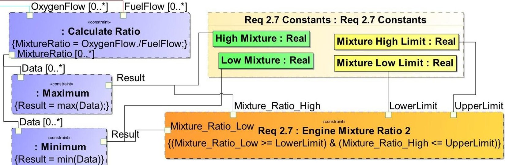
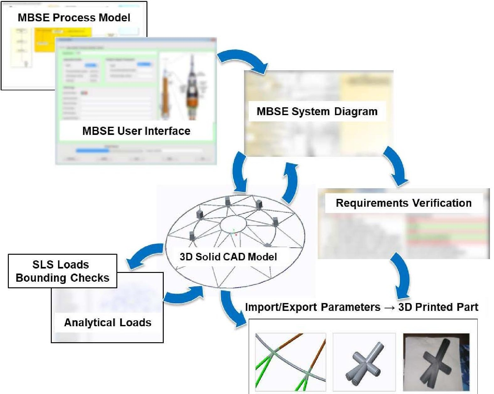
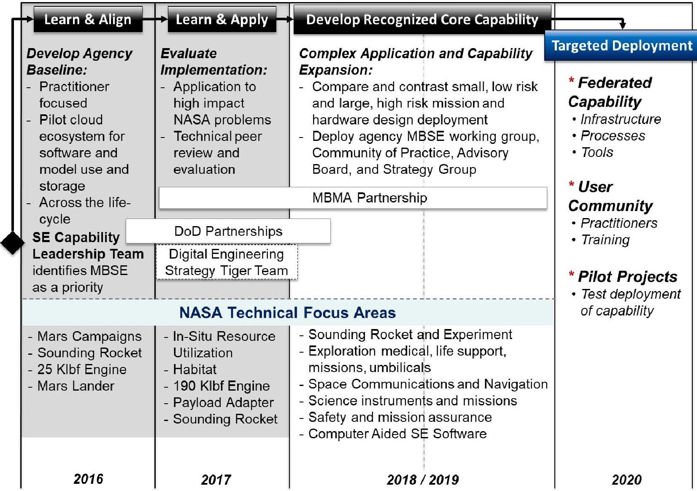
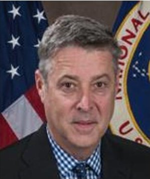
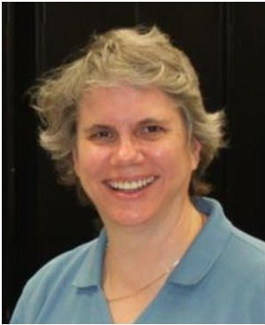
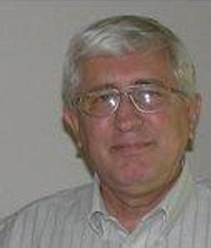

<!-- PDF_PAGE: 1 -->

# MBSE Infusion and Modernization Initiative (MIAMI): "Hot" Benefits for Real NASA Applications

Jon B. Holladay NASA Engineering and Safety Center Hampton, VA 23681 256-345-7250 jon.holladay@nasa.gov

Amanda Stein NASA Marshall Space Flight Center Huntsville, AL 35812 256-544-3837 amanda.stein@nasa.gov

Jessica Knizhnik NASA Goddard Space Flight Center 8800 Greenbelt Rd. Greenbelt, MD 20771 301-286-5728 jessica.knizhnik@nasa.gov

Terry Sanders Jacobs Technology, Inc. Huntsville, AL 35812 256-961-1328 terry.g.sanders@nasa.gov

Karen J. Weiland

NASA Glenn Research Center

21000 Brookpark Rd.

Cleveland, OH 44135

216-433-3623

karen.j.weiland@nasa.gov

Paul Schwindt

NASA Kennedy Space Center

Kennedy Space Center, FL 32899

321-867-9294

paul.a.schwindt@nasa.gov

Abstract Almost fifty years ago, Dr. Robert Frosch, the fifth NASA administrator, delivered a speech on the practice of systems engineering and a call for improvement that remains relevant today. A key difference between the past and today is that the digital information revolution offers new ways for improvements to manage complex systems, enhance knowledge transfer, and improve communications. These new ways offer reductions in cost, schedule, and risk. Over the past several years, the NASA Systems Engineering community has explored ways to use the digital environment to realize these benefits.

The NASA Systems Engineering community began evaluating the adoption of a digital approach or Model-Based Systems Engineering (MBSE) as early as 2011. The effort performed benchmarking of industry, evaluated standards, discussed infrastructure requirements, and interviewed NASA stakeholders. In 2016, the MBSE Pathfinder was established to evaluate application of MBSE to some of the most challenging aspects of real NASA spaceflight systems. The following year, the MBSE Pathfinder expanded to more rigorous implementation and coverage across multiple phases of the system engineering lifecycle. Two years of learning, alignment, and application resulted in over a dozen concrete use cases that illustrate the benefits of a digital framework for systems engineering. The MBSE Pathfinder informed the plans to move NASA towards enterprise implementation of MBSE.

This paper highlights examples in which both quantitative and qualitative benefits were obtained. The first example shows how systems engineering models used for concept design and definition were re-used for verification and test for a rocket engine. Schedule metrics were tracked to determine the improvement when using MBSE compared to recent historical data from manual methods. The second example shows the seamless transfer of modeling elements and data between the systems engineering model, computer aided design model, loads analysis, and additive manufacturing software for a payload adapter. This example shows how MBSE can be used to validate concepts and perform rapid prototyping. Qualitative benefits include improved communications and customer satisfaction. These examples, and others in a rich portfolio of results, demonstrate benefits available at points across the entire lifecycle in a rapid, agile approach.

978-1-5386-6854-2/19/$31.00 ©2019 IEEE

The MBSE Pathfinder projects were set up deliberately to sample multiple points in the lifecycle to understand the nuances and requirements sooner, rather than following one project end-to-end. The results from the MBSE Pathfinder help define the infrastructure and requirements necessary for a future systems engineering capability and provide a guide towards a full-up, integrated approach to systems development. To organize and implement these goals, the MBSE Pathfinder expanded into the MBSE Infusion and Modernization Initiative (MIAMI). The approach as well as the structure of MIAMI is unique in that it relies on learning from the use of MBSE on real projects and capturing the benefits that are useful for working engineers to make systems engineering easier. The lessons from this work are available for use by those who are interested in learning from or partnering with MIAMI.

## TABLE OF CONTENTS

1. INTRODUCTION ...1

2. MBSE PATHFINDER 2016 AND 2017 ...2

3. MBSE PATHFINDER ROCKET ENGINE ...5

4. MBSE PATHFINDER PAYLOAD ADAPTER ...7

5. MODEL-BASED SYSTEMS ENGINEERING INFUSION AND MODERNIZATION INITIATIVE (MIAMI) ...9

6. NEXT STEPS ...12

7. SUMMARY ...12

REFERENCES ...12

BIOGRAPHY ...13

## 1. INTRODUCTION

In 2018, NASA began the transition from understanding the challenges and opportunities of Model-Based Systems Engineering (MBSE) to one of infusion and implementation across the workforce. Using a more modernized, digital approach to systems engineering offers numerous advantages to product development and integration on NASA missions in aeronautics, science, space technology, and human

<!-- PDF_PAGE: 2 -->

exploration. The key to improvement is first, a solid understanding of good systems engineering and second, a solid understanding of how to efficiently utilize digital products to make systems engineering flow faster while producing higher quality process and product. As Robert Frosch stated in 1969 [1], "Systems, even very large systems, are not developed by the tools of systems engineering, but only by the engineers using the tools." Hence, the emphasis of NASA systems engineering improvements is always on our workforce and how to make the job of the systems engineer easier. How can we more rapidly evaluate the system design, response, and even change in an essentially automated domain that the computer provides?

The first two years of the MBSE Pathfinder effort included a strong focus on understanding workforce ability to utilize MBSE tools toward complex NASA missions. By focusing on engineering the system, well over a dozen use cases across the lifecycle were produced as well as metrics on tool and ecosystem readiness. These examples demonstrate a possible solution to the dilemma that Frosch noted some 40 years ago that still applies today [1]:"As we are now behaving, we are using up our best people in filling out documentation for their superiors to read, and most of the time no one is running the store."

This paper provides an overview of efforts within the first two years, a more detailed look at two MBSE use cases, and current efforts and plans for next steps toward future systems engineering workforce infusion.

## 2. MBSE PATHFINDER 2016 AND 2017

## 2016 MBSE Pathfinder Part 1 Summary

During the fall of 2015, the NASA Engineering and Safety Center (NESC) began planning its first MBSE Pathfinder (later entitled "MBSE Pathfinder Part 1") to begin in February 2016. The MBSE Pathfinder evaluated how easily MBSE could be deployed and usefully applied to four subject areas: 1) mission architecture use and reuse for a humans-to Mars campaign of missions, 2) additive manufacturing for rocket engine development, 3) mission element design of a Mars lander, and 4) mission flow shadowing of a sounding rocket project. Virtual teams of participants from multiple NASA centers were organized around each of the four subject areas. Participants provided feedback, teams provided regular and final reports, and the full group held an end-of-year knowledge capture meeting to gather lessons learned.

After approximately eight months, MBSE Pathfinder Part 1 teams successfully modeled different parts of a project lifecycle and used their system models to generate technical products for different reviews. They performed data import, data export, and data exchange with other software tools such as those for office productivity, computer-aided design (CAD), and simulation. Lastly, the teams all created models that had areas of reuse for campaigns or series of missions, missions, systems, or subsystems.

In creating these models, each team showed immediate potential benefits to their stakeholders and to NASA as a whole from using an MBSE approach. The Mars Architecture team demonstrated how agile development principles (similar to those used for software engineering) could be used to create system models. The Additive Manufacturing Rocket Engine team auto-generated up-to-date requirements and performance specifications in order to allow engineers to more easily track rapid system changes inherent in the additive manufacturing process. The Mars Lander team generated a subset of the technical review package for a Preliminary Design Review. The Sounding Rocket Mission Flow Shadowing team successfully modeled information from a prior mission's Design Review, where they uncovered missing information, such as a clear definition of the interfaces between the experiment and the sounding rocket, and inconsistencies in test plans.

This first iteration of the MBSE Pathfinder uncovered a number of lessons learned as well. Participants recommended the following Agency-level next steps: 1) establish an Agency community of practice with an online collaboration space and libraries, 2) provide handbooks, training, seminars, and other information for getting started in MBSE, 3) determine what software tools are used and what are needed, and identify solutions for future NASA needs, 4) give guidance on how to use MBSE with NASA's systems engineering processes, such as how to produce milestone review products, 5) architect the NASA systems and infrastructure for access, availability, and sustainment for MBSE, and 6) demonstrate the value of MBSE and gain the interest of projects and external partners.

Reference 2 covers the objectives, accomplishments, benefits, and lessons learned from the MBSE Pathfinder Part 1 in further detail.

## 2017 MBSE Pathfinder Part 2

Goals—The MBSE Pathfinder Part 2 in 2017 built on the successes and lessons learned from the MBSE Pathfinder Part 1. The MBSE Pathfinder Part 2 goals are as follows:

- Better align MBSE across Centers,

- Develop a user and practitioner community,

- Capture issues and opportunities for evaluating next steps.

The objectives for the MBSE Pathfinder Part 2 are listed here:

- Implement lessons learned from MBSE Pathfinder Part 1,

- Focus on the development of systems engineering products across the life-cycle,

- Integrate with various analytical tools, such as CAD and loads,

- Demonstrate and communicate value to the projects and Centers.

Table 1 details each of the seven teams included in the MBSE Pathfinder Part 2. It includes the focus for each of the teams,

<!-- PDF_PAGE: 3 -->

the teams' goals, and whether or not they continued work from the MBSE Pathfinder Part 1. The approaches of each team are listed in Table 2.

Subject Areas—As in the MBSE Pathfinder Part 1, the participants in the MBSE Pathfinder Part 2 were organized into virtual teams representing multiple NASA centers. Six of the teams addressed six subject areas. The first four teams in the table continued work from the previous year. The Integrated ISRU and Habitat Architecture team and the SLS Payload Adapter teams were new topic additions for the MBSE Pathfinder Part 2.

Though all six of the subject area teams focused on different topics, nearly all attempted to link their system models with other discipline analyses, ultimately in order to allow them to perform system level analyses with their integrated models. In performing these tasks, the ISRU team successfully provided a suggested Mars ISRU design solution using

published data and engineering estimates. The Cis-Lunar Habitat team created a scalable habitat model with interfaces to other entities that supports efficient verification. The Integrated ISRU and Habitat Architecture team successfully performed a Systems Operational Dependency Analysis (SODA) on their system model to recommend a fuel type for Mars ISRU to use with an in-space habitat [4]. With support from NASA Office of Safety and Mission Assurance (OSMA) and the United States Department of Defense (DoD), the Sounding Rocket team successfully modeled requirements early in the NASA project lifecycle to support 100% traceability for design verification and validation as the project matures, and enabled an earlier flight performance analysis to provide earlier confidence in launch vehicle selection. The CCP Rocket Engine team and the SLS Payload Adapter Team showed a number of successes and benefits from using MBSE that are discussed in Sections 3 and 4, respectively.

Table 1. MBSE Pathfinder Part 2 Teams and Goals

<table border="1"><tr><td>Team Focus</td><td>Goals</td><td>Continuing from MPP1?</td></tr><tr><td>Humans-to-Mars In-Situ Resource Utilization(ISRU) architecture</td><td>Determine the‘right’set of components and subsystems to enable production of mission consumables from either regolith or atmospheric resources at a variety of destinationsCalculate the performance and life that can be expected from the ISRU system in the actual environmentUnderstand how the ISRU system integrates and interacts with other systems(e.g.,power,lander,life support,etc.)</td><td>YesContinuation of mission architecture use and reuse for a humans-to-Mars campaign of missions</td></tr><tr><td>Architecture for a Cis-Lunar Habitat</td><td>Demonstrate system modeling of a cis-lunar habitatFocus on interactions among the System Model and other engineering disciplines(CAD,physics-based models,etc.)Develop agency modeling patterns,i.e.configurable and re-usable models,for assessing environmental impacts on the system domain and verification planning and execution.</td><td>YesContinuation of mission element design of a Mars lander</td></tr><tr><td>Requirement verification for a Commercial Crew Program(CCP) rocket engine</td><td>Discussed in Section 3.</td><td>YesContinuation of additive manufacturing for rocket engine development</td></tr><tr><td>Early lifecycle mission flow shadowing for a sounding rocket</td><td>Create a baseline early lifecycle system modelImport or export data from discipline model analysesDisplay views within the model for different stakeholdersPerform Systems Engineering analysis using iterative parametric model functionality.</td><td>YesContinuation of mission flow shadowing of a sounding rocket project</td></tr><tr><td>Integrated ISRU and Habitat Architecture</td><td>Develop a framework for integrated analysis and to support trade studies.</td><td>No</td></tr><tr><td>Design trades for a Space Launch System(SLS) payload adapter</td><td>Discussed in Section 4.</td><td>No</td></tr><tr><td>Cross Cutting Themes(CCT)</td><td>Develop knowledge capture materials for Agency MBSE Community of Practice(CoP).Develop model management strategies.Integrate models with NASA Procedural Requirements(NPRs) and institutional standards[3].Develop an MBSE roadmap.</td><td>No</td></tr></table>

<!-- PDF_PAGE: 4 -->

Table 2. MBSE Pathfinder Part 2 Teams and Approaches

<table border="1"><tr><td>Team Focus</td><td>Approach</td></tr><tr><td>Humans-to-Mars In-Situ Resource Utilization(ISRU) architecture</td><td>Demonstrate system modeling for the ISRU portion of a Mars mission campaign.Develop models that trade various assets for production on Mars surface. Establish concept of operations and requirements decomposition.Show model items like re-use, sensitivity analysis, change evaluation, and tech evaluation.</td></tr><tr><td>Architecture for a Cis-Lunar Habitat</td><td>Model Environmental Control and Life Support Systems(ECLSS) architecture,a functional decomposition,and requirements.Interact with discipline tools to enable systems engineering functions.Track progress towards gate review entrance and success criteria.Develop a modeling pattern for requirements verification.</td></tr><tr><td>Requirement verification for a Commercial Crew Program(CCP) rocket engine</td><td>Discussed in Section 3.</td></tr><tr><td>Early lifecycle mission flow shadowing for a sounding rocket</td><td>Model Colorado High-resolution Echelle Stellar Spectrograph(CHESS) sounding rocket from its pre-Mission Initiation Conference(MIC)(similar to a Mission Concept Review)through its Requirements Definition Meeting(RDM)(similar to a System Requirements Review).Import information from a system model to flight performance analysis software.Create views for the Experimenter,the NASA Sounding Rocket Operations Contract(NSROC),and the Sounding Rocket Program Office(SRPO).Model a science-to-requirements trace,a trade study,and a mass roll up.</td></tr><tr><td>Integrated ISRU and Habitat Architecture</td><td>Create trade studies implemented by a variable modelling pattern.Show correspondence between systems in the two architecture options(oxygen only and oxygen/methane).Produce a visual means for understanding a complex system in a consistent manner.Utilize analytically solid and consistent measures of performance(e.g.mass,operability,landing cadence).</td></tr><tr><td>Design trades for a Space Launch System(SLS) payload adapter</td><td>Discussed in Section 4.</td></tr><tr><td>Cross Cutting Themes(CCT)</td><td>Create a preliminary MBSE glossary,leverage a NASA Glenn Research Center MBSE Kickstarter Guide to MBSE for tutorials,and aid in the development of the CoP collaborative website.Generate a MBSE Systems Engineering Products Implementation Spreadsheet,and complete research for a MBSE Configuration Management Plan.Define a pattern for Safety and Mission Assurance standards(with NASA OSMA),and NPR Gate Review Assessment rules for portions of a Mission Design Review[3].Conduct 12 stakeholder interviews representing opinions on MBSE from across NASA.</td></tr></table>

AdditionsGiven that the MBSE Pathfinder Part 1 had a number of agency-level next steps as lessons learned, the MBSE Pathfinder Part 2 included a Cross Cutting Themes (CCT) team. In order to encourage this team to pass and receive its knowledge back and forth with the teams covering specific subject areas, the CCT team was comprised of one or two members from each of the subject area teams. Among this team's deliverables is a particularly beneficial system modeling pattern for NASA Standard Integration. This pattern provides modelers with a framework for showing how their systems of interest satisfy any NASA standard. Because all NASA programs and projects must follow NASA standards, this pattern may save modelers from the need to develop a method for incorporating standards each time they begin modeling a new program or project.

The MBSE Pathfinder Part 2 also incorporated a Technical Advisory Board into its operations. This Technical Advisory Board served as a method for the MBSE Pathfinder Part 2 to address its objective of demonstrating and communicating MBSE's value to projects and centers. The board consisted of approximately 10 respected engineers representing various MBSE experience levels, government backgrounds (including a US Air Force employee), technical disciplines, and mission backgrounds (e.g. human exploration and operations, science, aeronautics, and/or space technology). The Technical Advisory Board played a critical role in grounding the MBSE Pathfinder Part 2 in work that could provide benefit to systems engineers working real NASA programs and projects. The Technical Advisory Board also provided the group with an independent perspective on its

<!-- PDF_PAGE: 5 -->

progress and helped illuminate a few of the group's lessons learned.

Lessons Learned—As with the MBSE Pathfinder Part 1, the MBSE Pathfinder Part 2 also brought a number of lessons learned to light. The Technical Advisory Board appreciated that the MBSE Pathfinder Part 2 was grounded in important real-world problems, that the teams all actively engaged their program and project stakeholders, and that the teams all incorporated discipline experts' knowledge well into their models. The Technical Advisory Board recommended that modelers should set clear boundaries for what should and should not be included in a model so the model exists to answer an engineering question. Modelers can become tempted to expand their models beyond the point that additional detail provides value. They also recommended where the MBSE Pathfinder results be quantified and compared to existing processes in order to easily demonstrate MBSE's direct benefit to programs and projects.

In addition, the MBSE Pathfinder Part 2 showed that complete digital data automation may not be necessary for working systems engineers to see MBSE's benefits on their programs and projects. MBSE has value on its own as a communication tool. This question of how much data interchange to automate also raised the additional question to the MBSE Pathfinder team on how much its future goals should include a focus on Model Based Engineering (MBE, briefly defined for the purposes of this paper as data as a primary means of communication for all engineering disciplines, not solely limited to systems engineering) in addition to MBSE. The MBSE Pathfinder team also came to understand a distinction between and a need for both production and pathfinding models. Production models are those models ready for systems engineers to use on programs and projects. They must be succinct and correct for their applications. Conversely, pathfinding models are models that are not ready for program and project use, but instead provide a testing ground for modelers to continue to discover capabilities and potential uses for system modeling. Lastly, the MBSE Pathfinder Part 2 group found that agency wide best practices for items like model architecture, configuration management, and commonly needed properties would aid the community in transferring knowledge and data across models.

## 3. MBSE PATHFINDER ROCKET ENGINE

## Description and Technical Challenge

Space flight hardware has rigorous qualification programs to ensure the safety of the mission. Spaceflight test programs require a verification and validation (V&V) program for the certification of hardware. The primary purpose of any test program is to maximize the probability that the tested design will function properly and successfully when used in actual service for the intended application. Margin testing with respect to the expected flight conditions protects against known and unknown uncertainties in the flight conditions. A successful development and qualification program

anticipates all potential flight conditions and makes sure those conditions are validated by a robust test program. Flight tests identify the differences between the demonstrated ground testing and flight regimes.

The test program utilized in development of this MBSE pathfinder was for a rocket engine. The plan was to test more than a dozen engines, with each engine being fired multiple times throughout the campaign. The liquid engine test program explores as much of the operational flight envelope as possible, in order to accomplish the general objective of avoiding operating any flight hardware configuration under all credible conditions for the first time in flight. Specific tested conditions for expected operating ranges include general performance requirements (such as thrust and mixture ratio), interface conditions (such as propellant inlet conditions, electrical, pneumatic and hydraulic connections), and environmental exposure (such as thermal, acoustic, and vibration conditions).

Liquid propulsion engines go through a development test, qualification test, and flight test process. Multiple design iterations and development tests are typically required to finalize the design and conduct qualification tests. Qualification testing verifies the engine operation meets all the requirements and the engine is in its final flight configuration.

The rocket engine qualification program utilized for the pathfinder is anticipated to be composed of at least 2 engine designs, with at least 6 engines per engine design, and each engine can have anywhere from 10 to 40 tests, totaling 120 to 480 individual tests to be post processed and assessed against requirements. The current requirement verification process for qualification testing is to manually track the test engine configuration, anomalies, and test data. Spreadsheets are generally used to track configurations for a particular test series and are very labor intensive. A person has to update the data manually for hundreds of entries. Each test currently requires 7 to 9 hours of manual data post-processing using the current verification process, totaling 840 to 4320 hours over the life of this qualification test program.

The objective of this MBSE Pathfinder team is to make the process more efficient. By integrating the V&V process into a model-based system engineering ecosystem, the test campaign can be tracked and validated in a consistent and automated fashion throughout the qualification program.

## Approach and Results

Given the exploratory nature and resources, the team addressed two features: post-processing of test data and tracking which requirements are met or missed. Other features can be implemented in SysML but are not addressed in this activity.

The modeling team used the 2016 MBSE Pathfinder Part 1 Rocket Engine model as a starting point and as an example of model re-use. The model contains all relevant elements for

<!-- PDF_PAGE: 6 -->

assessing whether a test shows the engine has met the modelled requirements. The model layout contains the system components, system requirements, the unit test configuration blocks, and the refining constraint equations.

An example of a parametric diagram for post processing the test data is shown in Figure 1. Calculation of the mixture ratio is done using inputs of fuel flow and oxygen flow (purple blocks) and the results are stored in the Req 2.7 Constants block (green blocks). Then a comparison to the high and low mixture limits that are in the model as constraint blocks (yellow blocks) is performed (orange block). A simulation plugin was used to execute constraints and parametric diagrams. The constraints are defined and executed within a scripting language, as the modeling tool is inefficient at handling large data sets. The results from an individual test are stored as instances.

The model returns the post-processed test parameters and a table documenting whether the requirements were met during the test. The example in Table 3 shows the pass or fail status of each requirement and the overall settings for each run (Start Time, End Time, and File Name). This table shows the results from four engine tests for requirements 2.1, 2.7, 2.8, and 4.1. This table can be exported into other formats for reporting.

To achieve the goal of automating the process of verification and validation (V&V), several approaches were tried. One

approach to modeling the validation routine in SysML was to validate all the test program requirements concurrently using a single parametric diagram. In this approach, the minimum computer resources should be used, since it only loads the data once and does not store the imported raw data. Each requirement in the engine model requires its own analysis routine. A data importer loads and imports the data between the different software tools. Parameter ID values along with the start and end time are used to locate different data channels that are stored in the test data file, which are saved as a string type value. An important observation from the development of the data importer was that the SysML tool expects the values to be typed by double precision, which was not the case for the engine data, which was typed by single precision. Only the SysML real type was implemented in the parametric model to maximize the reusability of subsequent constraint blocks. In addition, value properties for the requirement results and limits were placed in a separate block to reduce the size and complexity of the Combustion Unit Test block.

The other modeling approach that was investigated was for each requirement have its own separately executable parametric diagram. This approach provides a cleaner model, since each requirements analysis process is self-contained in individual parametric diagrams. One drawback is that the data is loaded as many times as the number of requirements in the model.

Figure 1. Requirement 2.7 Parametric Diagram

Table 3. Example of Rocket Engine V&V Model Output Results

<table border="1"><tr><td>#</td><td>Name</td><td>Start Time:Real</td><td>End Time:Real</td><td>FileName:String</td><td>Req2.1:SL Thrust</td><td>Req2.7:Engine Mixture Ratio2</td><td>Req2.8:2.8_SL ISP</td><td>Req4.1:Req4.1 Turbin Inlet Temp</td></tr><tr><td>4</td><td>Test1</td><td>100</td><td>300</td><td>a1j026.parms.fixed_rate_50_START.sun</td><td>fail</td><td>pass</td><td>fail</td><td>pass</td></tr><tr><td>5</td><td>Test2</td><td>10</td><td>300</td><td>a1j025.subset.fixedrate.sun</td><td>fail</td><td>pass</td><td>fail</td><td>pass</td></tr><tr><td>2</td><td>Test3</td><td>10</td><td>300</td><td>a1j027.subset.fixedrate.sun</td><td>pass</td><td>pass</td><td>fail</td><td>pass</td></tr><tr><td>3</td><td>Test4</td><td>10</td><td>300</td><td>a1j028.subset.fixedrate.sun</td><td>pass</td><td>fail</td><td>fail</td><td>pass</td></tr></table>

<!-- PDF_PAGE: 7 -->

Testing and validation of the model was performed using data from the J-2X engine that was previously tested at NASA Stennis Space Center. All requirements in the SysML model were adjusted to the levels expected for the J-2X testing and several J-2X data sets were tested. A graphical output is used to plot segments of the imported data. Its envisioned use is to allow an engineer or subject matter expert to validate the data is correctly imported.

After the model execution completes, the results are found in several tables. Requirement validation results are compared against previous manual processing of the data sets to verify the SysML model. It is easy to see the overall picture of the engine test, as shown in Table 3, but does not give specifics of why a requirement fails. Further details can be found within instance tables, as shown in Table 4 for requirement 2.7. The table shows that during Test 4, the mixture ratio fell below the lower bound that was set. An engineer can use this information to inspect the data from this test to determine the root cause; in this case, the engine was in the part of the test running at a lower power level that has a lower mixture ratio.

The key metrics for this activity are the time to develop the model and the post-processing time required per test. The Pathfinder team estimates that it spent a combined 380 hours researching, learning, and building several versions of the model. With the knowledge the team has now, we estimate that building a working model for a test campaign could be performed in about a week. The automated post-processing time required per test is about 1 hour, compared to the 7 to 9 hours for manual data post-processing. The time savings is more than 80% for this first version of the model.

This automated approach is well suited for any Verification and Validation (V&V) groups or organizations regardless of whether the system being developed is an "in-house" development or a contracted effort. The V&V entity could utilize this technique by either developing their own model, or utilize models being developed by the system developer. Although the team's task was to verify engine requirements, the approach could be utilized from system level requirements to lower-level requirements. Once the model is constructed and verified, V&V groups can spend their time understanding anomalies or exceedances rather than processing the data.

## 4. MBSE PATHFINDER PAYLOAD ADAPTER

## Description and Technical Challenge

The Space Launch System (SLS) Payload Adapter is the structure that holds payloads in place while the rocket is transporting the payloads to their in-space target locations. The Payload Adapter is a cone-shaped structure that is attached to the top of the SLS vehicle and is enclosed within fairings during ascent. The SLS may carry three types of payloads. A primary payload is the main payload for a cargo mission. A co-manifested payload is a payload being transported along with the Orion capsule and is attached below the Orion capsule. Secondary payloads are small Cubesats attached to the outside of the Payload Adapter and are deployed after the other payloads are deployed. A separation system sits on top of the Payload Adapter and assists in the deployment of primary and co-manifested payloads. Each of the secondary payloads has its own spring-loaded deployment box mounted to the outside surface of the Payload Adapter.

The primary and co-manifested payloads range in size and mass from payloads meeting the Evolved Expendable Launch Vehicle class of payloads to large habitation and logistics payloads for the Deep Space Gateway (DSG). Therefore, having only one design of the Payload Adapter to meet the needs of all types of payloads is not feasible. There is a need to evaluate 10's to 100's of optimized Payload Adapter options for SLS users over the life of the program in an efficient, automated manner.

The MBSE Pathfinder Payload Adapter Team evaluated a system modeling approach for integrating key user requirements within the range of SLS payload accommodation capabilities to identify preferred Payload Adapter designs for each mission. The goal is to automate the development and management of requirements from concept to as-designed and as-built configuration, along with configuration management of the design using CAD, manufacturing, and testing. By utilizing the interaction between a Systems Modeling Language (SysML) model and the CAD system, this approach could realize a lower cost and time for design of multiple payload adapters and reduce the time spent on vehicle interface definition and management activities.

Table 4. Requirement 2.7 Constants Instance Table

<table border="1"><tr><td>#</td><td>Owner</td><td>Name</td><td>Mixture High Limit:Real</td><td>Mixture Low Limit:Real</td><td>Low Mixture:Real</td><td>High Mixture:Real</td></tr><tr><td>1</td><td>Test1</td><td>Test1.req2.7Constants</td><td>0.35</td><td>0.32</td><td>0.32409564...</td><td>0.33336977...</td></tr><tr><td>2</td><td>Test2</td><td>Test2.req2.7Constants</td><td>0.35</td><td>0.32</td><td>0.32250401...</td><td>0.33537381...</td></tr><tr><td>3</td><td>Test3</td><td>Test3.req2.7Constants</td><td>0.35</td><td>0.32</td><td>0.33897936...</td><td>0.34926202...</td></tr><tr><td>4</td><td>Test4</td><td>Test4.req2.7Constants</td><td>0.35</td><td>0.32</td><td>0.27185681...</td><td>0.33339697...</td></tr></table>

<!-- PDF_PAGE: 8 -->

## Approach and Results

The specific approach of this effort is to define a model that utilizes a Payload Adapter with a truss design and a separation system based on a given diameter of the Forward Ring. This model determines the loads on the attached payload inside the CAD model and exports the results for verification of requirements. This approach is able to establish the range of capabilities for the Primary, Co-Manifested, and Secondary payloads.

The modeling approach, as shown in Figure 2, comprises a user interface, multiple interconnecting models for analysis and verification, and output to additive manufacturing.

The MBSE process model controls the steps for defining the payload adapter, including data initializing, input, export, calculations, saving the data, and display.

The user interface allows for input of key parameters by either the payload design team or the Payload Adapter design team. The inputs are parameters for specific payload sizes and masses, separation system sizes, and payload adapter size

and mass. The outward facing user interface then feeds the parameters into a SysML model.

The SysML model represents the physical structure, and contains requirements, verification constraints, and behaviors. The SysML model is used to export parameters based on the height of the payload adapter; the number, size and mass of the secondary payloads; the mass and center-ofgravity of the primary or co-manifested payload; and attributes of the separation system, into a spreadsheet.

The spreadsheet data is imported into the CAD model as a parameter set and the generic model is modified accordingly. After the CAD model is updated via the imported parameters, a preliminary check of loads is performed. When the loads and stress analyses are complete, the data is exported back to a spreadsheet and into the SysML model.

The updated parameters are run through a requirements verification process, which was fully developed by several university students as a one-semester project. The results of the analyses are tested against the constraint attributes tied to each requirement. This demonstrates the use of a system

Figure 2. MBSE Pathfinder Payload Adapter Concept Modeling Approach

<!-- PDF_PAGE: 9 -->

model to verify the Payload Adapter concept met the requirements.

Lastly, additive manufacturing is used to produce a scale model of the adapter. A 3/64 scale model was 3-D printed using the SysML model and the CAD model, as was a full scale prototype of a joint connector, as shown in the bottom right of Figure 2.

## Benefits

A number of benefits are realized by the use of this model:

- Communicates and educates users about the utility of the Payload Adapter.

- Identifies early design constraints for primary, comanifested, and secondary payloads

- Reduces the formal analysis effort after a payload is manifested.

- Minimizes errors from manual steps

- Saves time during prototyping and manufacturing

The next steps are to develop a user interface for a SLS Mission Planners Guide and further develop the model for batch mode automation. Reference 5 contains a more detailed description and benefits.

## 5. MODEL-BASED SYSTEMS ENGINEERING INFUSION AND MODERNIZATION INITIATIVE (MIAMI)

## MIAMI Planning Approach

While the MBSE Pathfinder Part 2 teams were completing their work and reporting results in the summer of 2017, the MBSE Pathfinder Leadership team planned the follow-on work for the next few years. The Leadership team looked at the lessons learned and recommendations from the MBSE Pathfinder Parts 1 and 2, received assessments of the health of the systems engineering discipline at NASA, and considered other internal and external factors. The lessons learned from the MBSE Pathfinder work in 2016 and 2017 are summarized in Section 2.

A recent state-of-the-discipline internal assessment noted concerns in the following areas for systems engineering: 1) lack of hands-on opportunities to grow the technical leadership of the workforce; 2) difficulty in the transition of projects from concept to formulation phase; 3) lack of an agency systems engineering strategy and vision; and 4) proper integration of policy while encouraging uniqueness for implementations to meet NASA's diverse missions and geographic locations. A subsequent expert practitioner deep dive identified related areas: a compliance culture that discourages tailoring, fewer opportunities for workforce experience across the project lifecycle, and process proliferation at agency and Center levels.

Internal factors include the inefficient use of agency-wide engineering resources, and an emphasis on process and

documentation instead of engineering the system. Notable trends are moves towards leveraging cloud services for engineering and collaborative environments. One of NASA's technology roadmaps lists desires for system simulation and a common set of frameworks, languages, tools, and standards for modeling from diverse sources [6]. Reports and information from other government agencies and professional societies provided external factors to consider. The Interagency Working Group on Engineering Complex Systems - Model-Based Systems Engineering Infusion Task Team report identifies prerequisites, expectations, initial challenges, recommendations, and examples of efforts already in progress for digital model-based engineering [7]. The US Department of Defense recently released a Digital Engineering Strategy that outlines five strategic goals for a digital engineering initiative [8]. Finally, the International Council of Systems Engineering (INCOSE) Vision 2025 mentions digital engineering and model-based systems engineering throughout the Vision [9].

The MBSE Pathfinder Leadership team established new goals and objectives, stated the expected benefits, and developed an approach to organizing the work for expansion into areas beyond a pathfinder, in order to address the lessons learned, recommendations, and driving factors and trends. At the center of the approach is the overarching goal of making systems engineering easier for the workforce.

The MBSE Pathfinder Leadership team changed the name of the overall effort to Model-based Systems Engineering Infusion and Modernization Initiative (MIAMI) in order to distinguish the expanded scope from the MBSE Pathfinder work of 2016 and 2017.

## MIAMI Goals and Planning Summary

The goals for the MIAMI work are in two sets: modernizing the systems engineering workforce and for the MIAMI work itself. The goals for the modernizing the systems engineering workforce are as follows:

- Increase efficiency and reduce errors.

- Informed decision making through increased transparency and greater insight. Link technical and programmatic insight and data driven decisions.

- Increased understanding for greater flexibility and adaptability in design.

- Increased confidence that the system-of-interest will perform as expected.

- Easier, efficient, connected communication (ideally electronically) to keep everyone on the same page.

- Close the chasm between systems analysis and systems engineering (show trade traceability).

The goals for the MIAMI work itself are to make systems engineering easier, realize the potential benefits of digitization, establish a MBSE capability, link the work with the related NASA work, and communicate MIAMI efforts.

<!-- PDF_PAGE: 10 -->

The expected benefits are increased productivity mostly through the reduction of churn and rework. Through MBSE, the system engineers will ask and answer the right question once, and understand risk and cost (time, performance, and resources) trade-offs.

The NASA Engineering and Safety Center (NESC) Systems Engineering Technical Discipline Team sponsors the MIAMI effort. Its organizational location provides a means for communications across the systems engineering discipline with leaders and experts on a capability leadership team, assessments, and other groups.

Figure 3 shows a planning summary for 2016 to 2020. The tag lines for each year run across the top of the figure and brief descriptions of the implementation approach are in the top half of the figure. The MBSE Pathfinder areas in the lower section indicate the close relationship to real NASA missions. The center of the figure highlights partnerships with other organizations. The Model-based Mission Assurance (MBMA) Partnership is with the NASA Office of Safety and Mission Assurance, and the DoD Partnerships and Digital Engineering Strategy Tiger Team are partnerships with the Department of Defense. The milestone in 2020 is for

a targeted deployment of a federated capability, user community, and pilot projects.

## MIAMI Organization

Several work teams within MIAMI were established to facilitate communications, productivity, and collaboration: MIAMI Leads, Digital Practitioner Community, MBSE Pathfinder, Strategy Group, and Advisory Board. The remainder of this section describes the work teams, their tasks, and highlights of some accomplishments during 2018. All the work teams continue into 2019 with some changes to accommodate increased understanding and respond to advice and guidance.

MIAMI LeadsThe MIAMI Leads are responsible for the overall leadership and management of the effort. They establish the business cadence of meetings and reporting, and allocate and manage the resources to meet the MIAMI goals. The MIAMI Leads divide their efforts into five major areas: building organizations and collaborations for long-term sustainment, growing awareness and interest, preparing for targeted deployment, charting the future of systems engineering at NASA, and developing technical leaders.

Figure 3. NASA MBSE Five Year (2016 to 2020) Planning Summary

<!-- PDF_PAGE: 11 -->

The MIAMI Leads guide a digital practitioner community, and continue existing and establish new collaborations with NASA and external organizations. The digital practitioner community is viewed as the long-term sustainment entity that allows participants to tap into expertise across the agency. Internal collaborations are with NASA organizations in safety and mission assurance, information technology, and digital transformation. External collaborations are with other government agencies, another national space agency, standards groups, professional societies, and universities. These collaborations provide a way to tap into expertise, share lessons learned, and leverage resources and impact.

The MIAMI Leads give roadshow presentations at the different NASA centers to highlight the work and benefits. A short video shows a model in action for unfamiliar audiences.

The MIAMI Leads prepare for targeted deployment by fostering growth in the user community and providing resources to potential pilot projects. A NASA MBSE Workshop in 2018 gathered MBSE practitioners to meet each other and share experiences.

The MIAMI Leads set up a Strategy Group to chart the future of systems engineering at NASA. The MIAMI Leads provide guidance and other assistance such as introductions to subject matter experts. The MIAMI Leads also set up an Advisory Board to provide advice and guidance on the value of the work to NASA programs and projects, both now and in the future.

The MIAMI Leads provide technical leadership opportunities to the other MIAMI participants in several ways. The MIAMI Leads investigated and provided training in design thinking and lean startup. This new approach to technical leadership training is bearing fruit immediately as the teams use it to engage with stakeholders, brainstorm new ideas, prototype and test concepts, and identify classes of stakeholders and their top interests. The MIAMI Leads intentionally provide leadership experiences through stretch assignments and leadership of multi-center and virtual teams having members with diverse organizational experiences, career-levels, and technical fields.

Digital Practitioner Community-A Digital Practitioner Community expanded in 2018 to build upon the community of practice started earlier. The objectives are to find, develop, and promote modeling best practices; define options and recommendations for the infrastructure necessary for MBSE and collaborative environments; and serve as points of contact to communicate between the MIAMI work and the MBSE working groups and communities of interest at the NASA Centers. The four major work topics are a community of practice, systems modeling, systems analysis and data visualization, and infrastructure and ecosystems. Each work group maintains focus on its area and examines practitioner ability, tools and software, overall gaps and capabilities, priorities for training and next steps, along with nurturing their area.

The Digital Practitioner Community contributes to the targeted deployment in 2020 through deliverables. The community of practice increases the user community through engagement with the workforce and through harvesting lessons learned and other information onto a collaborative, digital worksite. The community of practice is using the results from a user test to update the web site. The systems modeling area develops sample models, templates, patterns, re-use of models, libraries, and model and style guides. The systems analysis and data visualization area identifies and develops ways to do analyses for technical, schedule, cost, and risk sensitivities, and to visualize the information through graphics and communications. The infrastructure and ecosystems area examines cloud-based deployment, collaboration areas, and tools and tool chains, from both the user and information technology points of view. This includes identifying key capabilities and functions, developing and maintaining a cloud environment user's guide, and investigating cybersecurity.

MBSE PathfinderThe MBSE Pathfinder effort continued into 2018 with defined goals and objectives. A new addition was the Active Project Partnerships, which are described below. The MBSE Pathfinder teams are encouraged to define, develop, and demonstrate high priority capabilities. Areas of interest include additional integration with other disciplines, demonstrations of milestone reviews, further tests of a collaborative infrastructure, and convincing examples of successful MBSE implementation.

The MBSE Pathfinder provides examples of and opportunities to the workforce for growing technical leadership experiences. Experiences cover the project lifecycle, promote flexibility and adaptability, grow communication and leadership skills, provide conflict resolution and negotiation opportunities, and give meaningful technical leadership growth opportunities to early and mid-career employees.

The Cross Lifecycle Modeling (CLM) project is a follow-on from the 2016 and 2017 MBSE Pathfinder Sounding Rocket efforts [10]. The Sounding Rocket Program is not organizationally complicated, but still has analogs to many end-to-end larger missions. One team models sounding rocket experiment systems engineering artifacts and another team models sounding rocket launch vehicle systems engineering artifacts. The teams collaborate for experiment-to-launch vehicle interfaces and a payload planner's guide. The teams successfully linked the models for the experiment and the vehicle to each other into a higher level Mission Model for the Mission Operations Managers (MOM) to use. This type of interface will ultimately enable future project teams to pass important requirements, architecture, behavior, and associated properties across multiple project teams without encumbering future modelers with the need to load data they don't need or pass along data they are unable to share (in the case of proprietary or protected information). They have also prepared a preliminary launch vehicle selection analysis using properties (such as mass and required

<!-- PDF_PAGE: 12 -->

altitude) from standard library components within their system model to feed flight performance analysis software. Such an analysis would allow the SRPO to more easily confirm their launch vehicle selection earlier in a project's lifecycle before changing a vehicle can become costly. In the coming year, the team will strengthen and connect these model components to allow the MOM insight into a sounding rocket system throughout its lifecycle, which will ultimately inform future systems modelers on how to use MBSE throughout a project's full lifecycle.

The Active Project Partnerships (APPs) are a portfolio of projects that act as independent seedling projects, which may eventually transition to pilots. The APPs are selected based on their alignment with MIAMI goals and objectives. The APPs define and own their work and provide a brief work plan and monthly accomplishments to the MIAMI Leads. In return, MIAMI provides access to resources such as expert advice, Advisory Board review, and software tools. The APPs cover the mission focus areas of exploration medical systems engineering and integration [11], exploration life support systems, exploration spacecraft, umbilicals, space communications and navigation, earth science spacecraft, lunar rover, astronomy spacecraft, ground safety systems, early systems engineering conceptual design, and safety and mission assurance. The APPs made progress in a variety of ways, with two areas of note. One APP shared a model containing baselined requirements, terminology, and definitions with an international partner. Another APP reproduced traditional systems engineering products (schedule, change traffic, requirements, product structure, concept of operations, and a verification matrix) and demonstrated high-level integration in a single model using a suite of tools.

Strategy Group—The Strategy Group is a small group of early to mid-career personnel who have diverse experiences and ideas that go beyond traditional systems engineering and even beyond model-based systems engineering. The Strategy Group members interact with experts and peers in many areas. The members use their awareness of trends in political, technological, educational, organizational, and engineering environments along with their expertise in disciplines related to the practice of systems engineering. As part of MIAMI, they benefit from opportunities for technical leadership experience and influencing agency-wide engineering practice. The Strategy Group is preparing a 20 Year vision, roadmap, strategic plan, and recommendations for future investments.

Advisory BoardThe Advisory Board is a panel of respected engineers from multiple NASA centers and external stakeholder organizations. The members cover the diverse areas of mission experience (human exploration, science, aeronautics, and other). The Advisory Board guides MIAMI towards providing value to NASA programs and projects by providing an assessment of work and plans and advice and guidance for recommended next steps, at least once annually.

## 6. NEXT STEPS

With a rich collection of data developed and available in 2016 and 2017 to guide next steps, 2018 and 2019 have shifted to preparation for transition of MBSE from a pathfinder effort to one focused on implementation. Over a dozen programs and projects are being directly supported in the application of MBSE. Many other NASA projects are also applying MBSE.

Currently the SE Technical Discipline Team (TDT) and the MBSE Infusion and Modernization Initiative (MIAMI) continue a strong focus on supporting the user base, but also to better define the ecosystem that NASA MBSE will reside through a partnership with the Office of Chief Information Officer (OCIO). Small businesses are being leveraged toward improving application tools and addressing cyber security issues via technologies such as block-chain.

The desired end state of future NASA model-based systems engineering is to be useful, ingrained, the normal course of work, and available as a national resource. The focus of MIAMI is on the workforce, specifically, to make systems engineering easier for the workforce. In all cases MIAMI and the SE TDT provide a focal point for maintaining alignment of the agency's model-based systems engineering implementation and future planning to support localized and potential expansion of the capability within NASA and with strong understanding of NASA's external partners: commercial, international, and academia.

## 7. SUMMARY

The NASA approach to evaluate and implement MBSE leverages the approach that NASA uses daily to develop our diverse and complex set of ever challenging missions. An overview of the planning approach utilized to understand and implement MBSE demonstrates a logical and innovative approach toward improvement. By focusing on workforce and infrastructure to improve the speed and quality of systems engineering response, NASA missions will receive similar impact.

## REFERENCES

[1] Frosch, R. A., "A Classic Look at Systems Engineering", in Readings in Systems Engineering, NASA-SP-6102, Hoban, F.T. and Lawbaugh, W. M., Eds., 1993.

[2]Weiland, K. J. and Holladay, J.," Model-Based Systems Engineering Pathfinder: Informing the Next Steps," 27th Annual INCOSE International Symposium (IS 2017), Adelaide, Australia, July 15-20, 2017.

[3] NPR 7123.1B w/Change 4, "NASA Systems Engineering Processes and Requirements," NASA Office of Chief Engineer, 10/23/2017.

[4] Zusack, S., Guariniello, C., and Delaurentis, D., "Operational dependency analysis of a human mars architecture based on the SODA methodology," 2018 IEEE Aerospace Conference, Big Sky, MT.

<!-- PDF_PAGE: 13 -->

[5] Holladay, J., Sanders, T., and Smith, D. A., "Enhanced Feasibility Assessment of Payload Adapters for NASA's Space Launch System," 2019 IEEE Aerospace Conference, Big Sky, MT.

[6] NASA Strategic Technology Investment Plan, NASA Office of Chief Technologist, 2017.

[7] NASA/TM - 2017-219633, "Digital Model-Based Engineering: Expectations, Prerequisites, and Challenges of Infusion," Model-Based Systems Engineering Infusion Task Team, Interagency Working Group on Engineering Complex Systems, 7/1/2017.

[8] Department of Defense, "Digital Engineering Strategy," Office of the Deputy Assistant Secretary of Defense for Systems Engineering, June 2018.

[9] INCOSE VISION 2025, "A World in Motion," Systems Engineering Vision 2025, International Council on Systems Engineering (INCOSE), 2014.

[10] Waldram, N., Cornford, S., Piette, M., and Plattsmier, G., "Cross Lifecycle Modeling in MBSE," 2019 IEEE Aerospace Conference, Big Sky, MT.

[11] Hanson, A., Mindock, J., Hailey, M., Mc Guire, K., Bardina, J., Toscano, B., Winther, S., Rubin, D., Cerro, J., Abdelmelek, M., Rubin, A., and Kockler, M., "A ModelBased Systems Engineering Approach to Exploration Medical System Development," 2019 IEEE Aerospace Conference, Big Sky, MT.

## BIOGRAPHY

Jon Holladay is the NASA Technical Fellow for Systems Engineering. His responsibilities include assessment of critical NASA Programs as well as the Agency's SE discipline state and its future capability needs. He has over thirty years of experience in the human spaceflight arena involving both spacecraft and

launch vehicle development and operations serving as both Chief Engineer and Engineering Project Manager. He holds a Bachelors and a Master's degree in Mechanical Engineering from the University of Alabama, has completed the Legislative Studies Program at Georgetown University and the Senior Executive Fellows Program at Harvard's Kennedy School of Government. He most recently served as the Project Lead/Chief Engineer in the SLS Advanced Development Office, where he focused on strategic analysis and planning for evolvability of NASA's Space Launch System.

Jessica Knizhnik is a Co-Lead for NASA's MBSE Infusion And Modernization Initiative (MIAMI) to implement MBSE at NASA by utilizing test cases and engineering expertise from across NASA field centers, industry, and academia. She completed a BS degree in Mechanical Engineering and a MS degree in Systems Engineering, both at the

University of Maryland. Her MS research focused on using model based techniques for exploring and automating satellite design trade studies. Prior to her work on MIAMI she served as a Product Assurance Engineer on NASA science missions including the James Webb Space Telescope (JWST).

Karen J. Weiland is a Systems Engineer at the NASA Glenn Research Center and works at the Center and Agency levels to improve systems engineering capabilities across NASA. She is a Co-Lead for the Model-Based Systems Engineering Infusion and Modernization Initiative (MIAMI) and led the MBSE Pathfinder in

2016 and 2017. She began her NASA career performing microgravity combustion diagnostics research and as a project scientist for spaceflight experiments on the Space Shuttle and International Space Station. She performed systems engineering on many spaceflight projects, including the Spacecraft Fire Safety Demonstration (Saffire) project. She received a B.S. in Chemistry from the University of Notre Dame and a Ph.D. in Chemistry from the University of WisconsinMadison.

Amanda Stein is a propulsion systems engineer in the liquid engines group at the NASA Marshall Space Flight Center. She previously worked at the NASA Stennis Space Center. She received a Master's in Aerospace, Aeronautical and Astronautical Engineering from Purdue University, and Bachelor's

degrees in Aerospace, Aeronautical and Astronautical Engineering and Mechanical Engineering from the University of Buffalo.

<!-- PDF_PAGE: 14 -->

Terry Sanders is a Systems Engineer at Jacobs Technology providing engineering services to NASA at the Marshall Space Flight Center. He received a B.S. in Computer Science from Rockford College and a M.S. degree in Systems Management from Florida Institute of Technology. He has been a

Payload Operations Flight Controller for two Space Shuttle missions and on four expeditions for the international Space Station (ISS). Subsequently, he served a Lead Systems Engineer for the First Material Science Research Rack (MSRR-1) currently operating onboard the ISS, and is now working on the Verification and Validation (V&V) Team for the Space Launch System. He has been a member of IEEE for twenty-five years.

Paul Schwindt is an engineer at the NASA Kennedy Space Center. He received a B.S degree in Mechanical Engineering from the Florida State University and a M.S. degree in Systems Management from Florida Institute of Technology. He has worked all phases of Program lifecycle in various roles and

assignments in space vehicle processing, ground support equipment testing, design, and sustainment. He is an early adopter of Model Based Engineering and strives to improve engineering communication, quality effectiveness, and efficiency. He teaches a course on using 3-D Solid Modeling in Engineering as an adjunct teacher at Florida Institute of Technology.