<!-- PDF_PAGE: 1 -->

<div align="center">

# Adapting Progressive MBSE Development to Document Based Contracts

</div>

Richard Ferguson BAE Systems 9300 Wellington Road Manassas, VA 20110 571-364-7893 Richard1.Ferguson@BAESystems.com

Joseph Marshall BAE Systems 9300 Wellington Road Manassas, VA 20110 571-364-7799 Joe.Marshall@BAESystems.com

Maria Guzman

BAE Systems

65 River Road

Hudson, NH 03051

603-885-3376

aria.Guzman1@BAESystems.com

Abstract—Every new program executed by BAE Systems Space Systems continues to improve and mature the Model Based Systems Engineering (MBSE) development position. While the benefits of MBSE are realized internally, each program is forced to regress to a legacy document-based structure for customer interaction and contract deliverables. Until there is a paradigm shift in how contracts are fulfilled, there will be a need to adapt the model to traditional document deliverables. This paper discusses the challenges of adapting Model Based System Engineering models and development processes with legacy document based contracts through document representation within the model combined with document exportation. BAE Systems has embraced Model Based Systems Engineering since 2016 and continues to expand its application. Satisfying document-based deliverables without duplication of effort and information is essential to continue the rapid adoption of Model Based Systems Engineering.

## TABLE OF CONTENTS

1. INTRODUCTION...1

2. THE DOCUMENT CHALLENGE...2

3. THE FIFTH PILLAR...2

4. META-MODEL EXTENSIONS...4

5. SPECIFICATION AND REQUIREMENTS...5

6. SATISFACTION TRACEABILITY...5

7. VERIFICATION TRACEABILITY...6

8. REPORT GENERATION ...8

8. FUTURE PLANS ...10

9. SUMMARY ...10

REFERENCES...11

BIOGRAPHY ...11

## 1. INTRODUCTION

Over the past three decades, digital spacecraft electronics have grown more integrated and compact, thus providing orders of magnitude of increased performance and

978-1-7821-2734-7/20/$31.00 ©2020 IEEE

complexity. What once took a box of electronics modules now fits on a single system on a chip device surrounded by a handful of support devices. Current space systems contain complexity at several levels starting at the constellation and its ground support down through individual payloads and then internal to the payloads down to the individual semiconductor devices. A robust systems engineering process applies systems engineering requirements management, systems design, integrated product team development and integration and test at each of these levels typically across several organizations in the acquisition hierarchy. In BAE Systems' Space Systems product line, we apply this from payloads to individual hundred million gate application specific integrated circuits, with special emphasis on boxes containing SpaceVPX modules.

In 2016, BAE Systems embarked on new engineering practices leveraging Model Based Systems Engineering (MBSE) tools and applying these methods to our spaceborne electronics products [1]. We are using the company standard MagicDraw by NoMagic [2] as our MBSE tool. MBSE enables large amounts of knowledge to be captured, analyzed and managed during the earliest phases of concept definition, requirements capture and design. This knowledge is refined by design activities over the life of the program. Over time, a reusable library framework is being established creating a database with cross linked views of datasets not possible with heritage methods of standalone documents and diagrams [3]. As this framework grows the benefits of knowledge transfer and ease of design customization for our suite of products can lead to faster architecture maturity during the proposal phase and early identification of risks or issues.

This paper will focus on the use of Programmatics, a new addition to the four pillars of MBSE model structure and a new part of our MBSE framework. We describe its makeup, its usage within a program's development and its use to capture external document information. We discuss the Programmatic structure and contents as it is used in modeling

Not export controlled per ES-C4ISR-100219-0219

<!-- PDF_PAGE: 2 -->

from requirements capture, model analysis to test verification. We also discuss generating documents from a model illustrated by the construction of a generated Test Plan.

## 2. THE DOCUMENT CHALLENGE

As engineering communities continues to embrace Model Based Systems Engineering (MBSE), certain aspects of program execution are adapting at a much slower pace. The primary contractual communication path for prime to subcontractor is still the classic document. As an example, procurement documents are still the method of choice for communicating requirements to subcontractors. System descriptions using text are not ideal and as history demonstrates, allows for ample misinterpretation of the desired product function. This no longer needs to be the method of communicating desired system behavior. Since the initial release of SysML 1.0 in 2007[4], the engineering community has had a powerful and comprehensive language to capture requirements, behavior and structure of a desired system. Models are the future of communication between prime and subcontractor as it enables clear and precise communication and helps eliminate the opportunity for misinterpretation of text. Until the full program execution lifecycle converts to a model based acquisition, development and test structure, the full potential of MBSE will not be realized.


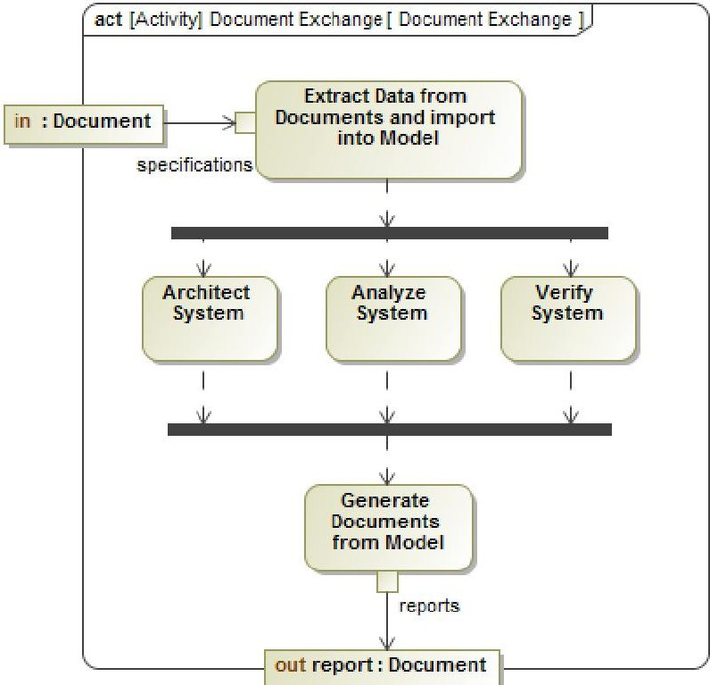


<div align="center">

Figure 1 - Document Import and Generate Model

</div>

A major challenge of modeling in a document centric world is how to maintain execution efficiency without heavy duplication of effort. For the foreseeable future, documents will continue to be the communication path of choice for program execution. From procurement documents to end item data packages, all contractual obligations will be verified through documents. As shown in Figure 1, data must be effortlessly extracted from specifications and other

program or reference documents, then utilized for architecture, trades, systems design, requirements management allocation and derivation, development guidance, behavioral analysis, integration and test planning and execution. During the development of the system, subsystem, module, software or other development item(s), data is extracted from the current model and formatted into the report documents as required. This enables the achievement of challenging execution efficiency goals. As the systems engineers within BAE Systems continue to refine their craft, additional document information may be input while features are being added to the models to support generating the wide variety of documents required.

## 3. THE FIFTH PILLAR

In 2016, the initial methodology and framework established for leveraging reuse at BAE Systems implemented a four pillar approach [1]. These pillars were Requirements, Structure, Behavior and Parametrics. Each pillar provides a container for their respective content where teams can work in both an independent and constructive basis. These four pillars were effective in capturing models in the early phases of MBSE adoption within BAE Systems. As the team's effectiveness in capturing models matured, more focus was spent on integrating the model into aspects of full program execution. No longer was the model just replacing Visio or PowerPoint diagrams. Customer document integration and traceability became a new focus for the model.

Initial customer interactions with the new MBSE paradigm did not always go as planned. On several occasions, customers were not thrilled with the apparent disconnect between their carefully crafted statements of work procurement documents, specifications and the model. The


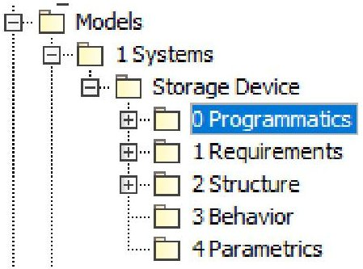


<div align="center">

Figure 2 - Model Pillars

</div>

model was referenced as a single source of truth for program execution, yet customers did not agree with this sentiment. The customer considered their documents as the source of truth, not the model. This interaction led to the need for providing more explicit traceability from customer documents, through requirement extraction, to model capture and execution. But these new elements in the model did not belong in any of the established pillars. They weren't structure, behavior, parametric or requirements. They were a logical representation of documents that live outside the model. A new pillar was needed. As show in Figure 2, Programmatics was established as the fifth pillar in the

<!-- PDF_PAGE: 3 -->

model. The new pillar was quickly adopted for several unintended aspects of the model such as glossaries and program information. The glossary sections, as shown in Figure 3, hold a generic modeling glossary that is applicable to all models, and a program specific glossary for terms with meaning only for this program's model. This provides both a static list of the terminology as well as the instant pop-up of information about a term when highlighted within the model.


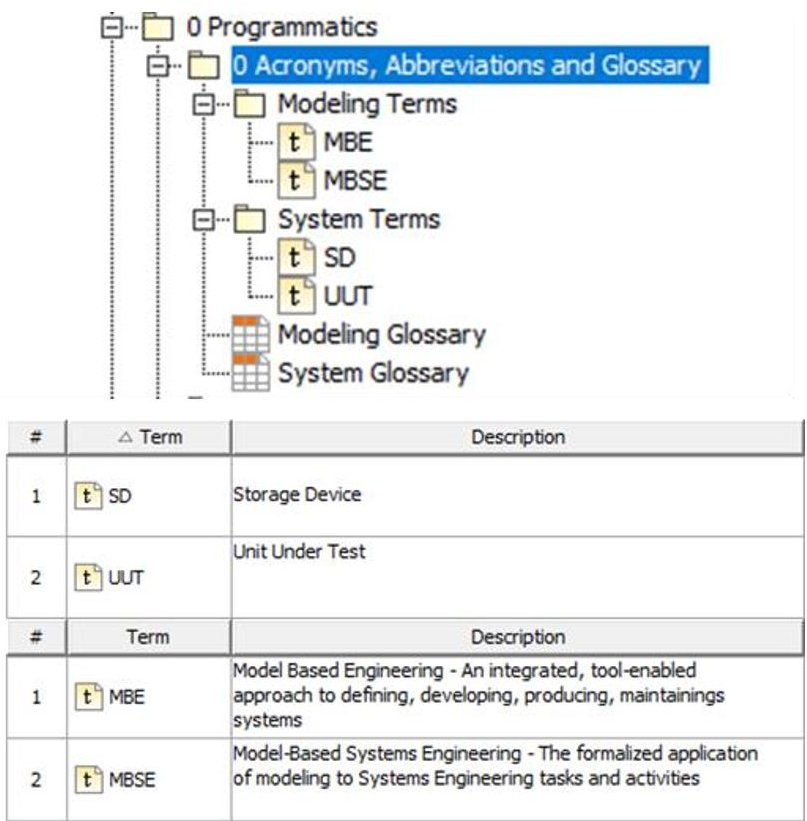


<div align="center">

Figure 3 - Programmatic Glossaries

</div>

For this reason, each term should not only spell out the acronym, but also include a definition when not immediately obvious.


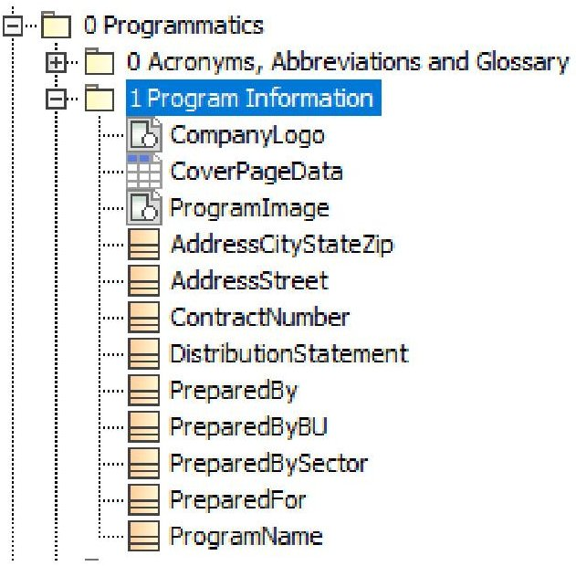


<div align="center">

Figure 4 - Program Data Elements

</div>

served two purposes. First, it acted as a tag for the model to formally tie it to a specific program. Second, the program data was a convenient source of information for document generation from the model. Document cover pages, headers and footers could be populated with all the critical program information required for official delivery to the customer.

Additionally, program data such as contract numbers, customer contact information, and other internal BAE Systems program data were captured in the Programmatics pillar. Example program data is shown in Figure 4. This

While these additional uses of the Programmatics pillar were great, they were not the original intent of the fifth pillar. The original purpose was to capture document traceability. To achieve this primary goal, several additional packages were added to the Programmatics pillar, Customer Documents, Program Documents, Reference Documents and Supplier Data Requirement List (SDRL) documents. These packages enable the logical representation of document inputs to the program, documents generated by the program, and program document deliverables. The model elements in the Customer Documents package and Reference Documents package are only a logical representation of the actual customer or reference document. Any information extracted from the documents such as requirements, would live elsewhere in the model as supported by the original four pillars. It should be noted that MagicDraw has the ability to hyperlink these symbolic elements to the documents should they be available on a local file system. While these elements are symbolic only, they do provide an anchor in the model that enables traceability from any model element back to the customer's source documents. In contrast to customer documents, SDRL packages are used to collect and organize model elements required to generate document deliverables.


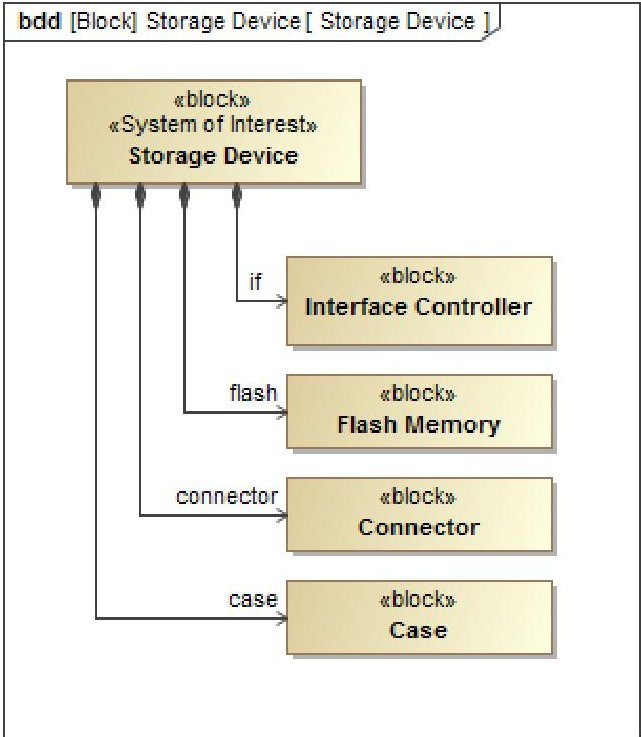


<div align="center">

Figure 5 - Example Block Definition Diagram

</div>

The full interaction of the fifth pillar with the rest of the model will be illustrated through the use of an example. The example model will illustrate full traceability from a symbolic customer document, through requirement satisfaction and verification, and finally report generation. The example system will be used as a vehicle to demonstrate

<!-- PDF_PAGE: 4 -->

the function and benefits of the Programmatics pillar in the modeling structure used at BAE Systems.

The example model System-of-Interest is a USB Flash Media device referred to as the Storage Device. The Storage Device includes an Interface Controller, Flash Memory, Connector and Case as shown in Figure 5. The Storage Device and its components were chosen because they should be familiar to most people. The purpose of the example model is not the system being modeled, but the traceability and subsequent data generation from the model.

## 4. META-MODEL EXTENSIONS

To support the ultimate goal of report generation from the model, the SysML meta-model was extended. SysML metamodel extensions provide the modeler with the capability to customize the language for targeted applications. In this example, the target application is the generation of a Test Plan document with full verification traceability.


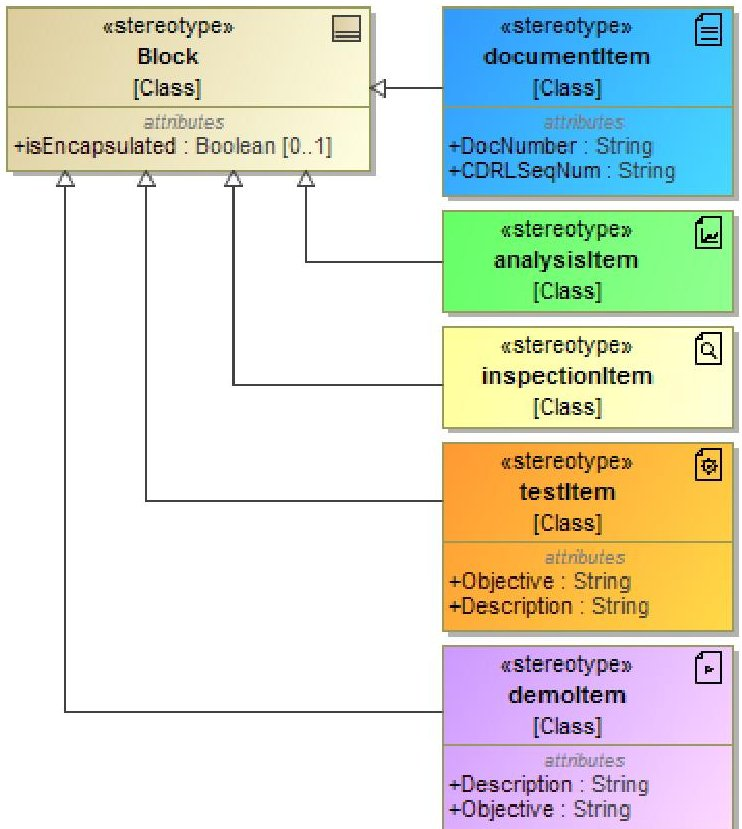


<div align="center">

Figure 6 - Verification Meta-model Extensions Diagram

</div>

To represent documents in the model a documentItem class was extended from the base SysML Block. This stereotype includes attributes for document number and SDRL sequence number. Additional attributes could be added for other applications, but these two satisfy the intent of the example. For verification traceability, stereotypes were added for inspectionItems, analysisItems, testItems and demoItems. testItems and demoItems include attributes for description and objective which will be used during report generation. Additional attributes were not added to the inspectionItem or analysisItem as they are not being used during report generation and are assumed to live outside the SysML model

and be generated from other modeling tools. The base Item stereotypes are shown in Figure 6.


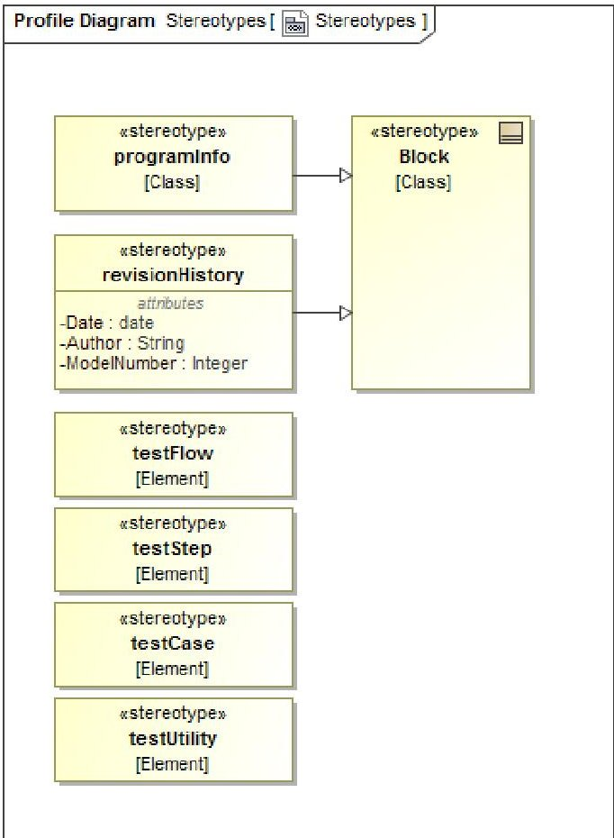


<div align="center">

Figure 7 - Report Generation Meta-Model Extensions Diagram

</div>

Further clarifying the testItem stereotype, four additional stereotypes were added: testFlow, testStep, testCase and testUtility. These types will be used as element identifiers when extracting data for subsections of the Test Plan report. Two final stereotypes were added named programInfo and revisionHistory. The programInfo type is used for all program related information such as program name, customer name, address information, etc. The documentation field of the programInfo elements contain the text used in report generation. The revisionHistory type is used for tracking the output revision of each generated document. These will be demonstrated further in Section 7. As shown in Figure 7, the test clarification types are simple stereotypes while the programInfo and revisionHistory are specialized from the Block SysML base element.

Meta-model extensions allow the primary modeler a level of control by establishing a framework that sits between the base SysML capabilities and the system being modeled. By creating a system of stereotypes and attributes, the modeler is declaring how certain aspects of the model are to be captured. This rigor adds consistency across modelers and can act as a guide to junior modelers who can often be overwhelmed by the openness of the SysML language.

An additional benefit is the use of meta-model attributes during data extraction and report generation. Applied stereotypes can be referenced by name in the report template

<!-- PDF_PAGE: 5 -->

language. This greatly simplifies the extraction of specific data. Instead of iterating through all the generic Block elements with complicated comparison logic, filters can be performed to iterate through only the elements of the specified stereotype.

## 5. SPECIFICATION AND REQUIREMENTS

The Storage Device specification is represented in the model under the Customer Documentation package in the Programmatics pillar as a documentItem. Typical program execution would see requirements extracted from the actual specification document and imported through a tool such as Cameo DataHub[5] and stored in the Requirements package. For this example, a simple set of requirements were crafted with the intent to exercise all aspects of traceability. For example, REQ001 states 'The Storage Device shall be USB 3.0 compliant.' To establish the source traceability of the requirements to the customer specification, each requirement


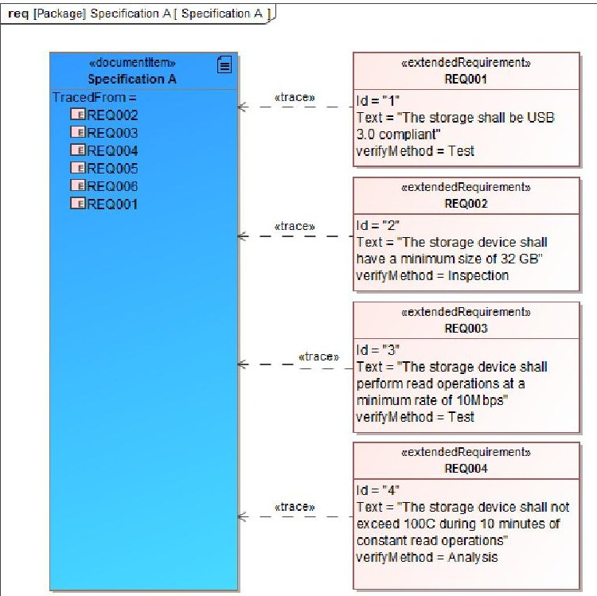


<div align="center">

Figure 8 - Requirement Source Traceability

</div>


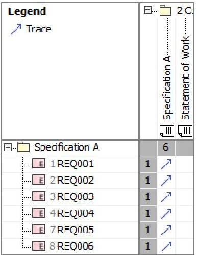


<div align="center">

Figure 9 - Requirement Traceability Matrix

</div>

was given a Trace relationship to the specification documentItem. The Trace relationship of the requirements can be captured in a Requirements Diagram as shown in Figure 8 or a Generic Matrix Diagram as shown in Figure 9. This Trace relationship will communicate to the customer that their specification is the source of requirements and drives all subsequent program modeling and execution. REQ001 illustrates a requirement that may also be traced to a Reference Document (e.g. USB 3.0 Standard)

## 6. SATISFACTION TRACEABILITY

Once all requirements have been imported or captured in the model, satisfaction relationships can be created and managed. Depending on the complexity of the model, there can be an extensive set of satisfaction and allocation relationships from requirements to functional model elements, logical model elements and physical model elements. In this case, the Storage Device is a physical only model which simplifies the traceability. Similar to the requirement Trace relationship, Satisfaction relationships can be created using either Block Definition Diagrams or a Satisfaction Matrix as shown in Figure 10. Satisfaction Matrix Diagrams are the preferred method of capture and convey information in a concise manner. Solid line arrows are explicit relationships added to the model while dashed line arrows are implied due to a child element. For example, The Storage Device is implied to satisfy REQ001 due to the Interface Controllers explicit relationship. For large systems, the implied satisfaction indications in the matrix view can be beneficial when verifying all requirement satisfaction at hierarchical boundaries.

<table border="1"><tr><td>Legend
Satisfy
Satisfy (Implied)</td><td colspan="5">2 System
Storage Dev
Case
Connector
Flash Memory
Interface Controller</td></tr><tr><td>Specification A[1 Requirements]</td><td>6</td><td>1</td><td>1</td><td>2</td><td>2</td></tr><tr><td>1 REQ001</td><td>2</td><td></td><td></td><td></td><td>✓</td></tr><tr><td>2 REQ002</td><td>2</td><td></td><td></td><td>✓</td><td></td></tr><tr><td>3 REQ003</td><td>3</td><td></td><td></td><td>✓</td><td>✓</td></tr><tr><td>4 REQ004</td><td>2</td><td>✓</td><td>✓</td><td></td><td></td></tr><tr><td>7 REQ005</td><td>1</td><td>✓</td><td></td><td></td><td></td></tr><tr><td>8 REQ006</td><td>2</td><td>✓</td><td></td><td>✓</td><td></td></tr></table>

<div align="center">

Figure 10 - Satisfaction Traceability Matrix

</div>

Satisfaction traceability provides several benefits to program execution. First, it ensures that all requirements will be achieved when the product is realized while providing clear understanding about which sub-systems are responsible for which requirements. Second, it provides traceability needed to evaluate the impact of requirement changes. For example, if REQ003 is updated by the customer, the Satisfaction Matrix in Figure 10 clearly indicates both Interface

<!-- PDF_PAGE: 6 -->

Controller and Flash Memory will be impacted. The designers of those sub-systems can be consulted and the overall program impact can be assessed. Lastly, it can aid in identifying unnecessary components or features in a design. When looking for schedule or cost cutting opportunities, if a component or feature is not directly needed to satisfy a requirement, it can be highlighted as a likely candidate for removal or delayed development at a future time.

## 7. VERIFICATION TRACEABILITY

Verification Traceability is where the new Programmatics pillar becomes essential. The Storage Device requirements and satisfaction traceability sections followed typical SysML practices. In contrast, verification traceability requires references to many items that still currently live outside the model or modeling environment. Examples of these are inspection items such as schematic documents and analysis items such as thermal models. While they are created using their own modeling tools, they are not yet integrated into a SysML model-based engineering (MBE) paradigm. As a result, symbolic representations of these external elements are captured in the Programmatics section of the model, typically as either a Reference document or SDRL report.

First discussed in the meta-model extension section, the four industry standard methods for verification have been represented in the model as inspectionItem, analysisItem, testItem and demoItem. InspectionItems are used to represent documentation such as component datasheets or design schematics. AnalysisItems are used to represent external data such as thermal or electrical stress analysis. AnalysisItems could also represent internal SysML parametric data such as power consumption analysis[6] or behavioral data such as timing flows or message latency


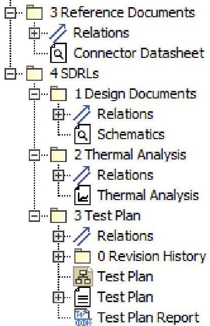


<div align="center">

Figure 11 - Programmatic Verification Item Structure

</div>

analysis. TestItems and demoItems fit naturally in the SysML model and can be represented using any of the behavioral diagrams. This set of Item types representing

either external or internal model data are then used as targets for the 'verified by' requirement relationship.

The Storage Device example includes three external documents represented by symbolic inspectionItems and analysisItems as shown in Figure 11. The connector datasheet is an inspectionItem located in the reference documents package and represents data generated outside the program. Reference documents would typically include industry standards, government standards or vendor data. The Storage Device schematic is also an inspectionItem, but it is located underneath the SDRL package. Items in the SDRLs package are different from Reference Documents package in that they represent data generated by the program and are contract


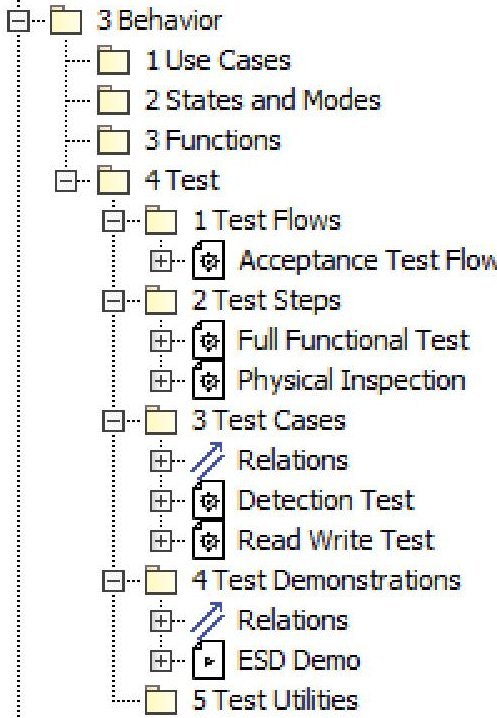


<div align="center">

Figure 12 - Test and Demonstration Verification Item Structure

</div>

deliverables. TestItems and demoItems live in the Test package located in the Behavior pillar as shown in Figure 12. Within the Test package there is a package structure which aligns with the program Test Plan SDRL. The root of the structure are Test Flows which represent the full life cycle of testing experienced by a program deliverable. The Storage Device includes an Acceptance Test Flow but it could also include Qualification or Workmanship test flows. The next level of structure is Test Steps which represent logical groups of tests or events in the Test Flow. The Storage Device includes a Physical Inspection event and a Full Functional Test event. Other common Test Steps may include thermal cycling, vibration testing, limited functional test, etc. The bottom level of the structure is Test Cases which represent an individual test run on the system of interest and have defined pass or fail criteria. The Storage Device includes a Detection Test and a Read Write Test. Also shown in the package structure but not needed for the Storage Device are Test Utilities. These are helper routines or operations that are used to prepare the system of interest. An example of a Test Utility would be loading of a software image or changing operational state in between Test Steps or Test Cases. Test Flows, Test

<!-- PDF_PAGE: 7 -->

Steps, Test Cases and Test Utilities are all of type testItem. To aid in report generation, each testItem is also applied with an additional sub type category, testFlow, testStep, testCase or testUtilitiy. The final test element is Test Demonstrations. Test Demonstrations are of type demoItem and represent a onetime design verification or test event. DemoItems are typically run on initial build or qualification units and are not repeated on every build of a product.


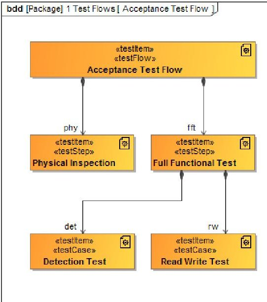


<div align="center">

Figure 14 - Verification Test Hierarchy

</div>

TestItem and demoItem stereotypes have attributes for test Objective and Description. The Objective and Description attributes are first shown in Section 4. These attributes are string type and add additional documentation to the model which is leveraged during Test Plan report generation.

Verification Test Hierarchy and Activities


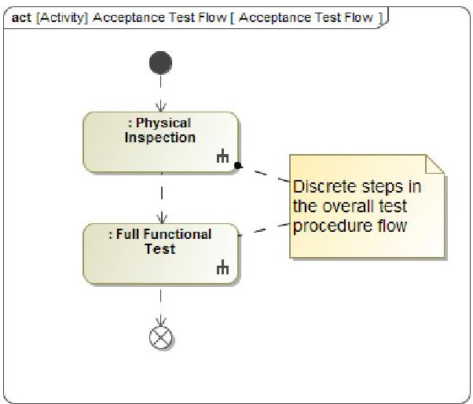


<div align="center">

Figure 13 - Acceptance Test Flow Activity Diagram

</div>

Recall that all verification stereotype meta-model extensions are specialized versions of the base SysML block. As such, they can be arranged in a hierarchical fashion that will provide verification traceability benefits, which will be illustrated later. The Storage Device test hierarchy is shown in Figure 14. Each testItem is further defined through Base


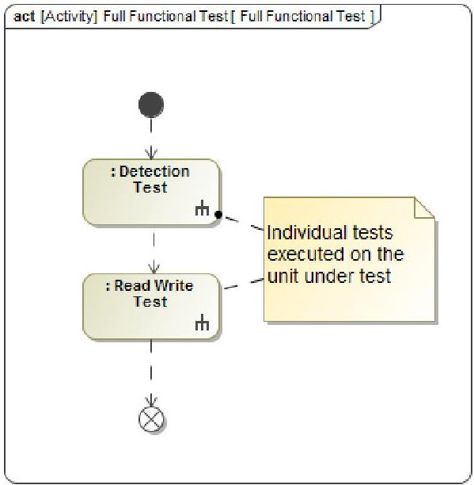


<div align="center">

Figure 15 - Full Functional Test Activity Diagram

</div>

Classifier Activity elements. The testItem classifying activities are then defined through Activity Diagrams. The Acceptance Test Flow Activity Diagram is shown in Figure 13. The Physical Inspection and Full Functional Test activities in the Acceptance Test Flow diagram are the Test Step testItem classifier activities. This hierarchical methodology continues from Test Flows through Test Steps to Test Cases and Test Utilities. Activity Diagrams for the Full Functional Test and Read Write Test testItem activities are shown in Figure 15 and Figure 16. Note how the Activity elements in the Activity Diagrams match the structural hierarchy in Figure 14.


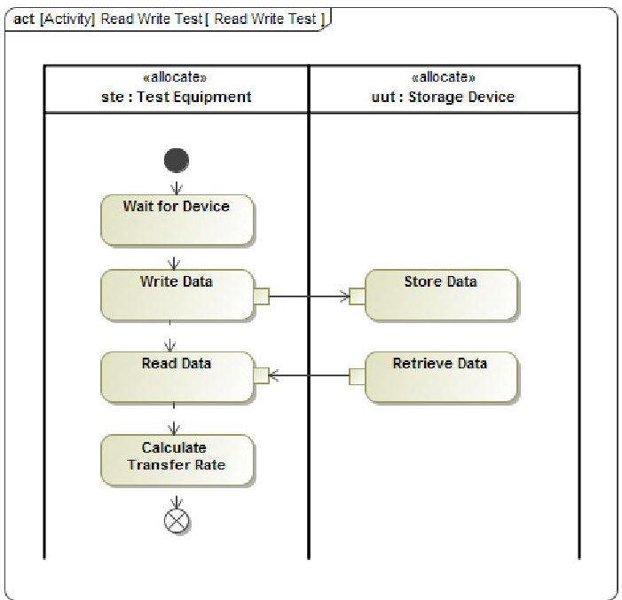


<div align="center">

Figure 16 - Read Write Test Activity Diagram

</div>

## Verification Traceability

Similar to satisfaction traceability, verification traceability relationships can be captured in the model using several methods. While it is possible to manually draw the associations in Block Definition Diagrams, matrix diagrams

<!-- PDF_PAGE: 8 -->

<table border="1"><tr><td>Legend
Verify
Verify (Implied)</td><td colspan="6">Specification A [1 Re
1 REQ001
2 REQ002
3 REQ003
4 REQ004
7 REQ005
8 REQ006</td></tr><tr><td>1 Design Documents
Schematics</td><td></td><td></td><td>1</td><td></td><td></td><td></td></tr><tr><td>2 Thermal Analysis
Thermal Analysis</td><td>1</td><td></td><td></td><td></td><td></td><td></td></tr><tr><td>3 Reference Documents
Connector Datasheet</td><td>1</td><td></td><td></td><td></td><td></td><td>1</td></tr><tr><td>4 Test</td><td></td><td>3</td><td></td><td>3</td><td>3</td><td>1</td></tr><tr><td>1 Test Flows
Acceptance Test Flow</td><td></td><td>1</td><td></td><td>1</td><td>1</td><td></td></tr><tr><td>2 Test Steps
Full Functional Test
Physical Inspection</td><td></td><td>1</td><td></td><td>1</td><td>1</td><td></td></tr><tr><td>3 Test Cases
Detection Test
Read Write Test</td><td></td><td>1</td><td></td><td>1</td><td>1</td><td></td></tr><tr><td>4 Test Demonstrations
ESD Demo</td><td></td><td></td><td></td><td></td><td></td><td>1</td></tr><tr><td></td><td>1</td><td></td><td></td><td></td><td></td><td></td></tr></table>

<div align="center">

Figure 17 - Verification Traceability Matrix

</div>

are the most convenient for data entry and effective for display. The Storage Device verification matrix is shown in Figure 17. The left side of the matrix diagram lists the potential verification items contained in the model. The scope of this list was limited to items in the Programmatics Reference Documents, SDRL packages, and Test elements. The requirements to be verified are shown across the top. Verification associations can be added and removed by clicking the box intersecting the two elements to be linked. Note how the Acceptance Test Flow and Full Functional Test have implied verification relationships. These relationships are implied and displayed because of the structural hierarchical associations in Figure 14. These implied relationships have the benefit of providing summaries of requirements being verified at all levels of the Test Plan.

<div align="center">

Requirements Verification Matrix

</div>

<table border="1"><tr><td>#</td><td>Name</td><td>Text</td><td>Satisfied By</td><td>Verify Method</td><td>Verified By</td></tr><tr><td>1</td><td>REQ001</td><td>The storage shall be USB 3.0 compliant</td><td>Interface Controller</td><td>Test</td><td>Detection Test</td></tr><tr><td>2</td><td>REQ002</td><td>The storage device shall be have a minimum size of 32 GB</td><td>Flash Memory</td><td>Inspection</td><td>Schematics</td></tr><tr><td>3</td><td>REQ003</td><td>The storage device shall perform read operations at a minimum rate of 10Mbps</td><td>Flash Memory Interface Controller</td><td>Test</td><td>Read Write Test</td></tr><tr><td>4</td><td>REQ004</td><td>The storage device shall have not exceed 100C during 10 minutes of constant read operations</td><td>Case</td><td>Analysis</td><td>Thermal Analysis Read Write Test</td></tr><tr><td>5</td><td>REQ005</td><td>The storage device shall survive an HBM ESD event of 5000 volts.</td><td>Storage Device</td><td>Demonstration</td><td>ESD Demo</td></tr><tr><td>6</td><td>REQ006</td><td>The storage device shall support 10,000 mate, demate operations.</td><td>Connector</td><td>Inspection</td><td>Connector Datasheet</td></tr></table>

<div align="center">

Figure 18 - Requirement Verification Matrix

</div>

Generic table diagrams provide the ability to display custom views of model data and are perfect for Requirements Verification Matrix (RVM) summaries. Note, the term matrix in this context refers to a legacy cross reference of data and not the MagicDraw Matrix Diagram. Using the model

requirements as context, a table diagram can be edited to display traditional RVM information such as requirement ID, requirement text, satisfaction elements, verification methods and verification items. The Storage Device RVM summary table is shown in Figure 18. Although a simple verification matrix is shown, meta-chain analysis may be used to show derived requirements and their verification matrix if needed.

## 8. REPORT GENERATION

The Storage Device example model has been presented with a comprehensive view of document traceability including requirement satisfaction and verification relationships. The final step in document based contract execution is generating documents from the model data. The Storage Device model with an extended meta-model provide all the information required to generate a basic Test Plan document. Although the actual generated document is unable to be included in this paper report, generation code snippets are provided.

The MagicDraw report generation capability is a document template system which uses the Apache Velocity Template Language (VTL)[7]. The VTL enables the report generator to extract and include model data into the document template. Additionally, NoMagic has extended the base VTL with additional commands called the Report Wizard Custom Language[8]. This extension adds the ability to generate multi-row and multi-column tables in industry standard office document formats. Together, the VTL and Report Wizard enable the insertion of text and diagrams from the model to construct contract document deliverables.


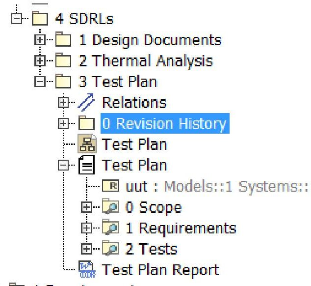


<div align="center">

Figure 19 - Report Package Structure

</div>

## Report Context Structure

To generate the Storage Device Test Plan SDRL document, the required content needs to be assembled for inclusion in a common context for the Report Wizard. The Report Wizard scope dialog does allow for the selection of multiple packages scattered around the model structure, but this is time consuming, error prone and not conducive for reuse among modelers. The preferred method is the use of Smart Packages to collocate the required model data into a single package

<!-- PDF_PAGE: 9 -->

context. Note, when model data is copied into a Smart Package, only a link to the original data is created. The SDRLs package within the Programmatics pillar provides a collection area for assembling data required to generate contract document deliverables. Shown in Figure 19, the


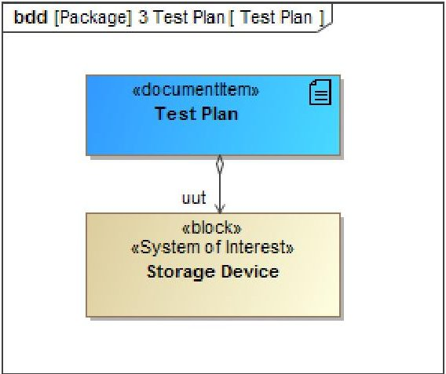


<div align="center">

Figure 20- Test Plan Block Definition Diagram

</div>

Storage Device Test Plan package includes a Revision History package, a Test Plan structural diagram, and the Test Plan documentItem. The Test Plan documentItem contains several Smart Packages for collecting model data including Scope, Requirements and Tests. The Scope Smart Package contains programInfo content for cover page, header and footer generation. The Requirements Smart Package contains all the requirements verified through test and demonstration. In the Storage Device example, the Requirements Smart Package also contain requirements verified through inspection and analysis which enables a complete RVM to be generated and included in the Test Plan report. The Test Smart Package contains the testItems and demoItems defining the Test Plan behavior and sequences. Finally, the Test Plan Report template is attached to the model and stored in the Test Plan package.

```perl

## documentItem for Example|Master Test Plan

#set($EXcurDocList = $report.filterElement($elements, ["documentItem"]))

#set($EXcurDoc = $list.get($EXcurDocList,0))

##

#foreach($a in $EXcurDoc.attribute)

#if ($a.name == "uut")

#set($systemBlock = $a.type)

#end

#end

```

## Listing 1 - Report Context Reference

Although the Test Plan Report document is focused on test procedures and requirements, some system context may be required. As shown in Figure 20, the Test Plan documentItem contains a part reference relationship to the System of Interest context for the test plan. The part name "uut", for Unit Under Test, can be used for extracting data during report generation. The code snippet in Listing 2 demonstrates how to extract the main documentItem in the report context and then extract the system block type from the part name "uut" to establish the System of Interest reference.

Note, document template lines starting with "#" indicate Velocity Template Language code.

## Get Example Program Info

#set($EXprogInfoList = $report.filterElement($elements, ["programInfo"]))

## Set Program Information Variables

#set($EXProgramName = $report.findElementInCollection

    ($EXprogInfoList, "ProgramName").documentation)

#set($EXAddressStreet = $report.findElementInCollection

    ($EXprogInfoList, "AddressStreet").documentation)

#set($EXAddressCityStateZip = $report.findElementInCollection

    ($EXprogInfoList, "AddressCityStateZip").documentation)

## Listing 2 - Report Program Info Reference

## Program Information

The Scope Smart Package in the Test Plan documentItem contains links to the program information from the Programmatics pillar. Each of the program information elements were typed with the programInfo stereotype for report extraction. The code in Listing 2 demonstrates how all programInfo elements can be collected and then referenced by name to extract information such as Program Name, Address, etc. In this example, the $EXProgramName variable now contains the text in the documentation field of the ProgramName element. The extracted text can be placed into the generated document by placing "$EXProgramName" in any non-VTL line. Program information is often used in generating document cover pages, footers and headers.


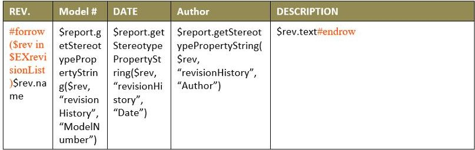


<div align="center">

Figure 21- Revision History Table

</div>

## Revision History

The Revision History package in the Test Plan package contains elements which represent the development history of the generated Test Plan document. Each time the Test Plan report is generated, a new revisionHistory element is manually added to this package with the appropriate tracking information such as author, date, description and model number. The model number records the specific version of shared models stored in MagicDraw Teamwork Server or Teamwork Cloud systems. Extracting and inserting the revision history into the generated document uses VTL Custom Language extensions to support adding rows to a revision table in the template document. The code shown in Figure 21, demonstrates a #forrow - #endrow operation. In this example, $EXrevisionList contains a sorted set of revisionHistory elements. These elements are iterated through and assigned to the temporary variable $rev. $rev is then used to extract the specific field values for the template table row. For each entry in the $EXrevisionList a new row is created and added to the generated report. The #forrow-

<!-- PDF_PAGE: 10 -->

#endrow construct is powerful and has many applications beyond the simple revision history table.

## Test Items

The Tests Smart Package, in the Test Plan documentItem, contains links to the testItem elements including activities and diagrams. The Test Plan Report template contains sections for each of the sub types including flows, steps, cases, utilities and demonstrations. For each sub type section in the template, all testItem elements are collected and filtered on said sub type. Then for each remaining testItem element, the appropriate data is extracted and inserted into the report. Listing 3 contains the code to extract and insert testCase sub type elements.


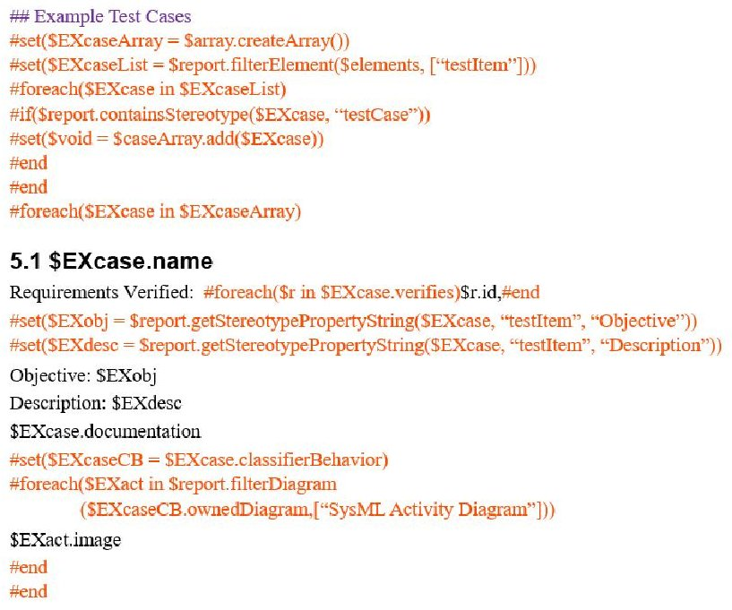


<div align="center">

Listing 3 - Report Test Case Reference

</div>

The code first collects all testItems in the report context which is the Test Plan SDRL package. Then the element list is reduced to only testCase sub types. A loop then iterates over each testCase extracting and inserting data from the model. Note how standard element properties can be addressed by name, such as "$EXcase.name" and "$EXcase.verifies". Both of these properties are part of the SysML definition and are accessible directly. For metamodel extensions, property values must be accessed through a getStereotypePropertyString VTL call. While this isn't as convenient as direct access, meta-model extension attributes are still accessible by name. In addition to text extraction from the model, this example also includes the classifying behavior Activity Diagrams. The diagrams are collected through the ownedDiagrams property of the classifierBehavior property of the testItem. The diagram is then inserted by the inclusion of "$EXact.image" in the template. Furthermore, document formatting is maintained while the template is being processed resulting in new level 2 headings for each testCase.


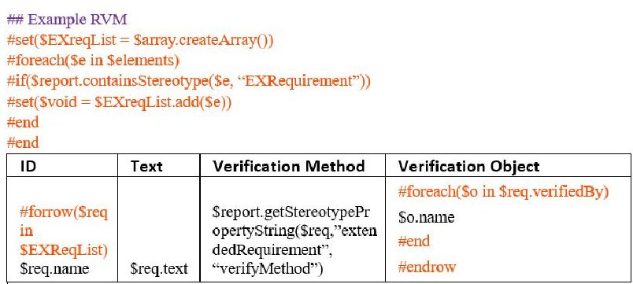


<div align="center">

Listing 4 - Requirements Verification Matrix Table

</div>

## Requirements Verification Matrix

The Requirements Verification Matrix (RVM) is often the last section of the Test Plan document. The RVM is a table listing all requirements from the controlling specification with verification method and object. This provides a convenient table view for customer review and signoff. The requirements included in the report are extracted from the Requirements Smart Package member of the Test Plan documentItem. Listing 4 demonstrates how to extract the requirement elements and loop through them creating a table in the generated report. Similar to Revision History, the RVM table uses the VTL Custom Language extensions for creating rows in the report. The requirements are collected, sorted and iterated through to generate the RVM table. The requirement text, verification method and object are extracted and inserted using previously described techniques.

## 8. FUTURE PLANS

The BAE Systems Capability group is incrementally developing a high fidelity prescriptive model template illustrating the proper construction of SysML model requirements, functions, structures, and parametrics. This model template provides examples of a traceable and decomposed system design. The template employs a common set of prescriptive modeling techniques and guidelines for general program reuse.

The prescriptive model template incorporates a powerful document generation capability taking advantage of the inherent database nature of the MBSE model. Documents come straight from the model eliminating the need for manual report generation while removing the necessity of the typical modeler to be intimate with the VTL language.

## 9. SUMMARY

Model Based Systems Engineering is a rapidly growing discipline in Aerospace and adjacent engineering fields. The capabilities of MBSE through languages such as SysML, are evolving at an incredible pace. Unfortunately, not all business functions are required to be as agile as engineering and are often slow in adopting new concepts of operations. Until support functions, such as contract management, modernize into a model driven paradigm, it will be the burden of engineering to bridge the growing divide. Applying automated methods for document integration and generation

<!-- PDF_PAGE: 11 -->

from model driven development is critical to realizing the full potential of MBSE. Tools such as NoMagic's MagicDraw include report generation capabilities through open languages such as the Velocity Template Language. Combining report generation capabilities with common model structures will pave the way for the development of reusable document templates for routine contract deliverables. Document integration and generation further realizes the benefits of Model Based Systems Engineering.

## REFERENCES

[1] J. Marshall, et. al, "Transitioning Model Based Systems Engineering to Onboard Spacecraft Electronics", Proceedings of the 2017 IEEE Aerospace Conf, Big Sky, MT, March 2017

[2] http://www.nomagic.com/products/magicdraw.html

[3] J. Marshall, et. al., "Using Model Based Systems Engineering Structures for Onboard Spacecraft Electronics", Proceedings of 2018 IEEE Aerospace Conference, Big Sky, MT, March 2018.

[4] https://www.omg.org/spec/SysML/1.0/About-SysML/

[5] https://www.nomagic.com/products/cameo-datahub/

[6] R. Ferguson, et. al., "Automated Power Analysis of Onboard Spacecraft Electronics with Model Based Systems Engineering", Proceedings of 2019 IEEE Aerospace Conference, Big Sky, MT, March 2019.

[7] http://velocity.apache.org/engine/devel/user-guide.html

[8] https://docs.nomagic.com/display/MD184/Report+Wizard +custom+language

## BIOGRAPHY


Richard Ferguson is a Senior Principal Systems Engineer at BAE Systems in Manassas, Virginia. With over 18 years of experience in VLSI ASIC development and embedded processing applications, Richard is the lead Engineer on the RAD750 $ ^{\circ} $ processor family of radiation hardened PowerPC

microprocessors. His experience includes circuit card design, VLSI ASIC design, verification and manufacturing electronic design automation tool development and embedded firmware development. Richard received a BSEET from DeVry University in 2002.


Joe Marshall is a BAE Systems Global Engineering Fellow and Senior Principal Systems Engineer working on embedded processor and high speed network space electronics systems at BAE Systems in Manassas, Virginia. He has developed and or led development of hardware, software and subsystems at

GTE, IBM, Loral, Lockheed Martin and BAE Systems with the last 30 years focused on Spacecraft processing systems, high performance interconnects and their applications. He is editor of SpaceVPX (ANSI/VITA 78), was chair of the AIAA Computer Systems Technical Committee from 2001 to 2006 and specializes in dependable systems, reconfigurable systems, processor architectures, plug and play, high speed interconnects and model-based systems engineering. Joe has a BSEE and MSEE from Purdue University and has been certified twice as a System Architect by Lockheed Martin.


Maria Guzman is a Principal Systems Engineer at BAE Systems in Hudson, New Hampshire, working on and supporting the implementation of Model Based Systems Engineering (MBSE), as part of the MBSE Capability Group. During her trajectory, she has worked on modeling and simulation, operational

analysis, tool development and validation, mechanical design, and structural analysis. Maria has received a BS and MS in Astronautical Engineering from the University of Southern California.