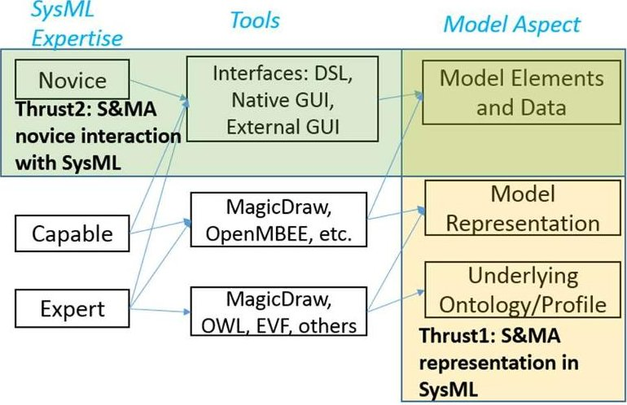
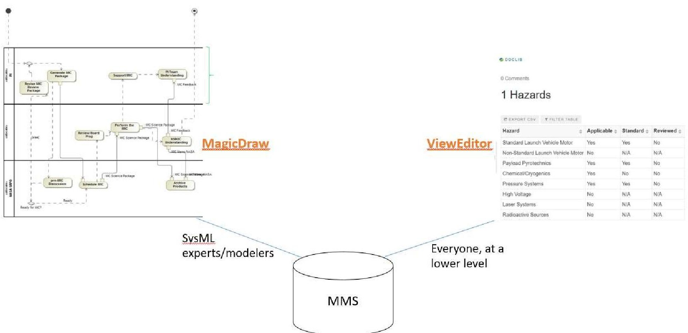
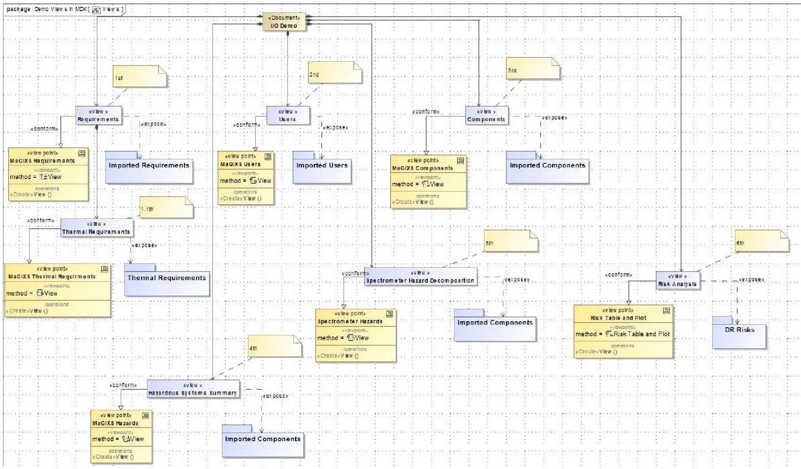
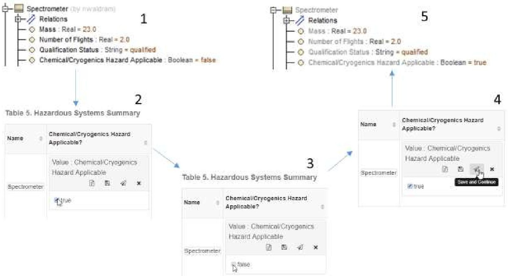
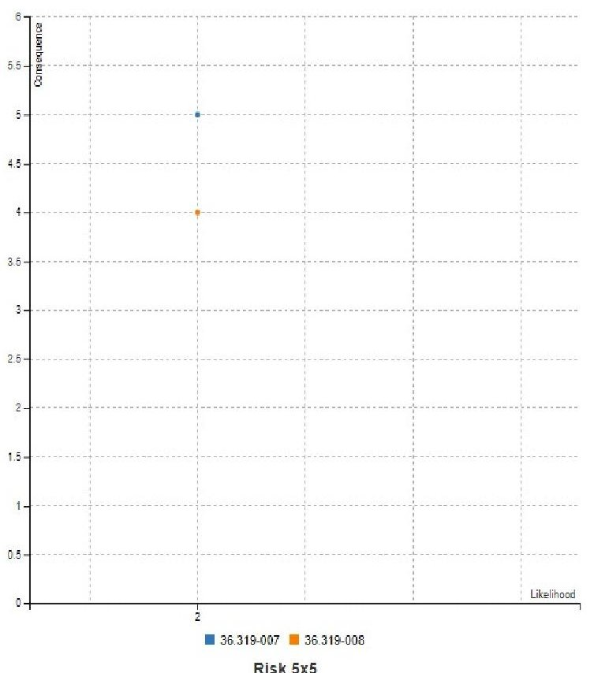
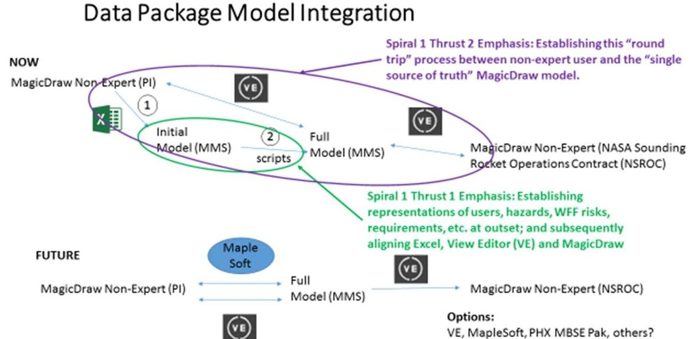
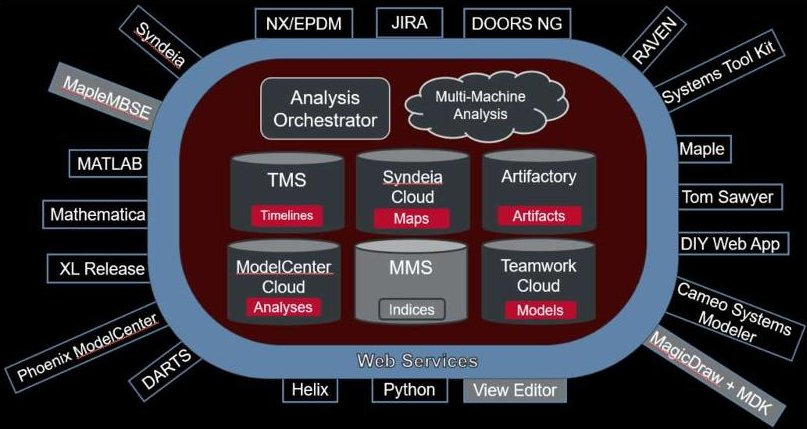

<!-- PDF_PAGE: 1 -->

# Pathfinding Model-Based Mission Assurance: S&MA Representation & Interaction within MBSE

Nicholas Waldram,

Steven Cornford

Jet Propulsion Laboratory

4800 Oak Grove Dr.

Pasadena, CA 91109

626-491-5061

818-354-1701

holas.R.Waldram@jpl.nasa.gov

slc@jpl.nasa.gov

Abstract—The Model-Based Mission Assurance (MBMA) Program, led by John Evans within the Office of Safety and Mission Assurance (OSMA) at NASA is leading the charge in terms of integrating mission assurance into MBSE for flight projects. While OSMA operates with a charter at the agency level, the JPL contingency of support, including Steve Cornford and Nicholas Waldram, has a unique role in tying MBSE into the S&MA discipline. One of the advantages of operating within JPL is the exposure to flight projects which have adopted MBSE into several phases of the project lifecycle. Europa Clipper is currently in Phase B, utilizing the largest implementation of MBSE on a JPL flight project, simultaneously innovating the technology space and pathfinding for future efforts by constructing and developing the supra-model architectures with plugins such as the Europa Validation Framework (EVF), which is used to efficiently validate a large, complex model quickly and thoroughly. Besides the project level insight and resources, JPL has also invested significantly into MBSE from three distinct angles, via the Computer Aided Engineering (CAE) team, the Integrated Model-Centric Engineering (IMCE) group, and the Innovation Foundry. Through our development we have utilized the expertise and advice of the CAE to guide us towards sound modeling approaches and greatly enhanced tool integration to meet stakeholder needs. To broaden our thinking "beyond the gates" of JPL and to test our thinking on an agency level we have become involved with the NASA's agency-wide MBSE Infusion and Modernization Initiative (MIAMI). Through our work in the Cross Lifecycle Modeling (CLM) team we have been able to develop and test out our technologies and modeling patterns. While facing a number of configuration management hurdles in gaining and distributing access to our various tools which lie behind JPL firewalls, these difficulties have proven useful in terms of understanding limitations and how to circumvent these issues. The ground-level technology troubleshooting is critical to realize a tangible stakeholder integration.

## TABLE OF CONTENTS

1. INTRODUCTION ...1

2. OVERALL APPROACH ...2

3. THRUST 1: MODELING APPROACH AND PURPOSE2

4. THRUST 2: LOWERING THE BARRIER TO ENTRY .4

5. CONCLUSIONS AND FUTURE WORK ...6

ACKNOWLEDGEMENTS ...7

REFERENCES ...7

BIOGRAPHY ...7

## 1. INTRODUCTION

Several years ago, Jon Holladay, the NASA Systems Engineering Technical Fellow started an initiative to pilot and infuse MBSE across the Agency. Today, MIAMI [1] is working to achieve that original goal. In addition, the goals have been expanded and now include 4 teams [1].

One of the MIAMI teams, the CLM team, is composed of engineers from a number of NASA Centers working to develop and pilot models and modeling patterns at Wallops Flight Facility (WFF). This team, its goals and its progress are described in more detail in [1].

Within the CLM team is a small team focused on integrating aspects of the Safety and Mission Assurance (S&MA) domain into MBSE. As described in [1], the primary activities at WFF involved Sounding Rockets and small Science teams. This means that "safety first," with low budgets, is the usual mode of operation. The advantages of piloting in this environment is both a willingness of the small teams to try something better, and a shorter mission life cycle (there are dozens of launches per year) that enable more rapid iteration. A significant disadvantage is that there are not a lot of S&MA activities to incorporate, at least compared with larger, higher budget NASA missions.

Our MBMA charter was to create and deploy small but comprehensive examples of a variety of S&MA information

<!-- PDF_PAGE: 2 -->

and streamlined user-interactive interfaces to be associated with the Sounding Rocket Project Model. Our intention was not to prove out the ultimate feasibility of MBMA as a whole, but rather to show our stakeholders that including S&MA in a centralized model framework can make S&MA personnel's job more efficient and less error-prone, so that they can imagine a future with a more integrated network of S&MA information.

For these reasons, our Model-based Mission Assurance (MBMA) effort has focused on integrating both foundational aspects of S&MA as well as "lowering the barrier to entry" for interaction with the models we develop. Few of the personnel involved in these lower cost mission are computer scientists, nor are they going to become experts in SysML. Because of this, we are working to leverage existing work, develop viewpoints and other necessary tooling in an effort to reduce the SysML and MagicDraw [2] knowledge required to contribute to the modeling effort.

## 2. OVERALL APPROACH

The resources available for our MBMA team are few and thus need to be wisely spent. By joining forces with the CLM team, we leverage the system modeling work they are doing, and they leverage our work, due to technology overlap in our efforts. For example, as we develop patterns for the sequencing and phasing of various mitigations and hazardous activities, the CLM team can apply these same patterns to non-S&MA activity sequencing. It must be reiterated that with our limited budget, our goal was not to develop finished products for our customers, but rather to illustrate what is possible. We are exploring these possibilities by way of two main "thrusts." The two thrusts to our effort of incorporating S&MA in to the sounding rocket model are, firstly, appropriate and consistent representation, and secondly, stakeholder integration.

The first thrust concerns the foundation of MBMA in that it tackles the architecture, nodes, and connectivity through the S&MA domain within the modeling framework. As a foundation of the model, it requires careful thinking from modelers, engineers, stakeholders, and computer scientists to ensure sound implementation. Our investigation into technologies which tie stakeholders into the model as part of the second thrust has focused instead on user testing and experimentation. These two thrusts fit in to the tools, users, and model scope as shown in Figure 1.

## 3. THRUST 1: MODELING APPROACH AND PURPOSE

While our first thrust concerns a general S&MA framework, our specific development was tailored to be applicable to the Sounding Rockets Program Office (SRPO) at NASA. When the CLM team started out their work with SRPO, the Marshall Grazing Incidence X-ray Spectrometer (MaGIXS) mission was approaching its Design Review, so the team

began work modeling the rocket system [3]. One of the primary MBMA aspects provided in the Design Review package for the MaGIXS mission was a list of applicable hazards. These hazards are listed in various other SRPO missions in similar tables, with a Boolean "YES/NO" indicating their applicability (see Table 1). This seemed a logical starting point for our work, given that hazards lie within the realm of S&MA, and that a primary directive of the MIAMI sounding rocket modeling effort is re-usability by incorporating a generic set of hazards and allowing for a simple way to specify their applicability on a per-mission basis we demonstrate the re-usability of a new, MBMA portion of our model.

Figure 1. The interaction amongst users, tools, and model aspects is represented within the context of two thrusts of our MBMA effort. As the expertise level increases, so do the number of tools utilized by the modeler as well as the scope of the model aspects which are accessed (interactions represented as arrows).

Our basic hazard modeling pattern is displayed in Figure 2. In SysML language, we have "decomposed" the components and subsystems in our model into relevant hazards. These hazards are associated with various activities (test procedures, etc.) and requirements in such a way that all information pertinent to the hazardousness of the subsystem is rolled up the subsystem or component block.

Figure 2. Hazard modeling pattern expressed generically. Subsystems or parts of the spacecraft "decompose" into hazards, providing an explicit link throughout the model that facilitates association with hazardous tests ("activities") and requirements. This also enables rapid collection of S&MA information levied on parts, phases, and individuals (see Section 4 and Figure 6).

<!-- PDF_PAGE: 3 -->

Table 1. A list of applicable hazards to the MaGIXS Mission.

<table border="1"><tr><td>Hazard</td><td>Applicable</td><td>Standard</td><td>Reviewed</td></tr><tr><td>Standard Launch Vehicle Motors
Terrier Mk70-Black Brant Mk4</td><td>Yes</td><td>Yes</td><td>In process</td></tr><tr><td>Non-Standard Launch Motors
None</td><td>No</td><td>N/A</td><td>N/A</td></tr><tr><td>Payload Pyrotechnics
• Belly Band
• S-19 Canard Decouple
• Nosetip Eject
• Despin
• P/L Separation
• Heat Shield
• Parachute Pyros</td><td>Yes</td><td>Yes</td><td>In process</td></tr><tr><td>Chemical and/or Cryogenics
Experiment LN2</td><td>Yes</td><td>No</td><td>Yes</td></tr><tr><td>Pressure Systems
• S19
• SPARCS</td><td>Yes</td><td>Yes</td><td>Yes</td></tr><tr><td>Laser Systems
None</td><td>No</td><td>N/A</td><td>N/A</td></tr><tr><td>Radioactive Sources
None</td><td>No</td><td>N/A</td><td>N/A</td></tr><tr><td>Waiver or ELS
None</td><td>No</td><td>N/A</td><td>N/A</td></tr></table>

While this hazard modeling pattern is fairly straightforward, it arose out of trial and error with various different approaches using native MagicDraw functionalities, such as the Domain Specific Language (DSL) Customization [4], which rely on custom stereotypes and therefore change and extend the SysML language, rather than using SysML as-is.

The power in linking the pieces (subsystem, part, instrument, etc.) of the system architecture to hazards is that it provides an explicit relationship which facilitates a cohesive network of information useful to S&MA engineers. As shown below in Section 4, an S&MA engineer checking a box on a front end tool yields a roll-up of all mitigations, requirements, and cognizant individuals related to a particular hazardous piece of a system. Without hazards in the model, this information must be collected manually or intuited.

Given our implementation on a small project with such welldefined S&MA procedures, the payoff of MBSE for our stakeholders is giving them ready access to information they want, with data based in a centralized source. So, our risk and hazard modeling use-cases are geared less at being predictive of flight system behaviors, and more towards mitigating programmatic risks and challenges, in the form of cost, schedule, and efficiency. Therefore, according to the desires of these stakeholders, the promise of hazard modeling comes primarily through the tools and interfaces which make their lives easier, and make the mission planning and execution more efficient.

A more recent area of inquiry within our first thrust has been modeling risks. Risks from the MaGIXS Design Review

package are shown in Table 2. In our current scheme, risks are blocks in SysML, and they possess various value properties which correspond to the columns in the table. Likelihood (L), Consequence (C), and LxC from Table 2 are stored in the model as integers, unlike the other properties which exist as strings. These integer values are useful elsewhere in the model in that they can be associated with constraints and incorporated in simulations. In addition, they can be used in front-end analysis, such as in ViewEditor plots as shown in the following section.

It is a unique challenge to approach S&MA modeling on a Class-D mission, where the scope of risk mitigation is greatly confined (only two, severe risks identified for MaGIXS). Our exploration, however, has so far provided an opportunity to capture the entire S&MA context provided to us as applied to the actual mission, and an opportunity to focus on the greater ontological significance of certain modeling choices, rather than dwelling in the grainier details of fault-tree and FMECA modeling, or binning hundreds of waivers, Engineering Change Requests (ECRs), or Problem Failure Reports (PFRs), like on a larger mission. The presentation of even these simple risks in an editable format (see Section 4) directly connected to the model has attracted a lot of attention. The ability for non-modelers to not only see, but edit, model elements is incredibly inviting to those sitting on the sideline. As many of us know, the risks that get us are often those we failed to keep track of.

One limitation we face by working with a Class-D project is that by focusing on the greater implications of a small number of modeling choices, the decision-making involved with

<!-- PDF_PAGE: 4 -->

Table 2. Risks applicable to the MaGIXS mission. "L" is likelihood and "C" is consequence in the above table.

<table border="1"><tr><td>Risk Number</td><td>Risk Description</td><td>Risk Statement</td><td>Handling Action and Projected Outcome</td><td>Risk Handling Approach</td><td>L</td><td>C</td><td>LxC</td><td>Comments</td></tr><tr><td>36.319-007</td><td>GLN-MAC&quot;Soft Reboot&quot;inflight No Root Cause yet found on36.245 Figueroa&amp;36.311 UG Green</td><td>Given that the unresolved GLN-MAC(orLN-200)&quot;soft reboot&quot;that occurred on the36.245 Figueroa&amp;36.311 UG Green mission,there is potential that a similar reboot could occur in flight leading toS-19L Loss of attitude reference in BGS leading toFTS activation on the vehicle(during guidance)</td><td>The AIB is actively investigating theGLN-MAC IMU failure.An open branch in the Fault Tree includes theLN-200,which is the primary attitude sensor in theS-19L BGS.</td><td>Watch</td><td>2</td><td>5</td><td>10</td><td></td></tr><tr><td>36.319-008</td><td>Crydom Relay FailureIonic Contamination Susceptibility andFailure</td><td>Given that Crydom Relay in the Shutter DoorControl Box is susceptible to ionic contamination,there is potential that the component will not function as designed,leading to loss of planned inflight events(shutter door open and close).</td><td>Continue the investigation with theGaleazzi door NCR.Additional screening test(voltage scintillation tests)was completed on a replacement Shutter Door ControlBox regarding the Crydom relays to detect contamination.</td><td>Accept</td><td>2</td><td>4</td><td>8</td><td>-Replacement Shutter Door ControlBox tested acceptable for flight.-Ionic contamination has positively occurred on1 analyzed relay.-Additional design with these relays are under scrutiny as possible implication in other subsystem inflight failures.</td></tr></table>

other considerations such as scope of data inclusion is bypassed. Rolling out MBSE on projects demands a close look on what data belongs in what venues (MagicDraw, heritage tools and platforms, etc.). Fortunately, at JPL we have had opportunity to gain insight and advice from members of larger MBSE efforts, such as Europa Clipper, in these regards.

## 4. THRUST 2: LOWERING THE BARRIER TO ENTRY

While there are a variety of methods for interacting with the model, we have chosen a few common ones to illustrate the utility of distributing a model across a suite of a few useful tools. The CAE team at JPL has been instrumental (quite literally) in providing technologies, insight, and instruction in order to realize much of our integrated vision for our MBMA model. The current architecture for our models shifts the data down one level from MagicDraw to a database repository, known as the Model Management System (MMS) [5], which stores values, datatypes, and other model data (see Figure 3). MagicDraw and other front end tools designed to be portals of access to the data are mounted on MMS as shown. One of these front end applications of great utility to the goals of our second modeling thrust is ViewEditor, a web application which interacts with the model via MMS and is capable of displaying reports in a user friendly and editable way. ViewEditor is an open source, OpenMBEE tool, and information can be found on their website [5].

Report generation in ViewEditor is similar in nature to DocGen, another OpenMBEE tool which output static reports from MagicDraw [5]. The document itself is modeled from a diagram, where the views and viewpoints are defined within MagicDraw (see Figure 4). Rather than generating views and exporting to HTML to be opened locally in an application such as OXYGEN, the information can be pushed directly to ViewEditor. From ViewEditor, these reports can be downloaded in several file types including PDF.

ViewEditor is an improvement on DocGen in several ways. It retains the core capabilities of DocGen, in terms of exposing model data and conforming to user-defined document generation formatting, while presenting the information in a simple and easily accessible manner from a webpage. In addition, ViewEditor allows the front-end user to make edits to the model from the interface itself, and push these changes to MagicDraw. This way, the MagicDraw modeler can set up various views relevant to different stakeholders, and when the stakeholder goes into ViewEditor they see data tabulated in a comprehensible way. Little to no SysML expertise is needed from ViewEditor to make meaningful changes to the model. Because the viewpoints are set up from within the MagicDraw model, the primary modelers have the ability to set the scope of ViewEditor data to only that which is relevant for the stakeholder to see, so that the non-modeler does not possess unnecessary permissions which might lead to errors and inconsistencies in the model structure and data. Figure 5 includes an example of a user toggling a hazard from "false" to "true," thereby changing the value throughout the model.

One power of providing views into the model using tools such as ViewEditor is that the viewpoints can be constructed to yield data views which traverse several connections among model data at once. This node traversal is facilitated by the underlying ontology in SysML, as part of thrust 1. The Spectrometer Hazard Decomposition table shown in Figure 6 demonstrates this capability. The "Applicable Hazards" column shows all hazards associated with the component in accordance with the modeling pattern described in Section 3 and Figure 2, while the "Hazard Mitigation Activities" and "Hazard Mitigation Requirements" shows those respective elements each under the umbrella of the hazard in question. While viewing this inside MagicDraw might demand a sequence of clicks, not to mention tool-specific knowledge as to where to look, in a front-end web-app mounted onto a database shared with MagicDraw, the user sees the information laid out cleanly in one table.

<!-- PDF_PAGE: 5 -->

Figure 3. Front-end interfaces, such as MagicDraw and ViewEditor are mounted on the MMS repository.

Figure 4. MDK view diagram shown. The top level document decomposes into views, which expose model data and conform to a viewpoint which constructs views such as tables, paragraphs, and plots.

<!-- PDF_PAGE: 6 -->

Figure 5. Steps 1 through 5 show the mechanism through which the ViewEditor user can edit model data. In steps 2 through 4, the user toggles the Chemical/Cryogenics Hazard Applicable value from "false" to "true, and saves the changes. This commit then changes the value throughout the model, as seen in step 5.

One power of providing views into the model using tools such as ViewEditor is that the viewpoints can be constructed to yield data views which traverse several connections among model data at once. This node traversal is facilitated by the underlying ontology in SysML, as part of thrust 1. The Spectrometer Hazard Decomposition table shown in Figure 6 demonstrates this capability. The "Applicable Hazards" column shows all hazards associated with the component in accordance with the modeling pattern described in Section 3 and Figure 2, while the "Hazard Mitigation Activities" and "Hazard Mitigation Requirements" shows those respective elements each under the umbrella of the hazard in question. While viewing this inside MagicDraw might demand a sequence of clicks, not to mention tool-specific knowledge as to where to look, in a front-end web-app mounted onto a database shared with MagicDraw, the user sees the information laid out cleanly in one table.

Another way that front-end tools add value to our stakeholders is through data visualization. Figure 7 shows the risk values from Table 2 presented in a risk plot. While this plot does not appear exactly as a NASA standard "5X5 matrix" in its current state, the CAE is exploring this extra level of beautification through the JSON plotting integration into MDK to make it appear more like the NASA matrix. When a user changes a value in the table (Table 2) for a risk's Likelihood or Consequence in the ViewEditor web-app and saves the change, the corresponding data point shifts on the plot, in MagicDraw, and throughout the model in real-time. This capability should have implications for further MBMA development towards stakeholder integration into early lifecycle, allowing the end-user to easily ask the model how a change in parameter could affect the rest of the system, from outside of MagicDraw.

Table 6. Spectrometer Hazard Decomposition

<table border="1"><tr><td>Part</td><td>Applicable Hazards</td><td>Hazard Mitigation Activities</td><td>Hazard Mitigation Requirements</td></tr><tr><td>Spectrometer</td><td>Chemical/Cryogenics HazardHigh Voltage Hazard</td><td>Cryo CheckVoltage Test</td><td>Cryo Hazard ComplianceHigh Voltage Hazard Compliance</td></tr></table>

Figure 6. Spectrometer hazard decomposition information from the MagicDraw model, displayed in a table on ViewEditor.

<!-- PDF_PAGE: 7 -->

Figure 7. ViewEditor Risk Plot for the two risks identified for MaGIXS by the Design Review (see Table 2). This plot is a draft version of a plot to overlay mission risks on the NASA standard "5X5 matrix," and work is underway to clean up its appearance (tick marks only appear on the X-axis for corresponding data points, for instance).

With many of the technological pieces in place, our next effort was to tailor our development towards the products and deliverables desired by our stakeholder. Given the collaborative power of a front-end like ViewEditor to loop in these stakeholders, we have designed a round-trip into the model (see upper level of Figure 8).

At step one, the PI provides her input via Excel into the model to define the properties of model elements (requirements, components, etc.). This initializes the model data, which the SysML expert can then refer to work in MagicDraw and generate views back to ViewEditor to present the data for viewing and editing. At this level, the data changes made on ViewEditor can either lead to direct changes to the MagicDraw model, or run scripts to initiate queries or make other model changes. After model initialization, the model is at a sufficiently mature state, so that both the PI and NSROC may make incremental edits through ViewEditor. To make this "round-trip" more seamless for users, it would be beneficial to scale the interaction down to one tool, and by using a tool more sophisticated than Excel for manual data dumps.

One tool being explored is MapleMBSE, which uses Excel sheets connected to a server to interact with the model (lower level of Figure 8). A tool like MapleMBSE is an improvement over Excel, but it is still an inconvenience to switch between two applications (MapleMBSE and ViewEditor) for different purposes when interacting with the model at different stages of maturity. It remains to be explored as to whether MapleMBSE could be the single interface to meet both of these needs.

Regardless of what tools are available and chosen, the point is that modelling MBMA comes down to more than relationships in SysML. Without the right views into the model, the information is of limited use to a project. MagicDraw, based on feedback we have captured from stakeholders and non-modelers, is not always the tool of choice for views into a system. Fortunately, a "single source of truth" in MBMA does not equal a "single tool of use." When the model lives in a database rather than exclusively within MagicDraw, each tool can perform what it's most capable of, rather than one tool trying to do everything.

Figure 8. Various tools for stakeholder integration into the model are shown ("VE" is ViewEditor). The upper level shows our current methodology for stakeholder data input and output, while the lower level shows what we believe to be the next step.

<!-- PDF_PAGE: 8 -->

An example of a distributed network used by the CAE at JPL is shown in Figure 9 below. As can be seen in this diagram, MagicDraw is just one of many web service tools in this paradigm. The foundational aspects, or Thrust 1, of MBMA form the heft of the model's centralized S&MA information (within MMS in Figure 9), and lowering the barrier to entry for our stakeholders, or Thrust 2, requires a network of useful front-end tools (mounted web services in the figure).

Figure 9. OpenCAE Systems Environment Overview. Of this environment, MIAMI CLM uses a subset, and these tools are identified in grey.

## 5. CONCLUSIONS AND FUTURE WORK

As part of our MBMA exploration, we have decided on various modeling patterns for hazards and risks which integrate mitigation activities, and applicable requirements and risks into the project model structure. While our current work includes the set of relevant S&MA activities, it does not yet consider in-flight system behavior, but rather pre-flight activities such as inspections and tests. Deeper complexities will emerge in later Sprints which may require deeper functional modeling. For instance, we know from our stakeholders that the shutter door is at greater risk of sticking at particular points in the launch sequence. These are the kinds of risks that we would like to identify and plan against, once we develop a more mature understanding of the system. That way, we can utilize modeling to optimize the system and suggest mitigations to behavioral risks, and our modeling patterns can provide the necessary linkages to give a systemwide description of the effects. Given our current level of knowledge of risks and hazards, the best we can do right now is modeling S&MA from an inspection and test planning level. For our implementation on a Phase D mission working on a quick timeline, the work we have completed helps provide deliverables based on the information traditionally utilized by the SRPO. In the long term, system behavior integration will allow for cheaper, smarter risk mitigation which is less "on-the-fly" than the current systems engineering allows.

Another aspect of our models that we are seeking to improve is the relational structure of the data involved in our risks and hazards. One method which will help us accomplish this goal is incorporating Smart Packages in MagicDraw to

automatically sort the model elements of interest into appropriate categories based on particular identifiers or properties (such as a "risk" value property). This would simplify the organization of our model, and allow our viewpoints defined through MDK to be consistent with the latest updates. If someone created a risk in a new, untracked package within the model, the Smart Package would still find and include it in its contents.

Amy Winebarger, PI of the MaGIXs mission, stated that her desire for MBSE was to provide the SRPO a "single source of truth" for information, which is exactly what we are after within our first thrust. As we continue to explore MBMA, we seek also to provide cohesive, per-stakeholder, tools for model interaction tailored to usability and domain of expertise. With these two goals in mind we intend to move MBMA towards not only satisfying stakeholders, but providing them a low barrier of entry into the model. This enables more great minds and experience sets to contribute to better NASA missions.

## ACKNOWLEDGEMENTS

The authors wish to thank Dr. John Evans at NASA HQ, along with Mr. Anthony Diventi and Dr. Frank Groen for their vision and continued support. We would also like to thank the MIAMI leadership, especially Mr. Jon Holladay. Finally, we would like to thank our fellow MIAMI team members and our leaders, George Plattsmier and George Turner.

## REFERENCES

[1] N. Waldram, S. Cornford, G. Plattsmier, M. Piette, Cross Lifecycle Modeling in MBSE, 2019 IEEE Aerospace Conference, https://ieeexplore.ieee.org/document/8741966

[2] More information of NoMagic and MagicDraw can be found on their website: https://www.nomagic.com/products/magicdraw

[3] Information on the MaGIXS Mission: https://sites.wff.nasa.gov/code810/news/story240- 36.319%20MaGIXS.html

[4] Information for UML Profiling and DSL: https://www.magicdraw.com/files/manuals/MagicDraw% 20UMLProfiling&DSL%20UserGuide.pdf

[5] The OpenMBEE effort is an open-source collaboration of volunteers making advances in the implementation of MBSE. More information can be found on their website: http://www.openmbee.org/

<!-- PDF_PAGE: 9 -->

Nicholas Waldram is a Systems Engineer at the Jet Propulsion Laboratory (312C). His work in the MBSE realm includes modeling and tool-exploration for the MIAMI Sounding Rocket CLM Team, as well as participation in the MIAMI Strategy Working Group, whose charter is to provide a vision of the state of the art of

Systems engineering practices at NASA and develop a strategic plan to enable the state of the art up to 20 years in the future.

Steven Cornford is a Senior Engineer in the System Modeling and Analysis Program Office at NASA/JPL. Steve has a double major in Mathematics and Physics from UC Berkeley, a MS in Quantum Gravity and a PhD in Experimental Atomic Physics from Texas A&M University. Since coming to JPL, Dr. Cornford has designed,

built and tested a wide variety of spacecraft and their components. He has also performed a variety of research with the goal of making things better, more practical or more efficient. This includes design and test methods, technology development and implementation methods and team interaction processes. He has authored over 100 papers and been awarded the NASA Exceptional Service Medal. He was in a rock band which recorded two albums, and still plays music with his three wonderful boys and his wife.