<!-- PDF_PAGE: 1 -->

# A Suggestion-Based Interaction System for Spacecraft Design in Augmented Reality

Azeem Syed Muhammad

German Aerospace Center

Lilienthalplatz 7

Braunschweig, 38108, Germany

syed.azeem@dlr.de

Krishnan Chandran

German Aerospace Center

Lilienthalplatz 7

Braunschweig, 38108, Germany

krishnanpc@gmail.com

Frank Steinicke

Hamburg Universität

Vogt-Kölln-Str. 30

Hamburg, D-22527, Germany

frank.steinicke@uni-hamburg.de

Georgia Albuquerque German Aerospace Center Lilienthalplatz 7 Braunschweig, 38108, Germany georgia.albuquerque@dlr.de

Andreas Gerndt

Andreas Gerndt

German Aerospace Center

Lilienthalplatz 7, Braunschweig, 38108, Germany

University of Bremen

Bibliothekstr 1, Bremen, 28359, Germany

andreas.gerndt@dlr.de

Abstract—Designing interaction for Augmented Reality assembly applications is a challenging task. Hand based interaction metaphors supported by modern AR Head Mounted Displays are not always intuitive and may cause fatigue with prolonged use. This problem can be addressed by considering context knowledge of the assembly task for which the AR application is developed. Integrating context knowledge in the interaction may not only help user to interact faster but also lead towards an optimum assembly. In this paper, we present an adaptable constraints-based interaction system that assists users in interacting with virtual components in AR assembly applications. We demonstrate our interaction system with a spacecraft design use case in which users virtually assemble the components of a spacecraft. It combines constraint-based interaction with a suggestion mechanism. The constraints are defined by a set of rules built into the application which enforce self-consistency by defining the inter-relationships of the components leading to an optimum configuration. Our interface provides users with the freedom to move the components around, but prevents movements that are not in accordance with the defined rules. In addition to the constraints, it also suggests the optimum location for a component in the spacecraft based upon an optimization criteria. In the end, we evaluate our suggestion system through a user study. Our results indicate that optimized suggestions are time efficient, easy to use and a preferred choice of the users.

## TABLE OF CONTENTS

1. INTRODUCTION...1

2. RELATED WORK ...2

3. OUR INTERACTION SYSTEM ...3

4. EVALUATION...5

5. RESULTS AND DISCUSSION...6

6. CONCLUSION AND FUTURE WORK ...7

ACKNOWLEDGMENTS ...8

REFERENCES ...8

BIOGRAPHY ...9

## 1. INTRODUCTION

Over the past decades, computers have evolved to serve as assistive systems for human beings. With the advent of Augmented Reality (AR) Head-Mounted Displays (HMDs) it is possible to project information directly to the eyes of

the users. Microsoft's HoloLens $ ^{2} $ is an example of such a HMD. It supports multimodal input such as hand tracking, hand gestures, click input, head motion and voice commands. However, the most commonly used interaction techniques supported by the HoloLens such as hand tracking and gestures may not be very efficient for performing intensive assembly tasks that require repetitive rotation and translation of virtual objects.

Through a case study of spacecraft configuration in AR, this paper demonstrates how such knowledge can be leveraged to design a context-aware interaction system that can be used to support users in completing the assembly tasks faster while feeling less physical workload.

Spacecraft configuration requires design specialists from various domains of knowledge such as propulsion, thermal and structural engineers. These specialists gather in a concurrent engineering facility (CEF) [1] to design a spacecraft. Conventionally, they collaborate using a desktop software for configuration of spacecraft. As every spacecraft is unique there is not predefined assembly available as guideline. Furthermore, expressing specialized knowledge to engineers of other subject areas especially configuration issues concerning the position and orientation of spacecraft components prove to be difficult to communicate [2]. Researchers have tried to solve this problem using AR and obtained promising results [3], [4].

In [3] Baranowski et al. have developed an AR based extension to the desktop-based spacecraft design software and explored new metaphors of 3D hand interaction for translation and rotation of virtual components. They compared their AR interface with the desktop software's interface through a spacecraft configuration user study and found out that desktop software was still a preferred choice of the users. Bahnmuller et al. extended the research of [3] by integrating a 6DOF controller of an external motion tracking system to the HoloLens. They conducted a user study to compare 6DOF controller-based interaction with the HoloLens' proprietary interaction through a spacecraft assembly task mimicking the CEF [4]. They found out that the controller-based interaction was significantly faster and comfortable for the users compared to the HoloLens' interaction and also a preferred choice of the majority of users. However, setting up of the

<!-- PDF_PAGE: 2 -->

6DOF tracking system required several calibration steps and was not mobile.

In this paper, we go one step further and add computer-based optimization to the interaction to calculate the most optimum configuration of a component in the spacecraft based upon the requirements and constraints imposed on the system. Our system does not force the users to solely rely on the computer-based optimization, rather it serves as a suggestion system during the interaction process. Moreover, it allows adding basic constraints on the interface derived from context knowledge. In spacecraft assembly, for example, virtual components can only be mounted to a surface of the spacecraft (inside or outside) which restricts the users from placing the components in mid-air. Based upon the characteristics of the component, it is only allowed to be placed in a specific area on the spacecraft, e. g., a star tracker camera is allowed to be mounted only to the outer body of the spacecraft. This paper offers the following contributions:

- A suggestion-based interaction system for AR-based assembly applications.

- A mechanism to generate suggestions based upon an optimization criteria.

- A proof-of-concept application to evaluate the use of optimized suggestions in our constraints-based interaction system.

The remainder of this paper is structured as follows: The following section talks about the related work. Section 3 presents the design and implementation of our constraintsbased interaction. Section 4 presents the evaluation of our interaction system through a user study. Section 5 then presents and discusses the results of the evaluation. Finally, section 6 concludes this paper and talks about the possible future work.

## 2. RELATED WORK

Research on 3D interaction is being carried out for many years generating a large amount of contribution in areas such as gesture recognition, constraints and suggestion-based interaction, intelligent user interfaces, and multi-modal interaction [5]. In this section, we concentrate on the previous work related to constraints and suggestion-based interaction that are most related to our work.

In 2007 Igarashi and Hughes [6] introduced a suggestive interface for 3D drawing in which the user gave hints about a desired operation such as "drawing a wall perpendicular to the ground" to the system. The system then inferred the desired operation from the hints and presented suggestions to the user in the form of small thumbnails. The user then completed the operation simply by clicking on the desired thumbnail.

Buttner et al. [7] explored the design space of AR and virtual reality (VR) applications for assistive environments. They identified cognitive support as one of the key opportunities and challenges in AR and VR based assistive environments. Virtual environments which provide real-time context related information, is a heavily researched field [8], [9] [10], [11].

Within the aerospace industry, AR and VR environments are also being used for gains of labor qualification, training costs reduction, inspection system and overall productivity improvement of businesses [12]. Frigo et al. [13] reviews

and describes use of AR in the aerospace industry.

Furthermore, AR and VR have been in use for virtual spacecraft prototyping for a while. In their work, Muthaiyan and Cecil [14] presented a virtual environment that facilitates the comparison of candidate designs and simulates various assembly tasks. Geng et al. [12] developed a virtual environment for spacecraft assembling and maintenance. Gavish et al. [15] evaluated AR and VR systems for assembly tasks and found AR to be better for industrial assembly tasks. Fernando et al. [16] presented a constraint-based Cave Automatic Virtual Environment (CAVE) system for assembly and maintenance tasks in the aerospace industry. In [17], the authors introduced Personal Active Assistant, an ARbased environment for assembly sequence optimization and operator instruction assistance.

Januszka et al. [18] present an exhaustive list of the applications of AR for product design and development. From the abundant literature of [19] and [20], it is evident that immersive environments have been aiding research efforts in various engineering domains, including design and manufacturing. Chandramouli and Bertouline presented a genetic algorithmbased optimization framework for 3D space configurations in VR [21]. Cecil et al. also presented a virtual micro-assembly factory environment to support process design [22].

However, the interaction methods of such immersive system still need improvements before they can be used for design and assembly tasks. Modern AR headsets such as Microsoft HoloLens offer hand interaction which is mainly used for selection and manipulation i.e., translation and rotation of virtual components. Bahnmuller et al. [4] evaluated the use of a 6DOF controller against the proprietary hand interaction of the HoloLens through an AR-based spacecraft assembly application. They reported the controller to be faster and easier to use. However, they reported arm fatigue felt by the users. In our system, rather than using a 6DOF controller or hand tracking like [3] and [4], we use constraintsbased interaction which is designed by integrating context knowledge of the assembly application into the interaction system. Our interaction system requires only head rotation to move the virtual components and uses the HoloLens' wireless clicker device (see Figure 1) for selection/deselection of virtual components.

Furthermore, we use an algorithm to generate suggestions for an optimum assembly based upon an optimization criteria. Our suggestion system is inspired by [23]. However, the authors of [23] have used optimization to automatically layout virtual components in the AR environment, whereas our system uses optimization only to generate suggestions.

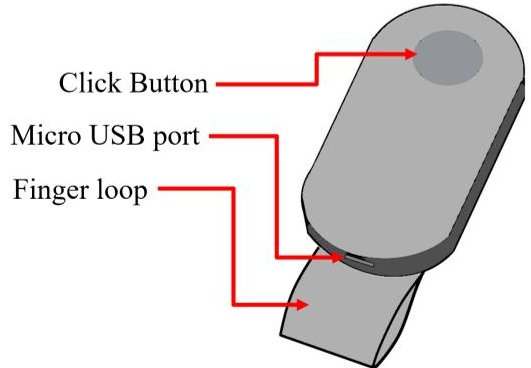

Figure 1. Wireless clicker device of the Microsoft HoloLens first version.

<!-- PDF_PAGE: 3 -->

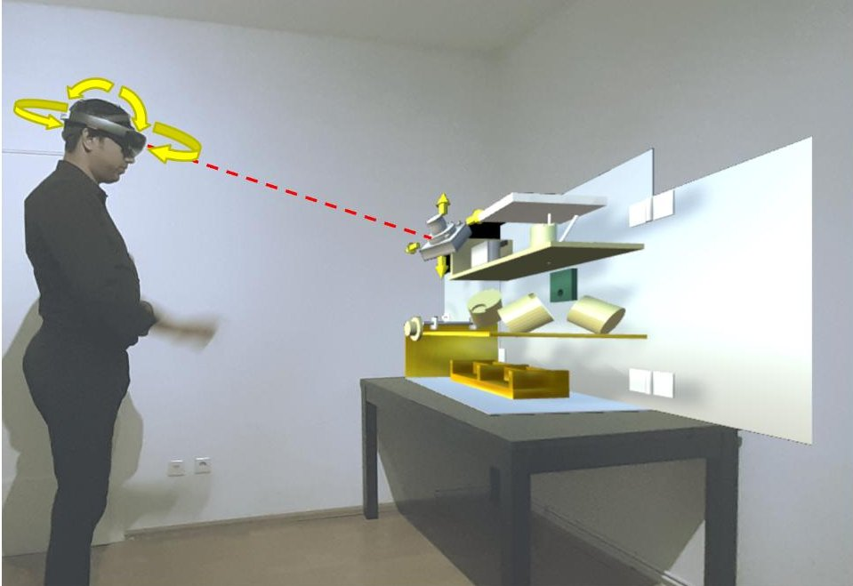

Figure 2. A user wearing the HoloLens and using his head rotation to move a virtual component. The arrows around the component indicate the directions in which it can be moved.

Even after choosing a suggested location, our system allows its users the flexibility to freely move a virtual component while adhering to the constraints.

## 3. OUR INTERACTION SYSTEM

To develop our suggestion-based interaction system, we use the design of TET-1 [24] spacecraft as a use case. Considering a scenario similar to the CEF, we do not have the final design of a fully assembled TET-1 spacecraft. However, we have the knowledge of shape, size and functionality of its components and we also know the general rules, standards, constraints and requirements of spacecraft design. For example, there is a requirement that the center of gravity (COG) of a fully assembled spacecraft should be as close to its geometric center (GC) as possible. For this special requirement, if a computer-based optimization algorithm is used to suggest locations that can help bringing the COG closer to the GC, it may reduce the effort required by the users to complete assembly. Additionally, specific characteristics of the components such as size, weight and functionality are also considered. Unity3D game engine $ ^{3} $ is used to design

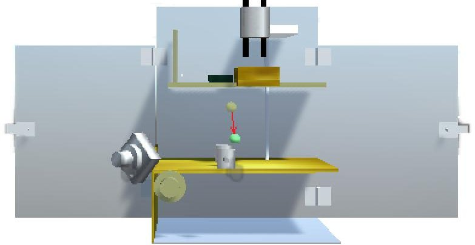

Figure 3. A virtual spacecraft with subcomponents and an arrow from the center of gravity to the geometric center of the spacecraft.

our AR-based spacecraft assembly application that runs on the first version of the HoloLens. Figure 3 shows a Unity3D scene with the spacecraft and some components placed in it. An arrow points from its COG to GC.

Our interaction system consists of four main parts: user input, constraints specification, optimized suggestions, and system feedback.

## User Input

Our system uses a conjunction of head gaze and clicker as shown in Figure 1 as input. A gaze is ray-cast from the user's view direction onto a virtual object, then the clicker is clicked to select the desired object. Once the object is selected, it is attached to the gaze as shown in Figure 2 with a dotted red line. Then head rotation can be used to move the object along the surface of the spacecraft in the direction(s) indicated by arrows on the object. However the areas inside and/or outside the spacecraft in which the selected object is allowed to be moved are limited by the constraints.

## Constraints Specification

3D models of 10 components of the spacecraft (including 4

Table 1. Constraints on whether a component can be mounted inside/outside the spacecraft.

<table border="1"><tr><td>Component</td><td>Constraint(s)</td></tr><tr><td>K-box</td><td>Inside only</td></tr><tr><td>CHU</td><td>Outside only</td></tr><tr><td>RW</td><td>4-reactions wheels mounted only inside in tetrahedral orientation</td></tr><tr><td>MCS</td><td>Inside only</td></tr><tr><td>CSS</td><td>At the outermost area of the outer surface</td></tr><tr><td>GPS</td><td>Inside only</td></tr><tr><td>S-Ant</td><td>Outside only</td></tr></table>

<!-- PDF_PAGE: 4 -->

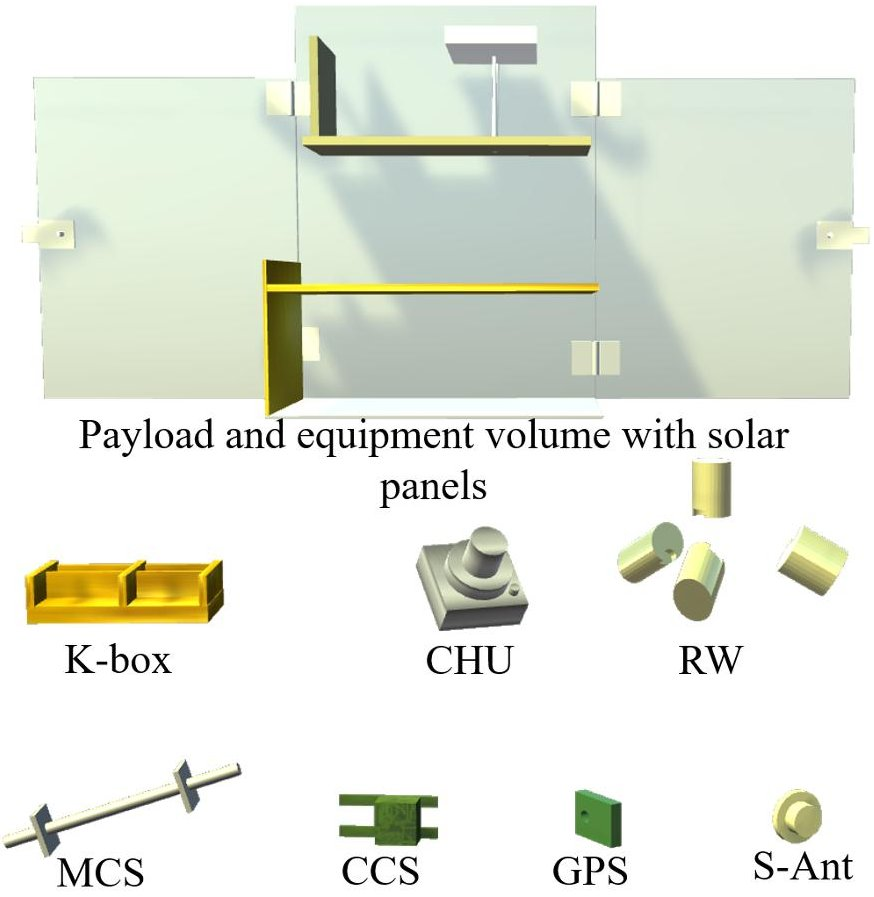

Figure 4. Virtual spacecraft envelope and its components used in our interaction system.

reaction wheels) are designed using the Blender 3D modeling software $ ^{4} $ . They are similar to the real components in shape and size. The basic constraints on placement of each component are identified from the design specifications of TET-1 satellite provided by Foeckersperger et al. in [24]. A field expert is also consulted for help in designing the constraints which have been summarized in Table 1. It can be observed from Table 1 that the Camera Head Unit (CHU), the S-Antenna (S-Ant) and the Coarse Sun Sensor (CSS) can be placed only outside the spacecraft. It is done to maximize their reception. The Keramis-Box (K-Box), the Magnetic Coil System (MCS) and the Global Positioning System (GPS) are placed inside the spacecraft. Additionally, the four reaction wheels have to be mounted in a tetrahedral configuration as they are responsible for rotating the spacecraft. Figure 4 shows all the 3D models of our use case.

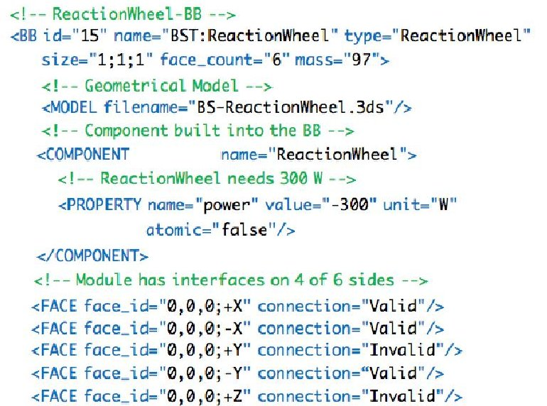

Figure 5. Example of constraints defined in the form of XML.

In order to embed the constraints in our interaction design, each component is defined in the form of SatXML [25], a standard that can support component hierarchies, properties and space mission specific rules. An example of SatXML defining a component is shown in Figure 5. It contains information such as the name and format of the component and its 3D model, information about the attachable face(s), and the mass of the component.

## Optimized Suggestions

In our interaction system, the main optimization criteria is that, after the assembly, the center of gravity of the spacecraft should be as close as possible to its geometric center. To compute the optimal configurations considering the domain knowledge, we used an optimization algorithm. The algorithm runs every time a new component is selected, and, based on our optimization criteria, generates the three most optimum suggestions for the the user.

$ ^{4} $https://blender.org

For the AR visualization we use the first version of the Microsoft's HoloLens. As an independent mobile device the HoloLens has limited processing power and it may not be able to run computationally intensive algorithms. To have our algorithm fully integrated in the Hololens device, we use a simple Random Search Optimiser (RSO) [26] algorithm to generate optimized suggestions. However, any other fast optimization algorithm can be used in this step. The RSO algorithm iterates through the solution space until the stopping criteria is met, calculating fitness for each configuration. Initially, a random point is sampled from the configuration space and is set as the optimum. Subsequently, another point

<!-- PDF_PAGE: 5 -->

is sampled from the space randomly, and fitness comparison is performed for both points. If the new configuration has better fitness than the previous configuration, the new configuration is assigned as the new optimum solution. This process continues until the sample size is reached. We experimentally found the sample size of 100 to be good enough for our use case.

Every component has a feasible region in which the system is allowed to generate candidate samples. The feasible regions of each component are inferred from the catalog of requirements (represented in SatXML format). After the samples are populated, the non-feasible solutions are discarded. A solution is non feasible either if the optimization criteria is not met or if the sample is colliding or overlapping with another object. Then, the Random Search routine is performed, a candidate configuration is randomly chosen, and fitness values are calculated. An update step is performed if the fitness improves. The process continues until we reach the sample size. When the algorithm converges, the solution is rendered to the user as a suggestion. With a sample size of 100 the algorithm can generate suggestions without any visually noticeable delay.

The main steps of the RSO algorithm can be described as follows:

Let f: $ \mathbb{R}^{n}\rightarrow\mathbb{R} $ be the fitness or cost function which must be minimized. Let $ x\in\mathbb{R} $ designate a position or candidate solution in the search-space. The basic RSO algorithm can then be described as:

1. Initialise x with a random position in the search-space.

2. Until a termination criterion is met (e.g. number of iterations performed, or adequate fitness is reached), repeat the following:

(a) Sample a new position y from the hypersphere of a given radius surrounding the current position x

(b) If $ f(y)<f(x) $ then move to the new position by setting $ x=y $

## System Feedback

When a component is clicked, three ghost versions of it appear on the spacecraft as suggestions. As the user selects a suggested location, the component moves to that location meanwhile, it gives user the control to move the component around the spacecraft using head gaze. Furthermore, the current distance between the COG and the GC appears on top right side of the user's field of view as well as on the side of the spacecraft. Figure 6 shows how suggestions appear on the spacecraft once a component is clicked. The effect of moving a component on the COG is provided in real-time using colored spheres as shown in Figure 3.

## 4. EVALUATION

We conducted a user study to evaluate the effect of contextbased suggestions on assembly tasks. In our experiment, the users were presented with the task of assembling a spacecraft and were given the following requirement; The COG of the spacecraft should be as close to its GC, thus resulting in a more stable configuration, we call it COG optimization.

We developed the following two interface conditions:

Condition 1: The system suggests 3 optimized locations for each object and follows all the constraints applied to the object including the COG optimization.

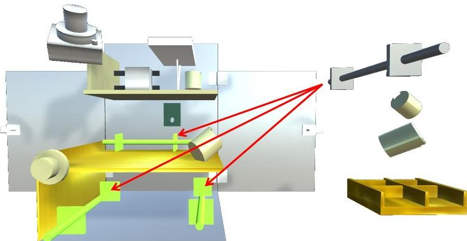

Figure 6. Suggestions appear on spacecraft in the form of ghost versions when one of the components from the right side is selected.

Condition 2: The system suggests 3 random locations for each object and follows all the constraints applied to the object excluding the COG optimization.

The constraints defined in the SatXML were in place for both conditions. In condition 2, the three different random locations on spacecraft were chosen by the system as suggestions.

## Task

During the task, a user wears the HoloLens and sees a virtual spacecraft envelop 1.5m in front of him/her (see Figure 4 top) along with 10 virtual components including 6 individual components and 4 reaction wheels on the right side of the spacecraft. The user is required to place the components on the spacecraft one-by-one using the gaze and clickerbased interaction method explained in Section 3. Instead of moving a component towards the spacecraft, the user simply selects a component and the system suggests 3 ghost versions of the selected component in different locations as shown in Figure 6. The user chooses one of the suggested locations for the component which immediately moves the selected component to the chosen location. The user can then move the component with his gaze while our system makes sure that the component always sticks to a surface on the spacecraft and can move only in accordance with the predefined constraints. The system also does not allow the components to collide or overlap. The task of the user is to make sure that the COG of the spacecraft is as close as possible to its GC at the end of the task. The COG and the GC are shown with small spheres as shown in Figure 5. The magnitude of the distance between the COG and the GC is also shown in in the peripheral vision of the user. If the user is not satisfied with a location of a component he can always reposition the component on the spacecraft by selecting it again. No suggestions appear for repositioning. The user immediately gets the ability to move the component as soon as it is selected for repositioning. There is no limitation on how many times a component is repositioned. The spacecraft is said to be assembled when all the 10 components have been placed on the spacecraft and the user has clicked the finish experiment button. The task of the user is to make sure that the COG of the spacecraft is as close as possible to its GC at the end of the assembly. In one user study session, a user completes the task once with optimized suggestions (condition 1) and once with suggestions (condition 2). The order in which the conditions are presented to the users is counterbalanced.

We built the following hypotheses before conducting the experiment:

<!-- PDF_PAGE: 6 -->

## Task Completion Time

Null Hypothesis H0: There is no difference in the mean task completion time between condition 1 and condition 2.

Alternate Hypothesis H1: The mean task completion time for condition 1 is less than condition 2.

## Repositioning Time

Null Hypothesis H0: There is no difference in the mean time spent repositioning the components between condition 1 and condition 2.

Alternate Hypothesis H1: The mean time spent repositioning the components for condition 1 is less than condition 2.

## Number of Clicks

Null Hypothesis H0: There is no difference in the mean number of clicks performed by the users between condition 1 and condition 2.

Alternate Hypothesis H1: The number of clicks performed by the users in condition 1 less than condition 2.

## Distance between COG to GC

Null Hypothesis H0: There is no significant difference between the magnitude of the distance between COG and GC in condition 1 and condition 2.

Alternate Hypothesis H1: The magnitude of the distance between COG and GC in condition 1 is less than condition 2.

## Participants

The user study involved 19 participants from the German Aerospace Center (DLR), Braunschweig. They were required to be fluent speakers of English. Only 9 participants had some experience with the HoloLens. Participants were not compensated for taking part in the user study. They were allowed to leave the user study session any time without giving a reason. Mean age of the participants was 26.63 and SD was 4.82, and 3 of them were female.

Each participant was debriefed after the experiment and was also asked to fill in standard questionnaires for qualitative feedback. The goals of the study and the conditions that a participant received were also explained at the end of the user study session. A participant took approximately 30 minutes to complete the user study session.

## Procedure

At the beginning of the user study, the participants were given a short description of the experiment. The HoloLens' gaze and clicker based input method was introduced to the participants. In order to make the participants familiar with the HoloLens and the assembly task, they were provided with a training scene which scene involved self explanatory visual aids to help the users get familiar with interaction system. Users spent an average time of 5 minutes and 12 seconds in the training scene before beginning the actual experiment. All the users were subjected to both the conditions in a within group format. The conditions were counter balanced to avoid unintended effects caused by the order. Before the experiment, all participants filled out an informed consent form. The participants were also asked to fill in a set of questionnaires after each condition. The task was considered

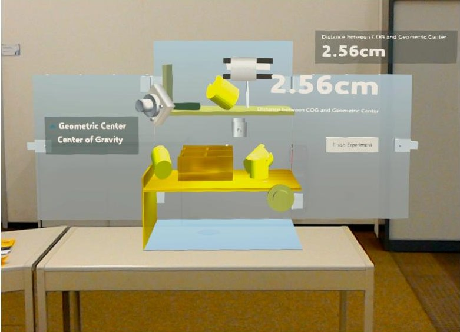

Figure 7. Screenshot taken from the HoloLens at the end of a task.

complete when all the components were placed on the spacecraft and the user clicked the "Finish Experiment" button. Figure 7 shows the final assembly of the virtual spacecraft by a participant after she finished the experiment.

Most importantly, none of the users had prior knowledge of the fact that they would be presented with optimized suggestions in one of the conditions.

We measured the following metrics for each user:

1. Task completion time.

2. Time under repositioning.

3. Final offset distance.

4. Number of clicks on each object.

Furthermore, we used the NASA-Task Load Index questionnaire [27] and System Usability Scale (SUS) questionnaire [28] for qualitative analysis of the two conditions.

## 5. RESULTS AND DISCUSSION

After the user study, the quantitative and qualitative results were compiled and statistical significance tests were conducted on them. This section presents and discusses them in detail.

## Task Completion Time

The task completion time with optimized suggestions was found to be not normally distributed using the Shapiro-Wilk test, therefore a t-test was not applicable. Alternatively, we performed Mann-Whitney test and found out that there the mean task completion time was significantly lower for condition 1 in comparison to condition 2 (p < 0.05). Hence we rejected the null hypothesis H0 for task. The alternate hypothesis proved to be true. Table 2 summarizes the results of task completion time.

Table 2. Total time taken to complete the task.

<table border="1"><tr><td></td><td>Mean(s)</td><td>SD(s)</td><td>p-value</td></tr><tr><td>Optimized Suggestions</td><td>191.97</td><td>85.46</td><td>0.02</td></tr><tr><td>Random Suggestions</td><td>253.25</td><td>110.63</td><td></td></tr></table>

<!-- PDF_PAGE: 7 -->

## Repositioning Time

Repositioning time serves as the most important metric for this experiment because it is least affected by the random suggestions. Almost all the users did some repositioning of the components even after they had initially chosen an optimum location for a component in the spacecraft. The time spent on repositioning each component in the task was added to calculate the total repositioning time of a user. The results were normally distributed therefore we performed the t-test. We found out that the mean repositioning time was significantly lower for condition 1 compared to condition 2 $ \mathrm{(p < 0.05)} $ . Hence the null hypothesis was rejected and the alternate hypothesis proved to be true. The results are summarized in Table 3.

Table 3. Total time spent repositioning the components in a task.

<table border="1"><tr><td></td><td>Mean(s)</td><td>SD(s)</td><td>p-value</td></tr><tr><td>Optimized Suggestions</td><td>40.42</td><td>26.47</td><td>0.02</td></tr><tr><td>Random Suggestions</td><td>75.57</td><td>57.47</td><td></td></tr></table>

## Number of Clicks Performed

Total number of clicks required to be performed to accomplish a task is an important metric to evaluate an interaction system. It could be observed from Table 4 that p < 0.05 for mean number of clicks performed to complete the task, hence the null hypothesis was rejected. The alternate hypothesis H1 was satisfied.

Table 4. Total number of clicks performed to complete the task.

<table border="1"><tr><td></td><td>Mean(s)</td><td>SD(s)</td><td>p-value</td></tr><tr><td>Optimized Suggestions</td><td>16.32</td><td>4.50</td><td>0.03</td></tr><tr><td>Random Suggestions</td><td>21.79</td><td>9.35</td><td></td></tr></table>

## Distance between COG and GC

The goal of the task was to minimize the distance between the COG and the GC. The distance was significantly lower for the condition using optimized suggestions compared to the condition using random suggestions (p < 0.05). Hence, we rejected the null hypothesis and the alternate hypothesis H1 was satisfied.

Table 5. Distance between the COG and the GM at the end of the task.

<table border="1"><tr><td></td><td>Mean(s)</td><td>SD(s)</td><td>p-value</td></tr><tr><td>Optimized Suggestions</td><td>1.70</td><td>1.47</td><td>0.03</td></tr><tr><td>Random Suggestions</td><td>3.41</td><td>3.41</td><td></td></tr></table>

## Qualitative Feedback

NASA-TLX questionnaire was used to assess the subjective mental workload in performing the task with condition 1 and condition 2. The results have been summarized in Figure 8. The mean score for all parameters in both conditions is below 8 (on the scale of 0 to 20). This indicates that the subjects did not feel high mental workload by performing the task with

Intelligent Suggestions Random Suggestions

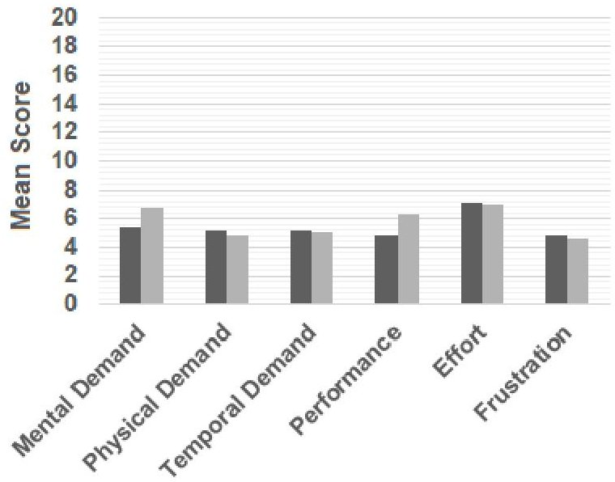

Figure 8. Mean scores of NASA-TLX questionnaire for Physical Demand, Mental Demand, Temporal Demand, Performance, Frustration and Effort involved in performing the task with gaze and clicker-based interaction method.

gaze and clicker-based interaction method. The SUS score was 80.92 for optimized suggestions and 80.53 for random suggestions. According to SUS scoring chart, the score of 80 is between good and excellent usability. A high SUS score even without optimized suggestions indicates a good usability of our interaction system. Each participant was also asked the following question at the end of the session:

"Could you notice a difference between the suggestions presented in the two tasks?"

73. 7% of the participants answered that they could notice a difference.

General feedback of the participants regarding the 3D interaction was positive overall. Some participants criticized the limited field-of-view of the HoloLens, however, most of them gave positive responses such as; "I felt being assisted so I trusted the system to optimize the result for me." Even though the users did not know that they were being presented with optimized suggestions in one of the tasks, still most of them could notice that they were being assisted. This is also reflected in significantly lower repositioning time for optimized suggestions.

## 6. CONCLUSION AND FUTURE WORK

In this paper, we presented a suggestion-based interaction system for AR assembly tasks. Specifically, we developed an AR application to demonstrate how context knowledge could be used to design interaction suggestions and constraints within a virtual spacecraft assembly scenario. The constraints and attributes of each interactable component could be manually written in SatXML format and a plugin was developed in the Unity3D application to parse the constraints. In this application, we used an optimization algorithm to assist the users during the placement of components, while adhering to complex rules such as bringing the COG closer to the GC of the spacecraft. Furthermore we evaluated

<!-- PDF_PAGE: 8 -->

how algorithm-based optimization could affect the interaction experience. As a result, the users could perform the assembly task faster and with less number of clicks when presented with optimized suggestions, even though they were not aware of the fact that an optimization algorithm was running in the background for them in one of the conditions.

In the future, we plan to develop a user friendly graphical user interface to define and enforce constraints and requirements. The interface will allow users to define the forbidden region for every component on the spacecraft visualized in 3D. Similarly, the constraints on each surface of a virtual component will be defined directly on the component.

The newer version of HoloLens comes with built-in eye-tracking therefore an enhanced interaction method combining head-gaze and eye-gaze can be implemented and evaluated in the future. The other aspect that we would like to address in the future is related to our optimization algorithm. In the current version, our algorithm can optimize a quantity based only on one requirement, but complex problems may have multiple requirements such as "minimize the volume occupied by the components and bring the COG as close as possible to the GC." Hence, we plan to develop a generic approach for single and multidimensional optimization.

## ACKNOWLEDGMENTS

The authors gratefully acknowledge funding by the Virtual Satellite project, DLR, Germany. We thank our colleague Philipp M. Fischer for his inspiring discussions and all participants of our user study for their contribution.

## REFERENCES

[1] P. M. Fischer, M. Deshmukh, V. Maiwald, D. Quantius, A. M. Gomez, and A. Gerndt, "Conceptual data model: A foundation for successful concurrent engineering," Concurrent Engineering, vol. 26, no. 1, pp. 55-76, 2018.

[2] P. M. Fischer, R. Wolff, and A. Gerndt, "Collaborative satellite configuration supported by interactive visualization," in 2012 IEEE Aerospace Conference. IEEE, 2012, pp. 1-11.

[3] A. Baranowski, S. Utzig, P. M. Fischer, A. Gerndt, and J. Herder, "3d spacecraft configuration using immersive ar technology," in Workshop Proceedings/Tagungsband: Virtuelle und Erweiterte Realität-15. Workshop der GIFachgruppe VR/AR. Shaker Verlag, 2018, pp. 71-82.

[4] A. Bahnmuller, A. S. Muhammad, G. Albuquerque, and A. Gerndt, "Evaluation of interaction techniques for early phase satellite design in immersive ar," in 2020 IEEE Aerospace Conference. IEEE, 2020, pp. 1-8. [Online]. Available: https://doi.org/10.1109/AERO47225.2020.9172753

[5] M. Billinghurst, A. Clark, and G. Lee, "A survey of augmented reality," Foundations and Trends $ ^{\circ} $ in Human-Computer Interaction, vol. 8, no. 2-3, pp. 73-272, 2015. [Online]. Available: http://dx.doi.org/10.1561/1100000049

[6] T. Igarashi and J. F. Hughes, "A suggestive interface for 3d drawing," in Proceedings of the 14th Annual ACM Symposium on User Interface Software and Technology, ser. UIST '01. New York, NY, USA: Association

for Computing Machinery, 2001, p. 173-181. [Online]. Available: https://doi.org/10.1145/502348.502379

[7] S. Büttner, H. Mucha, M. Funk, T. Kosch, M. Aehnelt, S. Robert, and C. Röcker, "The design space of augmented and virtual reality applications for assistive environments in manufacturing: a visual approach," in Proceedings of the 10th International Conference on PErvasive Technologies Related to Assistive Environments, 2017, pp. 433-440.

[8] S. Feiner, B. Macintyre, and D. Seligmann, "Knowledge-based augmented reality," Communications of the ACM, vol. 36, no. 7, pp. 53-62, 1993.

[9] U. Neumann and A. Majoros, "Cognitive, performance, and systems issues for augmented reality applications in manufacturing and maintenance," in Proceedings. IEEE 1998 Virtual Reality Annual International Symposium (Cat. No. 98CB36180). IEEE, 1998, pp. 4-11.

[10] B. Schwald and B. De Laval, "An augmented reality system for training and assistance to maintenance in the industrial context," 2003.

[11] S. Webel, U. Bockholt, T. Engelke, N. Gavish, M. Olbrich, and C. Preusche, "An augmented reality training platform for assembly and maintenance skills," Robotics and autonomous systems, vol. 61, no. 4, pp. 398-403, 2013.

[12] E. Bottani and G. Vignali, "Augmented reality technology in the manufacturing industry: A review of the last decade," IISE Transactions, vol. 51, no. 3, pp. 284-310, 2019.

[13] M. A. Frigo, E. C. da Silva, and G. F. Barbosa, "Augmented reality in aerospace manufacturing: A review," Journal of Industrial and Intelligent Information, vol. 4, no. 2, 2016.

[14] A. Muthaiyan and J. Cecil, "A virtual environment for satellite assembly," Computer-Aided Design and Applications, vol. 5, no. 1-4, pp. 526-538, 2008.

[15] N. Gavish, T. Gutiérrez, S. Webel, J. Rodr'iguez, M. Peveri, U. Bockholt, and F. Tecchia, "Evaluating virtual reality and augmented reality training for industrial maintenance and assembly tasks," Interactive Learning Environments, vol. 23, no. 6, pp. 778-798, 2015.

[16] T. Fernando, L. Marcelino, and P. Wimalaratne, "Constraint-based immersive virtual environment for supporting assembly and maintenance tasks," Human Computer Interaction International 2001, 2001.

[17] A. Liverani, G. Amati, and G. Caligiana, "A cad-augmented reality integrated environment for assembly sequence check and interactive validation," Concurrent Engineering, vol. 12, no. 1, pp. 67-77, 2004.

[18] M. Januszka and W. Moczulski, "Augmented reality system for aiding engineering design process of machinery systems," Journal of Systems Science and Systems Engineering, vol. 20, no. 3, p. 294, 2011.

[19] J. Cecil and A. Kanchanapiboon, "Virtual engineering approaches in product and process design," The International Journal of Advanced Manufacturing Technology, vol. 31, no. 9-10, pp. 846-856, 2007.

[20] A. Ceruti, P. Marzocca, A. Liverani, and C. Bil, "Maintenance in aeronautics in an industry 4.0 context: The role of augmented reality and additive manufacturing," Journal of Computational Design and Engineering, vol. 6, no. 4, pp. 516-526, 2019.

<!-- PDF_PAGE: 9 -->

[21] M. Chandramouli and G. Bertoline, "A genetic algorithm based optimization framework to visualize, evaluate, and modify 3d space configurations in desktop vr," International Journal for Simulation and Multidisciplinary Design Optimization, vol. 5, p. A01, 01 2014. [Online]. Available: https://doi.org/10.1051/smdo/2013004

[22] J. Cecil, J. Huber, N. Gobinath, and J. Jacques, "A virtual factory environment to support process design in micro assembly domains," Computer-Aided Design and Applications, vol. 8, no. 1, pp. 119-127, 2011.

[23] R. Gal, L. Shapira, E. Ofek, and P. Kohli, "Flare: Fast layout for augmented reality applications," in 2014 IEEE International Symposium on Mixed and Augmented Reality (ISMAR), 2014, pp. 207-212.

[24] S. Foeckersperger, K. Lattner, C. Kaiser, S. Eckert, W. Bärwald, S. Ritzmann, P. Mühlbauer, M. Turk, and P. Willemsen, "Tet-1-a german microsatellite for technology on-orbit verification," ESASP, vol. 660, p. 14, 2008.

[25] M. Göller, L. Pfotzer, J. Oberländer, K. Uhl, T. Buettner, A. Ronnau, and R. Dillmann, "Modellierung und konfigurationsgenerierung für bausteinbasierte satellitensysteme," in Proc. of Deutscher Luft- und Raumfahrtkongress (DLRK), 2011.

[26] J. Bergstra and Y. Bengio, "Random search for hyperparameter optimization," Journal of Machine Learning Research, vol. 13, no. Feb, pp. 281-305, 2012.

[27] S. G. Hart and L. E. Staveland, "Development of nasatlx (task load index): Results of empirical and theoretical research," in Advances in psychology. Elsevier, 1988, vol. 52, pp. 139-183.

[28] J. Brooke, "Sus: a "quick and dirty' usability scale," Usability evaluation in industry, p. 189, 1996.

BIOGRAPHY

Azeem Syed Muhammad is a research scientist in department "Software for Space Systems and Interactive Visualization" at the German Aerospace Center (DLR). In 2013, he received his degree in Computer Engineering from National University of Sciences and Technology (NUST), Islamabad, Pakistan, and served in the software development sector in his country for two years. Before joining DLR in 2017, he received his Master's degree from University of Science and Technology (UST), Daejeon, South Korea, while working as a research assistant at Korea Institute of Science and Technology (KIST), Seoul, South Korea, where his focus was Virtual and Augmented Reality interaction.

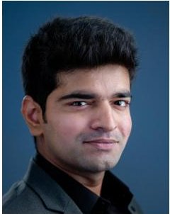

Krishnan Chandran is a research associate at the chair of Immersive Media at the Technical University of Dresden, Germany. In 2013, he received his Bachelor's degree in Information Technology from Anna University, Chennai, India. He received his Master's degree in Intelligent Adaptive Systems, from the University of Hamburg, Germany in 2019. Previously, he was also a student researcher at INRIA, Paris and German Aerospace Center, Braunschweig. His research focus is Human Computer Interaction and Artificial Intelligence.

Georgia Albuquerque is a research scientist at the department "Software for Space Systems and Interactive Visualization" at the German Aerospace Center (DLR). She received the bachelor's degree in computer science from the University of Pernambuco, Brazil, in 2003, and the master's degree in computer science from the TU Braunschweig, Germany, in 2007. She received the PhD

degree at the Computer Graphics Lab from the TU Braunschweig in 2013, and continued as postdoctoral researcher until 2019. Her main research interests focus on augmented and virtual reality as well as on visual analytics, machine learning and computer graphics.

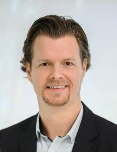

Frank Steinicke is a professor of Human-Computer Interaction at the Department of Informatics at the Universität Hamburg and head of the Department since 2018. From 2011 to 2014 he was a professor of Computer Science in Media at the Department of Computer Science at the University of Würzburg and chair of the Immersive Media Group. Between 2012 and 2014

he was the director of the newly founded interdisciplinary Institute for Human Computer Media. In 2009 he assumed an associate guest professor position at the University of Minnesota. He studied Mathematics with a Minor in Computer Science at the University of Minster, from which he received his Ph.D. and Venia Legendi in Computer Science. His research is driven by understanding the human perceptual, cognitive and motor abilities and limitations in order to reform the interaction as well as the experience in computer-mediated realities.

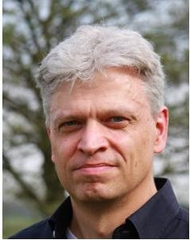

Andreas Gerndt is the head of the department "Software for Space Systems and Interactive Visualization" at the German Aerospace Center (DLR). He received his degree in computer science from Technical University, Darmstadt, Germany in 1993. In the position of a research scientist, he also worked at the Fraunhofer Institute for Computer Graphics (IGD) in Germany. Thereafter,

he was a software engineer for several companies with focus on Software Engineering and Computer Graphics. In 1999 he continued his studies in Virtual Reality and Scientific Visualization at RWTH Aachen University, Germany, where he received his doctoral degree in computer science. After two years of interdisciplinary research activities as a postdoctoral

<!-- PDF_PAGE: 10 -->

fellow at the University of Louisiana, Lafayette, USA, he returned to Germany in 2008 to work for DLR in the domain of aerospace software research. Since 2019, he is also a Professor in High-Performance Visualization at University of Bremen, Germany.