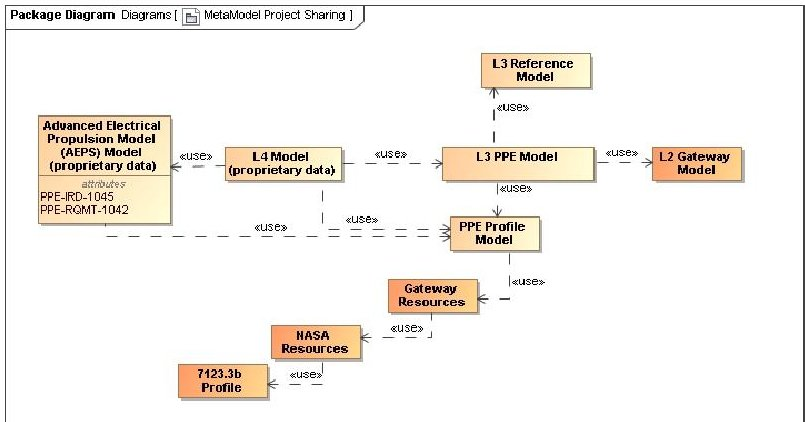
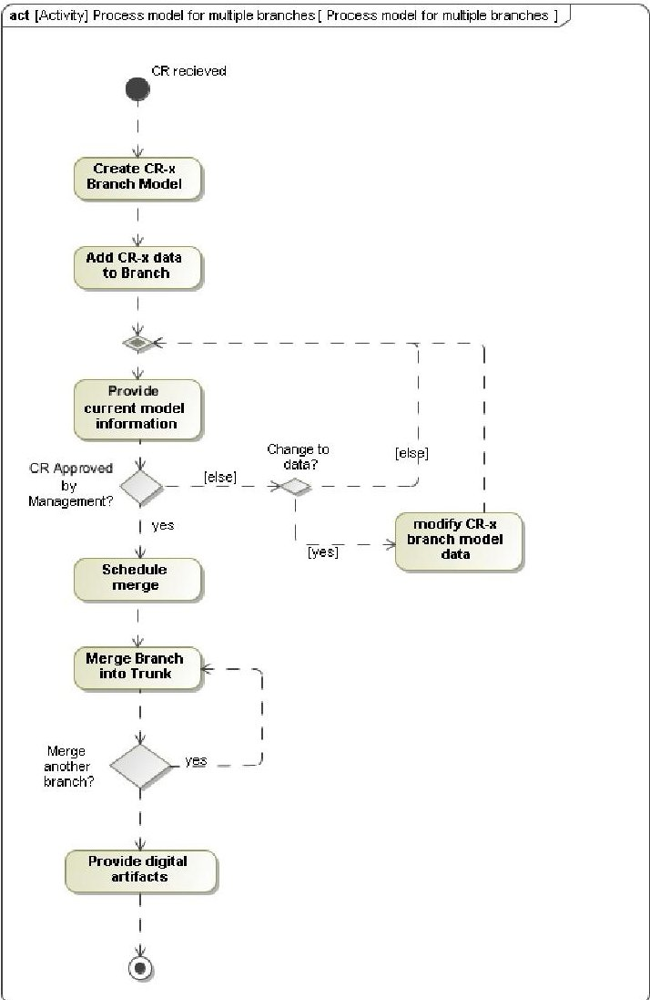
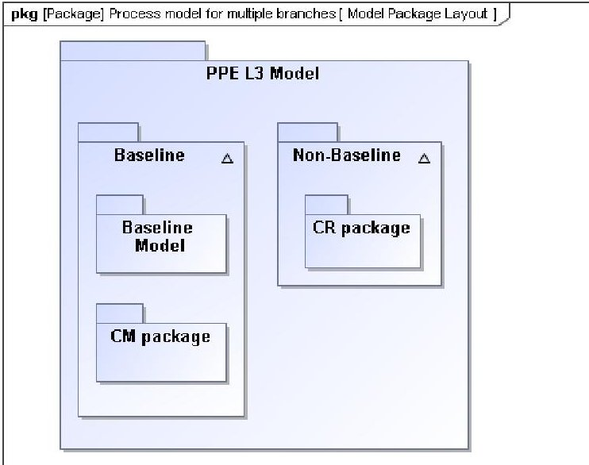
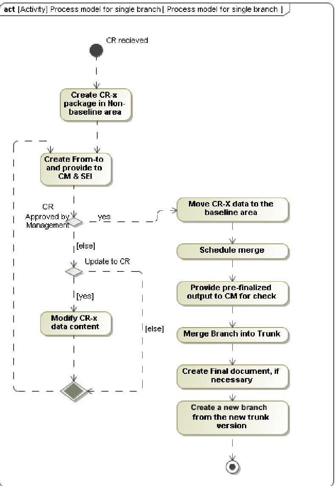
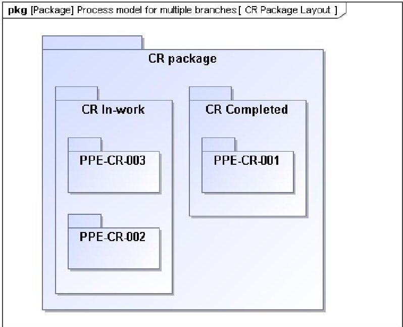

<!-- PDF_PAGE: 1 -->

# A PPE Use Case on Configuration Management Approach for MBSE

Edith L. Parrott

NASA Glenn Research Center

Cleveland, OH 44135

216-433-8749

Edith.parrott@nasa.gov

Abstract—Systems engineers worldwide have been working to implement Model-based Systems Engineering (MBSE) environments, tools, and methodologies. MBSE is a formalized application of modeling to support systems engineering, including requirements, design, analysis, verification, and validation activities over the project's lifecycle[1]; MBSE captures the system data into a digital environment. Significant benefits of MBSE includes a reduction in the time in performing systems engineering activities and an improvement higher fidelity data production. As more Systems Engineers are using MBSE, the models it produces are becoming the source of truth for Systems Engineering artifacts. As we move towards using these models as the source of truth, a more rigorous Configuration Management (CM) infrastructure is needed.

Many of the MBSE tools provide CM options but utilizing them efficiently and effectively can be challenging. More rigorous methods and tools are needed to assist with keeping track of changes in the model, making sure inadvertent changes to baseline data did not occur, visibility of changes in the different model versions, and the impacts of changes to the models.

System engineers and configuration management personnel from the Power and Propulsion Element (PPE) project at NASA Glenn Research Center have been working to develop a modeling construct that allows models to be the source of truth and maintain a configuration managed baseline. This paper presents a process that leverages the existing CM tools and describes how PPE used this process to manage changes more rigorously. It will describe the process behind building the model architecture that utilizes the MBSE tool capabilities and the configuration management process. It will contain some of the advantages and disadvantages of the architecture that the PPE project had settled upon utilizing, as well as some enhanced capabilities that the PPE MBSE team has developed.

## TABLE OF CONTENTS

1. INTRODUCTION...1

2. OVERALL MODELING LAYOUT ...2

3. CONFIGURATION MANAGEMENT RESEARCH...2

4. OPTION 1 – STORING MODELS LOCALLY...2

5. OPTION 2 – UTILIZING TRUNK AND MULTIPLE BRANCHES IN A CM TOOL...3

6. OPTION 3 – UTILIZING A TRUNK AND A SINGLE BRANCH IN A CM TOOL...4

U.S. Government work not protected by U.S. copyright

7. CONSTRUCTION OF FROM-TO ARTIFACTS...7

8. VERIFYING THE CONFIGURATION MANAGEMENT

FUNCTION IS MET ...7

9. ADDED CAPABILITIES TO ENHANCE MBSE ...7

10. CONCLUSION AND FORWARD WORK ...7

ACRONYM LIST...7

ACKNOWLEDGEMENT ...7

REFERENCES ...8

BIOGRAPHY ...8

## 1. INTRODUCTION

For the past decade, NASA has been investigating ModelBased Systems Engineering (MBSE) capabilities and opportunities. Historically, systems engineers capture and track information through the manual generation of documents and are standalone and manually kept in sync. These documents are released, baselined, and governed by a document-centric configuration management (CM) process.

CM is a process that ensures that information is baselined and changes to the baseline are managed [2]. Model configuration management is a process that establishes which part the model is controlled, that the model information selected is baselined, and describes how changes to the baseline will be managed. Model CM ensures that changes from one instance to another are planned, approved, and goes through the established change management process.

Many of the MBSE tools provide version control mechanism as a mean to store models and their file history. This paper describes the model CM process that leverages the built-in MBSE version control tools. These MBSE tools allows interconnection between models. This paper will describe the different methods that were researched in setting up the modeling architecture. This paper will address some of the complexity of using interconnected models and how these interconnect models can inadvertently make a change to a baseline model. More rigorous methods and tools are needed to assist with keeping track of the changes these interconnected models create and the potential impacts to the baseline model.

<!-- PDF_PAGE: 2 -->

CM is not a new concept to MBSE. Most modelers make modification to the model utilizing a version control tool. Model changes are reviewed and approved via the modeler or a technical process. What is different is the inclusion of configuration management personnel into the process. They not only bring an objective look at the data, but also their standards into the model configuration process.

In expanding on "Configuration and Data Management of the NASA Power and Propulsion Element MBSE Model(s)" [3] which described how configuration management is performed overall and the technique that was used; this paper presents the process behind building the model architecture for the Power and Propulsion Element (PPE) project at the National Aeronautics and Space Administration (NASA) Glenn Research Center and how it utilizes the rigorous MBSE configuration management process. It will highlight some of the advantages and disadvantages of the architecture that the PPE project has observed over the past two years, the architecture that was chosen, and capabilities that the PPE MBSE team has developed.

The PPE is a 50-kilowatt solar electric propulsion spacecraft that will provide power, high-rate communication, attitude control, and transfer capabilities for the Gateway. The Gateway is a component of NASA's Artemis program that will serve as a multi-purpose outpost orbiting the Moon, providing support for long-term human return to the lunar surface and serves as a staging point for deep space exploration [4].

The PPE Systems Engineering and Integration (SEI) team is responsible for overseeing the development of the PPE spacecraft and uses MBSE models to capture product breakdown structure, requirements, technical performance measures, and verifications of requirements. PPE is using the model as the source of truth. The need to control the technical baseline content of the modelled the SEI and CM teams to define and administer the model CM process.

## 2. OVERALL MODELING LAYOUT

Understanding how the model will be utilized externally is an important aspect prior to architecting how the individual models will interface and be linked together. PPE SE model(s) needed to be constructed in a way that would maintain 1) data sensitivity, 2) all the models to be CM separately if required, 3) allow sharing of the configuration control subsets of technical data within other models, configuration control subsets of technical data within the model, and 4) eliminate any changes to baseline content that are not planned. Breaking the PPE SE System models into separate model allowed PPE to meet the above. Figure 1 shows the interaction between PPE SE System models. PPE SE system models include the Level 3(L3) PPE Model, Level 4(L4) Model, L3 Reference Model, PPE Profile Model, and the Advanced Electrical Propulsion System Model. There is also interaction with non PPE owned models that Level 2 (L2) Gateway Model, Gateway Resources Model, NASA Resources Model, and 7123.1b Model. These models are

shared with each other via 'project usage' dependency capability. The darker models L2 Gateway, Gateway Resources, NASA Resources, and 7123.1b Profile models are not owned by PPE but are necessary as these models contains parent information that PPE requires.

Figure 1. Shared Model Layout

## 3. CONFIGURATION MANAGEMENT RESEARCH

In developing a MBSE model architecture that works and follows configuration management principles, the PPE SEI team researched different methods for the tools and modeling practices provided. There were three methods the team researched. 1) Storing models locally and only committing back to the teamwork cloud for baselining. 2) Utilizing the trunk and branch modeling option available, where a branch is created for every change or group of changes identified. 3) Utilizing the trunk and branch modeling option, but only having a single branch that contains all the different changes. Each of these methods are typically used at NASA. As PPE defined and required the baselining of their requirements, the CM process was tested on each of these methods. The findings are described in the following sections.

## 4. OPTION 1 - STORING MODELS LOCALLY

Storing locally allows a person or persons to work in the model and store it onto their system until it is ready for baselining. This still allows the person who is storing it locally to update the project to the latest trunk if a new baseline was created. This seemed like a viable solution until it was further analyzed. If there is only a single person performing the modeling and there are multiple changes that could be baselined at different times it is harder for the person to save different versions locally without having to disconnect from the model and saving locally for each instance. With a locally saved model, there is no way of updating the current model version they are working on with the newer baseline without doing a full replacement of the model version. This in turn creates an issue where there is a potential to overwrite baseline content when re-baselining or placing it back onto the server. When there are multiple people performing modeling work, there are potential issues with the model elements being locked by another user. This could happen if the first modeler locked more than what was necessary or if there are shared element that are updated in order to print out the changes. One also has to consider the

<!-- PDF_PAGE: 3 -->

availability of the modeler who has the local copy of the baselining changes for baselining. There is also and the inability to audit the work prior to committing which is a no go for configuration management managers. For the above reasons, this method was rejected.

## 5. OPTION 2- UTILIZING TRUNK AND MULTIPLE BRANCHES IN A CM TOOL

Some of the tool that support MBSE provide built-in version repositories using a trunk and branch methodology. The model trunk would contain the baseline data, and each branch off the trunk would constitute a baseline change. The trunk with multiple branches is what the tool PPE utilizes suggest using. This method allowed the model to have many different changes going on at one time. This also made the CM process easier to implement. The MBSE team didn't see any barriers to this process so it was tested. The one major advantage of this option was having changes to the data associated with a change request (CR) of baseline data being in its own branch. Therefore, inadvertent change could not be made to the data within the CR branch without any knowledge.

To understand the modeling process for this option, an activity diagram was created to understand the moving parts, shown in Figure 2. The activity diagram flows as follows: MBSE team received a CR, a branch with the CR ID is created, the MBSE team waits until the CR is approved by management or an update to that CR is needed. If a CR is updated, the CR branch is modified with the data. Once the CR is approved, the merge is scheduled, then performed. After the merge is performed, model artifacts are created either digitally or document form.

Using the process described, when the modeling team received five different CRs, a branch was created for each one per our process. The MBSE team received approval from the project for three of the five CRs. The modeling team started the merging process for the three approved CRs. The merge of the first CR was completed as planned. However, when the second CR was started, the modeling team became aware of potential challenges in the implementation of this process. The tool worked as it was designed by identifying changes, but the human side of the equation is where it was falling short. As well as the whole model needed to be unlocked for it to be merged. The disadvantages and advantages of this process is described below.

Figure 2. Process model for multiple branches

## Option 2-Disadvantages

- Merging the supplier cannot be locked: When performing a merge, the whole model, client and supplier needs to be unlocked for it to work. This required that the model be committed and unlocked after each merge to the server. Attempts to perform merges with some of the model packages locked was unsuccessful.

- Overwriting the new baseline: when merging a new CR onto the trunk, where the trunk has already been updated with an earlier merge within the same time frame, target wanted to overwrite the new trunk baseline (supplier) with the old data. This put a burden on the modeler performing the merger to make sure that only the information that was contained in the CR was selected and deselect everything else. This brings in the human error aspect which also then relies on CM personnel to check for any errors and could cause the model to be merged multiple times until it is right. A workaround that was explored was merging the content from the new baseline in the trunk into the other branches at the same time. However, that had the same effect where the first merge could change the data in the existing branch since again one needs to select and deselect model elements and relationship.

<!-- PDF_PAGE: 4 -->

In order for this method to work, one would need meticulous notes on what exactly changed which is challenging when working in models with multiple people and hope that the CRs where not changing the same information. It is easy to lose track of the progress.

- Changing same information: Since the information is captured in separate model, it is easy to change baseline content in one branch and then change it again in another branch without knowing that there is an overlap. This can create issues when baselining happen as the wrong information could be moved over.

- Difficulty in model maintenance: The importance of having the ability to perform model maintenance is crucial. Examples of model maintenance is updating profiles, models, and cleaning up diagrams. Since the trunk could only be changed for baselining, how could one implement model maintenance, such as, updating a requirement profile unless implementing model maintenance for every branch so the change is propagated.

- Inability to provide change documentation for reviews and to CM personnel: Providing change documentation to CM is critical to the CM process. The process has that all project reviews that make changes to baseline data use data that comes from the model. This process requirement is one way of making sure that when a merge of the data occurs, that it is only the approved items. Having element not approved could constituted a delay in merging of the CR to correct the issue. The modeling team researched ways in electronically generating a CR from -to form, but since the CR data overwrites the baseline data in the branches, it was not possible. One could combine the change information into a document via cut and paste, but that ends up being very time consuming.

- Providing CM documentation prior to merging: providing information to CM, prior to merge. If we were performing a merge, we could not provide the necessary information that CM personnel requested. The tool provided a summary of the results, but since our model architecture brought in other models, the reports ended up being hundreds of pages long and ninety percent was not applicable to the PPE models. CM prefers to check to see if there are any issues prior to the merge especially as later merges take hours to perform. The ability to recreate a document and then do a compare between the baseline document and current document is time consuming and not really efficient.

- Collecting requirement metric: PPE SE wants to understand the number of requirements that are

being changed or added. Since the information is located in separate branches, there is no way to obtain this information without doing it manually. There is also very little history except for using the commit comments.

## Option 2- Advantages and Benefits

The PPE modeling team have only found a few benefits for this option to the MBSE CM method PPE is using:

- Change independence: The ability to change the baseline within the branch(s) and having them independent of each other is a major plus. This allows the ability to add content to the branches and the data is independent of each other.

- Project sharing: The ability to share the model trunk with other models is also a plus. By having the changes in branches and not within the trunk, the project knows that only baseline information can be used by others.

Due to these challenges and few benefits, the PPE MBSE team continued to explore the third method.

## 6. OPTION 3 - UTILIZING A TRUNK AND A SINGLE BRANCH IN A CM TOOL

The trunk with a single branch was then researched. Using the information and finding from the second option, the methodology to track the changes in a single model was developed. The modeling team needed to identify a way to capture non-baseline data within the main model, but not affect the baseline data and maintain configuration management of the data. Using the knowledge from the Option 2, and understanding on how CM manages a document (CM has the baseline document, they supply the document to the document owner, the document owner makes changes, the changes are reviewed and approved, and then CM re-baselines it), the idea of using different packages with the modeling construct was implemented. The concept was simple, but implementation of this idea needed to be worked. This idea was to create two Model domains: Baseline and non-Baseline within the model. The baseline model contains the fixed data that is under CM control and the non-baseline model contains the working area. This working area is where the CR package information it is located. (shown in Figure 3).

<!-- PDF_PAGE: 5 -->

Figure 3. Model Package Layout

In addition to the baseline package, Table 1 describes the different data housed within the packages.

Table 1. Package usage data description

<table border="1"><tr><td>Model sections</td><td>Description of Data</td></tr><tr><td>CM Package</td><td>Package within the Baseline Model. Contains views into the data that is baseline for the CM team.</td></tr><tr><td>Baseline</td><td>Baseline Model. Contain packages that contain model elements that are configuration controlled.</td></tr><tr><td>Non-baseline</td><td>Non-baseline Model. Contains packages that are considered not baseline or the working part of the model. This is where the CR packages would be located.</td></tr><tr><td>CR Package</td><td>Package with the non-baseline Model. Contains CR information such as in work or completed CRs.</td></tr></table>

In helping to understand the modeling CM process for this option, an activity diagram was again created to understand the moving parts, shown in Figure 4. The activity diagram flows as follows: MBSE team received a CR, a CR package is created in the Non-baseline Model, from-to documentation is created and given to CM and SEI for the reviews, MBSE team waits until the CR is approved by management or an update to that CR is needed. If an update to the CR is needed, it model is updated and from-to documentation is created. Once the CR is approved, the data is moved to the baseline section, the merge is scheduled, pre-finalized documentation is sent to CM, and then a merge is performed. After the merge is performed, model artifacts are created either digitally or document form and the new branch is created waiting for next baselining or more changes. The difference between this flow and option 2 was the ability to provide from-to

documentation, pre and post merge documentation, and having to create a branch immediately after a merge.

Figure 4. Process model for a single branch

## Option 3- Setting up the model to manage Change Requests

The next step was to develop the methodology to create and manage the CR that's implementable. To implement it was necessary to have a main CR package and two sub packages within the non-baseline model. Those being: CR in-work and CR completed (shown in Figure 5). Figure 5 also shows how the CR packages are defined within each sub-package. That way the modeling team can distinguish instantly which CR(s) have not been added to the baseline and which had.

The modeling team then had to address was how to place the data within the CR in a way that would not be bad model practice, have the potential to overwrite CM data, works within the tool, and can be maintained. The modeling team found by placing a 'p-' in front of an element id or name, it gave the ability to have basically the same element name but with different content. Example: PPE-RQMT-001 would be p-PPE-RQMT-001 in the CR working package. This method allowed us to manage multiple CRs within a model at one time while maintaining the baseline data.

<!-- PDF_PAGE: 6 -->

Figure 5. CR Package Layout

The next part of the CM process was the development of the creating from-to outputs. The modeling team discovered mapping the requirement to the CR package and the baseline requirement gave us the flexibility to create a single output document to create the necessary from-to outputs. Having each CR independent of each other allows the information to stay within itself, allows the modeler know what needs to be changed to the baseline whenever it is approved. Due to time constraints, the step for implementing the CR to the baseline automatically as surpassed. Since all the changed elements were within the CR-x package including the CR in-work package and non-baseline model, the modeling team was required to physically move the data or relationship from the p-element to the baseline elements just prior to re-baselining. When the data was moved to the baselined section, it was easy to create artifacts so CM personnel could validate that only the approved changes were implemented unlike option 2. This method allowed flexibility when merging a single CR, multiple CRs, maintenance merge, or any combination with a single merge event. Maintenance merges are merges where baseline content doesn't change, but a project usage change, review cycle or some other event occurred that requires an updated baseline model.

## Option 3 - Advantages and Benefits

PPE has seen many benefits from the model setup for MBSE configuration management.

- Change request staying power: One main benefit is that the change requests can sit in the model for months, the model can be updated and re-baselined multiple times and the information within that CR is still there and the baseline has not changed. There is no need to perform extra merges to make sure the data within is still the most accurate.

- Forensic analysis capability: The modeling team can perform forensic analysis on the model to find out how many times has a requirement been changed,

and on what change request(s). This is a time saver for the CM team. The only downside to our implementation was the ability to go back to the original requirement text. We can see all the changes that was completed, but have lost the initial. This was something that was not considered at onset.

- Requirement change history: The ability to know how many requirements are in the works to be changed and how many new ones are being worked is a benefit. This is something that would be more difficult if one was using a separate branch for each change request.

- Working in non-baseline areas: The ability to work on other areas of systems engineering such as traceability between requirements (parent/child) and verifications that do not get baselined at the same time. By working in the non-baseline area, the PPE modeling team can provide insight and review artifacts to the SEI team for gap and assessment analysis.

## Option 3-Disadvantages

The PPE modeling team have only found few down-sides to the MBSE CM method PPE is using:

- Implementation of CR to baseline: One downside the element data within the CR-x package had to physically be moved to the baseline section. In option 2, the CR-x would have had it's own branch that we would have merged into the trunk, but with the CRs information being in the same branch, there is no way to move it automatically. The time to implement moving the data to this is not significant enough to write a script or code to do it at this time.

- Providing correct information: Making sure that the data outputs that the modeling team provides to CM, contains all the element information, data fields, and relationships that should be baselined. This can be an issue as the information in the change request is specific and is managed per the changes, where the output used for validation that is supplied to CM is table. This is only an issue when the CR is adding a new data field or relationship or new information has been added to the model for baselining and needs to be added to the existing baseline dataset. This is extremely important due to if data is missing or in error, the data either has to be created during the merge process (if new), or the scheduled merge of the branch into the trunk is postponed. Sometimes these merges are scheduled because the data output is required immediately (either digitally or hardcopy).

- Data visibility: When sharing model data with other models via project usages, it was found that the nonbaseline model area can be seen and used by other

<!-- PDF_PAGE: 7 -->

models if not properly hidden. This can create problems for other programs or project using the data as they might assume that all the information in the model is baseline and do not look at which package the data is coming from.

## 7. CONSTRUCTION OF FROM-TO ARTIFACTS

Having the ability to create from-to artifacts was very important aspect of the modeling criteria that PPE desired. This capability would make sure that the information that is within the model was what was reviewed by management and assists CM in performing their duties. This capability was researched for option 2 and 3. For option 2, the Modeling team could not devise a method to give the ability to create a from-to artifact. This was one of the reasons as mentioned above that it was rejected. For option 3, having both baseline and non-baseline data within the same model, allowed the ability to generate this type of information. The modeling team found by creating relationships specifically for mapping the non-baseline to the baseline elements, the modeling team was able to create from-to artifacts (Word, Excel, PowerPoint) and preview documentation (recreates the baseline output but replaces the information with the changed information) without changing the baseline data. The relationships that was developed was a CRtrace. CRtrace was derived from the <<trace>> relationship but allows the modeling team to sort specifically on that relationship. This relationship is used to traces from the 'p-' elements within the CR-x package to the CR package the elements are located in, as well as, to the associated baseline element. This tracing ability allowed SEI and project management know when changes are presented to them, the data came from the source of truth and the changes are correctly captured within the model. This capability also allowed the tracking of historical data change on an element. For example, the modeling team could identify how many times a requirement was changed and on which CR that it was changed quickly.

## 8. VERIFYING THE CONFIGURATION MANAGEMENT FUNCTION IS MET

After reviewing the various methods, the next step was to understand if these methods met configuration management functions: Configuration Management and Planning, Configuration Status Accounting, Configuration Identification, Configuration Change Management, and Configuration Verification & Audit. After reviewing options 2 and 3, the modeling construct met all of the CM functions listed above.

## 9. ADDED CAPABILITIES TO ENHANCE MBSE

PPE created many requirement artifacts from the multiple models that they are responsible for. Each of these artifacts required a specialized template to be created. These templates took requirement data from the MBSE models and produced documents in order for CM to provide the updated content with our partners. Creating the documents from these templates was simple process, but it became clear that there

were difficulties within the process that needed to be addressed. These difficulties included: 1) Maintaining the latest template (outside of the model) was difficult to track, as minor tweaks could occur, that the full modeling team was unaware of due to external causes. 2) The CM team had to keep track of which template was used for which document version in addition to the model used for creating the artifact. Because of these difficulties, the modeling team developed a way to capture the template data within the model and used a single generic template to create over five requirements documents. This in turn reduced the need for CM to track multiple templates and what was for which artifact. This method for capturing the data is described in a NASA/TM 2220003737 [5]. This TM describes how to take a project's model data, set up the output document information in a template in a specific way, and utilizing our generic template, one can create any number of different documents utilizing the model data. Not only does this generate a document, but the same logic can be used to create digital artifacts for the digital thread aspect. PPE also created generic templates for generating from-to and preview documents.

## 10. CONCLUSION AND FORWARD WORK

The PPE SE&I team has been implementing configuration management of its MBSE models for the past couple of years using Option 3-Trunk and a single branch. PPE modeling and CM teams will continue to work diligently to improve the process as the project moves further down its life-cycle towards verifications and verification closures baselining. There is still a lot of work on bridging the gap between MBSE system engineers and CM personnel and the roles that each one plays. Understanding the data CM cares about and needs to be captured is one of the most difficult and challenging activity. There are other aspects that modeling team want to explore, is to how to use the model, instead of model artifacts, for project reviews. The modeling team wants to also research a hybrid approach between Option 2 and Option 3. This hybrid would utilize Option 2 for new content and Option 3 for change management. PPE modeling team is looking forward to continuing to work the challenges of combining MBSE and CM together.

ACRONYM LIST

<table border="1"><tr><td>BAA</td><td>Broad Agency Announcement</td></tr><tr><td>CM</td><td>Configuration Management</td></tr><tr><td>CR</td><td>Change Request</td></tr><tr><td>GRC</td><td>Glenn Research Center</td></tr><tr><td>MBSE</td><td>Model-Based System Engineering</td></tr><tr><td>NASA</td><td>National Aeronautics and Space Administration</td></tr><tr><td>PPE</td><td>Power and Propulsion Element</td></tr><tr><td>SEI</td><td>System Engineering and Integration</td></tr></table>

## ACKNOWLEDGEMENT

I would like to thank my PPE modeling team, R. Green and

<!-- PDF_PAGE: 8 -->

J. Boccuti and the configuration management lead L. Spayd for their support and dedication. I would like to thank S. Nadile for her help in gathering my thoughts and ideas.

## REFERENCES

[1] INCOSE - International Council on Systems Engineering. (n.d.). Retrieved October 4, 2022. "INCOSE Initiatives". INCOSE. (https://www.incose.org/incose-memberresources/initiatives)

[2] National Aeronautics and Space Administration - NASA Systems Engineering Processes and Requirements, Source: NPR 7123.1C

[3] Parrott, E., & Spayd, L, (2020) Configuration and Data Management of the NASA Power and Propulsion Element MBSE Model(s), 2020 IEEE Aerospace Conference, 2020

[4] NASA - National Aeronautics and Space Administration https://www.nasa.gov/gateway

[5] Boccuti, J., Green, R., & Parrott, E., (2022) Using Systems Modeling Language (SysML) Model to Capture and Organize Content for Posting and Generating Documents Guide, NASA/TM-2220003737.

## BIOGRAPHY

Edith Parrott is a system engineer in the Science and Space Technology Systems Branch at NASA Glenn Research Center (GRC). She is currently the ModelBased System Engineering lead for the Power and Propulsion Element for the Gateway Program. She has been at GRC for over 30 years having served as a system and facility engineer. She has been

actively working with MBSE since 2011 and has developed multiple hands-on training courses on MBSE (in particular SysML) for other engineers. She chairs the NASA Glenn MBSE working group and serves as a point of contact for all MBSE related items at the center. She has a Master of Engineering specializing in Electrical Engineering from the University of Louisville.