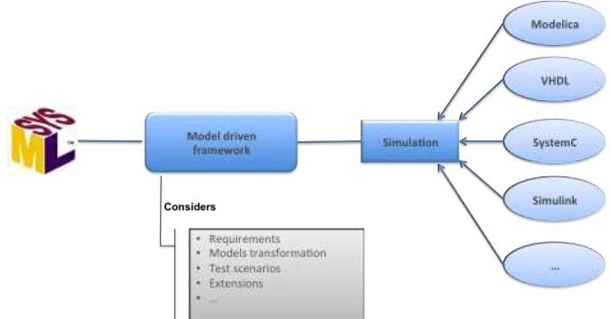
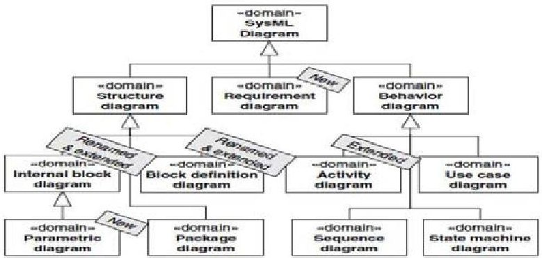
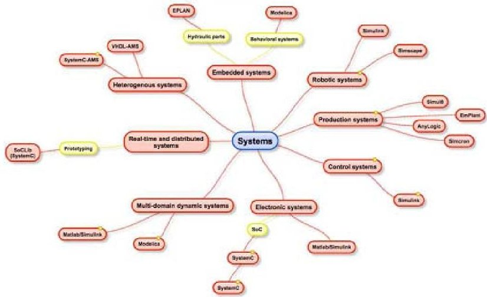

<!-- PDF_PAGE: 1 -->

# Towards an alignment of SysML and simulation tools

Bassim Chabibi IMS, SIME laboratory, ENSIAS, Mohamed V University Rabat, Morocco Email: bassim.chabibi@um5s.ac.ma

Adil Anwar SIWEB, EMI, Mohamed V University Rabat, Morocco Email: anwar@emi.ac.ma

Mahmoud Nassar IMS, SIME laboratory, ENSIAS, Mohamed V University Rabat, Morocco Email: nassar.ensias@gmail.com

AbstractEven if it is considered as an effective language for system modeling because of the descriptive aspect of its diagrams, SysML (System Modeling Language) is insufficient for verification of their behavior. This lack is accentuated by the increasing complexity of recent systems. In order to conduct behavior verifications, designers use simulation tools to realize experiments on the studied system. Thus, the efficiency of the engineering process is often reduced because of the separate and consecutive use of both SysML modeling and simulation tools. As a consequence, various research works focused on unifying the potential provided by the SysML language and simulation environments. We propose in this paper to study links taxonomy between SysML and various existing simulation environments. The ultimate goal of this study is to consider the most optimal passage from SysML to various simulation tools. A common environment based on models and modern techniques of modelbased engineering will handle this transformation.

Keywords—System engineering, SysML, simulation, MDE, models.

## I. INTRODUCTION

A system can be defined as a set of elements that mutually interact. It can also be seen as a set that interacts with the external environment. Systems engineering (SE) is a multidisciplinary scientific approach aimed to develop solutions in response to the requirements of different stakeholders [1]. It focuses on defining system or actors needs and functional requirements, detected early in the life cycle, by documenting requirements, then by proceeding with design synthesis and system validation. Systems engineering describes a structured development process, from design to production phase by integrating several disciplines. It takes into account the technical and economical aspects to ensure the development of a system that meets the needs of users.

Due to the increasing complexity of the systems, it becomes more difficult to verify the requirements expressed by stakeholders on the system by only using the descriptive models. Although being suitable for defining high-level connections that exist between requirements, the structure and the behavior of a system, SysML descriptive models do not allow verification of system behavior. In order to solve

this problem, designers use a variety of simulation tools that allow them to answer questions without having to use the real system, because such experiences can be expensive and dangerous.

Engineering process efficiency is reduced because of the separate and consecutive use of SysML modeling tools and simulation environments. Therefore, much scientific research has been done in order to explore how to link SysML potential of describing systems at a high level of abstraction and simulation capabilities regarding behavior verification. Thus, a panoply of transitions is defined between SysML language and one or more simulation environments.

In a similar perspective, our research aims to study an integration approach, based on MDE principles, of several simulation environments in a common platform (Figure 1) and to ensure bidirectional transformation between these environments and SysML. In addition, we seek to determine criterions of designating the most suitable simulation environment for each part of the system studied.

Fig. 1: Bridge between SysML and simulation environments

To this end, SysML modeling language and simulation approach will be presented in Section 2 before drawing up a state of the art of research works based on the transition from SysML to one or more simulation tools in Section 3. Section 4 will list major simulation tools found in bibliographic research. In order to have an idea of links that can be established between SysML and simulation, a comparative study of both SysML and simulation constructs will be detailed in section 4

<!-- PDF_PAGE: 2 -->

before concluding.

## II. SYSML AND SIMULATION OVERVIEW

## A. SysML modeling language

SysML [2] is a modeling language specified by the OMG. SysML allows describing graphically complex systems including hardware, software, data, etc. (e.g., wireless sensor network [3]). SysML supports the practice of Model-Based Systems Engineering (MBSE) used to develop system solutions in response to complex and technological constraints. SysML is defined as a modeling language for systems engineering which is able to provide a support for multiple processes and methods modeling. Therefore, it should be recalled that SysML is a notation and not a methodology for systems development.

Considered as related to software engineering, SysML concepts have been limited or adapted. Moreover, the original UML notation has been simplified by reducing the number of available diagrams types in order to facilitate their use. Taken from [4], Figure 2 shows diagrams used in SysML. In addition to adopted or modified diagrams from UML2.0 [5] original ones, two have been added: Requirement and Parametric diagrams. The first one allows capturing system requirements. As for the second, its role is to specify differential equations between models elements. It should be noted that Block Definition Diagram (BDD) and Internal Block Diagram (IBD) were obtained by modifying respectively UML Class and Composite Diagrams.

Through these diagrams, SysML allows describing requirements, structure and behavior in order to ensure a complete description of a system, its components and its environment. This description consists on an integrated model, where each diagram provides a different view of the modeled system. Requirements specify conditions or capabilities to satisfy, functions that the system must perform or performance conditions a system must achieve. As a fact, requirement diagrams capture requirements and their relationship with other requirements, design elements and test cases to support requirements traceability, satisfaction and verification. As for structure diagrams, they describe system architecture hierarchically, based on the modular unit of a SysML structural model, namely the block. Since behaviors describe the interaction between the block and its environment, behavior diagrams specify how the system should do to meet requirements. By defining constraints in terms of equations and their parameters, constraints blocks are described through parametric diagrams. These ones help define systems of equations that constrain the value properties of the blocks [1].

SysML simplifies UML in various aspects since it uses fewer diagrams. In addition, it reduces the growing complexity of recent systems (SoC, embedded systems,...) and improves communication between team members by promoting systems engineering and providing a common notation for different disciplines. Indeed, SysML has the advantage of integrating, at a high level of abstraction, heterogeneous domains into a unified model. Furthermore, SysML provides the developer with the ability to specify system requirements, and ensure

Fig. 2: SysML diagrams taxonomy

software/hardware partition and performance estimation without changing the SysML modeling environment [6].

Nevertheless, like UML, SysML remains a semi-formal language because of the lack of associated semantics. In addition, it does not allow defining practically continuous time behavior. To remedy this, its extension may be efficient depending on requirements. In this perspective, being a UML extension mechanism, stereotypes allow users to define modeling elements derived from existing UML classifiers such as classes and associations, and adapt them to their own application domains. For example, the authors of [7] have created SysML profiles, extended with stereotypes, for EPLAN and Modelica's environments.

Even though SysML provides strong capabilities to specify, analyze and design complex systems including hardware, software, human, procedural and resources aspects; the operational semantics of its diagrams are not precisely defined. As a result, the execution of SysML models is affected. Simulation is one of the effective methods of systems verification, because it is considered as a facet of this execution.

## B. Simulation needs of complex systems

According to [8], the simulation of a system can be defined as the process of creating a model of this system. This model can undergo reconfigurations and experiments that are impossible or financially expensive to achieve on the real system. Simulation is performed before an existing system is changed or a new system is designed in order to ensure the satisfaction of requirements, prevention of over or under-utilization of resources and optimization of system performance.

Simulating a system returns to create a virtual model that represents it and reflects some of its properties. To this end, modeling a system in a simulation environment is based on three fundamental concepts, namely components, ports and links [9].

Consisting on subcomponents, variables and parameters, components are system elements that process and exchange information. The behavior of a component, which is not a subsystem, is described by a mathematical model linking component parameters and variables through mathematical equations. Ports are interfaces through which information is exchanged between components. Thus, they allow specifying variables that are shared or exchanged between system components.

<!-- PDF_PAGE: 3 -->

Connections between the ports across which information is exchanged, represent links. Once components are connected through links, mathematical equations are generated, describing by the way a part of the whole behavior of the system represented by the model.

Given the importance of simulation in the system design process, several simulation environments have been developed and readjusted in recent years [10], [11]. Therefore, it becomes increasingly difficult to choose the most suitable simulation tool for the system designed or to design. To this end, some research works [12], [13] have focused on this axis by offering decision-making techniques for choosing the adequate simulation environments.

Although the simulation allows the evaluation of system performance under different configurations of interest and over real-time long periods, it is not quite usable at all system engineering process such as architectural or requirements analysis. On the other hand, these processes are managed through various SysML behavioral, structural and requirements diagrams. In order to take advantage of the potential offered by the two approaches, a bidirectional transition between SysML and simulation environments turns out to be interesting.

## III. RELATED WORKS

To unify the potential offered by both SysML and simulation tools, some research studies have examined the passage of SysML to an intermediate platform integrating several simulation tools. Thus, the authors of [14] proposed an approach, based on models transformation and metamodeling, to pass from SysML models to Modelica and Matlab/Simulink.

In [15], the authors have developed a SysML modeling and simulation platform of production systems. Simulation tools were selected according to scientific criteria (reproduction, accounting, results falsification, etc.). The proposed approach is based on the creation of SysML models, transformation of these models to XMI, models parsing to remove impertinent information, preparation of models for simulation according to the chosen simulator before running simulations.

The authors of [7] opted for Modelica and EPLAN (simulation of hydraulic structural schematics) simulation tools for verification of embedded systems, modeled in SysML. This passage is based on formal definition of the domains involved in the system through metamodels, creation of SysML profiles to enable domain specific modeling and model transformations to generate domain-specific views from SysML.

In addition, the authors of [16], [17] and [18] have established a transition procedure from SysML to SystemC-AMS and VHDL-AMS. The approach is based on an M2M (Modelto-Model) transformation to generate an intermediate representation of the system, either in SystemC-AMS or VHDL-AMS, and then an M2T (Model-To-Text) transformation for generating the executable code. In order to be able to run simulations of heterogeneous systems, the authors plan to create a generic intermediary metamodel to facilitate transformations to other languages.

As for the authors of [19], they described an approach to pass from SysML diagrams to SystemC models via an

M2M transformation and generating, thereafter, SystemC code through an M2T transformation. The diagrams used in the described approach are BDD (Block Definition Diagram) and IBD (Internal Block Diagram), for describing the structural aspect, and SMD (State Machines Diagrams) for the behavioral aspect of the system. Therefore, a mapping was proposed between SysML elements of these diagrams and their corresponding in SystemC. Once generated, the SystemC models will be translated into UPPAAL automata to formally verify SysML requirements.

Certainly SysML has advantages in the matter of event-driven behavior description of a system. However, SysML has not defined practically continuous-time behavior although it is suggested to describe it as differential equations in a parametric diagram. To enable an embedded system verification whose behavior is described by mixing both continuous-time and event-driven models, the authors of [20] propose a SysML extension and its execution tool based on the co-simulation between SysML and Matlab/Simulink. For this purpose, the extension concerns continuous data flow description between blocks, assignment of time to event-driven behavior and coupling of continuous-time and event-driven simulation.

By defining an approach based on code generation, the authors of [21] and [6] have established a bridge between UML/SysML modeling and embedded systems simulation and synthesis. This approach consists on SysML extensions for SystemC, C/C++ and Matlab/Simulink co-modeling and co-simulation. Furthermore, after successful simulation, a VHDL synthesis can be envisaged on synthesizable SystemC code.

Among the panoply of SysML diagrams, only a few were used for the transition between SysML and simulation tools. BDD and IBD are those that are most used to model the system before its simulation [19], [22], [23], [24] because of their characteristics and similarity between their concepts and those of simulation tools (section 5). In addition to these two diagrams, the authors of [19] have used SMD for system behavioral description. Moreover, the authors of [25] studied similarities between IBD, parametric and activities diagrams constructs and Modelica constructs. However, they point out that even when parametric diagrams provide semantics to specify detailed equations, complexity and size of data can cumbersome the modeler.

## IV. TAXONOMY OF SIMULATION ENVIRONMENTS

Because of the importance of simulation in the verification and validation of complex systems, simulation environments are increasingly developed and adapted to new requirements and nature and complexity of recent systems. The transition from SysML to simulation environments has been the subject of several studies. When some works have focused on the alignment of SysML with a single simulation tool [22], [25], others have focused on a more general approach based on a simulation environment with several tools [15], [7], [6].

The major simulation languages that have been linked to SysML are:

Simulink: It is a multi-domain simulation language

<!-- PDF_PAGE: 4 -->

of dynamic systems. Simulink / Matlab is used particularly to simulate digital, analog and mixed components. The bridge between SysML and Matlab/Simulink can be established using two approaches [26]: Co-simulation or executable common language [22]. Concerning the first one, SysML and Simulink simulations communicate via an intermediate coupling tool whereas in the second one, a common execution language (especially C/C++ code) is used to link SysML and Simulink models. Even if it requires special attention to the synchronization aspect, co-simulation approach allows better support for the most recent advances in UML 2.0, the SoC profile and SysML, by relying on the latest UML CASE tools. On the other hand, a faster simulation speed can be ensured by the specific development frameworks that ease the creation of a C++ executable model from UML and Matlab/Simulink [26].

SystemC: Considered as one of the most popular ESL languages, SystemC is characterized by its system-level specification facilities based on simulation capabilities in an early phase of development. It is, indeed, a high-level language for modeling systems (including hardware, software, mixed or even non-partitioned systems) at behavioral level. It is very suitable for design and simulation of Systems On Chip -SoC- [27]. Many research works have explored the mapping between SysML and SystemC in order to raise the abstraction level of electronics designs and speed up the design process. Moreover, this association provides several benefits such as a common and structured environment for the documentation of the system specification, the structure of the SystemC model and the system's behavior [6]. The SystemC capability of modeling concurrent processes is due to a dedicated discrete event (DE) simulation kernel. However, using only a DE MoC (Model of Computation) can be cumbersome in the case of modeling a multi-domain application. Considered as the Analog Mixed Signal (AMS) extension for SystemC, the SystemC-AMS version [16] provides pre-established MoCs (e.g. LSF: Linear Signal Flow, ELN: Electrical Linear Network, etc.) for the simulation of continuous and discrete components in order to deal with the heterogeneity problem.

VHDL: It is a hardware description language, with a rigorous method, for representing behavior and architecture of a digital electronic system. The features of VHDL allow behavior description of electronic components either it is a matter of

simple logic gates or microprocessors and custom chips. The electrical aspects of circuit behavior are well-described using VHDL features. As a consequence, simulation can be conduct by using the resulting VHDL simulation models as building blocks in larger circuits. Furthermore, considered as a high level programming language, VHDL allows complex electronic circuits behavior to be specified in a design system for automatic circuit synthesis or for system simulation. Since VHDL code is textual and often hard to maintain especially for complex systems, the need for a readable notation is crucial. Therefore, some works have established a bridge between SysML and either VHDL [28] or VHDL-AMS Version [17], [29] in order to benefit from the advantages of both approaches.

Modelica: It is an object oriented programming language which is based on the declarative programming paradigm which expresses the logic of a computation by describing what the application should accomplish without describing its control flow. This aspect minimizes side effects which are absolutely unrequested during a simulation phase [30]. Large, complex and heterogeneous physical systems, containing subcomponents from multiple engineering domains (e.g. electrical, hydraulic, thermal, mechanical, etc.), can be modeled using the Modelica language. Rather than assignments (as in the case of Simulink), Modelica mathematics is based on differential, algebraic and discrete equations [7]. SysML and Modelica have structure similarities since Modelica models consist of compositions of submodels connected by ports that represent energy flow (undirected) or signal flow (directed) [25]. In order to take advantages of combining modeling and simulation of complex systems at any stage

Fig. 3: A taxonomy of simulation tools in function of systems nature

<!-- PDF_PAGE: 5 -->

of system development, a SysML4Modelica profile [25], [31] was developed for the passage between the two languages. This profile simplifies the SysML-Modelica transformation by defining SysML stereotypes that correspond directly to constructs in the Modelica metamodel.

Figure 3 summarizes a taxonomy made from bibliographic review. It represents the systems that have been studied in this review and simulation tools used for evaluating these systems performance. Even though it is not an exhaustive taxonomy, this study is only a preliminary work aiming the analysis of different parameters justifying the choice of a suitable simulation tool for a given system.

## V. COMPARATIVE STUDY OF SYSML AND SIMULATION CONSTRUCTS

In order to create a bridge between SysML and simulation tools, it is essential to analyze how SysML constructs can represent those of simulation tools. Table I, taken from [32] illustrates the SysML elements that best match the elements used by the simulation tools.

A block is considered as the modular unit of structure in SysML that is used to define a type of system, component, or item that flows through the system, as well as external entities conceptual entities or other logical abstractions [1]. IBD is one of SysML diagrams for describing the internal structure of blocks by illustrating how their parts are interconnected.

Thus, it seems logical that SysML blocks homologue in simulation tools is system model. Seen as a component that contains other components that may be subsystems, a model is used to check the behavior of the system without the need to conduct real experiments.

TABLE I: SysML and simulation tools constructs mapping

<table border="1"><tr><td colspan="2">Simulation tools constructs</td><td>SysML constructs</td></tr><tr><td colspan="2">Model</td><td>Block with internal structure, but not a component of other blocks</td></tr><tr><td>Component</td><td>Atomic component Subsystem</td><td>Block without internal structure Block with internal structure</td></tr><tr><td colspan="2">Links</td><td>Connectors</td></tr><tr><td colspan="2">Ports</td><td>Flow properties</td></tr><tr><td colspan="2">Dynamic equations</td><td>Constraint blocks typing constraints properties</td></tr></table>

Components are elements of which interaction creates the model of a system. A sub-system can be defined as a component containing other components and / or subsystems while an atomic component is a component that cannot be decomposed further. From these definitions, a subsystem and an atomic component can be compared respectively to a SysML block with internal structure and SysML block without internal structure.

Ports provide a way for components to interact; they have variables describing aspects of energy or information exchanged with other components. Ports can be roughly equivalent to the concept of Flow properties. This SysML concept specifies kind of information circulating between block

instances and its environment.

Links represent connections between components ports through which energy or information is exchanged. They can be compared to the concept of SysML connectors. They allow specifying how the parts of a block are connected together.

Dynamic equations are used to specify atomic components behavior in simulation. These equations can be compared to the concept of Constraint Property, contained in a Constraint Block. The latter is a special block used to define equations so that they are reused and interconnected.

Thus, it appears that a rough comparison can be made between some of SysML and simulation constructs. Concerning the semantics that differ between the two approaches, an extension [32] of simulation tools elements in SysML can be explored to gap a bridge between the two approaches.

In order to optimize the transition between SysML and various simulation environments, it would be interesting to set up a link, based on MDE principles, between SysML and simulation models. This link will consist on a mapping between SysML and simulation constructs (Section 5) in order to define an abstract model that will gap a bridge between the two approaches. We work, at the time of writing this article, to draw up a global comparative study between SysML and simulation constructs in order to create the intermediate model. Furthermore, a SysML modeling methodology will be defined in order to take advantage of the potential offered by the two approaches.

## VI. CONCLUSION

In order to ensure an alignment between SysML and simulation tools, this article summarizes a bibliographic review of works supporting the same context, an analysis of SysML and simulation constructs and a taxonomy of major simulation environments. Searching to gap a bridge between SysML and several simulation tools, the ultimate goal of our research is to study an integration approach, based on MDE principles, of several simulation environments in a model-driven platform and ensure bidirectional transformation between these environments and SysML. To this end, we aim to answer the following questions: how to create a bridge between SysML and different simulation tools? What are the criteria to identify the most suitable simulation tool for a specific part of the system studied? How a bidirectional path can be provided between an integrated simulation tool and SysML?

Answering these questions will create a bridge between SysML and simulation environments by taking advantage of the potentials offered by the two approaches. In this context, it would be interesting to define a methodology for modeling and simulation of SysML models. This methodology will consist on establishing a link, based on MDE principles, between SysML and different simulation environments through an abstract representation linking SysML and simulation constructs.

<!-- PDF_PAGE: 6 -->

## REFERENCES

[1] Sanford Friedenthal, Alan Moore, and Rick Steiner. A practical guide to SysML: the systems modeling language. Morgan Kaufmann, Waltham, MA, 2012.

[2] Object Management Group. OMG Systems Modeling Language (OMG SysMLtm). Technical Report 1.3, 2012.

[3] Nicolas Belloir, Jean-Michel Bruel, Natasha Hoang, and Pham Congduc. Utilisation de SysML pour la modélisation des réseaux de capteurs. pages 169-184, 2008.

[4] Tim Weilkiens. Systems engineering with SysML/UML: Modeling, Analysis, Design. Morgan Kaufmann, Heidelberg, 2006.

[5] Object Management Group. Object management group, inc. unified modeling language (uml) 2.1.2 infrastructure. Technical report, November 2007.

[6] Yves Vanderperren, Wolfgang Mueller, Da He, Fabian Mischkalla, and Wim Dehaene. Extending UML for Electronic Systems Design: A Code Generation Perspective. In Gabriela Nicolescu, Ian O'Connor, and Christian Piguet, editors, Design Technology for Heterogeneous Embedded Systems, pages 13-39. Springer Netherlands, Dordrecht, 2012.

[7] Aditya A. Shah, Aleksandr A. Kerzhner, Dirk Schaefer, and Christiaan JJ Paredis. Multi-view modeling to support embedded systems engineering in SysML. In Graph transformations and model-driven engineering, pages 580-601. Springer, 2010.

[8] Anu Maria. INTRODUCTION TO MODELING AND SIMULATION. pages 7-13, 1997.

[9] Ion Matei and Conrad E. Bock. Modeling Methodologies and Simulation for Dynamical Systems. Technical report, National Institute of Standards and Technology, August 2012.

[10] Modelica - A Unified Object-Oriented Language for Systems Modeling Language Specification. Technical report, Modelica, 2012.

[11] Michael W. Browne, Robert Cudeck, Kenneth A. Bollen, and J. Scott Long. Alternative ways of assessing model fit. Sage Focus Editions, 154:136-136, 1993.

[12] Suay Erees, Emel Kuruoglu, and Nilgun Morali. An Application of Analytical Hierarchy Process for Simulation Software Selection in Education Area. pages 60-70, 2013.

[13] S. Arunachalam, R. Zalila-Wenkstern, and R. Steiner. Environment mediated Multi Agent Simulation Tools-A Comparison. pages 43- 48, Venice, October 2008. IEEE.

[14] Christiaan JJ Paredis and Thomas Johnson. Using OMGs SysML to support simulation. In Simulation Conference, 2008. WSC 2008. Winter, pages 2350-2352. IEEE, 2008.

[15] Oliver Schonherr and Oliver Rose. First steps towards a general SysML model for discrete processes in production systems. In Simulation Conference (WSC), Proceedings of the 2009 Winter, pages 1711-1718. IEEE, 2009.

[16] Daniel Chaves Café, Filipe Vinci dos Santos, Cécile Hardebolle, Christophe Jacquet, and Frédéric Boulanger. Multi-paradigm semantics for simulating SysML models using SystemC-AMS. In Specification & Design Languages (FDL), 2013 Forum on, pages 1-8. IEEE, 2013.

[17] Daniel Chaves Café, Cécile Hardebolle, Christophe Jacquet, Filipe Vinci Dos Santos, and Frédéric Boulanger. Discrete-Continuous Semantic Adaptations for Simulating SysML Models in VHDL-AMS. In MPM 2014, volume 1237, pages 11-20, 2014.

[18] Daniel Chaves Café, Filipe Vinci dos Santos, Cécile Hardebolle, Christophe Jacquet, and Frédéric Boulanger. Une sémantique multiparadigme pour simuler des modèles SysML avec SystemC-AMS. CIEL, pages 93-96, 2014.

[19] Abdulhameed Abbas, Hammad Ahmed, Mountassir Hassan, and Tatibouet Bruno. An approach combining simulation and verification for sysml using systemc and uppaal.

[20] Ryo Kawahara, Hiroaki Nakamura, Dolev Dotan, Andrei Kirshin, Takashi Sakairi, Shinichi Hirose, Kohichi Ono, and Hiroshi Ishikawa.

Verification of embedded system's specification using collaborative simulation of SysML and simulink models. In Model-Based Systems Engineering, 2009. MBSE'09. International Conference on, pages 21- 28. IEEE, 2009.

[21] Fabian Mischkalla, Da He, and Wolfgang Mueller. A UML profile for SysML-based comodeling for embedded systems simulation and synthesis. In Proc. of Workshop on Model Based Engineering for Embedded System Design (MBED), 2010.

[22] Andrea Sindico, Marco Di Natale, and Gianpiero Panci. Integrating SysML with Simulink using Open-source Model Transformations. In SIMULTECH, pages 45-56, 2011.

[23] Roland Renier, Raphael Chenouard, and others. DE SYSML A MODELICA AIDE A LA FORMALISATION DE MODELES DE SIMULATION EN CONCEPTION PRELIMINAIRE. In 12ème Colloque National AIP PRIMECA, 2011.

[24] Mara Nikolaidou, Vassilis Dalakas, and Dimosthenis Anagnostopoulos. Integrating Simulation Capabilities in SysML using DEVS. In Proceedings of IEEE Systems Conference 2010, 2010.

[25] Peter Fritzson, Nicolas F. Rouquette, and Wladimir Schamai. An Overview of the SysML-Modelica Transformation Specification. 2010.

[26] Yves Vanderperren and Wim Dehaene. From UML/SysML to Matlab/Simulink: current state and future perspectives. In Proceedings of the conference on Design, automation and test in Europe: Proceedings, pages 93-93. European Design and Automation Association, 2006.

[27] Alexander Viehl, Timo Schonwald, Oliver Bringmann, and Wolfgang Rosenstiel. Formal performance analysis and simulation of UML/SysML models for ESL design. In Proceedings of the conference on Design, automation and test in Europe: Proceedings, pages 242-247. European Design and Automation Association, 2006.

[28] Okba Boutekkouk, Fateh; Fartas. Automatic generation of sysml diagrams from vhdl code. In Symposium on Complex Systems and Intelligent Computing (CompSIC), 2015.

[29] J. Verries and A. Sahraoui. Case Study On SYSML and VHDL-AMS for Designing and Validating Systems. In Proceedings of the World Congress on Engineering and Computer Science, volume 1, 2013.

[30] Parham Vasaiely. Interactive Simulation of SysML Models using Modelica. PhD thesis, hamburg university of applied sciences, Faculty of engineering and Computer Science, 2009.

[31] Thomas Johnson, Aleksandr Kerzhner, Christiaan J. J. Paredis, and Roger Burkhart. Integrating Models and Simulations of Continuous Dynamics Into SysML. Journal of Computing and Information Science in Engineering, 12(1):011002-011002, December 2011.

[32] Ion Matei and Conrad Bock. SysML Extension for Dynamical System Simulation Tools. US Department of Commerce, National Institute of Standards and Technology, 2012.