<!-- PDF_PAGE: 1 -->

# Using a Model Based Systems Engineering Approach for Aerospace System Requirements Management

Subarna S Aerospace Eaton India Innovation Center Pune, India subarnas@eaton.com

Ankita K Jawale, ASEP Aerospace Eaton India Innovation Center Pune, India ankitakjawale@eaton.com

Shana Fliginger

Akshay S Vidap Aerospace Eaton India Innovation Center Pune, India akshaysvidap@eaton.com

Aerospace

Eaton

Grand Rapids, USA

shanafliginger@eaton.com

Subodh D Sadachar Aerospace Eaton India Innovation Center Pune, India subodhdsadachar@eaton.com

Srimannarayana Myla, CSEP

Aerospace

Eaton India Innovation Center

Pune, India

srimannarayanamyla@eaton.com

Abstract Since systems engineering encompasses the entire scope of a system, successful systems engineering should embody efficient requirements management through a collaborative and interdisciplinary approach. Model Based Systems Engineering (MBSE) is an emerging field, which applies a model-based framework to the elements of a system comprised of requirements, system functions, analysis results, validation and verification artifacts. The effective comprehension of a complex system is more easily visualized through a model-based approach than a document centric one. The representative models and the inherent traceability which one receives through visual associations provides more effective requirements traceability and analysis; and, thus leading to fewer technical risks, earlier detection and resolution of issues, and helps keep schedules and costs in check. This approach yields better, clearer, and more concise requirements and in turn aids in more effective verification and validation processes as well as more expedient impact analyses of unforeseen changes.

This paper describes MBSE through SysML (System Modelling Language) by application on a complex aerospace system. The study qualitatively and quantitatively discusses the value addition of such an implementation using commercially available tools that equip SysML to achieve MBSE in systems. SysML is a domain-specific modeling language developed for systems engineering to specify, analyze, design, optimize, and verify systems. From a practitioner's standpoint, this MBSE approach can be used to engineer any complex system from satellite programs to transport networks.

Keywords— MBSE, SysML, Traceability, Verification, Validation, Requirements Engineering, Requirements Management

## I. INTRODUCTION

The 2018 advent of the second edition of ISO/IEC/IEEE 29148 Systems and software engineering Life cycle processes Requirements engineering [1] marks a pivotal affirmation of the bonds among requirements engineering, life cycle processes, systems and software

engineering. Since systems engineering encompasses the entire life cycle or scope of a system, successful systems engineering should embody efficient requirements management through a collaborative and interdisciplinary approach. One such approach stems from the emerging and dynamic field of Model Based Systems Engineering (MBSE), which applies a model-based framework to the elements of a system comprised of requirements, system functions, analysis results, validation and verification artifacts. After a concise definition of a system and an overview of key concepts to aid in the discussion of MBSE, this paper highlights the potential benefits of implementing MBSE on a small yet complex aircraft system.

## II. KEY CONCEPTS

## A. Requirements Engineering

Since requirements engineering focuses on a defining a system, software or service, a need for a common discussion basis is clear, starting with an understanding of requirements engineering itself. The ISO/IEC/IEEE 29148:2018(E) states:

"Requirements engineering is concerned with discovering, eliciting, developing, analyzing, verifying (including verification methods and strategy), validating, communicating, documenting and managing requirements. The primary result of requirements engineering is sets of requirements, each set:

— being with reference to a defined system, software, or service

enabling an agreed understanding between stakeholders (e.g., acquirers, users, customers, operators, suppliers)

- having been validated against real-world needs

- able to be implemented, and

— providing a reference for verifying designs and solutions."

<!-- PDF_PAGE: 2 -->

This paper compares requirements engineering using MSBE approach with the traditional document-based method of achieving the results. As requirements engineering standards are relatively new, the use of MBSE as means to accomplish sound requirements engineering likewise is novel.

## B. System and Life Cycle Concepts

The concept of a system is key to requirements engineering and systems engineering alike. For this paper, a system is an arrangement of parts or elements that together exhibit behavior or meaning that the individual constituents do not [2]. Thus, a system is a set of interacting elements acting as a deliberate whole for a desired function. An engineered system is a system designed or adapted to interact with an anticipated operational environment to achieve one or more intended purposes while following applicable constraints.

Any system passes through a series of stages to achieve its desired function, which is referred to as its life cycle. Defining the system life cycle model establishes a framework for meeting the stakeholders' needs in an orderly and efficient manner for the whole life cycle. The generic life cycle stages are concept development, production, utilization, support, retirement.

As seen in the definition of requirements engineering, every system has a life which can be defined as a set of processes. One key benefit of using a design or development approach that engulfs the entire lifecycle is the ability to trace requirements to stakeholder requirements. System architects, engineers, auditors follow requirements from cradle to grave. Due to increasing system complexity, environmental factors, safety and security concerns, the life cycle has expanded its focus from traditional design, development, utilization to include the retirement and disposal stages as well. Considering business aspects of a project, project leadership makes a technical decision to select a life cycle process.

One such model is the V-model which the SAE ARP4754A [3] showcases as the foundation for the standard. Using a model that aligns with the SAE ARP4754A follows the guidelines set forth in the FAA AC 20-174 [4]. The V-model represents the life cycle process of a system from concept stage to retirement stage. It highlights the importance of validation of stakeholder requirements and a strategy for verification at each stage of life cycle.

## C. Systems Engineering

Systems Engineering is a cross-disciplinary and integrated approach to enable the successful realization, use and retirement of engineered systems, using systems principles and concepts, and scientific, technological and management methods. It focuses on holistically and concurrently understanding stakeholder needs; exploring opportunities; documenting requirements; and synthesizing, validating, verifying, and evolving solutions while considering the complete problem, from system concept exploration through system disposal. This interdisciplinary approach helps govern the total technical and managerial effort required to transform a set of customer needs, expectations, and constraints into a solution and to support that solution throughout its life cycle.

## D. Current Practices and Challenges - Document Based Approach

The contemporary systems engineering discipline relies heavily on document-based artifacts to capture much of the system specification and design information, such as requirements documentation, interface control documentation, test plan or result documentation, system architecture design descriptions.[5] This information is often spread across many different document formats including text, informal drawings, and spreadsheets. This document-based approach to systems engineering suffers from a lack of precision, inconsistencies from one artifact to another, and difficulties in maintaining and reusing the information. This includes demands from collaborative working among engineering functions, supply chain, quality, manufacturing. As the real-world systems get increasingly complex, inter-disciplinary, multi-disciplinary fields, smarter systems, and products, the need for a better systems engineering method arises.

## E. Model Based Systems Engineering

Model Based Systems Engineering (MBSE) is the formalized application of modeling to support system requirements, design, analysis, verification, and validation activities beginning in the conceptual design phase and continuing throughout development and later life cycle phases.[2]

## F. SysML - System Modelling Language

Modeling languages are generally intended to be interpreted by both humans and computers interpretable and are specified in terms of both syntax and semantics. The SysML[6] from the OMG group is developed as a systems engineering domain specific language, which is widely used and considered an important modeling language for systems. The SysML diagrams are widely grouped into structure diagram, behavior diagram, requirement diagram and parametric diagram.

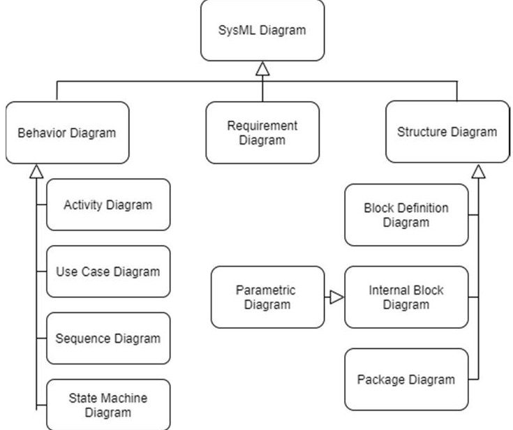

Figure 1: SysML Diagrams [5]

The 9 types of SysML diagrams, as shown in Figure 1, are used to appropriately represent the constituents, system

<!-- PDF_PAGE: 3 -->

structure, behavior of system elements, parametric influence, and requirements flow-down. SysML also enables association or allocation of functions to elements, allocation of logical to physical elements and other types of allocation, through allocation relationship. SysML being a domain specific modeling language for systems understanding, it facilitates specification, analysis, design, and verification of systems. A specific model-based method application may require only a subset of the SysML diagrams. For this project, team leadership chose IBM Rational Rhapsody $ \textcircled{c} $ 8.3.1 (2018)[9] as the modeling tool due to its better compatibility with IBM Rational DOORS $ \textcircled{c} $ an aerospace and automotive industry recommended requirements management tool.

The purpose of modelling or systems engineering efforts considers a systems development study focused on architecture definition, requirements flow-down or allocation, validation and verification as well as business needs including an efficient path to certification.

The requirements and system engineering approaches can be tailored based on the application and domain of a system. The following sections of this paper cover the study of an aerospace system and the application of a model-based systems engineering method. The generated diagrams and related artifacts focus on the system development processes, including validation and verification. The conclusions section of this paper discusses the findings and observations based on this study.

A conventional fixed wing aircraft is equipped with fuel-run engines for propulsion. The fuel is stored in the tank compartments and transferred to the engine for combustion. The depletion of fuel is engineered to avoid a variable weight force causing an imbalance on the aircraft. The replenishment of the tanks is achieved also. The Fuel Distribution System (FDS) of an aircraft functions to fulfill the above-mentioned processes. The FDS is an inter-disciplinary, multi-modular system, with multiple regulatory constraints, which makes it a suitable candidate for the model-based study.

## III. MBSE EXAMPLE: FUEL DISTRIBUTION SYSTEM

The system development process should be approached from multiple viewpoints (Figure 2). The operational view has the

exterior of the system as the standpoint, where the stakeholders, their needs and the lifecycles of systems are studied. The functional view works upon the understanding from the operational view studies. The functional expectations on the system are understood, which could then be decomposed to subfunctions. The constructional view standpoint focuses on the constituents of the system, where the equipment level requirements and interactions are deciphered. Throughout the system definition, trade-off and prioritization take place to meet any constraints of business or regulatory nature.

The stakeholder analysis helps us identify the players who are interested in the development of FDS, starting from the ideation/conceptualization phase to disposal phase. The identified stakeholders or stakeholder groups exhibit specific expectations over the FDS, which are the needs of the stakeholders. These stakeholder needs then translate to the system level functions and requirements, along with any derived requirements. Table 1 lists a few stakeholders and their needs.

TABLE 1. STAKEHOLDERS AND NEEDS

<table border="1"><tr><td>Group</td><td>Stakeholder</td><td>Needs(Keywords)</td></tr><tr><td rowspan="3">Powerplant System</td><td rowspan="2">Engine</td><td>Expected Flow rate, pressure, temperature</td></tr><tr><td>Heat Exchange</td></tr><tr><td>Auxiliary Power Unit</td><td>Expected Flow rate, pressure, temperature</td></tr><tr><td rowspan="3">Airframe</td><td rowspan="3">Fuselage and Wing</td><td>Structural load within limits</td></tr><tr><td>Compatible internal interfaces for conveyance</td></tr><tr><td>Ground refueling adapter compatibility</td></tr><tr><td rowspan="3">Airlines</td><td rowspan="3">Airlines</td><td>Standard functions &amp; performance</td></tr><tr><td>Lower priced</td></tr><tr><td>Lower non-engineering expenses</td></tr></table>

The life cycle analysis of a system leads to more holistic understanding. The life cycle analysis of FDS, as seen in Figure 3, provides a view of its evolution from design stage to disposal stage, which would lead to identifying any missed stakeholders. The study of entire lifecycle during the development phase ensures inclusion of maintenance considerations, material compliances for safe disposal, ease of manufacture, etc.

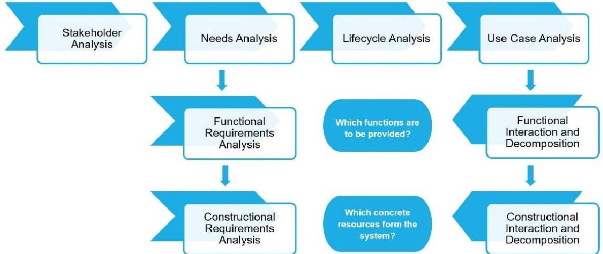

Figure 2: System Definition Methodology [7]

<!-- PDF_PAGE: 4 -->

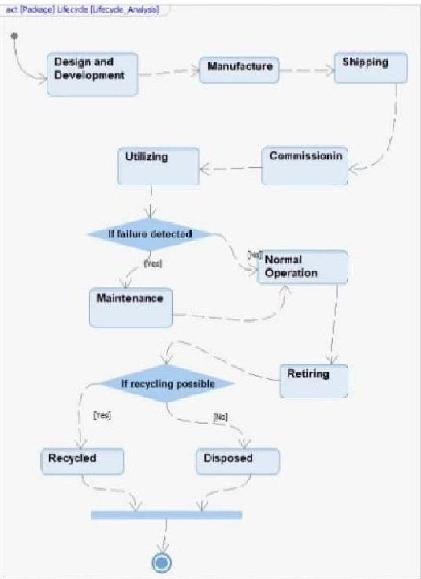

Figure 3: Lifecycle diagram of FDS

Life cycle is represented using SysML Activity Diagram which is a type of behavior diagram. The boldened circle ( $ \cdot $ ) marks the start of the activity, with sequential activities denoted by the rounded rectangle elements and the end of the sequence is at the concentric circle element. Diamond-shaped element denotes a decision node.

The operation stage of the FDS constitutes the significant portion of its lifecycle and this is the regime for which the system is primarily engineered to function for. Studying and modeling the behavior expected during its operation leads to more clarity on the operational functions.

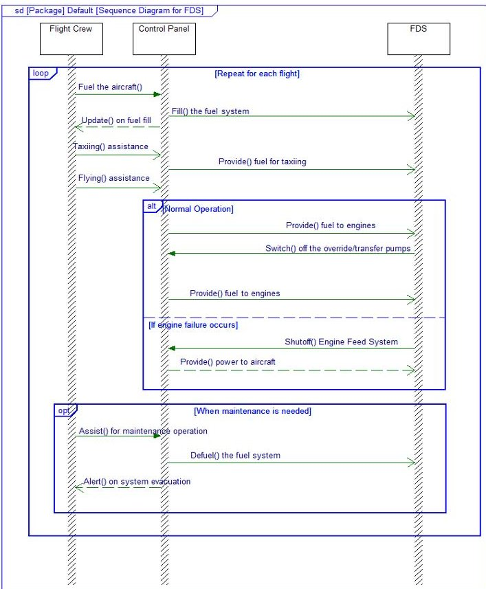

Figure 4: Operation of FDS

To represent operational behavior, SysML sequence diagram is used as in Figure 4. The vertical lines represent the respective system's operating regime. The functions are shown as prompts, driven or received by a system. The blocks show the conditions, such as flight cycle loop, engine failure condition and maintenance mode.

By understanding the stakeholder needs and the operation of FDS, the system level functions can be deciphered. The desired functionalities then lead to the use-cases of the system. The use-case analysis helps understand the practical use scenarios, the actors which initiate a use-case or enable the realization of it. Here, we have identified such actors which then form the next level hierarchy, sub-systems of the FDS.

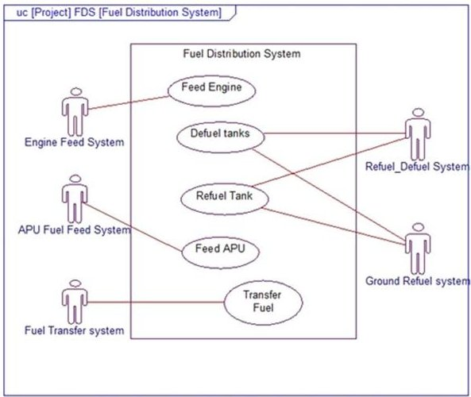

Figure 5: Use-case diagram of FDS

Figure 5 applies a SysML Use-case diagram to the FDS. All use-cases are associated with the respective actors. The identified sub-systems are the next-level build-up units of FDS. This can be demonstrated using a structure diagram.

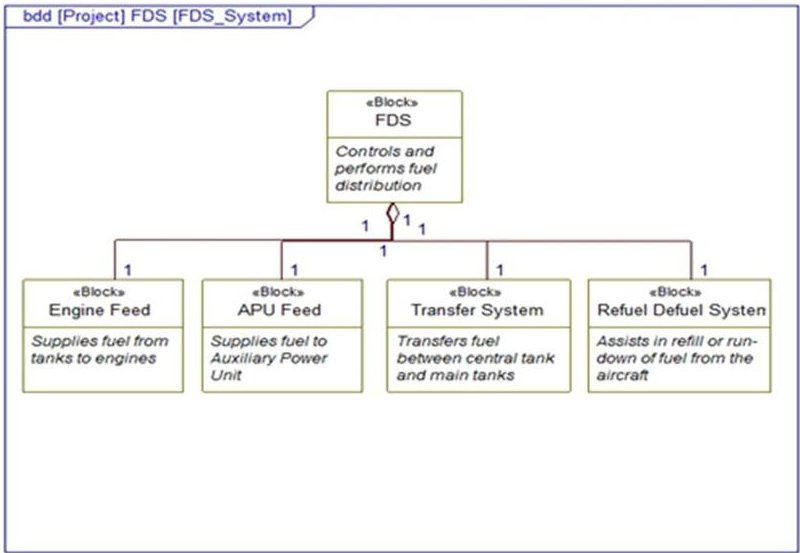

Figure 6: Sub-systems of FDS

Figure 6 depicts a SysML Block Definition Diagram for the sub-systems of the FDS. The system, sub-system hierarchy is denoted by the blocks with appropriate associations.

<!-- PDF_PAGE: 5 -->

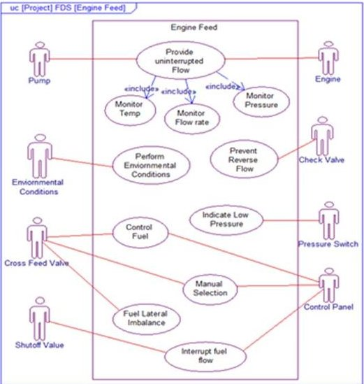

Figure 7: Use-case diagram of the Engine feed sub-system

The above process of performing use-case analysis to find enabling actors is applied at the sub-system level. Understanding the actions carried out by the sub-system helps in identifying use-cases and breaking down the enabling actors. As the use cases of the sub-system are identified, the entities needed to realize them are deciphered. This leads to the next level of hierarchy, the elements of the sub-system (Figure 7). The use-case analysis can be performed at a component level to decipher the interactions and interfaces necessary for the functioning of the component (Figure 8).

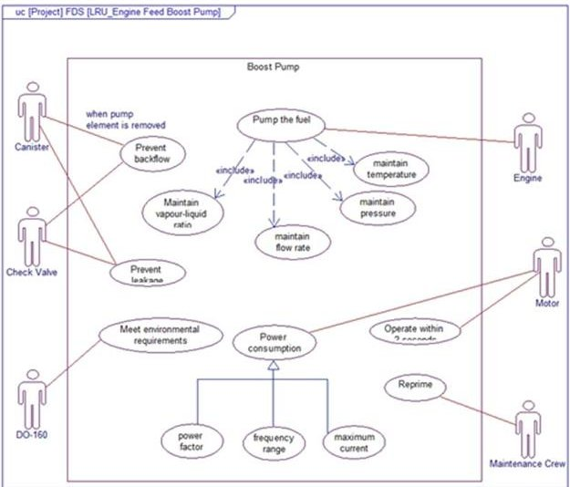

Figure 8: Use-case diagram of Boost pump, a component of Engine feed sub-system

By using the above processes recursively in the hierarchy from system to sub-systems, we can identify the constituting components. The interactions between the components and the external systems lead to the interface definition. These elements and their interactions constitute the sub-systems, which together form the FDS. This leads to the architecture creation. Figure 9

shows a developed FDS architecture[8] with minimal elements.

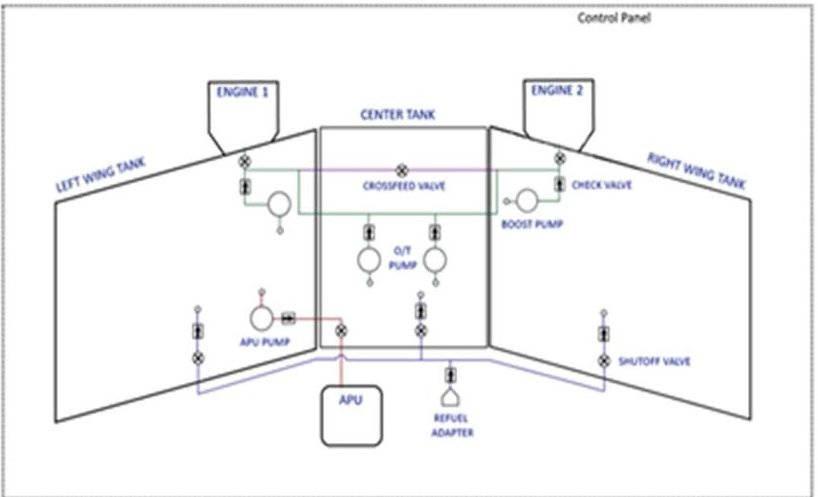

Figure 9: A representative architecture with decided components

## A. Validation and Verification Process

This system definition approach when paired with good V&V (Validation and Verification) planning leads to lesser iterations and hence quicker system development. MBSE allows for multiple associations between elements like requirements, blocks, use-cases, objects, etc. These associations are the entities that act as traceability evidences. The above approach also aids in better V&V as the traceability and associations are established in the early stage of system definition.

In a nutshell the SAE ARP4754A views validation of requirements as the process of ensuring that the specified requirements are sufficiently correct and complete so that the product meets the needs of customers, users, suppliers, certification authorities and other stakeholders. The requirements validation process covers the correctness check and the rationality of the requirements. Tracing the system level requirements to the stakeholder needs or contract documents validates the presence of the requirement. However, there might be requirements which are not directly linked to the higher-level item but can be traced to regulatory or recommended standards. These linkages and rationale validate the presence of the requirements. The requirements should also follow good requirements writing to avoid misinterpretation, ambiguity, or vagueness.

The purpose of verification paraphrased from the SAE ARP4754A is to ascertain that each level of the implementation meets its specified requirements. The verification process ensures that the system implementation satisfies the validated requirements. Verification consists of inspections, reviews, analyses, tests, and service experience applied in accordance with a verification plan. Test reports and analysis data can verify the performance of system against the requirement. Verified lower level requirement then acts as the basis of verification of the higher-level requirement. The linkages between the verification evidences and the requirements help us in identify the missed requirements, which can mean non-compliance to the customer requirement.

<!-- PDF_PAGE: 6 -->

The requirements can be linked to the elements of the model. Linking a requirement to the use case establishes that the rationality for designing to that requirement. Such links act as the validation of the requirement, ensuring the system developer is designed for the agreed requirements. The absence of linkages in a requirement means that it can be defective, that is, an unnecessary or incorrect requirement. Examples of these associations or linking are seen in Figure 10, Figure 11, and Figure 12.

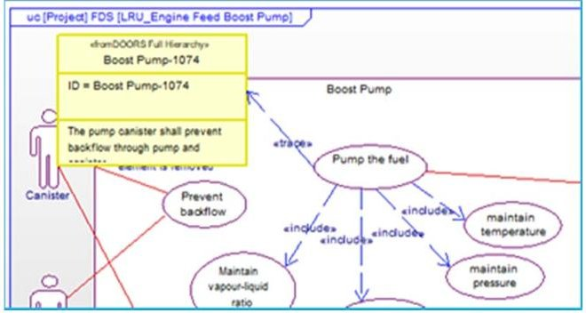

Figure 10(a): Boost Pump Use-case

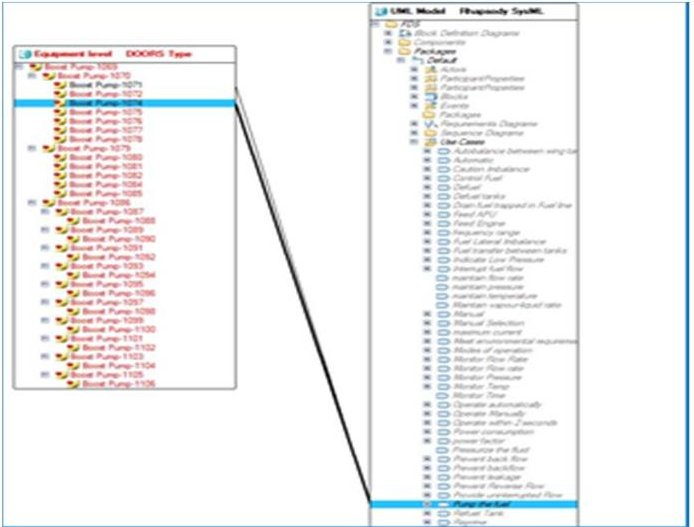

Figure 10(b): Trace-links

Figure 10: (a) A use-case of Boost Pump is traced to the requirement, (b) This view shows the trace-links present between the system requirements and the elements of the system model

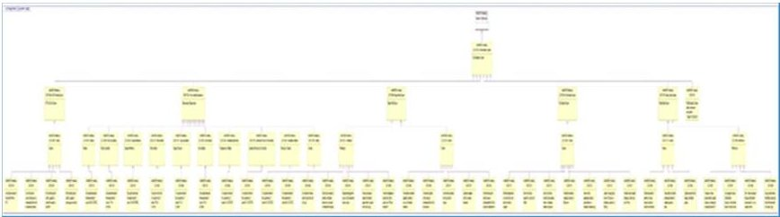

Figure 11: The hierarchy among the requirements can be represented using the SysML requirements diagram

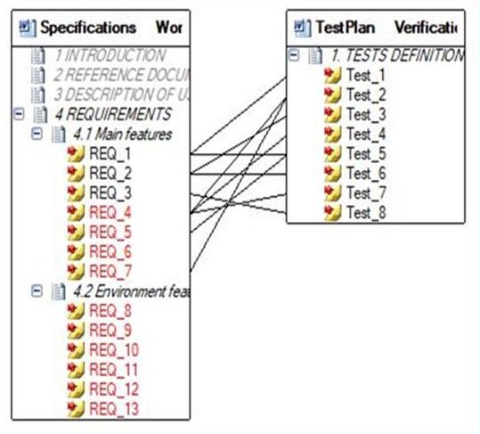

Figure 12: The test plan (a verification evidence) can be linked to the respective requirements [10]

The system modeling discussed here, enables the system engineer to perform the architecture definition and validation and verification processes.

## IV. RESULTS AND OBSERVATIONS FROM PRACTICALY APPLYING MBSE

In traditional document-based approach, data is generated in the form of documents. In such an approach, the system is described using a set of text documents, such as requirement documents, system design specifications, and interface control documents. The information contained in these documents are difficult to synchronize, assess and maintain in terms of its quality, correctness, completeness, and consistency. It is difficult to track and assess the information in these documents and amend these documents for every change.

A distinguishing feature of a MBSE is the use of a model which is a primary artifact of the requirements engineering process using systems engineering. The focus on developing, managing and controlling a model of the system is a shift from the traditional document-based approach to systems engineering, where the emphasis is on producing and controlling documentation about the system as depicted in Figure 13. The key aspects of MBSE are the presence of integrated system model, consistency among teams, traceability of artifacts.

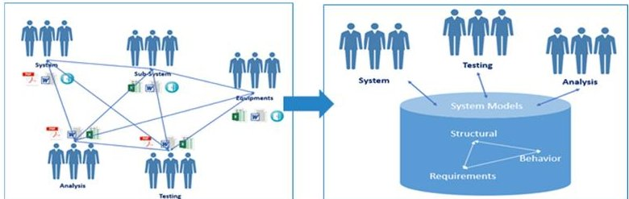

Figure 13: Collaboration scenario shift from a traditional method to a MBSE approach

<!-- PDF_PAGE: 7 -->

The use of MBSE aids in handling the communication essential to system design and efficient requirements engineering. through prudent and complementary set of tool, methodology and models. By leveraging the system model as a primary artifact, MBSE offers the potential to enhance quality of the development process, enhance reuse of the system modeling artifacts, and improve communications among the systems development team. This offers the potential to reduce the time and costs associated with integrating and testing the system, and significantly reduces cost, schedule, and risks in fielding a system. Additionally, MBSE intrinsically offers the reusability and re-applicability of the models, which saves time and effort.

Our team conducted a study on system development using the small yet complex FDS, which considered the traditional document and MBSE approaches. In both approaches the system level requirements constituted ~20% of the total requirements, ~30% at the sub-system level and ~50% at the component level. Table 2 showcases the results of that study where MBSE yielded a significant reduction in time. The yardstick for the duration estimates was the indispensable task of capturing the system level requirements from the customer specifications. The time unit itself was an aggregate of billable hours of effort. For conciseness, the study scrutinized only the key processes, as defined in the ISO 29148 and SAE ARP4754A, and the efforts to realize them.

Even though the addition of the use-case and use-case analysis increased the amount of time at needs and analysis stage, the use-case and use-case analysis in the MBSE approach led to earlier identification of missing requirements, improved traceability and ensured the reduction of effort in requirements management, validation and verification. Though the requirements verification demanded more time in the MBSE approach, it was a more thorough and efficient method as compared to document based approach. Verification in document-based approach consists of just a textual affirmation. However, the MBSE based verification provides links between the verification artifacts and the model elements ensuring accountability. The MBSE approach saved substantial time with an overall savings of 50% as compared to the traditional document-based approach.

The utilization of MBSE for the above discussed systems definition processes led to a significant reduction in efforts for requirements validation and traceability as reflected in Figure 14. The reduced technical risks with an added ease of communication, fewer chances of misinterpretation through models, reusability or re-applicability of models and saving the opportunity costs of additional effort make the MBSE based requirements management process preferable. Early identification and reduction of the technical risks, accountable verification traceability entities help in the readiness for FAA or other required certification compliance.

TABLE 2. COMPARING A TRADITIONAL DOCUMENT BASED APPROACH TO MBSE

<table border="1"><tr><td colspan="2">Document Based Approach</td><td colspan="2">Model Based System Engineering Approach</td></tr><tr><td>Processes/Activities</td><td>Time* (Hrs.)</td><td>Processes/Activities</td><td>Time* (Hrs.)</td></tr><tr><td colspan="4">System Level(~20% of Total Requirements)</td></tr><tr><td>Business Requirements capture(from legal documents, contracts, emails, memo)</td><td>1</td><td>Business Requirements capture(from legal documents, contracts, emails, memo)</td><td>1</td></tr><tr><td>Stakeholder Needs capture</td><td>&lt;1(nominal)</td><td>System Needs capture(Stakeholder Analysis, Needs Analysis, Use case Analysis)</td><td>10</td></tr><tr><td>System Requirements Capture from Customer specification</td><td>1</td><td>System Requirements Capture from Customer specification</td><td>1</td></tr><tr><td>Flow down of Requirements to subsystem requirements spec</td><td>3</td><td>Functional Decomposition and flow down of requirements to subsystems</td><td>2</td></tr><tr><td>Requirements Validation</td><td>60</td><td>Requirements Validation</td><td>30</td></tr><tr><td>Requirements Verification</td><td>10</td><td>Requirements Verification</td><td>20</td></tr><tr><td colspan="4">Subsystem Level(~30% of Total Requirements)</td></tr><tr><td>Flow down of Requirements to component</td><td>3</td><td>Functional Decomposition and flow down of requirements</td><td>2</td></tr><tr><td>Requirements Validation</td><td>60</td><td>Requirements Validation</td><td>10</td></tr><tr><td>Requirements Verification</td><td>15</td><td>Requirements Verification</td><td>20</td></tr><tr><td colspan="4">Component Level(~50% of Total Requirements)</td></tr><tr><td>Requirements Validation</td><td>80</td><td>Requirements Validation</td><td>10</td></tr><tr><td>Requirements Verification</td><td>20</td><td>Requirements Verification</td><td>20</td></tr><tr><td>Total</td><td>254</td><td>Total</td><td>126</td></tr><tr><td colspan="3">Savings in Time</td><td>128</td></tr><tr><td colspan="3">Savings in %</td><td>50</td></tr></table>

* Aggregate Hours of Effort

As a further observation, the dramatic cumulative savings of 50% over the traditional document approach also meant that initial outlay for tool licenses and training were recovered early in the project. Logically, using MBSE on a second project took less time to set up and execute adding cost and effort saving to other endeavors.

<!-- PDF_PAGE: 8 -->

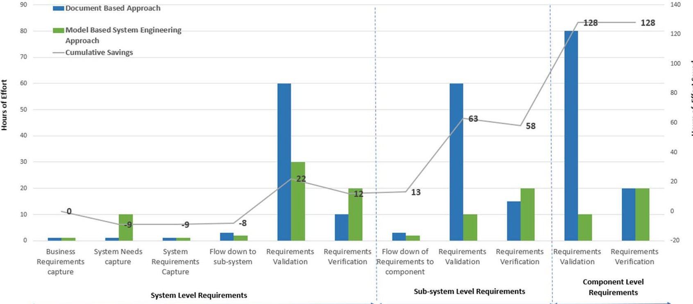

Figure 14: Side-by-side comparison of efforts

## V. CONCLUSIONS

Requirements and Systems Engineering are practiced using a variety of approaches based on the purpose and other constraints of a project including business aspects. The system definition process discussed here is one such approach, that benefits the entire life cycle. Earlier definition of the system and the corresponding requirements not only eases and expedites requirements engineering but delivers a higher quality product to the stakeholders and customers sooner. By taking the MBSE approach, we experienced increased stakeholder satisfaction which we found gratifying and inspired us to increase our use of MBSE.

The focus on validation and verification at earlier stages ensures fewer errors and loss of resources, especially time. MBSE using SysML greatly assists in early defect detection, technical or program risk reduction. Implementation on even a small complex system yielded a 50% reduction in total time spent from inception to verification. As shown by this example and previous experience, modeling helps enforce consistency across functions, requirements traceability, enhances change management and managing complicated systems efficiently. The models and data can be reused or reapplied to guide future endeavors. The earlier the adaptation of MSBE, the greater the gains and the sooner the initial investment is returned.

## VI. REFERENCES

[1] ISO/IE/IEEE 29148:2018(E), Systems and software engineering - Life cycle processes - Requirements engineering, Second Edition, IEEE Explore (extracted September 10, 2020).

[2] INCOSE Systems Engineering Handbook: A Guide for System Life Cycle Processes and Activities, Version 4." International Council on Systems Engineering (2014).

[3] Guidelines for Development of Civil Aircraft and Systems, SAE Standard ARP4574 Rev.A, 2010

[4] FAA AC 20-174 - Development of Civil Aircraft and Systems. Issued Sept.30,2011. https://www.faa.gov/regulations_policies/advisory_circulars/index.cfm/go/document.information/documentID/1019527

[5] SEBoK contributors, "Guide to the Systems Engineering Body of Knowledge (SEBoK)," SEBoK, https://www.sebokwiki.org/w/index.php?title=Guide_to_the_Systems Engineering_Body_of_Knowledge_(SEBoK)&oldid=59187 (accessed July 8, 2020).

[6] Object Management Group. "OMG Systems Modeling Language (OMG SysML $ ^{\mathrm{TM}} $ ), V1. 3." (2015).

[7] A methodology for system defining process, unpublished.

[8] Langton, Roy, Chuck Clark, Martin Hewitt, and Lonnie Richards. Aircraft Fuel Systems. Vol. 24. John Wiley & Sons, 2009.

[9] IBM Rational Rhapsody $ \textcircled{c} $ 8.3.1 (2018). https://www.ibm.com/products/systems-design-rhapsody

[10] IBM Knowledge Center, ibm.com https://www.ibm.com/support/knowledgecenter