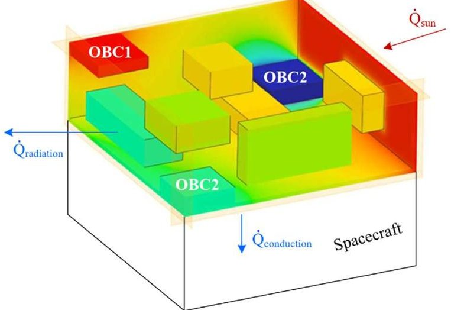
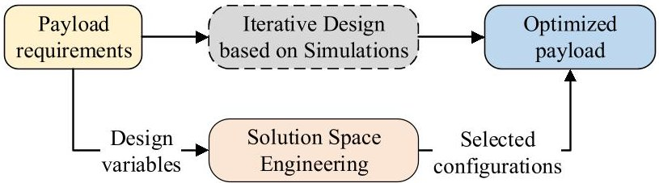
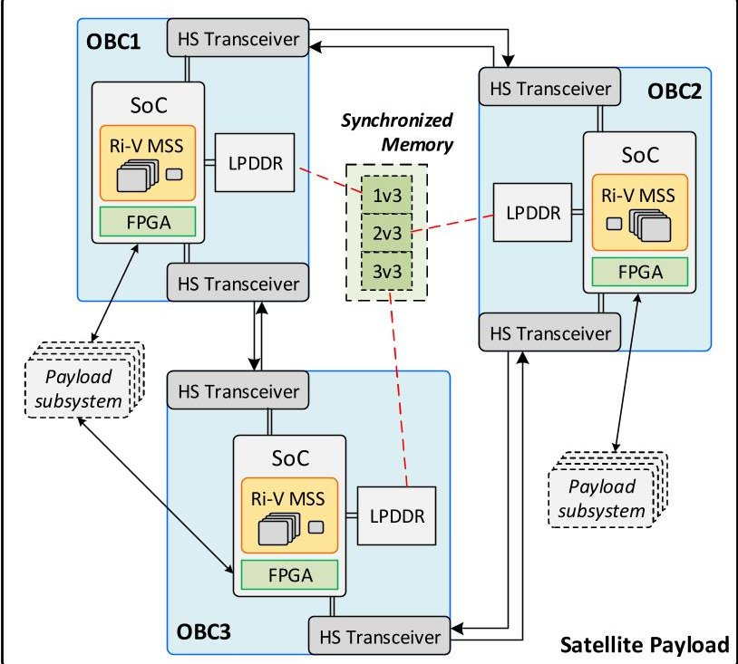
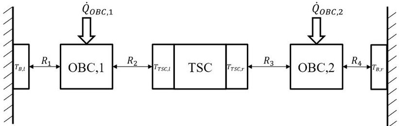
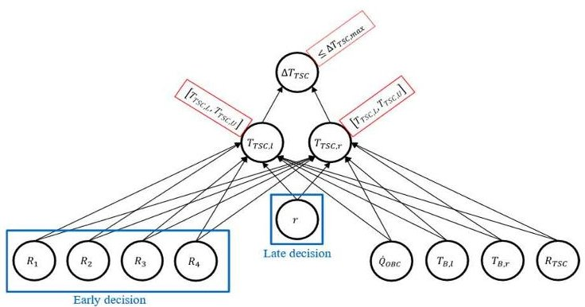
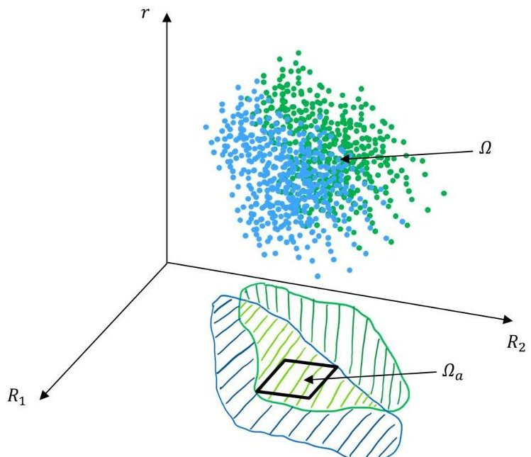
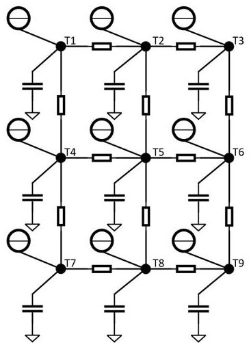
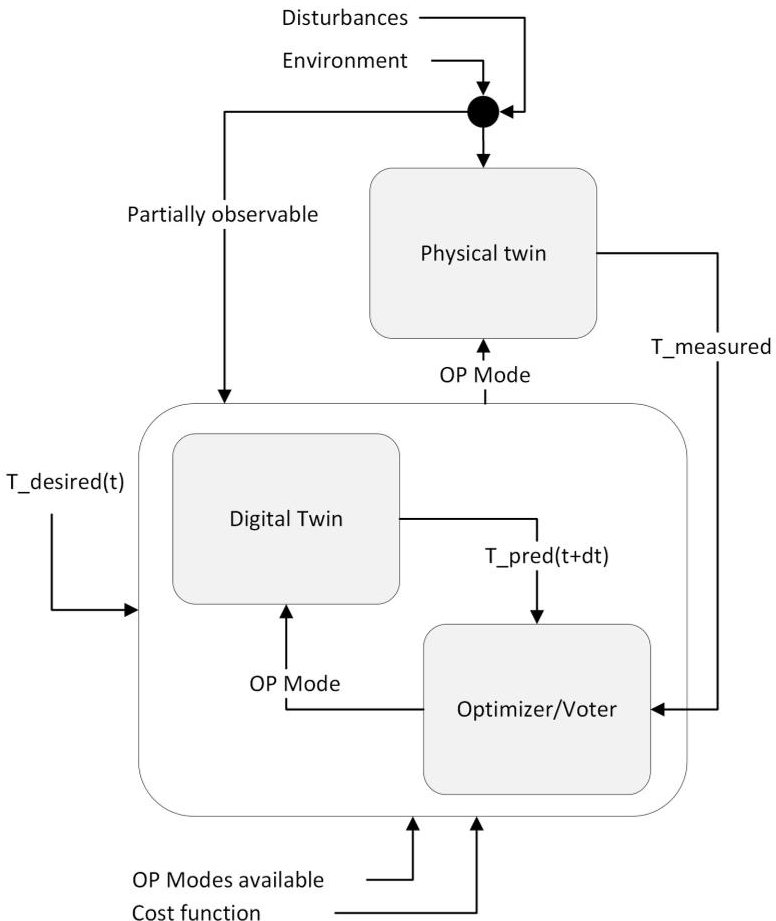
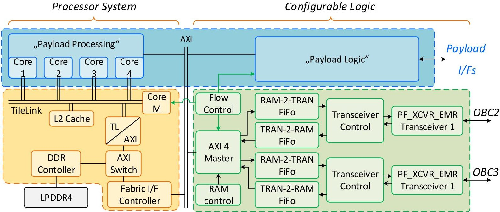
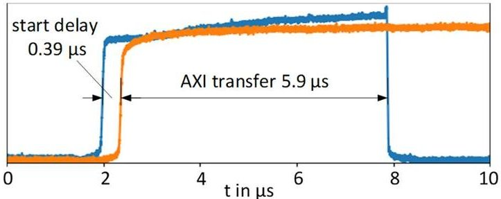

<!-- PDF_PAGE: 1 -->

# Satellite Payload Design for Optimized Thermal Management using a Distributed Processor System

Project Dissemination Paper

Markus Plattner, Chedi Fassi, Florian Kreiner, Jintin Frank

Engineering Minds Munich GmbH

Munich, Germany

markus.plattner@em-munich.de

Philipp Radecker, Markus Zimmermann

Technical University of Munich

Laboratory for Product Development and Lightweight Design

Munich, Germany

philipp.radecker@tum.de

Abstract-Processor Layout Utilization for Thermal Optimization (PLUTO) is a research project that started in 2022 and is co-funded by the Bavarian Ministry of Economic Affairs, Regional Development, and Energy. In a consortium of space industry and university, the PLUTO project investigates new methodologies for designing thermally sensitive satellite payloads accommodating distributed processor modules. A top-down design approach, based on so-called solution spaces, is applied to arrange modules within a given payload envelope and find a payload layout with low thermal gradients for various operational modes. A digital twin of the thermal behavior of the system shall then be derived from the design and implemented as a software routine in the processor modules. The temperature gradients within the payload shall be minimized by adjusting the distribution of power consumption within the payload. Therefore, the system control and processing tasks are locally distributed among the modules on the fly based on the prediction of the digital twin. A demonstrator payload with three interconnected processor modules is currently under development and is expected to be thermally tested in 2024.

Keywords—SoC, processor system, FPGA, satellite, payload, OBC, solution space engineering, thermal design, design space exploration

## I. INTRODUCTION TO PLUTO PROJECT

The design of satellite payloads requires, among many other tasks, concurrent engineering of electronics and thermal design. Payload subsystems, such as processor modules and data acquisition electronics, consume electric power, which is converted into waste heat. The heat flow inside the satellite is predefined, as all heat paths must be construed to achieve thermal equilibrium with all subsystems operating within their nominal temperature ranges. Usually, thermal paths are designed for maximum-load cases to avoid overheating of the subsystems. For operation modes with loads below maximum, additional heaters are built into the system to maintain the temperature above the minimum. For small satellites, electric power generation is limited and thermal management is challenging because the available space for thermal paths is small in a densely packed system.

Payloads, including optoelectronic systems such as laserbased intersatellite communication, require careful design and accommodation of components and subsystems. Electronic components that consume power and produce heat are sources of interference in such systems. Small temperature gradients (on the order of $ + / - $ 1 K) along the mounting surfaces of optical parts can significantly deteriorate the performance [1].

In addition, along the mission orbit, the environmental temperature conditions vary, making a design that considers only internal sources inappropriate. Therefore, in complex payloads, considerable design effort is applied to achieve decoupled or isostatic optical elements [2]. However, in the early design phases and with limited space and power budgets, an optimal subsystem accommodation and utilization of electronic redundancies for balancing thermal gradients is regarded as an effective approach.

Satellites in the New Space era are mainly built using commercial electronics that can suffer from radiation effects. Owing to these radiation sensitivities, error-prone electronics are often implemented redundantly. If the nominal system is temporarily down, the redundant system takes over functionality while the nominal restarts. In the framework of the research project "Processor Layout Utilization for Thermal Optimization" PLUTO, we investigate a new system design methodology that uses existing redundancy to achieve stable operating temperatures within the payload. Therefore, the accommodation electronics modules, including the control and date processing modules is optimized during the design process. Depending on the payload operation mode, a subset of all modules is operated and acts as a heat source. Fig. 1 illustrates a snapshot of a potential payload system with subsystems indicated as boxes, and its temperature profile illustrated in different colors.

Fig. 1. Example payload layout as a section of the spacecraft. Payloadexternal heat-flows and internal heat sources determine the thermal gradient within the payloads.

<!-- PDF_PAGE: 2 -->

Changing the operation mode allows the spatial distribution of the heat sources within the payload perimeter to be varied. To find an optimum accommodation of subsystems considering various operation modes, Solution Space Engineering (SSE) is applied as a design method. The goal is to find an accommodation layout that minimizes the thermal gradients within the payload system, considering the power consumption ranges of all payload modules and disturbances such as the heat input from the sun. In state-of the-art payload design, a manual and iterative design approach is performed. Therefore, a simulation model is created

to investigate the system behavior under varying conditions defined by the payload requirements. Regarding the trade-off between subsystem accommodation and minimized thermal gradients, many iterations are usually required to identify and optimize the payload configuration. Because SSE can cope with uncertainties and an unstructured design space in the early stages of the design process, it will partly replace manual iterations by an automated pre-selection of configurations that fulfil the requirements. Therefore, the design variables are derived from the requirements, and an SSE-based optimization algorithm is performed, as illustrated in Fig. 2.

Fig. 2 Design process for payload accommodation. Iterative design based on manual adaptation of modelling and simulation should be improved by solution space engineering. Therefore, design variables are derived from the payload requirements and an optimization process is executed that prioritizes configurations with low thermal gradients.

During operation, all processor modules labeled OBC (onboard computers) in Fig. 1 are operated with active redundancy. System control and processing tasks are distributed among the modules to use an operation mode that minimizes thermal gradients within the payload system. These have already been developed and environmentally tested in the frame of ESA-funded projects $ ^{1} $ . The concept of the underlying payload design optimization method is shown, which is used to model the thermal resistances between payload modules.

Therefore, three major tasks are conducted within this research project:

- A distributed multi-OBC (MOBC) system was designed to allow the shifting of control and processing tasks from one OBC to another. Therefore, an underlying communication architecture is designed to copy the data acquired by one OBC to all the other OBC in the system. Thus, the data become redundant, and the location for processing of tasks becomes independent from where the data have been acquired.

- The payload system has to be analyzed with regard to its operation modes and the corresponding waste heat generation within its subsystems. An optimization of the accommodation, i.e. the arrangement of the payload

subsystem, based on design space exploration using Monte Carlo sampling is carried out to find an optimum layout.

- The "as-built" layout is transferred to a digital twin mirroring the thermal behavior of the system. The measurement of temperature sensors distributed within the system and tracking of the temperature distribution over time allow the adjustment of temperature gradients by changing the location of the heat sources.

The PLUTO concept is elaborated using a multi-OBC system with three individual OBCs, as shown in Fig. 2.

Each OBC is based on an SoC containing an RISC-V microcontroller subsystem (MSS) with five cores and FPGA fabric [11]. A low-power DDR4 (LPDDR) is connected to each SoC as the main memory. High-speed transceiver lines interconnect OBCs. Each OBC has hardware interfaces dedicated to the payload for control, monitoring, and data acquisition.

Fig. 3 Distributed multi-OBC system demonstrator of the PLUTO project.

## II. GUARANTEEING FEASIBLE DESIGNS THROUGH SOLUTION SPACE ENGINEERING

## A. Design Space Exploration

The PLUTO project targets onboard temperature control. This requires the creation of a digital twin of the payload that can predict the behavior of the system in real time. However, to have a relevant influence on the temperature gradients with the redistribution of the heat load, the thermal design has to be optimized for this purpose.

Traditionally, complex technical systems have been developed using an incremental and iterative approach with a focus on optimizing system performance with respect to the quantities of interest (QoIs) assigned to the requirements [3]. However, in the early design phases, there are usually significant uncertainties owing to the incomplete knowledge base of the final system. This uncertainty can be attributed to a lack of knowledge regarding the final design required for sufficient controllability of the temperature distribution. More

<!-- PDF_PAGE: 3 -->

specifically, the thermal resistances between payload elements are not known at the beginning of the design process. To address this issue, a set-based problem-solving approach is helpful [4]. This approach identifies areas of good design and helps develop robust systems, even if certain specifications become concrete only during the course of development.

A further extension of this concept is that of the solution-compensation spaces [7]. Design variables (DVs) are divided into two classes depending on when they should be specified in the development process. Early-decision variables $ x_{a} $ must be determined early in the design process, because they cannot be adjusted later on. To maximize the design freedom, late-decision variables $ x_{b} $ are considered as DVs with values that are adjusted later. In the proposed PLUTO concept, these are the power levels of each subsystem. The space of the late-decision variables $ \Omega_{b} $ is projected onto that of the early-decision variables $ \Omega_{a} $ . This means that all designs within the space of early-decision variables are identified as good if they fulfill the performance criteria together with at least one set of late-decision variables $ x_{b} $ . This approach is applied to controllable systems in PLUTO, where late-decision variables become manipulatable variables in the control system. The general procedure for the overall approach, called solution space engineering, follows three crucial steps [4]: (1) defining the scope of the design problem by collecting QoIs and relevant DVs in a so-called attribute dependency graph (ADG), (2) establishing a quantitative relationship from DVs onto QoIs which is called bottom-up mapping, and finally (3) deriving target regions for DVs from requirements on QoIs, which is called top-down mapping.

The system must first be modeled to identify all important influencing variables. The degree of abstraction must be reduced in the further course of development, but in order to explain the concept, one-dimensional, stationary heat conduction over the structure of the payload with defined boundary temperatures (worst-case estimation) and two pointheat-sources are assumed. A conceptual physical interpretation of this thermal model is shown in Fig. 3.

The goal is to specify the design of the payload such that it is always possible to maintain the temperature gradient of the temperature-sensitive components (TSC) within a specified range by distributing the heat output among the appropriate subsystems. By applying the solution space approach, the PLUTO project aims to create a robust and controllable system that can withstand uncertainties and complexities inherent in the development process.

Fig. 3. Abstract representation of the thermal model.

As shown in Fig. 4, an ADG is used to transparently show the dependencies between DVs, QoIs, and fixed system parameters [5].

Fig. 4. Attribute dependency graph.

The DVs are defined as the thermal resistances $ R_{1} $ ... $ R_{4} $ and the distribution of the power consumption $ r $ among the subsystems. The QoIs $ T_{TSC,l} $ and $ T_{TSC,r} $ as well as the temperature gradient $ \Delta T_{TSC} $ are determined in the bottom-up mapping according to the Fourier heat conduction correlations. The thermal resistance across the TSC $ R_{TSC} $ , the temperatures of the payload $ T_{B,l} $ and $ T_{B,r} $ as well as the total heating power $ \dot{Q}_{OBC} $ to be distributed are included in the system as non-influenceable system parameters for the respective worst-case assumptions. The resulting performance functions $ f(x) $ then compute the QoIs depending on the DVs.

## B. Top-down mapping using solution-compensation spaces

In classical solution space engineering, the representation of solution spaces follows the following problem statement [6]:

$$
\begin{array}{l} \underset {\Omega \subseteq \Omega_ {d s}} {\mathrm {m a x i m i z e}} \mu (\Omega) \\ \mathrm {s . t .} f (x) \leqslant f _ {c}, \forall x \in \Omega , \\ \end{array}
$$

where $ \mu(\Omega) $ is the volume of the set $ \Omega $ $ \Omega_{\mathrm{ds}} $ is the design space and $ f_{c} $ is a threshold value for the performance criteria.

However, because the PLUTO payload model is a controllable system, the solution-compensation space approach can further increase the solution space. Then, the problem statement reads as [7]

$$
\begin{array}{l} \max _ {\Omega_ {a} \subseteq \Omega_ {d s, a}} \mu \left(\Omega_ {a}\right) \\ \mathrm {s . t .} \forall x _ {a} \in \Omega_ {a}, \exists x _ {b} \in \Omega_ {d s, b}, f \left(x _ {a}, x _ {b}\right) \leqslant f _ {c}. \\ \end{array}
$$

Thus, solution spaces are generated for the early-decision variables that satisfy the requirements for QoIs with at least one set of late-decision variables. An algorithm to compute solution-compensation spaces was presented in [7] and is adapted to the needs of this project. This comprises, e.g., the ability to deal with non-linear performance functions. The underlying concept is illustrated in Fig. 5, which shows the projection of the space of late-decision variable r onto the space of the two early-decision variables $ R_{1} $ and $ R_{2}. $

<!-- PDF_PAGE: 4 -->

Fig. 5. Projection of the late-decision variable r onto the space of the early-decision variables $ R_{1} $ and $ R_{2} $ . The randomly sampled dots represent good designs for the cold (blue) and hot (green) cases.

The projections for the cold (blue) and hot (green) cases overlap in the space of the early decision variables. If care is taken in the design process to ensure that the values for the thermal resistances $ R_{1} $ ... $ R_{4} $ are within the intersections, it can be guaranteed that an r can always be found that distributes the steady-state heat input in such a way that both the absolute temperatures of the TSC and the temperature gradient across it remain within the requirements.

## III. DIGITAL TWIN DESIGN FOR PLUTO

## C. Accommodation process

The result of this design phase is a set of admissible ranges for all thermal resistances between payload elements. The size of these intervals leaves the necessary design freedom to determine a hardware solution that realizes a value within this interval. The main influencing factors are the distances between the components, heat-transferring surfaces, and the thermal conductivity of the materials used. Accommodation of the components in the payload can then be automated, and finally, the best designs can undergo accurate and transient thermal simulations that are aligned with mission planning data.

## A. From generic design to thermal control

While a steady-state consideration of heat transfer is sufficient for the design process and worst-case estimations, the models used to control the system design need to be extended to include time-dependent elements. In the case of thermal networks, these can be modeled by heat capacities, which, analogous to electrical networks, have a transient storage capacity. Fig. 6 illustrates such a two-dimensional network.

This representation assigns the appropriate thermal network elements to each support point, which in this case, represents the positions of the temperature sensors or thermally critical elements. It is assumed that heat can be introduced, stored, and removed from the system at these points by switching the corresponding payload subsystems on or off.

Fig. 6. Thermal design representation analogon as electrical network to implement into the digital twin model.

The points at the edges of the model are designed as Dirichlet (known edge temperatures) or Neumann (known external heat fluxes) boundary conditions, depending on the mission design and the heat input from the other components of the satellite structure. With the heat transfer matrix

$$
\boldsymbol {U} = \left( \begin{array}{c c c} R _ {1, 1} ^ {- 1} & \dots & - R _ {1, n} ^ {- 1} \\ \vdots & \ddots & \vdots \\ - R _ {n, 1} ^ {- 1} & \dots & R _ {n, n} ^ {- 1} \end{array} \right)
$$

this results in the following linear system:

$$
C \dot {T} + U T = \dot {Q}.
$$

C describes the diagonal matrix of the heat capacities, T the temperature vector of the support points and $ \dot{Q} $ the respective heat flows entered. As described in the previous section, these discrete elements were parameterized using transient thermal simulations.

## B. Using the digital twin for model predictive control

Digital Twins (DT) describe a physical artifact, predict and control a system behavior, integrate the information of the real product into the environment, and process a system [8]. In the PLUTO project, this DT primarily describes the thermal control system of the payload. Because a typical DT provides a bidirectional flow of information [9], this software component not only regulates the distribution of tasks but its design is also continuously adjusted by temperature measurements. Therefore, its design is similar to that of a model predictive control system, as shown in Fig. 7.

As illustrated in Fig.1, the payload system consists of several subsystems. Some of these subsystems are passively redundant, that is, some of them are off, while others are on. Several valid operational modes (OpModes) exist, where each OpMode is a configuration of how to operate the payload. Mainly important for PLUTO, each OpMode has a characteristic constellation of subsystems that act as heat sources within the payload. The physical twin receives the same information about the currently selected OpMode, allowing it to calculate the predicted temperature distribution.

<!-- PDF_PAGE: 5 -->

Fig. 7. General design of the onboard running control system.

For this purpose, the controller is given a temperature trajectory Tdesired. Tmeasured refers to the temperature values recorded by the sensors and, together with a list of available OpModes, forms the inputs of the controller. The digital twin in the form of the network circuit described above and an Optimizer/Voter component, selects appropriate OpModes based on a cost function to optimize the predicted temperature gradient. The OpMode whose predicted temperature distribution Tpred deviates least from Tdesired can be selected by the OBC for further operation of the payload. Because thermal time constants are generally of the order of seconds to minutes, relatively coarse time steps for the prediction horizon, much longer than the time constant, can be selected. However, this approach is computationally intensive. Although the required computational power is not yet known, the envisaged multicore computer architecture is regarded as beneficial for solving the prediction equation given in formula (4).

## IV. MPS COMMUNICATION ARCHITECTURE AND DATA TRANSFER

## A. MPS architecture

The MOBC demonstrator is composed of three OBCs. The processing system of each OBC is based on a SoC with a multi-core processor and an FPGA fabric with configurable logic. Fig. 8 illustrates the architecture of a single OBC organized in two layers.

The payload-computing layer at the top of Fig. 8 is shown in blue. Four RISC-V processor cores and 97% of the

configurable logic are allocated to payload computing. The hardware interfaces from the OBC to the corresponding payload modules are provided via logic. The cores can either be operated with real-time access to exclusive cache areas or with access to common cache areas organized with access organized by an operating system.

The backbone layer is shown at the bottom of Fig. 8. The backbone contains the framework for data transfer between OBCs, shown in green. This communication architecture is described in detail in Section IV.C below. It uses approximately 7% of the targeted PolarFire SoC configurable logic, including the connection to the LPDDR main memory.

## A. RISC-V enables MPC approach

Model predictive control implemented in the Digital Twin (DT) is based on an algorithm that involves solving an optimization problem at each prediction time step to determine the optimal control actions. The optimization problem typically involves a large number of variables and constraints, making it a computationally intensive task. The computational performance increases with the size of the predictive model, the prediction horizon, the control horizon, and the desired control frequency. To calculate the desired control parameters, nonlinear calculations are ideally performed by a processor, and linear matrix multiplications are performed within an FPGA [12]. The architecture provided by the Polarfire SoC (Fig. 7) includes five RISC-V cores connected to the FPGA Fabric. Each core provides 3.01 CoreMark/MHz while operating at 600 MHz. Previous implementations have shown that comparable microcontrollers provide the required processing power [13].

## B. Implementation of the onboard digital twin and interface to OBCs

The operational DT is placed in one of the processor cores of one of the OBCs. Using a model predictive controller, the temperature distribution resulting from the heat source distribution and the thermal behavior of the various system components is simulated. At fixed time steps, the operational digital twin determines which subsystems should be operated and which software programs should be executed to fulfil the thermal requirements. An OpMode lookup table is defined as the communication interface between the digital twin and tasks running on the SoC (Fig. 10).

Each OpMode defines which software programs have to be executed on each OBC and the corresponding hardware units that have to be activated. The look-up table (Fig. 8) allows for the selection of an OpMode. In the demonstrator, each OpMode will be associated with a particular heat source distribution of the system. Based on this information, the digital twin can simulate the thermal effects of each OpMode.

Each OBCs has a local copy of the LUT that is updated by the digital twin. Therefore, it is necessary to synchronize the data from OBCs.

<!-- PDF_PAGE: 6 -->

Fig. 8. Architecture of one OBC for implementation in the MOBC system.

<table border="1"><tr><td>OP Mode</td><td>Active</td><td>OBC no.</td><td>Hardware Tasks</td><td>Software Program</td></tr><tr><td rowspan="3">1</td><td rowspan="3">Yes</td><td>1</td><td>A</td><td>A</td></tr><tr><td>2</td><td>C</td><td>C</td></tr><tr><td>3</td><td>E</td><td>E</td></tr><tr><td rowspan="3">2</td><td rowspan="3">No</td><td>1</td><td>B</td><td>B</td></tr><tr><td>2</td><td>D</td><td>D</td></tr><tr><td>3</td><td>F</td><td>F</td></tr><tr><td rowspan="2">...</td><td rowspan="2"></td><td></td><td></td><td></td></tr><tr><td></td><td></td><td></td></tr></table>

Fig. 9. Lookup table defining the operational modes of the system.

Temperature sensor data are collected in different physical locations of the system by the OBC next to the corresponding sensors. The DT receives the sensor data and calculates the prediction of the thermal gradient. The LUT and the acquired temperature sensor data are mapped to the LPDDR memory accessible by the Polarfire SoC. The memory can operate at 800 MHz and allows fast access to the data. In addition, the memory is linked to the AXI bus of the processor and enables fast access from both the FPGA fabric and the processor cores.

## C. Communication architecture

To enable the redistribution of control processing tasks among any of the OBCs at any time, the data to be processed as well as information about the system status and predicted behavior have to be available in every module. Therefore, the memory content of each OBCs is periodically copied to all other OBCs. This forms a fully meshed topology that is tolerant of the failure of a single node and allows switching of OpModes whenever necessary because of thermal optimization needs. A multi-master constellation is established among the OBCs.

The data transfer module is marked in green in the "Configurable Logic" section of Fig 8. The module interfaces with the rest of the SoC using the AXI bus. This interface is used to gain access to the DDR4 memory attached to the memory controller, which is part of the processor system. An AXI Master was designed to perform read and write transfers on the AXI bus. The master allows single-channel burst transfers, transferring 256 beats per transaction on a 64-bit bus. The AXI bus operated at an ACLK frequency of 200 MHz. This yields a theoretical bandwidth of

B = 64 b * 200 MHz = 12,8 Gb/s. However, the data rate of the LPDDR4 memory used in the OBC is limited to a data rate to below 6 Gb/s. The transceiver consists of multiple submodules, including a reference clock network, transmit PLL, and XCVR block for clock data recovery.

## D. Test setup and performance measurement

The performance of the communication system was tested using two PolarFire FPGA evaluation boards. These FPGAs use the same technology as the PolarFire SoC fabric. They differ in the DDR Controller implementation. In the SoC part, the controller is a part of the microcontroller subsystem. In the FPGA the DDR Subsystem is part of the fabric. Both controllers are accessible using AXI; therefore, any one of the parts can be used in this module. The transceiver was configured at a data rate of 5 Gb/s.

To test the delay from starting a transfer to the first valid output from the DDR controller, the following measurements were performed. The blue trace shows the busy state of the AXI Master. As soon as a transaction begins, the signal increases. The orange trace shows the fill level of the RAM2-TRAN FIFO. If there is usable data at the output of the FIFO, the signal increases. This signal represents the time required to transfer data on the serial link. The measurement in Fig. 11 shows a delay of 390 ns between the start of the transfer and the first data word at the output of the FIFO. This delay includes the DDR access time and delays caused by the FIFO. The entire AXI transaction takes 5,9 us.

Fig. 11. Delay and transfer time measurement.

<!-- PDF_PAGE: 7 -->

## V. CONCLUSION AND OUTLOOK

The PLUTO concept improves the payload design process by applying a systematic approach to accommodate subsystems using design space exploration. This results in payload layouts with minimal temperature gradients. It also provides a digital twin that can be implemented in the OBC to adjust the thermal gradients based on the selection of payload OpModes. Thereby, the heat sources are relocated by shifting functionality between redundant subsystems. For completing the PLUTO project, a modular prototype will be manufactured. Model-predicted temperature control by the selection of OpModes will be demonstrated with various payload accommodation alternatives. Several open points have to be clarified for this demonstrator to become effective. First, a more detailed analysis of the processing power required for the operational digital twin must be conducted. Furthermore, it is essential to define the OpModes utilized to regulate system functionalities by characterizing the thermal footprint of every OpMode. The primary challenge lies in maintaining data coherency within the MOBC using data-copy processes implemented using high-speed transceiver lines. Finally, a failure mode analysis needs to be examined to identify potential issues when individual system components fail and when some of the OpModes become unavailable.

## ACKNOWLEDGMENT

This work was co-funded by the Bavarian Ministry of Economic Affairs, Regional Development, and Energy under Grant No. MRF-2107-0006//RaFo21-012-A.

## REFERENCES

[1] J. Young, S. Inlow, and B. Bender, "Solving Thermal Control Challenges for CubeSats: Optimizing Passive Thermal Design," in 2019 IEEE Aerospace Conference, 2019, pp. 1-7.

[2] H. Kihm, H.-S. Yang, I. K. Moon, J.-H. Yeon, S.-H. Lee, and Y.-W. Lee, "Adjustable bipod flexures for mounting mirrors in a space telescope," Appl. Opt., vol. 51, no. 32, pp. 7776-7783, 2012, doi: 10.1364/AO.51.007776.

[3] C. Larman and V. R. Basili, "Iterative and incremental developments. a brief history," Computer, vol. 36, no. 6, pp. 47-56, 2003, doi: 10.1109/MC.2003.1204375.

[4] M. Zimmermann et al., "On the design of large systems subject to uncertainty," Journal of Engineering Design, vol. 28, no. 4, pp. 233- 254, 2017, doi: 10.1080/09544828.2017.1303664.

[5] S. Rötzer, S. Schweigert-Recksiek, D. Thoma, and M. Zimmermann, "Attribute dependency graphs: modelling cause and effect in systems design," Des. Sci., vol. 8, 2022, doi: 10.1017/dsj.2022.20.

[6] M. Zimmermann and J. E. von Hoessle, "Computing solution spaces for robust design," Int. J. Numer. Meth. Engng, vol. 94, no. 3, pp. 290- 307, 2013, doi: 10.1002/nme.4450.

[7] M. E. Vogt, F. Duddeck, M. Wahle, and M. Zimmermann, "Optimizing tolerance to uncertainty in systems design with early- and late-decision variables," IMA Journal of Management Mathematics, vol. 30, no. 3, pp. 269-280, 2019, doi: 10.1093/imaman/dpy003.

[8] M. Schluse, T. Osterloh, and J. Roßmann, "Development of Modular Spacecraft with Experimentable Digital Twins Workshop on Simulation and EGSE for Space Programmes (

[9] J. Trauer, S. Schweigert-Recksiek, C. Engel, K. Spreitzer, and M. Zimmermann, "What is a Digital Twin? - Definitions and Insights from an Industrial Case Study in Technical Product Development," Proc. Des. Soc.: Des. Conf., vol. 1, pp. 757-766, 2020, doi: 10.1017/dsd.2020.15.

[10] ARM IHI 0022E, ID033013, AMBA $ ^{\circ} $ AXI $ ^{\circ} $ and ACE $ ^{\circ} $ Protocol Specification, 22. Feb. 2013.

[11] Microchip Technology Inc., DS0147, PolarFire SoC Advanced Datasheet, Dec. 2019.

[12] I. McInerney, G. A. Constantinides, and E. C. Kerrigan, 'A Survey of the Implementation of Linear Model Predictive Control on FPGAs, The

support of the EPSRC Centre for Doctoral Training in High Performance Embedded and Distributed Systems (HiPEDS, Grant Reference EP/L016796/1) is gratefully acknowledged', IFACPapersOnLine, vol. 51, no. 20, pp. 381-387, 2018.

[13] P. Chaber and M. Lawryńczuk, "Fast Analytical Model Predictive Controllers and Their Implementation for STM32 ARM Microcontroller," in IEEE Transactions on Industrial Informatics, vol. 15, no. 8, pp. 4580-4590, Aug. 2019, doi: 10.1109/TII.2019.2893122.