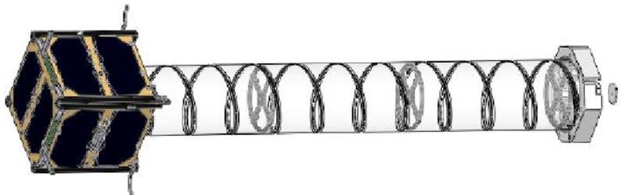
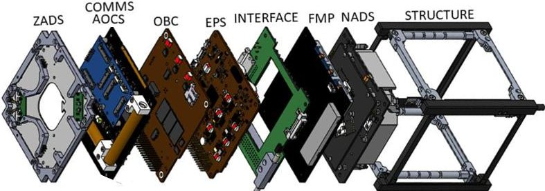
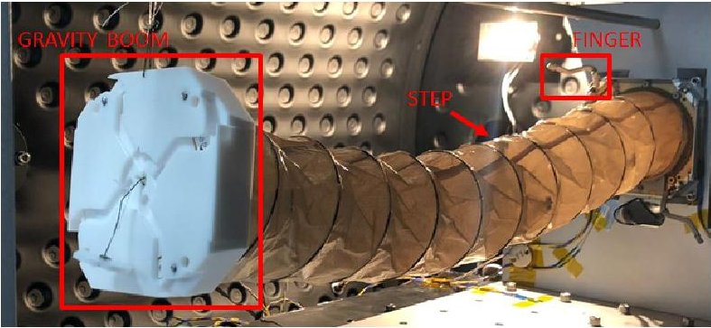
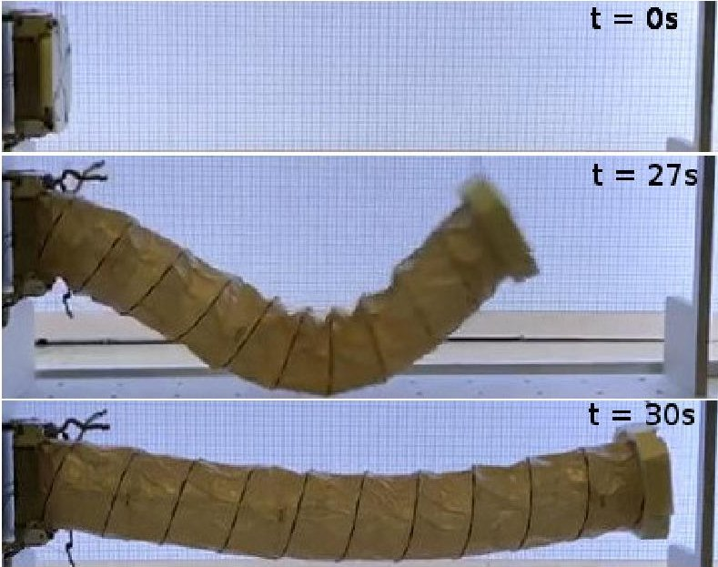

<!-- PDF_PAGE: 1 -->

# $ ^{3} $CAT-4 MISSION: A 1-UNIT CUBESAT FOR EARTH OBSERVATION WITH A L-BAND RADIOMETER AND A GNSS-REFLECTOMETER USING SOFTWARE DEFINED RADIO

J.A. Ruiz-de-Azua $ ^{a} $ $ ^{d} $ , J.F. Muñoz $ ^{a} $ $ ^{d} $ , L. Fernández $ ^{a} $ $ ^{d} $ , M. Badia $ ^{a} $ , D. Llavería $ ^{a} $ $ ^{d} $ , C. Diez $ ^{a} $ , A. Aguilella $ ^{a} $ , A. Pérez $ ^{a} $ $ ^{d} $ , O. Milian $ ^{a} $ , M. Sobrino $ ^{a} $ , A. Navarro $ ^{a} $ , H. Lleó $ ^{a} $ , M. Sureda $ ^{b} $ , M. Soria $ ^{b} $ , A. Calveras $ ^{c} $ , A. Camps $ ^{a} $ $ ^{d} $

$ ^{a} $ NanoSat Laboratory, Unidad María de Maeztu "ComSensLab", and Dept. of Signal Theory and Communications - UPC BarcelonaTech $ ^{b} $ Dept. of Physics - UPC ESEIAAT $ ^{c} $ Dept. of Network Engineering - UPC BarcelonaTech $ ^{d} $ Institute of Space Studies of Catalonia (IEEC) - CTE-UPC

## ABSTRACT

Global Navigation Satellite System Reflectometry and Lband microwave radiometry have been used for soil moisture, biomass, and cryosphere studies. Combining both technologies in a low-power and cost-effective solution could largely improve current Earth observations. $ ^{3} $Cat-4 mission is a 1-Unit CubeSat technology demonstrator of the Flexible Microwave Payload - 1, a reduced size payload that combines these two technologies. This work presents the objectives of the $ ^{3} $Cat-4 mission and the details of the spacecraft architecture and performance. Each spacecraft subsystem is detailed at hardware and software levels. In addition, the presented results indicate that the current spacecraft design will survive the flight conditions (i.e. thermal and structural ones).

Index Terms— Earth Observation, CubeSat, GNSS-R, Radiometry

## 1. INTRODUCTION

In recent times, there is a renewed interest in Earth Observation (EO) of the cryosphere as a proxy of global warming, soil moisture for agriculture and desertification studies, biomass for carbon storage, etc [1]. Global Navigation Satellite System - Reflectometry (GNSS-R) has demonstrated its potential for soil moisture [2]. In addition, the Cyclone GNSS (CYGNSS) mission [3] has demonstrated the power of this technique to monitor ocean winds, flooded areas, etc. Previous works [4] have also highlighted the potential of GNSS- Reflectometry and L-band Radiometry to improve soil moisture and sea salinity measurements. Therefore, developing a small and low-power consumption payload that performs GNSS-R and microwave radiometry measurements is of great interest.

$ ^{3} $Cat-4 mission aims at addressing this technology challenge by integrating a payload that combines a dual-band (L1 & L2) GNSS-Reflectometer and a L-band Radiometer in a 1-Unit CubeSat. This resulting payload, called the Flexible Microwave Payload - 1 (FMPL-1), uses a low-power

Fig. 1: $ ^{3} $Cat-4 CubeSat with the structure and the subsystems (left) and the payload helix antenna deployed (right)

Commercial Off-The-Shelf (COTS) Software Defined Radio (SDR) module to combine both technologies in a single board. Moreover, as discussed in [5], Radio Frequency Interferences (RFI) in the radiometry band reserved at Lband is currently impacting the quality performance of this data. Therefore, the FMPL-1 also aims at demonstrating the benefits of including RFI detection and mitigation techniques. Finally, to demonstrate the power of this architecture, the FMPL-1 also includes an Automatic Identification System (AIS) receiver. This mission was selected for the Fly Your Satellite (FYS) program of the European Space Agency (ESA) academy in May 2017.

A global view of the FMPL-1 has already been presented in previous work [6]. This work presents thus the details of the $ ^{3} $Cat-4 mission, as well as the entire spacecraft architecture, with emphasis on the FMPL-1 performance.

## 2. $ ^{3} $CAT-4 MISSION AND OBJECTIVES

$ ^{3} $Cat-4 is a 1-Unit educational CubeSat mission that aims at demonstrating the capabilities of using nano-satellites for challenging EO applications. The spacecraft is equipped with the FMPL-1 that combines three instruments (a GNSS- Reflectometer, a L-band Radiometer, and an AIS receiver) in a single board, using a SDR module. It is planned to collect data over the Nile river dry land and the evolution of forest close to the Congo river. Furthermore, this payload also

<!-- PDF_PAGE: 2 -->

allows monitoring the ocean winds in calm and agitated regions, such as the coast of South Africa. The satellite will be launched from the International Space Station (ISS) following a $ 51.6^{\circ} $ inclination orbit. Nevertheless, the mission expects also to contribute on cryosphere studies over the Himalayas region.

The proposed solution presents a small architecture that can assess the relative sensitivity of GNSS-R observables (waveform peak amplitude and maximum derivative delay) at different frequency bands (i.e. L1 and L2) as well as the impact of the required ionospheric corrections (i.e. different delays of the reflected signals at different bands). Moreover, as it is using RFI detection and mitigation techniques, it will contribute to the generation of a global RFI map as well as palliating its current impact. Finally, the design of an AIS receiver for space-borne applications using SDR is an interesting technological validation. Being able to test these technologies in a 1-U CubeSat may enable their fast adoption as hosted payloads or in more performing dedicated platforms in the future.

The $ ^{3} $Cat-4 mission is being conducted at the UPC NanoSat Laboratory by a team entirely composed of students. The mission also has an educational component to promote qualified future professionals in these fields.

## 3. SATELLITE ARCHITECTURE

The $ ^{3} $Cat-4 satellite is a 1-Unit CubeSat composed of different subsystems to provide the required power, processing capacity, and communications capability to accomplish the mission. In particular, these are the Electrical and Power Subsystem (EPS), the On-Board Computer (OBC), and the Communications Subsystem (COMMS). One additional subsystem is included in this groupd, called Zenith Antenna and Deployment Subsystem (ZADS), which contains the communications antenna. The payload-oriented subsystems aim at providing the different functions to achieve the scientific mission. It is mainly composed of the FMPL-1 (previously presented) and the Nadir Antenna and Deployment Subsystem (NADS) which includes an helix antenna for the payload. The Attitude and Determination Control Subsystem (ADCS) ensures a nadir pointing to observe the Earth surface.

An additional board has been conceived to interface the platform subsystems with the payload. Specifically, this Interface Board contains a PC104 connector that unifies the pinout of the entire spacecraft. It also contains an umbilical port that allows external operators to connect to the spacecraft. All these subsystems are integrated in a 1-Unit structure, covered by five solar panels. This is the default stowed configuration, but after satellite ejection the helix payload antenna will be deployed reaching the nominal configuration (see Fig. 1).

Figure 2 presents a global view of the $ ^{3} $Cat-4 internal distribution.

Fig. 2: 3D model of the $ ^{3} $Cat-4 CubeSat subsystems

## 4. ELECTRICAL AND POWER SUBSYSTEM

The EPS of the $ ^{3} $Cat-4 CubeSat is the Nanopower P31u, a COTS product from Gomspace, which interfaces with ten photo-voltaic cells (two per face), and uses a highly efficient boost-converter to adapt their output voltages. It provides a 3.3 V and a 5 V channels to supply the entire spacecraft. This subsystem also includes a pair of lithium-ion battery cells with 18650 form factor.

With this configuration, the power budget becomes positive in all the operating modes of the spacecraft. However, the most critical feature of this subsystem is the temperature during charge and discharge states. Therefore, a heater is installed around the battery cells to ensure a minimum temperature during cold scenarios. The thermal analysis with the worst hot and cold cases (pessimistic scenarios) has been performed. Table 1 presents the temperature range the EPS and the battery cells, which confirms that the current satellite configuration ensures the correct operation of this subsystem in all conditions.

Table 1: Temperature ranges (in $ ^{\circ} \mathrm{C} $) of the EPS and battery

<table border="1"><tr><td></td><td colspan="2">Hot case</td><td colspan="2">Cold case</td><td colspan="2">Design range</td></tr><tr><td></td><td>Min</td><td>Max</td><td>Min</td><td>Max</td><td>Min</td><td>Max</td></tr><tr><td>EPS</td><td>22.77</td><td>34.86</td><td>-6.75</td><td>20.79</td><td>-30</td><td>+75</td></tr><tr><td>Battery</td><td>25.04</td><td>37.13</td><td>5.13</td><td>27.64</td><td>5</td><td>+40</td></tr></table>

## 5. ON-BOARD COMPUTER

The OBC subsystem of the $ ^{3} $Cat-4 is the NanoMind A712C module (from Gomspace) which has all the required interfaces (e.g. UART, I2C, etc.) to interconnect with the other subsystems. At software level, the OBC works over the Free Real-Time Operative System (FreeRTOS) solution that provides means to schedule tasks with their own context which are pre-empted by external notifications/events. This prioritybased task scheduler allows the execution of a task depending on its priority level.

The software architecture is based on a star framework, in which a central task manages the other ones that communicate with the external subsystems. This central task is also responsible to execute the different spacecraft modes: launch early

<!-- PDF_PAGE: 3 -->

operations mode, nominal mode, sun-safe mode, and survival mode. This architecture enables to monitor the battery status, the transition through the different spacecraft modes, the execution of the payload, the attitude control, and the communications with the ground station. The generated data is stored in an industrial microSD, robust against radiation effects (e.g. DOSE and single events).

## 6. COMMUNICATIONS SUBSYSTEM

The COMMS provides a direct downlink and uplink between the CubeSat and the ground station. The exchanged messages are commands, payload data, and spacecraft telemetry. The downlink is performed following a periodic beacon which allows retrieving instantaneous telemetry as well as a simplified historic telemetry. The last represents 18 hours of CubeSat telemetry that have been stored (i.e. maximum duration without contact with the ground station). With this combination, it is possible to understand the past and the current state of the satellite just in receive mode. In addition, a specific command downloads payload data. This on-request transmission is necessary due to the amount of data generated by the payload. As a global view, 10 % of the orbit is used to download a full set of instantaneous telemetry and twelve messages of historic telemetry.

The communications link is in the amateur Ultra High Frequency (UHF) band (437 MHz) using a monopole antenna. Packets are fragmented in blocks of 256 bytes with Reed-Solomon redundancy to overcome channel errors. Moreover, an Erasure Reed-Solomon code generates four redundant packets per each transmitted to avoid slow fadings. This probabilistic communications mechanism downloads without using an Automatic Repeat-Request (ARQ) algorithm. At hardware level, the COMMS has a half-duplex transceiver that modulates the incoming messages using a Gaussian Minimum Shift-Keying (GMSK) modulation. Its reception and transmission chains are composed of a Low Noise Amplifier (LNA) module and a Power Amplifier (PA) respectively, which provide 15 dB of reception gain and a transmitted power of 30 dBm.

## 7. DEPLOYMENT SUBSYSTEMS

The $ ^{3} $Cat-4 cubesat has two deployment systems which are responsible to transit from stowed configuration to deployed one. The ZADS is allocated in the top face of the spacecraft and deploys the Very High Frequency (VHF) and UHF monopole antennas for the payload and the communications subsystem respectively. AIS ship tracking and the UHF antenna for communications with the ground segment. The antennas are thus coiled until the melting lines are burned.

The other deployment system is placed in the opposite face and it is called the NADS. This subsystem includes an L-band helix antenna. This antenna is composed of 11 turns

equally distributed in a total axial length of 50.6 cm. This design enables to work at 1227.6 MHz, 1400 MHz, and 1575.42 MHz with 8.8 dB, 12.0 dB, and 13.5 dB directivity respectively, which ensure a correct footprint. Moreover, at the end of the antenna a gravity boom helps to point the antenna to nadir. Figure 3 presents the different parts of the NADS during a deployment inside a Thermal Vacuum Chamber at ESA Redu premises.

Fig. 3: Deployed NADS inside a Thermal Vacuum Chamber

Due to the antenna length, its deployment poses important mechanical challenges. The proposed solution addresses this deployment in different stages, with a mechanism that is composed of four fingers which initially keep the antenna and the gravity boom stowed. When the deployment is commanded, these fingers release step-by-step the antenna until it reaches the nominal length (see Fig. 4).

Fig. 4: Deployment of the NADS antenna, from stowed (top) to deployed (bottom)

## 8. FLEXIBLE MICROWAVE PAYLOAD

The FMPL-1 combines three different experiments in a single board. Specifically, it is an AIS receiver to track vessels, a Lband radiometer to measure the antenna temperature, and a GNSS-Reflectometer to measure winds and ice cover. The

<!-- PDF_PAGE: 4 -->

combination of the three experiments is achieved thanks to the SDR module, which flexibly adapts the software reception algorithm to process the incoming signals.

The architecture of the FMPL-1 was presented in detail in previous work [6]. It is composed of a set of antennas, three independent reception Radio Frequency (RF) chains, a SDR module to sample and process the input signals, and a System-On-Module (SOM) to manage the interaction with spacecraft platform as well as the generated data. The GNSS-Reflectometer experiment computes the Delay-Doppler Maps (DDM) of the direct and the reflected signals over the Earth GNSS signals. Because of the coherent scattering over ice, and the diffase scattering over water, the DDM shape is very different and it is easy to detect ice cover. In the FMPL-1, the DDMs are computed acquiring the signal using parallel code-phase search (PCPS) [7], and propagating the available GPS and Galileo satellites to estimate the Doppler shift of those that are visible from the $ ^{3} $Cat-4 CubeSat. The L-band Radiometer is a Total Power Radiometer (TPR) that includes RFI mitigation techniques. In particular, this TPR covers all the 27 MHz band sequentially processes each 1 MHz, extracting the incoming power. This measurement is then statistically processed using the Kurtosis RFI technique and making a pulse blanking. The outcome of the experiment is the processed power, as well as the Kurtosis estimation parameters. The AIS receiver retrieves the messages sent by the vessels, demodulating them from a Gaussian Modulation Shift Keying (GMSK) and accessing the channel with a Time-Division Multiple Access (TDMA) technique. These messages are then stored to be downloaded.

## 9. ATTITUDE CONTROL SUBSYSTEM

The ADCS ensures that the NADS antenna is always pointing to nadir after its deployment. For that reason, the subsystem performs first a B-dot detumbling algorithm to stabilize the spacecraft rotation speed below 2 $ ^{\circ} / \mathrm{s} $ . Then, it changes to nadir-pointing mode in which the spacecraft attitude is determined using Optimal REQUEST algorithm, and a Proportional-Derivative (PD) controller.

The Optimal REQUEST algorithm provides the quaternion from the spacecraft coordinate reference to Earth-Centered Inertial (ECI) reference. The determination is possible because it uses the measurement of magnetometers, sun sensors, and gyroscopes to determine the attitude of the spacecraft. Following the REQUEST nomenclature, the two former sensor types help to determine the state of the spacecraft attitude, while the gyroscope input helps to define the state prediction. Current analyses indicate that this algorithm is able to determine the attitude with less than 3 % of error. The PD control uses the attitude determination to compare it with a reference to actuate. The corresponding actuator used consists of three independents magnetorquers placed in each body axis. In addition, the gravity boom of

the NADS works in the actuation, because it generates a non-negligible gravity gradient towards the nadir.

## 10. CURRENT AND FUTURE WORK

Currently, the mission has successfully passed the Critical Design Review (CDR) and it is in phase of manufacturing and testing the subsystems. Some of them, such as the FMPL1, have already been tested and results have demonstrated its correct performance. At the time of writing this paper, the NADS deployment mechanism has been validated in extreme cold temperatures $ (-35^{\circ} \mathrm{C}) $ in a thermal vacuum chamber. The following phase will be the FlatSat campaign, and then its integration. The launch will be during the year 2020.

## 11. ACKNOWLEDGEMENT

The mission is possible thanks to the NanoSat Lab members that have participated and the ESA Academy staff support. This work received funding from "CommSensLab Excellence Research Unit Maria de Maeztu (MINECO grant MDM-2016-0600), and by the Spanish MICINN and EU ERDF project (RTI2018-099008-B-C21) "Sensing with pioneering opportunistic techniques" with the grant FI-DGR 2015 of the AGAUR - Generalitat de Catalunya (FEDER).

## 12. REFERENCES

[1] E. Lancheros and et al., "Gaps Analysis and Requirements Specification for the Evolution of Copernicus System for Polar Regions Monitoring: Addressing the Challenges in the Horizon 2020-2030," Remote Sensing (MDPI), vol. 10, no. 7, 2018.

[2] A. Camps et al., "Sensitivity of gnss-r spaceborne observations to soil moisture and vegetation," IEEE Journal of Selected Topics in Applied Earth Observations and Remote Sensing, vol. 9, no. 10, pp. 4730-4742, Oct 2016.

[3] M. Clarizia and C. Ruf, "Wind speed retrieval algorithm for the Cyclone Global Navigation Satellite System (CYGNSS) mission," IEEE Transactions on Geoscience and Remote Sensing, vol. 54, no. 8, pp. 4419-4432, 2016.

[4] I. Ramos-Perez and et al., "PAU-SA: A synthetic aperture interferometric radiometer test bed for potential improvements in future missions," Sensors, vol. 12, no. 6, pp. 7738-7777, 2012.

[5] R. Oliva and et al., "Status of Radio Frequency Interference (RFI) in the 1400-1427 MHz passive band based on six years of SMOS mission," Remote sensing of environment, vol. 180, pp. 64-75, 2016.

[6] J.F. Munoz-Martin and et al., "3Cat-4: Combined GNSS-R, L-Band Radiometer with RFI Mitigation, and AIS Receiver for a I-Unit Cubesat Based on Software Defined Radio," in IGARSS 2018 - 2018 IEEE International Geoscience and Remote Sensing Symposium, July 2018, pp. 1063-1066.

[7] R. Khan and et al., "Acquisition strategies of GNSS receiver," in Computer Networks and Information Technology (ICCNIT), 2011 International Conference on. IEEE, 2011, pp. 119-124.