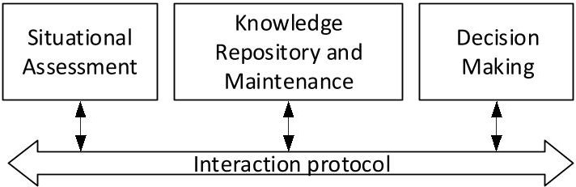
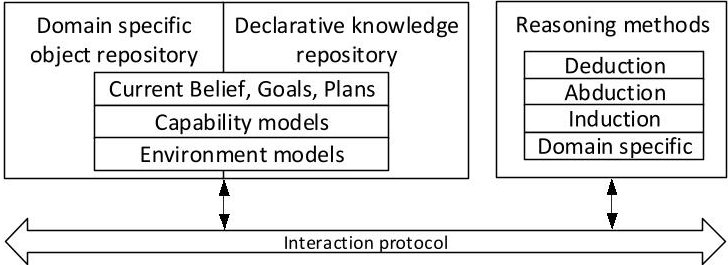
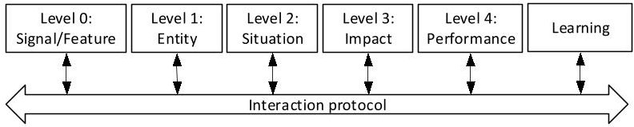
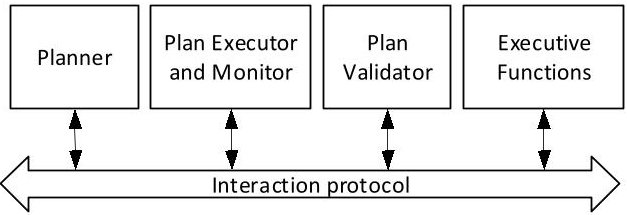
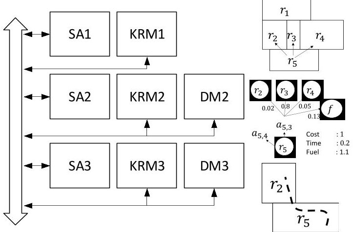
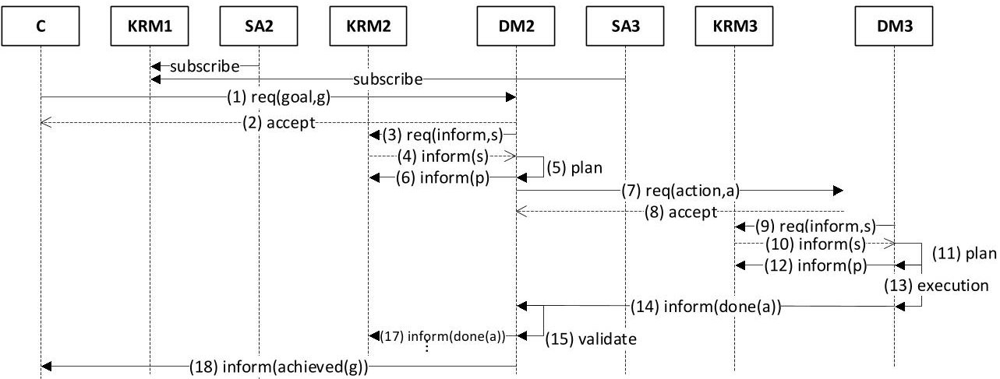

<!-- PDF_PAGE: 1 -->

# An Open and Modular Architecture for Autonomous and Intelligent Systems

Alessandro Pinto

Technical Fellow, Autonomous and Intelligent Systems Department

United Technologies Research Center

pintoa@utrc.utc.com

Abstract-Over the past few decades, remarkable progress has been made in the field of Artificial Intelligence (AI). For some tasks such as games, natural language processing, and image classification, AI powered applications can match or surpass human performance. Despite this progress, truly Autonomous and Intelligent Systems (AIS) serving the needs of, and sharing the environment with humans, are yet to become a commercial reality. AIS engineering requires considerable integration efforts that must be disciplined and guided by a reference model enabling reuse and concurrent design: an open and modular architecture. While several specialized architectures have been developed over the course of few decades, there is a need for a unified approach that supports multi-agency, learning, knowledge representation, reasoning, planning, and run-time verification. In this paper, we propose an open and modular architecture for autonomous and intelligent systems. We start by defining the three primary modules of the architecture, namely situational assessment, knowledge repository and management, and decision making. We then refine each module into functional units and we describe possible interaction patterns among them.

Index Terms—Autonomy, Intelligence, Architecture.

## I. INTRODUCTION

The class of systems that we will be concerned with have two key attributes: they are autonomous and intelligent. Although there is no standard and agreed upon definition for these attributes, we adopt a general one that should not appear controversial to the reader, and that will be sufficiently detailed to guide the development of architectural principles at the right level of granularity. An intelligent system is capable of extracting high-level knowledge from a variety of lowerlevel data sources, and is able to generalize and store such knowledge for future usage. An autonomous system is able to make decisions without supervision in the pursuit of a goal.

AI, which has much to contribute to the development of AIS, is a vast area of research and development that has been growing remarkably fast. There is, today, a wide variety of algorithms available to practitioners to solve specialized tasks. Algorithmic development keeps moving forward in all areas such as planning [1], perception, and learning [2], [3]. However, engineering autonomous and intelligent systems requires, among many other things [4], a disciplined guidance to the integration of all such techniques in order to enable reuse and concurrent design: an architecture.

The salient features of an architecture depend on the class of applications it is intended to serve. In our case, we are interested in applications where the operational environment

is not fully known at design time, and where the goals that can be given to the system are open rather than a few. If both the environment and the goals are known and well-characterized at design time, then it is possible to pre-program a set of policies that guarantees an optimal behavior. The system would not need to have any intelligence, but would only need to step through such designed-in policies at run-time. On the contrary, if the environment cannot be fully characterized at deign time, or the goals are wide open, then the system will need to understand the external world on its own, and coordinate its internal functions to find ways to achieve new goals as they are requested by the user.

From the standpoint of an agent, the external world includes sensors, actuators, any other mechanical or hardware components that are part of the system it controls, as well as other agents which might be cooperative or adversarial. Furthermore, the agent needs to know what it can do to change the environment towards achieving a desired state. Since the world is dynamic and not fully known, the agent will need to have the ability to continuously assess the current plans, and to deal with contingencies which will inevitably occur. Thus, run-time analysis and verification is an essential functionality of an autonomous and intelligent system. Finally, there is a set of meta-decisions that need to be made in the case of a contingency such as revising the goals, generating alternative plans, or leveraging unexpected events to learn new knowledge. Such complexity requires refining the architectural view to a level where algorithms can be reused and integrated.

The architecture we present in this paper does not discuss only the protocol of a generic multi-agent system. In fact, such protocols exist today and we leverage previous work in this area. We refine the agent level view by introducing the key three modules of the architecture: situation assessment, knowledge repository, and decision making. These three modules represent a fairly standard decomposition of an autonomous and intelligent agent. We refine this standard view by decomposing each module into key functions, or functional units. We then show how such functions interact at run-time in typical application scenarios. The architecture is open in the sense that any composition of functional units cannot be "closed", thereby leaving no port of entry to interact with them. This also means that the boundaries of an agent are established as a convention to manage the complexity of a large system, or to encapsulate functions into products, rather than as essential

<!-- PDF_PAGE: 2 -->

delineation of domains of control. The architecture features a virtual bus that is used to facilitate the interaction among functional units. A virtual bus is also required since it is not possible, in general, to fix the information flow between functions.

The presentation of the proposed architecture will not rely on a formal notation which we will use only in some cases to explain some of the details of the interaction among functional units. Some previous efforts have focused on formal definitions and we include references to such previous work throughout the paper. We will instead focus on the description of the architectural principles. We also provide example of possible execution traces of typical implementations, but each embodiment of the architecture will have its own unique traces depending on the the choices made by the designer. The architecture does not place limitations on such interactions but is rather a scaffolding to manage design and integration challenges.

## II. PREVIOUS WORK

We review previous work in Section II. Section III presents the architecture and its decomposition into functions, also referred to as functional units. Section IV shows an example inspired by a vehicle management system together with some typical interaction traces. Finally, Section V offers some concluding remarks.

Architectures are essential in the organization of a design process and to facilitate integration of capabilities as they become available. Since the beginning of the development of autonomous systems, researchers and engineers have felt the need for a reference architecture, and many have emerged over the years. Early approaches to autonomous and intelligent systems proposed the use of a symbolic representation of the world. In the 80s and 90s, the subsupmtion architecture [5], [6] advocated for linking sensory information directly to actions without the need for an explicit representation of the world. In the early 90s, James Albus at NIST developed architecture principles for intelligence [7] leading to the definition of the 4D-RCS architecture [8]. This architecture is close in spirit to the one we present in this paper, and also inspired the development of several others that have been specialized in different domains. The architecture presented in [9] features a hierarchical structure with a decision layer, an execution layer, and a functional layers. The decision level includes planners and plan supervisors which resembles some of the functions in our decision making module. The CLARAty architecture [10] is an evolution of the three layer approach that combines the decision and the execution layers into one decision layer directly interacting with the functional layer.

A number of other architectures can be found in literature, developed for different purposes or for specific applications. In the automotive domain, the DARPA Grand Challenge showcased a range of vehicles whose hardware and software architectures have been published in a special issue of the Journal of Field Robotics [11]. Although with some differences, each architecture features an internal representation of the

Fig. 1. High-level view of the architecture.

world, as well as domain specific planning systems. Cognitive architectures such as SOAR [12] and ACT-R [13] are instead inspired by theories of human cognition and have been used both to simulate human performance and to build intelligent systems. In common we these approaches, we share the need for symbolic representations and for a mix of procedural and declarative knowledge. Finally, we mention the classical Belief-Desire-Intention model [14] which is also the model adopted by the LORA [15] formal framework to reason about rational agents.

## III. PROPOSED ARCHITECTURE

The high-level diagram of a generic autonomy architecture is shown in Figure 1. The situational assessment (SA) module receives data from potentially many heterogeneous sources, and interacts with the knowledge repository and maintenance (KRM) module to estimate the current state of the environment. The decision making (DM) module encapsulates planning, plan execution and monitoring, plan verification, and meta-decisions as described in Section I. Interactions among these modules take place over a virtual bus which implements a multi-agent interaction protocol.

The high-level view in Figure 1 is not effective in enabling integration of components. In the area of autonomy and artificial intelligence, these components are developed at a lower level of granularity. In the next few sections we will refine each module to arrive at the definition of a functional architecture.

## A. Knowledge Repository and Management

An intelligent agent acts accordingly to its understanding of the world, its goals, its capabilities, and its values. All these different kinds of information are stored in the KRM as shown in Figure 2. The KRM is divided into a repository (on the left), and a set of reasoning algorithms (on the right). The repository is further decomposed into a domain specific repository of objects, and a declarative repository for which the most critical aspect is the knowledge representation language, which has an impact on what can be expressed and reasoned about.

Several representations are available to capture knowledge useful to an agent. Symbolic representations have been used since the 70s (see [16] for a detailed review of knowledge representation and reasoning methods). The knowledge modeling effort for symbolic representations is nontrivial as shown by the multi-decade project Cyc $ ^{1} $ . Reasoning methods for

<!-- PDF_PAGE: 3 -->

symbolic representations tend to be complex and hard to scale to large knowledge repositories. Other practical representations have been developed over the years such as knowledge graphs $ ^{2} $ and $ \mathrm{O W L}^{3} $ that have been used for large scale knowledge acquisition primarily for the Web.

Another form of knowledge representation that has emerged in recent years follows a connectionist approach and as been made possible by innovations in the area of deep-learning [17]. In this cases, knowledge is represented by the architecture and the numerical parameters of a network of simple computational units. It has been shown to be effective in many areas including image classification and natural language processing. In the case of reinforcement learning [18], this approach has also been used to learn helicopter maneuvers [19], or to learn how to plan games starting from just the observation of pixels on a screen [20]. These representations can be very effective but also have limitations since they require a large amount of training data and are not interpretable by humans.

In recent years, there has been a renewed interest in symbolic methods that have taken advantage of languages and inference algorithms able to mix logic and uncertainty [21] [24]. These knowledge representation languages have been used in many interesting applications such as detecting earthquakes [25], or autonomous scientific discovery [26].

Finally, there is still a large body of knowledge that is captured in an imperative way using different programming languages. This is common practice in all those cases where the knowledge model is about a group of objects that are known to exist, have well-characterized properties, and where the queries to be answered by the knowledge base are few and well-defined. For example, when designing an autopilot for a fixed-wing aircraft, the model of the aircraft is known, and the queries are fixed to the computation of the next dynamic state given the previous state and the sensory inputs, and the computation of the next actuator inputs. In other cases, efficiency is a good reason to resort to domain specific knowledge representation and algorithms. For example, reasoning about objects like graphs and polytopes may become hard in a symbolic setting, although there are cases in which efficient decision procedures can be developed [27].

A declarative approach to knowledge representation offers several advantages. The most evident is the separation of the knowledge content from the reasoning algorithms. From a development point of view, this separation enables reuse which is critical to a fast development cycle. If knowledge is captured in a declarative way, reasoning algorithms can be reused across different domains because they are designed and implemented to operate on any input that complies with the knowledge representation language independently from the application. The other advantage is that declarative representation languages provide the expressive power to define abstractions that work in a wide variety of actual environments. Finally, declarative models can answer questions about the existence of a certain

Fig. 2. Knowledge-repository and maintenance architecture.

concept that satisfies some constraints, whereas imperative knowledge typically answers questions about properties of a specific set of instances.

Each knowledge representation language, and associated reasoning methods, have their own strength and weaknesses. Multiple representations may have to be used to fulfill the requirements and the constraints imposed on the design of an agent. The KRM must organize the reasoning process of such heterogeneous knowledge base while keep it consistent. In many practical cases, this is done in an ad-hoc fashion, but formal frameworks, such as the Nelson-Oppen approach for combining decision procedures [28], could in principle be leveraged to address this problem.

The knowledge repository also holds models that capture the dynamics of the environment and the dynamics of the actions that can be executed by the agent. Several declarative action models have been developed over the years starting from the STRIPS [29] representation, to the more expressive one described in the Planning Domain Definition Language [30] and its probabilistic extension [31], and to Hierarchical Task Netoworks [32]. Together with these models, models of the environment may require an explicit notion of time and are needed to propagate the current state and evaluate the quality of a plan.

## B. Situational Assessment

The purpose of the situational assessment process is to maintain an internal representation of the external world as accurate and needed to make "good" decisions. The primary goals are extraction of knowledge from data, and update and revision of the belief stored in the KRM. The SA module architecture is shown in Figure 3 and includes processing data and identifying features, recognizing entities, assessing the situation, and determining the impact by projecting the evolution of the environment in the future. The architecture takes inspiration from the JDL data fusion model [33], which is based in turn on the Endsley's model for situational awareness [34]. An addition to the original model is a learning function. Learning is about extracting knowledge from input data, storing it, and being able to reuse it whenever needed. We note that this function refers to the ability of the agent to learn autonomously on-line which is different from a learning function used off-line to train a model (which is then used online). We include on-line learning in the SA module because it extract models of the environment, thereby refining its knowledge to make it more precise and robust.

<!-- PDF_PAGE: 4 -->

Fig. 3. Situational assessment module architecture.

The first few levels are typically domain specific. The signal processing and feature extraction level depends both on the nature of the incoming data, and on the knowledge extraction goal, and is hard to generalize. Consider for example a simple image classification task which consists in assigning pixels in an image to object categories. Clearly, signal processing and feature extraction depend on the selected sensor technology (a camera in this case). Also, the selection of features in general depends on the object categories of interest. The second level uses these features to classify objects in the image. In the early days of computer vision, feature engineering was a manual task, and object classification was implemented as a network of rules taking features as inputs. A breakthrough happened in 2012, when AlexNet [35] entered the ImageNet Large Scale Visual Recognition Competition achieving results superior to previous approaches. With a neural networks approach, a large set of labeled images is used as training data to learn the parameters of a network that solves both the feature selection and the object classification problems. However, the resulting model is still domain specific because it depends on the selected input data set: a neural network that has been trained to recognize characters from cameras, would not be capable of recognizing people even with the same sensing technology.

Higher levels, such as situation and impact assessment, require more advanced reasoning methods and are in many cases domain independent (although they might be restricted to reasoning about specific aspects of a situation such as physics). Assessing a situation may also require reasoning beyond what is known and stored in the knowledge repository. Relaxing the closed-world assumption requires formalisms with open-world semantics such as the one proposed in [21].

Impact assessment projects the current state into the future. This function uses dynamic models of the environment and of the capabilities of the agent that are stored in the KRM. These models are essentially description of transition functions that can, in some cases, be full-fledged simulators of certain physical phenomena. As will be discussed also in Section III-C, the impact assessment process requires instantiating a secondary knowledge repository to propagate the state in the future. The agent (either based on a policy computed at design time, or based on context) will need to select the abstraction level to conduct the assessment. The impact on the current plans will be then assessed by the plan verification engine that is part of the decision making module (see Section III-C).

The different levels should not be interpreted as a sequential process. Each level receives inputs that consist, at least theoretically, of a history of observations (e.g., a list of audio samples, or features from a previous camera frame), and computes its

outputs (e.g., the uttered word, or the speed of an object). All these outputs are stored in the knowledge repository so that algorithms at any level have access to all of them. Finally, information fusion is required to take into account features and entities extracted from different data sources, as well as the previous content of the knowledge repository. Computing the new state of the world is a nontrivial task also known as belief update and revision [36] which consists in finding the changes to be made to the content of the knowledge repository so that the addition of new knowledge does not make it inconsistent. In most common applications, the content of the KRM is probabilistic and a Bayesian approach is used to keep it updated.

Finally, the learning function extracts knowledge that can be stored in the knowledge repository and reused whenever needed. We are mainly concerned with on-line unsupervised learning which, at the moment of writing, is not deployed in any practical system (especially in those cases such as driverless cars, or autonomous aircraft, where safety is a concern). Enabling on-line learning imposes some requirements on other functions such as the ability to store execution histories of each component which may further increase the complexity of the knowledge repository. The learning function needs to first identify interesting data points from which something useful can be learned. In the off-line setting, this is done by data scientists, but in the on-line setting, this function needs to be automated. When data points are identified, new knowledge can be extracted. The result of this process is an update of the current models in the knowledge repository. While neural networks are used in many applications as models, many other models and methods exists that are based on knowledge and that are more explainable (for a review of knowledge-based methods, refer to [37]).

## C. Decision Making

The main task of the decision making module is to determine the best course of action in any given state of the world in order to optimally achieve a goal. Several functions are considered part of a decision making process including planning, plan execution and monitoring, plan validation, and executive functions, as shown in Figure 4. The planning function takes as input the current state $ ^{4} $ S, the goal G, the set of dynamic capabilities, also called operators, O, and the models of the environment (both invariant and dynamic) E, and computes a plan $ \pi $ , which is a network of actions to be executed by other agents. Many planning systems only accept the triple $ (S,G,O) $ in which case the operators must be modeled in such a way to include the axioms and the dynamic models of the environment. The operator model includes a precondition, multiple effects (possibly with associated probabilities), and metrics such as cost, duration, and resource utilization.

<!-- PDF_PAGE: 5 -->

Fig. 4. Decision making architecture.

The plan execution function takes care of executing the plan by sending requests of executing actions to other agents. It takes as inputs a plan $ \pi $ and the response from other agents r, and generates two outputs: requests to execute actions contained in the plan, and plan state $ S_{\pi} $ . The plan state includes the state of each action in the plan which can be idle (waiting execution), exec (started execution but not finished yet), done (terminated execution successfully), and fail (failed execution). After sending a request for an action and changing the plan state, the plan execution function monitors the response r for that action. The response can be positive or negative and may also include an explanation for a failure. When received, a response changes the plan state and generates other requests until all actions have been successfully executed. It is good practice to only send requests that the plan execution engine believes can be executed by the receiver. For this reason, before requesting and action a to be executed, the execution engine should ask the KRM whether the knowledge base entails the action precondition. Similarly, the plan execution engine should verify the effect of an action after the execution has completed. In the case of multiple possible effects, the plan execution engine is actually required to check which effect has been achieved to be able to select the next action in the plan.

The plan verification function solves a run-time model checking problem. Given the current state S, the plan $ \pi $ and the plan state $ S_{\pi} $ , plan verification checks whether the current plan is still feasible. If this is the case, then nothing needs to be done and the agent keeps executing the current plan. Otherwise, the plan verification function computes a new plan state $ S_{\pi}^{\prime} $ that shows a possible future state of the world where the plan fails. This information can be used by the executive functions to determine what to do next. A more complex check that the plan verification algorithm may perform is on the optimality of the current plan. In fact, a change in the environment could also be favorable to the agent in the pursuit of its goals, and a new plan could be computed to improve over the current one. Depending on the planning domain, checking for optimality may require running the planning algorithm. Some implementation details deserve attention. In particular, projecting the possible evolution of the agent and of the environment may require evolving the entire knowledge repository in time which brings complexity challenges both in terms of execution time and space.

The executive functions govern the execution of the decision making cycle. In particular, they observe changes in the goals

requested by other agents, changes in the content of the knowledge repository, and results from the other decision making functions to determine what needs to be done. Executive functions monitor the knowledge repository and select goals. Several goals can be assigned to an agent. These goals can be totally ordered or partially ordered. Executive functions select a goal to be pursued and query the planning function for the generation of a plan. If the plan cannot be found, another goal must be selected or generated. When a plan if found, the executive functions request its execution and observe the results of both the planning execution engine and the plan verification engine. When failures are reported, the execution functions must decide what is the best next step which may include continuing with the execution of the current plan, locally fixing a plan, computing a completely new plan, or asking for changes in the goals. The policy followed by the executive functions is part of the design of the agent and may very well be implemented as a full fledged planning system itself.

## D. Communication Protocol

So far, we have introduced the modules and functions that are typical of an autonomous and intelligent system. In this section we discuss their interaction. The interaction protocol that allows designers to integrate functional units, and that enables reuse in a multi-agent system, should be expressive enough to convey the intent of an interaction, but should not restrict the potential sequences of events that can occur among the functions. In this section we will not discuss the transport, network, access, and physical layer protocols (that are still necessary to ensure connectivity among agents), but rather the high-level interaction protocols that allows agents to engage int a discourse.

In many cases, implementation of closed systems rely on protocols that are specific to a particular application and that leave only limited or underspecified interfaces for interaction. In our case, we commit to an open architecture for systems that are autonomous and therefore free to make their own internal decisions while negotiating with other entities in a dynamic environment. The seminal work that helped define many of the protocols used for multi-agent systems was done by philosopher John Autin [38] who worked at the definition of communicative acts. Practically speaking, we can think of a message from an initiator to a participant as an act that does something. For example, a message from one agent to another agent that informs of a severe weather condition in a certain region, changes the information state of the receiver. Sending information is one particular communicative act, but there are others that are used in a multi-agent system such as requesting to perform an action. The intent of the communicative act is called performative and can be thought of as a message type.

The FIPA Agent Communication Library (ACL) [39], [40] is a standard that defines a list of communicative acts together with their message structure. Each message carries information about the performative, the sender, the intended receiver, the content, and several fields to indicate how to respond to the

<!-- PDF_PAGE: 6 -->

message. Example of performatives include informing an agent about some facts, requesting an agent to perform an action or accomplish a goal, calling for a proposal to perform a task, proposing a way to accomplish a task, accepting or rejecting a proposal, and several others used to indicate how the execution of a task is proceeding. The main criticism to this protocol is on the semantics given to the content of a communicative act. The content is about the belief, desires and intentions of an agent. Such content may or may not be truthful. Other proposals, instead, are based on commitments [41], [42] which are promises made by an agent. For example, rather than informing about ones internal state, a commitmentbased protocol commits the agent to making sure that such state is eventually brought about.

## IV. APPLICATION EXAMPLE

In this section we provide an example of a vehicle management system as shown in Figure 5. The different levels, as well as some details about the algorithms used in this specific example, can be found in [43]. Agent Ai is composed of situational awareness module SAi, knowledge repository KRMi, and decision making DMi (except for agent A1 which does not inlcude a decision making module). This multiagent system is tasked with navigating a complex environment that may span an entire city. Thus, planning is organized hierarchically into a mission planning agent A2, and a motion planning agent A3.

Each agent has its own view of the world. Agent A1 stores information about regions, adjacency and navigability. Each region is also annotated with properties that capture the level of difficulty that an agent may face in crossing the region. This knowledge repository is populated by module SA1 starting from satellite images, $ \mathrm{G I S}^{5} $ maps, or data streams from on-board sensors. When processing images, SA1 starts by identifying objects such as buildings and roads. From these features and entities, SA1 extracts regions that are stored in the form of polygons in dedicated data structures. KRM1 is the recipient of the processed regions. It maintains a logical model of such regions that is kept current by using domain specific reasoning algorithms that compute intersection of regions. KRM1 also stores a logical model of the actions that can be executed by the vehicle such as moving from a region to another region. For example, Figure 5 shows five regions where $ r_{5} $ is adjacent to $ r_{2}, $ $ r_{3}, $ and $ r_{4}. $ Also, a vehicle can move from $ r_{5} $ to the adjacent regionrs.

Agent A2 refines the logical view of the world into a Markov Decision Process [44]. SA2 uses information about regions and navigability, together with action models, to generate the set of states and the possible transitions among them. Each state includes the region information and other properties such as the state of the vehicle and its health. SA2 uses models from KRM2 to compute the probability that an action a, performed by the vehicle, changes the state from s to $ s^{\prime} $ . For each triple $ (s,a,s^{\prime}) $ , SA2 also computes a set

Fig. 5. Example of a three agent architecture for vehicle management.

of attributes $ \{g_{i}(s,a,s^{\prime})\} $ corresponding to typical metrics of interest such as fuel consumption, time, threat exposure, and cost. For example, Figure 5 shows the possible outcomes of attempting to execute action $ a_{5,3} $ to move from region $ r_{5} $ to region $ r_{3} $ . The vehicle could end up on regions $ r_{2} $ or $ r_{4} $ with some probability, or it could even fail (state f) to move. DM2 includes a planning system that is able to solve a Constrained Markov Decision Process [45].

Agent A3 uses the detailed maps stored in KRM1 to maintain a discrete view of the world represented as a graph. Each vertex is a point in space. Two vertices are connected by and edge only if the edge does not intersect obstacles. This representation is more complex in our case for several reasons. First, nodes in the graph may actually include information about other state variables such as speed which enlarges the state space. In generating the graph, SA3 will need to take into account the dynamics of the vehicle to avoid including edges that do not correspond to any feasible trajectory. SA3 will also need to decorate each edge with metrics such as cost, time, and resource utilization. DM3 will need to solve the problem of moving between two states while satisfying a given list of constraints.

## A. Examples of Interactions

In this section, without committing to a specific standard protocol, but we reference to some of the performatives defined in [40], we describe the interactions among these modules in a nominal case, and we discuss the expected communication events in several failure cases.

The interaction diagram is shown in Figure 6. The situational awareness modules both subscribe to the state held by KRM1. An external commander agent C sends a request to achieve a given goal g. In a multi-agent system, this process might first involve a call for proposal performative, followed by potentially several agents proposing to plan for that goal, which in turn is followed by the commander accepting on proposal. In this case, we have shown a message going directly to A2. In fact, we have elected DM2 to respond to this type of requests. The request is accepted (message 2) and the planning process starts. DM2 requests KRM2 to provide the current

<!-- PDF_PAGE: 7 -->

state (message 3). Notice that this is a request performative which asks the recipient to perform another communicative act. KRM2 responds with the current state s which triggers DM2 to compute a plan p and store it back in KRM2. After the plan is computed, DM2 starts its execution which consists of requesting other agents to perform actions (message 7) as prescribed by the plan.

In our case, and action a has a description which includes the initial state s, the state after the execution $ s^{\prime} $ and a set of attributes $ \{g_{i}(s,a,s^{\prime})\} $ . The action description is interpreted by DM3 as the specification of a planning problem. In particular, $ s^{\prime} $ is a desired target state, while the attributes can be considered as upper bounds on the corresponding metrics. In the case shown in Figure 6, the request is accepted, and DM3 start a similar interaction with KRM3 to request the current state, compute a plan, and execute it. When the plan completes its execution, DM3 informs DM2 (message 14) which validates that that the goal $ s^{\prime} $ has been achieved and that the upper bounds on the metrics has not been violated (the validation may require further interaction with KRM2 to retrieve the current state). Similarly, DM2 notifies the commander once the original goal g has been achieved.

Executive functions in each decision making module may have to deal with failures that may occur during this interaction process. Some typical failure cases include:

- A request is rejected by the recipient. The recipient should include a reason in the response message. This failure can happen because the recipient does not have the capabilities to plan for the given goal, in which case, the sender should select a different recipient or change the goals. Another typical case is that the requested action cannot start its execution. Consider the case of message 7. The request includes a description of the current state s. This state must be consistent with the current state as represented in KRM3. If this is not the case, then A2 and A3 clearly have a different understanding of the current state.

- A plan cannot be found. In this case, the recipient accepts the request, but a plan to satisfy the request cannot be found. In our example, message 11 would be a failure message which would be sent by DM3 to DM2. In this case, DM2 should try to change the goals if possible, or send a failure message directly to C (together with aborting the execution of the current plan). In order to revise the goal, an explanation for the failure should be provided. Generating such explanation is not typically done by planning algorithms, although some research has been done in this direction (see [46] for an example).

- An action is executed but the intended effect is different than predicted. For example, in our case this means that the result of the validation step 15 was negative. If this failure happened because KRM2 does not entail state $ s^{\prime} $ then DM2 could plan a recovery action to get back on track with the plan, and the failure would be resolved locally. If such recovery action is not available, then the failure will need to be relayed to C. The other case is

when constraints on the set of metrics associated with the requested action have been violated. In this case, DM2 should ask SA2 to evaluate the impact on the overall mission and decide whether to continue with the current plan or compute a new plan.

## V. CONCLUDING REMARKS

The field of AI is broad, spanning domains that cover sensing, data processing, data fusion, reasoning, planning, data analysis, and learning. In the past few years we have witnessed advances in all these areas that have enabled the deployment of intelligent applications in fields such as finance, health care, on-line advertising, and social media. However, systems such as autonomous cars, unmanned aerial vehicles, robots that aim at replacing humans, or other intelligence software applications going beyond pattern matching, operate in environments that cannot be fully characterized at design time, and need to be able to respond to a wide open set of tasks that could be assigned to them. We have presented an open an modular architecture for these class of systems and we have decomposed the architecture into functional units that we believe are at the right level of granularity. Architectures are essential to design, development, and integration processes, and therefore are key enablers to engineering truly autonomous and intelligent systems.

As future work, we plan to support the proposed architecture with design guidelines, formal definition of each function, and design and analysis methods. Since many autonomous and intelligent systems serve critical applications, it is also imperative to develop tools that can prove properties about their emerging behaviors. This task is hard due to a potentially large number of interaction patterns that may occur among agents and functional units. A formal framework to model the architecture and related analysis methods are necessary tools to provide assurance guarantees, which may otherwise be impossible or impractical to prove using a testing approach.

## REFERENCES

[1] Malik Ghallab, Dana Nau, and Paolo Traverso. Automated Planning: theory and practice. Elsevier, 2004.

[2] Christopher M Bishop. Pattern recognition and machine learning. springer, 2006.

[3] Ian Goodfellow, Yoshua Bengio, and Aaron Courville. Deep learning. MIT press, 2016.

[4] Michael Jordan. Artificial intelligence : The revolution hasn't happened yet, 2018.

[5] Rodney A Brooks. Intelligence without representation. Artificial intelligence, 47(1-3):139-159, 1991.

[6] Ronald C Arkin, Ronald C Arkin, et al. Behavior-based robotics. MIT press, 1998.

[7] James S Albus. Outline for a theory of intelligence. IEEE Transactions on Systems, Man, and Cybernetics, 21(3):473-509, 1991.

[8] James S Albus, Hui-Min Huang, Elena R Messina, Karl Murphy, Maris Juberts, Alberto Lacaze, Stephen B Balakirsky, Michael O Shneier, Tsai H Hong, Harry A Scott, et al. 4d/rcs version 2.0: A reference model architecture for unmanned vehicle systems. Technical report, 2002.

[9] Rachid Alami, Raja Chatila, Sara Fleury, Malik Ghallab, and Félix Ingrand. An architecture for autonomy. The International Journal of Robotics Research, 17(4):315-337, 1998.

<!-- PDF_PAGE: 8 -->

Fig. 6. Example of a nominal interaction among the functions of the vehicle management system.

[10] Richard Volpe, Issa Nesnas, Tara Estlin, Darren Mutz, Richard Petras, and Hari Das. The claraty architecture for robotic autonomy. In 2001 IEEE Aerospace Conference Proceedings (Cat. No. 01TH8542), volume 1, pages 1-121. IEEE, 2001.

[11] Karl Iagnemma and Martin Buehler. Editorial for journal of field robotics—special issue on the darpa grand challenge. Journal of Field Robotics, 23(9):655-656, 2006.

[12] John E Laird, Allen Newell, and Paul S Rosenbloom. Soar: An architecture for general intelligence. Artificial intelligence, 33(1):1-64, 1987.

[13] John R Anderson. How can the human mind occur in the physical universe? Oxford University Press, 2009.

[14] Michael E Bratman, David J Israel, and Martha E Pollack. Plans and resource-bounded practical reasoning. Computational intelligence, 4(3):349-355, 1988.

[15] Michael Wooldridge. Reasoning about rational agents. MIT press, 2003.

[16] Hector J Levesque. Knowledge representation and reasoning. Annual review of computer science, 1(1):255-287, 1986.

[17] Yann LeCun, Yoshua Bengio, and Geoffrey Hinton. Deep learning. nature, 521(7553):436, 2015.

[18] Richard S Sutton and Andrew G Barto. Reinforcement learning: An introduction. MIT press, 2018.

[19] Pieter Abbeel, Adam Coates, and Andrew Y Ng. Autonomous helicopter aerobatics through apprenticeship learning. The International Journal of Robotics Research, 29(13):1608-1639, 2010.

[20] Yan Duan, Xi Chen, Rein Houthooft, John Schulman, and Pieter Abbeel. Benchmarking deep reinforcement learning for continuous control. In International Conference on Machine Learning, pages 1329-1338, 2016.

[21] Brian Christopher Milch. Probabilistic Models with Unknown Objects. PhD thesis, Berkeley, CA, USA, 2006. AAI3253991.

[22] Lei Li, Yi Wu, and Stuart J. Russell. Swift: Compiled inference for probabilistic programs. Technical Report UCB/EECS-2015-12, EECS Department, University of California, Berkeley, Mar 2015.

[23] Matthew Richardson and Pedro Domingos. Markov logic networks. Machine learning, 62(1-2):107-136, 2006.

[24] Luc De Raedt and Angelika Kimmig. Probabilistic (logic) programming concepts. Machine Learning, 100(1):5-47, 2015.

[25] Nimar Arora, Stuart J Russell, Paul Kidwell, and Erik B Sudderth. Global seismic monitoring as probabilistic inference. In Advances in neural information processing systems, pages 73-81, 2010.

[26] Andrew Sparkes, Wayne Aubrey, Emma Byrne, Amanda Clare, Muhammed N Khan, Maria Liakata, Magdalena Markham, Jem Rowland, Larisa N Soldatova, Kenneth E Whelan, et al. Towards robot scientists for autonomous scientific discovery. Automated Experimentation, 2(1):1, 2010.

[27] Sam Bayless, Noah Bayless, Holger H Hoos, and Alan J Hu. Sat modulo monotonic theories. In Twenty-Ninth AAAI Conference on Artificial Intelligence, 2015.

[28] Cesare Tinelli and Mehdi Harandi. A new correctness proof of the nelson-oppen combination procedure. In Frontiers of Combining Systems, pages 103-119. Springer, 1996.

[29] Richard E Fikes and Nils J Nilsson. Strips: A new approach to the application of theorem proving to problem solving. Artificial intelligence, 2(3-4):189-208, 1971.

[30] Maria Fox and Derek Long. Pddl2. 1: An extension to pddl for expressing temporal planning domains. Journal of artificial intelligence research, 20:61-124, 2003.

[31] Håkan LS Younes and Michael L Littman. Ppddl1. 0: An extension to pddl for expressing planning domains with probabilistic effects. Techn. Rep. CMU-CS-04-162, 2004.

[32] Kutluhan Erol, James A Hendler, and Dana S Nau. Umcp: A sound and complete procedure for hierarchical task-network planning. In AIPS, volume 94, pages 249-254, 1994.

[33] Alan N Steinberg and Christopher L Bowman. Revisions to the jdl data fusion model. In Handbook of multisensor data fusion, pages 65-88. CRC press, 2008.

[34] Mica R Endsley. Toward a theory of situation awareness in dynamic systems. Human factors, 37(1):32-64, 1995.

[35] Alex Krizhevsky, Ilya Sutskever, and Geoffrey E Hinton. Imagenet classification with deep convolutional neural networks. In Advances in neural information processing systems, pages 1097-1105, 2012.

[36] Peter Gärdenfors. Belief revision, volume 29. Cambridge University Press, 2003.

[37] Stuart J Russell and Peter Norvig. Artificial intelligence: a modern approach. Malaysia; Pearson Education Limited., 2016.

[38] John Langshaw Austin. How to do things with words. Oxford university press, 1975.

[39] Foundation for Intelligent Physical Agents. Fipa acl message structure specification, 2000.

[40] Foundation for Intelligent Physical Agents. Fipa communicative act library specification, 2002.

[41] Pinar Yolum and Munindar P Singh. Flexible protocol specification and execution: applying event calculus planning using commitments. In Proceedings of the first international joint conference on Autonomous agents and multiagent systems: part 2, pages 527-534. ACM, 2002.

[42] Nicoletta Fornara and Marco Colombetti. A commitment-based approach to agent communication. Applied Artificial Intelligence, 18(9-10):853-866, 2004.

[43] Xuchu Dennis Ding, Brendan Englot, Alessandro Pinto, Alberto Speranzon, and Amit Surana. Hierarchical multi-objective planning: From mission specifications to contingency management. In 2014 IEEE international conference on robotics and automation (ICRA), pages 3735-3742. IEEE, 2014.

[44] Martin L Puterman. Markov decision processes: discrete stochastic dynamic programming. John Wiley & Sons, 2014.

[45] Eitan Altman. Constrained Markov decision processes, volume 7. CRC Press, 1999.

[46] Moritz Göbelbecker, Thomas Keller, Patrick Eyerich, Michael Brenner, and Bernhard Nebel. Coming up with good excuses: What to do when no plan can be found. In Twentieth International Conference on Automated Planning and Scheduling, 2010.