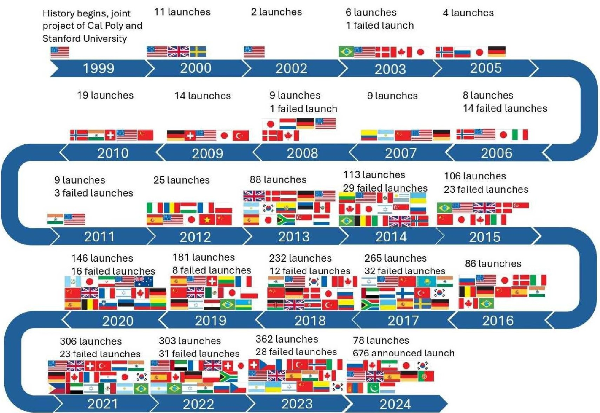
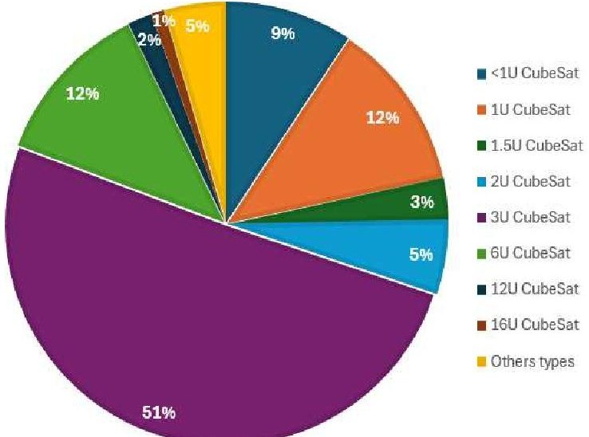
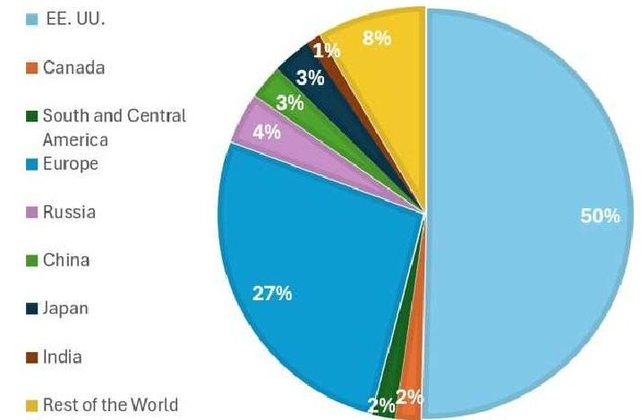
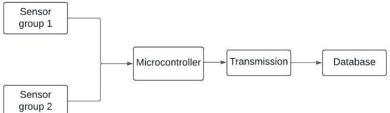
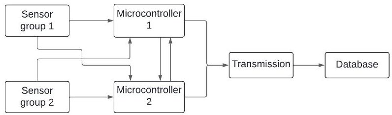
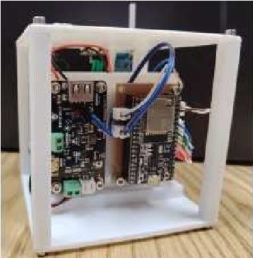
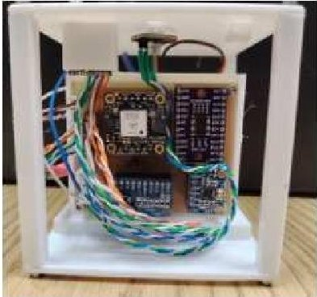

<!-- PDF_PAGE: 1 -->

# LabSI-SAT: Low-cost CubeSat Nanosatellite Prototype Assembly Demonstration

Juan Rodriguez-Chong

Intelligent Systems Laboratory, Faculty of Electrical Engineering, Tecnology University of Panama, Panama, Panama

Danilo Caceres-Hernandez

Intelligent Systems Laboratory, Faculty of Electrical Engineering, Tecnology University of Panama, Panama Panama, National Research System (SNI), National Secretariat of Science, Technology and Innovation (SENACYT), Panama, Panama

Abstract-This document is a report on the lessons learned during the construction of a low-cost nanosatellite prototype using commercially available components. It examines the system control models and sensors that can be utilized, as well as ways to enhance the reliability and availability of both hardware and software. The project was conducted using the space race achievements of other countries as a reference, with the goal of enabling other nations seeking to develop in this field to embark on their own space endeavors.

Index Terms—CubeSat, redundancy, prototype, commercial components, sensors

## I. INTRODUCTION

CubeSats emerged as a project in 1999 with Cal Poly (California Polytechnic State University) and Stanford University [1]. These fall into the general category of nanosatellites, which in-cludes PocketQubes, TubeSats, SunCubes, ThinSats, and other types of picosatellites. The objectives are primarily focused on education, research and experimentation, and the democratization of access to space, as well as enabling international collaboration and cooperation. They are designed according to a standard [2] modular design (1U) with dimensions of 10 cm 10 cm 10 cm and a weight ranging from 1 kg to 1.33 kg per module. Recently, larger sizes have become popular, such as 1.5U, 2U, 3U, 6U, and 12U. They can be built in approximately 18 to 24 months, including design and testing, and must be delivered at least 4 weeks to 6 months before deployment. The entire process, along with the basic guidelines for their construction, as well as the regulations on telecommunications, testing, feasibility studies, and analysis that must be carried out prior to deployment on a mission [3].

The first CubeSat launch took place in June 2003, on the

Russian Eurockot rocket with the AAU CubeSat nanosatellite. By 2008, approximately 75 nanosatellites were already in orbit, and by 2019 at least 900 had been successfully deployed [4]. In 2023, this number reached 1800 deployments. The purpose of these can be aimed at Earth surface remote sensing, telecommunications, scientific and educational applications, and technological demonstration.

The United States has been the leading country in the development and launch of nanosatellites [5]----[11], accounting for nearly 51% of missions and launches. Highlighted among these missions is the 3U LightSail 2 [6], launched in 2019, which tested the use of a solar sail. Another notable mission is ASTERIA, developed by NASA and MIT, whose Earth

observation mission was carried out using COTS (Commercial Off-The-Shelf) components. In telecommunications missions, studies and tests in the Ka-band have been conducted with the RaInCube [9] and ISARA [12] CubeSats. In Europe, countries such as the UK, Finland, Switzerland, Sweden, Spain, Luxembourg, Italy, Belgium, France, Germany, Czech Republic, Norway, Bulgaria, and Russia have developed their own CubeSat models in recent years. Many of the projects in the European region are carried out jointly or in associations with several countries [13] -[18]. In Asia, the most prominent countries are Japan, China, Israel, South Korea, India, the Philippines, Singapore, and Indonesia [19] -[23].

Latin America has taken advantage of the opportunities offered by these types of technologies and has deployed its own Cube- Sats. Argentina, for example, started with PehuenSat 1 [24], which was an educational, scientific, and technological demonstration project that was

<!-- PDF_PAGE: 2 -->

installed in the launch structure of the PSLV-G (3) vehicle and deployed with this structure. Others launched were CubeBug-1 and CubeBug-2 [25], which were 2U designs for the technological demonstration of the reaction wheel launched in 2013. They later developed Pehuensat II [26], where they demonstrated the operation of a 2.4 GHz Sband link. Bolivia, on the other hand, developed Tupac Katari (TK-1), which has been in orbit and operation since 2013, with telecommunications tasks such as internet transmission, television systems, tele-education, and telemedicine. The document provides a more detailed description of its operation and systems, and how the space race is being studied and carried out in this country. For its part, Colombia ventured with Libertad-1 in 2007, which conducted data packet transmission tests, with 2320 transmissions performed, featuring tempera- ture sensors, an accelerometer, and battery charging [28]. It continued with FACSAT-1 [29] [30] in 2018 and FACSAT-2 in

2023, built by the Colombian Aerospace Force for Earth observation, environmental protection including a 30 m per pixel RGB camera in a 3U module, and an infrared spectrometer in the range of 1000 to 1700 nm. Currently, it is developing a 3U CubeSat for the LEOPAR mission [32]. Brazil is the Latin American country that has developed the most nanosatellites. One of these was NANOSATC-BR1 in 2014 [33], with the goal of monitoring space weather and atmospheric anomalies related to the South Atlantic Magnetic Anomaly and the Equatorial Electrojets. In 2015, they also launched AESP14 [12], a 1U model that would investigate the generation of equatorial plasma bubbles; however, its signal was lost after deployment from the International Space Station. Another mission they developed was for Earth observation with the 6U CubeSat ITASAT-1, which features a transponder for retransmission from data collection systems [34].

Fig. 1: Timelapse of the history of CubeSats and the countries that conducted launches each year

<!-- PDF_PAGE: 3 -->

More visually, we can see in Fig. 1 that based on the review of the state of the art, websites that compile information about the history of the nanosatellite space race [35], [36], and specific searches for different regions, allowed us to create this timeline, summarizing a portion of what has been achieved so far, highlighting the work of multiple agencies, institutions, and nations.

Of the developed projects, most of their communication systems use UHF in the bands of 400 to 425 MHz and 435 to 438 MHz, as well as the S bands (2.2 to 3.4 GHz) and X bands (8.2 to 10.5 GHz). The most common types of CubeSat nanosatellites that have been launched are the 3U with approximately 1250 units, followed by the 1U with about 310 units, and the 6U with 300 units (Fig. 2).

Based on the place of origin (Fig.3), around 50.4% of nanosatellites come from the United States, 26.6% from Europe, 4% from Russia, 1.8% from Central and South America, 3.1% from Japan, and 2.7% from China. By manufacturer, and according to those already launched, 54.7% have been by companies, 29.7% by universities, 3.7% by the military, 3.6% by space agencies, 3.1% by institutes, and 0.8% by schools.

Fig. 2: Nanosatellite launches by types

Fig. 3: Diagram with percentages of countries or regions that have launched CubeSats

This project aims to construct a CubeSat-type nanosatellite prototype using low-cost commercial components, based on knowledge acquired from reviewing previous works in design, protocols, corrections, tasks, and more. The goal is to foster interest in this field of knowledge in countries looking to begin designing their own nanosatellites.

## II. PROTOTYPE

The demonstration that it is possible to construct the nanosatellite using commercial components was done by employing modules within an affordable price range and with specific dimensions to keep the prototype as compact as possible. Another factor influencing the selection of sensors was the communication protocol needed for the microcontroller, as the aim was to reduce design and wiring complexity on the PCBs.

The charging and power stages used an arrangement with a module that could handle the charging power from four solar panels and provide power to the system simultaneously. The battery bank had a capacity of 30 Ah. The module manages the use of stored energy, prioritizing power from the panels when sufficient, while keeping the batteries in reserve. If panel energy is insufficient, it switches to battery power and charges them with any available solar energy. The sensors were separated from the microcontroller onto two boards, and the elements were rearranged to increase the number of batteries. This new model included a GPS for satellite tracking, which was not possible in the previous version, and a UV radiation sensor in the range of 200 to 370 nm. The communication method of the sensors to the controller was changed to I2C, and analog output sensors employed an ADC to be compatible with this communication mode. Communication is carried out via a LoRa module operating at a frequency of 430 MHz, using SPI protocols to maintain higher speed. A satellite must have a certain degree of robustness to be tolerant and resistant to the extreme conditions it may encounter during the mission. Although a nanosatellite has a shorter lifespan than a larger satellite and its costs and manufacturing time are just a fraction of these, it is expected to have high availability to perform the tasks for which it is designed. Redundancy in these cases is a way to optimize performance and can be applied both physically and in software, with codings that ensure optimal logical operation. Using commercial components provides good reliability, but deviations in the measurements they provide can occur, as well as failures due to environmental conditions or component wear. One way to prevent this is the inclusion of another set of sensors in parity, allowing for the deviation of each sensor to be known, improving accuracy and providing a backup in case of disconnection or failure. Physical redundancy applied in these cases can be serial, parallel, or mixed, depending on the designer's needs.

## III. HARDWARE

For the design being worked on, parallel redundancy is applied to the sensors and microcontrollers so that in the event of disconnection of one of the modules, functionality is not lost which happens when the system has a series connection type

<!-- PDF_PAGE: 4 -->

between stages. Therefore, a parallel connection model was employed. Initially, a linear design was maintained, which onsisted of a set of sensors whose information was processed in a microcontroller and then transmitted to a separate station. This model presented low availability in the event of failures or measurement errors since there was no way to back up or validate the information. Thus, a new system was proposed where two identical sets of sensors (Fig. 4) are read alternately, and an average of the values and their deviation is calculated, verifying the reading values. This also allows that, in case of damage or disconnection of one of the sensors or the entire set, it can migrate and work with the backup available, resulting in a model similar to the linear one.

Fig. 4: System with dual sensor configuration

To further increase the reliability and availability of the system, it is possible to connect a second microcontroller identical to the other, communicating with each other and with both sets of sensors. This allows for a backup against failures, verification in case of reading errors inherent to the microcontroller, and maintaining value verification by the two sets of sensors. This exchange of information between controllers also allows for the distribution of the task load if necessary(Fig. 5). The

Fig. 5: System with Dual Sensors and Controller

reliability of this system is high since it covers many of the situations that may arise and offers various paths for data measurement and processing prior to transmission.

Reliability can be taken to the next level by adding a third set of sensors and a third microcontroller, creating a system known as Triple Modular Redundancy (TMR). TMR compiles the outputs of the 3 parallel processes and, through a voting mechanism, provides a result based on the two most similar or identical values. In case one of the modules fails and produces an incorrect output, the other two correct outputs can still surpass the error. This approach should be evaluated according to the criticality level of the component or stage, and appropriate protection methods should be applied. It should be noted that this redundancy also results in higher costs.

## IV. SOFTWARE

To maintain high availability in the software, there are techniques such as repeated packet sending to ensure the information is received. Another technique is storing data in separate memories in case of data corruption. For the design in question, the software is designed to verify the initialization of its components according to their communication protocol, and in case of failure, it can attempt to restart a certain number of times. A traditional method is to have duplicate codes where multiple implementations of the same functionality are used to verify results, even though this increases resource consumption. Therefore, the software was developed only with the indispensable components that are required to always be operational.

Transmission errors were addressed, one of the most common being disconnection due to loss of line-of-sight. To prevent this, a packet counter is used where the information on the number of packets to be transmitted is sent first. Then the frames are sent, and when the last one is sent, a completion message is transmitted. The receiver verifies the original predicted quantity sent against the actual amount of information received. In case of incomplete messages, the system resends the data to prevent information loss. This is complemented by message repetition each time the packet transmission is successful, following a behavior similar to TMR, to discard information change errors. This initial design does not overlook the utility of other techniques like parity, checksum, or Hamming code. It was simply a matter of simplifying the processing load that less computational methods were chosen. Additionally, no data compression techniques, such as Run-Length Encoding (RLE) or Lempel-Ziv-Welch (LZW), are being performed, which would avoid having to send multiple packets of data instead of making a single transmission.

## V. DISCUSSION

Prototypes of space missions with specialized sensors and equipment do not entirely guarantee the success of a mission, even though they provide robustness against certain conditions and incidents that may arise. However, conducting constant testing or acquiring these prototypes may not be accessible to everyone. The option of using COTS components, knowing that they may require a degree of redundancy or validation, and considering their operational range, opens the field to many institutions and students to venture into designing their own nanosatellites. In this way, it allows us to continue improving at the design level so that other objectives can be achieved. The document covers what was studied during the development of a sensor and control system prototype for a CubeSat nanosatellite (Fig. 6).

<!-- PDF_PAGE: 5 -->

(a)

(b)

Fig. 6: Design with Low-Cost Components

This case was qualitatively analyzed for reliability based on the components used. A quantitative study would require extensive testing, which involves costs and equipment beyond the scope of a low-cost student project. Therefore, the approach focuses on incorporating backups and subsystems to address potential failures, ensuring the system operates within the device's limits.

## ACKNOWLEDGMENT

This work was supported by the National Secretariat of Science, Technology and Innovation (SENACYT). The authors would like to thank the Technological University of Panama for their administrative support.

## REFERENCES

[1] "Introduction: The history of the cubesat by bob twiggs and jordi puigsuari," in Cubesat Handbook (C. Cappelletti, S. Battistini, and B. K. Malphrus, eds.), pp. xxi-xxviii, Academic Press, 2021.

[2] NASA, "CubeSat 101: Basic Concepts and Processes for First-Time CubeSat Developers," NASA CubeSat Launch Initiative.

[3] B. Yost and S. Weston, "State of the art small spacecraft technology report," th International Astronautical Congress, 2024.

[4] E. Kulu, "Small Launchers - 2023 Industry Survey and Market Analysis," th International Astronautical Congress, 2023.

[5] S. Jarmak, J. Brisset, J. Colwell, A. Dove, D. Maukonen, S. A. Rawashdeh, J. Blum, and L. Roe, "Cubesat particle aggregation collision experiment (q-pace): Design of a 3u cubesat mission to investigate planetesimal formation," Acta Astronautica, vol. 155, pp. 131-142, 2019.

[6] J. Mansell, D. A. Spencer, B. Plante, A. Diaz, M. Fernandez, J. Bellardo, B. Betts, and B. Nye, "Orbit and Attitude Performance of the LightSail 2 Solar Sail Spacecraft," in AIAA Scitech 2020 Forum, (Orlando, FL), American Institute of Aeronautics and Astronautics, Jan. 2020.

[7] J. Thomassin, S. Laurens, and F. Toussaint, "Asteria : Autonomous collision risks management," Acta Astronautica, vol. 200, pp. 599-611, 2022.

[8] A. J. Ricco and P. Ehrenfreund, "O/OREOS Nanosatellite," in Encyclopedia of Astrobiology (M. Gargaud, W. M. Irvine, R. Amils, P. Claeys, H. J. Cleaves, M. Gerin, D. Rouan, T. Spohn, S. Tirard, and M. Viso, eds.), pp. 2137-2139, Berlin, Heidelberg: Springer Berlin Heidelberg, 2023.

[9] E. Peral, S. Statham, E. Im, S. Tanelli, T. Imken, D. Price, J. Sauder, N. Chahat, and A. Williams, "The radar-in-a-cubesat (raincube) and measurement results," in IGARSS 2018 - 2018 IEEE International Geoscience and Remote Sensing Symposium, pp. 6297-6300, 2018.

[10] R. Hodges, B. Shah, D. Muthulingham, and A. Freeman, "Isara integrated solar array and reflectarray mission overview," 08 2013.

[11] J. Dankanich, H. Kamhawi, M. W. Selby, and L. Byrne, "The Iodine Satellite (iSat) Project Development through Critical Design Review (CDR)," in 52nd AIAA/SAE/ASEE Joint Propulsion Conference, (Salt Lake City, UT), American Institute of Aeronautics and Astronautics, July 2016.

[12] E. Burger, G. Loureiro, P. Lacava, D. Hernan, H. Carrera, and T. Hoffmann, "The cubesat aesp14 and its systems engineering development process," 12 2014.

[13] A. Camps, A. Golkar, A. Gutierrez, J. R. de Azua, J. Munoz-Martin, L. Fernandez, C. Diez, A. Aguilella, S. Briatore, R. Akhtyamov, and N. Garzaniti, "Fsscat, the 2017 copernicus masters' "esa sentinel small satellite challenge" winner: A federated polar and soil moisture tandem mission based on 6u cubesats," in IGARSS 2018 - 2018 IEEE International Geoscience and Remote Sensing Symposium, pp. 8285-8287, 2018.

[14] R. Wright, "Remote sensing of volcanoes at low and high spatial resolution: A historical perspective and future opportunities," in 2021 IEEE International Geoscience and Remote Sensing Symposium IGARSS, pp. 970-972, 2021.

[15] J. Praks, A. Kestilä, T. Tikka, H. Leppinen, O. Khurshid, and M. Hallikainen, "Aalto-1 earth observation cubesat mission educational outcomes," in 2015 IEEE International Geoscience and Remote Sensing Symposium (IGARSS), pp. 1340-1343, 2015.

[16] P. Marzioli, D. Amadio, F. Curiano, L. Gugliermetti, A. Moretti, L. Gregori, A. Bergami, M. Boscia, S. Kumar, S. De Pascale, E. Benvenuto, A. Pannico, L. Nardi, G. Metelli, C. Montag, F. Schafer, G. Herdrich, C. Berger, R. Laufer, and F. Santoni, "The greencube cubesat mission: Development and qualification of an autonomous microgreens cultivation system and demonstration of cubesat propulsion in meo," 10 2021.

[17] J. Fernandez, V. Negro, and S. Cuevas del Valle, "Fossasat-2e constellation: Unleashing space-based satiot for industrial applications through picosatellites," 09 2022.

[18] L. Müller, K. Chen, G. Möller, M. Rothacher, B. Soja, and L. Lopez, "Real-time navigation solutions of low-cost off-the-shelf gnss receivers on board the astrocast constellation satellites," Advances in Space Research, vol. 73, no. 1, pp. 2-19, 2024.

[19] K. Khoo, M. Laterza, G.-C. Potrivitu, and L. J. W. Mark, "Novel cathodeless and very low-power hall thruster: Qualification and integration on a 3u platform for an in-orbit demonstration mission," 06 2022.

[20] R. Marbel, B. Ben-Moshe, and T. Grinshpoun, "Pico-sat to ground control: Optimizing download link via laser communication," Remote Sensing, vol. 14, p. 3514, 07 2022.

[21] D. Nakayama, Y. Takashi, H. Masui, S. Kim, K. Toyoda, T. Dayarathna, and M. Cho, "On-orbit experimental result of a non-deployable 430mhz-band antenna using a 1u cubesat structure," Electronics, vol. 11, p. 1163, 04 2022.

[22] A. K. Ba1Du, "XW-3 (CAS-9) Amateur Radio Satellite,"

[23] G.-N. Kim, S.-Y. Park, D.-E. Kang, J. Son, T. Lee, S. Jeon, N. Kim, and Y.-K. Park, "Development of cubesats for canyval-c mission in formation flying," 10 2019.

[24] J. J. Quiroga, J. Lassig, and D. Mendieta, "Pehuensat-1: Development and Flight Test of a Nano Satellite," International Journal of Space Technology Management and Innovation, vol. 3, pp. 47-77, Apr. 2013.

[25] C. G. Bolzi, C. Bruno, P. Cabot, E. Carela, J. D. Santo, J. Durán, J. F. Vázquez, E. Godfrin, V. Goldbeck, L. Gonzalez, A. Moglioni, S. Muñoz, J. Olima, J. Plá, J. I. Pérez, D. Raggio, H. Socolovsky, and M. Tamasi, "INTEGRACIÓN DE LOS PANELES DE VUELO DEL SATÉLITE CUBEBUG-1,"

[26] J. L. Riquelme, C. Meroi Matinez, D. D. Simone, and M. F. Araoz, "Cálculo del enlace descendente en banda s y antena patch para el nanosatélite pehuensat ii," in 2014 IEEE Biennial Congress of Argentina (ARGENCON), pp. 411-416, 2014.

[27] F. Ticona, G. Rojas, K. Vidaurre, C. Conchari, R. Manrique, N. Aliaga, and J. Condori, "Attitude determination and control system for nadir pointing and detumbling using magnetorquer for 1u bolivian cubesat," in 2022 International Conference on Control, Robotics and Informatics

<!-- PDF_PAGE: 6 -->

(ICCRI), pp. 48-57, 2022.

[28] J. G. Portilla, "LA ORBITA DEL SATÉLITE LIBERTAD 1," Revista de la Academia Colombiana de Ciencias Exactas, F'isicas y Naturales, vol. 36, pp. 491-500, Dec. 2023.

[29] J. G. Portilla Barbosa and J. O. Murcia Piñeros, "Evolución orbital del satélite FACSAT-1 y estimación de su tiempo de reentrada," Ciencia y Poder Aéreo, vol. 16, pp. 6-17, June 2021.

[30] J. E. Méndez G., A. M. K. Cheng, and S. Muñoz, "FACSAT: Concep- tion as a cyber-physical system for satellite observation of the Earth: Automated mission planning and scheduling," in Proceedings of the ACM/IEEE 14th International Conference on Cyber-Physical Systems (with CPS-IoT Week 2023), (San Antonio TX USA), pp. 241- 242, ACM, May 2023.

[31] S. R. Rincón-Urbina, J. M. Cárdenas-García, K. N. Pirazán-Villanueva, I. F. Acero-Niño, R. H. Hurtado-Velasco, and E. D. Cortés-García, "Critical Design of the FACSAT-2 mission CubeSat for the observation and analysis of the Colombian Territory," Revista UIS Ingenier'us, vol. 22, July 2023.

[32] L. Rojas-Rodriguez, J. Rodriguez-Ferreira, P. A. Salgado-Meza, S. Rin-con, I. F. Acero, F. L. Hernandez, F. Palencia-Solano, and D. Arciniegas- Arbelaez, "Advances in the hyperspectral imager anfa and it is role in the colombian leopar satellite mission," in 2024 IEEE Aerospace Conference, pp. 1-9, 2024.

[33] J. P. Marchezi, Odim Mendes, Clezio M. Denardini, Nalin B. Trivedi, Otavio C. Durao, and N. J. Schuch, "The NANOSATC-BR1 Scientific Payload: Magnetometer System," 2013. Publisher: Unpublished.

[34] M. Henrique Morais, "Requirement Evaluation Metric Applied on an University Small Satellite," in SpaceOps 2012 Conference, (Stockholm, Sweden), American Institute of Aeronautics and Astronautics, June 2012.

[35] E. Kulu, "Nanosatellite & cubesat database." https://www.nanosats.eu/ database, 2014. Accessed: 2024.

[36] H. Kramer, "eoportal." https://www.eoportal.org. Accessed: 2024.